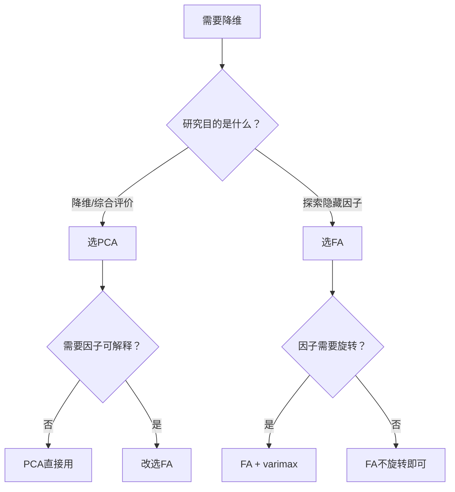

# KP03 [[02_主成分分析PCA|主成分分析]] vs 因子分析

## 1. 是什么

**定义**：主成分分析（PCA）与因子分析（FA）是两种最常用的降维方法，但它们的建模思路有本质区别。PCA 是"变量的线性组合"，FA 是"变量由隐藏因子生成"。

**直觉类比**：
- **PCA**：你有一堆水果（苹果、橘子、香蕉……），PCA 把它们按"甜度""酸度"重新打包成几箱综合果汁。果汁 = 水果的混合，水果本身不存在了。
- **FA**：你假设水果的甜度、酸度、颜色背后有两个隐藏原因——"日照时间"和"降水量"。FA 试图找出这两个隐藏原因（因子），水果的特征只是它们的外在表现。

**解决什么问题**：
- 什么时候用 PCA？什么时候用 FA？
- 两者结果有何联系与区别？

## 2. 怎么用

### 模型对比

**PCA 模型**：

$$Y_i = \boldsymbol{a}_i' \boldsymbol{X}, \quad i = 1, 2, \ldots, k$$

- 主成分 Y 是原变量 X 的线性组合
- 没有误差项，Y 完全由 X 决定
- 目标：使 Var(Y_i) 最大

**FA 模型**：

$$\boldsymbol{X} = \boldsymbol{A}\boldsymbol{F} + \boldsymbol{\varepsilon}$$

- 原变量 X 由隐藏因子 F 生成
- A 为载荷矩阵，ε 为特殊因子（误差）
- 目标：用少数因子 F 解释 X 的相关结构

### 关键区别

| 维度 | PCA | FA |
|------|-----|-----|
| 方向 | X → Y（从原变量到综合指标） | F → X（从隐藏因子到原变量） |
| 误差项 | 无 | 有（特殊因子 ε） |
| 因子可旋转 | 不可旋转 | 可旋转（varimax 等） |
| 共同度 | 无此概念 | 有（h_i² = 共同因子方差占比） |
| 估计方法 | 特征分解，唯一解 | 多种方法（主成分法、主轴法、极大似然法） |
| 解释性 | 较差（主成分是混合体） | 较好（旋转后因子有明确含义） |

### 联系：主成分法估计 FA

FA 的"主成分法"估计载荷矩阵，直接使用 PCA 的结果：

$$\boldsymbol{A} = \sqrt{\boldsymbol{\Lambda}_k} \boldsymbol{P}_k'$$

其中 Λ_k 为前 k 个特征值构成的对角阵，P_k 为对应特征向量。

也就是说：PCA 是 FA 主成分法的基础，但 FA 在此基础上增加了特殊因子和可旋转性。

### R 代码

```r
# 目的：对比 PCA 与 FA 的结果
# PCA
pc <- princomp(data, cor = TRUE)
summary(pc)
loadings(pc)

# FA（主成分法）
library(psych)
fa_result <- fa(data, nfactors = 2, fm = "pa", rotate = "varimax")
# nfactors = 因子个数
# fm = "pa" 主轴因子法；"ml" 极大似然法
# rotate = "varimax" 方差最大旋转
fa_result$loadings    # 旋转后的载荷矩阵
fa_result$communality # 共同度 h²
```

## 3. 什么时候用

**选 PCA 的情况**：
- 只需要降维，不需要解释因子含义
- 综合评价排序（用第一主成分得分）
- 回归中消除[[KP02_多重共线性|多重共线性]]（主成分回归）
- 无模型假设，计算简单

**选 FA 的情况**：
- 研究目的是探索"背后有哪些隐藏因子"
- 需要对因子命名和解释（如"数学能力""语言能力"）
- 需要区分共同方差与特殊方差
- 数据有明显的因子结构假设

## 4. 什么时候不能用 / 易错点

**常见错误**：
- ❌ 把 PCA 的主成分当成 FA 的因子来解释（方向反了）
- ❌ 对 PCA 结果做旋转（PCA 不可旋转，旋转后失去方差最大性质）
- ❌ 混淆载荷矩阵的含义：PCA 载荷 = 特征向量；FA 载荷 = 因子对变量的贡献
- ❌ 用 FA 但不指定因子个数就跑模型（结果不稳定）

**概念辨析**：
- PCA 的"载荷"（loading）= 特征向量分量，表示原变量在主成分上的权重
- FA 的"载荷"（loading）= a_ij，表示第 j 个因子对第 i 个变量的贡献
- 两者数学形式相似，但统计含义完全不同

## 5. 与相似方法对比表

| 对比维度 | 主成分分析 PCA | 因子分析 FA |
|----------|---------------|-------------|
| 数学模型 | Y = A'X | X = AF + ε |
| 方向性 | 变量 → 综合指标 | 隐藏因子 → 变量 |
| 误差项 | 无 | 有特殊因子 ε |
| 目标 | 方差最大 | 再现相关阵 |
| 可旋转 | 否 | 是（varimax, promax） |
| 共同度 | 无 | 有 h² |
| 估计方法 | 特征分解唯一解 | 主成分法/主轴法/极大似然法 |
| 因子解释性 | 差 | 好（旋转后） |
| 样本量要求 | n > p 即可 | n 越大越好（通常 n ≥ 5~10p） |
| 典型应用 | 降维、综合评价、主成分回归 | 问卷分析、能力结构探索 |

## 6. 为什么用这个不用那个

**决策逻辑**：



**被排除的方法会出什么问题**：
- 该用 FA 却用了 PCA：得到的主成分是原变量的混合，无法命名为"数学能力""语言能力"，失去探索隐藏结构的意义
- 该用 PCA 却用了 FA：引入了不必要的模型假设（特殊因子分布、因子[[KP02_OLS正交性|正交性]]），估计结果受方法选择影响，且降维不彻底

## 7. 完整例子

### 书中原例（5 项体质指标）

PCA 结果：第一主成分载荷 = (0.78, 0.82, 0.75, 0.68, 0.32)，主要反映"体格大小"。

FA 结果（2 因子，varimax 旋转后）：
- 因子1载荷：(0.85, 0.78, 0.20, 0.15, 0.10) → 命名为"握力/力量因子"
- 因子2载荷：(0.10, 0.20, 0.75, 0.82, 0.30) → 命名为"爆发力因子"

对比：PCA 第一主成分是所有变量的混合，难以命名；FA 旋转后两个因子各自聚焦不同变量，解释性强。

### 小白生活实例（学生成绩分析）

5 名学生 3 科成绩（数学、语文、英语）。

**PCA**：
- 第一主成分 = 三科总成绩（权重接近 1:1:1），反映"总体水平"
- 第二主成分 = 数学 - 语文（正负号相反），反映"文理偏科"

**FA**（2 因子）：
- 因子1"理科能力"：数学载荷 0.9，英语 0.3，语文 0.1
- 因子2"语言能力"：语文载荷 0.9，英语 0.7，数学 0.1

FA 旋转后能清楚说出"这个学生理科强还是文科强"；PCA 只能说"这个学生总分高不高、偏不偏科"。

## 答辩常问（带标准答案）

1. **问：PCA 和因子分析的数学模型方向为什么相反？** 答：PCA 是 Y=A'X（变量→综合指标），主成分是原变量的线性组合，无误差项；FA 是 X=AF+ε（隐藏因子→变量），原变量由少数隐藏因子生成，有特殊因子 ε。PCA 是"把数据压缩"，FA 是"假设数据背后有原因"。
2. **问：为什么 PCA 不能做[[KP02_因子旋转|因子旋转]]，而 FA 可以？** 答：PCA 的主成分是方差最大方向，旋转后就不再方差最大了，违背 PCA 初衷。FA 的因子本来就没有"方差最大"的约束（目标是再现相关阵），所以可以旋转，让载荷两极化便于命名。
3. **问：FA 的主成分法估计和 PCA 是什么关系？** 答：FA 的主成分法直接取 A=√Λ_k P_k'，即用 PCA 前 k 个特征向量乘对应特征值平方根作为载荷。但 FA 在此基础上多了：估计特殊方差 ψ_i=1-h_i²、可以旋转、可以迭代改进（主轴法）。

## 8. 速记卡

- **PCA**：变量 → 综合指标，无误差，不可旋转，重降维
- **FA**：隐藏因子 → 变量，有误差，可旋转，重解释
- **联系**：FA 的主成分法估计直接用 PCA 结果
- **一句话口诀**：要降维用PCA，要解释用FA；PCA是果汁，FA是配方


---

## 🔗 相关知识点

**同章关联：** [[KP01_PCA基本原理|PCA基本原理]]｜[[KP02_PCA性质与选择|PCA性质与选择]]

**跨教材视角：** [[../../../01_综合评价/09_主成分分析/知识点/KP01_主成分分析的概念与基本思想|综合评价视角·PCA概念与基本思想]]｜[[../../../01_综合评价/09_主成分分析/知识点/KP02_主成分分析的数学原理|综合评价视角·PCA数学原理]]｜[[../../../01_综合评价/09_主成分分析/00_章节总结|综合评价·09主成分分析章节]]

**🐮 大牛库深入：** [[../../../../经济统计学论文从0基础到精通/08_降维与分类/02_主成分分析PCA|大牛库·PCA手算推导与Python验证]]

**📖 原书原文：** [[../../../../原文件/多元统计分析/何晓群_多元统计分析_全书|何晓群《多元统计分析》第5章]]
