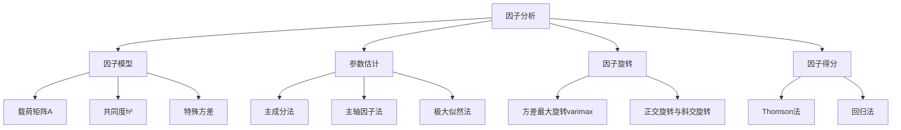
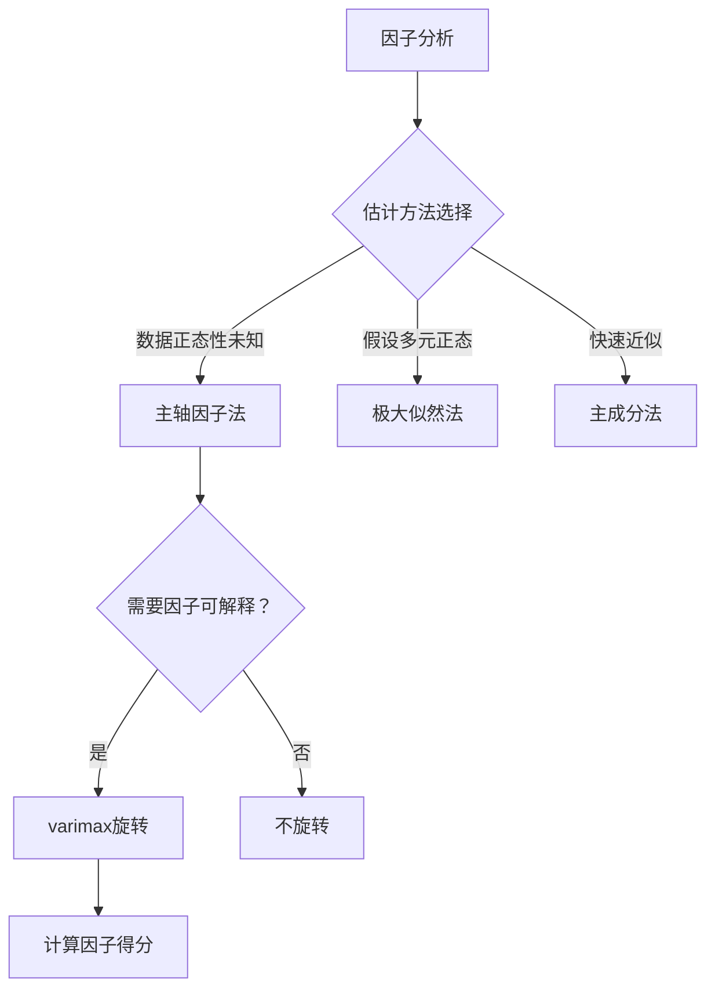

# 第6章 [[KP03_PCA与因子分析对比|因子分析]] · 章节总结

## 一、章节框架图

## 二、文字知识树

- **因子分析（Factor Analysis, FA）**
  - [[KP01_因子模型|因子模型]]
    - 数学模型：X = AF + ε
    - X：p 个可观测变量；F：m 个隐藏公共因子；ε：特殊因子
    - 载荷矩阵 A：a_ij = 第 j 个因子对第 i 个变量的贡献
    - 共同度 h_i² = Σ_j a_ij²：公共因子对第 i 个变量方差的贡献比例
    - 特殊方差 ψ_i = 1 - h_i²（从相关阵出发时）
  - 参数估计方法
    - 主成分法：直接用 [[KP04_PCA与FA对比|PCA]] 结果，A = √Λ P'
    - 主轴因子法：用共同度估计替换相关阵对角元素，迭代求解
    - 极大似然法：假设因子服从[[07_正态分布|正态分布]]，最大化似然函数
  - [[KP02_因子旋转|因子旋转]]
    - 目的：使载荷矩阵结构简化（每行少数几个大载荷，其余接近0）
    - 方差最大旋转（varimax）：最常用的正交旋转
    - 旋转不改变共同度和[[KP03_拟合优度R2|拟合优度]]，只改变因子的方向
  - [[KP03_因子得分|因子得分]]
    - 因子得分 = 每个样本在各公共因子上的估计值
    - Thomson 法（回归法）：F̂ = A'R⁻¹X
    - 用于后续分析（聚类、回归等）

## 三、核心公式清单

| 公式 | 符号解释 | 适用条件 |
|------|----------|----------|
| $\boldsymbol{X} = \boldsymbol{A}\boldsymbol{F} + \boldsymbol{\varepsilon}$ | X 为可观测变量向量，F 为公共因子，A 为载荷矩阵，ε 为特殊因子 | 正交因子模型假设 |
| $h_i^2 = \sum_{j=1}^{m} a_{ij}^2$ | 第 i 个变量的共同度（公共因子方差贡献） | 衡量该变量能被公共因子解释的比例 |
| $\sigma_{ii} = h_i^2 + \psi_i$ | 总方差 = 共同方差 + 特殊方差 | 从协方差阵出发 |
| $r_{ij} = \sum_{k=1}^{m} a_{ik}a_{jk}$ (i≠j) | 变量间相关由公共因子解释 | 从相关阵出发时 |
| $\boldsymbol{A} = \sqrt{\boldsymbol{\Lambda}_m}\boldsymbol{P}_m'$ | 主成分法估计载荷矩阵 | 主成分法 |
| $\hat{\boldsymbol{F}} = \boldsymbol{A}'\boldsymbol{R}^{-1}\boldsymbol{X}$ | 回归法（Thomson法）估计因子得分 | 已知载荷矩阵和相关阵 |

## 四、[[01_方法选择决策树|方法选择决策树]]

## 五、章节联系

- **前接**：第5章主成分分析（主成分法估计载荷直接来自 PCA）
- **后接**：第7章对应分析（R型因子分析是对应分析的基础）
- **横向**：第8章典型相关分析（CCA 类似"无旋转的因子分析"，但针对两组变量）

## 六、自测题

**1. 因子分析模型与主成分分析模型的本质区别是什么？**
答：FA 模型 X = AF + ε 是"从隐藏因子生成观测变量"，有误差项；PCA 模型 Y = A'X 是"从观测变量生成综合指标"，无误差项。

**2. 共同度 h_i² 的含义是什么？**
答：h_i² = Σ_j a_ij²，表示第 i 个变量的方差中能被公共因子解释的比例。h_i² 接近 1 说明该变量主要由公共因子决定；接近 0 说明特殊因子占主导。

**3. 因子旋转的目的是什么？旋转会改变什么？不改变什么？**
答：目的是使载荷矩阵结构简化，便于因子命名解释。旋转改变因子的方向（载荷矩阵的数值），但不改变共同度、不改变模型拟合优度、不改变变量间的相关关系。

**4. 三种参数估计方法有何区别？**
答：主成分法直接用 PCA 结果，简单但不区分共同/特殊方差；主轴法用共同度估计替换对角元素并迭代，更符合因子模型；极大似然法假设正态分布，统计性质好但计算复杂。

**5. 因子得分有什么用？**
答：因子得分是每个样本在公共因子上的估计值，可用于后续的聚类分析、回归分析或综合评价。

**6. varimax 旋转的准则是什么？**
答：使载荷矩阵中各列（各因子）的载荷平方的方差最大化，即让每个因子上的载荷尽量向 0 和 ±1 两极分化，便于识别哪些变量归属哪个因子。

## 本章方法答辩速查

1. **问：因子分析和 PCA 最容易被混淆的点是什么？** 答：模型方向相反——PCA 是 Y=A'X（变量→综合指标，无误差），FA 是 X=AF+ε（隐藏因子→变量，有误差）。PCA 不可旋转，FA 可旋转(varimax)。PCA 重降维，FA 重解释。
2. **问：共同度 h² 普遍偏低说明什么？怎么处理？** 答：说明公共因子不足以解释这些变量的方差。处理：(1)增加因子个数；(2)删除共同度极低的变量；(3)检查变量是否测量了不同构念。h² 接近 1 说明因子模型拟合得好。
3. **问：因子旋转后能改变什么、不能改变什么？** 答：改变载荷矩阵的数值和因子方向（让载荷两极化便于命名）；不改变共同度 h²、不改变模型拟合优度、不改变变量间相关。旋转是坐标变换，不丢信息。

---

## 🔗 跨库导航

- 📚 **同方法另一教材视角：** [[../../01_综合评价/10_因子分析/00_章节总结|综合评价教材·因子分析（12KP·应用导向）]]
- 🐮 **大牛库配套：** [[../../../经济统计学论文从0基础到精通/08_降维与分类/03_因子分析|大牛库·因子分析与旋转]]
- 📖 **原书对应：** [[../../../原文件/多元统计分析/何晓群_多元统计分析_全书|何晓群《多元统计分析》第6章]]
- ⬅️ **上一章方法：** [[../05_主成分分析/00_章节总结|第5章 主成分分析（FA主成分法估计来源）]]
- ➡️ **下一章方法：** [[../07_对应分析/00_章节总结|第7章 对应分析]]
