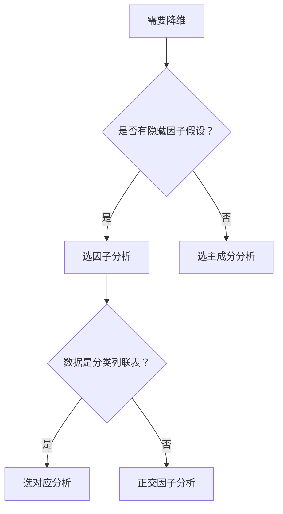

# KP01 因子模型

<div style="text-align:right;margin:10px 0;"><a href="../../../../exam.html" target="_blank" style="display:inline-block;padding:6px 16px;background:#2563eb;color:#fff;border-radius:6px;text-decoration:none;font-size:14px;">📝 开始做题</a></div>


## 1. 是什么

**定义**：[[KP03_PCA与因子分析对比|因子分析]]模型假设 p 个可观测变量 X 由 m 个（m < p）不可观测的公共因子 F 和特殊因子 ε 线性生成，即 $\boldsymbol{X} = \boldsymbol{A}\boldsymbol{F} + \boldsymbol{\varepsilon}$。

**直觉类比**：假设学生考试成绩（数学、物理、语文、英语、历史）背后有两个隐藏能力——"理科能力"和"语言能力"。每个学生的每科成绩 = 理科能力 × 权重 + 语言能力 × 权重 + 随机误差。因子分析就是从 5 科成绩反推出这两个隐藏能力及其权重。

**解决什么问题**：
- 探索多个观测变量背后是否存在少数隐藏因子
- 用少数因子解释变量间的相关结构
- 为每个样本计算[[KP03_因子得分|因子得分]]，用于后续分析

## 2. 怎么用

### 因子模型的完整表述

$$
\begin{cases}
X_1 = a_{11}F_1 + a_{12}F_2 + \cdots + a_{1m}F_m + \varepsilon_1 \\
X_2 = a_{21}F_1 + a_{22}F_2 + \cdots + a_{2m}F_m + \varepsilon_2 \\
\vdots \\
X_p = a_{p1}F_1 + a_{p2}F_2 + \cdots + a_{pm}F_m + \varepsilon_p
\end{cases}
$$

矩阵形式：$\boldsymbol{X}_{p \times 1} = \boldsymbol{A}_{p \times m}\boldsymbol{F}_{m \times 1} + \boldsymbol{\varepsilon}_{p \times 1}$

**符号解释**：
- $\boldsymbol{X} = (X_1, \ldots, X_p)'$：p 个[[KP11_标准化_ZScore|标准化]]后的可观测变量（均值为0，方差为1）
- $\boldsymbol{F} = (F_1, \ldots, F_m)'$：m 个公共因子（m < p），不可直接观测
- $\boldsymbol{A} = (a_{ij})_{p \times m}$：载荷矩阵，$a_{ij}$ = 第 j 个因子对第 i 个变量的载荷
- $\boldsymbol{\varepsilon} = (\varepsilon_1, \ldots, \varepsilon_p)'$：特殊因子（误差项）

#### 【三问】$X = AF + \varepsilon$ 这个方向为什么和 [[KP04_PCA与FA对比|PCA]] 相反？因子分析到底在"找"什么？

- **怎么来的（直觉推导）**：因子分析的核心假设是"**先有隐藏因子 F，再有可观测变量 X**"——就像先有"理科能力""语言能力"这两个隐藏的东西，然后它们分别影响数学、物理、语文、英语的成绩。所以模型是 $X = AF + \varepsilon$（X 是结果，F 是原因）。两边取协方差：$\text{Var}(X) = AA' + \Psi$，这就是因子分析在"解释相关阵 R"——R 被拆成两部分：公共部分 $AA'$（由 m 个因子贡献）和特殊部分 $\Psi$（每个变量自己的独有误差）。估计 A 就是"找一组权重，让 m 个隐藏因子的组合能最大限度还原原变量之间的相关性"。
- **为什么用它**：解决"观察到的多个变量背后，到底有几个共同的驱动因素"这个问题。比如 50 道问卷题，不可能有 50 个独立特质，背后一定是"焦虑""自信""外向"少数几个维度在起作用。因子分析把这 50 道题浓缩成 3-5 个可解释的因子，每个因子还能命名（"理科能力""语言能力"），这是 PCA 做不到的（PCA 的主成分通常是难以解释的混合体）。
- **知识为什么存在**：1904 年 Charles Spearman 在研究学生考试成绩时发现，各科成绩之间的相关结构可以被一个"一般智力因子 g"解释。因子分析由此诞生，成为心理学、社会学、教育学量表开发的标准工具（所有心理测验的维度结构都是用因子分析验证的）。它和 PCA 的根本区别在于：PCA 是"数据降维的数学工具"，因子分析是"关于因果结构的统计模型"——后者假设世界背后真的有少数几个隐藏因子在驱动我们看到的所有变量。

### 模型假设（正交因子模型）

1. $E(\boldsymbol{F}) = \boldsymbol{0}$，$\text{Var}(\boldsymbol{F}) = \boldsymbol{I}_m$（公共因子不相关，方差为1）
2. $E(\boldsymbol{\varepsilon}) = \boldsymbol{0}$，$\text{Var}(\boldsymbol{\varepsilon}) = \boldsymbol{\Psi} = \text{diag}(\psi_1, \ldots, \psi_p)$（特殊因子互不相关）
3. $\text{Cov}(\boldsymbol{F}, \boldsymbol{\varepsilon}) = \boldsymbol{0}$（公共因子与特殊因子不相关）

### 共同度与特殊方差

**共同度**（communality）：

$$h_i^2 = \sum_{j=1}^{m} a_{ij}^2$$

含义：第 i 个变量 $X_i$ 的方差中能被 m 个公共因子解释的比例。

从相关阵出发时，$\text{Var}(X_i) = 1$，所以：

$$1 = h_i^2 + \psi_i$$

$\psi_i$ 为特殊方差（ uniqueness），表示 $X_i$ 不能被公共因子解释的部分。

**因子方差贡献**：

$$SS_j = \sum_{i=1}^{p} a_{ij}^2$$

含义：第 j 个公共因子 $F_j$ 对所有 p 个变量总方差的贡献。

### R 代码

```r
# 目的：对学生成绩数据拟合因子分析模型
library(psych)

# 读取数据（5科成绩，已标准化）
grades <- read.csv("grades.csv", header = TRUE)

# 目的：主轴因子法提取2个公共因子，不旋转
# fm = "pa" 主轴因子法；nfactors = 因子个数
fa_raw <- fa(grades, nfactors = 2, fm = "pa", rotate = "none")

# 目的：查看载荷矩阵、共同度、特殊方差
fa_raw$loadings       # 载荷矩阵 A
fa_raw$communality    # 共同度 h²
fa_raw$uniquenesses   # 特殊方差 ψ
fa_raw$Vaccounted     # 各因子方差贡献比例
```

**输出解读**：
- `loadings`：a_ij 绝对值越大，说明第 j 个因子对第 i 个变量影响越大
- `communality`：接近 1 说明该变量主要由公共因子决定；接近 0 说明特殊因子占主导
- 若共同度普遍偏低，说明公共因子不足以解释这些变量，需增加因子个数

### 计算演示

设 3 个标准化变量，2 个公共因子，载荷矩阵为：

$$\boldsymbol{A} = \begin{bmatrix} 0.8 & 0.1 \\ 0.7 & 0.3 \\ 0.2 & 0.8 \end{bmatrix}$$

**第一步：计算共同度**

- $h_1^2 = 0.8^2 + 0.1^2 = 0.64 + 0.01 = 0.65$
- $h_2^2 = 0.7^2 + 0.3^2 = 0.49 + 0.09 = 0.58$
- $h_3^2 = 0.2^2 + 0.8^2 = 0.04 + 0.64 = 0.68$

**第二步：计算特殊方差**

- $\psi_1 = 1 - 0.65 = 0.35$
- $\psi_2 = 1 - 0.58 = 0.42$
- $\psi_3 = 1 - 0.68 = 0.32$

**第三步：计算因子方差贡献**

- $SS_1 = 0.8^2 + 0.7^2 + 0.2^2 = 0.64 + 0.49 + 0.04 = 1.17$
- $SS_2 = 0.1^2 + 0.3^2 + 0.8^2 = 0.01 + 0.09 + 0.64 = 0.74$

第一因子贡献 1.17/3 = 39%，第二因子贡献 0.74/3 = 25%，合计 64%。

## 3. 什么时候用

**适用场景**：
- 问卷/量表数据：多个题项背后是否有潜在维度（如"焦虑""自信"）
- 能力测验：各科成绩背后是否有"理科能力""语言能力"等隐藏因子
- 经济指标：多个宏观经济指标背后是否有"经济增长""物价水平"等因子

**数据条件**：
- 样本量 n 应较大（建议 n ≥ 5~10p）
- 变量间需有中等程度以上的相关（否则无公共因子结构）
- 连续型变量为主

**前提假设**：
- 正交因子模型（公共因子互不相关）
- 特殊因子互不相关
- 公共因子与特殊因子不相关
- 违反假设时：若因子间实际相关，应使用斜交旋转（promax）而非正交旋转

## 4. 什么时候不能用 / 易错点

**不适用场景**：
- 变量间几乎无相关（公共因子不存在）
- 样本量太小（n < p 或 n 接近 p，载荷估计不稳定）
- 分类变量为主的数据

**常见错误**：
- ❌ 把因子分析当成"[[02_主成分分析PCA|主成分分析]]的升级版"（模型方向完全不同）
- ❌ 不旋转就直接解释载荷（未旋转的载荷往往难以命名）
- ❌ 不看共同度就下结论（某变量共同度极低说明它不适合用这个因子模型）
- ❌ 因子个数凭感觉取（应结合特征值、碎石图、累积方差贡献）

## 5. 与相似方法对比表

| 方法 | 模型 | 误差项 | 因子可旋转 | 适用数据 | 优点 | 缺点 |
|------|------|--------|-----------|----------|------|------|
| 主成分分析 PCA | Y = A'X | 无 | 否 | 连续变量 | 简单、无假设 | 解释性差 |
| 因子分析 FA | X = AF + ε | 有 | 是 | 连续变量、有隐藏结构 | 因子可解释 | 需指定因子个数、估计方法影响结果 |
| [[KP01_对应分析|对应分析]] CA | R×C 列联表 | 无 | 是（图形） | 分类变量列联表 | 同时展示行和列 | 仅适用于列联表 |

## 6. 为什么用这个不用那个

**决策逻辑**：



**被排除的方法会出什么问题**：
- 用 PCA 代替 FA：无法得到可命名的隐藏因子，主成分是原变量的混合体
- 用 FA 但不旋转：载荷矩阵结构混乱，无法判断哪些变量归属哪个因子

## 7. 完整例子

### 书中原例（5 科成绩因子分析）

5 名学生 5 科成绩（数学、物理、语文、英语、历史），主轴因子法提取 2 个因子，未旋转载荷矩阵：

| 变量 | 因子1 | 因子2 | 共同度 h² |
|------|-------|-------|----------|
| 数学 | 0.85 | 0.20 | 0.76 |
| 物理 | 0.80 | 0.15 | 0.66 |
| 语文 | 0.10 | 0.85 | 0.73 |
| 英语 | 0.20 | 0.75 | 0.60 |
| 历史 | 0.30 | 0.70 | 0.58 |

因子1 主要载荷在数学、物理 → "理科能力"
因子2 主要载荷在语文、英语、历史 → "语言能力"

### 小白生活实例（手机满意度调查）

100 名用户对手机 6 个方面打分（续航、屏幕、性能、拍照、重量、价格）。因子分析提取 2 个因子：
- 因子1"硬件体验"：续航、屏幕、性能载荷高
- 因子2"使用成本"：重量、价格载荷高，拍照中等

## 答辩常问（带标准答案）

1. **问：共同度 h_i² 是什么？为什么重要？h_i² 低说明什么？** 答：h_i²=Σ_j a_ij²，表示第 i 个变量的方差中能被 m 个公共因子解释的比例。从相关阵出发时 Var(X_i)=1，所以 1=h_i²+ψ_i。h_i² 接近 1 说明该变量主要由公共因子决定；接近 0 说明特殊因子占主导，该变量不适合这个因子模型，应考虑删除或增加因子数。
2. **问：因子分析和主成分分析最核心的区别是什么？** 答：PCA 是 Y=A'X 无误差，目标方差最大，不可旋转；FA 是 X=AF+ε 有误差，目标再现相关阵，可旋转。PCA 是纯数据变换，FA 是关于隐藏结构的统计模型。PCA 回答"数据怎么压缩"，FA 回答"数据背后有几个原因"。
3. **问：因子分析对样本量有什么要求？** 答：建议 n≥5~10p（p 为变量数）。因为要估计载荷矩阵 A 和特殊方差 ψ，样本太小载荷估计不稳定。问卷量表分析通常要求至少 200~300 份样本。

## 8. 速记卡

- **模型**：X = AF + ε，原变量由隐藏因子生成
- **共同度 h²**：公共因子解释的方差比例，越接近1越好
- **载荷 a_ij**：第 j 因子对第 i 变量的贡献，绝对值越大影响越强
- **一句话口诀**：变量是果，因子是因；载荷定权重，共同度定质量


---

## 🔗 相关知识点

**同章关联：** [[KP02_因子旋转|因子旋转]]｜[[KP03_因子得分|因子得分]]｜[[KP04_PCA与FA对比|PCA与FA对比]]

**跨教材视角：** [[../../../01_综合评价/10_因子分析/知识点/KP01_因子分析的概念与基本思想|综合评价视角·因子分析概念]]｜[[../../../01_综合评价/10_因子分析/知识点/KP09_因子分析与主成分分析的异同|综合评价视角·FA与PCA异同]]｜[[../../../01_综合评价/10_因子分析/00_章节总结|综合评价·10因子分析章节]]

**🐮 大牛库深入：** [[../../../../经济统计学论文从0基础到精通/08_降维与分类/03_因子分析|大牛库·因子分析与旋转]]

**📖 原书原文：** [[../../../../原文件/多元统计分析/何晓群_多元统计分析_全书|何晓群《多元统计分析》第6章]]
