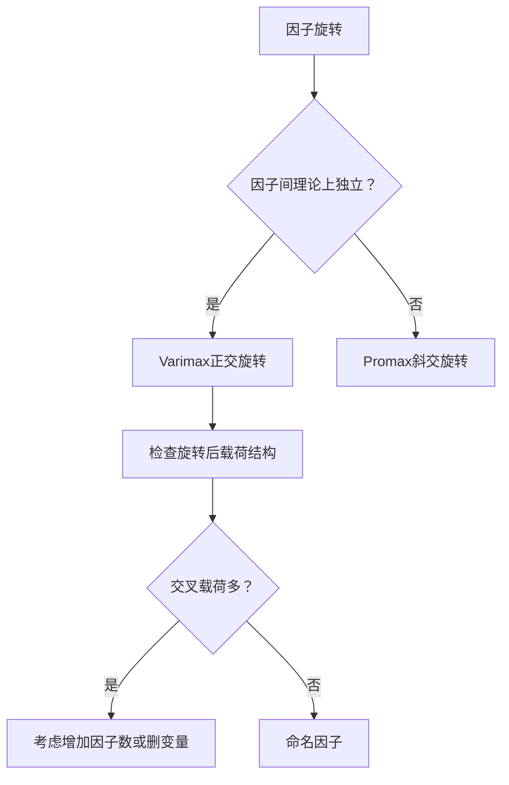

# KP02 因子旋转

## 1. 是什么

**定义**：因子旋转是在不改变[[KP01_因子模型|因子模型]][[KP03_拟合优度R2|拟合优度]]的前提下，通过正交（或斜交）变换旋转因子轴，使载荷矩阵的结构更加简化——每个变量在尽可能少的因子上有较高载荷，便于对因子命名和解释。

**直觉类比**：就像拍一群人的合影，初始角度下大家的脸都有点斜。旋转相机角度后，每个人都正脸朝镜头，谁站前排、谁站后排一目了然。因子旋转就是"旋转坐标系"，让每个因子的含义更清晰。

**解决什么问题**：
- 未旋转的因子载荷往往分散在多个因子上，难以命名
- 旋转后使载荷向 0 和 ±1 两极分化，便于识别变量归属

## 2. 怎么用

### 方差最大旋转（Varimax）

**正交旋转**：找到一个正交变换矩阵 Γ，使旋转后的载荷矩阵 B = AΓ 满足：

$$V = \sum_{j=1}^{m}\left[\frac{1}{p}\sum_{i=1}^{p}(b_{ij}^2)^2 - \left(\frac{1}{p}\sum_{i=1}^{p}b_{ij}^2\right)^2\right]$$

最大化。

含义：使每列载荷平方的方差最大——即每列中载荷尽量向两极（0 或 ±1）分化。

### 其他旋转方法

| 方法 | 类型 | 特点 |
|------|------|------|
| Varimax | 正交 | 最常用，使每列载荷两极化 |
| Quartimax | 正交 | 使每行载荷两极化（简化变量结构） |
| Equamax | 正交 | 综合 Varimax 和 Quartimax |
| Promax | 斜交 | 允许因子间相关，更贴近实际 |

### R 代码

```r
# 目的：因子旋转对比
library(psych)

# 未旋转
fa_none <- fa(grades, nfactors = 2, fm = "pa", rotate = "none")
fa_none$loadings

# Varimax 正交旋转
fa_varimax <- fa(grades, nfactors = 2, fm = "pa", rotate = "varimax")
fa_varimax$loadings

# Promax 斜交旋转（允许因子相关）
fa_promax <- fa(grades, nfactors = 2, fm = "pa", rotate = "promax")
fa_promax$loadings
fa_promax$Phi  # 斜交旋转的因子相关矩阵
```

**输出解读**：
- 旋转后载荷矩阵中，每行应只有 1~2 个绝对值较大的载荷
- 若某变量在两个因子上载荷都较大（如 >0.4），称为"交叉载荷"，需考虑是否删除该变量或增加因子数

### 计算演示（简单数字）

未旋转载荷矩阵：

$$\boldsymbol{A} = \begin{bmatrix} 0.70 & 0.35 \\ 0.65 & 0.30 \\ 0.25 & 0.75 \\ 0.20 & 0.70 \end{bmatrix}$$

问题：数学、物理在两个因子上都有中等载荷，难以命名。

Varimax 旋转后（示意）：

$$\boldsymbol{B} = \begin{bmatrix} 0.78 & 0.05 \\ 0.72 & 0.02 \\ 0.05 & 0.78 \\ 0.02 & 0.72 \end{bmatrix}$$

旋转后：
- 因子1：数学 0.78、物理 0.72，其余接近 0 → "理科能力"
- 因子2：语文 0.78、英语 0.72，其余接近 0 → "语言能力"

命名清晰多了。

## 3. 什么时候用

**适用场景**：
- [[KP03_PCA与因子分析对比|因子分析]]结果需要解释和命名
- 未旋转载荷结构模糊（交叉载荷多）
- 问卷/量表分析（需要知道每个因子代表什么维度）

**前提**：
- 已确定因子个数 m
- 已得到初始载荷矩阵

## 4. 什么时候不能用 / 易错点

**常见错误**：
- ❌ 旋转后共同度变了（不可能变——正交旋转不改变每行平方和）
- ❌ 旋转后模型拟合优度变了（不可能变——旋转只是坐标变换）
- ❌ 盲目使用正交旋转：若因子间实际相关（如"焦虑"与"抑郁"），正交旋转会扭曲结果，应使用斜交旋转
- ❌ 旋转后因子顺序可能改变（不影响分析，只是排列顺序）

**什么时候不旋转**：
- 纯粹降维用于后续分析（如[[KP03_因子得分|因子得分]]用于回归），不需要解释因子含义时
- 因子个数已经很少（如只有1个因子，旋转无意义）

## 5. 与相似方法对比表

| 方法 | 类型 | 因子间关系 | 适用场景 | 优点 | 缺点 |
|------|------|-----------|----------|------|------|
| Varimax | 正交 | 不相关 | 因子理论上独立 | 简单、结果稳定 | 强加强制因子不相关 |
| Promax | 斜交 | 可相关 | 因子实际有相关 | 更贴近现实 | 结果解释更复杂 |
| 不旋转 | — | 不相关 | 仅用于降维 | 保留初始结构 | 难以解释 |

## 6. 为什么用这个不用那个

**决策逻辑**：



## 7. 完整例子

### 书中原例（5 科成绩旋转前后对比）

**旋转前**：

| 变量 | 因子1 | 因子2 |
|------|-------|-------|
| 数学 | 0.75 | 0.40 |
| 物理 | 0.70 | 0.35 |
| 语文 | 0.30 | 0.75 |
| 英语 | 0.35 | 0.70 |
| 历史 | 0.40 | 0.65 |

**旋转后（varimax）**：

| 变量 | 因子1 | 因子2 |
|------|-------|-------|
| 数学 | 0.85 | 0.10 |
| 物理 | 0.80 | 0.05 |
| 语文 | 0.10 | 0.85 |
| 英语 | 0.15 | 0.80 |
| 历史 | 0.20 | 0.75 |

旋转前：数学在因子1(0.75)和因子2(0.40)都有载荷，不清晰。
旋转后：数学几乎只在因子1(0.85)，因子2(0.10)接近0 → 因子1明确为"理科能力"。

### 小白生活实例（手机满意度）

未旋转时，"续航"在两个因子上载荷都是 0.5。旋转后，"续航"在因子1上 0.8，因子2上 0.1 → 明确归属"硬件体验"因子。

## 答辩常问（带标准答案）

1. **问：因子旋转会改变共同度和模型拟合优度吗？** 答：不会。正交旋转 B=AΓ（Γ 为正交阵），每行平方和 Σ_j b_ij²=Σ_j a_ij²（因为正交变换保内积），所以共同度 h_i² 不变；模型拟合优度（再现相关阵的程度）也不变。旋转只改变载荷矩阵的数值和因子方向，让载荷向 0 和 ±1 两极分化，便于命名。
2. **问：什么时候用正交旋转 Varimax，什么时候用斜交旋转 Promax？** 答：理论上因子相互独立（如理科能力和语言能力）用 Varimax；实际中因子往往相关（如焦虑和抑郁），强行正交会扭曲结果，应用 Promax 斜交旋转，旋转后看因子相关矩阵 Φ 判断因子间相关性。
3. **问：什么叫"交叉载荷"？怎么处理？** 答：某变量在两个因子上载荷都较大（如都 >0.4），说明它同时归属两个因子，结构不清晰。处理方法：增加因子数、删除该变量、或结合专业判断保留。

## 8. 速记卡

- **目的**：让载荷两极化，便于因子命名
- **Varimax**：最常用正交旋转，使每列载荷方差最大
- **不改变**：共同度、拟合优度、变量间相关
- **改变**：载荷矩阵的数值、因子的方向
- **一句话口诀**：旋转不改模型，只让因子"现原形"


---

## 🔗 相关知识点

**同章关联：** [[KP01_因子模型|因子模型]]｜[[KP03_因子得分|因子得分]]｜[[KP04_PCA与FA对比|PCA与FA对比]]

**跨教材视角：** [[../../../01_综合评价/10_因子分析/知识点/KP01_因子分析的概念与基本思想|综合评价视角·因子分析概念]]｜[[../../../01_综合评价/10_因子分析/知识点/KP09_因子分析与主成分分析的异同|综合评价视角·FA与PCA异同]]｜[[../../../01_综合评价/10_因子分析/00_章节总结|综合评价·10因子分析章节]]

**🐮 大牛库深入：** [[../../../../经济统计学论文从0基础到精通/08_降维与分类/03_因子分析|大牛库·因子分析与旋转]]

**📖 原书原文：** [[../../../../原文件/多元统计分析/何晓群_多元统计分析_全书|何晓群《多元统计分析》第6章]]
