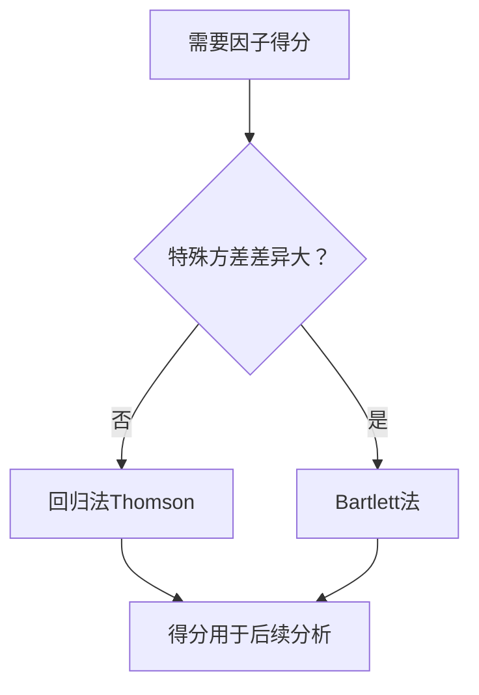

# KP03 因子得分

<div style="text-align:right;margin:10px 0;"><a href="../../../../exam.html" target="_blank" style="display:inline-block;padding:6px 16px;background:#2563eb;color:#fff;border-radius:6px;text-decoration:none;font-size:14px;">📝 开始做题</a></div>


## 1. 是什么

**定义**：因子得分是每个样本在各公共因子上的估计值，即将 p 个原始变量转换为 m 个因子得分，用于后续的[[04_聚类分析|聚类分析]]、回归分析或综合评价。

**直觉类比**：考试结束后，老师不仅给每科打分，还算出每个学生的"理科能力分"和"语言能力分"。因子得分就是这个"能力分"——它不是直接测出来的，而是从各科成绩反推出来的。

**解决什么问题**：
- 每个样本在各因子上的表现如何？
- 哪些样本在"理科能力"上得分高？哪些在"语言能力"上得分高？
- 因子得分可作为新变量用于后续分析。

## 2. 怎么用

### 回归法（Thomson 法）

已知载荷矩阵 A 和相关阵 R，估计因子得分：

$$\hat{\boldsymbol{F}} = \boldsymbol{A}'\boldsymbol{R}^{-1}\boldsymbol{X}$$

**符号解释**：
- $\hat{\boldsymbol{F}} = (\hat{F}_1, \ldots, \hat{F}_m)'$：因子得分向量
- $\boldsymbol{A}$：p×m 载荷矩阵
- $\boldsymbol{R}$：p×p 相关阵
- $\boldsymbol{X}$：p×1 [[KP11_标准化_ZScore|标准化]]后的原始变量（均值为0）

这实际上是将 F 对 X 作线性回归的最小二乘解。

### 加权最小二乘法（Bartlett 法）

$$\hat{\boldsymbol{F}} = (\boldsymbol{A}'\boldsymbol{\Psi}^{-1}\boldsymbol{A})^{-1}\boldsymbol{A}'\boldsymbol{\Psi}^{-1}\boldsymbol{X}$$

其中 Ψ 为特殊方差对角阵。Bartlett 法考虑了特殊因子的方差差异。

### R 代码

```r
# 目的：计算因子得分
library(psych)

fa_result <- fa(grades, nfactors = 2, fm = "pa", rotate = "varimax")

# 因子得分（回归法）
fa_result$scores

# 每个样本的两个因子得分
# 行 = 样本，列 = 因子
head(fa_result$scores)

# 目的：用因子得分作后续分析（如聚类）
f_scores <- fa_result$scores
plot(f_scores[,1], f_scores[,2], 
     xlab = "理科能力因子得分", ylab = "语言能力因子得分")
abline(h = 0, v = 0, lty = 2)
```

**输出解读**：
- 因子得分均值约为 0（因为变量已标准化）
- 正值 = 该样本在该因子上高于平均水平
- 可在散点图上直观分类：第一象限 = 双高，第二象限 = 语言高理科低，等等

### 计算演示

设 2 个变量、1 个因子，载荷矩阵 A = (0.8, 0.6)'，相关阵 R：

$$\boldsymbol{R} = \begin{bmatrix} 1 & 0.5 \\ 0.5 & 1 \end{bmatrix}$$

**第一步：求 R 的逆**

$$\boldsymbol{R}^{-1} = \frac{1}{1-0.25}\begin{bmatrix} 1 & -0.5 \\ -0.5 & 1 \end{bmatrix} = \begin{bmatrix} 1.333 & -0.667 \\ -0.667 & 1.333 \end{bmatrix}$$

**第二步：计算因子得分系数**

$$\boldsymbol{A}'\boldsymbol{R}^{-1} = \begin{bmatrix} 0.8 & 0.6 \end{bmatrix}\begin{bmatrix} 1.333 & -0.667 \\ -0.667 & 1.333 \end{bmatrix} = \begin{bmatrix} 0.667 & 0.267 \end{bmatrix}$$

**第三步：某学生标准化成绩 X = (1, 0.5)'**

$$\hat{F} = 0.667 \times 1 + 0.267 \times 0.5 = 0.667 + 0.133 = 0.80$$

该学生在公共因子上的得分为 0.80，高于平均水平。

## 3. 什么时候用

**适用场景**：
- 需要对样本按因子维度分类（如哪些学生理科强）
- 因子得分作为自变量用于回归分析
- 综合评价：用因子得分加权计算综合排名

**前提**：
- 已确定因子个数 m
- 已估计出载荷矩阵 A
- 原始变量已标准化

## 4. 什么时候不能用 / 易错点

**常见错误**：
- ❌ 因子得分不是"真实值"，而是估计值（有误差），不能当作精确测量
- ❌ 不同估计方法（回归法 vs Bartlett法）得到的得分不同，应注明使用了哪种方法
- ❌ 因子得分的正负号取决于载荷的符号方向——若将载荷全部取反，得分也取反，但含义不变
- ❌ 用因子得分做因果推断（[[KP03_PCA与因子分析对比|因子分析]]是探索性方法，不能证明因果关系）

**注意**：
- 因子得分是"估计"而非"观测"，其精度取决于共同度大小
- 共同度高的变量，因子得分估计更可靠

## 5. 与相似方法对比表

| 方法 | 原理 | 优点 | 缺点 | 什么时候用 |
|------|------|------|------|-----------|
| 回归法（Thomson） | 最小二乘回归 | 简单、常用 | 因子得分间可能相关 | 一般情况首选 |
| Bartlett法 | 加权最小二乘 | 考虑特殊方差差异 | 计算稍复杂 | 特殊方差差异大时 |
| 主成分得分 | [[KP04_PCA与FA对比|PCA]]的线性组合 | 无需[[KP01_因子模型|因子模型]]假设 | 不是因子分析的得分 | 仅用于PCA |

## 6. 为什么用这个不用那个

**决策逻辑**：



## 7. 完整例子

### 书中原例（5 科成绩因子得分）

| 学生 | 理科因子得分 | 语言因子得分 | 特征 |
|------|------------|------------|------|
| 张三 | 1.5 | -0.8 | 理科突出 |
| 李四 | -0.6 | 1.3 | 语言突出 |
| 王五 | 0.9 | 0.7 | 双优 |
| 赵六 | -1.2 | -0.5 | 双弱 |

在散点图上可清晰分为四类：理科型、语言型、全能型、偏科型。

### 小白生活实例（手机满意度因子得分）

100 名用户的因子得分散点图：
- 右上象限：硬件体验和使用成本都满意的用户
- 左上：满意硬件但嫌贵的用户
- 右下：觉得便宜但硬件差的用户
- 左下：双不满意

## 答辩常问（带标准答案）

1. **问：因子得分和主成分得分有什么区别？** 答：主成分得分 Y_i=a_i'X 是直接计算的确定线性组合；因子得分 F̂=A'R⁻¹X 是回归估计出来的（有误差），因为公共因子 F 本身不可观测。因子得分是"反推"的，精度取决于共同度 h²——h² 高的变量，得分估计更可靠。
2. **问：因子得分有什么用？能不能做因果推断？** 答：用途：(1)给样本画像——哪些学生理科强、哪些语言强；(2)作为新变量用于后续聚类或回归；(3)综合评价排序。但不能做因果推断，因子分析是探索性方法，不能证明因果关系。
3. **问：回归法（Thomson）和 Bartlett 法估计因子得分有什么区别？** 答：回归法 F̂=A'R⁻¹X 简单常用，但因子得分之间可能相关；Bartlett 法用特殊方差 Ψ 加权，当各变量特殊方差差异大时更准确。一般情况用回归法即可。

## 8. 速记卡

- **公式**：F̂ = A'R⁻¹X（回归法）
- **含义**：每个样本在公共因子上的估计值
- **用途**：分类、回归、综合评价
- **注意**：是估计值不是真实值，有误差
- **一句话口诀**：因子得分是"反推的能力分"，用于给样本画像


---

## 🔗 相关知识点

**同章关联：** [[KP01_因子模型|因子模型]]｜[[KP02_因子旋转|因子旋转]]｜[[KP04_PCA与FA对比|PCA与FA对比]]

**跨教材视角：** [[../../../01_综合评价/10_因子分析/知识点/KP01_因子分析的概念与基本思想|综合评价视角·因子分析概念]]｜[[../../../01_综合评价/10_因子分析/知识点/KP09_因子分析与主成分分析的异同|综合评价视角·FA与PCA异同]]｜[[../../../01_综合评价/10_因子分析/00_章节总结|综合评价·10因子分析章节]]

**🐮 大牛库深入：** [[../../../../经济统计学论文从0基础到精通/08_降维与分类/03_因子分析|大牛库·因子分析与旋转]]

**📖 原书原文：** [[../../../../原文件/多元统计分析/何晓群_多元统计分析_全书#6.1 因子分析的基本理论|何晓群《多元统计分析》第6章]]
