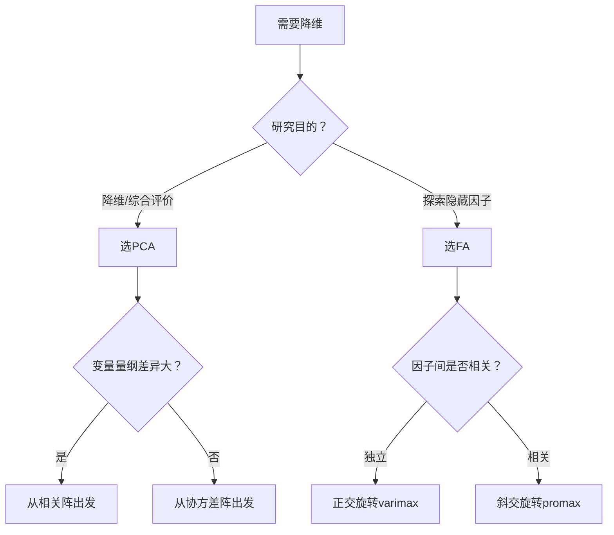

# KP04 PCA 与[[KP03_PCA与因子分析对比|因子分析]]对比（重点）

<div style="text-align:right;margin:10px 0;"><a href="../../../../exam.html" target="_blank" style="display:inline-block;padding:6px 16px;background:#2563eb;color:#fff;border-radius:6px;text-decoration:none;font-size:14px;">📝 开始做题</a></div>


## 1. 是什么

**定义**：[[02_主成分分析PCA|主成分分析]]（PCA）与因子分析（FA）是两种最常用的降维方法，但从建模哲学、数学模型到结果解释都有本质区别。本章是第5章和第6章的对比总结，是考试和实际应用的重点。

**直觉类比**：
- **PCA = 榨汁机**：把水果（原变量）榨成果汁（主成分）。果汁是水果的混合物，水果本身消失了。你得到的是"甜度""酸度"等综合口味。
- **FA = 配方师**：假设水果的甜酸色泽背后有"日照""降水"两个隐藏原因（因子）。FA 要做的是找出这两个原因及其影响权重（载荷），水果只是这些原因的外在表现。

**解决什么问题**：
- 面对高维数据，到底该用 PCA 还是 FA？
- 两者结果有何联系？
- 实际应用中如何选择？

## 2. 怎么用

### 模型方向对比

**PCA（正向：变量 → 综合指标）**：

$$Y_i = \boldsymbol{a}_i' \boldsymbol{X}, \quad i = 1, \ldots, k$$

- 主成分 Y 是原变量 X 的线性组合
- 没有误差项，Y 完全由 X 决定
- 目标：Var(Y_i) 最大

**FA（反向：隐藏因子 → 变量）**：

$$\boldsymbol{X} = \boldsymbol{A}\boldsymbol{F} + \boldsymbol{\varepsilon}$$

- 原变量 X 由隐藏因子 F 生成
- 有特殊因子 ε（误差）
- 目标：用少数因子 F 再现 X 的相关阵

### 数学关系对比

| 维度 | PCA | FA |
|------|-----|-----|
| 协方差阵分解 | $\boldsymbol{\Sigma} = \boldsymbol{P}\boldsymbol{\Lambda}\boldsymbol{P}'$ | $\boldsymbol{\Sigma} = \boldsymbol{A}\boldsymbol{A}' + \boldsymbol{\Psi}$ |
| 对角元素 | $\sigma_{ii} = \sum_j a_{ij}^2$ | $\sigma_{ii} = h_i^2 + \psi_i$ |
| 非对角元素 | $\sigma_{ij} = \sum_k a_{ik}a_{jk}$ | $\sigma_{ij} = \sum_k a_{ik}a_{jk}$ (i≠j) |

关键区别：PCA 的总方差全部由主成分"解释"（无剩余），FA 将方差拆分为共同方差 h² 和特殊方差 ψ。

### 联系：主成分法估计 FA

FA 的"主成分法"直接使用 PCA 结果：

$$\boldsymbol{A}_{p \times m} = \sqrt{\lambda_1}\boldsymbol{p}_1, \ldots, \sqrt{\lambda_m}\boldsymbol{p}_m$$

即取前 m 个特征向量乘以对应特征值的平方根。

但 FA 在此基础上：
- 估计特殊方差 ψ_i = 1 - h_i²
- 可以旋转因子轴
- 可以迭代改进（主轴法）

### R 代码对比

```r
# ===== PCA =====
pc <- princomp(data, cor = TRUE)
pc$loadings    # 特征向量（PCA的"载荷"）
pc$scores      # 主成分得分

# ===== FA =====
library(psych)
fa_result <- fa(data, nfactors = 2, fm = "pa", rotate = "varimax")
fa_result$loadings     # 因子载荷矩阵
fa_result$scores       # 因子得分
fa_result$communality  # 共同度 h²
fa_result$uniquenesses # 特殊方差 ψ
```

### 计算演示

设 3 个[[KP11_标准化_ZScore|标准化]]变量，相关阵 R：

$$\boldsymbol{R} = \begin{bmatrix} 1 & 0.6 & 0.2 \\ 0.6 & 1 & 0.3 \\ 0.2 & 0.3 & 1 \end{bmatrix}$$

**PCA 结果**（特征值 = (1.63, 0.87, 0.50)）：

第一主成分载荷：(0.68, 0.72, 0.18)

**FA 结果**（2 因子，主轴法，varimax 旋转后）：

| 变量 | 因子1 | 因子2 | 共同度 h² |
|------|-------|-------|----------|
| X₁ | 0.78 | 0.05 | 0.61 |
| X₂ | 0.75 | 0.10 | 0.57 |
| X₃ | 0.10 | 0.85 | 0.73 |

对比：PCA 第一主成分是三个变量的混合，FA 旋转后因子1 主要对应 X₁、X₂，因子2 主要对应 X₃。

## 3. 什么时候用

**选 PCA 的情况**：
- 只需要降维，不需要解释因子含义
- 综合评价排序（用第一主成分得分）
- 主成分回归（消除[[KP02_多重共线性|多重共线性]]）
- 无模型假设，计算简单快速

**选 FA 的情况**：
- 研究目的是探索"背后有哪些隐藏因子"
- 需要对因子命名和解释（如"焦虑""自信"）
- 需要区分共同方差与特殊方差
- 问卷/量表分析（需要知道维度结构）
- 数据有明显的因子结构假设

## 4. 什么时候不能用 / 易错点

**常见错误**：
- ❌ 把 PCA 的主成分当成 FA 的因子来解释（方向反了）
- ❌ 对 PCA 结果做旋转（PCA 不可旋转，旋转后失去方差最大性质）
- ❌ 混淆载荷含义：PCA 载荷 = 特征向量；FA 载荷 = 因子对变量的贡献
- ❌ 用 FA 但不指定因子个数（结果不稳定）
- ❌ 认为 FA 一定优于 PCA（FA 引入更多假设和选择，不一定更好）

**概念辨析**：
- PCA 的"载荷"（loading）= 特征向量分量，表示原变量在主成分上的权重
- FA 的"载荷"（loading）= a_ij，表示第 j 个因子对第 i 个变量的贡献
- 两者数学形式相似，但统计含义完全不同

## 5. 与相似方法对比表（核心对比）

| 对比维度 | 主成分分析 PCA | 因子分析 FA |
|----------|---------------|-------------|
| **数学模型** | Y = A'X（正向） | X = AF + ε（反向） |
| **方向性** | 变量 → 综合指标 | 隐藏因子 → 变量 |
| **误差项** | 无 | 有特殊因子 ε |
| **目标** | 方差最大 | 再现相关阵 |
| **协方差分解** | Σ = PΛP'（无剩余） | Σ = AA' + Ψ（有剩余） |
| **共同度** | 无此概念 | 有 h² = Σ a_ij² |
| **特殊方差** | 无 | 有 ψ_i = 1 - h_i² |
| **可旋转** | 否 | 是（varimax, promax） |
| **估计方法** | 特征分解唯一解 | 主成分法/主轴法/极大似然法 |
| **因子解释性** | 差（混合体） | 好（旋转后可命名） |
| **[[KP03_因子得分|因子得分]]** | 主成分得分（直接计算） | 因子得分（回归估计） |
| **样本量要求** | n > p 即可 | n 越大越好（n ≥ 5~10p） |
| **模型假设** | 无（纯数学变换） | 正交[[KP01_因子模型|因子模型]]、特殊因子独立 |
| **典型应用** | 降维、综合评价、主成分回归 | 问卷分析、能力结构探索 |
| **软件函数** | `princomp()` | `psych::fa()` |

## 6. 为什么用这个不用那个

**决策逻辑**：



**被排除的方法会出什么问题**：
- **该用 FA 却用了 PCA**：主成分是原变量的线性混合，无法命名为"焦虑""自信"等隐藏因子，失去探索维度结构的意义
- **该用 PCA 却用了 FA**：引入了不必要的模型假设（特殊因子分布、因子[[KP02_OLS正交性|正交性]]），增加复杂度但无额外收益；且 FA 的因子个数需要主观选择
- **PCA 做旋转**：旋转后主成分不再是方差最大方向，违背 PCA 的初衷
- **FA 不旋转**：载荷结构模糊，无法判断变量归属

## 7. 完整例子

### 书中原例（5 项体质指标）

**PCA 结果**：
- 第一主成分载荷 = (0.78, 0.82, 0.75, 0.68, 0.32)
- 所有变量都有中等偏正载荷 → "总体体质水平"
- 难以进一步拆分

**FA 结果**（2 因子，varimax 旋转后）：

| 变量 | 因子1（力量型） | 因子2（耐力型） | 共同度 |
|------|---------------|---------------|--------|
| 握力 | 0.85 | 0.15 | 0.75 |
| 背力 | 0.80 | 0.20 | 0.68 |
| 肺活量 | 0.30 | 0.75 | 0.65 |
| 立定跳远 | 0.40 | 0.70 | 0.65 |
| 台阶试验 | 0.10 | 0.80 | 0.65 |

FA 旋转后可以明确说："这个人力量强但耐力一般"或"这个人耐力好但力量一般"，而 PCA 只能说"这个人总体体质好"。

### 小白生活实例（学生成绩）

5 名学生 3 科成绩（数学、语文、英语）。

**PCA**：
- 第一主成分 = 三科总分（权重接近 1:1:1）→ "总体学习水平"
- 第二主成分 = 数学 - 语文 → "文理偏科"

**FA**（2 因子，varimax 旋转）：
- 因子1"理科能力"：数学载荷 0.9，英语 0.3，语文 0.1
- 因子2"语言能力"：语文载荷 0.9，英语 0.7，数学 0.1

FA 能说出"张三理科强、李四语言强"；PCA 只能说出"张三总分高、李四偏文科"。

## 答辩常问（带标准答案）

1. **问：什么场景选 PCA、什么场景选 FA？各举一个典型应用。** 答：只需要降维或综合评价排序→PCA（无假设、计算简单），典型应用如综合国力排名；要探索背后隐藏因子并命名（问卷维度、能力结构）→FA（可旋转、可解释），典型应用如心理量表维度结构。
2. **问：为什么说"PCA 是果汁，FA 是配方"？** 答：PCA 把水果（原变量）榨成果汁（主成分），果汁是混合物，水果消失了，得到的是综合口味；FA 假设水果的甜酸背后有日照、降水两个隐藏原因（因子），FA 要找出原因及其权重（载荷）。PCA 是正向压缩，FA 是反向建模。
3. **问：FA 的三种参数估计方法怎么选？** 答：主成分法直接用 PCA 结果，简单但不区分共同/特殊方差；主轴法用共同度替换对角元素并迭代，更符合因子模型；极大似然法假设[[07_正态分布|正态分布]]，统计性质好但计算复杂。数据正态性未知用主轴法，假设多元正态用极大似然法。

## 8. 速记卡

- **PCA**：变量 → 综合指标，无误差，不可旋转，重降维
- **FA**：隐藏因子 → 变量，有误差，可旋转，重解释
- **联系**：FA 主成分法估计 = PCA 结果 + 特殊方差 + 旋转
- **关键区别**：PCA 无共同度概念，FA 有 h² 和 ψ
- **一句话口诀**：要降维用PCA，要解释用FA；PCA是果汁，FA是配方


---

## 🔗 相关知识点

**同章关联：** [[KP01_因子模型|因子模型]]｜[[KP02_因子旋转|因子旋转]]｜[[KP03_因子得分|因子得分]]

**跨教材视角：** [[../../../01_综合评价/10_因子分析/知识点/KP01_因子分析的概念与基本思想|综合评价视角·因子分析概念]]｜[[../../../01_综合评价/10_因子分析/知识点/KP09_因子分析与主成分分析的异同|综合评价视角·FA与PCA异同]]｜[[../../../01_综合评价/10_因子分析/00_章节总结|综合评价·10因子分析章节]]

**🐮 大牛库深入：** [[../../../../经济统计学论文从0基础到精通/08_降维与分类/03_因子分析|大牛库·因子分析与旋转]]

**📖 原书原文：** [[../../../../原文件/多元统计分析/何晓群_多元统计分析_全书|何晓群《多元统计分析》第6章]]
