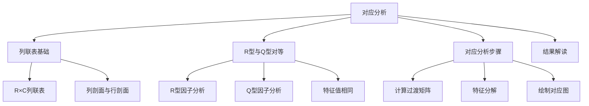
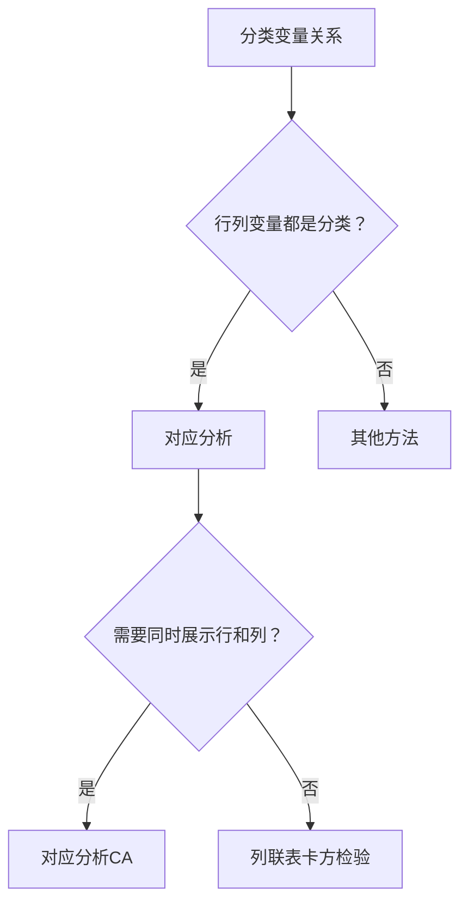

# 第7章 [[KP01_对应分析|对应分析]] · 章节总结

## 一、章节框架图

## 二、文字知识树

- **对应分析（Correspondence Analysis, CA）**
  - 列联表基础
    - R×C 列联表：行变量 R 个类别 × 列变量 C 个类别
    - 行剖面：每行的频率分布
    - 列剖面：每列的频率分布
    - 总剖面：总计频率分布
  - R 型与 Q 型[[KP03_PCA与因子分析对比|因子分析]]的对等关系
    - R 型：对列变量作因子分析（基于列变量间的关系）
    - Q 型：对行变量作因子分析（基于行变量间的关系）
    - 核心发现：R 型和 Q 型的特征值完全相同
    - 行坐标和列坐标可以画在同一张图上
  - 对应分析步骤
    - 计算列联表的频率矩阵 P = N/n
    - 计算行边缘 r 和列边缘 c
    - 计算过渡矩阵 S = D_r^(-1/2)(P - rc')D_c^(-1/2)
    - 对 S 作奇异值分解（SVD）
    - 行坐标 = D_r^(-1/2) UΛ^(1/2)
    - 列坐标 = D_c^(-1/2) VΛ^(1/2)
    - 在二维平面上绘制行点和列点
  - 结果解读
    - 行点接近 = 行类别相似
    - 列点接近 = 列类别相似
    - 行点与列点接近 = 该行列组合关联强

## 三、核心公式清单

| 公式 | 符号解释 | 适用条件 |
|------|----------|----------|
| $\boldsymbol{P} = \boldsymbol{N}/n$ | N 为列联表频数矩阵，n 为总样本量 | 列联表数据 |
| $\boldsymbol{r} = \boldsymbol{P}1$ | 行边缘（行频率） | |
| $\boldsymbol{c} = \boldsymbol{P}'1$ | 列边缘（列频率） | |
| $\boldsymbol{S} = \boldsymbol{D}_r^{-1/2}(\boldsymbol{P} - \boldsymbol{r}\boldsymbol{c}')\boldsymbol{D}_c^{-1/2}$ | 过渡矩阵（[[KP11_标准化_ZScore|标准化]]后的列联表） | 对应分析核心 |
| $\boldsymbol{S} = \boldsymbol{U}\boldsymbol{\Lambda}\boldsymbol{V}'$ | SVD 分解 | 特征值 λ_k = 惯量 |
| 行坐标 $\boldsymbol{F} = \boldsymbol{D}_r^{-1/2}\boldsymbol{U}\boldsymbol{\Lambda}^{1/2}$ | 行类别在对应图上的坐标 | |
| 列坐标 $\boldsymbol{G} = \boldsymbol{D}_c^{-1/2}\boldsymbol{V}\boldsymbol{\Lambda}^{1/2}$ | 列类别在对应图上的坐标 | |
| 惯量贡献率 = $\lambda_k / \sum\lambda_k$ | 第 k 轴解释的信息量 | 类似主成分贡献率 |

## 四、[[01_方法选择决策树|方法选择决策树]]

## 五、章节联系

- **前接**：第6章因子分析（R型因子分析是对应分析的基础）、第5章[[02_主成分分析PCA|主成分分析]]（CA 本质是对列联表的奇异值分解）
- **后接**：无（第8章[[KP01_典型相关分析|典型相关分析]]是独立方法）
- **横向**：卡方检验（对应分析可以视为卡方检验的几何化扩展）

## 六、自测题

**1. 对应分析的核心思想是什么？**
答：将列联表中的行类别和列类别同时投影到同一个低维空间（通常二维），使行点和列点之间的距离反映它们之间的关联强度。

**2. R 型因子分析与 Q 型因子分析的对等关系是什么？**
答：R 型（对列变量）和 Q 型（对行变量）的特征值完全相同，只是特征向量不同。这意味着行和列共享同一组维度，因此可以画在同一张图上。

**3. 对应图上的点距离如何解读？**
答：行点之间接近 = 行类别相似（在列变量上的分布相似）；列点之间接近 = 列类别相似；行点与列点接近 = 该行列组合的关联强于独立假设下的期望。

**4. 惯量是什么？**
答：惯量（inertia）是对应分析中方差的度量，类似于 [[KP04_PCA与FA对比|PCA]] 中的特征值。惯量越大，说明该轴携带的信息越多。

**5. 对应分析与卡方检验有何关系？**
答：对应分析总惯量 = 卡方统计量 / n。对应分析是卡方检验的几何化扩展，将"行列是否独立"的抽象检验转化为直观的二维散点图。

## 本章方法答辩速查

1. **问：对应分析和 PCA、因子分析怎么区分？** 答：PCA/FA 处理连续变量（数据阵 X），对应分析处理分类变量列联表（频数矩阵 N）。CA 同时投影行类别和列类别到同一张图，这是 PCA 做不到的——PCA 只能投影样品或变量，不能同时投影两者。
2. **问：CA 图上点之间的距离为什么不能直接当欧氏距离读？** 答：CA 用的是加权卡方距离（按行/列边缘概率加权），不是欧氏距离。同行点之间、同列点之间距离有意义；行点和列点之间只看方向不看绝对距离。
3. **问：前两轴惯量贡献率不够 70% 说明什么？** 答：说明二维图不能代表全部信息，行列关系在第三维还有结构。要么增加维度，要么该数据不适合做对应分析。稀疏表（很多 0）时结果也不稳定，应先合并水平。
