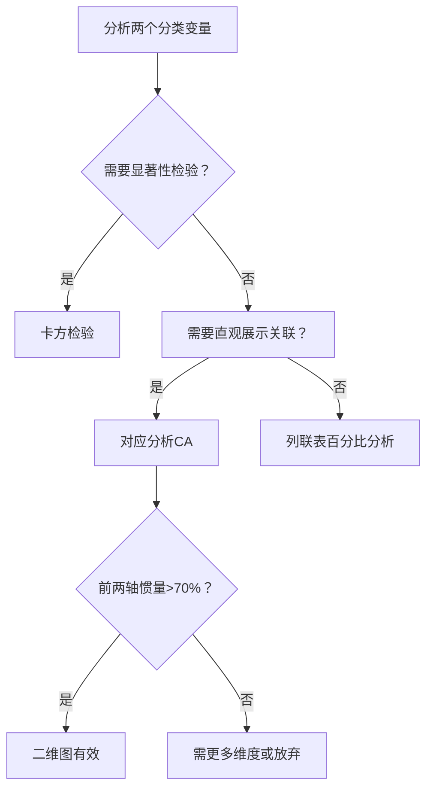

# KP01 对应分析

<div style="text-align:right;margin:10px 0;"><a href="../../../../exam.html" target="_blank" style="display:inline-block;padding:6px 16px;background:#2563eb;color:#fff;border-radius:6px;text-decoration:none;font-size:14px;">📝 开始做题</a></div>


## 1. 是什么

**定义**：对应分析（Correspondence Analysis, CA）是一种将列联表中的行类别和列类别同时投影到低维空间（通常二维）的方法，使行点和列点在同一张图上的距离反映它们之间的关联强度。

**直觉类比**：假设你有一个"电影类型 × 观众年龄"的列联表。传统方法只能分别看"各年龄组喜欢什么类型"或"各类型受哪个年龄组欢迎"。对应分析画一张图：电影类型（如动作片、爱情片、动画片）和观众年龄（如青少年、青年、中年）都画在同一张图上。动作片靠近青少年，爱情片靠近青年，动画片靠近家庭观众——一眼就能看出谁喜欢什么。

**解决什么问题**：
- 同时展示行变量和列变量的类别关系
- 发现哪些行类别与哪些列类别关联强
- 将高维列联表压缩为二维散点图，直观展示

## 2. 怎么用

### 完整步骤

1. 由列联表 N（R×C 频数矩阵）计算频率矩阵 P = N/n
2. 计算行边缘 r = P1 和列边缘 c = P'1
3. 计算过渡矩阵 S = D_r^(-1/2)(P - rc')D_c^(-1/2)
4. 对 S 作奇异值分解 S = UΛV'
5. 计算行坐标 F = D_r^(-1/2)UΛ^(1/2)
6. 计算列坐标 G = D_c^(-1/2)VΛ^(1/2)
7. 在二维平面上绘制行点和列点

### 核心公式

**频率矩阵**：

$$\boldsymbol{P}_{R \times C} = \frac{\boldsymbol{N}}{n}, \quad \sum_{i,j} p_{ij} = 1$$

**行边缘与列边缘**：

$$\boldsymbol{r} = \boldsymbol{P}\boldsymbol{1}_C, \quad \boldsymbol{c} = \boldsymbol{P}'\boldsymbol{1}_R$$

**过渡矩阵**：

$$\boldsymbol{S} = \boldsymbol{D}_r^{-1/2}(\boldsymbol{P} - \boldsymbol{r}\boldsymbol{c}')\boldsymbol{D}_c^{-1/2}$$

其中 D_r = diag(r)，D_c = diag(c)。(P - rc') 是"观测频率 - 独立假设下期望频率"的残差。

**奇异值分解**：

$$\boldsymbol{S} = \boldsymbol{U}\boldsymbol{\Lambda}\boldsymbol{V}'$$

- 奇异值平方 λ_k² = 第 k 惯量（inertia）
- 惯量贡献率 = λ_k² / Σλ_k²

**行坐标与列坐标**：

$$\boldsymbol{F} = \boldsymbol{D}_r^{-1/2}\boldsymbol{U}\boldsymbol{\Lambda}^{1/2}, \quad \boldsymbol{G} = \boldsymbol{D}_c^{-1/2}\boldsymbol{V}\boldsymbol{\Lambda}^{1/2}$$

### R 代码

```r
# 目的：对应分析示例
# 列联表：电影类型（行）× 观众年龄（列）
# 行：动作片、爱情片、动画片、纪录片
# 列：青少年、青年、中年、老年

N <- matrix(c(
  50, 30, 10,  5,    # 动作片
  10, 40, 30, 10,    # 爱情片
  40, 20, 15,  5,    # 动画片
   5, 10, 30, 40     # 纪录片
), nrow = 4, byrow = TRUE)

rownames(N) <- c("动作片", "爱情片", "动画片", "纪录片")
colnames(N) <- c("青少年", "青年", "中年", "老年")

# 目的：使用 ca 包作对应分析
install.packages("ca")
library(ca)

# 对应分析
ca_result <- ca(N)

# 输出摘要
summary(ca_result)

# 行坐标和列坐标
ca_result$rowcoord     # 行点坐标
ca_result$colcoord     # 列点坐标

# 绘制对应图
plot(ca_result)
```

**输出解读**：
- 行点（电影类型）和列点（观众年龄）画在同一张图上
- 动作片靠近青少年 → 青少年喜欢动作片
- 纪录片靠近老年 → 老年人喜欢纪录片
- 第一轴解释了多少惯量（通常 >60%），第二轴补充

### 计算演示（简单数字）

列联表 N：

| | 青少年 | 青年 | 行合计 |
|---|---|---|---|
| 动作片 | 50 | 10 | 60 |
| 爱情片 | 10 | 40 | 50 |
| 列合计 | 60 | 50 | 110 |

**第一步：频率矩阵 P**

n = 110，P = N/110：

$$\boldsymbol{P} = \begin{bmatrix} 0.455 & 0.091 \\ 0.091 & 0.364 \end{bmatrix}$$

**第二步：行边缘 r 和列边缘 c**

- r = (60/110, 50/110) = (0.545, 0.455)
- c = (60/110, 50/110) = (0.545, 0.455)

**第三步：独立假设下的期望频率 rc'**

$$\boldsymbol{r}\boldsymbol{c}' = \begin{bmatrix} 0.298 & 0.248 \\ 0.248 & 0.207 \end{bmatrix}$$

**第四步：残差 P - rc'**

$$\boldsymbol{P} - \boldsymbol{r}\boldsymbol{c}' = \begin{bmatrix} 0.157 & -0.157 \\ -0.157 & 0.157 \end{bmatrix}$$

残差不为 0，说明行列不独立。

**第五步：惯量**

此例只有 1 个非零惯量（因为 2×2 表）：
- 惯量 = 残差加权平方和 / n ≈ 0.18
- 惯量贡献率 = 100%

**第六步：对应图**

- 动作片行坐标 = (+x, 0)，青少年列坐标 = (+x, 0) → 同方向，关联强
- 爱情片行坐标 = (-x, 0)，青年列坐标 = (-x, 0) → 同方向，关联强

## 3. 什么时候用

**适用场景**：
- 两个分类变量的列联表分析
- 需要直观展示行类别与列类别的关联
- 问卷数据：题项（行）× 被试反应（列）的对应关系
- 市场调查：产品（行）× 消费者特征（列）

**数据条件**：
- 列联表中频数不应有太多 0（稀疏表对应分析效果差）
- 总样本量 n 应足够大
- 行类别数 R 和列类别数 C 均不宜过多（通常 < 20）

**前提假设**：
- 无严格分布假设
- 对应分析是探索性方法，不做显著性检验
- 总惯量 = 卡方统计量 / n，可与卡方检验关联

## 4. 什么时候不能用 / 易错点

**不适用场景**：
- 连续型变量（应使用 [[KP04_PCA与FA对比|PCA]] 或 FA）
- 列联表太稀疏（大量 0），对应图不稳定
- 行或列类别太多（> 20），图太拥挤无法解读

**常见错误**：
- ❌ 把行点和列点之间的距离直接解释为"距离"（CA 的距离是加权卡方距离，不是欧氏距离）
- ❌ 行点与列点之间的绝对距离没有意义，只有同方向/反方向才有意义
- ❌ 忽略惯量贡献率（若前两轴惯量 < 70%，二维图不能代表全部信息）
- ❌ 对稀疏表强行作对应分析（结果可能误导）

**注意**：
- 行点之间的距离有意义（行类别相似性）
- 列点之间的距离有意义（列类别相似性）
- 行点与列点之间：同方向 = 关联强，反方向 = 负关联，垂直 = 无关联

## 5. 与相似方法对比表

| 方法 | 数据类型 | 输出 | 优点 | 缺点 | 什么时候选它 |
|------|----------|------|------|------|-------------|
| 对应分析 CA | 列联表（分类×分类） | 行点+列点同图 | 同时展示行列关联、直观 | 距离解释复杂、稀疏表效果差 | 两个分类变量的关联探索 |
| 卡方检验 | 列联表 | 统计量、p值 | 有严格[[KP02_假设检验|假设检验]] | 只能判断是否独立，不能展示关系 | 需要显著性检验时 |
| [[02_主成分分析PCA|主成分分析]] PCA | 连续变量 | 综合指标 | 降维明确 | 不能处理分类变量 | 连续变量降维 |
| [[KP03_PCA与因子分析对比|因子分析]] FA | 连续变量 | 隐藏因子 | 因子可解释 | 模型假设多 | 探索隐藏维度 |

## 6. 为什么用这个不用那个

**决策逻辑**：



**被排除的方法会出什么问题**：
- 只用卡方检验：知道"不独立"，但不知道"谁和谁关联强"
- 用 PCA 处理分类变量：PCA 假设连续变量，分类变量的距离含义不明确
- 行点列点绝对值距离解读：CA 的距离是加权卡方距离，绝对距离无意义

## 7. 完整例子

### 书中原例（职业 × 满意度列联表）

| 职业\满意度 | 非常满意 | 满意 | 一般 | 不满意 |
|------------|---------|------|------|--------|
| 医生 | 30 | 40 | 20 | 10 |
| 教师 | 20 | 50 | 30 | 15 |
| 工人 | 10 | 30 | 40 | 30 |
| 职员 | 15 | 40 | 35 | 20 |

对应图结果：
- 医生靠近"非常满意"
- 工人靠近"不满意"
- 教师和职员靠近"满意"和"一般"

### 小白生活实例（奶茶店 × 顾客偏好）

| 奶茶店\口味 | 全糖 | 半糖 | 无糖 |
|------------|------|------|------|
| A店（网红） | 50 | 30 | 10 |
| B店（老牌） | 10 | 40 | 40 |
| C店（健康向） | 5 | 20 | 60 |

对应图：
- A店靠近全糖 → 年轻人喜欢
- B店靠近半糖 → 大众口味
- C店靠近无糖 → 健康意识强的顾客

## 答辩常问（带标准答案）

1. **问：对应分析解决什么问题？和卡方检验是什么关系？** 答：卡方检验只告诉你"行列不独立"，但不告诉你"谁和谁关联强"。对应分析把列联表的行类别和列类别同时投影到二维图上，行点靠近哪个列点就说明该行列组合关联强。总惯量=χ²/n，所以对应分析是卡方检验的几何化扩展。
2. **问：对应图上行点和列点之间的距离怎么解读？** 答：同行点之间距离有意义（行类别相似）；同列点之间距离有意义（列类别相似）；行点和列点之间不看绝对距离，看方向——同方向=正关联，反方向=负关联，垂直=无关联。因为 CA 用的是加权卡方距离，不是欧氏距离。
3. **问：前两轴惯量贡献率不够 70% 怎么办？** 答：说明二维图不能代表全部信息。要么增加维度到 3 维，要么放弃对应分析改用其他方法。列联表太稀疏（很多 0）时对应图不稳定，应先合并水平组合或增加样本量。

## 8. 速记卡

- **核心**：行点和列点画在同一张图上看关联
- **惯量**：CA 的"方差"，贡献率类似 PCA
- **距离解读**：同行点/同列点距离有意义；行点列点看方向不看绝对距离
- **与卡方关系**：总惯量 = χ²/n
- **一句话口诀**：行列同图，近者关联，远者无关


---

## 🔗 相关知识点

**🐮 大牛库深入：** [[../../../../经济统计学论文从0基础到精通/08_降维与分类/README|降维与分类模块]]

**📖 原书原文：** [[../../../../原文件/多元统计分析/何晓群_多元统计分析_全书|何晓群《多元统计分析》第7章]]
