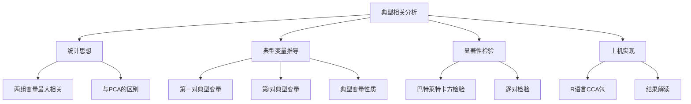
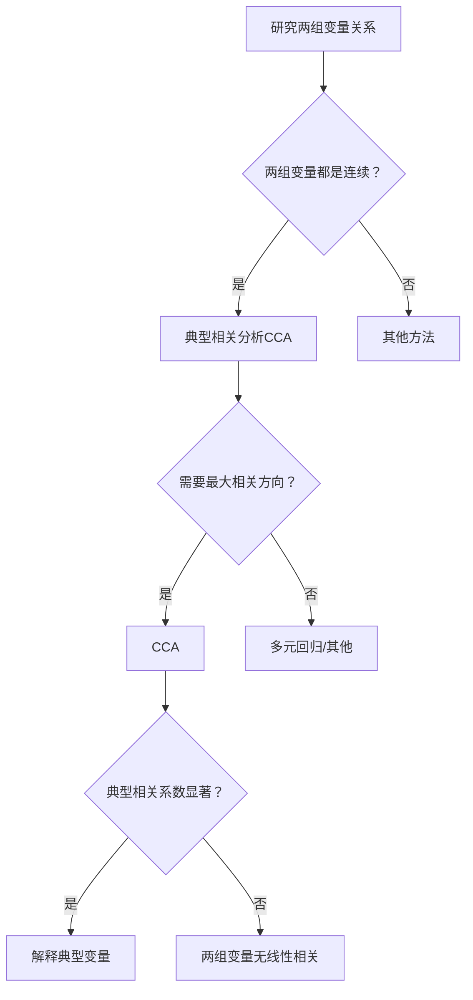

# 第8章 [[KP01_典型相关分析|典型相关分析]] · 章节总结

## 一、章节框架图

## 二、文字知识树

- **典型相关分析（Canonical Correlation Analysis, CCA）**
  - 统计思想
    - 研究两组变量之间的线性关系
    - 第一组变量 X(p个)，第二组变量 Y(q个)
    - 找 X 的线性组合 U = a'X 和 Y 的线性组合 V = b'Y，使 Corr(U, V) 最大
    - 与 [[KP04_PCA与FA对比|PCA]] 的区别：PCA 找一组变量内部最大方差；CCA 找两组变量之间最大相关
  - 典型变量推导
    - 第一对典型变量：U₁ = a₁'X，V₁ = b₁'Y，[[01_相关系数|相关系数]] λ₁ 最大
    - 第 i 对典型变量：与前 i-1 对不相关的前提下，相关系数最大
    - 数学问题：求 Σ₁₁⁻¹Σ₁₂Σ₂₂⁻¹Σ₂₁ 的特征值
    - λ_i² 为典型根（典型相关系数的平方）
  - 典型变量性质
    - 各组内部典型变量互不相关，方差为 1
    - 同一对 U_i 与 V_i 的相关系数为 λ_i
    - 不同对之间 U_i 与 V_j (i≠j) 互不相关
  - 显著性检验
    - 巴特莱特大样本 χ² 检验
    - H₀：λ₁ = 0（两组变量不相关）
    - 逐对检验：去掉前 j-1 个后检验第 j 个
  - 上机实现
    - R：CCA 包的 `cc()` 函数
    - 输出：典型相关系数、典型权重、典型载荷、交叉载荷
    - 解释：典型载荷（原始变量与典型变量的相关）

## 三、核心公式清单

| 公式 | 符号解释 | 适用条件 |
|------|----------|----------|
| $U = \boldsymbol{a}'\boldsymbol{X}, \quad V = \boldsymbol{b}'\boldsymbol{Y}$ | X 为第一组 p 个变量，Y 为第二组 q 个变量 | 两组变量 |
| $\max \text{Corr}(U, V) = \max \frac{\boldsymbol{a}'\boldsymbol{\Sigma}_{12}\boldsymbol{b}}{\sqrt{\boldsymbol{a}'\boldsymbol{\Sigma}_{11}\boldsymbol{a}}\sqrt{\boldsymbol{b}'\boldsymbol{\Sigma}_{22}\boldsymbol{b}}}$ | 最大化两组线性组合的相关 | CCA 优化目标 |
| $\boldsymbol{\Sigma}_{11}^{-1}\boldsymbol{\Sigma}_{12}\boldsymbol{\Sigma}_{22}^{-1}\boldsymbol{\Sigma}_{21}\boldsymbol{a} = \lambda^2 \boldsymbol{a}$ | 求 a 的特征方程 | 典型相关系数推导 |
| $\lambda_i$ | 第 i 对典型相关系数 | |
| $\Lambda_j = \prod_{i=j}^{p}(1-\lambda_i^2)$ | 威尔克斯统计量 | 显著性检验 |
| $Q_j = -[n - j - \frac{1}{2}(p+q+1)]\ln\Lambda_j$ | 巴特莱特卡方统计量 | 大样本 χ² 检验 |
| 自由度 $(p-j+1)(q-j+1)$ | 第 j 对检验的自由度 | |

## 四、[[01_方法选择决策树|方法选择决策树]]

## 五、章节联系

- **前接**：第5章[[02_主成分分析PCA|主成分分析]]（CCA 可视为"两组变量的 PCA"）、第6章[[KP03_PCA与因子分析对比|因子分析]]（典型函数推导类似无旋转的因子分析）
- **后接**：无（多元统计分析主体方法结束）
- **横向**：[[KP03_多元回归Stata|多元回归]]（CCA 是多元回归的推广：从一个因变量推广到一组因变量）

## 六、自测题

**1. 典型相关分析的研究对象是什么？**
答：两组随机变量之间的线性关系。第一组 X(p个)，第二组 Y(q个)，找各自的线性组合使相关系数最大。

**2. CCA 与 PCA 的本质区别是什么？**
答：PCA 找一组变量内部方差最大的方向；CCA 找两组变量之间相关最大的方向。PCA 只涉及一组变量，CCA 涉及两组。

**3. 第一对典型变量的含义是什么？**
答：U₁ = a₁'X 和 V₁ = b₁'Y 是所有线性组合中相关系数最大的一对，λ₁ 为最大相关系数。

**4. 典型变量有哪些性质？**
答：(1) 各组内部典型变量互不相关，方差为1；(2) 同一对 U_i 与 V_i 的相关系数为 λ_i；(3) 不同对 U_i 与 V_j (i≠j) 互不相关。

**5. 典型相关系数显著性检验的原假设是什么？**
答：H₀：λ₁ = 0（两组变量不相关）。若拒绝 H₀，说明至少第一对典型变量显著相关。

**6. 典型载荷与典型权重有何区别？**
答：典型权重（[[KP11_标准化_ZScore|标准化]]典型系数）类似回归系数，受多重共线性影响不稳定；典型载荷是原始变量与典型变量的相关系数，更稳定，是解释典型变量的主要依据。

## 本章方法答辩速查

1. **问：CCA 和多元回归、PCA 是什么关系？** 答：多元回归是一个因变量→多个自变量；CCA 推广到一组因变量→一组自变量，找两组线性组合使相关最大。PCA 是一组变量内部降维，CCA 是两组变量之间找关联。典型变量对最多 min(p,q) 对。
2. **问：典型相关系数高是否说明一组变量预测另一组很好？** 答：不完全。典型相关是两组线性组合之间的相关，不是原始变量的方差解释。高 λ 只说明那对综合分相关强，不代表每个原始变量都强相关。要看典型载荷和交叉载荷才能解释。
3. **问：为什么只有显著的典型变量对才值得解释？** 答：Bartlett χ² 检验逐对检验 H₀:λ_j=0。不显著的对可能只是抽样波动，解释它们会编造不存在的结构。书中例子只第一对显著，后两对 p≈0.9 不解释。
