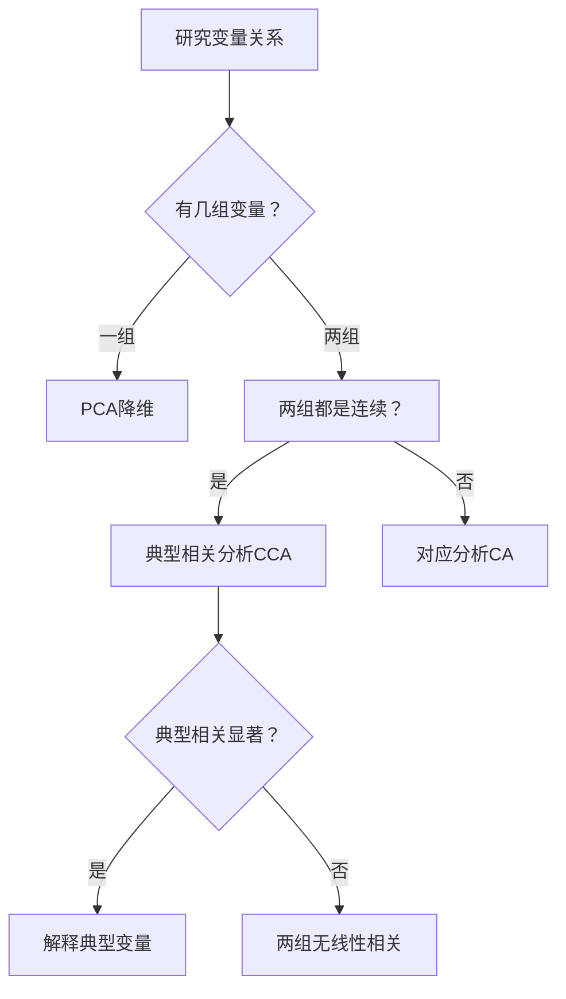

# KP01 典型相关分析

<div style="text-align:right;margin:10px 0;"><a href="../../../../exam.html" target="_blank" style="display:inline-block;padding:6px 16px;background:#2563eb;color:#fff;border-radius:6px;text-decoration:none;font-size:14px;">📝 开始做题</a></div>


## 1. 是什么

**定义**：典型相关分析（Canonical Correlation Analysis, CCA）是研究两组变量之间线性关系的方法。它分别在两组变量中找线性组合（典型变量），使这两组典型变量之间的[[01_相关系数|相关系数]]达到最大。

**直觉类比**：假设你研究"身体变量组"（身高、体重、腰围）和"运动变量组"（跑步速度、跳远成绩、引体向上数）之间的关系。CCA 不是逐对计算简单相关（3×3=9 个相关系数太乱），而是找一个"体型综合分"和一个"运动能力综合分"，使这两个综合分之间的相关最大。第一对综合分抓最主要的关联，第二对抓剩余的关联，以此类推。

**解决什么问题**：
- 两组变量之间是否存在显著的线性关系？
- 哪些变量对这种关系贡献最大？
- 用少数几对典型变量概括两组变量之间的关联

## 2. 怎么用

### 数学问题

设 $\boldsymbol{X} = (X_1, \ldots, X_p)'$（第一组，p个变量），$\boldsymbol{Y} = (Y_1, \ldots, Y_q)'$（第二组，q个变量）。

找 $\boldsymbol{a}$ 和 $\boldsymbol{b}$，使：

$$\max \text{Corr}(U, V) = \max \frac{\boldsymbol{a}'\boldsymbol{\Sigma}_{12}\boldsymbol{b}}{\sqrt{\boldsymbol{a}'\boldsymbol{\Sigma}_{11}\boldsymbol{a}} \cdot \sqrt{\boldsymbol{b}'\boldsymbol{\Sigma}_{22}\boldsymbol{b}}}$$

其中 $\boldsymbol{\Sigma} = \begin{bmatrix} \boldsymbol{\Sigma}_{11} & \boldsymbol{\Sigma}_{12} \\ \boldsymbol{\Sigma}_{21} & \boldsymbol{\Sigma}_{22} \end{bmatrix}$ 为联合协方差阵。

### 求解过程

约束 $\text{Var}(U) = \boldsymbol{a}'\boldsymbol{\Sigma}_{11}\boldsymbol{a} = 1$，$\text{Var}(V) = \boldsymbol{b}'\boldsymbol{\Sigma}_{22}\boldsymbol{b} = 1$。

解得：

$$\boldsymbol{\Sigma}_{11}^{-1}\boldsymbol{\Sigma}_{12}\boldsymbol{\Sigma}_{22}^{-1}\boldsymbol{\Sigma}_{21}\boldsymbol{a} = \lambda^2 \boldsymbol{a}$$

即 $\lambda^2$ 为矩阵 $\boldsymbol{\Sigma}_{11}^{-1}\boldsymbol{\Sigma}_{12}\boldsymbol{\Sigma}_{22}^{-1}\boldsymbol{\Sigma}_{21}$ 的特征值，$\boldsymbol{a}$ 为对应特征向量。

同理：

$$\boldsymbol{\Sigma}_{22}^{-1}\boldsymbol{\Sigma}_{21}\boldsymbol{\Sigma}_{11}^{-1}\boldsymbol{\Sigma}_{12}\boldsymbol{b} = \lambda^2 \boldsymbol{b}$$

两组特征值相同，按大小排列 $\lambda_1^2 \geq \lambda_2^2 \geq \ldots \geq \lambda_p^2 > 0$（p ≤ q）。

### 典型变量性质

1. **组内不相关**：$\text{Cov}(U_i, U_j) = 0 \ (i \neq j)$，$\text{Cov}(V_i, V_j) = 0 \ (i \neq j)$，且方差均为 1
2. **同对相关**：$\text{Cov}(U_i, V_i) = \lambda_i$
3. **异对不相关**：$\text{Cov}(U_i, V_j) = 0 \ (i \neq j)$

### 显著性检验（巴特莱特 χ² 检验）

检验第 j 对典型相关系数是否显著：

$$\Lambda_j = \prod_{i=j}^{p}(1 - \lambda_i^2)$$

$$Q_j = -\left[n - j - \frac{1}{2}(p + q + 1)\right]\ln\Lambda_j$$

$Q_j \sim \chi^2((p-j+1)(q-j+1))$。

若 $Q_j > \chi_\alpha^2((p-j+1)(q-j+1))$，则第 j 对典型相关系数显著。

### R 代码

```r
# 目的：典型相关分析
# 数据：20名中年男性，3项生理指标 + 3项运动指标

# 读取数据
fit <- read.csv("example8-1.csv", header = TRUE)

# 分组：生理指标 X，运动指标 Y
PHY <- fit[, 1:3]   # 体重、腰围、脉搏
EXER <- fit[, 4:6]  # 引体向上、仰卧起坐、跳跃

# 安装并加载 CCA 包
install.packages("CCA")
library(CCA)

# 目的：查看各组内部及组间相关阵
matcor(PHY, EXER)

# 目的：典型相关分析
cc1 <- cc(PHY, EXER)

# 输出典型相关系数
cc1$cor

# 输出典型系数（典型权重）
cc1$xcoef   # X组的典型系数
cc1$ycoef   # Y组的典型系数

# 输出典型载荷（原始变量与典型变量的相关）
cc1$scores$corr.X.xscores   # X组载荷
cc1$scores$corr.Y.yscores   # Y组载荷
cc1$scores$corr.X.yscores   # 交叉载荷
cc1$scores$corr.Y.xscores

# 目的：巴特莱特显著性检验
ev <- cc1$cor^2          # 典型根
ev2 <- 1 - ev            # 1 - 典型根
n <- dim(PHY)[1]         # 样本量
p <- length(PHY)        # X组变量数
q <- length(EXER)        # Y组变量数
m <- n - 1 - (p + q + 1)/2

# 逐对检验
for (i in 1:min(p,q)) {
  Lambda <- prod(ev2[i:min(p,q)])
  Q <- -(m - (i-1)) * log(Lambda)
  df <- (p - i + 1) * (q - i + 1)
  pvalue <- pchisq(Q, df, lower.tail = FALSE)
  cat(sprintf("第%d对: Q=%.3f, df=%d, p=%.4f\n", i, Q, df, pvalue))
}
```

**输出解读**：
- `cc1$cor`：典型相关系数，第一对最大（如 0.796），后续递减
- `xcoef`/`ycoef`：典型权重（[[KP11_标准化_ZScore|标准化]]后用于解释）
- `corr.X.xscores`：典型载荷，绝对值大的变量对典型变量贡献大
- 显著性检验：p < 0.05 则该对典型变量显著

### 计算演示（2×2 简化）

设 X = (X₁, X₂)'，Y = (Y₁, Y₂)'，已知：

$$\boldsymbol{\Sigma}_{11} = \begin{bmatrix} 1 & 0.5 \\ 0.5 & 1 \end{bmatrix}, \quad \boldsymbol{\Sigma}_{22} = \begin{bmatrix} 1 & 0.3 \\ 0.3 & 1 \end{bmatrix}, \quad \boldsymbol{\Sigma}_{12} = \begin{bmatrix} 0.6 & 0.2 \\ 0.4 & 0.5 \end{bmatrix}$$

**第一步：计算 $\boldsymbol{\Sigma}_{11}^{-1}\boldsymbol{\Sigma}_{12}\boldsymbol{\Sigma}_{22}^{-1}\boldsymbol{\Sigma}_{21}$**

- $\boldsymbol{\Sigma}_{11}^{-1} = \frac{1}{0.75}\begin{bmatrix} 1 & -0.5 \\ -0.5 & 1 \end{bmatrix}$
- $\boldsymbol{\Sigma}_{22}^{-1} = \frac{1}{0.91}\begin{bmatrix} 1 & -0.3 \\ -0.3 & 1 \end{bmatrix}$
- 逐步相乘后求特征值，得到 λ₁² 和 λ₂²
- 典型相关系数 λ₁ = √λ₁²，λ₂ = √λ₂²

**第二步：解释第一对典型变量**

- 若 X₁（腰围）在 U₁ 上载荷最大（-0.93），说明 U₁ 主要反映"体型肥胖程度"
- 若 Y₂（仰卧起坐）在 V₁ 上载荷最大（0.82），说明 V₁ 主要反映"核心力量"
- λ₁ = 0.796 说明体型与运动能力之间有较强负相关（越胖运动能力越差）

## 3. 什么时候用

**适用场景**：
- 研究两组变量之间的关系（如"生理指标组"与"运动指标组"）
- 经济研究："经济发展指标组"与"环境指标组"
- 教育研究："家庭背景变量组"与"学业成就变量组"

**数据条件**：
- 两组变量都是连续型
- 样本量 n 应大于 p+q（建议 n ≥ 10(p+q)）
- 变量间有一定相关性

**前提假设**：
- 变量间关系为线性
- 多元正态性（显著性检验需要）
- 协方差阵正定

## 4. 什么时候不能用 / 易错点

**不适用场景**：
- 只有一组变量（用 [[KP04_PCA与FA对比|PCA]] 即可）
- 分类变量为主（用[[KP01_对应分析|对应分析]]）
- 两组变量间无线性相关（检验不显著）

**常见错误**：
- ❌ 把典型权重（标准化系数）当成解释依据（受[[KP02_多重共线性|多重共线性]]影响不稳定）
- ❌ 应该用典型载荷（原始变量与典型变量的相关）来解释
- ❌ 忽略显著性检验就解释所有典型变量（只有显著的才值得解释）
- ❌ 典型相关系数高就认为"一组变量解释了另一组"（典型相关是两组线性组合之间的相关，不是原始变量的方差解释）

**典型相关的局限性**：
- 典型权重不稳定（变量间相关时）
- 典型变量解释困难（没有旋转工具）
- 反映的是线性组合间的共享方差，不是原始变量的方差解释

## 5. 与相似方法对比表

| 方法 | 研究对象 | 输出 | 优点 | 缺点 | 什么时候选它 |
|------|----------|------|------|------|-------------|
| 典型相关分析 CCA | 两组变量间关系 | 典型变量对、典型相关系数 | 概括两组变量间关联 | 解释困难、无旋转 | 两组连续变量的关联研究 |
| [[02_主成分分析PCA|主成分分析]] PCA | 一组变量内部 | 主成分、方差贡献率 | 降维明确 | 只涉及一组 | 一组变量降维 |
| [[KP03_多元回归Stata|多元回归]] | 多个自变量 → 一个因变量 | 回归系数、R² | 预测明确 | 只能一个因变量 | 预测单个因变量 |
| 对应分析 CA | 两个分类变量 | 行点列点同图 | 直观 | 仅分类变量 | 分类变量关联 |

## 6. 为什么用这个不用那个

**决策逻辑**：



**被排除的方法会出什么问题**：
- 用多元回归代替 CCA：只能处理一个因变量，无法同时研究多个因变量与多个自变量的关系
- 用简单相关系数代替：p×q 个相关系数太多，难以概括整体关系
- 用 PCA 分别对两组降维后再求相关：损失了两组变量之间的最优关联方向

## 7. 完整例子

### 书中原例（生理指标 × 运动指标）

20 名中年男性，3 项生理指标（体重、腰围、脉搏）和 3 项运动指标（引体向上、仰卧起坐、跳跃）。

**典型相关系数**：λ₁ = 0.796, λ₂ = 0.201, λ₃ = 0.073

**显著性检验**：
- 第1对：Q = 16.25, df = 9, p = 0.062（在 0.1 水平显著）
- 第2对：Q = 0.67, df = 4, p = 0.955（不显著）
- 第3对：Q = 0.07, df = 1, p = 0.789（不显著）

结论：只提取第一对典型变量。

**第一对典型变量**：
- U₁ = 0.031×体重 - 0.493×腰围 + 0.008×脉搏（主要反映"腰围/体型"）
- V₁ = 0.066×引体向上 + 0.017×仰卧起坐 - 0.014×跳跃（主要反映"运动能力"）

**典型载荷解读**：
- 腰围与 U₁ 载荷 = -0.93（强负相关）→ U₁ 得分越高 = 越瘦
- 仰卧起坐与 V₁ 载荷 = 0.82 → V₁ 主要反映核心力量
- 腰围与 V₁ 交叉载荷 = -0.74 → 腰围大的人运动能力差

### 小白生活实例（经济发展 × 空气质量）

36 个城市，6 项经济指标（GDP、工业增加值等）和 6 项空气质量指标（PM2.5、PM10、SO₂ 等）。

第一对典型相关系数 = 0.875（p < 0.01，显著）。

- U₁（经济水平典型变量）：与 GDP、工业增加值强负相关 → 得分越高 = 经济越发达
- V₁（空气质量典型变量）：与 NO₂、O₃ 正相关，与 SO₂、PM10 负相关
- 交叉载荷：经济发达城市的 NO₂、O₃、PM2.5 含量较高（汽车尾气、人为活动）

## 答辩常问（带标准答案）

1. **问：CCA 和 PCA 有什么区别？各研究什么？** 答：PCA 研究一组变量内部，找方差最大方向（无监督降维）；CCA 研究两组变量之间，找使两组线性组合相关最大的方向。CCA 可视为"两组变量的 PCA"。PCA 输出主成分得分，CCA 输出典型变量对及其相关系数。
2. **问：典型载荷和典型权重有什么区别？解释时用哪个？** 答：典型权重（标准化典型系数）类似回归系数，受多重共线性影响很不稳定；典型载荷是原始变量与典型变量的相关系数，更稳定。解释典型变量含义时，看载荷绝对值大的变量，不看权重。
3. **问：典型相关系数怎么检验？几对典型变量值得解释？** 答：Bartlett χ² 检验逐对进行：Λ_j=∏(1-λ_i²)，Q_j~χ²((p-j+1)(q-j+1))。只有显著的典型变量对才解释。书中生理×运动例子：第一对 λ₁=0.796 显著，第二三对 p≈0.9 不显著，只提取第一对。

## 8. 速记卡

- **核心**：两组变量各找线性组合，使相关最大
- **典型相关系数**：λ₁ > λ₂ > ... 递减，只有显著的才解释
- **与 PCA 区别**：PCA 找组内最大方差，CCA 找组间最大相关
- **解释依据**：典型载荷（不是典型权重）
- **一句话口诀**：两组变量各取一分，使两分相关最大；显著性逐对检验，显著才解释


---

## 🔗 相关知识点

**🐮 大牛库深入：** [[../../../../经济统计学论文从0基础到精通/08_降维与分类/README|降维与分类模块]]

**📖 原书原文：** [[../../../../原文件/多元统计分析/何晓群_多元统计分析_全书#8.1 典型相关分析的基本理论及方法|何晓群《多元统计分析》第8章]]
