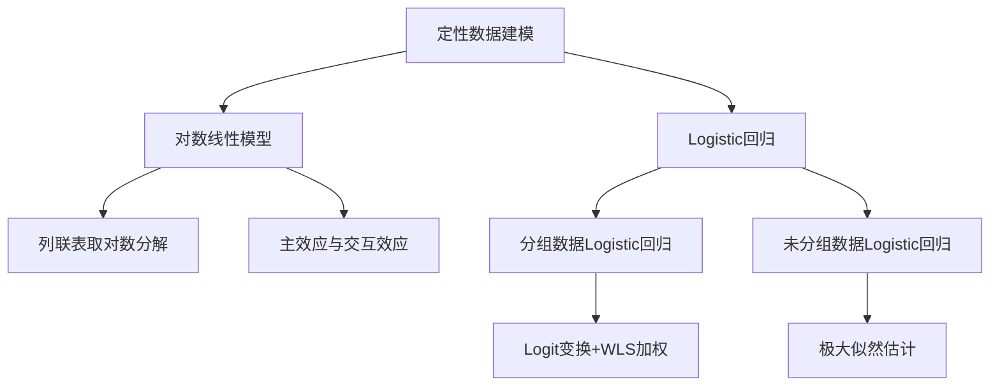
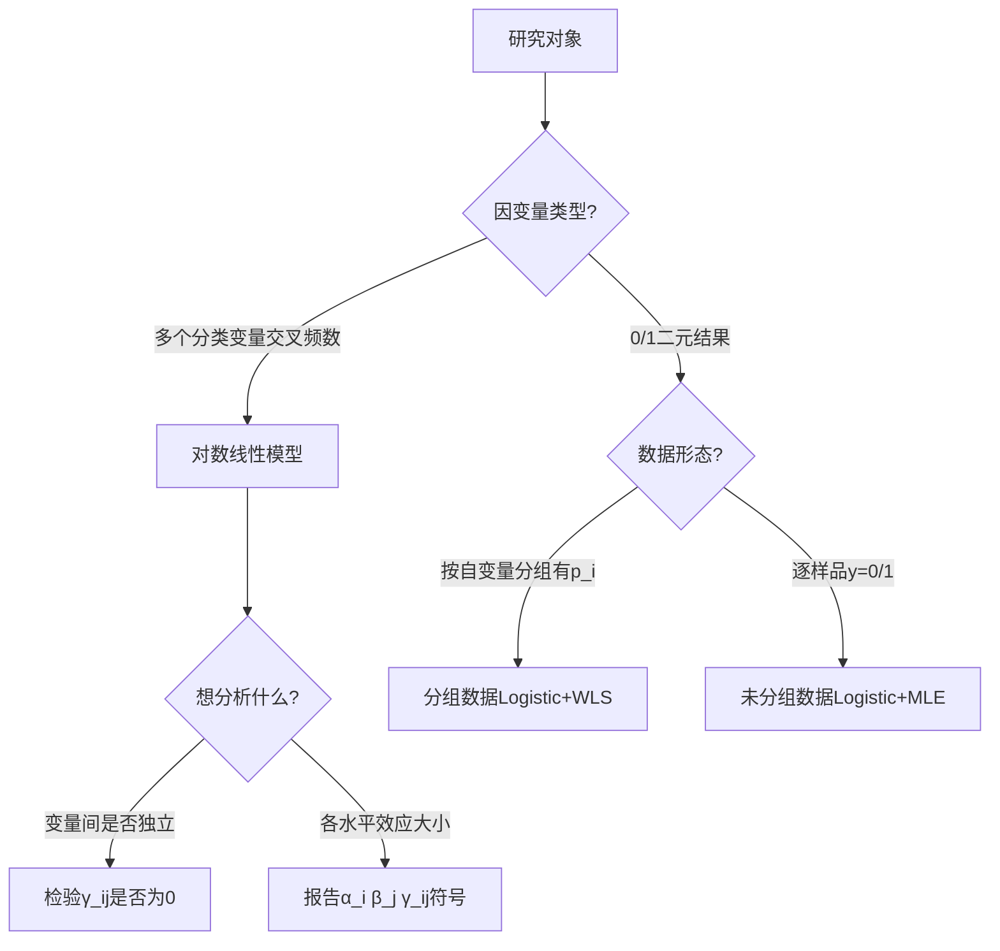

# 第9章 定性数据建模 · 章节总结

> 本章处理因变量为分类变量（尤其是 0/1 型）的建模问题，核心工具是**[[KP01_对数线性模型|对数线性模型]]**（分析列联表中分类变量间的关联）与 **Logistic 回归**（用自变量预测事件发生概率）。

## 一、章节框架图

## 二、文字知识树

- 对数线性模型
  - 出发点：交叉列联表的频数 $n_{ij}$
  - 变换：$\eta_{ij}=\ln p_{ij}$
  - 分解：$\eta_{ij}=\bar{\eta}_{..}+\alpha_i+\beta_j+\gamma_{ij}$（类比双因素方差分析）
  - 主效应 $\alpha_i,\beta_j$：行/列因素各自的平均效应
  - 交互效应 $\gamma_{ij}$：$\gamma_{ij}=0$ 即两因素独立（非饱和模型），否则为饱和模型
  - 参数估计：$\hat{\gamma}_{ij}=\ln n_{ij}-\frac12\sum_j\ln n_{ij}-\frac12\sum_i\ln n_{ij}+\frac14\sum_{i,j}\ln n_{ij}$
- Logistic 回归
  - 核心动机：$p\in[0,1]$ 不能直接用 [[KP02_OLS正交性|OLS]]（截断+[[02_异方差|异方差]]+非正态）
  - Logit 变换：$Q=\ln\frac{p}{1-p}$，把 $[0,1]$ 映到 $(-\infty,+\infty)$
  - Logistic 函数：$f(x)=\frac{1}{1+e^{-x}}$，S 形曲线
  - 分组数据：对 $p_i=m_i/n_i$ 做 Logit 变换后线性回归，加权最小二乘 $w_i=n_i p_i(1-p_i)$
  - 未分组数据：极大似然估计，似然函数 $L=\prod_i\pi_i^{y_i}(1-\pi_i)^{1-y_i}$
  - 系数解释：$\exp(b_j)$ 即优势比 OR，$b_j>0$ 表示该自变量使事件发生优势增大
  - 检验：Wald 统计量 $W=(B/S.E.)^2$，[[KP03_拟合优度R2|拟合优度]]用 $-2\ln L$（-2LL）
- 方法步骤：选变量 → 分训练/保留样本 → 估计 → 检验 → 解释 → 验证判别精度

## 三、核心公式清单

| 公式 | 符号解释 | 适用条件 |
|---|---|---|
| $\eta_{ij}=\bar{\eta}_{..}+\alpha_i+\beta_j+\gamma_{ij}$ | 列联表对数频率的方差分析式分解 | 二维列联表 |
| $\hat{\gamma}_{ij}=\ln n_{ij}-\frac12\sum_j\ln n_{ij}-\frac12\sum_i\ln n_{ij}+\frac14\sum_{i,j}\ln n_{ij}$ | 交互效应估计 | $n_{ij}>0$ |
| $\ln\frac{p}{1-p}=b_0+b_1x_1+\cdots+b_kx_k$ | Logistic 回归主方程 | 因变量 0/1 |
| $p=\dfrac{e^{b_0+\sum b_jx_j}}{1+e^{b_0+\sum b_jx_j}}$ | Logistic 函数 | 单调 S 形 |
| $w_i=n_i p_i(1-p_i)$ | 分组数据 WLS 权数 | 大样本分组数据 |
| $L=\prod_i\pi_i^{y_i}(1-\pi_i)^{1-y_i}$ | 未分组数据似然函数 | 逐样品 0/1 观测 |
| $\mathrm{Wald}=(B/S.E.)^2$ | 回归系数显著性检验 | 大样本近似 $\chi^2(1)$ |
| $p_i=\dfrac{m_i+0.5}{n_i+1}$ | $m_i=0$ 或 $n_i$ 时的频率修正 | 分组数据零频次修正 |

## 四、[[01_方法选择决策树|方法选择决策树]]

## 五、章节联系

- **承前**：第8章[[KP01_典型相关分析|典型相关分析]]处理两组连续变量的线性相关；本章转向**分类因变量**的回归建模。
- **启后**：第10章[[KP01_多变量图表示|多变量图表示]]法是探索性工具，可在建模前先画脸谱图/星图观察类别结构；第11章 [[KP01_多维标度MDS|MDS]] 处理样品间距离，与 Logistic 回归同属多元统计的"非连续/非线性"分支。
- **与判别分析**：Logistic 回归与距离判别都能做两组归类，但 Logistic 不要求正态、不要求等协方差阵，更稳健。

## 六、自测题

1. **对数线性模型中，$\gamma_{ij}=0$ 意味着什么？**
   答：A、B 两因素在该水平组合上无交互效应；若所有 $\gamma_{ij}=0$，则两因素相互独立，模型为非饱和模型。

2. **为什么因变量是 0/1 时不能直接用 OLS？**
   答：(1) 预测值可能落在 $[0,1]$ 之外；(2) 误差服从伯努利分布而非正态，t/F 检验失效；(3) $\mathrm{Var}(y)=\pi(1-\pi)$ 随 $\pi$ 变化，存在异方差。

3. **Logit 变换为什么能解决上述问题？**
   答：$Q=\ln\frac{p}{1-p}$ 把 $p\in[0,1]$ 单调映到 $(-\infty,+\infty)$，使 $Q$ 与自变量可建立线性关系，再通过反函数 $p=\frac{e^Q}{1+e^Q}$ 还原概率。

4. **分组数据 Logistic 回归为什么要加权？权数是多少？**
   答：变换后 $p_i'$ 的方差 $D(p_i')\approx 1/[n_i\pi_i(1-\pi_i)]$ 不等，需 WLS；取 $w_i=n_i p_i(1-p_i)$。

5. **OR 值如何解释？**
   答：$\exp(b_j)$ 表示自变量 $x_j$ 每增加 1 单位时事件发生优势 $p/(1-p)$ 的倍数。$\exp(b_j)=2$ 即优势翻倍；$b_j<0$ 则 $\exp(b_j)<1$，优势下降。

6. **Wald 统计量公式及其用途？**
   答：$\mathrm{Wald}=(B/S.E.)^2$，近似服从 $\chi^2(1)$，用于检验单个回归系数是否显著为 0。

7. **例 9-2 中 $x=8$ 万元家庭的预测购房概率是多少？**
   答：未加权 $\hat p=0.590$，加权后 $\hat p=0.585$，二者接近。

8. **饱和模型与非饱和模型的区别？**
   答：饱和模型包含所有交互效应，观测频数=期望频数、残差为 0、拟合优度 $\chi^2=0$；非饱和模型只含主效应，残差非零，需做 $\chi^2$ 检验判断交互是否可省。

## 本章方法答辩速查

1. **问：对数线性模型和 Logistic 回归怎么选？** 答：所有变量都是分类的、没有天然因变量、只想研究关联→对数线性模型；有明确的 0/1 因变量、想预测概率→Logistic 回归。对数线性把频数做方差分析式分解，Logistic 把 p 做 Logit 变换后回归。
2. **问：Logistic 回归和距离判别都做两类分类，区别在哪？** 答：距离判别要求各组多元正态、协差阵相等，用马氏距离；Logistic 不要求这些，只要观测独立、Logit 与自变量线性。实际数据不满足正态假定时 Logistic 更稳健，还能直接输出预测概率 p。
3. **问：为什么 Logistic 回归不能用 R² 评价？** 答：Logistic 用极大似然估计，不是最小二乘，没有"残差平方和"的概念。评价模型用 -2LL（似然比）、Hosmer-Lemeshow 检验、AIC、分类正确率。单个变量显著性用 Wald 检验。
