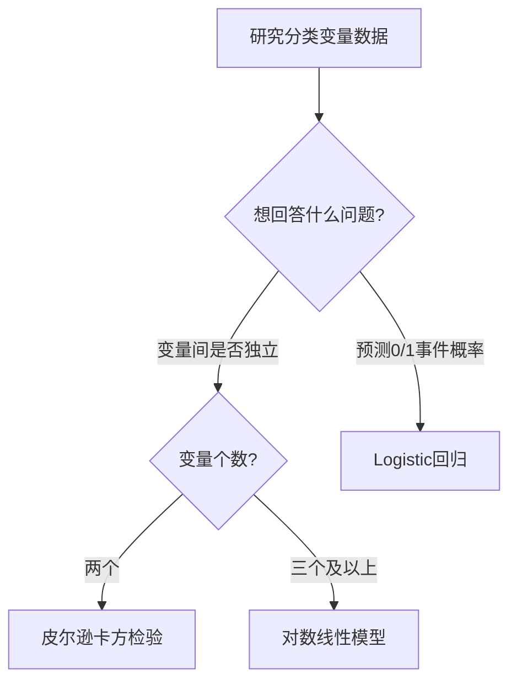

# KP01 · 对数线性模型

## 1. 是什么

**定义**：对交叉列联表中的概率（或频数）取自然对数后，仿照双因素方差分析的方式分解为**总均值 + 行因素主效应 + 列因素主效应 + 行列交互效应**，用以分析多个分类变量之间是否独立、哪个水平组合存在显著关联。

**直觉类比**：就像方差分析把一个班学生的成绩拆解成"学校平均水平 + 班级效应 + 教师效应 + 班级×教师交互"，对数线性模型把列联表中格子里的人数拆解成"总平均 + A 因素效应 + B 因素效应 + A×B 交互"。交互项 $\gamma_{ij}$ 是否为 0，直接告诉我们 A 与 B 是否独立。

**解决什么问题**：
- 多个分类变量（如"收入高/中/低"×"满意/不满意"）之间是否存在关联；
- 若存在关联，哪个水平组合的"偏好"或"排斥"最强。

## 2. 怎么用

### 完整步骤

1. 由样本列联表频数 $n_{ij}$ 算频率 $\hat p_{ij}=n_{ij}/n$。
2. 取对数：$\eta_{ij}=\ln \hat p_{ij}=\ln n_{ij}-\ln n$。
3. 对 $\eta_{ij}$ 做主效应+交互效应分解。
4. 用公式 (9.3) 估计交互效应 $\hat\gamma_{ij}$。
5. 根据 $\hat\gamma_{ij}$ 的正负与大小判断关联方向；用 K-way 检验判断高阶交互是否显著。

### 公式

核心分解（式 9.2）：

$$\eta_{ij}=\bar\eta_{..}+\alpha_i+\beta_j+\gamma_{ij}$$

约束：$\sum_i\alpha_i=\sum_j\beta_j=\sum_i\gamma_{ij}=\sum_j\gamma_{ij}=0$。

交互效应估计（式 9.3，$\ln n$ 项整体抵消 $\ln n$）：

$$\hat\gamma_{ij}=\ln n_{ij}-\frac12\sum_{j=1}^{2}\ln n_{ij}-\frac12\sum_{i=1}^{2}\ln n_{ij}+\frac14\sum_{i=1}^{2}\sum_{j=1}^{2}\ln n_{ij}$$

- $\alpha_i$：A 因素第 $i$ 水平的主效应；
- $\beta_j$：B 因素第 $j$ 水平的主效应；
- $\gamma_{ij}$：A 第 $i$ 水平与 B 第 $j$ 水平的交互效应。
- $\gamma_{ij}>0$：正关联（该组合出现频次高于独立预期）；
- $\gamma_{ij}<0$：负关联；
- $\gamma_{ij}\equiv0$：两因素独立（非饱和模型）。

### R 代码

```r
# 目的：对数线性模型分析——收入情况 × 满意情况（例9-1，3×2列联表）
# 原理：用对数变换把列联表频数分解为主效应与交互效应
# 数据：792份有效问卷，收入(高/中/低) × 满意(满意/不满意)

# 1. 构造列联表
tab <- matrix(c(53, 38,     # 高收入
                434, 108,   # 中收入
                111, 48),   # 低收入
              nrow = 3, byrow = TRUE,
              dimnames = list(收入 = c("高", "中", "低"),
                              满意 = c("满意", "不满意")))
tab
# 2. 饱和对数线性模型（等价于行列独立模型的反面对照）
#    loglin() 用于拟合分层对数线性模型，margin 设定保留哪些效应
#    margin=list(c(1,2)) 表示保留 A×B 交互（饱和）
sat <- loglin(tab, margin = list(c(1, 2)), eps = 1e-6, iter = 20, print = TRUE)
sat$pearson   # Pearson χ²，饱和模型为 0
sat$lrt       # 似然比 χ²，饱和模型为 0

# 3. 独立性模型（只保留主效应，去掉交互）
#    margin=list(1,2) 表示行、列各自独立
indep <- loglin(tab, margin = list(1, 2), eps = 1e-6, iter = 20, print = TRUE)
indep$pearson   # 独立性模型的 Pearson χ²，若 p<0.05 则拒绝独立
indep$lrt
indep$df

# 4. 用 MASS 包的 loglm() 获得更友好的输出
if (!requireNamespace("MASS", quietly = TRUE)) install.packages("MASS")
library(MASS)
# 饱和模型：~ 收入 * 满意
m_sat <- loglm(~ 收入 * 满意, data = as.data.frame(tab))
# 独立性模型：~ 收入 + 满意
m_ind <- loglm(~ 收入 + 满意, data = as.data.frame(tab))
summary(m_ind)   # LRT 检验：p<0.05 说明两因素不独立

# 5. 查看期望频数与残差
round(fitted(m_ind), 1)       # 独立性假设下的期望频数
round(resid(m_ind), 3)        # Pearson 残差，哪个格子残差大说明偏离独立多
```

### 计算演示（例 9-1 关键格子）

[[05_SPSS操作指引|SPSS]] 输出给出饱和模型参数估计：

- $\alpha_{\text{高}}=-0.683,\ \alpha_{\text{中}}=0.883$
- 由 $\sum\alpha_i=0$：$\alpha_{\text{低}}=0-(-0.683)-0.883=-0.200$
- $\beta_{\text{满意}}=0.425,\ \beta_{\text{不满意}}=-0.425$
- $\gamma_{\text{高,满意}}=-0.260,\ \gamma_{\text{中,满意}}=0.269$
- $\gamma_{\text{低,满意}}=0-(-0.260)-0.269=-0.009$

解读：中等收入顾客满意度最高（$\alpha_{\text{中}}=0.883$ 最大），且中等收入×满意的交互为正（$0.269$），说明该企业核心客户群就是中等收入者。

## 3. 什么时候用

- **适用场景**：
  - 研究对象全部是分类变量（定性变量）；
  - 数据是交叉列联表的频数；
  - 想知道多个分类变量之间是否独立、哪两个水平组合"互相吸引"或"互相排斥"。
- **数据条件**：每格期望频数不宜过小（一般要求期望频数 ≥5，否则需合并水平）；样本量足够（本例 792）。
- **前提假设**：
  - 观测相互独立（随机抽样）；
  - 频数服从多项分布（大样本下似然比 $\chi^2$ 近似成立）。
  - 违反后果：小样本下 $\chi^2$ 检验失真，应改用精确检验（Fisher）或合并格子。

## 4. 什么时候不能用/易错点

- **不适用**：自变量是连续变量、想直接预测概率（应改用 Logistic 回归）。
- **易错 1**：SPSS 中必须先 `Data → Weight Cases` 激活频数，否则模型照跑但结果错误。
- **易错 2**：饱和模型 $\chi^2=0$ 不代表"模型好"，只代表"参数把数据全部记住了"；真正要比较的是**非饱和模型**的[[KP03_拟合优度R2|拟合优度]]。
- **易错 3**：$\gamma_{ij}$ 的符号方向依赖于水平编码，解读时必须结合具体水平名，不能脱离列联表。
- **易错 4**：高维列联表（3 个以上分类变量）时要警惕高阶交互是否显著，应从最高阶开始逐层筛选。

## 5. 与相似方法对比表

| 方法 | 原理 | 适用数据 | 优点 | 缺点 | 何时选它 |
|---|---|---|---|---|---|
| 对数线性模型 | 对数频率做方差分析式分解 | 多个分类变量的列联表 | 同时分析多变量间关联；能给出交互效应大小 | 不直接预测概率；期望频数小时不稳 | 只关心"分类变量之间是否有关联" |
| 皮尔逊 $\chi^2$ 独立性检验 | 比较观测频数与独立期望频数 | 二维列联表 | 简单、经典 | 只给一个总 $\chi^2$，不分解到具体水平 | 只需判断两分类变量是否独立 |
| Logistic 回归 | Logit 变换后回归 | 一个 0/1 因变量 + 任意自变量 | 能预测概率、能引入连续自变量 | 只处理二元因变量 | 想预测某事件发生的概率 |

## 6. 为什么用这个不用那个



- 若只用皮尔逊 $\chi^2$：在三维以上列联表中无法区分主效应与交互效应，也无法给出哪个水平组合偏离独立最多。
- 若改用 Logistic 回归：必须指定一个变量作为"因变量"，其余作为自变量；但研究问题若是"收入、满意度、性别三者相互关系"，没有天然因变量，Logistic 回归就不合适。

## 7. 完整例子

### 书中原例（例 9-1）

某企业调查 792 名顾客，按收入（高/中/低）×满意度（满意/不满意）交叉分组：

| 收入 | 满意 | 不满意 | 合计 |
|---|---|---|---|
| 高 | 53 | 38 | 91 |
| 中 | 434 | 108 | 542 |
| 低 | 111 | 48 | 159 |
| 合计 | 598 | 194 | 792 |

SPSS 输出参数估计：

| 效应 | 参数 | 估计值 | Z | Sig. |
|---|---|---|---|---|
| 收入×满意 | 1 | -0.260 | -3.332 | 0.001 |
| 收入×满意 | 2 | 0.269 | 4.651 | 0.000 |
| 收入 | 1 | -0.683 | -8.737 | 0.000 |
| 收入 | 2 | 0.883 | 15.267 | 0.000 |
| 满意 | 1 | 0.425 | 8.703 | 0.000 |

结论：
1. $\beta_{\text{满意}}=0.425>0$：总体顾客偏满意；
2. $\alpha_{\text{中}}(0.883)>\alpha_{\text{低}}(-0.200)>\alpha_{\text{高}}(-0.683)$：中等收入满意度最高，高收入最低；
3. $\gamma_{\text{中,满意}}=0.269>0$：中等收入顾客对满意水平有正贡献；企业应重点维护中等收入客户群。

### 小白生活实例

某奶茶店调查 200 位顾客：是否看直播买过（是/否）× 是否喝过新品（是/否）。

| | 喝新品 | 没喝 | 合计 |
|---|---|---|---|
| 看直播 | 60 | 20 | 80 |
| 没看 | 40 | 80 | 120 |
| 合计 | 100 | 100 | 200 |

手算 $\hat\gamma_{11}$（看直播∩喝新品）：

- $\ln n_{11}=\ln 60=4.094$
- $\frac12\sum_j\ln n_{1j}=\frac12(\ln 60+\ln 20)=\frac12(4.094+2.996)=3.545$
- $\frac12\sum_i\ln n_{i1}=\frac12(\ln 60+\ln 40)=\frac12(4.094+3.689)=3.892$
- $\frac14\sum_{i,j}\ln n_{ij}=\frac14(4.094+2.996+3.689+4.382)=3.790$
- $\hat\gamma_{11}=4.094-3.545-3.892+3.790=0.447>0$

说明"看直播"与"喝新品"之间存在正关联：看直播的人更愿意尝试新品。

## 答辩常问（带标准答案）

1. **问：对数线性模型和 Logistic 回归怎么选？** 答：没有天然因变量、所有变量都是分类的、只想研究变量间关联→对数线性模型；有明确的 0/1 因变量、想预测事件概率→Logistic 回归。对数线性把每个格子频数分解为主效应+交互效应，交互项 γ_ij=0 就独立。
2. **问：饱和模型 χ²=0 是不是说明模型好？** 答：不是。饱和模型包含所有交互效应，参数把数据全部记住了，观测频数=期望频数，残差必然为 0。真正要比较的是非饱和模型（只含主效应）的拟合优度——它的 χ² 显著说明交互项不能省，即两因素不独立。
3. **问：交互效应 γ_ij 的正负怎么解读？** 答：γ_ij>0 说明该水平组合出现频次高于独立假设下的期望（正关联，互相吸引）；γ_ij<0 说明低于期望（负关联，互相排斥）；γ_ij=0 说明独立。书中例子：中等收入×满意 γ=0.269>0，说明中等收入者更倾向满意。

## 8. 速记卡

- 一句话：**把列联表频数取对数后做"方差分析"，用交互项判断分类变量是否独立。**
- $\gamma_{ij}=0$ → 独立；$\gamma_{ij}>0$ → 正关联；$\gamma_{ij}<0$ → 负关联。
- 饱和模型 $\chi^2=0$ 是必然，不是优点；要比较的是非饱和模型拟合。
- SPSS 必须先 Weight Cases。
- 口诀：**对数化、方差析、交互判独立**。


---

## 🔗 相关知识点

**同章关联：** [[KP02_Logistic回归|Logistic回归]]

**🐮 大牛库深入：** [[../../../../经济统计学论文从0基础到精通/06_受限因变量/02_Logit模型|大牛库·Logit模型]]

**📖 原书原文：** [[../../../../原文件/多元统计分析/何晓群_多元统计分析_全书|何晓群《多元统计分析》第9章]]
