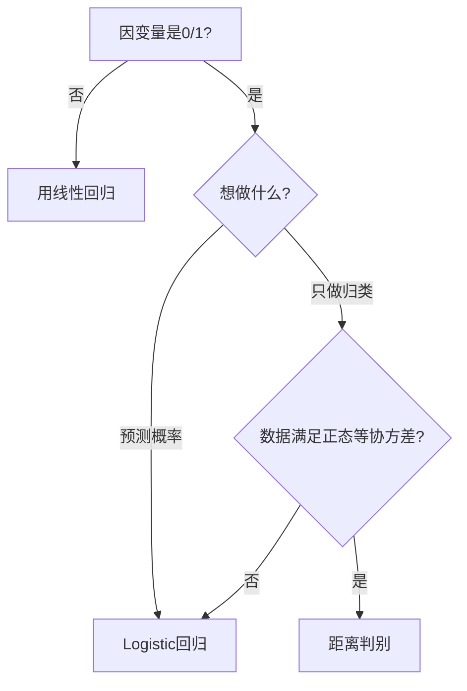

# KP02 · Logistic 回归

## 1. 是什么

**定义**：当因变量 $y$ 只取 0/1 两个值时，对发生概率 $p=P(y=1)$ 做 Logit 变换 $\ln\frac{p}{1-p}$，再用自变量的线性组合去拟合该变换值，从而得到事件发生概率与自变量关系的回归模型。

**直觉类比**：
- [[KP02_OLS正交性|OLS]] 是"直线预测温度"——温度可以从 -20 度到 40 度，直线没问题。
- Logistic 回归是"S 形曲线预测概率"——概率只能在 0 到 1 之间，曲线像一个平滑的 S：自变量很小时概率压在 0 附近，自变量很大时概率压在 1 附近，中间陡峭上升。

**解决什么问题**：
- 预测"客户是否购买""患者是否复发""企业是否违约"这类 0/1 事件的发生概率；
- 找出哪些因素显著影响该事件；
- 比较各自变量对事件发生优势的影响大小。

## 2. 怎么用

### 完整步骤

1. 明确因变量 $y\in\{0,1\}$，选择自变量（可连续可分类）。
2. 写出 Logistic 回归方程：$\ln\frac{p}{1-p}=b_0+b_1x_1+\cdots+b_kx_k$。
3. 用极大似然估计求 $\hat b_j$（R 中 `glm(family=binomial)`）。
4. 用 Wald 统计量检验各自变量显著性，剔除不显著变量。
5. 用 $\exp(b_j)$ 解释优势比 OR。
6. 对新样本代入方程算 $\hat p$，以 0.5 为阈值做归类。

### 公式

Logistic 函数（式 9.4）：

$$f(x)=\frac{e^x}{1+e^x}=\frac{1}{1+e^{-x}}$$

回归主方程：

$$\ln\frac{p}{1-p}=b_0+b_1x_1+\cdots+b_kx_k$$

反解出概率：

$$p=\frac{e^{b_0+\sum b_jx_j}}{1+e^{b_0+\sum b_jx_j}}$$

优势比 OR：

$$\mathrm{OR}_j=\exp(b_j)$$

- $b_j>0$：$x_j$ 增大使事件发生优势增大；
- $\mathrm{OR}_j=2$：$x_j$ 每增 1 单位，发生优势翻倍；
- $\mathrm{OR}_j=0.5$：发生优势减半。

Wald 检验（式 9.16）：

$$\mathrm{Wald}=\left(\frac{B}{S.E.}\right)^2\sim\chi^2(1)$$

分组数据权数（式 9.11）：

$$w_i=n_i p_i(1-p_i)$$

### R 代码

```r
# 目的：用未分组数据做 Logistic 回归（例9-3：乘公交 vs 骑自行车）
# 原理：因变量 y=1 表示乘公交，0 表示骑车；自变量 x1=性别 x2=年龄 x3=月收入
# R 中 glm() 的 family=binomial 即 Logistic 回归

# 1. 录入例9-3数据（n=28）
dat <- data.frame(
  性别 = c(0,0,0,0,0,0,0,0,0,0,0,0,0, 1,1,1,1,1,1,1,1,1,1,1,1,1,1,1),
  年龄 = c(18,21,23,23,28,31,36,42,46,48,55,56,58,
           18,20,25,27,28,30,32,33,33,38,41,45,48,52,56),
  月收入 = c(850,1200,850,950,1200,850,1500,1000,950,1200,1800,2100,1800,
             850,1000,1200,1300,1500,950,1000,1800,1000,1200,1500,1800,1000,1500,1800),
  y = c(0,0,1,1,1,0,1,1,1,0,1,1,1,
        0,0,0,0,0,1,0,0,0,0,0,1,0,1,1)
)

# 2. 拟合 Logistic 回归
#    glm() 是广义线性模型函数；family=binomial(link="logit") 即 Logistic
#    默认 link 就是 logit，可省略
fit <- glm(y ~ 性别 + 年龄 + 月收入, family = binomial(link = "logit"), data = dat)
summary(fit)
# 输出解读：
#   Estimate     → 回归系数 b
#   Std. Error   → 系数标准误
#   z value      → Wald 的平方根（即 B/S.E.）
#   Pr(>|z|)     → Wald 检验 p 值
#   月收入 p≈0.416 不显著，应剔除

# 3. 剔除月收入后重新拟合（对照书输出9-8）
fit2 <- glm(y ~ 性别 + 年龄, family = binomial, data = dat)
summary(fit2)
# 书结果：性别 b=-2.224 (p=0.034)，年龄 b=0.102 (p=0.026)，截距 b=-2.629

# 4. 提取优势比 OR = exp(b)
OR <- exp(coef(fit2))
OR
# exp(性别)=0.108 → 男性(性别=1)乘公交的优势是女性的 0.108 倍，即女性更爱坐公交
# exp(年龄)=1.108 → 年龄每大1岁，乘公交优势提高 10.8%

# 5. 预测新样本概率：一位 40 岁女性
new <- data.frame(性别 = 0, 年龄 = 40)
predict(fit2, newdata = new, type = "response")  # type="response" 直接输出 p
# 手算：η=-2.629-2.224*0+0.102*40=1.451
# p=exp(1.451)/(1+exp(1.451))=4.267/5.267=0.810

# 6. 分组数据 Logistic 回归（例9-2：购房意向）
#    当按 x 分组、每组有 n_i 和 m_i 时，可用 cbind(m_i, n_i-m_i) 作因变量
house <- data.frame(
  x = c(1.5,2.5,3.5,4.5,5.5,6.5,7.5,8.5,9.5),
  n = c(25,32,58,52,43,39,28,21,15),
  m = c(8,13,26,22,20,22,16,12,10)
)
fit_h <- glm(cbind(m, n-m) ~ x, family = binomial, data = house)
summary(fit_h)
# 书结果：b0=-0.849（WLS），b1=0.149；x=8 时 p=0.585
```

### 计算演示

例 9-2 未加权结果：$\hat p'=-0.886+0.156x$。

代入 $x_0=8$：

- $\hat p'=-0.886+0.156\times 8=0.362$
- $\hat p=\frac{e^{0.362}}{1+e^{0.362}}=\frac{1.436}{2.436}=0.590$

加权后：$\hat p'=-0.849+0.149x$，$x=8$ 时 $\hat p'=0.343$，$\hat p=\frac{1.409}{2.409}=0.585$。

结论：年收入 8 万元的签约家庭实际购房概率约 59%。

## 3. 什么时候用

- **适用场景**：
  - 因变量是 0/1 二元结果（买/不买、生病/不生病、违约/不违约）；
  - 想预测事件发生概率，或找显著影响因素；
  - 自变量可以是连续的（收入、年龄）也可以是分类的（性别、学历，需哑变量化）。
- **数据条件**：
  - 未分组数据：样本量一般 ≥ 100，事件组与非事件组都不能太少（每条自变量组合至少 5~10 个样本）；
  - 分组数据：要求每组 $m_i\neq0$ 且 $m_i\neq n_i$，否则用 $p_i=(m_i+0.5)/(n_i+1)$ 修正。
- **前提假设**：
  - 观测独立；
  - Logit 变换后 $\ln\frac{p}{1-p}$ 与自变量呈线性关系；
  - 自变量间无严重[[KP02_多重共线性|多重共线性]]（否则系数符号、显著性都不可信）。
  - 违反后果：残差呈系统曲线、Hosmer-Lemeshow 检验显著、预测概率偏差大。

## 4. 什么时候不能用/易错点

- **不适用**：因变量取三个及以上类别（应改用多项 Logistic 回归）；因变量是计数（应改用泊松回归）。
- **易错 1：用 OLS 拟合 0/1 数据**——预测值可能 <0 或 >1，残差[[02_异方差|异方差]]、非正态，t 检验失效。
- **易错 2：把回归系数 $b_j$ 直接当"概率变化"解读**——$b_j$ 是 Logit 尺度的变化，概率变化要按 $\Delta p=p(x+1)-p(x)$ 重新算。
- **易错 3：忽略 OR 值**——应报告 $\exp(b_j)$ 而非 $b_j$ 本身，因为 OR 才有"倍数"含义。
- **易错 4：用 $R^2$ 评价 Logistic 模型**——Logistic 不用 OLS 的 $R^2$，要用 -2LL、Hosmer-Lemeshow、AIC、分类正确率。
- **易错 5：完全分离（quasi-complete separation）**——某自变量能完美区分 0/1 两类时，MLE 不存在、系数发散，需合并类别或加惩罚。

## 5. 与相似方法对比表

| 方法 | 因变量 | 估计方法 | 误差假设 | 输出 | 何时选它 |
|---|---|---|---|---|---|
| 线性回归 OLS | 连续变量 | 最小二乘 | 正态等方差 | 预测值 | 因变量连续 |
| **Logistic 回归** | **0/1 二元** | **极大似然** | **伯努利** | **发生概率 p** | **因变量 0/1，想预测概率** |
| [[KP01_距离判别|距离判别]] | 类别（先验已知） | 马氏距离 | 各组多元正态、等协方差 | 归类 | 分类规则已知、要求正态等协方差 |
| Probit 回归 | 0/1 二元 | 极大似然 | 隐变量[[07_正态分布|正态分布]] | 发生概率 p | 与 Logistic 类似，连接函数不同 |
| [[KP01_对数线性模型|对数线性模型]] | 全部是分类变量 | 极大似然 | 多项分布 | 关联强度 | 没有天然因变量，只研究关联 |

**为什么 0/1 不能用 OLS**：

| 问题 | OLS 表现 | Logistic 回归处理 |
|---|---|---|
| 预测值范围 | 可能 <0 或 >1 | S 曲线把 p 压在 [0,1] |
| 误差分布 | 假设正态 | 伯努利分布 |
| 方差 | 假设等方差 | $\mathrm{Var}(y)=p(1-p)$，WLS 或 MLE 处理 |
| 显著性检验 | t/F | Wald、似然比 |

## 6. 为什么用这个不用那个



- **用距离判别会出什么问题**：要求各组自变量服从多元正态且协方差阵相等；实际数据（如性别、收入混合）往往不满足，判别边界失真。
- **用 OLS 会出什么问题**：预测概率越界、残差非正态导致[[KP02_假设检验|假设检验]]无效、异方差使标准误低估。
- **用 Probit**：与 Logistic 结果非常接近，区别仅在连接函数；Logistic 因 OR 解释直观、数值稳定，更常用。

## 7. 完整例子

### 书中原例（例 9-3）

28 位工薪族，$y=1$ 表示乘公交、$y=0$ 表示骑车。

第一次全变量回归输出：

| 变量 | B | S.E. | Wald | Sig. | Exp(B) |
|---|---|---|---|---|---|
| 性别 | -2.502 | 1.158 | 4.669 | 0.031 | 0.082 |
| 年龄 | 0.082 | 0.052 | 2.486 | 0.115 | 1.086 |
| 月收入 | 0.002 | 0.002 | 0.661 | 0.416 | 1.002 |
| 常数 | -3.655 | 2.091 | 3.055 | 0.081 | 0.026 |

月收入不显著（$p=0.416$），剔除后重估：

| 变量 | B | S.E. | Wald | Sig. | Exp(B) |
|---|---|---|---|---|---|
| 性别 | -2.224 | 1.048 | 4.506 | 0.034 | 0.108 |
| 年龄 | 0.102 | 0.046 | 4.986 | 0.026 | 1.108 |
| 常数 | -2.629 | 1.554 | 2.862 | 0.091 | 0.072 |

最终方程：

$$\hat p=\frac{e^{-2.629-2.224\cdot\text{性别}+0.102\cdot\text{年龄}}}{1+e^{-2.629-2.224\cdot\text{性别}+0.102\cdot\text{年龄}}}$$

解读：
- $\exp(-2.224)=0.108$：男性乘公交的优势仅为女性的 10.8%，即女性更爱坐公交；
- $\exp(0.102)=1.108$：年龄每大 1 岁，乘公交优势提高 10.8%；
- 显著性比较：年龄 Wald=4.986 > 性别 Wald=4.506，年龄影响略强。

### 小白生活实例

奶茶店想预测"顾客是否会复购"，收集 100 位顾客数据：自变量 $x$=消费金额（元），$y=1$=30 天内复购。

拟合得到 $\ln\frac{p}{1-p}=-2+0.03x$。

- 消费 50 元的顾客：$\eta=-2+0.03\times50=-0.5$，$p=\frac{e^{-0.5}}{1+e^{-0.5}}=0.378$，复购概率 37.8%；
- 消费 200 元的顾客：$\eta=-2+0.03\times200=4$，$p=\frac{e^4}{1+e^4}=0.982$，复购概率 98.2%；
- OR：$\exp(0.03)=1.0305$，每多花 1 元，复购优势提高 3.05%。

## 答辩常问（带标准答案）

1. **问：为什么 0/1 因变量不能直接用 OLS 回归？** 答：三个问题：(1)预测值可能<0 或>1，超出概率范围；(2)误差服从伯努利分布而非正态，t/F 检验失效；(3)Var(y)=p(1-p) 随 p 变化，存在异方差。Logistic 用 Logit 变换 ln(p/(1-p)) 把 [0,1] 映到 (-∞,+∞)，再拟合 S 形曲线。
2. **问：回归系数 b 怎么解释？OR 值怎么算？** 答：b_j 是 Logit 尺度的变化，不是概率变化。报告优势比 OR_j=exp(b_j)：OR=2 表示 x_j 每增 1 单位，事件发生优势 p/(1-p) 翻倍；OR=0.5 表示优势减半。概率变化要按 Δp=p(x+1)-p(x) 重新算，不能直接读 b。
3. **问：Logistic 回归和距离判别都能做两类分类，怎么选？** 答：距离判别要求各组多元正态且协差阵相等；Logistic 回归不要求这些，只要观测独立、Logit 与自变量线性即可。实际数据（混合连续/分类自变量）往往不满足正态等协差阵，Logistic 更稳健。想直接预测概率用 Logistic。

## 8. 速记卡

- 一句话：**0/1 因变量不能 OLS，做 Logit 变换后用 MLE 拟合 S 形曲线。**
- 核心方程：$\ln\frac{p}{1-p}=b_0+\sum b_jx_j$。
- 系数读 OR：$\mathrm{OR}=\exp(b_j)$，>1 促发事件，<1 抑制事件。
- 估计用 `glm(y~x, family=binomial)`；分组数据用 `cbind(m, n-m)~x`。
- 检验用 Wald，拟合看 -2LL/AIC，**不要用 $R^2$**。
- 口诀：**Logit 变直线、MLE 估系数、OR 读倍数、0.5 切归类**。


---

## 🔗 相关知识点

**同章关联：** [[KP01_对数线性模型|对数线性模型]]

**🐮 大牛库深入：** [[../../../../经济统计学论文从0基础到精通/06_受限因变量/02_Logit模型|大牛库·Logit模型]]

**📖 原书原文：** [[../../../../原文件/多元统计分析/何晓群_多元统计分析_全书|何晓群《多元统计分析》第9章]]
