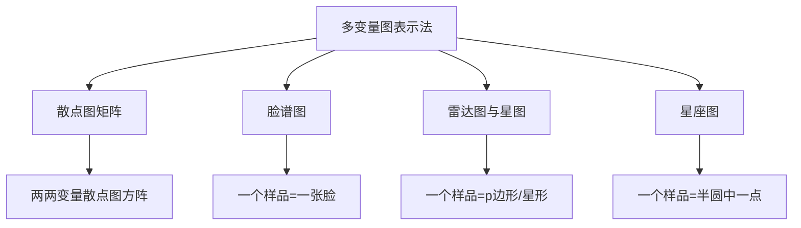
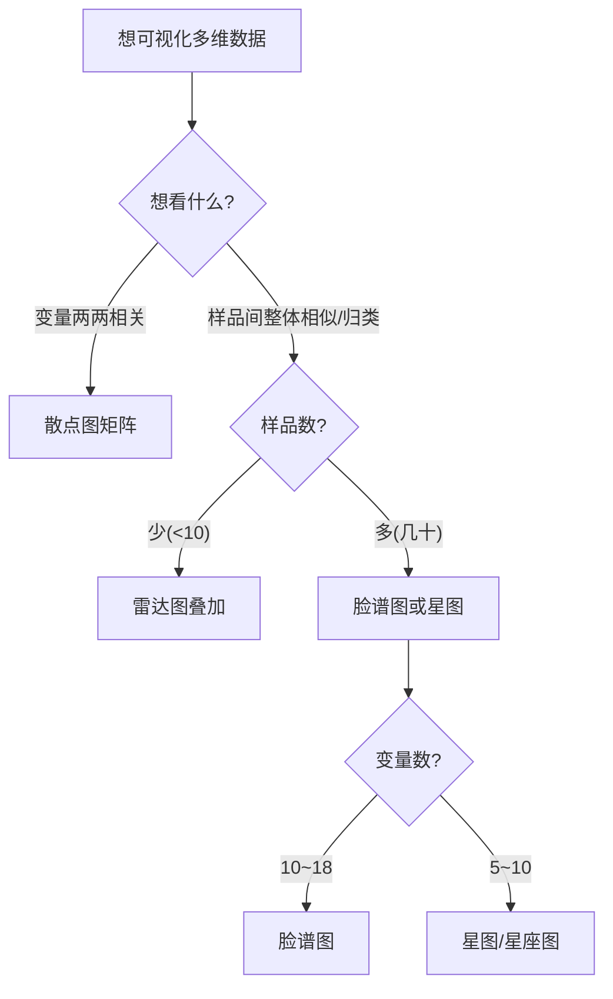

# 第10章 [[KP01_多变量图表示|多变量图表示]]法 · 章节总结

> 当变量个数超过 3 时，普通散点图、直方图已无法同时呈现多维信息。本章介绍把每一个多维样本"画成一张图"的探索性方法：散点图矩阵、脸谱图、雷达图/星图、星座图。

## 一、章节框架图

## 二、文字知识树

- **散点图矩阵**（pairs）
  - 主对角线放变量名，非对角格放 $x_i$ vs $x_j$ 散点；
  - 优点：直观、能看两两相关；
  - 缺点：仍是两两关系，不反映多维联合结构。
- **脸谱图**（Chernoff faces，1970）
  - 用脸的部位（脸高、脸宽、鼻长、嘴形、眼睛、眉毛等 15~18 个特征）对应 $p$ 个变量；
  - 一个样本画一张脸，像相似的脸归为一类；
  - 缺点：变量顺序改变会显著改变脸谱形状，主观性强。
- **雷达图/星图**
  - 雷达图：一个圆被 $p$ 等分，每个变量一条轴，样品在 $p$ 条轴上取值后连成 $p$ 边形；
  - 星图：R `stars()` 函数，每个样品一张星形图；
  - 适合少量样品、少量变量的结构对比。
- **星座图**
  - 把每个变量线性变换到 $[0,\pi]$；
  - 以权重 $w_j$ 为半径逐段画圆弧，$Z_k=\sum_j w_j e^{iB_{jk}}$；
  - 样品在半圆中的位置即星座图坐标，靠近者相似。

## 三、核心公式清单

| 方法 | 关键公式 | 符号解释 | 适用条件 |
|---|---|---|---|
| 星座图[[KP10_规格化_极差正规化|规格化]] | $B_{ji}=\dfrac{X_{ji}-\min X_j}{\max X_j-\min X_j}\pi$ | 把变量值映射到 $[0,\pi]$ | 每个变量需单调可量化 |
| 星座图权重 | $\sum_{j=1}^p w_j=1$ | 各变量重要性加权 | 默认 $w_j=1/p$ |
| 星座图坐标 | $Z_k=\sum_j w_j e^{iB_{jk}}$，实部 $\sum w_j\cos B_{jk}$，虚部 $\sum w_j\sin B_{jk}$ | 复数极坐标叠加 | 半圆内定位样品 |

## 四、[[01_方法选择决策树|方法选择决策树]]

## 五、章节联系

- **承前**：第 6 章[[04_聚类分析|聚类分析]]、第 7 章[[KP01_对应分析|对应分析]]都需要先观察样品结构，多变量图表示法是这些定量方法之前的**探索性工具**。
- **启后**：第 11 章[[KP01_多维标度MDS|多维标度]]法也是"把样品放在二维图上"，但 [[KP01_多维标度MDS|MDS]] 是从距离矩阵定量求解坐标；本章方法是定性作图，更直观但更主观。
- **定位**：本章方法"没有严格的数学理论"，应与聚类、[[KP03_PCA与因子分析对比|因子分析]]等定量方法结合使用，不能单独下结论。

## 六、自测题

1. **散点图矩阵为什么不算真正的多变量图？**
   答：它仍是 $p$ 个两变量散点图的拼盘，反映的是两两边际关系，不能直接呈现三个以上变量的联合结构。

2. **脸谱图的缺点是什么？**
   答：(1) 变量顺序改变会显著改变脸形；(2) 人对脸部位的注意力不同，主观归类差异大；(3) 变量数超过 15~18 个时必须裁剪。

3. **雷达图适合什么场景？**
   答：样品数少（2~5 个）、变量数中等（5~10 个），想在一张图上对比各维度结构差异（如北京 vs 天津消费结构）。

4. **星座图的坐标如何计算？**
   答：先把变量规格化到 $[0,\pi]$，再以权重 $w_j$ 为半径逐段叠加圆弧，实部 $\sum w_j\cos B_{jk}$、虚部 $\sum w_j\sin B_{jk}$ 即平面坐标。

5. **为什么强调"多种方法综合使用"？**
   答：每种图表示法都有强假设（脸谱受变量顺序影响、星座受权重影响），同一样品在不同图上归类可能不同；只有多种图相互印证，结论才可信。

## 本章方法答辩速查

1. **问：这些图表示法和聚类、MDS 是什么关系？** 答：脸谱/星/雷达是探索性定性画图，先肉眼看样品能否分组；然后用聚类（定量分组）或 MDS（定量求坐标）下结论。不能用脸谱图的直观归类当最终结论，必须和定量方法互相印证。
2. **问：为什么脸谱图主观性最强？** 答：变量顺序一改脸形全变；人对脸部位的注意力不同；变量数超过 18 个脸画不下。星座图数学定义最清晰（复数极坐标叠加），但受权重选择影响。
3. **问：样品数上百时这些图为什么失效？该用什么替代？** 答：几十张脸密密麻麻完全无法分辨。应改用 PCA 前两主成分散点图（定量降维）或 MDS（从距离阵求坐标），后者专门处理"只知道样品间距离"的场景。
