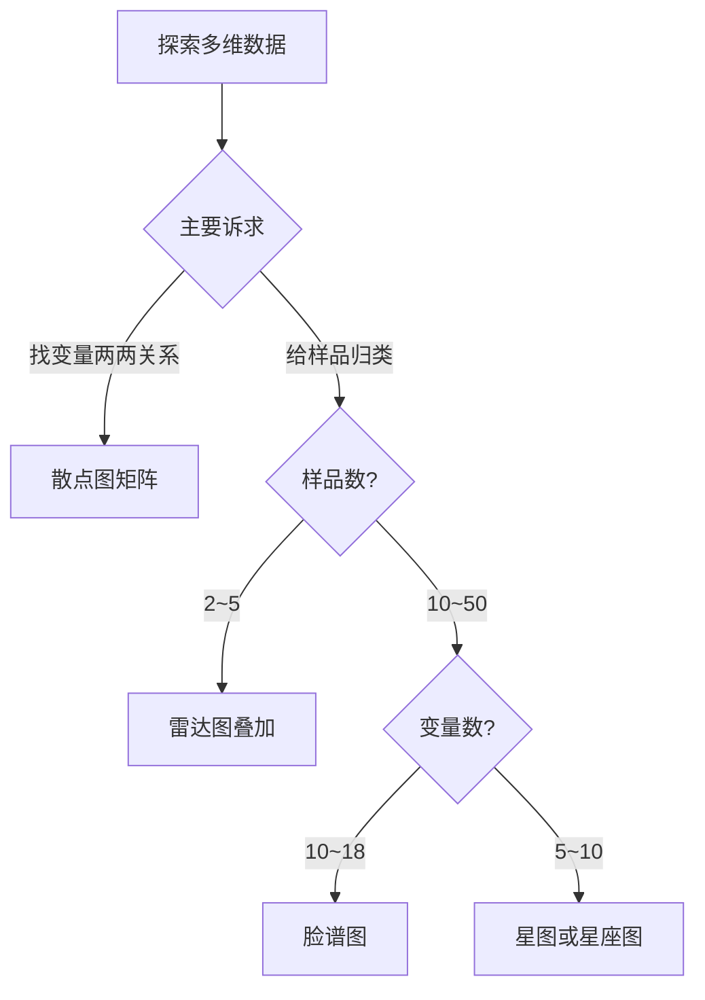

# KP01 · 多变量图表示法

## 1. 是什么

**定义**：当变量个数 $p>3$ 时，把每一个 $p$ 维样本点用一种图形（散点矩阵中的点、一张脸、一个多边形、半圆中一个点）直观地画出来，使研究者一眼看出样品间相似性、变量间相关性，为后续聚类、[[KP03_PCA与因子分析对比|因子分析]]提供直观印象。

**直觉类比**：
- 变量少（2~3 个）：就像给三个人拍正面照，一眼能比较高矮胖瘦。
- 变量多（10 个）：三个人变成了十个维度的"数据"，没法直接比较；于是给每个人画一张"身份证照片"——这张脸的胖瘦、眼睛大小、嘴角上扬程度就对应十个指标，脸像的人就是数据像的人。

**解决什么问题**：在跑复杂模型之前，先用眼睛看一眼[[01_数据长什么样|数据长什么样]]：样品能不能分组？哪些变量一起变大？有没有离群点？

## 2. 怎么用

### 四种方法的适用场景

| 方法 | 一个样品画成 | 适合样品数 | 适合变量数 | 主要看什么 |
|---|---|---|---|---|
| 散点图矩阵 | 多个散点中的一个点 | 不限 | 2~10 | 变量两两相关 |
| 脸谱图 | 一张人脸 | 10~50 | 5~18 | 样品整体相似性、归类 |
| 雷达图 | 一个多边形 | 2~5 叠加 / 多个分开 | 5~10 | 各维度结构对比 |
| 星图 | 一个放射星形 | 几十个 | 5~10 | 各样品大小+形状 |
| 星座图 | 半圆中一个点 | 几十个 | 5~20 | 样品间远近分类 |

### R 代码

```r
# 目的：用 R 画四种多变量图（例10-2 交通运输业30家上市公司10项财务指标）
# 说明：下面用模拟数据演示函数用法；实际使用时把 fdata 换成自己的数据矩阵

# ========== 1. 散点图矩阵 pairs() ==========
# 目的：看多个变量两两之间的散点关系
# pairs() 是 R 基础包函数，输入数据框，输出 p×p 散点矩阵
set.seed(1)
fdata <- data.frame(
  X1 = rnorm(30, 0.5, 0.4),
  X2 = rnorm(30, 5, 2),
  X3 = rnorm(30, 8, 5),
  X4 = rnorm(30, 15, 12),
  X5 = rnorm(30, 5, 4)
)
pairs(fdata,
      main = "散点图矩阵：变量两两关系",
      pch  = 19, cex = 0.6,
      gap  = 0)   # gap=0 让格子紧凑
# 输出解读：非对角格是 xi vs xj 散点；
# 若某格呈直线，说明两变量强相关；若呈云团，说明无线性相关

# ========== 2. 脸谱图 faces() ==========
# 目的：把每个样品画成一张脸，脸像者数据像
# faces() 在 aplpack 包中
if (!requireNamespace("aplpack", quietly = TRUE)) install.packages("aplpack")
library(aplpack)

# 注意：faces() 默认自动标准化数据（scale=TRUE）
# face.type=0 黑白脸；=1 彩色；=2 圣诞老人
# nrow.plot / ncol.plot 控制每行每列脸的个数
faces(fdata,
      face.type = 0,
      scale     = TRUE,     # 是否标准化
      nrow.plot = 5,        # 每行5张脸
      ncol.plot = 6,        # 每列6张脸
      main      = "30家交通运输上市公司脸谱图")
# 输出会在控制台打印每个变量对应脸的哪个部位：
#  X1→脸庞高度，X2→脸庞宽度，X3→轮廓，X4→嘴唇高度，X5→嘴唇宽度 ...
# 脸大、嘴翘、眼大者对应指标值高

# ========== 3. 星图 stars() ==========
# 目的：每个样品一张星形图，半径越长变量值越大
# stars() 是 R 基础包函数
stars(fdata,
      full        = TRUE,   # TRUE=圆形星图；FALSE=半圆
      scale       = TRUE,   # 自动标准化到 [0,1]
      radius      = TRUE,   # 画出内部半径线
      labels      = rownames(fdata),
      flip.labels = FALSE,  # 变量名排列整齐
      main        = "30家上市公司星图")
# 输出解读：从右边水平半径开始逆时针依次对应 X1,X2,...；
# 星大=综合水平高；形状胖瘦=结构相似

# ========== 4. 雷达图 radarchart() ==========
# 目的：把多个样品叠加在一个多边形雷达图中对比
# radarchart() 在 fmsb 包中
if (!requireNamespace("fmsb", quietly = TRUE)) install.packages("fmsb")
library(fmsb)

# radarchart 要求数据框第一行=最大值，第二行=最小值
radar_df <- rbind(
  apply(fdata, 2, max),   # 第一行最大值
  apply(fdata, 2, min),   # 第二行最小值
  fdata[1:3, ]            # 想对比的3个样品
)
radarchart(radar_df,
           axistype  = 1,
           pcol      = c("red","blue","green"),
           plwd      = 2,
           plty      = 1,
           title     = "3家上市公司雷达图对比")

# ========== 5. 星座图（手算） ==========
# 目的：把样品在半圆中定位，靠近者相似
# 原理：B_ji = (X_ji - min_j)/(max_j - min_j) * π
#       Z_k = Σ_j w_j (cos B_jk, sin B_jk)
conste1 <- function(X, w = NULL) {
  X <- as.matrix(X)
  p <- ncol(X); n <- nrow(X)
  if (is.null(w)) w <- rep(1/p, p)     # 默认等权
  # 1. 规格化到 [0, π]
  B <- apply(X, 2, function(col) (col - min(col))/(max(col) - min(col)) * pi)
  # 2. 极坐标加权叠加
  cx <- B %*% diag(w)
  Zx <- apply(cos(cx) %*% diag(w), 1, sum)
  Zy <- apply(sin(cx) %*% diag(w), 1, sum)
  plot(Zx, Zy, asp = 1, pch = 19, cex = 1.5,
       main = "星座图", xlab = "实部", ylab = "虚部")
  text(Zx, Zy, labels = rownames(X), pos = 3, cex = 0.7)
  points(0, 0, pch = 3)
  invisible(cbind(Zx, Zy))
}
conste1(fdata)
# 输出解读：半圆内两点距离越近，样品越相似；可据此初步分类
```

### 计算演示（星座图简化版）

设某样品在两个变量上的[[KP10_规格化_极差正规化|规格化]]角度 $B_1=\pi/2$、$B_2=\pi/3$，权重 $w_1=w_2=0.5$：

- 实部 $=0.5\cos(\pi/2)+0.5\cos(\pi/3)=0.5\times0+0.5\times0.5=0.25$
- 虚部 $=0.5\sin(\pi/2)+0.5\sin(\pi/3)=0.5\times1+0.5\times0.866=0.933$

该样品在星座图上坐标为 $(0.25,\ 0.933)$。

## 3. 什么时候用

- **适用场景**：
  - 探索性分析阶段，想先肉眼观察数据结构；
  - 样品数在 10~50 之间，变量数 5~18；
  - 做聚类、因子分析之前的"看图说话"。
- **数据条件**：
  - 变量需先[[KP11_标准化_ZScore|标准化]]（$pairs()$ 除外），否则量纲大的变量会主导图形；
  - 样品数不宜过多（>100 张脸会看不清）。
- **前提假设**：无严格统计假设；但要求变量方向一致（越大越好或越小越好），必要时反向化。

## 4. 什么时候不能用/易错点

- **不适用**：
  - 变量数超过 20（脸画不下、雷达轴挤成一团）；
  - 需要做严格统计推断（这些图没有置信区间、没有 p 值）；
  - 样品数上百（图形过载）。
- **易错 1**：脸谱图变量顺序换一下，脸形全变——同一份数据可能得出不同归类。
- **易错 2**：雷达图直接用原始量纲，大数值变量（如资产 10 亿）会压扁小数值变量（如比率 0.05），必须先标准化。
- **易错 3**：把脸谱图/星图的直观归类当成定量结论——必须与 K-means、系统聚类等定量方法互相印证。
- **易错 4**：散点图矩阵里的"曲线关系"被误判为"无关系"，要注意相关≠线性相关。

## 5. 与相似方法对比表

| 方法 | 图形载体 | 一个样品= | 优点 | 缺点 | 何时选它 |
|---|---|---|---|---|---|
| 散点图矩阵 | p×p 散点格 | 每格中一点 | 能看两两相关 | 不看联合结构 | 检查变量间相关性、找离群点 |
| 脸谱图 | 人脸 | 一张脸 | 记忆点强、直观 | 受变量顺序影响大、主观 | 样品 10~50、变量 10~18，想快速归类 |
| 雷达图 | 叠加多边形 | 一个多边形 | 结构对比清晰 | 样品一多就糊 | 2~5 个样品的多维度对比 |
| 星图 | 每样品一个星形 | 一个放射星 | 一次画多样品 | 受半径顺序影响 | 样品几十个、变量 5~10 的整体比较 |
| 星座图 | 半圆内点 | 一个点 | 数学定义清晰、可定量 | 丢失路径细节 | 想在一张图上给样品定位分类 |

## 6. 为什么用这个不用那个



- 若该定量结论却只用脸谱图：脸形受主观影响大，审稿人会质疑；应再补一张树状图或 K-means 结果。
- 若样品上百还硬画脸谱：几十张脸密密麻麻，完全无法分辨，应改用 [[KP01_多维标度MDS|MDS]]（第 11 章）或主成分散点图。

## 7. 完整例子

### 书中原例

**例 10-2**：交通运输业 30 家上市公司 10 项财务指标，画脸谱图。
- 输出解读：上海机场、厦门空港、外运发展三家脸大饱满（脸高脸宽都大），归为一类——总体经营最好；
- 长江投资脸瘦小（甚至出现负值指标），单独成类；
- 其余公司归为中等。

**例 10-4**：北京 vs 天津消费支出雷达图。
- 8 个支出维度叠加两个多边形；北京的"居住支出"轴远远长出天津，其余维度近似。
- 结论：北京居住支出显著高于天津，其他消费结构相似。

**例 10-6**：31 个省份城镇居民消费支出星图。
- 北京、上海星最大；天津、浙江、江苏、广东次之；
- 河北、内蒙古、辽宁、山东、四川、青海、新疆星形状相似，归为一类。

### 小白生活实例

班主任想比较 3 个学生的 5 科成绩（语文、数学、英语、物理、化学），画雷达图：

| 学生 | 语文 | 数学 | 英语 | 物理 | 化学 |
|---|---|---|---|---|---|
| 甲 | 90 | 70 | 85 | 75 | 80 |
| 乙 | 70 | 95 | 65 | 90 | 85 |
| 丙 | 80 | 80 | 80 | 80 | 80 |

把三人成绩画在同一雷达图上：
- 甲的多边形在"语文""英语"方向凸出；
- 乙在"数学""物理"方向凸出；
- 丙是规则五边形，各科均衡。

一眼看出：甲偏文科、乙偏理科、丙均衡。这就是雷达图的价值——**不用读数字，图形形状直接告诉你结构**。

## 答辩常问（带标准答案）

1. **问：脸谱图有什么致命缺点？为什么不能单独下结论？** 答：变量顺序改变脸形完全变——同一份数据换个变量排列，归类结论就可能不同；人对脸部位的注意力也有差异，主观归类差异大。所以脸谱图只能作探索，必须配合聚类或 MDS 等定量方法互相印证。
2. **问：雷达图直接用原始数据有什么问题？** 答：量纲大的变量（资产 10 亿）会压扁量纲小的变量（比率 0.05），小变量的形状差异完全看不见。必须先标准化到 [0,1] 再画雷达图。
3. **问：这些图和 MDS、[[KP04_PCA与FA对比|PCA]] 散点图是什么关系？样品数上百时该用哪个？** 答：脸谱/星/雷达是定性画图，直观但主观；MDS 和 PCA 散点图是定量求坐标，距离有数学意义。样品数上百时脸谱图根本画不下，应改用 PCA 前两主成分散点图或 MDS。

## 8. 速记卡

- 一句话：**变量多了画不出散点，就把每个样品画成"脸/星/多边形/点"。**
- 散点矩阵看变量相关；脸谱/星/雷达/星座看样品相似。
- 脸谱图受变量顺序影响最大，主观性最强；星座图数学定义最清晰。
- 所有方法都是**探索性工具**，必须配合聚类、因子分析等定量方法下结论。
- 口诀：**pairs 看关系、faces 看整体、stars 看结构、星座图看位置**。


---

## 🔗 相关知识点

**🐮 大牛库深入：** [[../../../../经济统计学论文从0基础到精通/08_降维与分类/README|降维与分类模块]]

**📖 原书原文：** [[../../../../原文件/多元统计分析/何晓群_多元统计分析_全书|何晓群《多元统计分析》第10章]]
