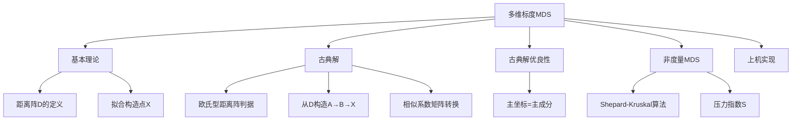
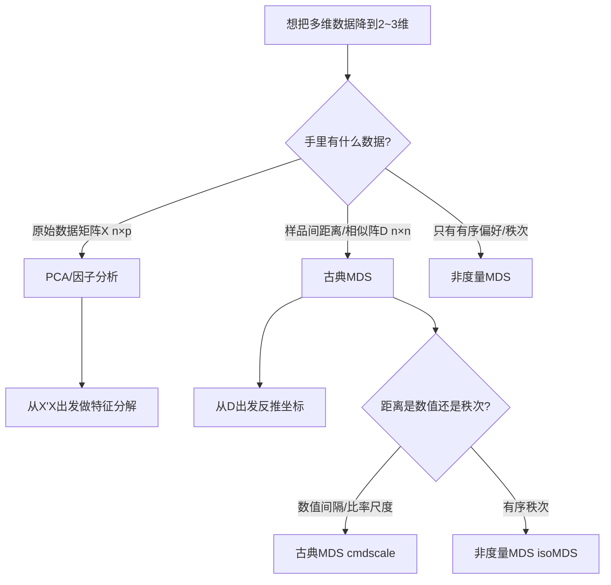

# 第11章 [[KP01_多维标度MDS|多维标度]]法 · 章节总结

> 多维标度法（[[KP01_多维标度MDS|MDS]]）的核心问题：**已知 $n$ 个样品两两之间的距离，能否在二维（或三维）平面上把这些样品的位置画出来，使平面距离尽量接近原始距离？** 它是"从距离矩阵反推坐标"的方法。

## 一、章节框架图

## 二、文字知识树

- **基本理论**
  - 输入：$n\times n$ 距离阵 $D=(d_{ij})$，对称、$d_{ii}=0$、$d_{ij}\ge0$（不要求三角不等式）；
  - 输出：$k$ 维空间中 $n$ 个点 $x_1,\dots,x_n$，使欧氏距离 $\hat d_{ij}\approx d_{ij}$；
  - 解不唯一：正交变换（旋转、平移）不改变距离。
- **古典解（度量 MDS）**
  - 步骤：$D \to A=-\frac12 D^2 \to B=HAH \to$ 特征分解 $B=V\Lambda V' \to \hat X=V_k\Lambda_k^{1/2}$；
  - 判据：$B\ge0$（无负特征根）$\Leftrightarrow D$ 是欧氏型；
  - 选维数：前 $k$ 个特征根累积贡献率 $a_{1,k}=\sum_{i=1}^k\lambda_i/\sum|\lambda_i|$，一般取 $k=2$ 或 $3$。
- **相似系数矩阵**
  - 若已知相似阵 $C$，转换为距离：$d_{ij}=(c_{ii}+c_{jj}-2c_{ij})^{1/2}$；
  - $C\ge0$ 时转换出的 $D$ 必为欧氏型。
- **古典解优良性**
  - 定理 11.3：$X$ 的 $k$ 维主坐标 = $X$ [[KP09_中心化_均值化|中心化]]后前 $k$ 个主成分得分；
  - 定理 11.4：在一切 $\hat X=X\Gamma_1$ 的 $k$ 维投影中，主坐标使距离失真 $\phi=\sum(d_{ij}^2-\hat d_{ij}^2)$ 最小。
- **非度量 MDS**
  - 输入不一定是数值距离，可能只是"谁和谁更像"的**秩次**；
  - 模型：$d_{ij}=f(\hat d_{ij}+e_{ij})$，$f$ 单调增；
  - Shepard-Kruskal 算法：压力指数 $S=\sqrt{\frac{\min\sum(d^*_{ij}-\hat d_{ij})^2}{\sum d_{ij}^2}}$；
  - 判断标准：$S\le5\%$ 优，$5\%\sim10\%$ 可，$>10\%$ 差。

## 三、核心公式清单

| 公式 | 符号解释 | 适用条件 |
|---|---|---|
| $A=(a_{ij}),\ a_{ij}=-\frac12 d_{ij}^2$ | 距离平方的半负矩阵 | 任意距离阵 |
| $B=HAH,\ H=I_n-\frac1n\mathbf1\mathbf1'$ | 双重中心化后的内积阵 | 居中化 |
| $b_{ij}=a_{ij}-\bar a_{i\cdot}-\bar a_{\cdot j}+\bar a_{\cdot\cdot}$ | 中心化公式 | 手算时用 |
| $\hat X=V_k\Lambda_k^{1/2}$ | 前 $k$ 个特征向量×特征根平方根 | $B$ 的正特征根 |
| $a_{1,k}=\sum_{i=1}^k\lambda_i/\sum_{i=1}^n\|\lambda_i\|$ | 累积绝对贡献率 | 选维数 |
| $d_{ij}=(c_{ii}+c_{jj}-2c_{ij})^{1/2}$ | 相似阵→距离阵 | 已知相似系数 |
| $S=\sqrt{\dfrac{\min\sum(d^*_{ij}-\hat d_{ij})^2}{\sum d_{ij}^2}}$ | Kruskal 压力指数 | 非度量 MDS |

## 四、方法选择决策图（MDS vs [[KP04_PCA与FA对比|PCA]] 降维）

## 五、章节联系

- **与 PCA**：定理 11.3 证明，当 $D$ 是由数据阵 $X$ 算出的欧氏距离阵时，MDS 的古典解就是 PCA 主成分得分。**MDS 是 PCA 的推广**——PCA 只能从数据阵出发，MDS 还能从任意距离阵（哪怕没有原始变量）出发。
- **与[[04_聚类分析|聚类分析]]**：聚类是"把样品分组"，MDS 是"把样品摆到图上"；MDS 散点图上离得近的样品自然可聚成一类，二者常配合使用。
- **与第 10 章图表示法**：脸谱图、星座图是定性画图；MDS 是定量求坐标，画出来的二维图有数学意义（距离保真）。

## 六、自测题

1. **MDS 要解决什么问题？**
   答：已知 $n$ 个样品两两距离 $d_{ij}$，在低维（通常 2 维）空间中找出 $n$ 个点 $x_i$，使它们之间的欧氏距离 $\hat d_{ij}$ 尽量接近 $d_{ij}$。

2. **什么是欧氏型距离阵？如何判断？**
   答：若存在 $R^p$ 中 $n$ 个点使 $d_{ij}^2=(x_i-x_j)'(x_i-x_j)$，则 $D$ 为欧氏型。判据：由 $D$ 构造 $B=HAH$（$A=-\frac12D^2$）后，$B\ge0$（无负特征根）当且仅当 $D$ 是欧氏型。

3. **古典解的求解步骤？**
   答：(1) $A=-\frac12D^2$；(2) $B=HAH$；(3) 对 $B$ 特征分解，取前 $k$ 个正特征根对应特征向量；(4) $\hat X=V_k\Lambda_k^{1/2}$ 即坐标。

4. **MDS 与 PCA 的区别？**
   答：PCA 从数据阵 $X$ 出发，找变量的线性组合使方差最大；MDS 从距离阵 $D$ 出发，找样品坐标使距离失真最小。当 $D$ 是由 $X$ 算得的欧氏距离时，二者结果等价（主坐标=主成分得分）。

5. **非度量 MDS 用在什么场合？**
   答：当数据只是"谁和谁更像"的有序评分（如 1=差异小、9=差异大），而不是真实数值距离时；用 Shepard-Kruskal 算法只保序不保距，靠压力指数 $S$ 判断拟合优劣。

6. **压力指数 $S$ 的判断标准？**
   答：$S\le5\%$ 拟合好；$5\%\sim10\%$ 一般；$>10\%$ 较差。

7. **例 11-3 英国 12 城市为什么取 $k=2$？**
   答：前两个特征根累积贡献率 $a_{1,2}=92.6\%$、$a_{2,2}=99.8\%$，二维已能解释几乎全部距离变异。

8. **MDS 的解为什么不唯一？**
   答：对坐标做旋转（正交变换）和平移，样品间欧氏距离不变，故任何 $\hat Y=\Gamma\hat X+a$ 都是解；画出来的"地图"可能旋转过，但相对位置不变。

## 本章方法答辩速查

1. **问：MDS 和 PCA、聚类怎么配合？** 答：PCA 需要原始数据阵 X；如果只有样品间距离 D（如品牌相似性评分），PCA 无从下手，用 MDS。MDS 画出的二维散点图上，离得近的样品自然可聚成一类，所以 MDS 常和聚类配合：先 MDS 画图看结构，再 K-means 定量分组。
2. **问：MDS 的解为什么不唯一？这是缺点吗？** 答：对坐标做旋转、平移、反射，样品间欧氏距离不变。所以 MDS 画出的"地图"可能整体转了一个角度，但城市间相对位置正确。这不是 bug，是距离的本质——距离只决定相对位置，不决定绝对坐标。
3. **问：什么时候用非度量 MDS？和古典 MDS 有什么区别？** 答：当数据只是有序秩次（1=差异小到 9=差异大的偏好评分），不是真实数值距离时。古典 MDS 会把秩次当真值导致扭曲（Stress=12.2%），非度量 MDS 只保序不保距，Stress 降到 4.6%。判断标准：Stress≤5% 优，5%~10% 可，>10% 差。
