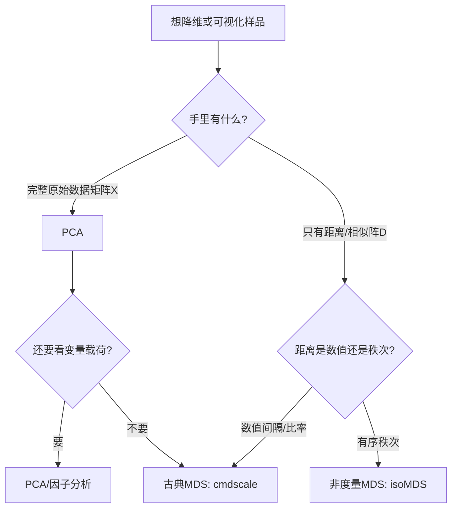

# KP01 · 多维标度法 MDS

<div style="text-align:right;margin:10px 0;"><a href="../../../../exam.html" target="_blank" style="display:inline-block;padding:6px 16px;background:#2563eb;color:#fff;border-radius:6px;text-decoration:none;font-size:14px;">📝 开始做题</a></div>


## 1. 是什么

**定义**：多维标度法（Multidimensional Scaling, MDS）是一类**从样品间距离矩阵 $D=(d_{ij})$ 出发，反推出样品在低维空间（通常二维）中坐标位置**的统计方法，使低维空间中样品间的欧氏距离尽量接近原始距离。

**直觉类比**：
你拿到一张纸条，上面写着："北京到天津 137 公里、北京到锦州 486 公里、天津到锦州 499 公里、锦州到沈阳 242 公里……"（两两距离全知道，但不知道任何城市的经纬度）。
你能否在纸上把这些城市的位置画出来？——这就是 MDS。
- 已知：城市间距离；
- 想求：城市坐标；
- 画出的地图可能旋转了一个角度，但城市间相对位置正确。

**解决什么问题**：
- 市场研究：消费者对 10 个品牌的相似性打分，反推消费者心中"评价品牌"的几个关键维度；
- 心理学：受访者对若干气味/音乐的偏好排序，反推感官维度；
- 地理学：已知城市间公路距离，复原地图；
- 任意场景：样品间距离/相似性已知，但样品在原始变量空间中的坐标未知。

## 2. 怎么用

### 完整步骤（古典 MDS）

1. 构造距离阵 $D=(d_{ij})$（对称、$d_{ii}=0$）。
2. 计算 $A=(a_{ij})=-\frac12 D^2$。
3. 双重[[KP09_中心化_均值化|中心化]]：$B=HAH$，其中 $H=I_n-\frac1n\mathbf1\mathbf1'$。
4. 对 $B$ 做特征分解 $B=V\Lambda V'$，按特征根从大到小排。
5. 选前 $k$ 个正特征根（一般 $k=2$），令 $\hat X=V_k\Lambda_k^{1/2}$。
6. $\hat X$ 的每一行就是一个样品在 $k$ 维空间中的坐标。
7. 画散点图，观察样品间相对位置，做归类。

### 公式

中心化矩阵：

$$H=I_n-\frac1n\mathbf1_n\mathbf1_n'$$

内积阵：

$$B=HAH,\quad a_{ij}=-\frac12 d_{ij}^2$$

特征分解：

$$B=V\Lambda V',\quad \Lambda=\mathrm{diag}(\lambda_1,\dots,\lambda_n)$$

$k$ 维古典解：

$$\hat X=V_k\Lambda_k^{1/2}$$

累积贡献率（选维数）：

$$a_{1,k}=\frac{\sum_{i=1}^k\lambda_i}{\sum_{i=1}^n|\lambda_i|},\qquad a_{2,k}=\frac{\sum_{i=1}^k\lambda_i^2}{\sum_{i=1}^n\lambda_i^2}$$

- $\lambda_i$：$B$ 的第 $i$ 个特征根；
- $v_{(i)}$：对应特征向量；
- $\hat X$：$n\times k$ 坐标阵，第 $i$ 行是第 $i$ 个样品的坐标。

相似阵转距离阵：

$$d_{ij}=(c_{ii}+c_{jj}-2c_{ij})^{1/2}$$

### R 代码

```r
# 目的：用 R 实现古典 MDS 与非度量 MDS（例11-6：国内10城市距离）
# 原理：已知城市间公路距离，反推城市在二维平面上的位置

# ========== 1. 古典 MDS：cmdscale() ==========
# 目的：从距离阵 D 求样品二维坐标（度量 MDS）
# cmdscale() 是 R 基础包函数
# 1.1 录入例11-6 距离阵（单位：千米）
city_names <- c("天津","北京","锦州","沈阳","长春",
                "哈尔滨","满洲里","齐齐哈尔","牡丹江","吉林")
# 注意：距离阵是对称阵，下面只写下三角
D <- matrix(c(
   0,   NA,  NA,  NA,  NA,  NA,  NA,  NA,  NA,  NA,
 137,   0,  NA,  NA,  NA,  NA,  NA,  NA,  NA,  NA,
 499, 486,   0,  NA,  NA,  NA,  NA,  NA,  NA,  NA,
 741, 728, 242,   0,  NA,  NA,  NA,  NA,  NA,  NA,
1046,1033, 547, 305,   0,  NA,  NA,  NA,  NA,  NA,
1288,1275, 789, 547, 242,   0,  NA,  NA,  NA,  NA,
2326,2210,1724,1482,1177, 935,   0,  NA,  NA,  NA,
1451,1335, 849, 760, 530, 288, 693,   0,  NA,  NA,
1746,1630,1144, 902, 597, 355,1290, 643,   0,  NA,
1187,1174, 688, 446, 128, 275,1210, 563, 630,   0
), nrow = 10, byrow = TRUE)
# 补成对称阵
D[upper.tri(D)] <- t(D)[upper.tri(D)]
diag(D) <- 0
rownames(D) <- colnames(D) <- city_names
D

# 1.2 古典 MDS：k=2 求二维坐标
# cmdscale(D, k) 中 D 必须是距离阵；k 是想要的维数
mds <- cmdscale(as.dist(D), k = 2)
mds
# 输出解读：两列即 10 个城市在二维平面的坐标；
#   解可能整体旋转/翻转，但城市间相对距离正确

# 1.3 画 MDS 图
plot(mds[,1], mds[,2], asp = 1, pch = 19, cex = 1.5,
     xlab = "维度1", ylab = "维度2",
     main = "国内10城市古典MDS二维图")
text(mds[,1], mds[,2], labels = rownames(mds), pos = 3, cex = 0.8)
abline(h = 0, v = 0, lty = 2, col = "gray")
# 输出解读：天津、北京应聚在一起；满洲里应远离其他城市；
#   形状与真实地图可能旋转，但相对位置一致

# 1.4 查看特征值累积贡献率
eig <- cmdscale(as.dist(D), k = 2, eig = TRUE)$eig
# eig 是 B 的特征值（可能有负的）
(cum <- cumsum(abs(eig)) / sum(abs(eig)))
# 前2维累积贡献率 >80% 即可接受

# ========== 2. 非度量 MDS：isoMDS() ==========
# 目的：当距离只是有序秩次（如1~9分差异）时使用
# isoMDS() 在 MASS 包中，用 Shepard-Kruskal 算法
if (!requireNamespace("MASS", quietly = TRUE)) install.packages("MASS")
library(MASS)

# 用例11-7 大学差异阵（1=差异小，9=差异大）演示
uni_names <- c("北大","清华","复旦","人大","南大",
               "吉大","天大","北师大","厦大","华东师大")
D_uni <- matrix(c(
0,1,5,4,6,7,7,7,8,8,
1,0,4,5,6,7,6,8,8,9,
5,4,0,1,1,2,3,3,4,4,
4,5,3,0,1,2,3,3,3,4,
6,6,1,1,0,2,4,4,4,5,
7,7,2,2,2,0,1,2,2,3,
7,6,3,3,4,1,0,1,1,2,
7,8,3,3,4,2,1,0,1,2,
8,8,4,3,4,2,1,1,0,2,
8,9,4,4,5,3,2,2,2,0
), nrow = 10, byrow = TRUE)
rownames(D_uni) <- colnames(D_uni) <- uni_names

# isoMDS() 输入必须是距离阵；k=2
# trace = FALSE 不打印迭代过程
nmds <- isoMDS(as.dist(D_uni), k = 2, trace = FALSE)
nmds$points   # 二维坐标
nmds$stress   # Kruskal 压力指数
# 判断：stress<5% 好；5%~10% 一般；>10% 差

plot(nmds$points[,1], nmds$points[,2], asp = 1,
     pch = 19, cex = 1.5,
     main = paste0("10所大学非度量MDS (stress=", round(nmds$stress,3),")"))
text(nmds$points[,1], nmds$points[,2], labels = uni_names, pos = 3)
# 输出解读：北大、清华应聚在一角；复旦、南大、人大、吉大居中；
#   厦大、华东师大等偏在另一角

# ========== 3. Shepard 图（诊断拟合） ==========
# 目的：画原始距离 vs 拟合距离散点，看是否单调
 Shepard <- function(dist_orig, dist_fit) {
   plot(dist_orig[lower.tri(dist_orig)],
        dist_fit[lower.tri(dist_fit)],
        xlab = "原始距离", ylab = "拟合距离",
       main = "Shepard 图：点越贴单调曲线越好")
   abline(0, 1, col = "red", lty = 2)
 }
# 计算拟合距离
D_fit <- as.matrix(dist(nmds$points))
Shepard(D_uni, D_fit)
```

### 计算演示（例 11-2，7 个点）

给定距离阵（正七边形+中心）：

$$D=\begin{bmatrix}0&1&\sqrt3&2&\sqrt3&1&1\\ &0&1&\sqrt3&2&\sqrt3&1\\ &&0&1&\sqrt3&2&1\\ &&&0&1&\sqrt3&1\\ &&&&0&1&1\\ &&&&&0&1\\ &&&&&&0\end{bmatrix}$$

手算要点：
1. $a_{ij}=-\frac12 d_{ij}^2$；
2. 中心化得 $B$，其秩为 2，$\lambda_1=\lambda_2=3$，其余为 0；
3. 取特征向量后得到 7 个点坐标：

$$\left(\frac{\sqrt3}{2},\frac12\right),\ \left(\frac{\sqrt3}{2},-\frac12\right),\ (0,-1),\ \left(-\frac{\sqrt3}{2},-\frac12\right),\ \left(-\frac{\sqrt3}{2},\frac12\right),\ (0,1),\ (0,0)$$

这正是单位圆内接正六边形 + 中心一个点，与原始距离阵完全吻合——说明 $D$ 是欧氏型。

## 3. 什么时候用

- **适用场景**：
  - 样品间距离/相似性已知，但样品在原始变量空间的坐标未知；
  - 想把样品在二维图上摆出来做直观比较、分类；
  - 市场研究、心理测量、地理复原、生态位分析。
- **数据条件**：
  - 距离阵对称、$d_{ii}=0$、$d_{ij}\ge0$；
  - 样品数 $n$ 不宜过小（$n<4$ 时 MDS 没意义）；
  - 一般 $n\ge10$ 才有分析价值。
- **前提假设**：
  - 样品间距离是对称的（$d_{ij}=d_{ji}$）；若不对称需用个体差异模型；
  - 度量 MDS 要求距离是数值间隔/比率尺度；
  - 非度量 MDS 只需距离的秩次。

## 4. 什么时候不能用/易错点

- **不适用**：
  - 只有少量样品（<4 个）——直接画散点图即可；
  - 想要变量权重、想要回归方程——那是回归/[[KP03_PCA与因子分析对比|因子分析]]的任务；
  - 距离阵严重不对称（消费者 A 觉得 B 像 C，但 B 不一定觉得 A 像 C）。
- **易错 1**：把 MDS 坐标当真实经纬度——MDS 解可以整体旋转、平移、反射，形状对但角度不一定对。
- **易错 2**：不看压力指数就下结论——$S>10\%$ 说明二维根本不够，必须加到 3 维或换方法。
- **易错 3**：对有序评分数据硬用古典 MDS——应改用非度量 MDS（例 11-7 中古典 Stress=0.12，非度量 Stress=0.046，差距显著）。
- **易错 4**：$B$ 出现负特征根却忽略——负特征根说明 $D$ 不是欧氏型，强行低维拟合会失真。
- **易错 5**：与 [[KP04_PCA与FA对比|PCA]] 混淆——PCA 输出的是"变量的主成分方向"，MDS 输出的是"样品的二维坐标"，二者数据出发点完全不同。

## 5. 与相似方法对比表

| 方法 | 输入 | 输出 | 原理 | 优点 | 缺点 | 何时选它 |
|---|---|---|---|---|---|---|
| **古典 MDS** | **距离阵 D** | **样品二维坐标** | **$D\to A\to B\to$ 特征分解** | **不需要原始变量** | **要求数值距离** | **已知距离阵，想复原坐标** |
| 非度量 MDS | 距离秩次 | 样品二维坐标 | Shepard-Kruskal 迭代 | 只保序，对数据尺度要求低 | 计算慢、依赖初值 | 数据是 1~9 分偏好评分 |
| PCA | 数据阵 X | 样品主成分得分 | 从 $X'HX$ 特征分解 | 同时给出变量载荷 | 必须有原始变量 | 有原始数据、想降维 |
| [[KP01_对应分析|对应分析]] | 列联表 | 行列双标图 | 从列联表广义奇异分解 | 同时画行点和列点 | 只适用于频数表 | 研究行列分类关系 |
| [[04_聚类分析|聚类分析]] | 数据或距离阵 | 样品分组 | 类间距离最小化 | 直接给类别 | 不画坐标、不看维度 | 只想分组不想画图 |

**MDS vs PCA 核心区别**：

| 维度 | PCA | MDS |
|---|---|---|
| 输入 | $n\times p$ 数据阵 $X$ | $n\times n$ 距离阵 $D$ |
| 出发点 | 协方差阵 $X'HX$ | 距离平方阵 $D^2$ |
| 输出 | 样品在主成分空间的得分 | 样品在欧氏空间的坐标 |
| 关系 | 若 $D$ 是由 $X$ 算得的欧氏距离，MDS 古典解 = PCA 主成分得分（定理 11.3） | 同左 |

## 6. 为什么用这个不用那个



- **用 PCA 会出什么问题**：PCA 要求每个样品在每个变量上都有观测值；若只有品牌间"像不像"的评分矩阵，根本没有原始变量，PCA 无从下手。
- **用聚类会出什么问题**：聚类只给"分几类"，不告诉你"类与类之间隔多远""哪些维度在起作用"，丢失了距离信息。
- **用古典 MDS 处理秩次数据会出什么问题**：把 1~9 分当真值代入，拟合扭曲（例 11-7 古典 Stress=0.122）；改用非度量 MDS 后 Stress 降到 0.046。

## 7. 完整例子

### 书中原例（例 11-6：国内 10 城市）

输入距离阵（表 11-3），[[05_SPSS操作指引|SPSS]] 输出二维坐标：

| 城市 | 维度1 | 维度2 |
|---|---|---|
| 天津 | 2.095 | -0.192 |
| 北京 | 1.922 | -0.286 |
| 锦州 | 0.931 | -0.116 |
| 沈阳 | 0.468 | 0.012 |
| 长春 | -0.141 | 0.090 |
| 哈尔滨 | -0.616 | 0.108 |
| 满洲里 | -2.476 | -0.802 |
| 齐齐哈尔 | -0.863 | -0.345 |
| 牡丹江 | -1.026 | 1.173 |
| 吉林 | -0.294 | 0.359 |

拟合指标：Stress=0.063，RSQ=0.985，拟合良好。
解读：天津北京挤在右侧，满洲里远在左侧——与真实东北地图相比只是整体旋转了一个角度，相对位置完全吻合。

### 书中原例（例 11-7：10 所大学）

1~9 分差异矩阵，古典 MDS：Stress=0.122，RSQ=0.943；
改用非度量 MDS：Stress=0.046，RSQ=0.992，拟合大幅改善。
分类结果：
- 第一类：北大、清华（综合实力最强）；
- 第二类：人大、吉大、复旦、南大（居中）；
- 第三类：天大、北师大、厦大、华东师大（相对较弱）。

### 小白生活实例

班主任让 3 个同学两两互评"相像程度"（1=很像，5=很不像）：

| | 甲 | 乙 | 丙 |
|---|---|---|---|
| 甲 | 0 | 2 | 5 |
| 乙 | 2 | 0 | 4 |
| 丙 | 5 | 4 | 0 |

手算（n=3 可解析）：
1. $a_{ij}=-\frac12 d_{ij}^2$：
   - $a_{12}=-2,\ a_{13}=-12.5,\ a_{23}=-8$
2. 中心化后 $B$ 秩为 2，解得坐标：
   - 甲在 $(0,0)$，乙在 $(1.414,0)$，丙在 $(3.5,-3.57)$
3. 画图：甲乙很近（距离 2），丙离甲乙都远——说明甲和乙学习风格像，丙是异类。

## 答辩常问（带标准答案）

1. **问：MDS 和 PCA 最本质的区别是什么？什么时候二者等价？** 答：PCA 从数据阵 X(n×p) 出发，找变量的线性组合使方差最大；MDS 从距离阵 D(n×n) 出发，反推样品坐标使距离失真最小。当 D 是由 X 算得的欧氏距离时，古典 MDS 解=PCA 主成分得分（定理 11.3）。MDS 是 PCA 的推广——PCA 需要原始变量，MDS 只需要距离。
2. **问：压力指数 Stress 怎么判断拟合好坏？** 答：S≤5% 拟合好；5%~10% 一般可接受；>10% 差，二维不够需加 3 维或换方法。书中大学例子：古典 MDS Stress=12.2%（差），非度量 MDS Stress=4.6%（好），说明数据是秩次型时应用非度量 MDS。
3. **问：度量 MDS 和非度量 MDS 怎么选？** 答：距离是真实数值间隔/比率尺度（城市间公里数）→古典 MDS(cmdscale)；距离只是有序秩次（1=很像到 9=很不像的偏好评分）→非度量 MDS(isoMDS)，它只保序不保距，用 Shepard-Kruskal 算法。

## 8. 速记卡

- 一句话：**知道城市间距离，反推城市在地图上的位置。**
- 出发点：距离阵 $D$（不是数据阵 $X$）；路线：$D\to A\to B\to$ 特征分解 $\to \hat X$。
- 度量 MDS 用 `cmdscale()`；非度量 MDS 用 `MASS::isoMDS()`。
- $B\ge0$ 等价于 $D$ 是欧氏型；有负特征根说明非欧氏型，只能做近似拟合。
- 解不唯一：旋转、平移不改变距离；画出来的"地图"可以转角度，但相对位置正确。
- 与 PCA 关系：$D$ 是 $X$ 的欧氏距离时，古典 MDS = PCA 主成分得分。
- 判断拟合：Stress（压力指数）$\le 5\%$ 优；$5\%\sim10\%$ 可；$>10\%$ 差。
- 口诀：**距离反推坐标、二维画图分类、旋转平移不变、压力指数判优劣**。


---

## 🔗 相关知识点

**🐮 大牛库深入：** [[../../../../经济统计学论文从0基础到精通/08_降维与分类/README|降维与分类模块]]

**📖 原书原文：** [[../../../../原文件/多元统计分析/何晓群_多元统计分析_全书|何晓群《多元统计分析》第11章]]
