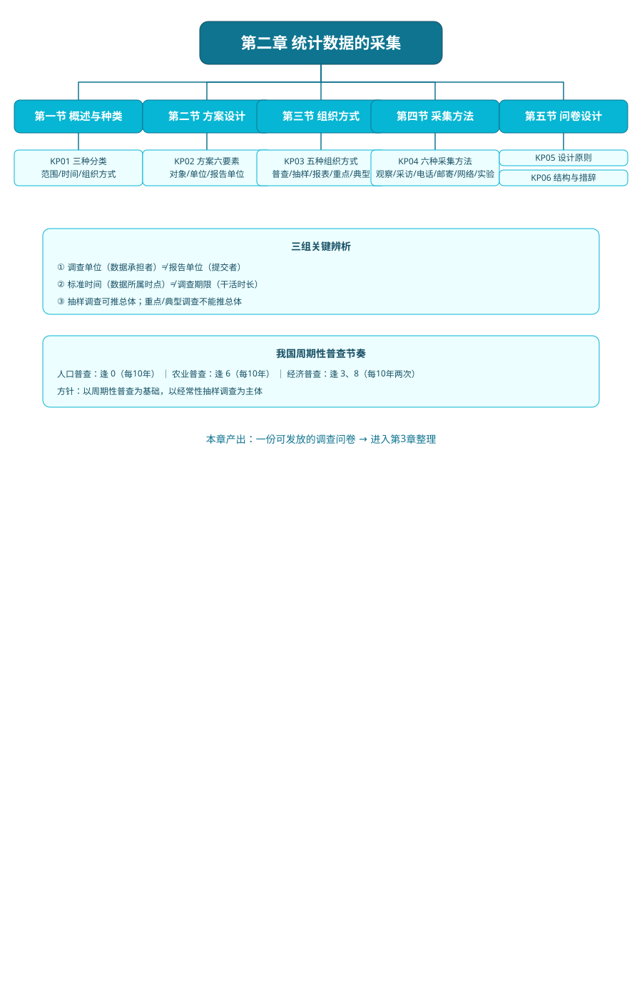

# 第二章 统计数据的采集

> 教材：韩兆洲《统计学原理（第7版）》第02章

## 本章一句话定位

本章解决"数据从哪里来、怎么拿回来"的问题：先设计方案，再选组织方式，再选现场采集方法，最后落地成问卷。它对应统计研究四阶段中的"统计调查"阶段。

## 知识树

```
第二章 统计数据的采集
├── 第一节 概述与种类
│    └── KP01 统计调查三分类（范围/时间/组织方式）
├── 第二节 调查方案设计
│    └── KP02 调查方案六要素（对象/单位/报告单位辨析）
├── 第三节 组织方式
│    └── KP03 五种方式对比（普查/抽样/报表/重点/典型）
├── 第四节 采集方法
│    └── KP04 六种方法（观察/采访/电话/邮寄/网络/实验）
└── 第五节 问卷设计
     ├── KP05 问卷设计原则（逻辑顺序/预调查）
     └── KP06 问卷结构与问题措辞
```

## 核心公式清单

本章以方法选择为主，无复杂公式。需要记住的"关系"：

- **调查单位 ≠ 报告单位**：调查单位是数据承担者，报告单位是提交者。
- **标准时间 ≠ 调查期限**：前者是数据所属时点，后者是工作时长。
- **抽样调查可推总体；重点/典型调查不能推总体**（因非随机、误差不可算）。

## 方法选择速查

| 你的需求 | 选什么 |
|---|---|
| 要最准确的国情底数 | 普查（逢0/6/3/8） |
| 要经常、便宜地估计总体 | 随机抽样调查 |
| 已有健全基层网络、要定期数据 | 统计报表 |
| 只要盯大户看主要趋势 | 重点调查 |
| 要深入剖析原因 | 典型调查 |
| 现场看行为 | 直接观察法 |
| 面对面聊、要深入 | 采访法 |
| 快速民意测验 | 电话调查（CATI） |
| 全国专业群体 | 邮寄调查 |
| 大学生/网民群体 | 网络调查 |
| 验证因果、新产品试点 | 实验调查法 |

## 与其他章节联系

- 前置：第 1 章的"总体/单位/标志/指标"在本章换成"调查对象/调查单位/调查项目"。
- 后续：第 3 章讲"采集回来的数据怎么审核、分组、汇总成图表"。
- 远期：随机抽样的数学原理在第 6 章展开。

## 自测题

1. 统计调查分哪三种分类维度？各举一例。
2. 调查方案六要素是什么？
3. 调查单位和报告单位有什么区别？举例说明两者何时一致、何时不一致。
4. 调查标准时间和调查期限有什么区别？用第六次人口普查举例。
5. 普查、随机抽样、重点调查、典型调查有何异同？哪几种能用来推总体？
6. 我国周期性普查体系是怎么安排的？
7. 六种数据采集方法各有什么优缺点？
8. 问卷的三部分结构是什么？问题排列应遵循什么顺序？
9. 开放式问题为什么不宜多、要放最后？

## 本章思维导图



---

## 🔗 相关链接

**章节导航：** ⬅️ 上一章：[[../01_绪论/00_章节总结|第一章 绪论]] ｜ 下一章：[[../03_统计数据整理/00_章节总结|第三章 统计数据整理]] ➡️

**📖 原书原文：** [[../../../原文件/统计学原理/韩兆洲_统计学原理第7版_全书|韩兆洲《统计学原理（第7版）》]]（第二章 统计数据采集）

**🐮 大牛库对应模块：** [[../../../经济统计学论文从0基础到精通/02_描述统计/README|02 描述统计]]
