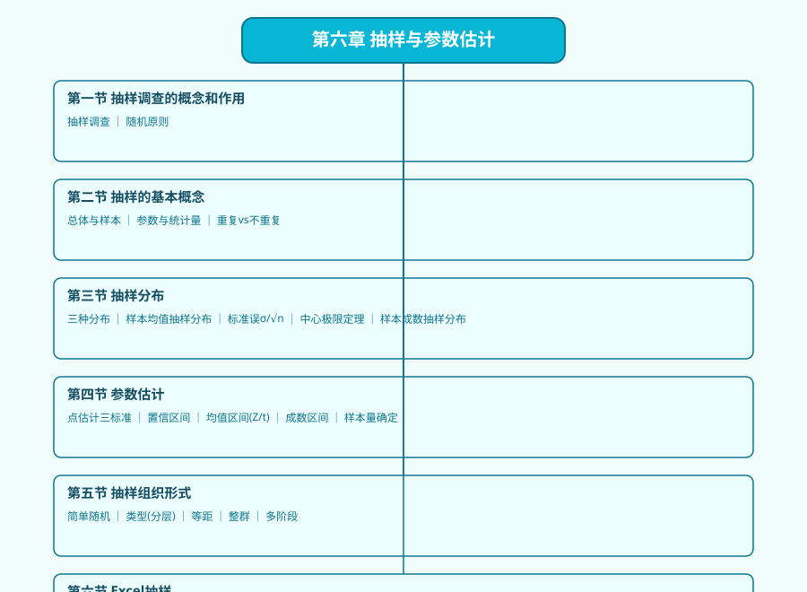

# 第六章 抽样与参数估计 · 章节总结

> 所属：[[00_章节总结|统计学原理]]

## 一、本章一句话定位

**总体太大、又不能全查，怎么办？**——抽一小部分出来，算几个数，反过来猜总体。本章解决的就是"怎么抽才公平、猜出来的数有多准、区间有多宽、要抽多少个才够"这一整条推断统计链路。它是第7章假设检验、第8章回归分析的地基。

---

## 二、知识树

```
第六章 抽样与参数估计
├── 第一节 抽样调查的概念和作用
│   └── KP01 抽样调查与随机原则
├── 第二节 抽样的基本概念
│   ├── KP02 总体与样本
│   ├── KP03 参数与统计量
│   └── KP04 重复抽样 vs 不重复抽样
├── 第三节 抽样分布
│   ├── KP05 抽样分布（总体分布/样本分布/抽样分布三分）
│   ├── KP06 样本均值的抽样分布与标准误
│   ├── KP07 中心极限定理（直觉版）
│   └── KP08 样本成数（比例）的抽样分布
├── 第四节 参数估计
│   ├── KP09 点估计与优良标准（无偏/有效/一致）
│   ├── KP10 区间估计与置信区间
│   ├── KP11 总体均值区间估计（σ已知Z / σ未知t）
│   └── KP12 总体成数区间估计
├── 第五节 抽样调查的组织形式
│   └── KP14 抽样组织形式（简单随机/类型/等距/整群/多阶段）
└── 第六节 Excel 抽样调查
    └── KP13 样本量的确定
```

---

## 三、核心公式清单

| 公式 | 含义 | 符号说明 |
|---|---|---|
| $E(\bar{x})=\mu$ | 样本均值的期望等于总体均值 | 无偏性 |
| $V(\bar{x})=\dfrac{\sigma^2}{n}$（重复） | 样本均值的方差 | $\sigma$ 总体标准差，$n$ 样本量 |
| $\sigma_{\bar{x}}=\dfrac{\sigma}{\sqrt{n}}$ | **标准误**（重复抽样） | 样本均值抽样分布的标准差 |
| $\sigma_{\bar{x}}=\sqrt{\dfrac{\sigma^2}{n}\left(1-\dfrac{n}{N}\right)}$ | 标准误（不重复，大N修正） | $N$ 总体单位数 |
| $\sigma_p=\sqrt{\dfrac{p(1-p)}{n}}$ | 样本成数的标准误 | $p$ 总体成数 |
| $\bar{x}\pm z_{\alpha/2}\dfrac{\sigma}{\sqrt{n}}$ | 总体均值置信区间（σ已知/大样本） | $z_{0.025}=1.96$ |
| $\bar{x}\pm t_{\alpha/2}(n-1)\dfrac{s}{\sqrt{n}}$ | 总体均值置信区间（σ未知小样本） | $s$ 样本标准差 |
| $p\pm z_{\alpha/2}\sqrt{\dfrac{p(1-p)}{n}}$ | 总体成数置信区间 | 大样本近似 |
| $n=\dfrac{z_{\alpha/2}^2\sigma^2}{\Delta^2}$ | 估计均值所需样本量 | $\Delta$ 极限误差 |
| $n=\dfrac{z_{\alpha/2}^2 p(1-p)}{\Delta_p^2}$ | 估计成数所需样本量 | $p(1-p)$ 最大取 0.25 |

---

## 四、方法选择速查

| 你要做什么 | 用什么 |
|---|---|
| 总体σ已知，估计均值区间 | **Z 区间**：$\bar{x}\pm 1.96\sigma/\sqrt{n}$ |
| 总体σ未知，小样本(n<30) | **t 区间**：查 t 表，自由度 n-1 |
| 大样本(n≥30)，不管σ知不知道 | 一律用 Z（t≈Z） |
| 估计合格率、收视率、赞成率 | **成数区间**：$p\pm z\sqrt{p(1-p)/n}$ |
| 调查前先算要抽多少 | 用样本量公式，精度要求越高 n 越大 |
| 总体内部差异大、能分层 | 用**类型抽样**，比简单随机更准 |
| 总体按顺序排列（学生名册、工资单） | 用**等距抽样**，省事又均匀 |
| 调查单位分散、登门贵 | 用**整群抽样**，虽然误差大但省钱 |

---

## 五、与其他章节的联系

- **前置依赖**：[[../05_平均与变异指标/知识点/KP08_方差与标准差|方差与标准差]]（第5章）——本章的 $\sigma$、$s$ 就是那里定义的；[[../../../经济统计学论文从0基础到精通/01_基础数学/README|01 基础数学(概率)]]——正态分布、二项分布是抽样分布的基础。
- **本章核心桥梁**：[[KP07_中心极限定理]] 把"随便什么总体"连到"样本均值正态"，是后面所有区间估计和假设检验的合法性来源。
- **后续被用**：[[00_章节总结|第七章 假设检验]] 直接复用本章的标准误、Z/t 统计量；[[../08_相关与回归/00_章节总结]] 里回归系数的标准误也是同一个 $\sigma/\sqrt{n}$ 思想；大牛库 [03_相关与回归](../../../经济统计学论文从0基础到精通/03_相关与回归/README.md) 全部实证分析都建立在本章的区间估计逻辑上。

---

## 六、自测题（小白能答）

1. 为什么抽样要"随机"？我刻意挑几个有代表性的人查不行吗？
2. 标准差 $\sigma$ 和标准误 $\sigma/\sqrt{n}$ 有什么区别？哪个更小？为什么？
3. "95%置信区间"到底是什么意思？是"真参数有95%概率落在这个区间里"吗？
4. 总体σ未知、只抽了16个样本，该用Z还是t？为什么？
5. 估计合格率时，如果什么都不知道，$p(1-p)$ 取多少最保险？为什么？

---

## 七、思维导图



---

## 🔗 相关链接

**章节导航：** ⬅️ 上一章：[[../05_平均与变异指标/00_章节总结|第五章 平均与变异指标]] ｜ 下一章：[[../07_假设检验/00_章节总结|第七章 假设检验]] ➡️

**📖 原书原文：** [[../../../原文件/统计学原理/韩兆洲_统计学原理第7版_全书|韩兆洲《统计学原理（第7版）》]]（第六章 抽样与参数估计）

**🐮 大牛库对应模块：** [[../../../经济统计学论文从0基础到精通/01_基础数学/README|01 基础数学]] ｜ [[../../../经济统计学论文从0基础到精通/03_相关与回归/README|03 相关与回归]]
