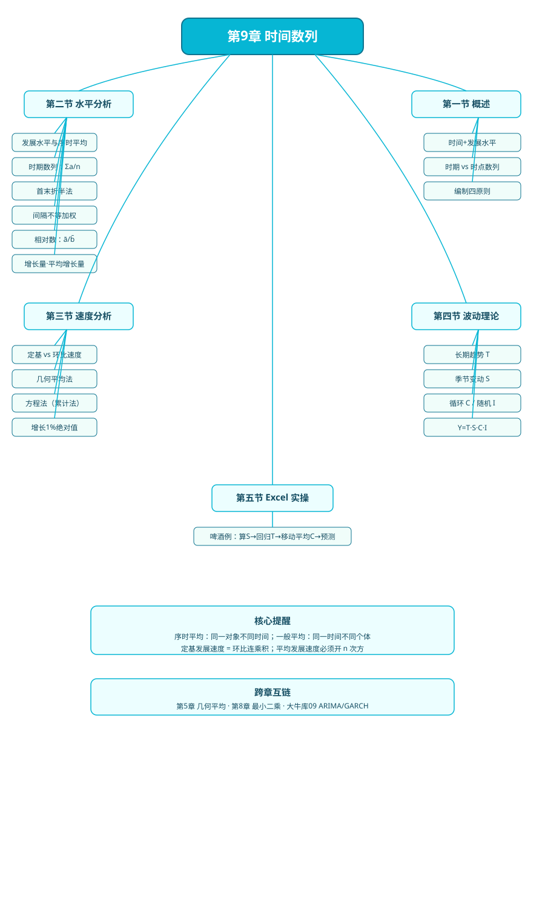

# 第九章 时间序列分析

> 教材：韩兆洲《统计学原理（第7版）》第 9 章

## 本章一句话定位
把同一指标按时间排队，**既看"水平"（这段时间平均是多少），又看"速度"（涨多快），还看"波动"（长期趋势 + 季节 + 周期 + 随机）**，是后续经济预测、趋势分析的基础数据加工方法。

## 知识树

```
第9章 时间数列
├── 第一节 时间数列概述
│   ├── KP01 时间数列两个基本要素（时间 + 发展水平）
│   ├── KP02 时期数列 vs 时点数列
│   └── KP03 编制原则（可比）
├── 第二节 水平分析指标
│   ├── KP04 发展水平与序时平均数（vs 一般平均）
│   ├── KP05 时期数列序时平均（简单算术）
│   ├── KP06 时点连续登记（简单/加权算术）
│   ├── KP07 首末折半法（间隔相等时点）
│   ├── KP08 间隔不等时点（加权首末折半）
│   ├── KP09 相对数/平均数数列序时平均（先分子分母各自平均）
│   └── KP10 增长量与平均增长量
├── 第三节 速度分析指标
│   ├── KP11 发展速度与增长速度（定基 / 环比）
│   ├── KP12 平均发展速度——几何平均法
│   ├── KP13 平均发展速度——方程法（累计法）
│   └── KP14 增长 1% 的绝对值
├── 第四节 波动基本理论
│   ├── KP15 长期趋势 T
│   ├── KP16 季节波动 S
│   └── KP17 循环 C 与不规则 I
└── 第五节 Excel 波动测定实操（啤酒例）
```

## 核心公式清单

| 公式 | 含义 |
|---|---|
| $\bar{a} = \sum a_i / n$ | 时期数列序时平均 |
| $\bar{a} = \dfrac{a_1/2 + a_2 + \cdots + a_n/2}{n-1}$ | **首末折半法**（间隔相等时点） |
| $\bar{a} = \dfrac{\sum \frac{a_i+a_{i+1}}{2} f_i}{\sum f_i}$ | 间隔不等时点加权序时平均 |
| $\bar{c} = \bar{a}/\bar{b}$ | 相对数/平均数数列序时平均 |
| 累计增长量 = $\sum$ 逐期增长量 | $a_n - a_0 = \sum(a_i - a_{i-1})$ |
| 平均增长量 = $(a_n - a_0)/n$ | 逐期增长量的算术平均 |
| 定基发展速度 = 环比发展速度连乘积 | $a_n/a_0 = \prod a_i/a_{i-1}$ |
| 平均发展速度（几何法）= $\sqrt[n]{a_n/a_0}$ | 水平法 |
| 平均发展速度（方程法）满足 $\bar{x} + \cdots + \bar{x}^n = \sum a_i/a_0$ | 累计法 |
| 增长 1% 绝对值 = 前期水平 / 100 | 速度与水平结合 |
| $Y = T \cdot S \cdot C \cdot I$ | 乘法波动模型 |

## 方法选择速查

| 你要算什么 | 用哪个方法 |
|---|---|
| 年 GDP 平均 | 简单算术平均 |
| 月末库存平均（间隔相等） | 首末折半法 |
| 间隔不齐的人口时点 | 加权首末折半 |
| 比重数列平均 | 分子分母各自平均后相除 |
| 一段时期总涨了多少 | 累计增长量 |
| 每年平均涨多少 | 平均增长量 / 平均发展速度 |
| 期末要达到目标的年均增速 | 几何平均法 |
| 关注累计完成量 | 方程法 |
| 剔除季节看趋势 | 季节指数 + 回归 |

## 与其他章节联系
- **前置**：第 5 章平均指标（算术/几何/加权平均）——本章序时平均是它在时间维度的应用；
- **后置**：第 10 章统计指数（发展速度思想延伸）；大牛库 09 时间序列（ARIMA、GARCH 等现代方法）；
- **互链**：[[../05_平均与变异指标/知识点/KP03_几何平均数|几何平均数]]（几何平均）、[[../08_相关与回归/知识点/KP08_最小二乘法OLS|最小二乘法]]（最小二乘趋势线）。

## 自测题
1. 时期数列和时点数列最本质的区别是什么？为什么时点数列不能相加？
2. 首末折半法的分母为什么是 $n-1$ 而不是 $n$？
3. 定基发展速度和环比发展速度什么关系？环比增长速度能直接连乘吗？
4. 平均发展速度为什么用几何平均而不是算术平均？
5. 时间数列四因素 $T, S, C, I$ 中，哪个可以预测、哪个预测时取 1？

## 配套学习
- 📖 原书：[韩兆洲《统计学原理（第7版）》第 9 章](../../原文件/统计学原理/韩兆洲_统计学原理第7版_全书.md)
- 📚 大牛库：[大牛库-09时间序列](../../../经济统计学论文从0基础到精通/09_时间序列/README.md)（现代时序建模：ARIMA、GARCH、HP 滤波，与本章传统描述性分析互补）


