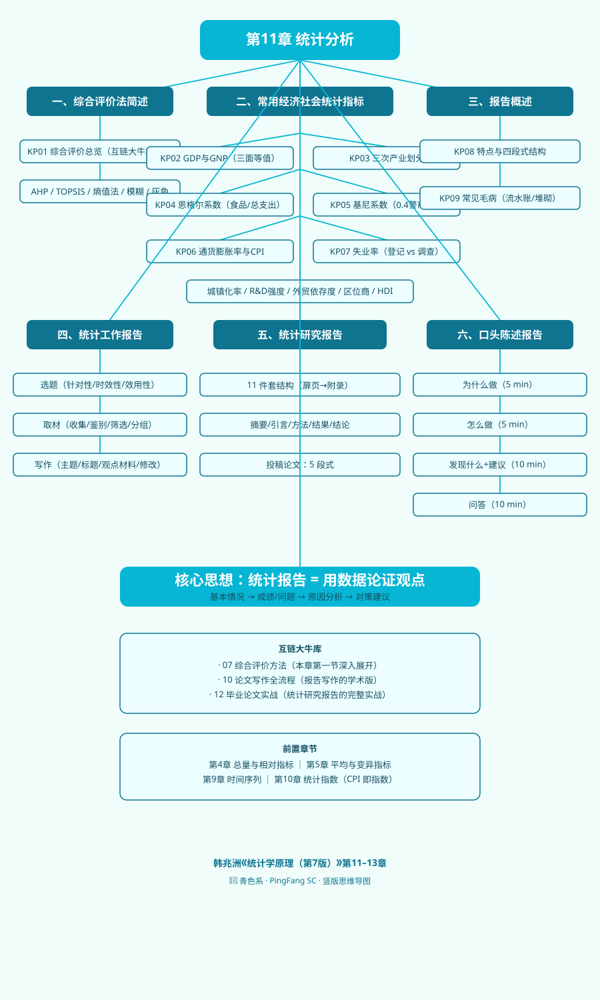

# 第十一章 统计分析

> 教材：韩兆洲《统计学原理（第7版）》第11–13章综合整理
> ｜ 前置：[[../10_统计指数/00_章节总结|第10章 统计指数]] ｜ 后续：毕业论文实战

## 本章一句话定位

前 10 章学完了"怎么收集数据、怎么整理数据、怎么描述数据、怎么推断数据、怎么用指数和回归分析数据"。这一章回答两个收尾问题：**第一**，国家和社会日常挂在嘴边的那些指标——GDP、恩格尔系数、基尼系数、CPI、失业率——到底是什么、怎么算、高低代表什么；**第二**，学了这么多方法，最后怎么把分析结果写成一份别人看得懂、愿意看、能拿去用的东西——统计分析报告。

这一章是"从方法到产出"的临门一脚，不教新的高深公式，而是把前面 10 章的零件组装成一台能上路的车。

## 知识树

```
第11章 统计分析
├── 第一节 综合评价法简述（原书第11章，互链大牛库07）
│   └── KP01 综合评价法总览（AHP/TOPSIS/熵值法/模糊综合/灰色关联 一句话各一个）
├── 第二节 常用经济社会统计指标（原书第12章）
│   ├── KP02 GDP与GNP（生产法/收入法/支出法三面等值）
│   ├── KP03 三次产业划分（第一/第二/第三产业）
│   ├── KP04 恩格尔系数（食品支出占总支出比重，联合国贫富标准）
│   ├── KP05 基尼系数与洛伦兹曲线（0–1，0.4 警戒线）
│   ├── KP06 通货膨胀率与CPI（温和/奔腾/恶性三档）
│   └── KP07 失业率（城镇登记失业率的口径与局限）
├── 第三节 统计分析报告概述（原书第13章第一节）
│   ├── KP08 统计分析报告的特点与结构（数字论证观点）
│   └── KP09 统计分析报告常见毛病（流水账/数字堆砌/缺乏结论）
├── 第四节 统计工作报告（原书第13章第二节）
├── 第五节 统计研究报告（原书第13章第三节）
└── 第六节 口头陈述报告（原书第13章第四节）
```

## 核心公式清单

| 公式 | 含义 | 符号要点 |
|---|---|---|
| $\mathrm{GDP}=\sum(\text{总产出}-\text{中间投入})$ | 生产法 GDP | 各部门增加值之和 |
| $\mathrm{GDP}=$ 劳动者报酬+固定资产折旧+生产税净额+营业盈余 | 收入法 GDP | 四项初次分配收入之和 |
| $\mathrm{GDP}=$ 最终消费+资本形成总额+货物与服务净出口 | 支出法 GDP | 三面等值 |
| $\mathrm{恩格尔系数}=\dfrac{\text{食品消费支出}}{\text{全部生活消费支出}}$ | 越穷越高，越富越低 | 联合国：>60% 绝对贫困，<30% 最富裕 |
| $G=\dfrac{a}{A}$（洛伦兹曲线与绝对平均线围成面积 / 下半三角面积） | 收入分配不平等程度 | 0=绝对平均，1=绝对不平均，0.4=国际警戒线 |
| $\mathrm{CPI}_t=\dfrac{\sum p_{ti}q_{0i}}{\sum p_{0i}q_{0i}}\times 100$ | 居民消费价格指数 | 通货膨胀率≈(CPI_t/CPI_{t-1}−1)×100% |
| $\mathrm{城镇登记失业率}=\dfrac{\text{城镇登记失业人数}}{\text{城镇从业人数}+\text{城镇登记失业人数}}\times100\%$ | 我国官方失业率 | 口径窄，不含农民工，国际可比性差 |
| $\mathrm{城镇化率}=\dfrac{\text{城镇人口}}{\text{总人口}}\times100\%$ | 人口城镇化水平 | 结构相对数 |
| $\mathrm{外贸依存度}=\dfrac{\text{进出口总额}}{\mathrm{GDP}}\times100\%$ | 经济对贸易的依赖 | 小国通常高于大国 |

## 方法选择速查

| 你想知道什么 | 用哪个指标 |
|---|---|
| 一个国家今年生产了多少最终产品 | GDP（生产/收入/支出三法互验） |
| 本国人无论在哪赚的钱有多少 | GNP / GNI |
| 这个国家产业结构高级不高级 | 三次产业比重、服务业增加值比重 |
| 老百姓日子过得怎么样 | 恩格尔系数、人均可支配收入、HDI |
| 社会财富分配公不公平 | 基尼系数、洛伦兹曲线 |
| 物价涨得凶不凶 | CPI、PPI、GDP 平减指数、通货膨胀率 |
| 劳动力闲置多不多 | 城镇登记失业率、调查失业率 |
| 一个区域哪个产业是优势产业 | 区位商（LQ>1 为专业化部门） |
| 学完所有方法，怎么写出一份东西 | 统计分析报告（工作/研究/口头三类） |

## 与其他章节联系

- **前置**：[[../04_总量与相对指标/00_章节总结|第4章]]的总量指标、相对指标是本章所有经济指标的地基；[[../05_平均与变异指标/00_章节总结|第5章]]的平均数讲"代表值"，基尼系数本质上是对收入分布离散程度的另一种度量；[[../09_时间序列分析/00_章节总结|第9章]]的发展速度就是经济增长率；[[../10_统计指数/00_章节总结|第10章]]的 CPI 就是综合指数的一种最常用形式。
- **后置/延伸**：综合评价部分（原书第11章）已在大牛库独立开课，本章只做简述与互链；统计报告部分直接对接毕业论文写作全流程。
- **大牛库**：[07_综合评价方法](../../../经济统计学论文从0基础到精通/07_综合评价方法/README.md)、[10_论文写作全流程](../../../经济统计学论文从0基础到精通/10_论文写作全流程/README.md)、[12_毕业论文实战](../../../经济统计学论文从0基础到精通/12_毕业论文实战/README.md)。

## 自测题

1. GDP 和 GNP 的核心区别是什么？中国企业在美国开工厂赚的钱，计入中国的 GDP 还是 GNP？
2. 一个家庭每月食品支出 3000 元，全部生活消费支出 10000 元。恩格尔系数是多少？按联合国标准，这是什么生活水平？
3. 基尼系数 0 代表什么？0.4 为什么被称为国际警戒线？基尼系数对哪一端的收入变化最不敏感？
4. CPI 同比上涨 3%，这属于温和、奔腾还是恶性通货膨胀？如果每月环比上涨 50% 呢？
5. 一份好的统计分析报告，和一本"数字流水账"的本质区别是什么？请用"基本情况→成绩/问题→原因分析→对策建议"这条主线说明。

## 思维导图



---

📖 原书：[韩兆洲《统计学原理（第7版）》第11–13章](../../../原文件/统计学原理/韩兆洲_统计学原理第7版_全书.md)

📚 大牛库：[07_综合评价方法](../../../经济统计学论文从0基础到精通/07_综合评价方法/README.md) ｜ [10_论文写作全流程](../../../经济统计学论文从0基础到精通/10_论文写作全流程/README.md) ｜ [12_毕业论文实战](../../../经济统计学论文从0基础到精通/12_毕业论文实战/README.md)
