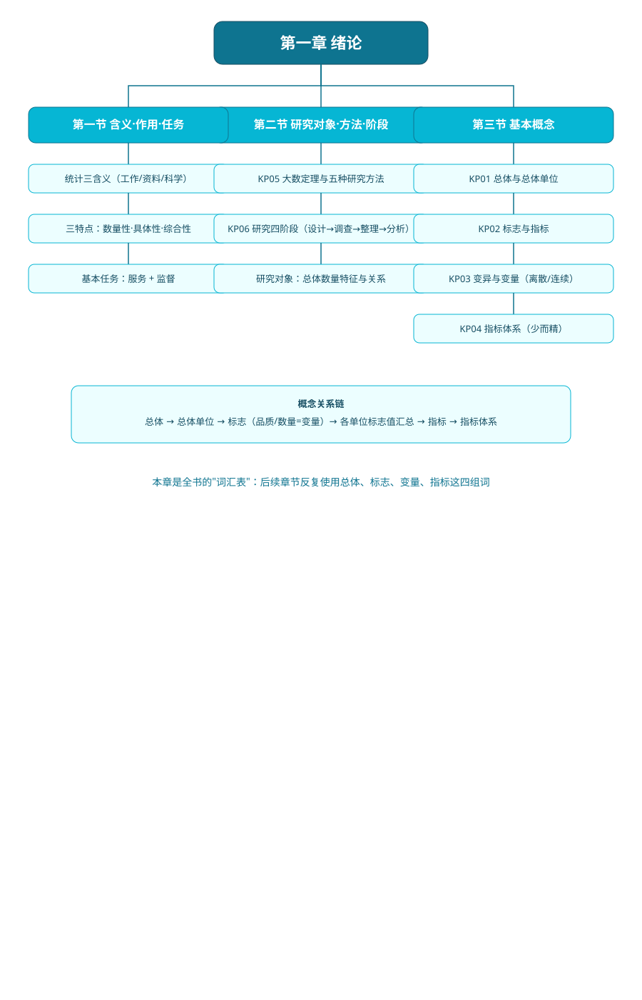
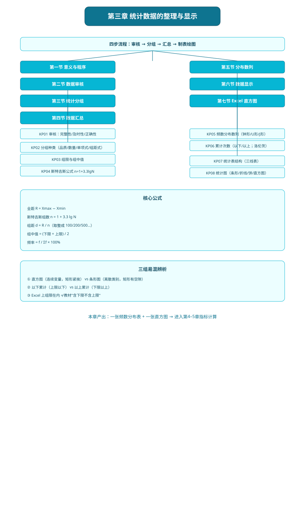
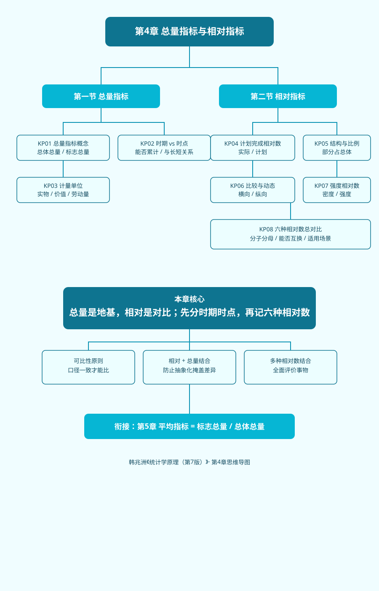
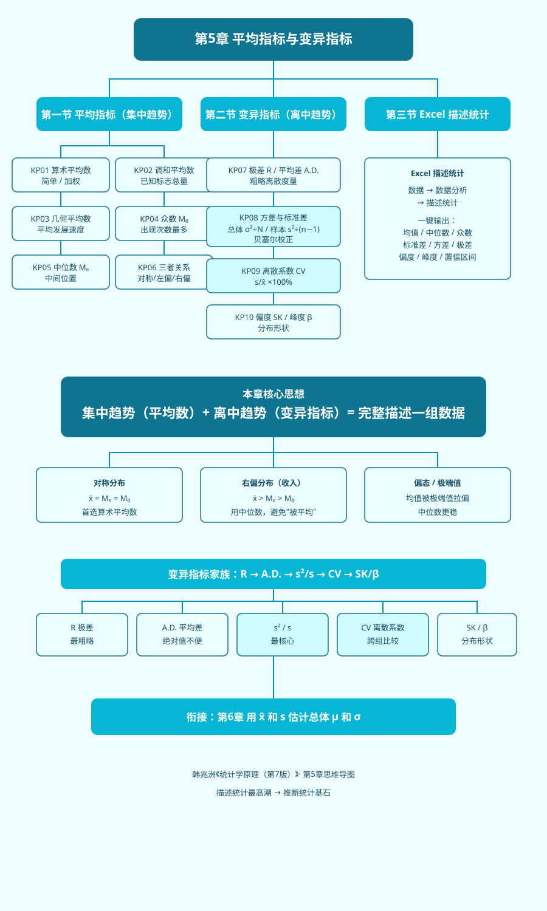
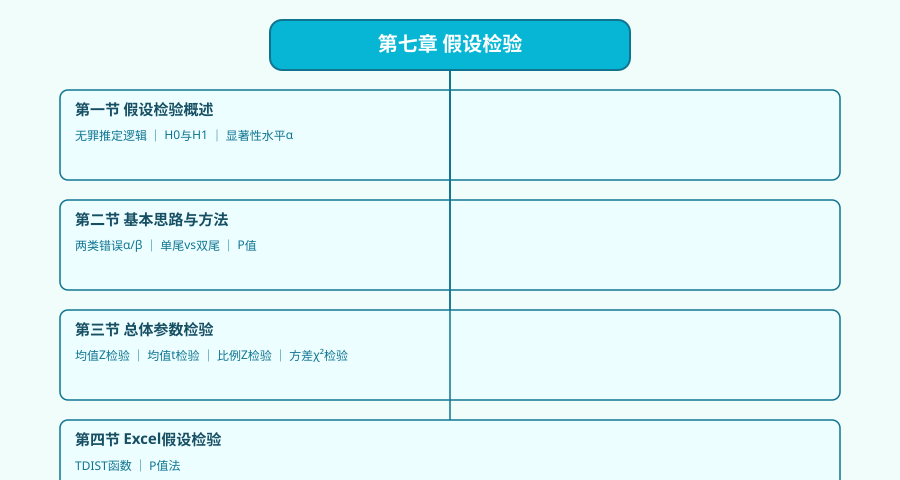
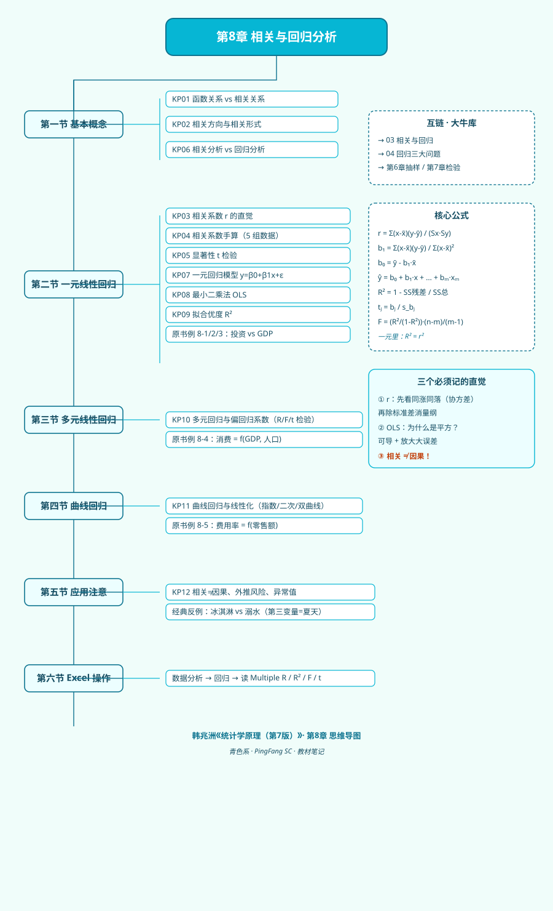
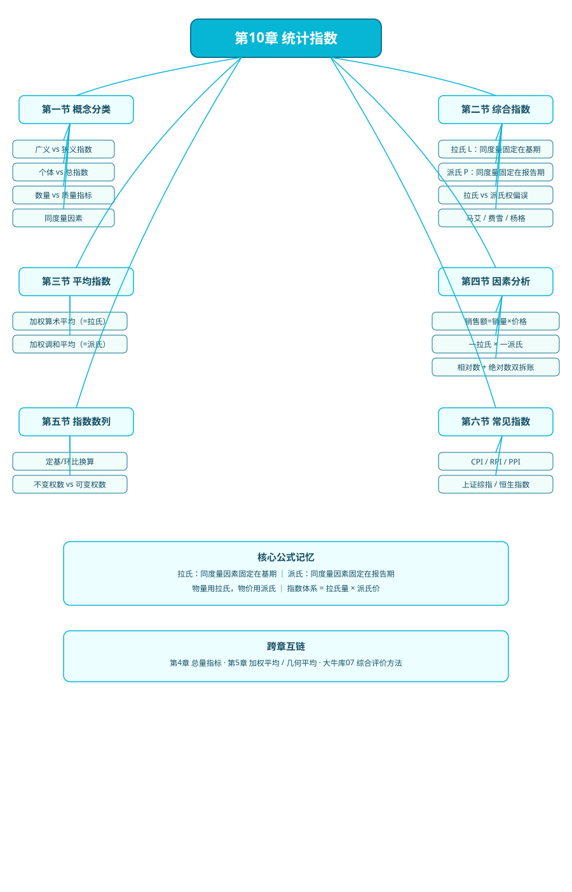

# 统计学原理（韩兆洲·第7版）

> 教材：韩兆洲主编《统计学原理（第7版）》
> 共 11 章，🩵 青色课程，是经济统计学专业的入门基础课。
> 面向"数学白痴、从没学过统计"的小白：每个公式讲怎么来的、每个符号什么意思、什么时候用、为什么不用别的。

## 章节目录（11 章 · 111 个知识点 · 11 张矢量思维导图）

| 章 | 主题 | 节数 | KP 数 | 思维导图 |
|---|---|---|---|---|
| [01 绪论](01_绪论/00_章节总结.md) | 统计含义、研究对象、总体/样本/指标/标志 | 3 | 6 |  |
| [02 统计数据采集](02_统计数据采集/00_章节总结.md) | 调查方案、组织方式、问卷设计 | 5 | 6 |  |
| [03 统计数据整理](03_统计数据整理/00_章节总结.md) | 审核、分组、汇总、分布数列、图表 | 7 | 8 |  |
| [04 总量与相对指标](04_总量与相对指标/00_章节总结.md) | 总量指标、6 种相对数 | 2 | 8 |  |
| [05 平均与变异指标](05_平均与变异指标/00_章节总结.md) | 算术/调和/几何平均、众数中位数、方差标准差、离散系数 | 3 | 10 |  |
| [06 抽样与参数估计](06_抽样与参数估计/00_章节总结.md) | 抽样分布、中心极限定理、置信区间、样本量 | 6 | 14 |  |
| [07 假设检验](07_假设检验/00_章节总结.md) | 反证法逻辑、两类错误、P 值、Z/t 检验 | 4 | 10 |  |
| [08 相关与回归](08_相关与回归/00_章节总结.md) | 相关系数 r、OLS、R²、多元/曲线回归 | 6 | 12 |  |
| [09 时间序列分析](09_时间序列分析/00_章节总结.md) | 水平/速度分析、首末折半、趋势季节 | 5 | 17 |  |
| [10 统计指数](10_统计指数/00_章节总结.md) | 拉氏/派氏、平均指数、指数体系、因素分析 | 6 | 11 |  |
| [11 统计分析](11_统计分析/00_章节总结.md) | 常用经济指标（GDP/恩格尔/基尼）、统计报告写作 | 6 | 9 |  |

## 学习路线

```
描述统计（Ch1-5）  →  推断统计（Ch6-7）  →  相关回归（Ch8）  →  时序与指数（Ch9-10）  →  写报告（Ch11）
```

- **先打地基**：Ch1 建立"总体/样本/指标"语言 → Ch2-3 学会拿数据、整理数据
- **再学描述**：Ch4-5 用一个数概括一堆数据（集中趋势+离散程度）
- **然后推断**：Ch6-7 从样本反推总体，这是统计学的灵魂
- **接着关系与预测**：Ch8 看变量之间怎么联动，Ch9 看一个变量怎么随时间变
- **最后应用**：Ch10 指数体系拆因素，Ch11 把分析写成报告

## 与大牛库的对应关系（双向链接）

| 本课程（教材笔记章节） | 大牛库（实战教程） | 核心融合点 |
|---|---|---|
| Ch1 绪论（总体/样本/标志/指标） | [00_学前准备](../../经济统计学论文从0基础到精通/00_学前准备/README.md) · [01_基础数学](../../经济统计学论文从0基础到精通/01_基础数学/README.md) | 统计语言体系 |
| Ch2 数据采集 · Ch3 数据整理 | [02_描述统计](../../经济统计学论文从0基础到精通/02_描述统计/README.md) | 拿数据、整理数据、画图 |
| Ch4 总量相对指标 · Ch5 平均变异指标 | [02_描述统计](../../经济统计学论文从0基础到精通/02_描述统计/README.md) | 均值、方差、离散系数 |
| Ch6 抽样与参数估计 | [01_基础数学](../../经济统计学论文从0基础到精通/01_基础数学/README.md)（概率统计） | 抽样分布、中心极限定理、置信区间 |
| Ch7 假设检验 | [03_相关与回归](../../经济统计学论文从0基础到精通/03_相关与回归/README.md)（t检验部分） | 两类错误、P值、Z/t检验 |
| Ch8 相关与回归 | [03_相关与回归](../../经济统计学论文从0基础到精通/03_相关与回归/README.md) · [04_回归三大问题](../../经济统计学论文从0基础到精通/04_回归三大问题/README.md) | OLS、R²、相关不等于因果 |
| Ch9 时间序列分析 | [09_时间序列](../../经济统计学论文从0基础到精通/09_时间序列/README.md) · [基期报告期与指数方法选择](../../经济统计学论文从0基础到精通/09_时间序列/09_基期报告期与指数方法选择.md) | 发展速度、定基环比、序时平均 |
| Ch10 统计指数（拉氏/派氏） | [基期报告期与指数方法选择](../../经济统计学论文从0基础到精通/09_时间序列/09_基期报告期与指数方法选择.md) | 基期vs报告期、拉氏vs派氏、权偏误 |
| Ch11 综合评价法简述 | [07_综合评价方法](../../经济统计学论文从0基础到精通/07_综合评价方法/README.md) · [距离方法选择指南](../../经济统计学论文从0基础到精通/07_综合评价方法/10_距离方法选择指南.md) | 欧式/马氏/曼哈顿/切比雪夫/兰氏对比 |
| Ch11 统计报告写作 | [10_论文写作全流程](../../经济统计学论文从0基础到精通/10_论文写作全流程/README.md) | 统计分析报告怎么写 |

## 配套学习

- 📖 原书：[韩兆洲《统计学原理（第7版）》](../../原文件/统计学原理/韩兆洲_统计学原理第7版_全书.md)
- 📚 大牛库：[经济统计学论文从0基础到精通](../../经济统计学论文从0基础到精通/README.md)
- 🎨 写作规范（内部）：[_写作规范.md](_写作规范.md)

---

*🩵 本课程标识色：青色 #06b6d4 · 全部 11 章思维导图均为竖版矢量 SVG*
