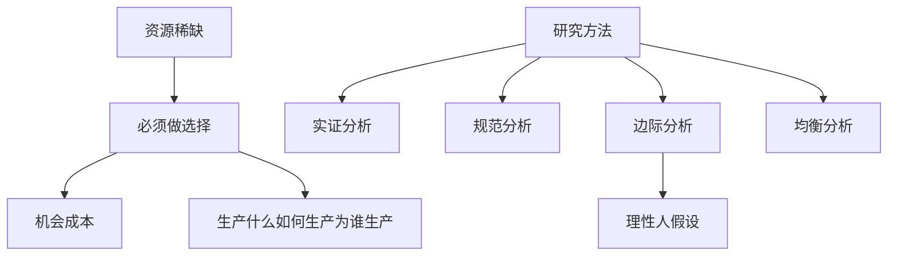

# 导论 章节总结

> 所属：[[../README|06 西方经济学]]

## 这一章在回答什么问题

- 经济学到底研究啥？
- 为啥"稀缺"是经济学的起点？
- 经济学家用什么方法思考问题？

## 核心概念清单

- **资源稀缺性**：人的欲望无限，但能用来满足欲望的资源有限。
- **选择与机会成本**：选了 A 就得放弃 B，放弃的 B 就是选 A 的代价。
- **实证分析 vs 规范分析**："是什么" vs "应该是什么"。
- **边际分析**：不看总量，看"再多一个单位"带来的变化。

## 框架图

## 本章 KP 列表

- [[KP01_资源稀缺性与经济学研究对象|KP01 资源稀缺性与经济学研究对象]]
- [[KP02_机会成本|KP02 机会成本]]
- [[KP03_实证分析与规范分析|KP03 实证分析与规范分析]]
- [[KP04_边际分析方法|KP04 边际分析方法]]

## 与前后章的关系

导论是"地图"——后面所有章节都是在"稀缺 + 理性人 + 边际 + 均衡"这四块基石上盖楼。第 1 章供求就是第一个应用。
