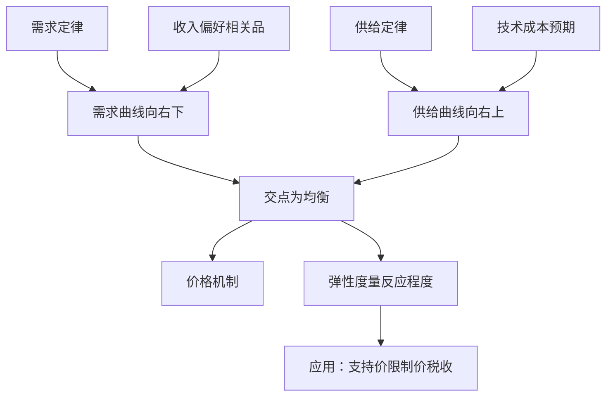

# 第一章 需求、供给和均衡价格 章节总结

> 所属：[[../README|06 西方经济学]]

## 这一章在回答什么问题

一件商品的价格是怎么定出来的？为什么口罩疫情时涨 10 倍？为什么白菜丰收反而农民赔钱？答案都在"需求 + 供给 + 弹性"这三件武器里。

## 核心概念清单

- **需求**：消费者愿意且能够购买的数量。
- **供给**：生产者愿意且能够出售的数量。
- **均衡价格**：需求量 = 供给量时的价格。
- **弹性**：价格变 1%，需求量/供给量变百分之几。

## 框架图

## 本章 KP 列表

- [[KP01_需求与需求定律|KP01 需求与需求定律]]
- [[KP02_供给与供给定律|KP02 供给与供给定律]]
- [[KP03_均衡价格与供求变动|KP03 均衡价格与供求变动]]
- [[KP04_需求价格弹性|KP04 需求价格弹性]]
- [[KP05_需求收入弹性与交叉弹性|KP05 需求收入弹性与交叉弹性]]
- [[KP06_供给价格弹性|KP06 供给价格弹性]]
- [[KP07_支持价格限制价格与税收归宿|KP07 支持价格、限制价格与税收归宿]]

## 与前后章的关系

- 本章是整个微观的"母版"——后面每一章都在重新推导"需求曲线从哪来"（第2章消费者选择）和"供给曲线从哪来"（第3章生产与成本）。
- 第 4、5 章把供求放到不同市场结构里看。
