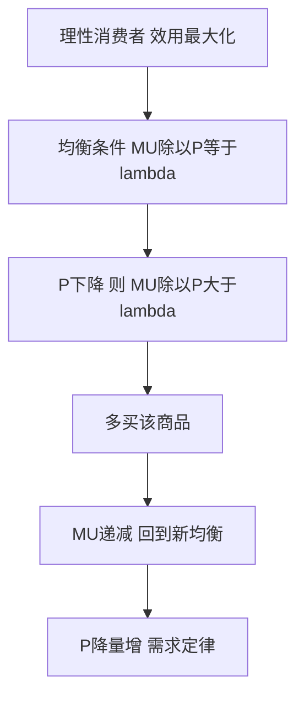

# KP01 需求与需求定律

<a href="../../../../exam.html" target="_blank" style="display:inline-block;padding:6px 16px;background:#2563eb;color:#fff;border-radius:6px;text-decoration:none;font-size:14px;">📝 开始做题</a>

> 所属：[[00_章节总结|第1章 需求、供给和均衡价格]]

## 1. 一句话先懂（小白版）

奶茶 10 块一杯你买 2 杯，涨到 15 块你就只买 1 杯，降到 5 块你可能买 4 杯。**价格越高，你越不想买——这就是需求定律。**

## 2. 严格定义

**需求（Demand）**：在其他条件不变的情况下，消费者在一定时期内，在各种可能的价格水平下**愿意而且能够**购买的商品数量。

两个关键词：**愿意**（有购买欲望）+ **能够**（有购买能力）。光想没钱买不算需求。

**需求定理（Law of Demand）**：其他条件不变，商品价格上升 → 需求量下降；价格下降 → 需求量上升。即价格与需求量呈**反方向**变动。

**需求函数**：
$$Q^d = f(P)$$
其中 $Q^d$ 是需求量，$P$ 是商品自身价格。

最简单的线性需求函数：
$$Q^d = a - bP \quad (a>0, b>0)$$

## 3. 为什么（原理/机制）

价格上升为什么买得少？两个原因：
1. **替代效应**：奶茶从 10 涨到 15，你改喝蜜雪冰城（替代品）。
2. **收入效应**：奶茶贵了，同样的钱能买的东西少了，等于实际收入缩水。

两者加起来，价格涨 → 买得少。

## 4. 来源（需求曲线怎么画）

假设奶茶店需求表：

| 价格 P（元） | 需求量 Q（杯/天） |
|---|---|
| 5 | 40 |
| 10 | 30 |
| 15 | 20 |
| 20 | 10 |

把这些点画在坐标图上，纵轴是 P，横轴是 Q，连起来就是一条**向右下方倾斜**的直线。

需求函数：代入两点 (10, 30) 和 (20, 10)：
- 斜率 $b = \Delta Q / \Delta P = (10-30)/(20-10) = -2$
- $Q = a - 2P$，代入 $P=10, Q=30$ → $30 = a - 20$ → $a=50$
- 所以 $Q^d = 50 - 2P$

## 5. 怎么用（手把手算）

**题目**：已知需求函数 $Q^d = 100 - 4P$，求 P = 10、P = 15 时的需求量。

**第一步**：P = 10 时：
$$Q^d = 100 - 4 \times 10 = 100 - 40 = 60$$

**第二步**：P = 15 时：
$$Q^d = 100 - 4 \times 15 = 100 - 60 = 40$$

**解读**：价格从 10 涨到 15（涨 5 元），需求量从 60 降到 40（少买 20），符合需求定律。

## 5.5 理论推导（一步步推）

> 本节补充：需求定律从什么假设出发，怎么一步步推出来。

**假设起点**：
1. 消费者是理性的，追求效用最大化。
2. 货币的边际效用 λ 不变（每元钱带来的满足感恒定）。
3. 边际效用递减：每多消费一单位商品，新增的满足感 MU 在下降。

**推导过程**：
- 第一步：消费者均衡条件（基数效用论）：在每种商品上花的最后一元钱带来的边际效用相等，即 $MU/P = \lambda$。
- 第二步：商品价格 P 下降 → 同样一块钱能买更多 → 在原消费量下 $MU/P > \lambda$（每元钱带来的效用比平均值高）。
- 第三步：理性消费者会**多买这种商品**，直到 MU 因边际效用递减而下降到满足新的均衡 $MU'/P' = \lambda$。
- 第四步：P 下降 → 多买；P 上升 → 少买。这就是需求定律：**价格与需求量反向变动**。

## 5.6 数学推导（公式怎么来的）

> 每个符号第一次出现必须解释。

设：$Q^d$ = 需求量（消费者在某价格下愿意且能够买的数量）；$P$ = 商品价格；$a$ = 需求曲线在纵轴上的截距（价格高到没人买的临界价）；$b$ = 需求曲线对价格的敏感系数（越大表示价格变动引起的数量变动越大）。

需求函数：
$$Q^d = a - bP$$

其中 $a > 0$、$b > 0$。当 $P = 0$ 时 $Q^d = a$（免费时的最大需求量）；当 $P = a/b$ 时 $Q^d = 0$（价格高到没人买）。

**图形说明**：纵轴 P，横轴 Q。需求曲线从 $(Q=0, P=a/b)$ 出发，向右下方倾斜，斜率 $dP/dQ = -1/b$。

**曲线移动的数学本质**：需求函数 $Q^d = a - bP$ 中，$a$ 是截距（受收入、偏好、相关品价格、预期影响），$b$ 是斜率。任何"非自身价格"因素变化 → $a$ 变化 → 整条线平移；自身价格变化 → 沿曲线移动。

## 6. 需求量变动 vs 需求变动（关键！）

这是新手最容易混的：

| | 需求量变动 | 需求变动 |
|---|---|---|
| 原因 | **商品自身价格**变了 | 价格以外的因素变了 |
| 表现 | 同一条需求曲线上**点移动** | 整条需求曲线**左右平移** |
| 例子 | 奶茶涨价，买得少 | 你涨工资了，同价格买更多 |

影响"需求"（整条曲线移动）的因素：
- 消费者收入（正常品收入↑→需求↑；低档品收入↑→需求↓）
- 相关商品价格（替代品涨价→本品需求↑；互补品涨价→本品需求↓）
- 偏好、预期、消费者数量、政策

## 7. 什么时候不能用（例外）

需求定律有两个著名反例：

1. **吉芬商品（Giffen Goods）**：穷人的主食（如土豆、大米）。价格涨 → 穷人更穷 → 买不起肉，只能多买主食。这种极罕见。
2. **炫耀性商品（Veblen Goods）**：奢侈品包、名表。越贵越显得身份，越贵越有人买。

## 8. 容易混淆什么

| 概念 | 区别 |
|---|---|
| 需求 vs 需要 | 需要是"我想喝"；需求是"我想喝且买得起"。 |
| 需求量 vs 需求 | 需求量是某个价格下的具体数量（点）；需求是整条曲线（所有价格对应的数量）。 |
| 需求 vs 供给 | 需求是买方；供给是卖方。 |

## 9. 现实意义

- 为啥双 11 打折销量暴涨？价格降 → 需求量沿曲线下移。
- 为啥疫情时口罩需求暴涨？不是口罩涨价，而是"偏好/预期"变了，整条曲线右移。
- 为啥口红经济？经济差时大额消费减少，口红这种便宜的小确幸需求反而上升。

---

## 🔗 相关知识点

**同章关联：** [[KP02_供给与供给定律|供给与供给定律]] ｜ [[KP03_均衡价格与供求变动|均衡价格]] ｜ [[KP04_需求价格弹性|需求价格弹性]]

**跨章关联：** [[../../02_消费者选择/知识点/KP02_基数效用论与消费者均衡|需求曲线从效用最大化推出]]

**📖 原书原文：** [[../../../../原文件/经济学/西方经济学上册_微观_全书#第一节 需求|原书·第一章第一节]]

---

## 🐮 小白教程入门

> 看不懂下面这个KP？先看通俗版教程建立直觉：

- [[../../../../经济统计学论文从0基础到精通/13_微观经济学基础/02_需求与供给是什么|🐮 教程·需求与供给是什么]]

---

## 📝 考研真题（首经贸 801）

**配套主观题：** 见同目录 [[../考研真题集|本章考研真题集]]
**配套选择题：** 见同目录 [[../选择题集|本章选择题集]]

### 高频简答
- 简述需求的含义与需求定律，并说明其成立的原因（15 分）→ 见 [[../考研真题集#s1|真题集·简答 1]]
- 辨析"需求量变动"与"需求变动"（15 分）→ 见 [[../考研真题集#s2|真题集·简答 2]]

### 高频论述
- 结合消费者选择理论，论述需求曲线为什么向右下方倾斜（30 分，跨第 2 章）→ 见 [[../考研真题集#l2|真题集·论述 2]]

### 易错选择
- 本知识点选择题见 [[../选择题集#KP01 需求与需求定律|选择题集·KP01]]
