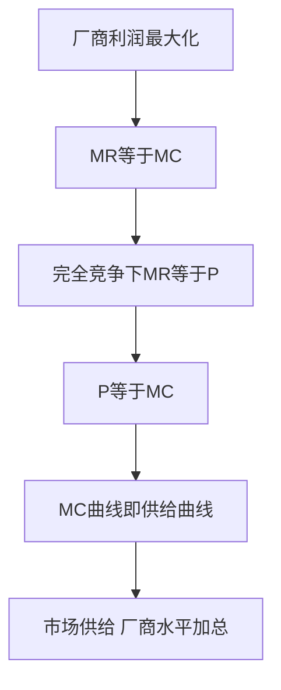

# KP02 供给与供给定律

<a href="../../../../exam.html" target="_blank" style="display:inline-block;padding:6px 16px;background:#2563eb;color:#fff;border-radius:6px;text-decoration:none;font-size:14px;">📝 开始做题</a>

> 所属：[[00_章节总结|第1章 需求、供给和均衡价格]]

## 1. 一句话先懂（小白版）

奶茶卖 5 块一杯你不愿意开店（亏本），卖 10 块你勉强开，卖 20 块你连夜加设备扩产。**价格越高，老板越愿意多生产——这就是供给定律。**

## 2. 严格定义

**供给（Supply）**：在其他条件不变的情况下，生产者在一定时期内，在各种可能的价格水平下**愿意而且能够**提供出售的商品数量。

两个关键词：**愿意**（想卖）+ **能够**（有产能）。

**供给定理（Law of Supply）**：其他条件不变，商品价格上升 → 供给量上升；价格下降 → 供给量下降。即价格与供给量呈**同方向**变动。

**供给函数**：
$$Q^s = f(P)$$

线性供给函数：
$$Q^s = c + dP \quad (d>0)$$

## 3. 为什么（原理/机制）

价格高为什么愿意多生产？
- 多生产一杯奶茶要多用料、多雇人，**边际成本递增**。
- 只有价格高到能覆盖边际成本，老板才愿意多生产。
- 价格低时，多生产一杯还亏一杯，干脆少产。

## 4. 来源（供给曲线怎么画）

奶茶店供给表：

| 价格 P（元） | 供给量 Q（杯/天） |
|---|---|
| 5 | 0 |
| 10 | 10 |
| 15 | 20 |
| 20 | 30 |

画在图上是一条**向右上方倾斜**的直线。

代入两点 (10, 10) 和 (20, 30)：
- 斜率 $d = \Delta Q / \Delta P = (30-10)/(20-10) = 2$
- $Q = c + 2P$，代入 $P=10, Q=10$ → $10 = c + 20$ → $c=-10$
- 所以 $Q^s = -10 + 2P$

注意截距是负的——意思是价格低于 5 元（$-10+2P=0$ 的解）时，老板根本不生产。

## 5. 怎么用（手把手算）

**题目**：已知供给函数 $Q^s = -20 + 5P$，求 P = 10、P = 15 时的供给量，以及老板开始愿意生产的最低价格。

**第一步**：P = 10 时：
$$Q^s = -20 + 5 \times 10 = -20 + 50 = 30$$

**第二步**：P = 15 时：
$$Q^s = -20 + 5 \times 15 = -20 + 75 = 55$$

**第三步**：最低价格 = 令 $Q^s = 0$：
$$0 = -20 + 5P \Rightarrow P = 4$$

也就是说，价格不到 4 元老板根本不开工。

## 5.5 理论推导（一步步推）

> 本节补充：供给曲线从利润最大化假设怎么推出来。

**假设起点**：
1. 厂商追求利润最大化：$\pi = TR - TC$。
2. 产品市场是完全竞争的，厂商是价格接受者（P 给定）。
3. 边际成本 MC 递增（边际报酬递减规律）。

**推导过程**：
- 第一步：总收益 $TR = P\cdot Q$，边际收益 $MR = dTR/dQ = P$（完全竞争时）。
- 第二步：利润最大化条件 $MR = MC$，即 $P = MC(Q)$。
- 第三步：由于 MC 曲线向右上方倾斜，给定 P 水平，对应的 $Q$ 就是厂商愿意供给的数量。
- 第四步：把所有 (P, Q) 对应点连起来 → 厂商短期供给曲线就是 MC 曲线上位于 AVC 最低点以上的部分。
- 第五步：市场供给曲线 = 所有厂商供给曲线水平加总。

## 5.6 数学推导（公式怎么来的）

> 每个符号第一次出现必须解释。

设：$Q^s$ = 供给量；$c$ = 供给曲线截距（价格低到没人愿意生产的临界量）；$d$ = 供给曲线斜率系数（越大表示价格上升引发的供给增加越多）。

供给函数：
$$Q^s = c + dP$$

其中 $d > 0$。当 $P = 0$ 时 $Q^s = c$（通常 $c < 0$，表示价格低于某临界值厂商停产）；当 $P = -c/d$ 时 $Q^s = 0$（停产点）。

**图形说明**：纵轴 P，横轴 Q。供给曲线从纵轴 $P=-c/d$ 处出发，向右上方倾斜，斜率 $dP/dQ = 1/d$。

**曲线移动的数学本质**：投入品价格 w 上升、技术退步、税收 τ 上升 → 截距 $c$ 下降（或曲线垂直上移 τ）→ 供给曲线左移；技术进步、厂商数 n 增加 → 供给曲线右移。

## 6. 供给量变动 vs 供给变动（关键！）

| | 供给量变动 | 供给变动 |
|---|---|---|
| 原因 | **商品自身价格**变了 | 价格以外的因素变了 |
| 表现 | 同一条供给曲线上**点移动** | 整条供给曲线**左右平移** |
| 例子 | 奶茶涨价，老板多卖 | 面粉便宜了，同价格老板愿意多做 |

影响"供给"（整条曲线移动）的因素：
- 生产成本（原材料、工资）
- 生产技术（技术进步→供给↑）
- 相关商品价格（同一块地种玉米还是种大豆）
- 生产者预期、政府政策（税收、补贴）、厂商数量

## 7. 什么时候不能用（例外）

1. **劳动供给**：工资高到一定程度，工人反而想休假（向后弯曲的劳动供给曲线）——这是第 6 章内容。
2. **稀缺文物、梵高画作**：数量固定，无论价格多高都不能多生产，供给曲线垂直。
3. **完全竞争厂商短期**：价格低于平均可变成本，供给量为 0。

## 8. 容易混淆什么

| 概念 | 区别 |
|---|---|
| 供给 vs 供给量 | 供给是整条曲线；供给量是某个价格下的具体数量。 |
| 供给 vs 需求 | 供给是卖方；需求是买方。 |
| 供给量变动 vs 供给变动 | 点移动 vs 线移动。 |

## 9. 现实意义

- 为啥猪肉价格周期性暴涨暴跌？母猪从怀孕到出栏要 10 个月，今天涨价农民扩产，10 个月后集中上市又跌。
- 为啥芯片涨价但手机产能跟不上？建厂要 2 年，短期供给曲线很陡。
- 为啥政府补贴新能源汽车后路上绿牌车暴涨？补贴让同价格厂商愿意多生产，供给曲线右移。

---

## 🔗 相关知识点

**同章关联：** [[KP01_需求与需求定律|需求与需求定律]] ｜ [[KP03_均衡价格与供求变动|均衡价格]] ｜ [[KP06_供给价格弹性|供给价格弹性]]

**跨章关联：** [[../../03_生产与成本/知识点/KP06_短期成本曲线|供给曲线就是边际成本曲线]]

**📖 原书原文：** [[../../../../原文件/经济学/西方经济学上册_微观_全书#第二节 供给|原书·第一章第二节]]

---

## 🐮 小白教程入门

> 看不懂下面这个KP？先看通俗版教程建立直觉：

- [[../../../../经济统计学论文从0基础到精通/13_微观经济学基础/02_需求与供给是什么|🐮 教程·需求与供给是什么]]

---

## 📝 考研真题（首经贸 801）

**配套主观题：** 见同目录 [[../考研真题集|本章考研真题集]]
**配套选择题：** 见同目录 [[../选择题集|本章选择题集]]

### 高频简答
- 简述供给的含义与供给定律，并列举影响供给变动的主要因素（15 分）→ 见 [[../考研真题集#s3|真题集·简答 3]]

### 高频论述
- 用供求弹性理论分析我国城市房价为何长期居高不下，并讨论限购政策效果（30 分）→ 见 [[../考研真题集#l3|真题集·论述 3]]

### 易错选择
- 本知识点选择题见 [[../选择题集#KP02 供给与供给定律|选择题集·KP02]]
