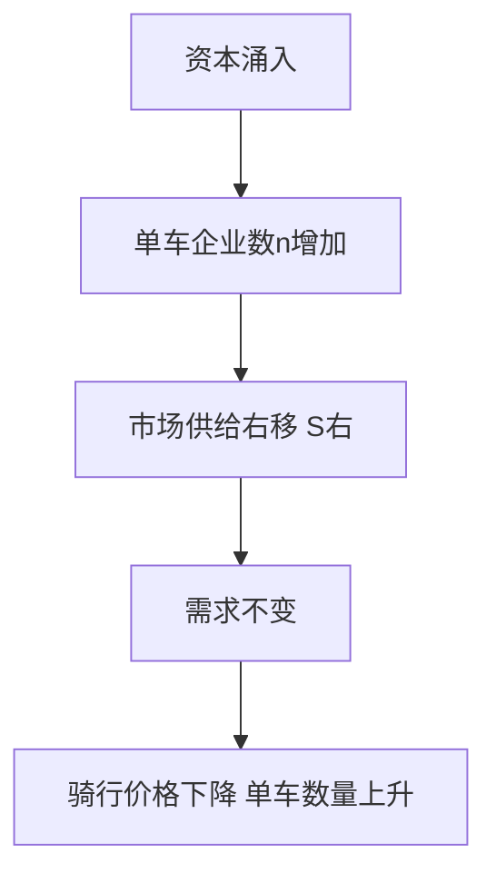
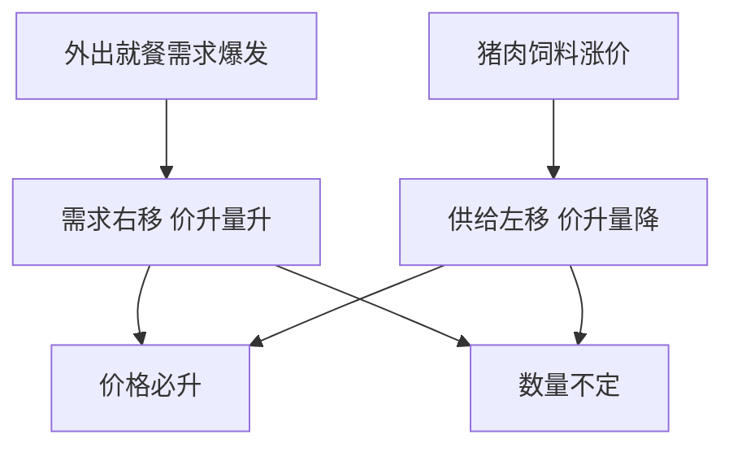
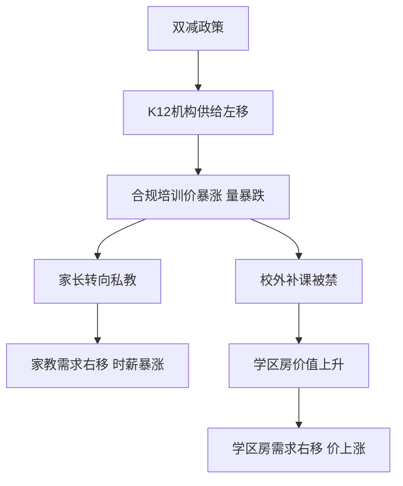

# 第 1 章 需求、供给与均衡价格 · 考研真题集（首经贸 801）

<a href="../../../exam.html" target="_blank" style="display:inline-block;padding:6px 16px;background:#2563eb;color:#fff;border-radius:6px;text-decoration:none;font-size:14px;">📝 开始做题</a>

> 本章共收录：简答题 12 道（每题 15 分）｜论述题 4 道（每题 30 分）
> 配套选择题见 [[选择题集|本章选择题集]]
> 对应大纲：需求与需求定律、供给与供给定律、均衡价格、需求价格弹性、收入与交叉弹性、供给弹性、支持价格与限制价格、税收归宿

## 📋 本题集目录

### 简答题
1. [简述需求的含义与需求定律，并说明其成立的原因](#s1)
2. [辨析"需求量变动"与"需求变动"，并举例说明](#s2)
3. [简述供给的含义与供给定律，并列举影响供给变动的主要因素](#s3)
4. [（计算）已知供求函数求均衡价格与均衡数量](#s4)
5. [供求的变动如何影响均衡价格和均衡数量？请用图形说明](#s5)
6. [简述需求价格弹性的含义、计算公式及五种类型](#s6)
7. [（计算）用弧弹性公式计算奶茶的需求价格弹性，并判断涨价增收还是减收](#s7)
8. [为什么说"薄利多销"只在商品富有需求价格弹性时才成立？](#s8)
9. [简述需求收入弹性与需求交叉弹性的含义，并说明如何据此判断商品类型](#s9)
10. [影响需求价格弹性大小的因素主要有哪些？](#s10)
11. [什么是支持价格与限制价格？二者分别会造成什么经济后果？](#s11)
12. [用弹性与税收归宿原理说明：为什么对香烟征税主要由消费者承担？](#s12)

### 论述题
1. [试用供求模型与弹性理论分析"谷贱伤农"现象，并评价政府农产品支持价格政策](#l1)
2. [结合消费者选择理论，论述需求曲线为什么向右下方倾斜](#l2)
3. [用供求弹性理论分析我国城市房价为何长期居高不下，并讨论限购政策的效果](#l3)
4. [试述税收归宿理论，并分析我国社保缴费负担为何主要由劳动者承担](#l4)

---

## 一、简答题（每题 15 分，建议 450–700 字）

### 简答 1：简述需求的含义与需求定律，并说明其成立的原因

**【建议字数】450–700 字 ｜ 【建议时间】15 分钟 ｜ 【题型】概念简答**

**【考什么】** 对应知识点 [[知识点/KP01_需求与需求定律|需求与需求定律]]；题型属于概念简答。

**【答题框架】**
- 第 1 段：需求的定义（愿意+能够）（4 分）
- 第 2 段：需求定律内容（4 分）
- 第 3 段：成立原因（替代效应+收入效应）（5 分）
- 第 4 段：曲线形状与例外（2 分）

**【参考答案】**

一、需求的含义。需求是指在其他条件不变的情况下，消费者在一定时期内，在各种可能的价格水平下愿意而且能够购买的该商品数量。它有两个缺一不可的要件：一是购买欲望（愿意），二是购买能力（能够）。光有欲望没钱买，只是"需要"而非需求。需求函数可写为 $Q^d=f(P)$，线性形式 $Q^d=a-bP$。

二、需求定律。在其他条件不变时，商品自身价格上升，需求量下降；价格下降，需求量上升，即价格与需求量呈反方向变动。反映在坐标图上，需求曲线是一条向右下方倾斜的曲线。

三、成立原因。价格下降之所以使需求量上升，来自两方面：

（一）替代效应：商品变便宜后，消费者会用它替代其他相对变贵的商品，多买本品。

（二）收入效应：价格下降使消费者既定货币收入的实际购买力提高，等于实际收入上升，从而多买。

两种效应叠加，使价格与需求量反方向变动。

四、例外。需求定律有两个著名反例：一是吉芬商品（穷人的主食，越涨价越穷反而多买）；二是炫耀性商品（奢侈品，越贵越显示身份）。二者极罕见，不否定定律的普遍意义。

**【解析·得分点】** 采分点：①"愿意且能够"两要件（4 分）；②反方向变动、曲线向右下倾斜（4 分）；③替代效应+收入效应（5 分）；④提及吉芬品/炫耀品例外（2 分）。易丢分处：只说"价格高买得少"而不点出"愿意+能够"和两大效应。

**【生活实例】** 奶茶 10 块你买 2 杯，涨到 15 块你改买蜜雪冰城（替代效应），而且同样的钱能买的奶茶变少了，等于"变穷了"一点（收入效应），所以少买一杯。

**【双链接】** 🔗 [[知识点/KP01_需求与需求定律|回知识点]] ｜ 📖 [[../../../原文件/经济学/西方经济学上册_微观_全书|原书·第一章第一节]]

---

### 简答 2：辨析"需求量变动"与"需求变动"，并举例说明

**【建议字数】450–700 字 ｜ 【建议时间】15 分钟 ｜ 【题型】关系对比**

**【考什么】** 对应知识点 [[知识点/KP01_需求与需求定律|需求与需求定律]]；题型属于关系对比。

**【答题框架】**
- 第 1 段：二者区分标准——变动原因不同（5 分）
- 第 2 段：图形表现不同（点移动 vs 线移动）（5 分）
- 第 3 段：列举影响整条需求曲线移动的因素（5 分）

**【参考答案】**

一、区分标准。二者的根本区别在于引起变动的原因不同：

（一）需求量变动：由商品**自身价格**变化引起，其他条件（收入、偏好、相关商品价格等）不变。

（二）需求变动：由商品**自身价格以外**的其他因素变化引起，价格本身不变。

二、图形表现不同。

（一）需求量变动：在同一条需求曲线上，点沿曲线上下移动。价格上升，点沿曲线向左上移动，需求量减少；价格下降，向右下移动。

（二）需求变动：整条需求曲线发生左右平移。需求增加，曲线右移（每一价格下买得更多）；需求减少，曲线左移。

三、影响整条需求曲线移动的因素。主要有：消费者收入（正常品收入上升需求右移，低档品则左移）；相关商品价格（替代品涨价使本品需求右移，互补品涨价使本品需求左移）；消费者偏好；对未来价格和收入的预期；消费者人数与结构；政策等。

四、举例。奶茶自身涨价，你买得少，是同一条曲线上的点移动（需求量变动）；你涨了工资，在同样 10 元价格下愿意买更多，是整条曲线右移（需求变动）。疫情期人们对口罩的需求暴增，不是口罩涨价，而是偏好和预期变化使曲线大幅右移。

**【解析·得分点】** 采分点：①自身价格 vs 价格以外因素（5 分）；②点移动 vs 整条线平移（5 分）；③列举收入、相关品价格、偏好等因素并说明方向（5 分）。易丢分处：把"收入上升"误当成需求量变动——它是整条线移动。

**【生活实例】** 奶茶降价你多喝，是顺着原来那条线往下滑；你发了奖金，不降价也想多喝，是整条线往右挪一格。

**【双链接】** 🔗 [[知识点/KP01_需求与需求定律|回知识点]] ｜ 📖 [[../../../原文件/经济学/西方经济学上册_微观_全书|原书·第一章第一节]]

---

### 简答 3：简述供给的含义与供给定律，并列举影响供给变动的主要因素

**【建议字数】450–700 字 ｜ 【建议时间】15 分钟 ｜ 【题型】概念简答**

**【考什么】** 对应知识点 [[知识点/KP02_供给与供给定律|供给与供给定律]]；题型属于概念+因素分析。

**【答题框架】**
- 第 1 段：供给定义（4 分）
- 第 2 段：供给定律（4 分）
- 第 3 段：影响供给（整条曲线移动）的因素（7 分）

**【参考答案】**

一、供给的含义。供给是指在其他条件不变时，生产者在一定时期内，在各种可能价格水平下愿意而且能够提供出售的商品数量。同样有"愿意（想卖）"和"能够（有产能）"两个要件。供给函数 $Q^s=f(P)$，线性形式 $Q^s=c+dP$。

二、供给定律。其他条件不变时，商品价格上升，生产者愿意提供的数量上升；价格下降，供给量下降，即价格与供给量同方向变动。原因在于：多生产一单位产品要多消耗原材料、人工，边际成本递增，只有价格高到能覆盖边际成本，厂商才愿意增产。供给曲线向右上方倾斜。

三、影响供给（整条曲线移动）的因素。区分"供给量变动"（自身价格引起，沿曲线点移动）与"供给变动"（价格以外因素引起，整条线平移）。主要因素有：

（一）生产成本：原材料、工资下降，同一价格下利润增加，供给增加、曲线右移。

（二）生产技术：技术进步提高劳动生产率，供给增加。

（三）相关商品价格：同一块地种玉米还是大豆，玉米涨价会使大豆供给减少。

（四）生产者对未来的预期：预期涨价会囤货惜售，当期供给减少。

（五）政府政策：补贴使供给增加，征税使供给减少。

（六）厂商数量：新厂商进入，行业供给增加。

四、举例。面粉降价，奶茶店在同一售价下愿多做奶茶，供给曲线右移；疫情封控使原料断供，同一价格下供给减少，曲线左移。

**【解析·得分点】** 采分点：①愿意+能够（4 分）；②同方向变动、原因是边际成本递增（4 分）；③成本、技术、相关品价格、预期、政策、厂商数量（7 分）。易丢分处：混淆供给量变动（点移动）与供给变动（线移动）。

**【生活实例】** 猪肉卖得贵，农民就愿意多养猪（顺着供给线往上走）；要是猪饲料便宜了，不用等猪肉涨价，农民本来就更乐意养更多猪（整条线右移）。

**【双链接】** 🔗 [[知识点/KP02_供给与供给定律|回知识点]] ｜ 📖 [[../../../原文件/经济学/西方经济学上册_微观_全书|原书·第一章第二节]]

---

### 简答 4：（计算）已知某商品市场需求函数 $Q^d=100-2P$，供给函数 $Q^s=-20+4P$。求该市场的均衡价格 $P^*$ 与均衡数量 $Q^*$，并说明当价格为 30 时市场处于什么状态。

**【建议字数】450–700 字 ｜ 【建议时间】15 分钟 ｜ 【题型】分析推导**

**【考什么】** 对应知识点 [[知识点/KP03_均衡价格与供求变动|均衡价格与供求变动]]；题型属于分析推导（计算题）。

**【答题框架】**
- 第 1 步：令 $Q^d=Q^s$ 求 $P^*$（6 分）
- 第 2 步：代入求 $Q^*$（5 分）
- 第 3 步：判断 P=30 时的状态（4 分）

**【参考答案】**

一、求均衡价格。市场均衡时需求量等于供给量，令 $Q^d=Q^s$：

$$100-2P=-20+4P$$

移项：$100+20=4P+2P$，即 $120=6P$，解得 $P^*=20$。

二、求均衡数量。把 $P^*=20$ 代入需求函数：

$$Q^*=100-2\times20=60$$

代入供给函数验证：$Q^s=-20+4\times20=-20+80=60$，供需一致，验证无误。故均衡数量 $Q^*=60$。

三、判断价格为 30 时的市场状态。当 $P=30$ 时：

需求量 $Q^d=100-2\times30=40$；供给量 $Q^s=-20+4\times30=100$。

此时供给量 100 大于需求量 40，出现超额供给（过剩）$100-40=60$ 单位。由于价格 30 高于均衡价格 20，商品卖不掉，生产者之间竞争降价，价格有向 20 回落的压力，直至回到均衡。

**【解析·得分点】** 采分点：①正确列方程 $100-2P=-20+4P$（3 分）；②$P^*=20$（3 分）；③$Q^*=60$ 并验证（5 分）；④P=30 时供过于求、过剩 60、价格有下降压力（4 分）。易丢分处：解方程移项出错，或不会判断 P=30 时是过剩还是短缺。

**【生活实例】** 一件衣服均衡价 20 元、买卖 60 件；店家贪多标 30 元，顾客只买 40 件，仓库压 60 件卖不动，最后只能打折降回 20 元。

**【双链接】** 🔗 [[知识点/KP03_均衡价格与供求变动|回知识点]] ｜ 📖 [[../../../原文件/经济学/西方经济学上册_微观_全书|原书·第一章第三节]]

---

### 简答 5：供求的变动如何影响均衡价格和均衡数量？请用图形说明

**【建议字数】450–700 字 ｜ 【建议时间】15 分钟 ｜ 【题型】模型分析**

**【考什么】** 对应知识点 [[知识点/KP03_均衡价格与供求变动|均衡价格与供求变动]]；题型属于模型分析。

**【答题框架】**
- 第 1 段：需求变动的影响（5 分）
- 第 2 段：供给变动的影响（5 分）
- 第 3 段：口诀与图形描述（5 分）

**【参考答案】**

一、需求变动的影响。需求增加（整条需求曲线右移），在原均衡价格下出现供不应求，价格上升，生产者沿供给曲线增产，新均衡价格和均衡数量都上升；反之需求减少（曲线左移），均衡价格和数量都下降。即需求变动使均衡价格与均衡数量同方向变动。图形上：需求曲线右移，与不变的供给曲线交于更高点，交点右上移。

二、供给变动的影响。供给增加（供给曲线右移），在原价格下供过于求，价格下降、需求量沿需求曲线扩大，新均衡价格下降而均衡数量上升；反之供给减少（曲线左移），均衡价格上升而均衡数量下降。即供给变动使均衡数量与供给同方向变动，而均衡价格反方向变动。图形上：供给曲线右移，与不变的需求曲线交于更右下的点。

三、口诀与小结。记忆口诀：需求移动，价与量同方向走；供给移动，量与供给同方向、价反方向走。若供求同时变动，则要看二者移动的幅度和方向，综合判断价格与数量的净变化方向（某一变量方向可能不确定）。

四、举例。收入上升使奶茶需求右移，奶茶涨价、销量上升；面粉降价使面包供给右移，面包降价、销量上升。

**【解析·得分点】** 采分点：①需求右移→P↑Q↑，左移→P↓Q↓（5 分）；②供给右移→P↓Q↑，左移→P↑Q↓（5 分）；③用"曲线平移+交点移动"描述图形（5 分）。易丢分处：把供给增加写成"价格上升"，方向搞反。

**【生活实例】** 天热了奶茶更好卖（需求右移），于是涨价还卖更多；某品牌奶茶店突然遍地开花（供给右移），竞争激烈就降价、但总销量更大。

**【双链接】** 🔗 [[知识点/KP03_均衡价格与供求变动|回知识点]] ｜ 📖 [[../../../原文件/经济学/西方经济学上册_微观_全书|原书·第一章第三节]]

---

### 简答 6：简述需求价格弹性的含义、计算公式及五种类型

**【建议字数】450–700 字 ｜ 【建议时间】15 分钟 ｜ 【题型】概念简答**

**【考什么】** 对应知识点 [[知识点/KP04_需求价格弹性|需求价格弹性]]；题型属于概念简答。

**【答题框架】**
- 第 1 段：含义（4 分）
- 第 2 段：点弹性与弧弹性公式（5 分）
- 第 3 段：五种类型（6 分）

**【参考答案】**

一、含义。需求价格弹性衡量需求量变动对商品自身价格变动的反应敏感程度，即价格变动百分之一时需求量变动百分之几。由于需求定律，它一般为负值，分析时常取绝对值。

二、计算公式。

（一）点弹性（某一点）：$e_d=\dfrac{\Delta Q/Q}{\Delta P/P}=\dfrac{dQ}{dP}\cdot\dfrac{P}{Q}$。

（二）弧弹性（一段区间，用中点法避免方向偏差）：

$$e_d=\frac{(Q_2-Q_1)/[(Q_1+Q_2)/2]}{(P_2-P_1)/[(P_1+P_2)/2]}$$

三、五种类型（按 $|e_d|$ 大小）。

（一）$|e_d|=0$：完全无弹性，价格怎么变需求量都不变，如特效药。

（二）$0<|e_d|<1$：缺乏弹性，需求量变动幅度小于价格变动幅度，如食盐、大米等必需品。

（三）$|e_d|=1$：单位弹性，二者变动幅度相同。

（四）$|e_d|>1$：富有弹性，需求量变动幅度大于价格变动幅度，如奢侈品、品牌服装。

（五）$|e_d|=\infty$：完全弹性，价格稍有上升需求量即降为零，如完全竞争厂商面对的需求。

四、小结。弹性大小是企业定价和政府制定税收、价格政策的重要依据，必需品弹性小、奢侈品弹性大是基本规律。

**【解析·得分点】** 采分点：①反应敏感程度（4 分）；②点弹性公式与弧弹性中点公式（5 分）；③五种类型及典型例子（6 分）。易丢分处：漏掉弧弹性用中点（平均）价格数量，或五种类型举例张冠李戴。

**【生活实例】** 食盐涨价一倍你还得吃（弹性几乎为 0）；某网红奶茶涨价 20% 你立刻改喝别家（弹性大于 1）——差别就在"离不离得开"。

**【双链接】** 🔗 [[知识点/KP04_需求价格弹性|回知识点]] ｜ 📖 [[../../../原文件/经济学/西方经济学上册_微观_全书|原书·第一章第四节]]

---

### 简答 7：（计算）某奶茶价格从 10 元涨到 12 元，日销量从 100 杯降到 80 杯。用弧弹性（中点）公式求该奶茶的需求价格弹性，并判断涨价后总收益是增加还是减少。

**【建议字数】450–700 字 ｜ 【建议时间】15 分钟 ｜ 【题型】分析推导**

**【考什么】** 对应知识点 [[知识点/KP04_需求价格弹性|需求价格弹性]]；题型属于分析推导（计算题）。

**【答题框架】**
- 第 1 步：算变化量与中点（5 分）
- 第 2 步：代入弧弹性公式（5 分）
- 第 3 步：比较涨价前后总收益（5 分）

**【参考答案】**

一、算变化量与中点值。

$\Delta P=12-10=2$，中点价格 $\bar P=(10+12)/2=11$；

$\Delta Q=80-100=-20$，中点数量 $\bar Q=(100+80)/2=90$。

二、代入弧弹性公式：

$$e_d=\frac{\Delta Q/\bar Q}{\Delta P/\bar P}=\frac{-20/90}{2/11}=\frac{-0.2222}{0.1818}\approx-1.22$$

取绝对值 $|e_d|\approx1.22>1$，该奶茶富有需求价格弹性。

三、判断总收益变化。

涨价前总收益 $TR_1=10\times100=1000$ 元；

涨价后总收益 $TR_2=12\times80=960$ 元。

$960<1000$，涨价后总收益反而减少了 40 元。

四、结论与原理。因为该商品富有弹性（$|e_d|>1$），涨价虽使每杯售价提高，但销量下降的幅度更大，"量的损失"超过"价的收益"，总收益不增反降。这印证了规律：富有弹性时，降价增收、降价才"薄利多销"；缺乏弹性时涨价才能增收。

**【解析·得分点】** 采分点：①中点价格 11、中点数量 90（5 分）；②$e_d\approx-1.22$（5 分）；③涨价前 1000 元、涨价后 960 元、收益减少（5 分）。易丢分处：用起点 10 和 100 而非中点计算（得 -1），或结论写反（以为涨价一定增收）。

**【生活实例】** 奶茶店一看涨价一块钱，每杯多赚两块，结果卖少了 20 杯，总账反而少收 40 块——顾客对奶茶是"可喝可不喝"，涨价就跑了。

**【双链接】** 🔗 [[知识点/KP04_需求价格弹性|回知识点]] ｜ 📖 [[../../../原文件/经济学/西方经济学上册_微观_全书|原书·第一章第四节]]

---

### 简答 8：为什么说"薄利多销"只在商品富有需求价格弹性时才成立？

**【建议字数】450–700 字 ｜ 【建议时间】15 分钟 ｜ 【题型】原因分析**

**【考什么】** 对应知识点 [[知识点/KP04_需求价格弹性|需求价格弹性]]；题型属于原因分析。

**【答题框架】**
- 第 1 段：总收益=价格×数量（3 分）
- 第 2 段：富有弹性时降价的效果（6 分）
- 第 3 段：缺乏弹性时降价反而减收，举例谷贱伤农（6 分）

**【参考答案】**

一、总收益的构成。总收益 $TR=P\times Q$。降价一方面使每单位售价 $P$ 下降（减少收益），另一方面使销售量 $Q$ 上升（增加收益）。净效果取决于这两股力量谁大，而这正是由需求价格弹性决定的。

二、富有弹性时降价增收。当商品富有需求价格弹性（$|e_d|>1$），价格下降一定百分比，需求量上升的百分比更大。于是"销量大增"带来的收益增加，超过"单价下降"带来的收益损失，总收益上升。此时降价（薄利）确实能多销并增收，"薄利多销"成立。例如某品牌服装、旅游景点门票打折，销量暴涨，总收入增加。

三、缺乏弹性时降价反而减收。当商品缺乏需求价格弹性（$|e_d|<1$），价格下降一定百分比，需求量只小幅增加。单价下降的损失超过销量增加的好处，总收益反而减少。典型例子是"谷贱伤农"：粮食是必需品，丰收后供给增加使粮价大跌，但人们对粮食的需求不会因此大增，农民总收入反而下降。此时降价不但不增收，反而减收，"薄利多销"不成立。

四、结论。企业是否应降价促销，必须先判断自己产品的需求价格弹性：富有弹性的商品适合薄利多销，缺乏弹性的生活必需品则不宜靠降价增收。这也是"谷贱伤农"与"机票打折"背后同一弹性原理的两面。

**【解析·得分点】** 采分点：①$TR=P\times Q$ 两股相反力量（3 分）；②$|e_d|>1$ 时价跌量增幅度更大、总收益升（6 分）；③$|e_d|<1$ 时价跌量增幅度小、总收益降，举谷贱伤农（6 分）。易丢分处：笼统说"降价能多卖所以增收"，不区分弹性大小。

**【生活实例】** 演唱会门票打五折，粉丝呼朋唤友多卖几千张，主办方反而赚更多（弹性大）；但大米降价一半，你家也不会多吃一倍米，粮农收入反而少（弹性小）。

**【双链接】** 🔗 [[知识点/KP04_需求价格弹性|回知识点]] ｜ 📖 [[../../../原文件/经济学/西方经济学上册_微观_全书|原书·第一章第四节]]

---

### 简答 9：简述需求收入弹性与需求交叉弹性的含义，并说明如何据此判断商品类型

**【建议字数】450–700 字 ｜ 【建议时间】15 分钟 ｜ 【题型】关系对比**

**【考什么】** 对应知识点 [[知识点/KP05_需求收入弹性与交叉弹性|需求收入弹性与交叉弹性]]；题型属于概念+对比。

**【答题框架】**
- 第 1 段：收入弹性定义及商品分类（6 分）
- 第 2 段：交叉弹性定义及关系判断（6 分）
- 第 3 段：举例（3 分）

**【参考答案】**

一、需求收入弹性。它衡量需求量变动对消费者收入变动的反应程度：

$$e_I=\frac{\Delta Q/Q}{\Delta I/I}$$

根据 $e_I$ 的正负和大小判断商品类型：

（一）$e_I>0$ 为正常品：收入上升需求上升。其中 $0<e_I<1$ 为必需品（粮食、自来水），$e_I>1$ 为奢侈品（旅游、名牌包）。

（二）$e_I<0$ 为低档品：收入上升人们转而消费更好的替代品，对低档品需求反而下降，如地摊货、普通公交。

二、需求交叉价格弹性。它衡量一种商品需求量变动对另一种相关商品价格变动的反应程度：

$$e_{xy}=\frac{\Delta Q_x/Q_x}{\Delta P_y/P_y}$$

根据 $e_{xy}$ 的正负判断两种商品的关系：

（一）$e_{xy}>0$ 为替代品：Y 涨价，消费者转买 X，X 需求上升，如咖啡与奶茶。

（二）$e_{xy}<0$ 为互补品：Y 涨价，连带 X 需求下降，如汽车与汽油。

（三）$e_{xy}=0$ 为无关商品。

三、举例。地铁出行的收入弹性为负，说明地铁是低档品——收入高了人们买车、少坐地铁；咖啡与奶茶交叉弹性为正，说明二者是替代品。

**【解析·得分点】** 采分点：①收入弹性公式及正常品/必需品/奢侈品/低档品的符号与数值区间（6 分）；②交叉弹性公式及替代品(正)/互补品(负)/无关(零)（6 分）；③举例（3 分）。易丢分处：把低档品与必需品混淆，或把交叉弹性符号与对应关系记反。

**【生活实例】** 你工资翻倍后，奶茶越喝越多（收入弹性正，是奢侈品），但泡面越吃越少（收入弹性负，是低档品）；咖啡涨价你就改喝奶茶，说明它俩是替代品。

**【双链接】** 🔗 [[知识点/KP05_需求收入弹性与交叉弹性|回知识点]] ｜ 📖 [[../../../原文件/经济学/西方经济学上册_微观_全书|原书·第一章第四节]]

---

### 简答 10：影响需求价格弹性大小的因素主要有哪些？

**【建议字数】450–700 字 ｜ 【建议时间】15 分钟 ｜ 【题型】因素影响**

**【考什么】** 对应知识点 [[知识点/KP04_需求价格弹性|需求价格弹性]]；题型属于因素分析。

**【答题框架】**
- 逐条列举因素并解释（每条 3 分，答 5 条满分）

**【参考答案】**

需求价格弹性大小，本质上取决于"价格变动时消费者容不容易调整购买"。主要影响因素有：

一、替代品的多少与相近程度。替代品越多、越相近，涨价后消费者越容易转买别种商品，弹性越大；替代品少或无（如特效药），弹性越小。

二、商品的必需程度。生活必需品（食盐、大米）无论贵贱都得买，弹性小；奢侈品、非必需品弹性大。

三、商品支出占家庭总支出的比重。占比小的商品（火柴、食盐），涨价几毛钱无感，弹性小；占比大的商品（房、车、家电），价格变动牵动大，弹性大。

四、时间的长短。时间越长，消费者越容易找到替代品、调整习惯，长期弹性大于短期弹性。例如油价刚涨时人们照常开（短期弹性小），几年后纷纷改买新能源车、坐地铁（长期弹性大）。

五、商品市场的定义宽窄。定义越窄，替代品越多，弹性越大——"某品牌奶茶"弹性大，而"饮品"甚至"食物"作为一个大类，弹性很小。

六、用途的广泛性。用途多的商品，价格下降后可逐步用到更多用途上，需求量增加幅度大，弹性较大。

**【解析·得分点】** 采分点：替代品多少、必需程度、支出比重、时间长短、市场定义宽窄，答出五条即满分（每条 3 分）。易丢分处：只罗列不解释"为什么这一因素使弹性大或小"。

**【生活实例】** 你之所以对某家奶茶价格敏感（弹性大），是因为楼下有十家奶茶可换；但你对食盐价格不敏感（弹性小），是因为没盐不行、也没别的可替代。

**【双链接】** 🔗 [[知识点/KP04_需求价格弹性|回知识点]] ｜ 📖 [[../../../原文件/经济学/西方经济学上册_微观_全书|原书·第一章第四节]]

---

### 简答 11：什么是支持价格与限制价格？二者分别会造成什么经济后果？

**【建议字数】450–700 字 ｜ 【建议时间】15 分钟 ｜ 【题型】关系对比**

**【考什么】** 对应知识点 [[知识点/KP07_支持价格限制价格与税收归宿|支持价格、限制价格与税收归宿]]；题型属于关系对比+政策分析。

**【答题框架】**
- 第 1 段：支持价格含义及后果（6 分）
- 第 2 段：限制价格含义及后果（6 分）
- 第 3 段：小结（3 分）

**【参考答案】**

一、支持价格（最低限价）。它是政府为支持某一行业生产而规定的、高于市场均衡价格的最低价格，如农产品保护价、最低工资。后果：由于限价 $P_{min}>P^*$，供给量大于需求量，出现产品过剩。过剩部分通常由政府按保护价收购储备（如粮食储备）。好处是保护生产者收入、稳定生产积极性；代价是增加财政负担、消费者支付高价、过剩库存可能造成资源浪费。

二、限制价格（最高限价）。它是政府为保护消费者利益而规定的、低于市场均衡价格的最高价格，如疫情期间口罩限价、城市房租管制。后果：由于限价 $P_{max}<P^*$，需求量大于供给量，出现短缺。短缺无法靠价格分配，转而出现排队、凭票供应、黑市交易、寻租等现象；长期还会打击生产者积极性，使供给进一步萎缩，短缺更加严重。

三、小结。二者都是政府对价格机制的干预：支持价格保供给方、造成过剩；限制价格保需求方、造成短缺。它们在特定时期（战争、灾害、扶持农业）有合理性，但长期使用会扭曲价格信号、降低效率，需权衡利弊。

**【解析·得分点】** 采分点：①支持价格=高于均衡价、保护生产者、过剩+政府收购+财政负担（6 分）；②限制价格=低于均衡价、保护消费者、短缺+排队黑市+长期打击供给（6 分）；③利弊权衡（3 分）。易丢分处：把两种限价的方向（高/低于均衡价）或后果（过剩/短缺）写反。

**【生活实例】** 政府说粮食收购价不能低于一块二（支持价格），农民拼命种、卖不完国家收库存；疫情时规定口罩不许超过 15 块（限制价格），结果药店空架、网上炒到 50 块一个（黑市）。

**【双链接】** 🔗 [[知识点/KP07_支持价格限制价格与税收归宿|回知识点]] ｜ 📖 [[../../../原文件/经济学/西方经济学上册_微观_全书|原书·第一章第五节]]

---

### 简答 12：用弹性与税收归宿原理说明：为什么对香烟征税主要由消费者承担？

**【建议字数】450–700 字 ｜ 【建议时间】15 分钟 ｜ 【题型】模型分析**

**【考什么】** 对应知识点 [[知识点/KP07_支持价格限制价格与税收归宿|税收归宿]]、[[知识点/KP04_需求价格弹性|需求价格弹性]]；题型属于模型分析。

**【答题框架】**
- 第 1 段：税收归宿的基本原理（5 分）
- 第 2 段：弹性与税负分摊的关系（6 分）
- 第 3 段：香烟的具体分析（4 分）

**【参考答案】**

一、税收归宿原理。政府对商品征收从量税时，会在消费者支付价 $P_b$ 与生产者到手价 $P_s$ 之间打入一个"税收楔子"，$P_b-P_s=t$。法律上规定由谁缴税（法定归宿），与经济上实际由谁承担税负（经济归宿）往往不一致。税负最终在买卖双方之间如何分摊，不取决于向谁收税，而取决于双方弹性的大小。

二、弹性与税负分摊的关系。基本规律是：弹性越小的一方，越难以通过改变购买量或销售量来逃避税负，因而承担的税负越多。原因在于，需求弹性小意味着消费者价格涨了也不得不买，厂商容易把税通过提价转嫁给他们；供给弹性小意味着厂商难以转产或退出，只能自己吸收税负。大致有：消费者承担份额与 $|e_d|$ 反向，生产者承担份额与 $e_s$ 反向。

三、香烟的具体分析。香烟是成瘾性商品，烟民对价格变动极不敏感，需求价格弹性很小（$|e_d|$ 趋近于缺乏弹性甚至近乎无弹性）；而香烟的生产供给弹性正常。根据上述原理，弹性小的一方（消费者）承担大部分税负。因此政府对每包烟征收的消费税，绝大部分通过涨价转嫁给烟民，烟企利润几乎不受影响。这也正是各国政府偏好对烟酒征税的原因——税基稳定、税收可靠，且不易打击生产。反之，对需求弹性大的奢侈品征税，厂商不敢提价（涨了没人买），税负主要由生产者承担。

**【解析·得分点】** 采分点：①税收楔子 $P_b-P_s=t$、法定归宿≠经济归宿（5 分）；②弹性小的一方多承担（6 分）；③香烟需求弹性小→消费者承担大部，并联系税收政策（4 分）。易丢分处：以为法律规定向厂商收税就由厂商承担——混淆法定归宿与经济归宿。

**【生活实例】** 一包烟涨 10 块税，老烟民照买不误，烟企直接把这 10 块加进售价，一分不少地转嫁给烟瘾大的人；要是对爱马仕包涨 10% 税，商家敢涨价吗？涨价土豪就不买了，只能自己咬着牙承担。

**【双链接】** 🔗 [[知识点/KP07_支持价格限制价格与税收归宿|回知识点]] ｜ [[知识点/KP04_需求价格弹性|需求价格弹性]] ｜ 📖 [[../../../原文件/经济学/西方经济学上册_微观_全书|原书·第一章第五节]]

---

## 二、论述题（每题 30 分，建议 900–1200 字）

### 论述 1：试用供求模型与弹性理论分析"谷贱伤农"现象，并评价政府农产品支持价格政策

**【建议字数】900–1200 字 ｜ 【建议时间】30 分钟 ｜ 【题型】现象类**

**【考什么】** 跨 [[知识点/KP03_均衡价格与供求变动|均衡价格]]、[[知识点/KP04_需求价格弹性|需求价格弹性]]、[[知识点/KP07_支持价格限制价格与税收归宿|支持价格]]；题型属于政策效应类+现象类。

**【答题框架】**
- 第 1 段：描述谷贱伤农现象（4 分）
- 第 2–3 段：用供求模型+弹性理论解释成因（12 分）
- 第 4 段：政府支持价格政策的机制与得失（10 分）
- 第 5 段：中国实际与评价（4 分）

**【参考答案】**

一、现象。"谷贱伤农"指农业丰收之年，粮食产量增加，农民收入反而下降的现象。这看似矛盾——多产了反而更穷——正是供求模型与需求弹性理论可以解释的经典问题。

二、供求模型解释。丰收使粮食供给增加，供给曲线向右移动。在图上，向右下倾斜的需求曲线与新的供给曲线相交，由于粮食需求相对稳定，新均衡点表现为均衡价格大幅下降、均衡数量仅小幅增加。也就是说，丰收主要压低了价格，而没有带来销量的成比例扩大。

三、弹性理论解释成因。关键在于粮食是生活必需品，需求价格弹性很小（$|e_d|<1$）。人们对粮食的消费量基本稳定，不会因为粮价下跌就多吃好几倍。根据弹性与总收益的关系：缺乏弹性的商品，价格下降时，需求量上升的幅度小于价格下降的幅度，总收益 $TR=P\times Q$ 反而减少。于是供给增加（丰收）→ 价格大跌 → 农民总收入下降，这就是"谷贱伤农"。

四、政府支持价格政策的机制与得失。为保护农民收入，政府常实行农产品支持价格（最低收购价），规定粮价不得低于某一高于均衡价的水平。其机制与后果为：

（一）由于支持价格高于市场均衡价，粮食供过于求，出现过剩。

（二）政府按保护价敞开收购过剩粮食，存入储备库，从而把农民收入维持在较高水平。

（三）好处：稳定农民种粮积极性、保障国家粮食安全；代价：财政负担沉重、储备库存积压、消费者支付较高粮价。

五、中国实际与评价。我国实行粮食最低收购价和重要农产品储备制度，对保障十几亿人粮食安全、维护种粮农民利益发挥了重要作用。但长期托市也带来库存高企、财政压力大、价格信号扭曲等问题。近年来，政府逐步推进"价补分离"——把价格形成还给市场，把补贴直接发给种粮农民，既让价格反映供求，又保护农民收入，是更符合市场规律的改进方向。

**【解析·得分点】** 采分点：①描述现象（4 分）；②供给右移、价格大跌而量小增（6 分）；③粮食缺乏需求弹性、$TR=P\times Q$ 反降（6 分）；④支持价格机制=过剩+政府收购+财政代价（10 分）；⑤联系最低收购价、价补分离改革（4 分）。易漏：不点出"缺乏弹性"这一根本原因。

**【生活实例】** 大白菜丰收，地里五毛一斤没人抢；你家也不会因为便宜就一天吃十斤白菜。价崩了、量没涨，菜农一年白干——这就是谷贱伤农。

**【双链接】** 🔗 [[知识点/KP03_均衡价格与供求变动|均衡价格]] ｜ [[知识点/KP04_需求价格弹性|需求价格弹性]] ｜ [[知识点/KP07_支持价格限制价格与税收归宿|支持价格]] ｜ 📖 [[../../../原文件/经济学/西方经济学上册_微观_全书|原书·第一章]]

---

### 论述 2：结合消费者选择理论，论述需求曲线为什么向右下方倾斜

**【建议字数】900–1200 字 ｜ 【建议时间】30 分钟 ｜ 【题型】理论类**

**【考什么】** 跨 [[知识点/KP01_需求与需求定律|需求定律]] 与 [[../02_消费者选择/知识点/KP02_基数效用论与消费者均衡|基数效用论]]、[[../02_消费者选择/知识点/KP05_序数效用论与消费者均衡|序数效用论]]；题型属于理论类。

**【答题框架】**
- 第 1 段：提出问题——需求曲线背后的消费者行为基础（4 分）
- 第 2–3 段：基数效用论的解释（边际效用递减）（12 分）
- 第 4 段：序数效用论的解释（价格—消费曲线）（10 分）
- 第 5 段：总结（4 分）

**【参考答案】**

一、提出问题。第 1 章直接假定需求曲线向右下方倾斜（需求定律），但并未回答"为什么"。消费者选择理论（第 2 章）从消费者效用最大化行为出发，为这一假定提供了微观基础。

二、基数效用论的解释。基数效用论认为效用可以用数字衡量。在边际效用递减规律下，消费者每多消费一单位商品，获得的边际效用 $MU$ 递减。消费者为购买商品支付的价格，取决于该商品给他带来的边际效用：他愿意为第一单位（$MU$ 大）支付高价，为后续单位（$MU$ 递减）只愿支付低价。因此，要让消费者多买，价格就必须下降——需求量随价格下降而上升。

更严格地，消费者均衡条件为 $\frac{MU}{P}=\lambda$（每一元钱买到的边际效用等于货币的边际效用 $\lambda$），由此得 $P=\frac{MU}{\lambda}$。由于 $MU$ 随消费量增加而递减，价格 $P$ 必然随需求量增加而下降。把不同价格下的最优购买量连接起来，就得到一条向右下方倾斜的需求曲线。

三、序数效用论的解释。序数效用论用无差异曲线和预算线分析。商品价格下降时，预算线绕另一轴向外旋转，与更高的无差异曲线相切，新均衡点上该商品的最优购买量增加。依次画出不同价格下的均衡点，连接成"价格—消费曲线"，再把对应价格—需求量组合移到价格—数量坐标系，即得到向右下方倾斜的个人需求曲线。这一过程还可分解为替代效应（相对价格下降使多买）和收入效应（实际购买力上升使多买），二者在正常品上同向，共同使价格下降时需求量上升。

四、总结。无论是基数效用论（边际效用递减 $\Rightarrow P=MU/\lambda$）还是序数效用论（价格—消费曲线），都从消费者效用最大化推导出：价格下降，最优购买量上升。这就为需求曲线向右下方倾斜提供了严格的理论基础，也把第 1 章的需求定律与第 2 章的消费者行为统一起来。

**【解析·得分点】** 采分点：①点明要为需求定律找微观基础（4 分）；②基数论：边际效用递减+$MU/P=\lambda$→$P=MU/\lambda$→价降量升（12 分）；③序数论：预算线旋转→价格—消费曲线→需求曲线（10 分）；④总结两论殊途同归（4 分）。跨章连接："第 1 章假定、第 2 章证明"。易漏：只讲基数论不提序数论。

**【生活实例】** 第一杯奶茶最爽，你愿意花 15 块；第二杯没那么爽了，你只愿出 10 块；第三杯更腻，5 块才考虑——商家想让你多买，就得一杯比一杯便宜，需求曲线自然往下斜。

**【双链接】** 🔗 [[知识点/KP01_需求与需求定律|需求定律]] ｜ [[../02_消费者选择/知识点/KP02_基数效用论与消费者均衡|基数效用论]] ｜ [[../02_消费者选择/知识点/KP05_序数效用论与消费者均衡|序数效用论]] ｜ 📖 [[../../../原文件/经济学/西方经济学上册_微观_全书|原书·第一、二章]]

---

### 论述 3：用供求弹性理论分析我国城市房价为何长期居高不下，并讨论限购政策的效果

**【建议字数】900–1200 字 ｜ 【建议时间】30 分钟 ｜ 【题型】政策效应类**

**【考什么】** 跨 [[知识点/KP03_均衡价格与供求变动|均衡价格]]、[[知识点/KP06_供给价格弹性|供给价格弹性]]、[[知识点/KP07_支持价格限制价格与税收归宿|价格管制]]；题型属于政策效应类+现象类。

**【答题框架】**
- 第 1 段：现象——房价长期上涨（4 分）
- 第 2 段：需求端分析（8 分）
- 第 3 段：供给端弹性分析（10 分）
- 第 4 段：限购政策的效果与局限（8 分）

**【参考答案】**

一、现象。我国一线城市房价长期居高不下、持续上涨，用供求模型和弹性理论可以给出清晰解释。

二、需求端：需求持续右移。过去二十年，大量人口向大城市集聚，城镇化加速，居民收入提高，改善性和投资性住房需求旺盛，使住房需求曲线持续向右移动。叠加对房价上涨的预期（买涨不买跌），需求进一步被放大。需求不断右移，推动均衡价格和均衡数量同时上升。

三、供给端：供给价格弹性极小。这是房价刚性上涨的关键。城市住房供给受土地供给、规划审批、建设周期制约，短期内无法随价格上涨迅速扩大：

（一）城市建设用地由政府垄断供应，土地供给缺乏弹性。

（二）房屋从拿地到建成需要数年，短期供给曲线非常陡峭、近乎垂直。

（三）核心城区土地稀缺，几乎没有增加供给的空间。

于是，当需求曲线持续右移时，由于供给难以相应增加（$e_s$ 很小），新增需求主要不是转化为更多住房，而是推高价格。这就是房价长期居高不下的根本原因——需求旺、供给僵，价格被需求"顶"上去。

四、限购政策的效果与局限。为抑制房价过快上涨，政府曾在许多城市实行限购（限制购房套数、要求社保户籍）、限贷、限价等政策。

（一）效果：限购直接压缩投资投机性需求，使需求曲线左移，短期内遏制了房价上涨势头，对过热市场有降温作用。

（二）局限：其一，限购是行政手段抑制需求，并未解决供给弹性小这一根本矛盾；一旦放松，被压抑的需求会集中释放，房价易反弹。其二，限价（限制价格）若低于市场均衡价，会造成"有价无市"、新房摇号、二手房黑市加价等扭曲。其三，真正长效的办法是增加土地和住房有效供给（如加快保障性住房建设、盘活存量）、改革土地供应，从供给端提高弹性。

五、结论。高房价是"旺盛而刚性的需求"撞上"极缺乏弹性的供给"的结果。限购短期有效，但属治标；治本在于扩大供给、增加供给弹性，并辅以税收、信贷引导预期。

**【解析·得分点】** 采分点：①需求持续右移+上涨预期（8 分）；②供给价格弹性小（土地垄断、建设周期、城区稀缺）是根本（10 分）；③限购=压需求、短期有效但未改供给刚性（8 分）；④联系长效机制：增供给、保障房（4 分）。易漏：只说"人多了所以涨价"，不点出供给缺乏弹性这一关键。

**【生活实例】** 重点小学附近的学区房，再贵家长也得买（需求旺），可那块地就那么大，十年也盖不出新房子（供给僵）。你把家长的购买资格卡一卡（限购），价是稳住了，但房子还是没多盖，一松绑又涨。

**【双链接】** 🔗 [[知识点/KP03_均衡价格与供求变动|均衡价格]] ｜ [[知识点/KP06_供给价格弹性|供给价格弹性]] ｜ [[知识点/KP07_支持价格限制价格与税收归宿|价格管制]] ｜ 📖 [[../../../原文件/经济学/西方经济学上册_微观_全书|原书·第一章]]

---

### 论述 4：试述税收归宿理论，并分析我国社保缴费负担为何主要由劳动者承担

**【建议字数】900–1200 字 ｜ 【建议时间】30 分钟 ｜ 【题型】政策效应类**

**【考什么】** 跨 [[知识点/KP07_支持价格限制价格与税收归宿|税收归宿]]、[[知识点/KP04_需求价格弹性|需求弹性]]、[[知识点/KP06_供给价格弹性|供给弹性]]；题型属于政策效应类。

**【答题框架】**
- 第 1 段：税收归宿的基本原理（6 分）
- 第 2 段：弹性决定税负分摊（8 分）
- 第 3 段：劳动力市场上供需弹性分析（10 分）
- 第 4 段：我国社保缴费的现实与启示（6 分）

**【参考答案】**

一、税收归宿基本原理。政府对商品或要素征税，会在买方支付价与卖方到手价之间形成税收楔子 $P_b-P_s=t$。法律规定由谁缴税（法定归宿）与经济上实际由谁承担（经济归宿）并不一致。研究税负最终由买方还是卖方承担、各承担多少，即为税收归宿理论。

二、弹性决定税负分摊。税负分摊比例不取决于向谁征税，而取决于交易双方的价格弹性：弹性越小、越难以通过调整交易量来逃避税负的一方，承担的税负越多。直觉是——需求弹性小者，涨价了也不得不买，卖方容易把税转嫁给买方；供给弹性小者，降价了也无法转产退出，只能自己吸收税负。极端地，一方完全无弹性时，全部税负由其承担。

三、劳动力市场的供需弹性分析。把这一原理用于劳动力市场：征税对象是工资（如社保缴费），"买方"是企业（对劳动的需求方），"卖方"是劳动者（劳动供给方）。

（一）劳动供给弹性小：在现行社保制度和生活压力下，劳动者为谋生必须工作，工资适度下降也不会明显减少劳动供给，尤其中低收入者几乎没有"少干活"的选择，劳动供给曲线缺乏弹性。

（二）劳动需求相对有弹性：企业是追求利润的，当用工成本上升时，它可以通过减少招工、用机器替代人工、把部分业务外包或转移到成本更低地区来调整，劳动需求对工资成本较敏感。

根据弹性决定税负的原理：供给方（劳动者）弹性小，需求方（企业）弹性相对大，于是社保缴费的大部分税负，最终通过压低工资或减少工资涨幅的方式，转嫁给了劳动者承担，而不是企业。这与"法律规定企业和职工各缴一半"的法定归宿形成反差。

四、我国现实与启示。我国社保缴费中，企业名义缴费比例较高，但实证和直觉都表明，相当部分企业缴费负担最终由劳动者以"较低的税前工资"形式承担。这解释了为何减税降费、降低社保费率政策被反复强调——它真正减轻的是劳动者的实际负担、同时鼓励企业多招工。启示在于：评估一项税收或社保政策，不能只看法定税率，更要分析经济归宿，即谁的实际收入因此下降，才能准确判断政策的分配效应。

**【解析·得分点】** 采分点：①税收楔子、法定≠经济归宿（6 分）；②弹性小者多承担（8 分）；③劳动供给弹性小、企业需求弹性相对大→税负主要落劳动者（10 分）；④联系降费政策与政策启示（6 分）。易漏：以为企业缴一半就由企业承担，忽视经济归宿的转嫁。

**【生活实例】** 法律规定社保公司交大头、个人交小头，可老板心里算盘打得精：招人时把"公司要帮你交的那部分社保"算进用工成本，于是给你开的工资就压低了——最后这笔钱，其实是你用工资少涨的方式自己扛了。

**【双链接】** 🔗 [[知识点/KP07_支持价格限制价格与税收归宿|税收归宿]] ｜ [[知识点/KP04_需求价格弹性|需求弹性]] ｜ [[知识点/KP06_供给价格弹性|供给弹性]] ｜ 📖 [[../../../原文件/经济学/西方经济学上册_微观_全书|原书·第一章]]

---

## 一、简答题（曲线移动补练）

### 简答 13：（曲线移动·分析）用供求模型分析"共享单车从爆发到退潮"过程中，单车市场的曲线移动与新均衡

**【建议字数】500–700 字 ｜ 【建议时间】15 分钟 ｜ 【题型】曲线移动分析**

**【考什么】** 对应知识点 [[知识点/KP02_供给与供给定律|供给定律]]、[[知识点/KP03_均衡价格与供求变动|均衡变动]]；题型属于曲线移动分析。

**【答题框架】**
- 第 1 段：事件定性——是供给冲击还是需求冲击（5 分）
- 第 2 段：哪条曲线移、往哪移、为什么（5 分）
- 第 3 段：新均衡价格数量变化 + 数学推导（5 分）

**【参考答案】**

一、事件定性。2016-2017 年共享单车爆发：ofo、摩拜疯狂投放，这是**供给侧**的变化（不是消费者突然想骑车）；2019 年后资本退潮、企业倒闭，供给收缩。

二、曲线移动。爆发期：大量企业涌入 → 在每一骑行价格下市场愿意提供的单车数暴增 → **供给曲线右移**（$Q^s_{市场} = n\cdot q_i$，厂商数 $n$ 暴增）。需求曲线基本稳定（城市短途出行需求本来就有）。退潮期：大量企业退出 → $n$ 减少 → **供给曲线左移**。

三、图形与新均衡。

四、数学推导。设需求 $Q^d = 100 - 2P$，原供给 $Q^s = -20 + 2P$（对应 $n=100$ 家小厂商）。原均衡 $P_1 = (100+20)/4 = 30$（元/月骑行卡）。爆发期厂商数翻 3 倍到 $n=300$，新供给 $Q^s = -60 + 6P$。新均衡：$100-2P = -60+6P$ → $8P = 160$ → $P_2 = 20$ 元，$Q_2 = 60$。价格从 30 降到 20，数量从 40 涨到 60——供给右移使价降量升。

五、生活实例。2016 年街头橙黄蓝绿紫五色单车乱停，月卡从 30 元降到 2 元随便骑——不是你骑车需求突然涨了，是供给曲线右移把价格打下来了。2019 年倒闭潮后，街面只剩哈啰、美团，月卡又悄悄涨回 15 元——供给左移。

**【解析·得分点】** 采分点：①判断供给侧冲击（5 分）；②供给曲线右移、需求不动（5 分）；③价降量升的新均衡（5 分）。易丢分：把共享单车爆发当成需求增加。

**【生活实例】** 滴滴、美团、饿了么大战外卖补贴时，每单 0.01 元——不是你突然爱点外卖了，是供给侧砸钱抢市场，供给曲线右移把价格打穿地板。补贴一停，价格立刻回归。

---

### 简答 14：（曲线移动·判断）同时发生两件事：①疫情封控结束，大家外出就餐需求爆发；②猪肉饲料成本因国际粮价上涨而上升。用供求图分析餐饮市场新均衡

**【建议字数】500–700 字 ｜ 【建议时间】15 分钟 ｜ 【题型】双冲击叠加分析**

**【考什么】** 对应知识点 [[知识点/KP03_均衡价格与供求变动|均衡变动]]；题型属于双曲线同时移动。

**【答题框架】**
- 第 1 段：两件事分别定性（5 分）
- 第 2 段：哪两条曲线各往哪移（5 分）
- 第 3 段：新均衡价格数量变化的确定性与不确定性（5 分）

**【参考答案】**

一、事件定性。①外出就餐需求爆发 = **需求侧冲击**（消费者偏好与活动范围变化）；②猪肉饲料成本上升 = **供给侧冲击**（投入品价格上涨）。

二、曲线移动。需求爆发 → 餐饮需求曲线 $D$ **右移**（推价升、量升）。猪肉成本上升 → 餐饮供给曲线 $S$ **左移**（推价升、量降）。

三、新均衡。两条曲线都推**价格上升**——这是确定的。但对数量的影响方向相反：需求右移拉量、供给左移压量，**数量变化取决于两股力量谁大**。

四、数学推导。原均衡 $P^* = (a-c)/(b+d)$，$Q^* = a-bP^*$。需求右移使 $a$ 升到 $a'$，供给左移使 $c$ 降到 $c'$。新均衡 $P' = (a'-c')/(b+d)$。由于 $a'>a$ 且 $c'<c$，分子 $a'-c' > a-c$ 确定 → $P'>P^*$ 确定。数量 $Q' = a' - bP'$，$a'$ 上升拉 $Q'$、$P'$ 上升压 $Q'$，方向不定。

五、生活实例。2023 年放开后，餐饮店客单价从 60 元涨到 80 元（价格必升），但有些店排队排到死（量升），有些店依然冷冷清清（量降）——就是因为供给侧成本冲击和需求侧复苏两股力量同时在拉扯。

**【解析·得分点】** 采分点：①两件事分别归到需求/供给侧（5 分）；②需求右移、供给左移（5 分）；③价格必升、数量不定（5 分）。易丢分：把数量变化也说死。

**【生活实例】** 2021 年芯片荒（供给左移）同时新能源车需求爆发（需求右移）——车价普涨 2-3 万（价格必升），但特斯拉销量还在涨、某些小众品牌却卖不动（数量分化）。

---

## 二、论述题（曲线移动补练）

### 论述 5：（曲线移动·大模型）试结合供求模型与弹性理论，分析 2021 年以来我国"教培行业双减"政策对 K12 培训市场、大学生家教市场与学区房市场的连锁曲线移动效应

**【建议字数】900–1200 字 ｜ 【建议时间】30 分钟 ｜ 【题型】跨市场联动曲线移动论述**

**【考什么】** 对应知识点 [[知识点/KP03_均衡价格与供求变动|均衡变动]]、[[知识点/KP05_需求收入弹性与交叉弹性|交叉弹性]]、[[知识点/KP07_支持价格限制价格与税收归宿|政策干预]]；题型属于多市场联动。

**【答题框架】**
- 第 1 段：政策定性——对 K12 学科培训供给端的行政压制（6 分）
- 第 2 段：K12 机构培训市场：供给曲线如何移动、新均衡（8 分）
- 第 3 段：大学生家教市场（替代品）：需求曲线如何移动（8 分）
- 第 4 段：学区房市场（替代/互补品）：需求曲线如何移动（8 分）

**【参考答案】**

一、政策定性。2021 年"双减"政策禁止学科类培训机构上市融资、限制营业时间、政府指导价——这是对 K12 学科培训**供给侧**的行政性压制，等价于一条垂直的供给限制线，使合规供给曲线 $S_{K12}$ **大幅左移**。

二、K12 机构培训市场。合规机构数从 2000 家降到 200 家 → $Q^s_{市场} = n\cdot q_i$ 中 $n$ 骤降 → 供给曲线左移。需求曲线短期内不变（家长"提分"需求还在）→ 新均衡：**合规培训价格暴涨、合规数量暴跌**。由于学科培训需求弹性极低（家长刚性），价格上升幅度远大于数量下降幅度。

三、大学生家教市场（替代品）。机构培训涨价 → 家长转向一对一私教、大学生家教 → 家教市场需求曲线 $D_{家教}$ **右移**。家教供给短期缺乏弹性（大学生人数有限）→ 家教时薪从 80 元涨到 200-300 元。

四、学区房市场。学科培训被压制后，"进入优质公办学校"的价值上升（因为校外补不了课）→ 家长对学区房的需求曲线 $D_{学区}$ **右移**。2021-2022 年北京、上海学区房价格一度逆势上涨，就是这条曲线右移的体现。

五、数学推导。设 K12 需求 $Q^d = 100 - P$（弹性小），原供给 $Q^s = -20 + 2P$。原均衡 $P_1 = 40$。双减使供给截距 $c$ 从 -20 降到 -80 → 新供给 $Q^s = -80 + 2P$。新均衡 $100-P = -80+2P$ → $3P=180$ → $P_2=60$。价格涨 50%，数量从 60 降到 40——价升量降，且因为需求弹性小，价格涨幅远大于数量降幅。家教市场作为替代品，交叉弹性为正，$P_{K12}$ 上升直接推 $D_{家教}$ 右移。

六、政策含义。行政性供给压制在短期内必然带来黑市价格上涨和替代品需求暴涨——这就是为什么"双减"后家教中介、学区房、在线私教反而更火。要真正降低教育负担，必须同时增加优质公办教育供给（让学区房需求曲线左移），而不是只压培训供给。

**【解析·得分点】** 采分点：①双减定性为供给侧压制（6 分）；②K12 供给左移、价升量降（8 分）；③家教需求右移（替代品）（8 分）；④学区房需求右移（8 分）；⑤数学推导 + 政策含义（4 分）。易漏：忽视跨市场联动。

**【生活实例】** 双减后，北京一对一家教时薪从 300 元涨到 800 元还排不上；中关村三小学区房 10 平米老破小从 400 万涨到 600 万——这就是一条供给曲线左移引发的连锁右移。

**【双链接】** 🔗 [[知识点/KP03_均衡价格与供求变动|均衡变动]] ｜ [[知识点/KP05_需求收入弹性与交叉弹性|交叉弹性]] ｜ [[知识点/KP07_支持价格限制价格与税收归宿|政策干预]] ｜ 📖 [[../../../原文件/经济学/西方经济学上册_微观_全书|原书·第一章]]

---

