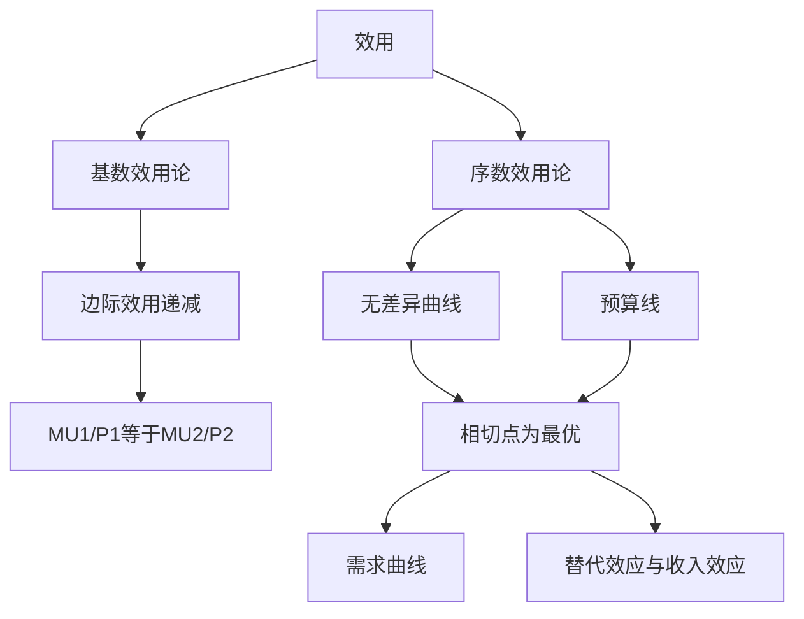

# 第二章 消费者选择 章节总结

> 所属：[[../README|06 西方经济学]]

## 这一章在回答什么问题

你口袋里有 50 块，奶茶 10 块、炸鸡 20 块，怎么组合花才最爽？本章给出"消费者最优选择"的数学解——这就是需求曲线背后的故事。

## 核心概念清单

- **效用**：商品给你带来的满足感。
- **边际效用递减**：第 1 杯奶茶爽，第 5 杯想吐。
- **无差异曲线**：两种商品怎么组合都一样爽。
- **预算线**：钱有限，能买到的组合边界。
- **消费者均衡**：无差异曲线与预算线相切的那一点。

## 框架图

## 本章 KP 列表

- [[KP01_效用与边际效用递减|KP01 效用与边际效用递减]]
- [[KP02_基数效用论与消费者均衡|KP02 基数效用论与消费者均衡]]
- [[KP03_无差异曲线|KP03 无差异曲线]]
- [[KP04_预算线|KP04 预算线]]
- [[KP05_序数效用论与消费者均衡|KP05 序数效用论与消费者均衡]]
- [[KP06_替代效应与收入效应|KP06 替代效应与收入效应]]

## 与前后章的关系

本章推导出需求曲线（从消费者最优化）。第 3 章推导出供给曲线（从生产者最优化）。第 4 章把两者放到市场上碰。
