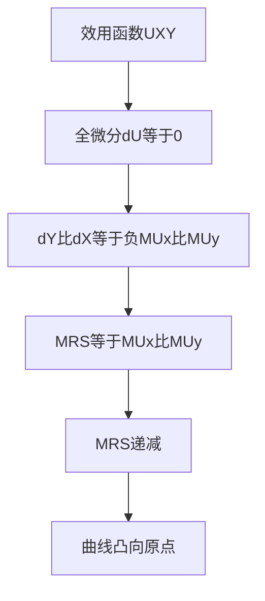

# KP03 无差异曲线

<a href="../../../../exam.html" target="_blank" style="display:inline-block;padding:6px 16px;background:#2563eb;color:#fff;border-radius:6px;text-decoration:none;font-size:14px;">📝 开始做题</a>

> 所属：[[00_章节总结|第2章 消费者选择]]

## 1. 一句话先懂（小白版）

1 杯奶茶 + 2 块炸鸡，和 2 杯奶茶 + 1 块炸鸡，你觉得一样爽——这两个点连起来的线就是无差异曲线。**线上所有组合给你的满足感都相同。**

## 2. 严格定义

**无差异曲线（Indifference Curve, IC）**：在偏好既定下，给消费者带来**相同满足程度**的两种商品所有组合的轨迹。

**无差异曲线的特征**：
1. 向右下方倾斜（要多拿一种，就得少拿另一种）。
2. 凸向原点（边际替代率递减）。
3. 离原点越远，效用越高（越多越好）。
4. 任意两条无差异曲线不相交。

**边际替代率（Marginal Rate of Substitution, MRS）**：在效用不变下，为多获得一商品 1 而愿意放弃的商品 2 数量。

$$MRS_{12} = -\frac{\Delta Q_2}{\Delta Q_1}$$

几何意义：无差异曲线斜率的绝对值。

## 3. 为什么（原理/机制）

- 你奶茶喝多了，愿意放弃很多炸鸡来换一杯奶茶吗？不，你已经喝饱了，再多一杯不值钱。
- 反过来，炸鸡吃多了，一杯奶茶特别珍贵。
- 所以 MRS 递减——这就是曲线凸向原点的原因。

## 4. 怎么用（手把手算）

**场景**：小王的无差异组合（效用 = 10 单位）：

| 组合 | 奶茶 $Q_1$ | 炸鸡 $Q_2$ |
|---|---|---|
| A | 1 | 5 |
| B | 2 | 3 |
| C | 3 | 2 |
| D | 4 | 1.5 |

**第一步**：算 MRS。
- A → B：多 1 杯奶茶，少 2 块炸鸡。$MRS_{12} = 2/1 = 2$。
- B → C：多 1 杯奶茶，少 1 块炸鸡。$MRS_{12} = 1/1 = 1$。
- C → D：多 1 杯奶茶，少 0.5 块炸鸡。$MRS_{12} = 0.5/1 = 0.5$。

**第二步**：观察 MRS 递减：2 → 1 → 0.5。

**解读**：奶茶从 1 杯加到 2 杯，你愿意放弃 2 块炸鸡；但从 3 杯加到 4 杯，只愿意放弃 0.5 块。奶茶越多越不稀罕。

## 5. 特殊形状

| 形状 | 含义 | 例子 |
|---|---|---|
| 平滑凸向原点 | 普通商品（可替代） | 奶茶和炸鸡 |
| 直线 | 完全替代品 | 1 元和 5 角硬币 |
| L 形 | 完全互补品 | 左鞋和右鞋 |
| 凸向外侧 | 厌恶品 | 你不喜欢的东西 |

## 5.5 理论推导（一步步推）

> 本节补充：无差异曲线为什么凸向原点。

**假设起点**：
1. 消费者能对商品组合排序（偏好的完备性、传递性）。
2. 商品越多越好（非饱和性）。
3. 边际替代率 MRS 递减：你拥有的 X 越多，越不愿意用 Y 换 X。

**推导过程**：
- 第一步：定义无差异曲线——给消费者带来相同效用水平 $ar U$ 的所有 (X, Y) 组合。
- 第二步：沿无差异曲线，$\Delta U = MU_X \cdot \Delta X + MU_Y \cdot \Delta Y = 0$。
- 第三步：$MRS_{XY} = -\frac{\Delta Y}{\Delta X} = \frac{MU_X}{MU_Y}$。
- 第四步：边际效用递减 → 随着 X 增多，$MU_X$ 下降、$MU_Y$ 上升 → $MRS_{XY}$ 递减。
- 第五步：MRS 递减 = 无差异曲线斜率绝对值递减 = 曲线凸向原点。

## 5.6 数学推导（公式怎么来的）

> 每个符号第一次出现必须解释。

设效用函数 $U(X, Y)$。无差异曲线方程 $U(X, Y) = ar U$。

全微分：
$$dU = \frac{\partial U}{\partial X}dX + \frac{\partial U}{\partial Y}dY = 0$$

$$\frac{dY}{dX} = -\frac{\partial U/\partial X}{\partial U/\partial Y} = -\frac{MU_X}{MU_Y}$$

MRS 是斜率绝对值：
$$MRS_{XY} = \frac{MU_X}{MU_Y}$$

**举例**：$U = XY$，$MU_X = Y$，$MU_Y = X$，$MRS_{XY} = Y/X$。沿无差异曲线 $XY = ar U$，$X$ 增大时 $Y = ar U/X$ 减小 → $MRS = Y/X = ar U/X^2$ 递减 → 凸向原点。

## 6. 容易混淆什么

| 概念 | 区别 |
|---|---|
| 无差异曲线 vs 需求曲线 | IC 是效用不变下的商品组合；需求曲线是价格变化下的购买量。 |
| MRS vs MRT | MRS 是消费者替代率；MRT（边际转换率）是生产者转换率（第 7 章）。 |

## 7. 现实意义

- 为啥可乐和百事是直线型无差异曲线？你尝不出区别，互相完全替代。
- 为啥左鞋右鞋是 L 形？多一只左鞋没用，必须配对。
- 为啥"奶茶 + 炸鸡"是凸的？吃多了任何一种都腻。

---

## 🔗 相关知识点

**同章关联：** [[KP04_预算线|预算线]] ｜ [[KP05_序数效用论与消费者均衡|消费者均衡]]

**跨章关联：** [[../../07_一般均衡与效率/知识点/KP03_交换的帕累托最优|埃奇沃思盒]]

**📖 原书原文：** [[../../../../原文件/经济学/西方经济学上册_微观_全书|原书·第二章第二节]]

---

## 🐮 小白教程入门

> 看不懂下面这个KP？先看通俗版教程建立直觉：

- [[../../../../经济统计学论文从0基础到精通/13_微观经济学基础/06_无差异曲线与消费者均衡是什么|🐮 教程·无差异曲线与消费者均衡是什么]]

---

## 📝 考研真题（首经贸 801）

**配套主观题：** 见同目录 [[../考研真题集|本章考研真题集]]
**配套选择题：** 见同目录 [[../选择题集|本章选择题集]]

### 高频简答
- 简述无差异曲线的含义及其基本特征（15 分）→ 见 [[../考研真题集#s4|真题集·简答 4]]
- 简述边际替代率的含义、递减规律及其与无差异曲线形状的关系（15 分）→ 见 [[../考研真题集#s5|真题集·简答 5]]

### 高频论述
- 试述基数效用论与序数效用论如何各自推出消费者均衡（30 分）→ 见 [[../考研真题集#l1|真题集·论述 1]]

### 易错选择
- 本知识点选择题见 [[../选择题集#KP03 无差异曲线|选择题集·KP03]]
