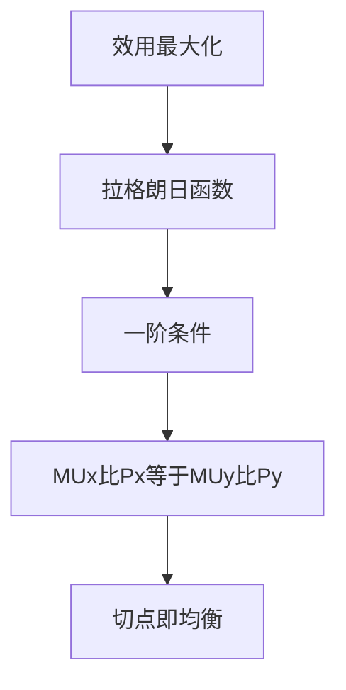

# KP05 序数效用论与消费者均衡

<a href="../../../../exam.html" target="_blank" style="display:inline-block;padding:6px 16px;background:#2563eb;color:#fff;border-radius:6px;text-decoration:none;font-size:14px;">📝 开始做题</a>

> 所属：[[00_章节总结|第2章 消费者选择]]

## 1. 一句话先懂（小白版）

把无差异曲线（你想要的）和预算线（你买得起的）画在同一张图上，**它们相切的那一点就是你最爽的买法**。

## 2. 严格定义

**序数效用论**：效用不能加总，但可以排序（A 比 B 好）。用无差异曲线描述偏好。

**消费者均衡条件**：在预算约束下达到最高无差异曲线。几何上：**无差异曲线与预算线相切**。

数学条件：
$$MRS_{12} = \frac{P_1}{P_2}$$

结合预算约束：
$$P_1 Q_1 + P_2 Q_2 = I$$

## 3. 为什么（原理/机制）

- 无差异曲线和预算线相交 → 还能往更高的无差异曲线走。
- 无差异曲线和预算线相离 → 买不起。
- 相切 → 刚好买到能达到的最高无差异曲线，这就是最优。

相切意味着两线斜率相等：
$$MRS_{12} = \frac{P_1}{P_2}$$

（注意：两边都取绝对值，负号消掉。）

## 4. 怎么用（手把手算）

**场景**：小王效用函数 $U = Q_1 Q_2$，$I = 30$，$P_1 = 10$，$P_2 = 15$。

**第一步**：$MRS_{12} = MU_1/MU_2$。
- $MU_1 = \partial U/\partial Q_1 = Q_2$
- $MU_2 = \partial U/\partial Q_2 = Q_1$
- $MRS_{12} = Q_2/Q_1$

**第二步**：均衡条件 $MRS_{12} = P_1/P_2$：
$$\frac{Q_2}{Q_1} = \frac{10}{15} = \frac{2}{3}$$
$$Q_2 = \frac{2}{3} Q_1$$

**第三步**：代入预算约束：
$$10 Q_1 + 15 Q_2 = 30$$
$$10 Q_1 + 15 \times \frac{2}{3} Q_1 = 30$$
$$10 Q_1 + 10 Q_1 = 30$$
$$20 Q_1 = 30$$
$$Q_1^* = 1.5$$

**第四步**：求 $Q_2^*$：
$$Q_2^* = \frac{2}{3} \times 1.5 = 1$$

**结论**：小王最优组合是 1.5 杯奶茶 + 1 份炸鸡，总效用 $U = 1.5 \times 1 = 1.5$。

## 5. 与基数效用论的关系

注意到 $MRS_{12} = MU_1/MU_2$，均衡条件：
$$\frac{MU_1}{MU_2} = \frac{P_1}{P_2} \Rightarrow \frac{MU_1}{P_1} = \frac{MU_2}{P_2}$$

和基数效用论的均衡条件**完全一样**。序数效用论只是换了个更合理的假设（效用可排序即可），结论一致。

## 5.5 理论推导（一步步推）

> 本节补充：消费者均衡条件 $MRS = P_X/P_Y$ 怎么推出来。

**假设起点**：
1. 消费者在预算约束下最大化效用。
2. 无差异曲线凸向原点。
3. 预算线是直线。

**推导过程**：
- 第一步：消费者目标 $\max U(X,Y)$，约束 $P_X X + P_Y Y = I$。
- 第二步：几何上，这是"在预算线上找一条最高的无差异曲线"。
- 第三步：最高可达无差异曲线必然与预算线相切（否则可继续向外推）。
- 第四步：相切 = 无差异曲线斜率 = 预算线斜率，即 $MRS_{XY} = P_X/P_Y$。
- 第五步：$MRS = MU_X/MU_Y = P_X/P_Y$，整理得 $MU_X/P_X = MU_Y/P_Y$（每元钱在两商品上带来的边际效用相等）。

## 5.6 数学推导（公式怎么来的）

> 每个符号第一次出现必须解释。

用拉格朗日乘数法：
$$\mathcal{L} = U(X,Y) + \lambda(I - P_X X - P_Y Y)$$

一阶条件：
$$\frac{\partial \mathcal{L}}{\partial X} = MU_X - \lambda P_X = 0$$
$$\frac{\partial \mathcal{L}}{\partial Y} = MU_Y - \lambda P_Y = 0$$
$$\frac{\partial \mathcal{L}}{\partial \lambda} = I - P_X X - P_Y Y = 0$$

前两式相除：
$$\frac{MU_X}{MU_Y} = \frac{P_X}{P_Y} \quad\Longleftrightarrow\quad \frac{MU_X}{P_X} = \frac{MU_Y}{P_Y} = \lambda$$

$\lambda$ 是货币的边际效用（每元收入带来的效用增量）。

**举例**：$U = XY$，$P_X=2, P_Y=3, I=30$。$MU_X = Y, MU_Y = X$。均衡 $Y/X = 2/3$，代入 $2X+3Y=30$ 得 $X=7.5, Y=5$。

## 6. 什么时候不能用

- **角点解**：你完全不买某种商品（如素食者不买肉），最优解在坐标轴上，不是相切点。
- **完全互补品**：L 形无差异曲线，最优解在拐点。
- **不确定性**：风险下要用期望效用。

## 7. 容易混淆什么

| 概念 | 区别 |
|---|---|
| 序数均衡 vs 基数均衡 | 数学条件等价；哲学假设不同（可排序 vs 可计量）。 |
| 相切点 vs 交点 | 相切是最优；交点不是。 |

## 8. 现实意义

- 每个人的偏好不同（无差异曲线形状不同），但都会在自己的预算线上选最优点。
- 价格变化 → 预算线旋转 → 最优点移动 → 得到需求曲线。
- 这就是"需求曲线背后的故事"。

---

## 🔗 相关知识点

**同章关联：** [[KP03_无差异曲线|无差异曲线]] ｜ [[KP04_预算线|预算线]] ｜ [[KP06_替代效应与收入效应|替代与收入效应]]

**跨章关联：** [[../../01_需求供给与均衡价格/知识点/KP01_需求与需求定律|需求曲线]]

**📖 原书原文：** [[../../../../原文件/经济学/西方经济学上册_微观_全书|原书·第二章第三节]]

---

## 🐮 小白教程入门

> 看不懂下面这个KP？先看通俗版教程建立直觉：

- [[../../../../经济统计学论文从0基础到精通/13_微观经济学基础/06_无差异曲线与消费者均衡是什么|🐮 教程·无差异曲线与消费者均衡是什么]]

---

## 📝 考研真题（首经贸 801）

**配套主观题：** 见同目录 [[../考研真题集|本章考研真题集]]
**配套选择题：** 见同目录 [[../选择题集|本章选择题集]]

### 高频简答
- 简述序数效用论的消费者均衡条件，并说明其几何意义（15 分）→ 见 [[../考研真题集#s7|真题集·简答 7]]
- （计算）已知柯布-道格拉斯效用函数 $U=Q_1Q_2$ 求消费者最优选择（15 分）→ 见 [[../考研真题集#s8|真题集·简答 8]]

### 高频论述
- 试述基数效用论与序数效用论如何各自推出消费者均衡，并比较二者一致性（30 分）→ 见 [[../考研真题集#l1|真题集·论述 1]]

### 易错选择
- 本知识点选择题见 [[../选择题集#KP05 序数效用论与消费者均衡|选择题集·KP05]]
