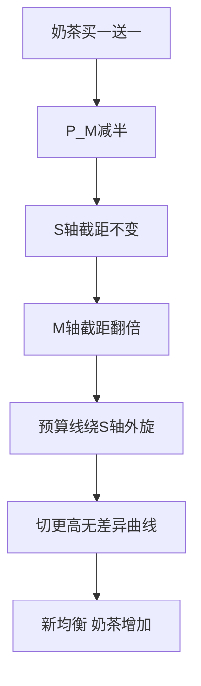
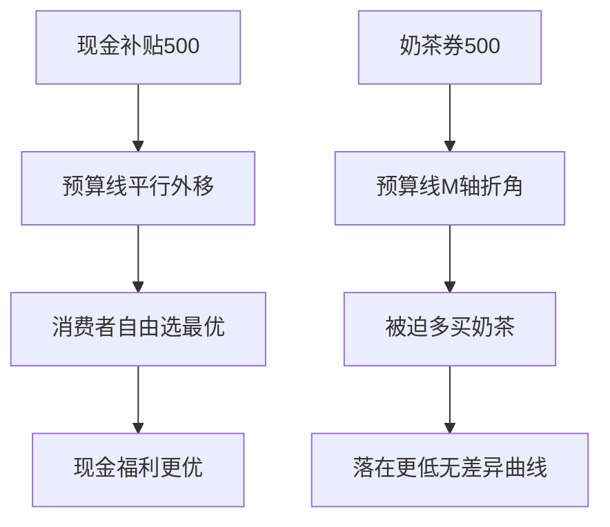
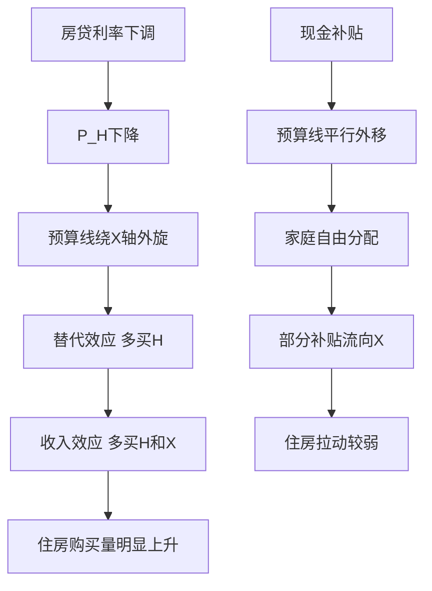

# 第 2 章 消费者选择 · 考研真题集（首经贸 801）

<a href="../../../exam.html" target="_blank" style="display:inline-block;padding:6px 16px;background:#2563eb;color:#fff;border-radius:6px;text-decoration:none;font-size:14px;">📝 开始做题</a>

> 本章共收录：简答题 11 道（每题 15 分）｜论述题 4 道（每题 30 分）
> 配套选择题见 [[选择题集|本章选择题集]]
> 对应大纲：效用与边际效用递减、基数效用论与消费者均衡、无差异曲线、预算线、序数效用论与消费者均衡、替代效应与收入效应

## 📋 本题集目录

### 简答题
1. [[#简答 1：简述效用、总效用与边际效用的含义及边际效用递减规律|简述效用、总效用与边际效用的含义及边际效用递减规律]]
2. [[#简答 2：简述基数效用论的消费者均衡条件及其经济含义|简述基数效用论的消费者均衡条件及其经济含义]]
3. [[#简答 3：（计算）某消费者每月收入 20 元，用于购买商品 X（价格 $P_1=2$ 元）和商品 Y（价格 $P_2=3$ 元）。边际效用表为：$MU_1$（第 1～5 单位）=10、8、6、4、2；$MU_2$（第 1～3 单位）=6、3、1。求该消费者的最优购买组合。|（计算）根据每元边际效用法求最优购买组合]]
4. [[#简答 4：简述无差异曲线的含义及其基本特征|简述无差异曲线的含义及其基本特征]]
5. [[#简答 5：简述边际替代率的含义、递减规律及其与无差异曲线形状的关系|简述边际替代率的含义、递减规律及其与无差异曲线形状的关系]]
6. [[#简答 6：简述预算线的含义、方程及其移动规律|简述预算线的含义、方程及其移动规律]]
7. [[#简答 7：简述序数效用论的消费者均衡条件，并说明其几何意义|简述序数效用论的消费者均衡条件，并说明其几何意义]]
8. [[#简答 8：（计算）已知某消费者效用函数 $U=Q_1Q_2$，收入 $I=30$ 元，商品 1 价格 $P_1=2$ 元，商品 2 价格 $P_2=3$ 元。求该消费者的最优购买组合及最大效用。|（计算）已知柯布-道格拉斯效用函数求消费者最优选择]]
9. [[#简答 9：简述替代效应与收入效应的含义，并说明价格变动总效应的分解|简述替代效应与收入效应的含义，并说明总效应的分解]]
10. [[#简答 10：用替代效应与收入效应区分正常品、低档品与吉芬品|用替代效应与收入效应区分正常品、低档品与吉芬品]]
11. [[#简答 11：比较基数效用论与序数效用论的异同|比较基数效用论与序数效用论的异同]]

### 论述题
1. [[#论述 1：试述基数效用论与序数效用论如何各自推出消费者均衡，并比较二者的一致性|试述基数效用论与序数效用论如何各自推出消费者均衡，并比较二者的一致性]]
2. [[#论述 2：用替代效应与收入效应分析"吉芬商品"之谜，说明需求定律为何存在例外|用替代效应与收入效应分析"吉芬商品"之谜，说明需求定律为何存在例外]]
3. [[#论述 3：结合预算线与无差异曲线，分析"现金补贴"与"实物（食品券）补贴"对消费者福利的不同影响|结合预算线与无差异曲线，分析"现金补贴"与"实物（食品券）补贴"对消费者福利的不同影响]]
4. [[#论述 4：从边际效用递减规律出发，论述收入再分配的福利含义|从边际效用递减规律出发，论述收入再分配的福利含义]]

---

## 一、简答题（每题 15 分，建议 450–700 字）

### 简答 1：简述效用、总效用与边际效用的含义及边际效用递减规律

**【建议字数】450–700 字 ｜ 【建议时间】15 分钟 ｜ 【题型】概念简答**

**【考什么】** 对应知识点 [[知识点/KP01_效用与边际效用递减|效用与边际效用递减]]；题型属于概念简答。

**【答题框架】**
- 第 1 段：效用与总效用定义（4 分）
- 第 2 段：边际效用定义与公式（4 分）
- 第 3 段：边际效用递减规律及与总效用关系（7 分）

**【参考答案】**

一、效用与总效用。效用是指消费者从消费商品或劳务中所获得的满足程度，记为 $U$，是消费者偏好的度量。总效用 $TU$ 是消费者在一定时间内消费一定数量商品所得到的全部满足的总和。

二、边际效用。边际效用 $MU$ 是指消费者再多消费一单位商品所新增加的满足程度，即：

$$MU=\frac{\Delta TU}{\Delta Q}$$

它衡量的是"最后一单位"带来的增量，而非全部。

三、边际效用递减规律。在其他条件不变的情况下，随着消费者对某商品消费数量的连续增加，他从新增每一单位中所获得的边际效用是递减的。这是一条心理学规律：人对同一刺激的重复反应会越来越弱，第一个包子最香，第二个次之，吃到后来甚至反胃。

四、与总效用的关系。当 $MU>0$ 时，总效用随消费量增加而上升；当 $MU=0$ 时，总效用达到最大；当 $MU<0$ 时，总效用开始下降。即边际效用是总效用的导数（增量），边际效用递减最终会使总效用由升转降。这一规律是基数效用论推导需求曲线和消费者均衡的基石。

**【解析·得分点】** 采分点：①效用=满足程度、TU=全部满足（4 分）；②MU=ΔTU/ΔQ（4 分）；③边际递减规律内容（4 分）；④MU>0 升、=0 最大、<0 降的关系（3 分）。易丢分处：把边际效用递减等同于总效用递减——错，只要 MU>0，TU 仍在升。

**【生活实例】** 饿极了吃第一个包子，爽值 10；第二个 6；第三个 2；第四个饱了变 -1。越吃越不稀罕，就是边际效用递减；吃到第四个想吐，总满足感反而下降。

**【双链接】** 🔗 [[知识点/KP01_效用与边际效用递减|回知识点]] ｜ [[../00_导论/知识点/KP04_边际分析方法|边际分析]] ｜ 📖 [[../../../原文件/经济学/西方经济学上册_微观_全书|原书·第二章第一节]]

---

### 简答 2：简述基数效用论的消费者均衡条件及其经济含义

**【建议字数】450–700 字 ｜ 【建议时间】15 分钟 ｜ 【题型】模型分析**

**【考什么】** 对应知识点 [[知识点/KP02_基数效用论与消费者均衡|基数效用论与消费者均衡]]；题型属于模型分析。

**【答题框架】**
- 第 1 段：基数效用论假定（3 分）
- 第 2 段：均衡条件公式（6 分）
- 第 3 段：经济含义（为什么相等）（6 分）

**【参考答案】**

一、基数效用论假定。基数效用论认为效用可以用具体数字计量并加总（如 10 单位、20 单位）。消费者在既定收入和价格下追求总效用最大，由此导出消费者均衡。

二、消费者均衡条件。设消费者收入为 $I$，购买两种商品数量 $Q_1,Q_2$，价格 $P_1,P_2$，边际效用 $MU_1,MU_2$。均衡条件为：

$$\frac{MU_1}{P_1}=\frac{MU_2}{P_2}=\lambda$$

同时满足预算约束：$P_1Q_1+P_2Q_2=I$。

其中 $\lambda$ 表示每一元货币的边际效用。含义是：消费者花在每一种商品上的最后一元钱，所带来的边际效用都相等，且等于货币的边际效用。

三、经济含义。若 $\frac{MU_1}{P_1}>\frac{MU_2}{P_2}$，说明同样一元钱花在商品 1 上比商品 2 上更"值"，理性消费者会多买商品 1、少买商品 2。但随着商品 1 购买量增加，其 $MU_1$ 递减；商品 2 购买量减少，其 $MU_2$ 回升。这一调整持续到二者相等为止，消费者不再改变购买组合，总效用达到最大。反之亦然。因此，"每元边际效用相等"是消费者不再调整、总效用最大的均衡状态。

**【解析·得分点】** 采分点：①基数效用可计量假定（3 分）；②$MU_1/P_1=MU_2/P_2=\lambda$ 及预算约束（6 分）；③不等时如何通过多买/少买和边际递减恢复相等（6 分）。易丢分处：写成 $MU_1=MU_2$ 或 $P_1=P_2$——错，必须是"每元的边际效用"相等。

**【生活实例】** 你掏最后一块钱，买奶茶得到的爽度和买炸鸡得到的爽度得一样高，你才不再纠结；要是这一块钱买奶茶更爽，你就会多买奶茶、少买炸鸡。

**【双链接】** 🔗 [[知识点/KP02_基数效用论与消费者均衡|回知识点]] ｜ 📖 [[../../../原文件/经济学/西方经济学上册_微观_全书|原书·第二章第一节]]

---

### 简答 3：（计算）某消费者每月收入 20 元，用于购买商品 X（价格 $P_1=2$ 元）和商品 Y（价格 $P_2=3$ 元）。边际效用表为：$MU_1$（第 1～5 单位）=10、8、6、4、2；$MU_2$（第 1～3 单位）=6、3、1。求该消费者的最优购买组合。

**【建议字数】450–700 字 ｜ 【建议时间】15 分钟 ｜ 【题型】分析推导**

**【考什么】** 对应知识点 [[知识点/KP02_基数效用论与消费者均衡|基数效用论与消费者均衡]]；题型属于分析推导（计算题）。

**【答题框架】**
- 第 1 步：算每元边际效用（5 分）
- 第 2 步：按每元 MU 从高到低选购（6 分）
- 第 3 步：验证均衡（4 分）

**【参考答案】**

一、算每元边际效用 $MU/P$。

商品 X：$MU_1/P_1$ = 10/2=5、8/2=4、6/2=3、4/2=2、2/2=1。

商品 Y：$MU_2/P_2$ = 6/3=2、3/3=1、1/3≈0.33。

二、按每元边际效用从高到低依次选购（每次买花掉对应价格的钱）：

（一）X 第 1 单位：5，花 2 元，累计 2 元；

（二）X 第 2 单位：4，花 2 元，累计 4 元；

（三）X 第 3 单位：3，花 2 元，累计 6 元；

（四）接下来 X 第 4 单位（2）与 Y 第 1 单位（2）并列，均选：X4 花 2 元累计 8 元，Y1 花 3 元累计 11 元；

（五）再接下来 X 第 5 单位（1）与 Y 第 2 单位（1）并列，均选：X5 花 2 元累计 13 元，Y2 花 3 元累计 16 元；

（六）剩余 4 元，X 已无第 6 单位，只能买 Y 第 3 单位（0.33），花 3 元，累计 19 元，余 1 元。

三、结论与验证。最优购买组合为：X 买 5 单位、Y 买 3 单位，总支出 $2\times5+3\times3=19$ 元，余 1 元。

验证均衡条件：最后购买的 X 第 5 单位每元边际效用为 $2/2=1$，Y 第 2 单位每元边际效用为 $3/3=1$，二者相等（Y 第 3 单位因无更多 X 可选而被迫购买，其每元 MU=0.33 是受收入约束下的无奈选择）。这满足"花在各商品上的每元边际效用尽可能相等"的消费者均衡原则，总效用达到最大。

**【解析·得分点】** 采分点：①正确算出两组 MU/P（5 分）；②按每元 MU 排序选购（6 分）；③X=5、Y=3、验证每元 MU 相等（4 分）。易丢分处：直接按 MU 大小选购而不除以价格，或忘记预算约束。

**【生活实例】** 花钱像排队抢"每一块钱爽度最高"的商品，先抢性价比最高的，直到钱花完——这就是你逛超市下意识在做的事。

**【双链接】** 🔗 [[知识点/KP02_基数效用论与消费者均衡|回知识点]] ｜ 📖 [[../../../原文件/经济学/西方经济学上册_微观_全书|原书·第二章第一节]]

---

### 简答 4：简述无差异曲线的含义及其基本特征

**【建议字数】450–700 字 ｜ 【建议时间】15 分钟 ｜ 【题型】概念简答**

**【考什么】** 对应知识点 [[知识点/KP03_无差异曲线|无差异曲线]]；题型属于概念+模型分析。

**【答题框架】**
- 第 1 段：无差异曲线定义（4 分）
- 第 2 段：四个特征（8 分）
- 第 3 段：含义小结（3 分）

**【参考答案】**

一、含义。无差异曲线是在偏好既定条件下，能给消费者带来同等满足程度的两种商品所有不同组合的轨迹。曲线上任意一点的商品组合，对消费者而言效用水平都相同，选哪一个都"无差异"。它描述的是消费者的主观偏好。

二、基本特征。

（一）向右下方倾斜。要多获得一种商品，就必须放弃一部分另一种商品，才能保持效用不变，故斜率为负。

（二）凸向原点。这是由边际替代率递减决定的：随着一种商品数量增加，它能替代的另一种商品数量越来越少，曲线向内凸出。

（三）离原点越远的无差异曲线代表的效用水平越高。因为越多消费一般带来越大满足，右上方的组合包含更多商品。

（四）任意两条无差异曲线不能相交。否则与"同一点效用唯一"矛盾（若相交，交点同时属于两条不同效用的曲线，违反偏好一致性）。

三、含义小结。无差异曲线与预算线结合，才能确定消费者在既定收入下能达到的最高满足。它是序数效用论描述偏好的基本工具。

**【解析·得分点】** 采分点：①同等满足的组合轨迹（4 分）；②四特征：负斜率、凸向原点、越远越高、不相交（8 分）；③小结（3 分）。易丢分处：漏掉"不相交"，或不会用偏好一致性解释为何不相交。

**【生活实例】** "1 杯奶茶+2 块炸鸡"和"2 杯奶茶+1 块炸鸡"你觉得一样爽，把这些"爽感相同"的组合连成一条线，就是无差异曲线。

**【双链接】** 🔗 [[知识点/KP03_无差异曲线|回知识点]] ｜ 📖 [[../../../原文件/经济学/西方经济学上册_微观_全书|原书·第二章第二节]]

---

### 简答 5：简述边际替代率的含义、递减规律及其与无差异曲线形状的关系

**【建议字数】450–700 字 ｜ 【建议时间】15 分钟 ｜ 【题型】原因分析**

**【考什么】** 对应知识点 [[知识点/KP03_无差异曲线|无差异曲线]]；题型属于模型/推导分析。

**【答题框架】**
- 第 1 段：MRS 定义与公式（5 分）
- 第 2 段：递减规律及原因（6 分）
- 第 3 段：与曲线凸向原点的关系（4 分）

**【参考答案】**

一、边际替代率的含义。边际替代率 $MRS_{12}$ 是指在维持效用水平不变的前提下，消费者为多获得一单位商品 1 而愿意放弃的商品 2 的数量：

$$MRS_{12}=-\frac{\Delta Q_2}{\Delta Q_1}$$

几何上，它就是无差异曲线斜率的绝对值。它衡量消费者主观上愿意用一种商品换另一种商品的比率。

二、递减规律。随着商品 1 数量不断增加，消费者为多获得一单位商品 1 而愿意放弃的商品 2 数量是递减的，即 $MRS_{12}$ 递减。原因在于：商品 1 越来越多、越来越不稀罕（其边际效用递减），而商品 2 越来越少、越来越珍贵，所以人们愿为新增一单位商品 1 放弃的商品 2 越来越少。

三、与曲线形状的关系。正因为 $MRS_{12}$ 递减（无差异曲线斜率的绝对值越来越小），无差异曲线才呈现凸向原点的形状：曲线左端陡峭（愿用很多商品 2 换一点商品 1），右端平缓（只愿放弃很少商品 2）。若两种商品完全可替代（如两枚一角硬币），MRS 不变，无差异曲线退化为一条直线；若完全互补（左鞋右鞋），则呈 L 形。

**【解析·得分点】** 采分点：①MRS 定义、公式、=无差异曲线斜率绝对值（5 分）；②递减规律及原因（边际效用递减）（6 分）；③凸向原点的几何解释（4 分）。易丢分处：把 MRS 写成无差异曲线斜率本身（忘记取绝对值/负号）。

**【生活实例】** 你只有 1 杯奶茶时，愿用 2 块炸鸡换第 2 杯；喝到第 3 杯时，只肯用 0.5 块炸鸡换第 4 杯——奶茶越多越不值钱，这就是边际替代率递减。

**【双链接】** 🔗 [[知识点/KP03_无差异曲线|回知识点]] ｜ 📖 [[../../../原文件/经济学/西方经济学上册_微观_全书|原书·第二章第二节]]

---

### 简答 6：简述预算线的含义、方程及其移动规律

**【建议字数】450–700 字 ｜ 【建议时间】15 分钟 ｜ 【题型】概念简答**

**【考什么】** 对应知识点 [[知识点/KP04_预算线|预算线]]；题型属于概念+模型分析。

**【答题框架】**
- 第 1 段：预算线含义与方程（5 分）
- 第 2 段：截距与斜率（4 分）
- 第 3 段：移动规律（6 分）

**【参考答案】**

一、含义与方程。预算线是指在消费者收入 $I$ 和商品价格 $P_1,P_2$ 既定条件下，消费者用全部收入所能买到的两种商品最大数量组合的轨迹。方程为：

$$P_1Q_1+P_2Q_2=I$$

它把商品组合划分为两部分：线及线下方是买得起的，线上方是买不起的，是消费者选择的客观约束。

二、截距与斜率。纵轴截距 $I/P_2$（全部收入买商品 2 的数量），横轴截距 $I/P_1$（全部收入买商品 1 的数量）。斜率为 $-\frac{P_1}{P_2}$，反映两种商品的市场相对价格。

三、移动规律。

（一）收入变动：价格不变，收入增加使两截距同比例外移，预算线向外平行移动；收入减少则向内平行移动。

（二）一种商品价格变动：收入不变，商品 1 降价使横轴截距外移、纵轴截距不动，预算线绕纵轴向外旋转；涨价则向内旋转。商品 2 价格变动类似，绕横轴旋转。

（三）两种价格同比例变动：相当于收入反向变动，预算线平行移动。

**【解析·得分点】** 采分点：①方程 $P_1Q_1+P_2Q_2=I$（5 分）；②截距 $I/P$、斜率 $-P_1/P_2$（4 分）；③收入变→平移，单一价格变→绕轴旋转（6 分）。易丢分处：把单一价格变化误写成平行移动。

**【生活实例】** 你 30 块钱，奶茶 10 块、炸鸡 15 块，最多买 3 杯奶茶或 2 份炸鸡——连这两点的斜线就是预算线。涨工资，整条线往外平移；奶茶降价，线绕着炸鸡那头往外转。

**【双链接】** 🔗 [[知识点/KP04_预算线|回知识点]] ｜ 📖 [[../../../原文件/经济学/西方经济学上册_微观_全书|原书·第二章第三节]]

---

### 简答 7：简述序数效用论的消费者均衡条件，并说明其几何意义

**【建议字数】450–700 字 ｜ 【建议时间】15 分钟 ｜ 【题型】模型分析**

**【考什么】** 对应知识点 [[知识点/KP05_序数效用论与消费者均衡|序数效用论与消费者均衡]]；题型属于模型分析。

**【答题框架】**
- 第 1 段：序数效用论与相切图（5 分）
- 第 2 段：均衡条件公式（6 分）
- 第 3 段：与基数论一致性（4 分）

**【参考答案】**

一、几何意义。序数效用论用无差异曲线（表示想要什么）和预算线（表示买得起什么）分析消费者选择。在一张图上，预算线外有许多无差异曲线：离预算线太远的（效用太高）买不起，与预算线相交的还能往更高无差异曲线移动。唯一既买得起、又达到最高满足的点，是无差异曲线与预算线相切的那一点，即消费者均衡点。

二、均衡条件。在切点上，无差异曲线的斜率等于预算线的斜率。无差异曲线斜率绝对值为边际替代率 $MRS_{12}$，预算线斜率绝对值为价格比 $P_1/P_2$，故：

$$MRS_{12}=\frac{P_1}{P_2}$$

同时满足预算约束 $P_1Q_1+P_2Q_2=I$。由于 $MRS_{12}=MU_1/MU_2$，上式等价于 $\dfrac{MU_1}{P_1}=\dfrac{MU_2}{P_2}$。

三、与基数论的一致性。可见序数效用论推出的均衡条件，在数学上与基数效用论的"每元边际效用相等"完全一致。区别只在哲学假设：序数论不要求效用可计量，只需可排序，假设更宽松，结论却相同，因而更被认可。

**【解析·得分点】** 采分点：①相切=买得起的最高无差异曲线（5 分）；②$MRS_{12}=P_1/P_2$（6 分）；③等价于 $MU_1/P_1=MU_2/P_2$、与基数论一致（4 分）。易丢分处：把均衡写成无差异曲线与预算线相交——相交不是最优。

**【生活实例】** 你想要的一堆曲线里，只有一条刚好碰到你买得起的那条斜线，碰到的那个点就是最划算的买法；再想要更多就超预算了。

**【双链接】** 🔗 [[知识点/KP05_序数效用论与消费者均衡|回知识点]] ｜ 📖 [[../../../原文件/经济学/西方经济学上册_微观_全书|原书·第二章第三节]]

---

### 简答 8：（计算）已知某消费者效用函数 $U=Q_1Q_2$，收入 $I=30$ 元，商品 1 价格 $P_1=2$ 元，商品 2 价格 $P_2=3$ 元。求该消费者的最优购买组合及最大效用。

**【建议字数】450–700 字 ｜ 【建议时间】15 分钟 ｜ 【题型】分析推导**

**【考什么】** 对应知识点 [[知识点/KP05_序数效用论与消费者均衡|序数效用论与消费者均衡]]；题型属于分析推导（计算题）。

**【答题框架】**
- 第 1 步：求边际效用与 MRS（5 分）
- 第 2 步：列均衡条件与预算约束联立（6 分）
- 第 3 步：求解最优组合与效用（4 分）

**【参考答案】**

一、求边际效用与边际替代率。

对 $U=Q_1Q_2$ 求偏导：

$MU_1=\dfrac{\partial U}{\partial Q_1}=Q_2$，$MU_2=\dfrac{\partial U}{\partial Q_2}=Q_1$。

故 $MRS_{12}=\dfrac{MU_1}{MU_2}=\dfrac{Q_2}{Q_1}$。

二、列均衡条件。消费者均衡要求 $MRS_{12}=P_1/P_2$：

$$\frac{Q_2}{Q_1}=\frac{2}{3}\quad\Rightarrow\quad Q_2=\frac{2}{3}Q_1$$

预算约束：$2Q_1+3Q_2=30$。

三、联立求解。把 $Q_2=\frac{2}{3}Q_1$ 代入预算方程：

$$2Q_1+3\times\frac{2}{3}Q_1=30$$

$$2Q_1+2Q_1=30\quad\Rightarrow\quad 4Q_1=30$$

$$Q_1^*=7.5,\qquad Q_2^*=\frac{2}{3}\times7.5=5$$

最大效用 $U^*=Q_1Q_2=7.5\times5=37.5$。

四、结论。最优购买组合为商品 1 买 7.5 单位、商品 2 买 5 单位，此时花完全部 30 元（$2\times7.5+3\times5=15+15=30$），达到最大效用 37.5。

**【解析·得分点】** 采分点：①$MU_1=Q_2$、$MU_2=Q_1$、$MRS=Q_2/Q_1$（5 分）；②$Q_2/Q_1=2/3$ 与预算方程联立（6 分）；③$Q_1^*=7.5$、$Q_2^*=5$、$U^*=37.5$（4 分）。易丢分处：求偏导时漏写一个变量，或联立方程算错系数。

**【生活实例】** 这种"乘积型"口味，奶茶和炸鸡缺一不可、按比例搭着吃最爽，于是你会按价格比来分配钱：奶茶贵就少点奶茶，炸鸡贵就少吃炸鸡。

**【双链接】** 🔗 [[知识点/KP05_序数效用论与消费者均衡|回知识点]] ｜ 📖 [[../../../原文件/经济学/西方经济学上册_微观_全书|原书·第二章第三节]]

---

### 简答 9：简述替代效应与收入效应的含义，并说明价格变动总效应的分解

**【建议字数】450–700 字 ｜ 【建议时间】15 分钟 ｜ 【题型】模型分析**

**【考什么】** 对应知识点 [[知识点/KP06_替代效应与收入效应|替代效应与收入效应]]；题型属于模型分析。

**【答题框架】**
- 第 1 段：总效应=替代+收入（4 分）
- 第 2 段：替代效应含义（5 分）
- 第 3 段：收入效应含义与图形分解（6 分）

**【参考答案】**

一、总效应的分解。商品价格下降引起的需求量变动（总效应），可分解为两个部分：

$$\text{总效应}=\text{替代效应}+\text{收入效应}$$

二、替代效应。它是指剔除实际收入变化后，纯粹由商品相对价格变化引起的需求量变动。当商品 1 降价，它相对于商品 2 变便宜了，消费者会用变便宜的商品 1 替代变贵的商品 2。在图形上，画一条与新预算线平行、但与原无差异曲线相切的"补偿预算线"，切点从原均衡点 A 移到 B，A→B 即为替代效应。其特点是效用保持不变（还在原来那条无差异曲线上），只调整相对价格。

三、收入效应。它是指价格下降使消费者实际购买力提高（相当于实际收入上升），由这种实际收入变化引起的需求量变动。在图形上，补偿预算线向外平移到新预算线，切点从 B 移到新均衡点 C，B→C 即为收入效应。其特点是相对价格不变，只是实际收入提高。

四、小结。总效应 A→C 被分解为替代效应 A→B（相对价格变、效用不变）和收入效应 B→C（实际收入变、相对价格不变）。这一分解为区分正常品、低档品和吉芬品提供了工具。

**【解析·得分点】** 采分点：①总效应=替代+收入（4 分）；②替代效应=相对价格变化、剔除收入、效用不变（5 分）；③收入效应=实际收入变化、用补偿预算线分解（6 分）。易丢分处：把替代效应和收入效应的先后/方向搞混，或忘记"补偿预算线"这一图形工具。

**【生活实例】** 奶茶半价你多买了。一半原因是"奶茶比炸鸡便宜了，改喝奶茶"（替代效应）；另一半原因是"同样的钱能买更多东西，感觉自己变富了"（收入效应）。

**【双链接】** 🔗 [[知识点/KP06_替代效应与收入效应|回知识点]] ｜ 📖 [[../../../原文件/经济学/西方经济学上册_微观_全书|原书·第二章第四节]]

---

### 简答 10：用替代效应与收入效应区分正常品、低档品与吉芬品

**【建议字数】450–700 字 ｜ 【建议时间】15 分钟 ｜ 【题型】关系对比**

**【考什么】** 对应知识点 [[知识点/KP06_替代效应与收入效应|替代效应与收入效应]]；题型属于关系对比+原因分析。

**【答题框架】**
- 第 1 段：替代效应方向统一（3 分）
- 第 2 段：正常品（4 分）
- 第 3 段：低档品（4 分）
- 第 4 段：吉芬品（4 分）

**【参考答案】**

一、替代效应方向统一。无论哪种商品，价格下降时替代效应总是使需求量增加（因为变便宜了，就多买），即替代效应与价格反方向变动。三者的区别全在收入效应的方向和大小。

二、正常品。价格下降→实际收入上升→收入效应使需求量也增加（正常品收入弹性为正）。替代效应与收入效应同向叠加，总效应大，价格下降需求量明显上升，需求曲线向右下方倾斜。

三、低档品。价格下降→实际收入上升→人们转而消费更好的替代品，对低档品的需求反而减少，即收入效应为负、与替代效应方向相反。但低档品的收入效应较小，不足以抵消替代效应，总效应仍是价格下降、需求量上升，需求曲线仍向右下方倾斜，只是较平缓。

四、吉芬品。它是一种特殊的低档品：收入效应为负且强度很大，超过了替代效应。当这种低档主食（如灾年土豆）价格下降时，实际收入上升，人们反而减少对它的购买（改吃更好的），净效应是价格下降、需求量也下降。于是需求曲线向右上方倾斜，成为需求定律的例外。但吉芬品需要"极低档+占支出比重大+无更好替代"三个苛刻条件同时成立，现实中极为罕见。

**【解析·得分点】** 采分点：①替代效应总是负向（价降量升）（3 分）；②正常品收入效应正、同向叠加（4 分）；③低档品收入效应负但小于替代效应（4 分）；④吉芬品收入效应负且大于替代效应、需求曲线右上倾斜（4 分）。易丢分处：把吉芬品等同于一般低档品，不强调"收入效应超过替代效应"这一关键。

**【生活实例】** 降价后：奶茶（正常品）你多喝；地摊 T 恤（低档品）你其实少买了几件、改买优衣库，但图便宜还是多买了点；灾年土豆（吉芬品）罕见——土豆便宜了你反而敢买肉，土豆买得更少。

**【双链接】** 🔗 [[知识点/KP06_替代效应与收入效应|回知识点]] ｜ [[../01_需求供给与均衡价格/知识点/KP01_需求与需求定律|需求定律的例外]] ｜ 📖 [[../../../原文件/经济学/西方经济学上册_微观_全书|原书·第二章第四节]]

---

### 简答 11：比较基数效用论与序数效用论的异同

**【建议字数】450–700 字 ｜ 【建议时间】15 分钟 ｜ 【题型】关系对比**

**【考什么】** 对应知识点 [[知识点/KP02_基数效用论与消费者均衡|基数效用论]]、[[知识点/KP05_序数效用论与消费者均衡|序数效用论]]；题型属于关系对比。

**【答题框架】**
- 第 1 段：相同点（结论一致）（6 分）
- 第 2 段：不同点（假设与方法）（6 分）
- 第 3 段：评价（3 分）

**【参考答案】**

一、相同点。

（一）二者都以消费者追求效用最大为基本假定，研究消费者如何在既定收入和价格下选择最优商品组合。

（二）二者推出的消费者均衡条件在数学上完全等价：基数论的 $\frac{MU_1}{P_1}=\frac{MU_2}{P_2}$，与序数论的 $MRS_{12}=\frac{P_1}{P_2}$ 是同一条件（因 $MRS=MU_1/MU_2$）。

（三）二者都能推导出向右下方倾斜的需求曲线，解释需求定律。

二、不同点。

（一）效用可否计量：基数效用论认为效用可以用具体数字衡量、加总（如效用单位 10、20）；序数效用论认为效用无法计量，只能排序（A 比 B 好）。

（二）分析工具不同：基数论用边际效用和边际效用递减规律，是数值分析；序数论用无差异曲线和边际替代率，是几何排序分析。

（三）假设强弱不同：基数论假设强（效用可测），序数论假设弱（只需可排序），更为严谨、更少争议。

三、评价。序数效用论以更宽松的假定得到了与基数论相同的结论，因此现代微观经济学普遍采用序数效用论的无差异曲线分析。但作为入门，基数论直观地揭示了边际效用递减与需求曲线的关系，二者是理解消费者行为的两条互补路径。

**【解析·得分点】** 采分点：①都追求效用最大、均衡条件等价、都推出需求曲线（6 分）；②效用可否计量、工具（边际效用 vs 无差异曲线）、假设强弱（6 分）；③评价（3 分）。易丢分处：只说不同不说"结论一致"这一最重要的相同点。

**【生活实例】** 基数论像给快乐打分："喝奶茶爽 10 分"；序数论像只排序："奶茶比炸鸡爽"。前者要求你能量出快乐几分，后者只要你能说清谁更爽——更科学，结论却一样。

**【双链接】** 🔗 [[知识点/KP02_基数效用论与消费者均衡|基数效用论]] ｜ [[知识点/KP05_序数效用论与消费者均衡|序数效用论]] ｜ 📖 [[../../../原文件/经济学/西方经济学上册_微观_全书|原书·第二章]]

---

## 二、论述题（每题 30 分，建议 900–1200 字）

### 论述 1：试述基数效用论与序数效用论如何各自推出消费者均衡，并比较二者的一致性

**【建议字数】900–1200 字 ｜ 【建议时间】30 分钟 ｜ 【题型】理论类**

**【考什么】** 跨 [[知识点/KP02_基数效用论与消费者均衡|基数效用论]]、[[知识点/KP05_序数效用论与消费者均衡|序数效用论]]；题型属于理论类。

**【答题框架】**
- 第 1 段：问题引入（4 分）
- 第 2–3 段：基数效用论的推导（10 分）
- 第 4 段：序数效用论的推导（10 分）
- 第 5 段：一致性与评价（6 分）

**【参考答案】**

一、引入。消费者均衡研究的是：消费者在既定收入和价格下，如何选择商品组合使总满足最大。围绕"效用能否计量"，形成了基数效用论和序数效用论两条推导路径。

二、基数效用论的推导。基数效用论假定效用可以用数字计量加总，核心规律是边际效用递减。消费者要使总效用最大，就必须把每一元钱都花在"边际效用最高"的商品上。若花在商品 1 上的每元边际效用高于商品 2（$MU_1/P_1>MU_2/P_2$），消费者会多买商品 1、少买商品 2；受边际效用递减约束，多买使 $MU_1$ 下降、少买使 $MU_2$ 上升，直到二者相等。由此得到均衡条件：

$$\frac{MU_1}{P_1}=\frac{MU_2}{P_2}=\lambda,\qquad P_1Q_1+P_2Q_2=I$$

此时消费者不再调整，总效用最大。由 $MU/P$ 相等还可推出需求曲线：价格下降，每元边际效用升高，消费者多买，需求曲线向右下方倾斜。

三、序数效用论的推导。序数效用论认为效用不能计量、只能排序，用无差异曲线表示偏好、用预算线表示约束。把二者放在同一坐标系：无差异曲线代表"想要什么"，预算线代表"买得起什么"。均衡点出现在二者相切之处——它是消费者能达到的最高无差异曲线与预算线的切点。在切点上，两条线斜率相等：

$$MRS_{12}=\frac{P_1}{P_2}$$

由于边际替代率 $MRS_{12}=MU_1/MU_2$，代入即得 $MU_1/MU_2=P_1/P_2$，整理后仍是 $MU_1/P_1=MU_2/P_2$。

四、一致性与评价。可见，两条路径出发点和工具不同：基数论用边际效用的数值计算，序数论用无差异曲线的几何相切；但它们得到的消费者均衡条件在数学上完全等价，都推导出向右下方倾斜的需求曲线。序数效用论的优越之处在于，它不依赖"效用可精确计量"这一可疑假设，只需"偏好可排序"这一更弱、更合理的前提，却得出了相同结论，因而成为现代微观经济学的标准分析框架。基数论则以其直观性，揭示了边际效用递减与需求定律的内在联系。二者殊途同归，共同构成消费者行为理论的完整基础。

**【解析·得分点】** 采分点：①问题引入（4 分）；②基数论：边际递减+$MU/P$ 调整过程+均衡条件（10 分）；③序数论：相切图+$MRS=P_1/P_2$（10 分）；④等价性证明（$MRS=MU_1/MU_2$）+评价（6 分）。易漏：不点出"两论结论等价"这一核心。

**【生活实例】** 一个人用尺子量快乐（基数论），一个人只给快乐排座次（序数论），结果两个人挑出来的最划算套餐一模一样——说明结论牢靠，不依赖你到底能不能量出快乐几分。

**【双链接】** 🔗 [[知识点/KP02_基数效用论与消费者均衡|基数效用论]] ｜ [[知识点/KP05_序数效用论与消费者均衡|序数效用论]] ｜ 📖 [[../../../原文件/经济学/西方经济学上册_微观_全书|原书·第二章]]

---

### 论述 2：用替代效应与收入效应分析"吉芬商品"之谜，说明需求定律为何存在例外

**【建议字数】900–1200 字 ｜ 【建议时间】30 分钟 ｜ 【题型】现象类**

**【考什么】** 跨 [[知识点/KP06_替代效应与收入效应|替代效应与收入效应]] 与 [[../01_需求供给与均衡价格/知识点/KP01_需求与需求定律|需求定律]]；题型属于理论类+现象类。

**【答题框架】**
- 第 1 段：提出吉芬之谜（4 分）
- 第 2–3 段：用两效应分解解释（12 分）
- 第 4 段：吉芬品成立的苛刻条件（8 分）
- 第 5 段：对需求定律的意义（6 分）

**【参考答案】**

一、提出问题。需求定律说价格上升、需求量下降，但 19 世纪英国经济学家吉芬观察到：爱尔兰灾年土豆价格上涨时，穷人对土豆的购买量反而增加。这种"越涨越买"的反常商品被称为吉芬商品，它向右上方倾斜的需求曲线构成了需求定律的著名例外。要解释这一悖论，必须借助替代效应与收入效应的分解。

二、两效应分解。商品价格变动的总效应=替代效应+收入效应。

（一）替代效应：价格下降（或上升）时，因相对价格变化引起的需求量变动，总是与价格反方向——土豆变便宜，人们倾向于多买土豆，这股力量使需求曲线向右下方倾斜。

（二）收入效应：价格变化引起实际收入变化，进而引起的需求量变动。对于吉芬品这种极度低档的主食，方向恰恰相反：土豆是穷人的主食，占其支出的很大比重。当土豆涨价时，穷人实际收入大幅缩水，变得更穷，连原本能吃得起的肉都买不起了，只能更多地依赖土豆这一最便宜的主食充饥。于是土豆涨价→实际收入下降→对土豆的需求反而增加。这股收入效应不仅为负，而且异常强大。

三、吉芬品的关键。在吉芬品上，负向的收入效应强度超过了替代效应：涨价本应（通过替代效应）减少购买，但"变穷了不得不更多吃最便宜主食"的收入效应更大，净结果是涨价后买得更多。于是总效应与价格同方向，需求曲线向右上方倾斜。

四、成立的苛刻条件。吉芬品极其罕见，需同时满足三个条件：其一，它是极低档的商品，收入效应为负；其二，它占消费者支出比重很大，价格变动对实际收入冲击显著；其三，没有更好的替代品可供选择。现实中绝大多数商品不满足，因此需求定律普遍成立。

五、理论意义。吉芬品并未推翻需求定律，而是揭示了需求定律背后的收入效应机制：只有当收入效应足够强且方向反常时，定律才会失效。这使我们对需求曲线形状的理解从"经验假定"深入到"效用最大化行为的逻辑结果"，也说明了为什么例外只是例外。

**【解析·得分点】** 采分点：①吉芬之谜描述（4 分）；②替代效应恒反向（4 分）；③收入效应在吉芬品上为负且强大（8 分）；④收入效应>替代效应→需求曲线右上倾（4 分）；⑤三苛刻条件（4 分）；⑥不推翻定律、揭示机制（6 分酌情）。跨章连接："第 1 章提到的需求定律例外，在这里得到机制解释"。

**【生活实例】** 灾年土豆涨价，穷人本来就没钱，肉更吃不起了，只能顿顿啃土豆——不是土豆好吃，是穷得没得选。涨价反而多买，这就是吉芬品；和平年代的超市里，这种情况几乎见不到。

**【双链接】** 🔗 [[知识点/KP06_替代效应与收入效应|替代效应与收入效应]] ｜ [[../01_需求供给与均衡价格/知识点/KP01_需求与需求定律|需求定律]] ｜ 📖 [[../../../原文件/经济学/西方经济学上册_微观_全书|原书·第二章]]

---

### 论述 3：结合预算线与无差异曲线，分析"现金补贴"与"实物（食品券）补贴"对消费者福利的不同影响

**【建议字数】900–1200 字 ｜ 【建议时间】30 分钟 ｜ 【题型】政策效应类**

**【考什么】** 跨 [[知识点/KP04_预算线|预算线]]、[[知识点/KP05_序数效用论与消费者均衡|消费者均衡]]；题型属于政策效应类。

**【答题框架】**
- 第 1 段：提出两种补贴方式（4 分）
- 第 2 段：现金补贴的效果（10 分）
- 第 3 段：实物/食品券补贴的效果（10 分）
- 第 4 段：福利比较与政策含义（6 分）

**【参考答案】**

一、问题。政府救济低收入家庭有两种常见方式：一是直接发放现金（或可自由支配的补贴），二是发放只能购买食品的食品券（实物补贴）。用预算线—无差异曲线工具，可以比较二者对消费者福利的不同影响。

二、现金补贴的效果。发放相当于一定数额的现金补贴，等于增加了消费者收入 $I$。在价格不变下，预算线向外平行移动（截距同比例外移）。消费者可以在新预算线上自由选择最偏好的商品组合，达到一条更高的无差异曲线。由于选择不受限制，消费者会按照自己的偏好选到最优切点，福利改善最大。

三、实物（食品券）补贴的效果。食品券只能用于购买食品，相当于对"食品"这一商品的定向补贴。在图形上，预算线不再是简单的平行外移：它在食品数量方向上被"打断"——消费者不能把食品券换成其他商品。具体表现为：预算线在达到食品券规定的食品数量之前斜率不变，之后出现一个"拐点"（折点），超出部分与原预算线平行或重合。

关键在于：如果消费者本来就愿意把补贴花在食品上（即无差异曲线切点落在允许范围内），食品券与现金效果相同；但如果消费者更想多买其他商品（如衣着、住房），食品券就会把他"逼"在被迫多买食品的折点上，无法达到现金补贴下他自己最偏好的那个切点。

四、福利比较与政策含义。一般而言，现金补贴给消费者最大的选择自由，能达到的无差异曲线位置不低于实物补贴，福利改善更充分；食品券虽然保障了受助者的食品消费（政策制定者希望"钱真正用在吃饭上"，防止滥用），但由于限制了选择，对那些不想多买食品的家庭，福利效果弱于等额现金。这解释了现实中的权衡：实物补贴（食品券、经济适用房）更易获得政治支持（公众希望救济用于正当用途），但从纯消费者福利角度，等额现金往往更优。

**【解析·得分点】** 采分点：①两种补贴界定（4 分）；②现金补贴=收入上升、预算线平行外移、自由选最优（10 分）；③食品券=预算线出现折点、限制选择（10 分）；④现金福利≥实物、政策权衡（6 分）。易漏：不点出"若消费者本来就买食品，二者效果相同"这一重要条件。

**【生活实例】** 给你 200 元现金，你想买啥买啥，最开心；给你 200 元食品券，可你其实正缺一件外套——券只能买米面，你就没那么爽了。钱能自由花，总比绑死用途让人满意。

**【双链接】** 🔗 [[知识点/KP04_预算线|预算线]] ｜ [[知识点/KP05_序数效用论与消费者均衡|消费者均衡]] ｜ 📖 [[../../../原文件/经济学/西方经济学上册_微观_全书|原书·第二章]]

---

### 论述 4：从边际效用递减规律出发，论述收入再分配的福利含义

**【建议字数】900–1200 字 ｜ 【建议时间】30 分钟 ｜ 【题型】理论类**

**【考什么】** 跨 [[知识点/KP01_效用与边际效用递减|边际效用递减]] 与消费者均衡理论；题型属于理论类+政策类。

**【答题框架】**
- 第 1 段：提出边际效用递减与货币的边际效用（6 分）
- 第 2–3 段：收入再分配的福利论证（12 分）
- 第 4 段：局限与权衡（8 分）
- 第 5 段：结论（4 分）

**【参考答案】**

一、货币的边际效用递减。边际效用递减规律认为，随着拥有某种物品数量增加，新增一单位带来的满足递减。把这一逻辑用于货币本身：富人手里钱很多，再多给一块钱，对他总满足的增加微不足道（货币的边际效用很低）；穷人手里钱很少，增加一块钱就能显著改善生活（货币的边际效用很高）。即货币的边际效用随收入增加而递减。

二、收入再分配的福利论证。如果社会总效用是个人效用之和，那么把一块钱从富人那里转移到穷人手里，穷人增加的效用大于富人减少的效用，社会总福利会提高。这为累进所得税和转移支付（如低保、社会保障）提供了一个直观的福利经济学依据：在总收入既定下，适度的收入再分配可以提高社会总福利。这也是现代社会保障制度的理论支点之一。

三、与消费者行为的联系。这一逻辑也解释了现实：富人的 $\lambda$（每元货币的边际效用）很低，所以对一块钱不敏感、愿意为奢侈品付高价；穷人的 $\lambda$ 很高，每一块钱都要精打细算。同样一元钱，在不同人手里价值天差地别，这正是再分配能增进福利的微观基础。

四、局限与权衡。必须谨慎：其一，效用是主观的、不可人际比较，我们无法真的量化"富人损失一单位效用"与"穷人增加一单位效用"谁大，上述论证带有规范判断色彩。其二，过度再分配会打击富人和投资者的积极性、扭曲劳动与储蓄的激励，导致社会总蛋糕缩小，反而可能损害效率。其三，公平与效率之间存在权衡，再分配的力度必须适度。

五、结论。边际效用递减为"让钱更多流向急需的人能增进社会福利"提供了理论直觉，支持了社会保障和累进税制的合理性；但它不能简单推导出"越平均越好"，而需在公平与效率之间寻求平衡。

**【解析·得分点】** 采分点：①货币的边际效用递减（6 分）；②一元钱从富人转穷人、社会总福利提高的论证（12 分）；③联系 λ、消费者行为（可并入）；④局限：效用不可人际比较、打击激励、公平效率权衡（8 分）；⑤结论（4 分）。易漏：只讲再分配好处、不谈"效用不可比"和"效率损失"的局限。

**【生活实例】** 你月入 3000 时，多 100 块能多吃好几顿好的；你月入 3 万时，多 100 块也就一杯奶茶——同样 100 块，给急需的人更值。这就是为什么国家要抽肥补瘦，但又不能抽太狠，不然没人愿意拼命挣钱了。

**【双链接】** 🔗 [[知识点/KP01_效用与边际效用递减|边际效用递减]] ｜ [[知识点/KP02_基数效用论与消费者均衡|消费者均衡]] ｜ 📖 [[../../../原文件/经济学/西方经济学上册_微观_全书|原书·第二章]]

---

## 一、简答题（曲线移动补练）

### 简答 12：（曲线移动·绘图）某消费者每月收入 3000 元，只买奶茶（M，15 元/杯）和零食（S，10 元/包）。现在奶茶推出"买一送一"活动（实际相当于 P_M 减半），请用预算线-无差异曲线图分析消费者最优购买组合如何变化

**【建议字数】500–700 字 ｜ 【建议时间】15 分钟 ｜ 【题型】预算线旋转分析**

**【考什么】** 对应知识点 [[知识点/KP04_预算线|预算线]]、[[知识点/KP05_序数效用论与消费者均衡|消费者均衡]]；题型属于预算线旋转与新均衡。

**【答题框架】**
- 第 1 段：原预算线方程与截距（5 分）
- 第 2 段：P_M 减半后预算线怎么转（5 分）
- 第 3 段：新均衡点的位置与替代/收入效应（5 分）

**【参考答案】**

一、原预算线。$15M + 10S = 3000$。M 轴截距 $I/P_M = 3000/15 = 200$ 杯；S 轴截距 $I/P_S = 3000/10 = 300$ 包。斜率 $-P_M/P_S = -15/10 = -1.5$。

二、奶茶买一送一 = P_M 实际减半到 7.5 元。新预算线 $7.5M + 10S = 3000$。S 轴截距不变（300 包）；M 轴截距从 200 升到 $3000/7.5 = 400$ 杯 → **预算线绕 S 轴交点向外旋转**（斜率从 -1.5 变成 -0.75，更平缓）。

三、新均衡。新预算线切到更高的一条无差异曲线。由于奶茶变便宜，替代效应让消费者多买奶茶；同时实际收入上升（同样的钱能买更多），收入效应也让消费者多买奶茶（奶茶是正常品）。两效应同向 → 奶茶购买量明显增加；零食购买量变化不定。

四、数学推导。设效用函数 $U = M\cdot S$（柯布-道格拉斯）。原均衡 $M^* = I/(2P_M) = 3000/(2\times 15) = 100$ 杯，$S^* = 3000/(2\times 10) = 150$ 包。新均衡 $M' = 3000/(2\times 7.5) = 200$ 杯，$S' = 150$ 包。奶茶购买量翻倍，零食购买量不变——这是柯布-道格拉斯偏好的特殊结论（两种商品各花一半收入）。

五、生活实例。奶茶店做活动"第二杯半价"，你一周从喝 2 杯变 4 杯——预算线绕零食轴外旋，切点移到奶茶更多的地方。

**【解析·得分点】** 采分点：①原预算线截距（5 分）；②新预算线绕 S 轴外旋（5 分）；③新均衡切更高无差异曲线（5 分）。易丢分：把旋转方向画反。

**【生活实例】** 麦当劳早餐第二份半价，你从每周买 2 次变 5 次——不是你突然有钱了，是相对价格变了，预算线旋转把你推到奶茶/早餐更多的新均衡。

---

### 简答 13：（曲线移动·分析）比较"发现金红包 500 元"和"奶茶专用券 500 元"对消费者预算线的不同影响，并用无差异曲线说明为什么现金补贴在福利上更优

**【建议字数】500–700 字 ｜ 【建议时间】15 分钟 ｜ 【题型】预算线折角分析**

**【考什么】** 对应知识点 [[知识点/KP04_预算线|预算线]]、[[知识点/KP05_序数效用论与消费者均衡|消费者均衡]]；题型属于实物补贴与现金补贴比较。

**【答题框架】**
- 第 1 段：现金补贴对预算线的影响（5 分）
- 第 2 段：专用券对预算线的影响（5 分）
- 第 3 段：为什么现金补贴福利更优（5 分）

**【参考答案】**

一、现金补贴 500 元。收入从 $I$ 升到 $I+500$，两商品价格不变 → 预算线**平行外移**，消费者可在整条新预算线上任意选择最优组合。

二、奶茶专用券 500 元。这 500 元只能买奶茶（M），不能买其他商品（Y）。预算线在 M 轴上跳增一段：在 Y 购买量较小时（$Y \leq$ 某值），相当于收入增加 500；但若消费者不想把券全花在奶茶上，预算线在 M 轴处出现一段**水平折角**——消费者不能用奶茶券去买 Y。

三、福利比较。现金补贴下消费者可选择任意组合，最优切点由自己偏好决定；专用券强制消费者把钱花在奶茶上，可能使切点被迫落在"奶茶比自由选择时更多、Y 更少"的位置 → 落在一条**更低的无差异曲线上**。所以现金补贴在福利上更优（不扭曲消费者选择）。

四、数学推导。设原预算 $P_M M + P_Y Y = I$。现金补贴后 $P_M M + P_Y Y = I+500$，无约束。奶茶券后约束为 $P_M M + P_Y Y = I+500$ 且 $M \geq 500/P_M$（若必须用完）。对原本就把超过 500 元花在奶茶上的人，两者等价；对原本奶茶支出少于 500 元的人，奶茶券强制多买奶茶，效用损失。

五、生活实例。公司发 500 元京东卡（只能买京东商品）vs 发 500 元现金——京东卡你可能被迫买些不需要的东西，现金你可以存起来或吃饭。这就是为什么经济学家普遍偏向现金补贴。

**【解析·得分点】** 采分点：①现金补贴平行外移（5 分）；②专用券出现折角（5 分）；③现金补贴福利更优（5 分）。易丢分：说两者完全等价。

**【生活实例】** 2022 年上海疫情期间发的"食品保供券"只能买指定套餐，不能换米面油——很多人宁愿要现金，因为券逼他们买了不需要的东西。

---

## 二、论述题（曲线移动补练）

### 论述 5：（曲线移动·大模型）试用预算线-无差异曲线框架，分析"房贷利率下调"和"给购房者直接发现金补贴"两种刺激楼市政策的效果差异，并讨论为什么政策制定者更倾向于前者

**【建议字数】900–1200 字 ｜ 【建议时间】30 分钟 ｜ 【题型】跨商品预算线政策分析**

**【考什么】** 对应知识点 [[知识点/KP04_预算线|预算线]]、[[知识点/KP05_序数效用论与消费者均衡|消费者均衡]]、[[知识点/KP06_替代效应与收入效应|替代收入效应]]；题型属于政策效果的福利分析。

**【答题框架】**
- 第 1 段：把家庭消费抽象为两种商品：住房 H 和其他消费 X（6 分）
- 第 2 段：房贷利率下调 = 住房"价格"下降，预算线怎么转（8 分）
- 第 3 段：现金补贴 = 收入增加，预算线怎么移（8 分）
- 第 4 段：两种政策对住房购买量、家庭福利的差异（8 分）

**【参考答案】**

一、模型设定。把家庭效用设为 $U(H, X)$，$H$ 为住房面积（或购房支出），$X$ 为其他商品消费量。预算约束 $P_H\cdot H + P_X\cdot X = I$。

二、房贷利率下调。利率 $r$ 下调 → 房贷月供下降 → 等价于住房"价格" $P_H$ 下降。预算线方程中 $P_H\downarrow$ → H 轴截距 $I/P_H$ 增大 → **预算线绕 X 轴交点向外旋转**（H 轴更外伸）。对购房者而言：替代效应使 H 变便宜、多买 H；收入效应使实际购买力上升、对正常品 H 和 X 都多买。两效应同向 → 住房购买量明显增加。

三、现金补贴。政府直接给购房者补贴 $S$ 元 → 收入 $I$ 升到 $I+S$，$P_H$、$P_X$ 都不变 → 预算线**平行外移**。家庭自由选择把补贴分给 H 和 X：本来就想买房的家庭会把补贴全砸进 H（等价于利率下调的效果）；本来犹豫的家庭可能把补贴花在 X 上（旅游、换车、孩子教育）→ 对住房市场的拉动效果弱于利率下调。

四、政策对比。

五、数学推导。设 $U = H^{0.5}X^{0.5}$（柯布-道格拉斯）。原均衡 $H^* = I/(2P_H)$，$X^* = I/(2P_X)$。利率下调使 $P_H$ 降 20% → $H' = I/(2\times 0.8P_H) = 1.25 H^*$，即住房购买量增 25%；$X' = X^*$（因为 X 价格没变）。现金补贴 $S=0.2I$ 后 $H'' = 1.2I/(2P_H) = 1.2H^*$，$X'' = 1.2X^*$——住房购买量只增 20%，且 X 也被拉动。所以利率下调对住房的"定向刺激"效果更强。

六、政策含义。利率下调是"定向降价"，把家庭预算线向住房方向旋转，强制把增量购买力引向房地产；现金补贴是"普惠涨收入"，家庭可以自由选择是否买房。这就是为什么楼市下行时央行先降房贷利率而不是直接发钱——前者对住房的拉动效率更高，但代价是扭曲了家庭消费选择（强迫多买房子）。

**【解析·得分点】** 采分点：①两商品模型设定（6 分）；②利率下调 = P_H 下降、预算线旋转（8 分）；③现金补贴 = 收入增加、预算线平移（8 分）；④利率下调对住房定向刺激更强（8 分）。易漏：不区分旋转和平移。

**【生活实例】** 2024 年央行 5 次降房贷利率，100 万 30 年月供从 5800 降到 4800——相当于房子"降价"了，预算线绕其他消费轴外旋。但如果直接给你 12 万现金补贴，你可能拿这笔钱去旅游，而不是加杠杆买房。

**【双链接】** 🔗 [[知识点/KP04_预算线|预算线]] ｜ [[知识点/KP06_替代效应与收入效应|替代收入效应]] ｜ 📖 [[../../../原文件/经济学/西方经济学上册_微观_全书|原书·第二章]]

---

