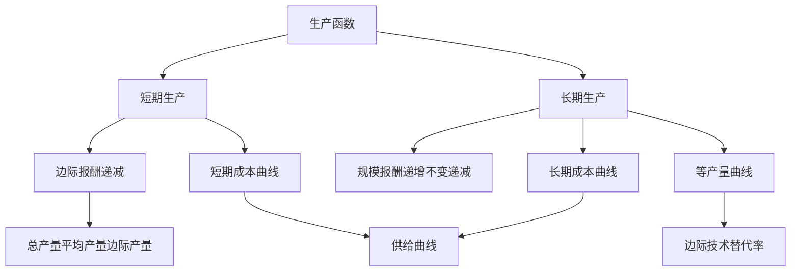

# 第三章 企业的生产和成本 章节总结

> 所属：[[../README|06 西方经济学]]

## 这一章在回答什么问题

老板开奶茶店，雇几个员工、买多少原料、租多大店面最划算？生产多少杯时成本最低？这就是生产论和成本论。

## 核心概念清单

- **生产函数**：投入（劳动、资本）→ 最大产出。
- **短期 vs 长期**：至少一种要素不能调 vs 全部要素都能调。
- **边际报酬递减**：人多了，多一个工人带来的产量增量递减。
- **规模报酬**：所有要素同比例增加，产出怎么变。
- **成本曲线**：TC、FC、VC、AC、MC 的关系。

## 框架图

## 本章 KP 列表

- [[KP01_生产函数与短期长期|KP01 生产函数与短期长期]]
- [[KP02_边际报酬递减规律|KP02 边际报酬递减规律]]
- [[KP03_等产量曲线与边际技术替代率|KP03 等产量曲线与边际技术替代率]]
- [[KP04_规模报酬|KP04 规模报酬]]
- [[KP05_成本概念|KP05 成本概念]]
- [[KP06_短期成本曲线|KP06 短期成本曲线]]
- [[KP07_长期成本曲线|KP07 长期成本曲线]]

## 与前后章的关系

本章推导供给曲线（从厂商最优化）。第 4 章把供给曲线放进完全竞争市场。
