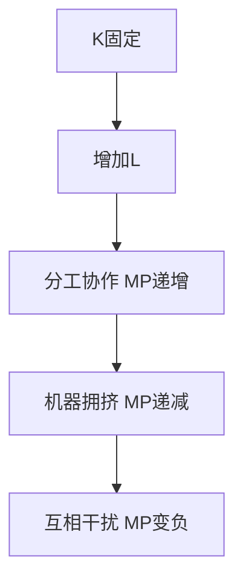

# KP02 边际报酬递减规律

<a href="../../../../exam.html" target="_blank" style="display:inline-block;padding:6px 16px;background:#2563eb;color:#fff;border-radius:6px;text-decoration:none;font-size:14px;">📝 开始做题</a>

> 所属：[[00_章节总结|第3章 企业的生产和成本]]

## 1. 一句话先懂（小白版）

奶茶店 1 个员工时手忙脚乱；加到 3 个员工分工明确，产量大增；但加到 10 个员工，店里挤得转不开，多招一个人反而帮倒忙。**其他要素固定时，一味加人，多一个人带来的产量增量越来越少——这就是边际报酬递减。**

## 2. 严格定义

**总产量（Total Product, TP）**：一定投入下的最大产量。

**平均产量（Average Product, AP）**：总产量 / 劳动投入：
$$AP_L = \frac{TP}{L}$$

**边际产量（Marginal Product, MP）**：多投入一单位劳动带来的产量增量：
$$MP_L = \frac{\Delta TP}{\Delta L}$$

**边际报酬递减规律（Law of Diminishing Marginal Returns）**：在技术和其他要素固定下，连续等量增加某一可变要素，边际产量最终会递减。

## 3. 为什么（原理/机制）

- 固定要素（店面、机器）就那么大。
- 第一个工人独享整个店面，效率最高。
- 第五个工人要和别人抢工位、排队用机器。
- 第十个工人只能站门口，边际产量可能为负。

## 4. 怎么用（手把手算）

**场景**：奶茶店 $K=4$ 固定：

| 工人 L | 总产量 TP（杯/天） | 平均产量 AP = TP/L | 边际产量 MP = ΔTP/ΔL |
|---|---|---|---|
| 0 | 0 | — | — |
| 1 | 10 | 10 | 10 |
| 2 | 25 | 12.5 | 15 |
| 3 | 42 | 14 | 17 |
| 4 | 56 | 14 | 14 |
| 5 | 65 | 13 | 9 |
| 6 | 60 | 10 | -5 |

**观察**：
- MP 从 10 → 15 → 17 → 14 → 9 → -5，先升后降。
- MP 最大在 L=3（17）。
- MP 穿过 AP 最高点（L=3 时 AP=14，之后 AP 开始下降）。
- MP = 0 时 TP 最大（L=5 时 TP=65）。
- MP < 0 时 TP 下降（L=6 时）。

## 5. 三个生产阶段

| 阶段 | MP vs AP | 特点 | 理性决策 |
|---|---|---|---|
| 阶段 I | MP > AP | AP 递增 | 生产者不会停在这里，加人划算 |
| 阶段 II | MP < AP 但 MP > 0 | AP 递减，TP 递增 | **合理区间** |
| 阶段 III | MP < 0 | TP 递减 | 人太多，必须裁人 |

## 5.5 理论推导（一步步推）

> 本节补充：为什么短期边际报酬递减。

**假设起点**：
1. 短期：资本 K 固定（如工厂规模不变），只有劳动 L 可变。
2. 技术水平不变。
3. 其他要素质量不变。

**推导过程**：
- 第一步：刚开始加劳动时，工人可以分工协作（一个切菜、一个炒菜、一个端盘），每加一个工人带来的产出增加量 MP 很大甚至递增。
- 第二步：工人继续增加，但机器数不变，每个工人能分到的机器时间变少 → MP 开始下降。
- 第三步：工人多到拥挤、互相干扰（餐厅里 10 个服务员挤在 5 张桌子间），MP 变成 0 甚至负。
- 第四步：TP 曲线先以递增速率上升（MP 递增），再以递减速率上升（MP 递减），最后水平甚至下降（MP≤0）。

## 5.6 数学推导（公式怎么来的）

> 每个符号第一次出现必须解释。

短期生产函数 $Q = f(ar K, L)$，$ar K$ 固定。

边际产量：
$$MP_L = \frac{\partial Q}{\partial L}$$

平均产量：
$$AP_L = \frac{Q}{L}$$

**举例**：$Q = 3KL - L^2$，$K=1$ 时 $Q = 3L - L^2$。
$$MP_L = 3 - 2L$$
$$AP_L = 3 - L$$

当 $L < 1.5$ 时 MP 递增？不，MP = 3-2L 本身随 L 增大而线性递减——这是二阶导数 $dMP/dL = -2 < 0$ 的结果。技术系数若为 $Q = 3KL - L^2$，MP 从一开始就递减；若为 $Q = 6L^2 - L^3$，则 MP 在 $L<2$ 时递增、$L>2$ 时递减，形成标准的"先递增后递减"曲线。

## 6. 容易混淆什么

| 概念 | 区别 |
|---|---|
| 边际报酬递减 vs 规模报酬递减 | 前者是"其他要素固定，只加一种"；后者是"所有要素同比例加"。短期 vs 长期。 |
| MP 递减 vs TP 递减 | MP 递减时 TP 仍在涨（只是涨得慢）；MP 负时 TP 才降。 |

## 7. 现实意义

- 为啥大学食堂中午挤爆？窗口数量固定（短期 $K$），学生越多，多一个学生打餐等待时间越长（边际产出递减）。
- 为啥农田施肥过量反而减产？土地固定，肥多了烧苗。
- 为啥互联网公司加班产出下降？员工边际产出递减。

---

## 🔗 相关知识点

**同章关联：** [[KP01_生产函数与短期长期|生产函数]] ｜ [[KP06_短期成本曲线|短期成本曲线]]

**跨章关联：** [[../../00_导论/知识点/KP04_边际分析方法|边际分析]]

**📖 原书原文：** [[../../../../原文件/经济学/西方经济学上册_微观_全书|原书·第三章第二节]]

---

## 🐮 小白教程入门

> 看不懂下面这个KP？先看通俗版教程建立直觉：

- [[../../../../经济统计学论文从0基础到精通/13_微观经济学基础/07_生产函数与边际报酬递减是什么|🐮 教程·生产函数与边际报酬递减是什么]]

---

## 📝 考研真题（首经贸 801）

**配套主观题：** 见同目录 [[../考研真题集|本章考研真题集]]
**配套选择题：** 见同目录 [[../选择题集|本章选择题集]]

### 高频简答
- 用图形说明 TP、AP、MP 三者之间的关系 → 见 [[../考研真题集#s2|真题集·简答]]

### 高频论述
- 结合"内卷"与加班现象，用边际报酬递减规律分析劳动投入 → 见 [[../考研真题集#l3|真题集·论述]]

### 易错选择
- 本知识点选择题见 [[../选择题集#KP02 边际报酬递减规律|选择题集]]
