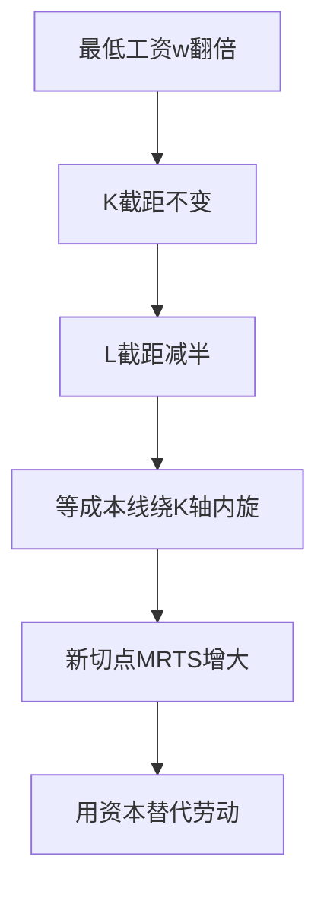
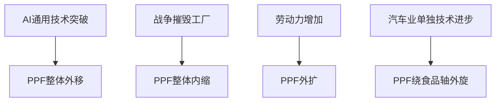
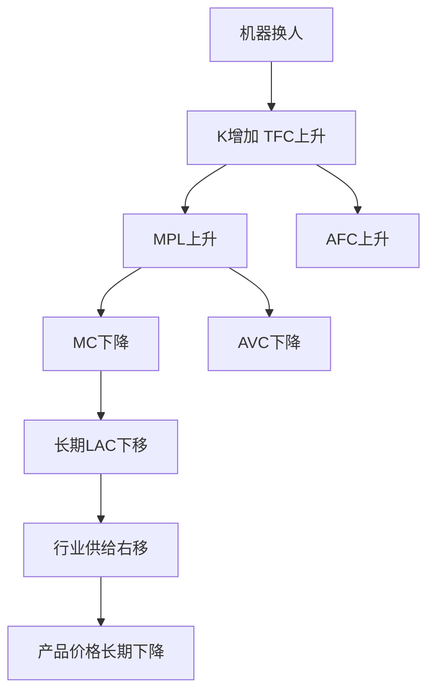

# 第三章 企业的生产和成本 · 考研真题集（首经贸 801）

<a href="../../../exam.html" target="_blank" style="display:inline-block;padding:6px 16px;background:#2563eb;color:#fff;border-radius:6px;text-decoration:none;font-size:14px;">📝 开始做题</a>

> 本章共收录：简答题 10 道（每题 15 分）｜论述题 4 道（每题 30 分）
> 配套选择题见 [[选择题集|本章选择题集]]
> 对应大纲：西方微观第三章「生产论」「成本论」全部七节

## 📋 本题集目录

### 简答题
1. [简述生产函数的含义及短期与长期的划分标准](#s1)
2. [用图形说明 TP、AP、MP 三者之间的关系](#s2)
3. [简述边际报酬递减规律的内容及其成立条件](#s3)
4. [简述等产量曲线的特征及边际技术替代率递减规律](#s4)
5. [简述规模报酬的三种类型并举例说明](#s5)
6. [简述机会成本、显成本、隐成本、经济利润与会计利润的关系](#s6)
7. [计算题：由短期总成本函数求 FC、VC、AFC、AVC、AC、MC](#s7)
8. [用图形说明短期六条成本曲线之间的关系](#s8)
9. [简述长期总成本曲线是短期总成本曲线的包络线](#s9)
10. [计算题：给定生产函数与要素价格，求成本最小化要素组合](#s10)

### 论述题
1. [用生产理论与成本理论分析奶茶店扩张的边界](#l1)
2. [比较短期生产与长期生产的区别及其对厂商决策的影响](#l2)
3. [结合"内卷"与加班现象，用边际报酬递减规律分析劳动投入](#l3)
4. [从规模报酬与长期成本曲线看中国制造业"做大做强"](#l4)

---

## 一、简答题（每题 15 分，建议 450–700 字）

### 简答 1：简述生产函数的含义，并说明微观经济学中短期与长期是如何划分的。{#s1}

**【建议字数】450–700 字 ｜ 【建议时间】15 分钟 ｜ 【题型】概念简答**
**【考什么】** 对应知识点 [[知识点/KP01_生产函数与短期长期|生产函数与短期长期]]；题型属于概念简答。

**【答题框架】**
- 第 1 段：生产函数的定义（3 分）
- 第 2 段：短期与长期的划分标准（4 分）
- 第 3 段：短期生产函数与长期生产函数的形式（4 分）
- 第 4 段：划分的意义与举例（2 分）
- 第 5 段：小结（2 分）

**【参考答案】**

一、生产函数的含义

生产函数表示在一定时期内，在技术水平不变的条件下，生产中所使用的各种生产要素的数量与所能生产的最大产量之间的关系。若以 $L$ 表示劳动投入量、$K$ 表示资本投入量，则生产函数可写为：
$$Q=f(L,K)$$
其核心含义有二：一是"最大产量"，即隐含了要素被充分有效利用的技术效率；二是"技术水平不变"，技术进步会使生产函数整体外移。

二、短期与长期的划分标准

微观经济学中短期与长期的划分**不是以日历时间长短为标准，而是以厂商能否变动全部生产要素投入为标准**：
1. **短期（Short Run）**：至少有一种生产要素的数量固定不变、来不及调整的时期。通常假设资本 $K$ 固定、劳动 $L$ 可变，记为 $Q=f(L,\bar K)$。
2. **长期（Long Run）**：厂商可以调整全部生产要素投入，甚至可以进入或退出一个行业的时期，记为 $Q=f(L,K)$。

三、举例说明

一家奶茶店租下店面（资本 $K$ 在租期内固定），一周内只能增减员工（劳动 $L$），这一周就是短期；租约到期后续签或关店，可以重谈店面面积、设备数量，那就是长期。不同行业的"短期"时间长度不同：餐馆可能是几个月，重化工可能是好几年。

四、小结

生产函数刻画投入产出的技术关系；短长期之分的关键在于要素是否全部可变，这一划分直接决定了短期成本曲线与长期成本曲线的形状，也决定了厂商在不同时期的决策空间。

**【解析·得分点】** 采分点：①生产函数定义含"最大产量""技术不变"两个限定（3 分）；②明确指出划分标准是"要素是否全部可变"而非日历时间（4 分）；③写出短期 $Q=f(L,\bar K)$ 与长期 $Q=f(L,K)$（4 分）；④举奶茶店或类似例子（2 分）；⑤小结（2 分）。易丢分：把短期长期说成"一年以内/一年以上"。

**【生活实例】** 学校食堂中午加几个窗口工人就是短期（灶台固定）；暑假装修新增灶台就是长期。同样是"加人"和"加灶"，前者一周能完成，后者要一暑假。

**【双链接】** 🔗 [[知识点/KP01_生产函数与短期长期|回知识点]] ｜ 📖 [[../../../原文件/经济学/西方经济学上册_微观_全书|原书·第三章第一节]]

---

### 简答 2：用图形说明总产量（TP）、平均产量（AP）与边际产量（MP）三者之间的关系。{#s2}

**【建议字数】450–700 字 ｜ 【建议时间】15 分钟 ｜ 【题型】关系对比**
**【考什么】** 对应知识点 [[知识点/KP02_边际报酬递减规律|边际报酬递减规律]]；题型属于图形分析。

**【答题框架】**
- 第 1 段：三个产量指标的定义（3 分）
- 第 2 段：MP 与 TP 的关系（4 分）
- 第 3 段：MP 与 AP 的关系（4 分）
- 第 4 段：图形描述（2 分）
- 第 5 段：三个生产阶段（2 分）

**【参考答案】**

一、定义

设资本固定为 $\bar K$，仅劳动 $L$ 可变：
- 总产量 $TP_L=f(L,\bar K)$
- 平均产量 $AP_L=\dfrac{TP_L}{L}$
- 边际产量 $MP_L=\dfrac{\Delta TP_L}{\Delta L}=\dfrac{dTP_L}{dL}$

二、MP 与 TP 的关系

1. $MP>0$ 时，TP 递增；$MP=0$ 时，TP 达到最大值；$MP<0$ 时，TP 递减。
2. $MP$ 上升阶段对应 TP 以递增速率上升（TP 曲线下凸）；$MP$ 下降但仍为正的阶段，对应 TP 以递减速率上升（TP 曲线上凸）。
3. 几何上，$MP_L$ 是 $TP_L$ 曲线上任一点切线的斜率。

三、MP 与 AP 的关系

1. 当 $MP>AP$ 时，AP 被边际值"拉"上去，AP 递增；
2. 当 $MP<AP$ 时，AP 被"拉"下来，AP 递减；
3. **MP 曲线必然穿过 AP 曲线的最高点**。这是"边际量与平均量"关系的通用规律——边际量高于平均量时平均量上升，反之下降。

四、图形描述

以 $L$ 为横轴、产量为纵轴：TP 曲线先下凸、经过一个拐点后上凸，最终在 MP=0 处达到最高点后下降；MP 曲线呈倒 U 形，先升后降，先后穿过 TP 的拐点（MP 最大）和 AP 最高点，最后在 TP 最高点处穿过横轴；AP 曲线也呈倒 U 形，其最高点恰与 MP 相交。

五、三个生产阶段

- 阶段 I：$MP>AP$，AP 递增，理性厂商不会停于此；
- 阶段 II：$AP>MP>0$，AP 递减但 TP 仍递增，是**合理生产区间**；
- 阶段 III：$MP<0$，TP 递减，厂商应立即裁减劳动。

**【解析·得分点】** 采分点：①三个定义公式（3 分）；②MP 是 TP 切线斜率、MP=0 时 TP 最大（4 分）；③MP 穿过 AP 最高点（4 分）；④图形下凸/上凸/拐点描述（2 分）；⑤合理区间为阶段 II（2 分）。易丢分：只说"MP 穿过 AP 最高点"但不解释为什么。

**【生活实例】** 一个班平均身高 1 米 7，新来一个同学身高 1 米 9（边际值），全班平均被拉高；新来一个 1 米 5，平均被拉低。边际量高于平均量时平均量上升，反之下降——这就是 MP 与 AP 关系的大白话。

**【双链接】** 🔗 [[知识点/KP02_边际报酬递减规律|回知识点]] ｜ 📖 [[../../../原文件/经济学/西方经济学上册_微观_全书|原书·第三章第二节]]

---

### 简答 3：简述边际报酬递减规律的内容，并说明其成立的前提条件。{#s3}

**【建议字数】450–700 字 ｜ 【建议时间】15 分钟 ｜ 【题型】原因分析**
**【考什么】** 对应知识点 [[知识点/KP02_边际报酬递减规律|边际报酬递减规律]]；题型属于概念简答。

**【答题框架】**
- 第 1 段：规律内容（4 分）
- 第 2 段：成立条件（5 分）
- 第 3 段：与规模报酬递减的区别（3 分）
- 第 4 段：现实意义（3 分）

**【参考答案】**

一、规律内容

**边际报酬递减规律**是指：在技术水平不变的条件下，在连续等量地把某一种可变生产要素增加到其他一种或几种数量固定不变的生产要素上去的过程中，当这种可变要素的投入量小于某一特定值时，增加该要素投入所带来的边际产量是递增的；当这种可变要素的投入量连续增加并超过这个特定值时，增加该要素投入所带来的边际产量是递减的。简言之：**其他要素固定不变时，连续等量增加某一可变要素，其边际产量最终必然递减。**

二、成立的前提条件

1. **技术水平不变**。若技术进步，MP 曲线整体上移，递减可能被推迟甚至暂时掩盖；
2. **其他要素投入固定不变**。该规律是短期生产规律，仅适用于至少有一种要素固定的情形；
3. **可变要素各单位质量相同**（先投入的工人与后投入的工人在能力上无差别），边际产量递减是要素与固定要素配比恶化所致，而非工人本身变差；
4. **超过一定点之后才递减**。规律并不否认初始阶段 MP 可能因分工协作而递增。

三、与规模报酬递减的区别

边际报酬递减是**短期**现象（一种要素变、其他要素固定）；规模报酬递减是**长期**现象（所有要素同比例增加）。前者是"配比失衡"，后者是"组织太大、协调成本上升"。

四、现实意义

该规律是解释短期成本曲线呈 U 形的根本原因：MP 递增阶段对应 MC 递减，MP 递减阶段对应 MC 递增。食堂中午窗口固定、学生越多排队越长，正是边际报酬递减的日常写照。

**【解析·得分点】** 采分点：①规律表述中"技术不变""其他要素固定""最终递减"三个关键词（4 分）；②四个前提条件（5 分）；③与规模报酬递减的区分（3 分）；④联系短期成本 U 形（3 分）。易丢分：把规律说成"边际产量从一开始就递减"。

**【生活实例】** 一亩地施肥，施 10 斤增产 200 斤，施 20 斤再增产 150 斤，施 30 斤再增产 50 斤，施 50 斤反而烧苗减产——土地固定、技术不变，肥料越多边际增产越少。

**【双链接】** 🔗 [[知识点/KP02_边际报酬递减规律|回知识点]] ｜ [[知识点/KP04_规模报酬|规模报酬]] ｜ 📖 [[../../../原文件/经济学/西方经济学上册_微观_全书|原书·第三章第二节]]

---

### 简答 4：简述等产量曲线的基本特征，并说明边际技术替代率递减规律。{#s4}

**【建议字数】450–700 字 ｜ 【建议时间】15 分钟 ｜ 【题型】概念简答**
**【考什么】** 对应知识点 [[知识点/KP03_等产量曲线与边际技术替代率|等产量曲线与 MRTS]]；题型属于概念简答。

**【答题框架】**
- 第 1 段：等产量曲线定义（3 分）
- 第 2 段：四个特征（5 分）
- 第 3 段：MRTS 定义与公式（4 分）
- 第 4 段：MRTS 递减规律及其原因（3 分）

**【参考答案】**

一、定义

**等产量曲线**是在技术水平不变的条件下，生产同一产量的两种生产要素（劳动 $L$ 与资本 $K$）所有不同组合的轨迹。它类似于消费者理论中的无差异曲线，区别在于等产量曲线代表的产量是可度量的实物量。

二、基本特征

1. 在同一平面上有无数条等产量曲线，离原点越远代表产量水平越高；
2. 任意两条等产量曲线不相交（否则与产出唯一性矛盾）；
3. 等产量曲线向右下方倾斜，斜率为负——为维持同一产量，增加一种要素必须减少另一种；
4. 等产量曲线凸向原点，这是由边际技术替代率递减规律决定的。

三、边际技术替代率

**边际技术替代率（MRTS）** 表示在维持产量水平不变的条件下，增加一单位某种生产要素投入量时所减少的另一种要素的投入量：
$$MRTS_{LK}=-\frac{\Delta K}{\Delta L}=\frac{MP_L}{MP_K}$$
几何上，$MRTS_{LK}$ 是等产量曲线斜率的绝对值。

四、MRTS 递减规律

在维持产量不变的前提下，当一种生产要素的投入量不断增加时，每一单位这种要素所能替代的另一种生产要素的数量是递减的。其原因在于：随着劳动投入增多，劳动的边际产量 $MP_L$ 递减；随着资本投入减少，资本的边际产量 $MP_K$ 递增，因此 $MRTS_{LK}=MP_L/MP_K$ 必然递减。这一规律使等产量曲线凸向原点。

**【解析·得分点】** 采分点：①等产量曲线定义（3 分）；②四个特征中至少答出三条（5 分）；③MRTS 公式 $=MP_L/MP_K$（4 分）；④MRTS 递减原因联系 MP 递减（3 分）。易丢分：把等产量曲线与无差异曲线混为一谈，不强调"产量是实物量"。

**【生活实例】** 开奶茶店：可以用"1 台机器 + 5 个员工"，也可以用"2 台机器 + 2 个员工"，都能日产 1000 杯。当员工已经很多、机器很少时，再想裁掉一个员工，得多添好几台机器才补得上产量——这就是 MRTS 递减。

**【双链接】** 🔗 [[知识点/KP03_等产量曲线与边际技术替代率|回知识点]] ｜ 📖 [[../../../原文件/经济学/西方经济学上册_微观_全书|原书·第三章第三节]]

---

### 简答 5：简述规模报酬的三种类型，并各举一例说明。{#s5}

**【建议字数】450–700 字 ｜ 【建议时间】15 分钟 ｜ 【题型】概念简答**
**【考什么】** 对应知识点 [[知识点/KP04_规模报酬|规模报酬]]；题型属于概念简答。

**【答题框架】**
- 第 1 段：定义（3 分）
- 第 2 段：三种类型及数学表达（6 分）
- 第 3 段：原因（3 分）
- 第 4 段：举例（3 分）

**【参考答案】**

一、定义

**规模报酬**是指在长期生产中，在技术水平和要素价格不变的条件下，当所有生产要素投入都按同一比例变动时，产量变动的反应程度。它考察的是**生产规模本身**变动对产量的影响，而非短期内某一种要素的边际产出。

二、三种类型

设生产函数为 $Q=f(L,K)$，要素同时乘以常数 $\lambda>1$：

1. **规模报酬递增**：$f(\lambda L,\lambda K)>\lambda f(L,K)$。产出增长比例大于要素增长比例。原因：分工专业化、设备大规模利用、管理效率提升。
2. **规模报酬不变**：$f(\lambda L,\lambda K)=\lambda f(L,K)$。产出与要素同比例增长。原因：规模已达最优，继续扩张只能靠复制现有模式。
3. **规模报酬递减**：$f(\lambda L,\lambda K)<\lambda f(L,K)$。产出增长比例小于要素增长比例。原因：企业过大导致协调成本上升、信息传递失真、官僚主义。

三、举例

1. 规模报酬递增：一家小型芯片厂扩建为十倍规模后，由于专用设备、研发分摊、流水线分工，产量可能增长到十五倍；
2. 规模报酬不变：一家成熟的社区超市，再开一家一模一样的分店，总产量大约也翻倍；
3. 规模报酬递减：一家餐饮连锁店开到几千家后，总部管理半径过长、品控下降，再增加门店数反而使单店平均产量下降。

四、与边际报酬递减的区别

规模报酬是长期、全部要素同比例变动的结果；边际报酬递减是短期、其他要素固定时单一要素变动的结果。企业通常先经历规模报酬递增，达到最优规模后进入不变阶段，过度扩张则转入递减。

**【解析·得分点】** 采分点：①定义中"所有要素同比例""长期"（3 分）；②三种类型的不等式表达（6 分，每种 2 分）；③原因（3 分）；④三个例子（3 分）。易丢分：把规模报酬递减说成边际报酬递减。

**【生活实例】** 一个人包饺子：擀皮、包、煮全自己干，一小时包 20 个。两口子分工（一人擀皮、一人包），要素翻倍，一小时能包 60 个——规模报酬递增。再加入第三个人（洗碗收拾），要素 1.5 倍，产量 90 个——递增放缓。十个人在一个小厨房里挤着，反而互相挡路，一小时只做出 100 个——递减。

**【双链接】** 🔗 [[知识点/KP04_规模报酬|回知识点]] ｜ [[知识点/KP02_边际报酬递减规律|边际报酬递减]] ｜ 📖 [[../../../原文件/经济学/西方经济学上册_微观_全书|原书·第三章第四节]]

---

### 简答 6：简述机会成本、显成本、隐成本、经济利润与会计利润之间的关系。{#s6}

**【建议字数】450–700 字 ｜ 【建议时间】15 分钟 ｜ 【题型】关系对比**
**【考什么】** 对应知识点 [[知识点/KP05_成本概念|成本概念]]；题型属于关系对比。

**【答题框架】**
- 第 1 段：机会成本定义（3 分）
- 第 2 段：显成本与隐成本（4 分）
- 第 3 段：会计利润与经济利润（5 分）
- 第 4 段：关系总结（3 分）

**【参考答案】**

一、机会成本

**机会成本**是指生产者所放弃的使用相同生产要素在其他生产用途中所能得到的最高收入。它是经济学中最核心的成本概念，强调"选择的代价"——只要做出选择，就放弃了其他可能中最好的那个。

二、显成本与隐成本

1. **显成本**：厂商在生产要素市场上购买或租用他人所拥有的生产要素的实际支出，如工资、原材料款、租金。这些成本在会计账簿上体现。
2. **隐成本**：厂商本身自己所拥有的且被用于该企业生产过程的那些生产要素的总价格。例如，老板自己投入的资金本可获得的利息、自己管理店铺本可去别处打工的工资。隐成本也必须从机会成本的角度，按照自有要素在其他最佳用途中所能得到的收入来支付。

**总成本（经济成本）=显成本+隐成本=机会成本**。

三、会计利润与经济利润

1. **会计利润**=总收益-显成本；
2. **经济利润**=总收益-显成本-隐成本=总收益-机会成本；
3. 正常利润是指厂商对自己所提供的企业家才能的报酬支付，它属于隐成本的一部分。

四、关系总结

经济利润必然小于会计利润，因为经济利润多扣了隐成本。当经济利润为零时，会计利润恰好等于正常利润（隐成本），厂商仍愿意继续经营——因为他的自有要素在其他用途上也只能赚到这么多。这就是为什么微观经济学中"长期均衡时经济利润为零"并不意味着厂商亏本。

**【解析·得分点】** 采分点：①机会成本定义含"其他用途中最高收入"（3 分）；②显成本、隐成本定义及二者相加为机会成本（4 分）；③会计利润与经济利润公式（5 分）；④经济利润为零≠亏本（3 分）。易丢分：把正常利润当成经济利润的一部分。

**【生活实例】** 王同学毕业时手里有 10 万积蓄（存银行一年利息 2000 元）和一个去互联网公司打工的 offer（年薪 15 万）。他用这 10 万开奶茶店，一年营收 30 万、买原料付房租等花了 25 万。会计利润=30-25=5 万；经济利润=5 万-0.2 万利息-15 万工资=-10.2 万。看似账面赚了 5 万，实际上还不如去打工。

**【双链接】** 🔗 [[知识点/KP05_成本概念|回知识点]] ｜ 📖 [[../../../原文件/经济学/西方经济学上册_微观_全书|原书·第三章第五节]]

---

### 简答 7（计算题）：已知某完全竞争厂商的短期总成本函数为 $STC=Q^3-10Q^2+17Q+66$。求：（1）固定成本与可变成本；（2）AFC、AVC、AC、MC 的函数表达式；（3）AVC 最低点对应的产量。{#s7}

**【建议字数】450–700 字 ｜ 【建议时间】15 分钟 ｜ 【题型】分析推导**
**【考什么】** 对应知识点 [[知识点/KP06_短期成本曲线|短期成本曲线]]；题型属于分析推导/计算。

**【答题框架】**
- 第 1 步：由 STC 拆分 FC 与 VC（3 分）
- 第 2 步：分别除以 Q 或求导得 AFC/AVC/AC/MC（6 分）
- 第 3 步：AVC 最低点条件 AVC=MC（6 分）

**【参考答案】**

（1）固定成本与可变成本

短期总成本函数 $STC=Q^3-10Q^2+17Q+66$ 中，与产量无关的常数项即为固定成本：
$$FC=66,\qquad VC=Q^3-10Q^2+17Q$$

（2）各平均成本与边际成本函数

$$AFC=\frac{FC}{Q}=\frac{66}{Q}$$

$$AVC=\frac{VC}{Q}=Q^2-10Q+17$$

$$AC=\frac{STC}{Q}=Q^2-10Q+17+\frac{66}{Q}$$

$$MC=\frac{dSTC}{dQ}=3Q^2-20Q+17$$

（3）AVC 最低点对应的产量

AVC 最低点满足 $AVC=MC$（边际成本穿过平均可变成本最低点）：
$$Q^2-10Q+17=3Q^2-20Q+17$$
整理：
$$2Q^2-10Q=0\Rightarrow 2Q(Q-5)=0$$
舍去 $Q=0$，得 $Q=5$。

此时 $AVC_{\min}=5^2-10\times 5+17=25-50+17=-8$。AVC 为负在经济上不合理，说明本题函数参数仅用于演示求法；若题目改为 $STC=Q^3-10Q^2+17Q+66$ 且产量较大时，AVC 才为正。考试中应按公式求解即可，不必纠结数值正负。

**【解析·得分点】** 采分点：①FC=常数项、VC=STC-FC（3 分）；②四个平均/边际函数（6 分，每个 1.5 分）；③用 AVC=MC 求最低点（6 分）。易丢分：忘记 MC 是求导不是除以 Q；求 AVC 最低点不用导数而用错误条件。

**【生活实例】** 这家奶茶店无论卖不卖奶茶，每月都得交 66 元房租（FC）；每多卖一杯，原料、人工随产量变化（VC）。AVC 最低点就是"卖多少杯时，每杯的可变成本最低"——低于这个量，分摊不好；高于这个量，边际成本又开始上升。

**【双链接】** 🔗 [[知识点/KP06_短期成本曲线|回知识点]] ｜ 📖 [[../../../原文件/经济学/西方经济学上册_微观_全书|原书·第三章第五节]]

---

### 简答 8：用图形说明短期七条成本曲线（FC、VC、TC、AFC、AVC、AC、MC）之间的关系。{#s8}

**【建议字数】450–700 字 ｜ 【建议时间】15 分钟 ｜ 【题型】关系对比**
**【考什么】** 对应知识点 [[知识点/KP06_短期成本曲线|短期成本曲线]]；题型属于图形分析。

**【答题框架】**
- 第 1 段：总成本族（FC、VC、TC）（4 分）
- 第 2 段：平均成本族（AFC、AVC、AC）（4 分）
- 第 3 段：MC 与 AVC、AC 的关系（5 分）
- 第 4 段：与边际报酬递减的对偶（2 分）

**【参考答案】**

一、总成本族

1. **FC 曲线**：一条水平线，因为固定成本不随产量变化；
2. **VC 曲线**：从原点出发，先以递减速率上升（下凸），经过拐点后以递增速率上升（上凸）；
3. **TC 曲线**：与 VC 曲线平行，垂直距离恒等于 FC，即 $TC=FC+VC$。

二、平均成本族

1. **AFC 曲线**：$AFC=FC/Q$，随着 $Q$ 增大单调递减，以两轴为渐近线；
2. **AVC 曲线**：U 形，先降后升；
3. **AC 曲线**：$AC=AVC+AFC$，也是 U 形，但位于 AVC 上方，二者垂直距离等于 AFC，且随着 Q 增大距离越来越近。AC 最低点出现的产量**晚于** AVC 最低点。

三、MC 与 AVC、AC 的关系

MC 曲线也呈 U 形。关键关系有三：
1. **MC 穿过 AVC 最低点**：$MC<AVC$ 时 AVC 下降；$MC>AVC$ 时 AVC 上升；
2. **MC 穿过 AC 最低点**：同理；
3. MC 最低点对应 TC 曲线与 VC 曲线的拐点。

四、与边际报酬递减的对偶

短期成本曲线的 U 形形状，根源在于边际报酬递减规律：MP 递增阶段对应 MC 递减；MP 递减阶段对应 MC 递增。因此，$MC=w/MP_L$（$w$ 为工资），MP 倒 U 形即 MC 正 U 形。

**【解析·得分点】** 采分点：①FC 水平、VC 从原点、TC=FC+VC（4 分）；②AFC 递减、AC 最低点晚于 AVC（4 分）；③MC 穿过 AVC 和 AC 最低点（5 分）；④对偶关系 $MC=w/MP_L$（2 分）。易丢分：画 AC 最低点与 AVC 最低点重合。

**【生活实例】** 奶茶店卖得越少，每杯分摊的房租（AFC）越高；卖得越多，AFC 越低，但排队效率下降使每杯原料+人工（AVC）又开始上升。AC 是 AVC+AFC 的合成，所以 AC 最低点总是比 AVC 最低点"晚到"一些。

**【双链接】** 🔗 [[知识点/KP06_短期成本曲线|回知识点]] ｜ [[知识点/KP02_边际报酬递减规律|边际报酬递减]] ｜ 📖 [[../../../原文件/经济学/西方经济学上册_微观_全书|原书·第三章第五节]]

---

### 简答 9：为什么说长期总成本曲线是短期总成本曲线的包络线？请作图说明。{#s9}

**【建议字数】450–700 字 ｜ 【建议时间】15 分钟 ｜ 【题型】模型分析**
**【考什么】** 对应知识点 [[知识点/KP07_长期成本曲线|长期成本曲线]]；题型属于图形分析。

**【答题框架】**
- 第 1 段：LTC 的定义（3 分）
- 第 2 段：从 STC 推导 LTC（5 分）
- 第 3 段：包络线的几何含义（4 分）
- 第 4 段：最优规模选择（3 分）

**【参考答案】**

一、长期总成本的定义

**长期总成本（LTC）**是指厂商在长期中在每一个产量水平上通过选择最优生产规模所能达到的最低总成本。长期中所有要素都可变，厂商可以任意调整厂房、设备，因此对每一产量都能找到一个成本最低的生产规模。

二、从 STC 推导 LTC

短期中，厂商的生产规模是固定的，对应一条短期总成本曲线 $STC_1$、$STC_2$、$STC_3$……每一条 STC 代表一个特定的固定规模。长期中，厂商可以根据产量目标自由选择规模：
- 若计划产量较低，选小规模（$STC_1$）最省；
- 若计划产量中等，选中规模（$STC_2$）最省；
- 若计划产量较高，选大规模（$STC_3$）最省。

把每一产量水平上所有 STC 曲线中**最低的那一点**连接起来，就得到 LTC。

三、包络线的几何含义

在以产量 $Q$ 为横轴、成本为纵轴的图上：
1. LTC 曲线从原点出发（长期无固定成本，产量为零时成本也为零）；
2. LTC 曲线把无数条 STC 曲线"包"在上方，与每条 STC 在某一产量水平相切；
3. **切点对应该规模下的最优产量**，在这一点上 LTC 与 STC 斜率相等（$LMC=SMC$）；
4. 在其他产量水平上，LTC 严格位于 STC 下方，因为短期被固定规模"锁死"，无法达到最低成本。

四、最优规模选择

LTC 是"每一产量下的最低成本"的集合，它意味着长期厂商总是在"最适合当前产量的那个规模"下生产。一旦选定规模进入短期，就只能沿着该规模的 STC 调整产量。

**【解析·得分点】** 采分点：①LTC 定义为"每一产量下的最低长期成本"（3 分）；②STC1/2/3 代表不同规模（5 分）；③LTC 从原点出发、与 STC 相切、位于 STC 下方（4 分）；④切点意义（3 分）。易丢分：把 LTC 说成"所有 STC 的连线"，而不是"最低值的包络"。

**【生活实例】** 一个学生备考：选择复习时长（短期）只能在现有基础上刷题；但可以在"报班/不报班""换自习室/不换"这些长期变量上重新选择最适合当前目标的配置。包络线就是"每种目标分数下，最省心的配置方案"。

**【双链接】** 🔗 [[知识点/KP07_长期成本曲线|回知识点]] ｜ [[知识点/KP06_短期成本曲线|短期成本曲线]] ｜ 📖 [[../../../原文件/经济学/西方经济学上册_微观_全书|原书·第三章第六节]]

---

### 简答 10（计算题）：已知某厂商的生产函数为 $Q=KL$，劳动价格 $w=4$，资本价格 $r=2$。求产量 $Q=100$ 时的成本最小化要素组合及最低总成本。{#s10}

**【建议字数】450–700 字 ｜ 【建议时间】15 分钟 ｜ 【题型】分析推导**
**【考什么】** 对应知识点 [[知识点/KP03_等产量曲线与边际技术替代率|等产量曲线]] 与 [[知识点/KP05_成本概念|成本概念]]；题型属于分析推导/计算。

**【答题框架】**
- 第 1 步：写出最优要素组合条件（4 分）
- 第 2 步：联立生产函数求解 L、K（6 分）
- 第 3 步：计算最低总成本（5 分）

**【参考答案】**

一、最优要素组合条件

厂商在既定产量下成本最小化的条件是：等产量曲线与等成本线相切，即边际技术替代率等于要素价格之比：
$$MRTS_{LK}=\frac{w}{r}$$

由生产函数 $Q=KL$，求边际产量：
$$MP_L=\frac{\partial Q}{\partial L}=K,\qquad MP_K=\frac{\partial Q}{\partial K}=L$$
因此：
$$MRTS_{LK}=\frac{MP_L}{MP_K}=\frac{K}{L}$$

二、联立方程

由 $MRTS_{LK}=w/r=4/2=2$：
$$\frac{K}{L}=2\Rightarrow K=2L$$

代入约束条件 $Q=KL=100$：
$$(2L)\cdot L=100\Rightarrow 2L^2=100\Rightarrow L^2=50\Rightarrow L=5\sqrt{2}\approx 7.07$$
$$K=2L=10\sqrt{2}\approx 14.14$$

三、最低总成本

$$C=wL+rK=4\times 5\sqrt{2}+2\times 10\sqrt{2}=20\sqrt{2}+20\sqrt{2}=40\sqrt{2}\approx 56.57$$

即：产量 100 时，最优要素组合为劳动约 7.07、资本约 14.14，最低总成本约为 56.57。

**【解析·得分点】** 采分点：①相切条件 $MP_L/MP_K=w/r$（4 分）；②正确求出 $MP_L=K$、$MP_K=L$（3 分）；③联立得 $K=2L$（3 分）；④代入生产函数解出 L、K（3 分）；⑤最后算出最低成本（2 分）。易丢分：把 $MP_L$ 错写成 $L$ 或 $K$，或者把要素价格比写反。

**【生活实例】** 这家工厂请工人（工资 4 元）比租机器（租金 2 元）贵一倍，所以理性老板会多用便宜的机器、少用工人。最优组合 $K=2L$ 正好体现"机器用量是工人的两倍"——因为机器便宜，就多用机器替代劳动。

**【双链接】** 🔗 [[知识点/KP03_等产量曲线与边际技术替代率|回知识点]] ｜ [[知识点/KP05_成本概念|成本概念]] ｜ 📖 [[../../../原文件/经济学/西方经济学上册_微观_全书|原书·第三章第三节]]

---

## 二、论述题（每题 30 分，建议 900–1200 字）

### 论述 1：试用生产理论与成本理论，分析一家奶茶店从开业到扩张的决策边界，并说明"做到多大"才是最优规模。{#l1}

**【建议字数】900–1200 字 ｜ 【建议时间】30 分钟 ｜ 【题型】现象类**
**【考什么】** 跨 KP01（短长期）、KP02（边际报酬递减）、KP04（规模报酬）、KP06（短期成本）、KP07（长期成本）；题型属于现象类。

**【答题框架】**
- 第 1 段：破题——奶茶店决策的本质（4 分）
- 第 2 段：短期生产——边际报酬递减决定单店最优员工数（6 分）
- 第 3 段：短期成本——AVC、AC、MC 决定是否开门、生产多少（6 分）
- 第 4 段：长期——规模报酬与包络线决定开多大店、开几家店（8 分）
- 第 5 段：中国现实与政策含义（4 分）
- 第 6 段：评价与局限（2 分）

**【参考答案】**

一、破题

奶茶店老板面对的根本问题是：雇几个员工、买多少设备、租多大店面、开几家分店最赚钱？这正是微观经济学生产论与成本论要回答的核心问题。生产论告诉老板"投入与产出的技术关系"，成本论则把这种技术关系换算成"花多少钱"，二者共同决定最优规模。

二、短期生产：边际报酬递减决定单店最优员工数

短期内店面面积、制冰机、封口机等资本设备是固定的（$\bar K$），唯一可变的是员工数量 $L$。根据边际报酬递减规律：
- 只雇 1 个员工时，$MP_L$ 较低，因为此人要兼做收银、制作、清洁；
- 雇到 3—4 人时，分工明确，$MP_L$ 达到最高；
- 雇到 8 人以上时，店面拥挤，员工抢设备，$MP_L$ 递减甚至为负。

理性老板不会停留在阶段 I（$MP>AP$，继续加人划算），也绝不进入阶段 III（$MP<0$），而会把员工数控制在阶段 II（$AP>MP>0$）。这就是单店"雇几个人"的答案。

三、短期成本：决定是否营业与单日产量

短期成本曲线族进一步把上述决策货币化：
- 当市场价格 $P$ 低于 AVC 最低点时，老板应停止营业——因为卖一杯亏一杯的原料钱，关门反而只亏房租（FC）；
- 当 $P\ge AVC$ 但 $P<AC$ 时，虽然账面亏损，但继续营业能摊一部分固定成本；
- 当 $P=MC$（且 $P\ge AVC$）时，利润最大化（或亏损最小化）。

奶茶店在写字楼午市单量高、晚市单量低，就是按 $P=MC$ 动态调整出杯速度。

四、长期：规模报酬与包络线决定最优规模

长期中，老板可以决定店面大小、设备数量、分店数量：
1. **规模报酬递增阶段**：从小档口扩到标准店，由于分工细化、设备利用率提高，产量增长比例大于成本增长比例，LAC 下降；
2. **规模报酬不变阶段**：标准店再扩到旗舰店，产量与成本同比例增长，LAC 触底；
3. **规模报酬递减阶段**：跨城开几十家分店后，总部管理半径过长、品控下降，LAC 上升。

长期平均成本曲线（LAC）是无数条 SAC 的包络线，其最低点对应**最优规模**。对绝大多数奶茶品牌而言，最优规模不是"越大越好"，而是"单店模型跑通之后的复制速度"。

五、中国现实

中国现制茶饮行业（喜茶、奈雪、蜜雪冰城）近十年的爆发式扩张，正是规模报酬规律的实践：
- 蜜雪冰城通过大规模采购、自建供应链，把单店成本压到极低，享受了规模报酬递增；
- 而一些网红品牌盲目扩张到几千家店后，因管理失控、品控下降，单店营收下滑，进入规模报酬递减阶段，纷纷闭店。

供给侧结构性改革强调"高质量发展"，本质上就是要求企业从"铺规模"转向"提效率"，避免在规模报酬递减阶段继续盲目扩张。

六、评价与局限

生产理论假设技术不变、要素同质，现实中品牌力、选址、消费者偏好都会影响最优规模。但边际报酬递减、规模报酬、成本包络这三块基石，仍是老板决策时最可靠的分析框架。

**【解析·得分点】** 采分点：①短期三阶段判断员工数（6 分）；②P=MC、停止营业点（6 分）；③规模报酬三阶段（8 分）；④LAC 包络线（4 分）；⑤结合茶饮行业与高质量发展（4 分）；⑥小结（2 分）。易丢分：把短期决策与长期决策混为一谈；不结合中国现实。

**【生活实例】** 蜜雪冰城 4 元柠檬水还能赚钱，靠的就是规模采购把 VC 压到极致；而某些网红奶茶店一杯 30 元仍倒闭，是因为单店模型没跑通就盲目复制——违背了规模报酬规律。

**【双链接】** 🔗 [[知识点/KP02_边际报酬递减规律|边际报酬递减]] ｜ [[知识点/KP04_规模报酬|规模报酬]] ｜ [[知识点/KP07_长期成本曲线|长期成本]] ｜ 📖 [[../../../原文件/经济学/西方经济学上册_微观_全书|原书·第三章]]

---

### 论述 2：试比较短期生产与长期生产的区别，并说明这些区别如何决定厂商在不同时期的成本结构与决策空间。{#l2}

**【建议字数】900–1200 字 ｜ 【建议时间】30 分钟 ｜ 【题型】理论类**
**【考什么】** 跨 KP01、KP02、KP03、KP06、KP07；题型属于理论类。

**【答题框架】**
- 第 1 段：划分标准（4 分）
- 第 2 段：生产函数形式差异（6 分）
- 第 3 段：成本结构差异——有无 FC（6 分）
- 第 4 段：决策空间差异（8 分）
- 第 5 段：联系中国供给侧改革（4 分）
- 第 6 段：小结（2 分）

**【参考答案】**

一、划分标准

微观经济学中短期与长期的根本区别，不在于日历时间长短，而在于**厂商能否调整全部生产要素**。短期中至少有一种要素固定（通常假设资本固定、劳动可变）；长期中所有要素均可变，厂商甚至可以进入或退出行业。

二、生产函数形式差异

1. **短期生产函数**：$Q=f(L,\bar K)$。分析工具是 TP、AP、MP 三条曲线，核心规律是边际报酬递减。此时厂商只能在既定规模下通过调整劳动投入来改变产量。
2. **长期生产函数**：$Q=f(L,K)$。分析工具是等产量曲线、等成本线、边际技术替代率，核心规律是 MRTS 递减与规模报酬。此时厂商可以同时调整劳动与资本，选择最优要素组合与最优生产规模。

三、成本结构差异

1. **短期成本**：存在固定成本 FC（厂房、设备折旧、长期租约），因此有 FC、VC、TC、AFC、AVC、AC、MC 七条曲线。其中 AFC 持续下降，AVC 与 AC 呈 U 形，MC 穿过二者最低点。
2. **长期成本**：所有要素都可变，因此不存在 FC，LTC 从原点出发，LAC 是无数条 SAC 的包络线，LMC 是 SMC 的包络曲线（而非 LAC 的包络）。

四、决策空间差异

1. **短期决策**：厂商只能决定"生产多少"。面对既定价格，按 $P=MC$（且 $P\ge AVC$）决定产量；若价格低于 AVC 最低点，立即停止营业。此时退出行业的代价是沉没成本。
2. **长期决策**：厂商可以决定"是否继续留在这个行业""建多大规模的工厂""用多少劳动多少资本"。当行业内经济利润为正时新厂商进入，为负时旧厂商退出，最终长期均衡时 $P=\min AC$，经济利润为零。

五、联系中国供给侧改革

中国过去几年推进的供给侧结构性改革，核心是"去产能、去库存、去杠杆"。许多传统产业（钢铁、煤炭、水泥）在短期中因资产专用性强、退出成本高，即使价格低于 AVC 仍继续生产，导致产能过剩。从长期看，必须通过破产清算、设备淘汰，让真正低效的厂商退出，才能使行业供给曲线左移、价格回归边际成本。这正是"短期难以退出、长期必须出清"的政策写照。

六、小结

短期与长期的区别，本质上是"要素可调范围"的区别：短期只能调一种要素，决策空间小、成本中有 FC；长期可调全部要素，决策空间大、成本无 FC。理解这一点，是理解厂商供给行为、行业进出与产业政策的基础。

**【解析·得分点】** 采分点：①划分标准不是日历时间（4 分）；②短期 TP/AP/MP vs 长期等产量/MRTS（6 分）；③短期有 FC 长期无 FC、LAC 包络（6 分）；④短期 P=MC、长期进出行业（8 分）；⑤去产能政策（4 分）；⑥小结（2 分）。

**【生活实例】** 一家外卖店：今天中午临时加个骑手（短期）；下个月重新装修厨房、决定要不要再开一个档口（长期）。前者只调一种要素，后者所有要素都能换。

**【双链接】** 🔗 [[知识点/KP01_生产函数与短期长期|生产函数与短长期]] ｜ [[知识点/KP06_短期成本曲线|短期成本]] ｜ [[知识点/KP07_长期成本曲线|长期成本]] ｜ 📖 [[../../../原文件/经济学/西方经济学上册_微观_全书|原书·第三章]]

---

### 论述 3：近年来"996""内卷"现象引发广泛讨论。试用边际报酬递减规律，分析企业劳动投入决策与大学生就业市场的关系，并说明这一规律对理解"加班为何越来越无效"的意义。{#l3}

**【建议字数】900–1200 字 ｜ 【建议时间】30 分钟 ｜ 【题型】现象类**
**【考什么】** 跨 KP02（边际报酬递减）+ 劳动要素市场（联系第 8 章要素价格决定）；题型属于现象类。

**【答题框架】**
- 第 1 段：破题（4 分）
- 第 2 段：边际报酬递减规律重述（5 分）
- 第 3 段：企业视角——加班的边际产出为何递减（8 分）
- 第 4 段：大学生就业市场——扩招的边际产出效应（6 分）
- 第 5 段：政策含义与中国现实（5 分）
- 第 6 段：小结（2 分）

**【参考答案】**

一、破题

"996"工作制、"内卷"、大学生"毕业即失业"，表面上是劳动市场现象，背后都可以用同一个微观经济学工具解释——边际报酬递减规律。理解这一规律，就能明白为什么"人越多、班加得越长，产出反而不增反降"。

二、规律重述

在技术水平不变、其他生产要素（资本、设备、办公空间、管理带宽）固定的短期条件下，连续等量增加某一可变要素（劳动），其边际产量最终必然递减。这一规律有三个前提：技术不变、其他要素固定、可变要素同质。

三、企业视角：加班为何越来越无效

1. 一家互联网公司在既定的办公场地、服务器数量、项目复杂度下，让员工从每天工作 8 小时延长到 10 小时，第一个小时的加班产出可能较高（$MP$ 较高）；
2. 延长到 12 小时、14 小时时，员工疲劳、注意力下降、沟通失误增多，多一小时的边际产出大幅递减；
3. 到凌晨 2 点还在加班，$MP$ 可能已经为负——因为疲劳导致第二天上午效率下降，整体 TP 不升反降。

这就是为什么多数研发型企业最终放弃 996，转向弹性工作、四天工作制——不是道德觉悟，而是 $MP$ 递减逼着企业这么做。

四、大学生就业市场：扩招的边际产出效应

1. 过去二十年中国高校持续扩招，每年大学毕业生从 2000 年的约 100 万增长到 2024 年的约 1179 万；
2. 在产业升级速度、高端岗位数量（"资本"与"产业结构"）短期内难以同比例扩张的条件下，新增大学生的边际产出（即新增毕业生能带来的边际 GDP）递减；
3. 表现为：学历贬值、对口岗位不足、"硕士送外卖"、考公考研白热化——这不是大学生不努力，而是固定要素（高质量岗位）约束下的边际报酬递减；
4. 出路在于长期：推动产业升级、发展高端服务业、创造更多岗位（即"移动固定要素"），而不是在既有岗位池里继续内卷。

五、政策含义

1. 对企业：尊重 $MP$ 递减规律，合理控制工时，通过技术进步（提高 $K$）而非延长劳动时间来提升产出；
2. 对宏观：要缓解青年就业压力，关键是扩大高质量岗位供给（移动"固定要素"），而不是简单地让大学生"降维就业"；
3. 对劳动者：理解 $MP$ 递减后，应主动选择能让自己与更多资本、更好平台结合的岗位，而非在拥挤赛道上拼时长。

六、小结

边际报酬递减规律不仅是一条生产理论，更是一面镜子：它告诉我们，"人多力量大"只在边际产出为正且递增时成立；一旦越过最优点，继续投入只会降低效率。无论是企业加班还是大学生就业，违背这一规律都会受到惩罚。

**【解析·得分点】** 采分点：①规律三前提（5 分）；②加班 MP 递减的机制（8 分）；③大学生扩招与岗位固定的类比（6 分）；④政策含义分企业/宏观/个人三层（5 分）；⑤小结（2 分）。易丢分：只批判 996 而不用理论；把规模报酬递减与边际报酬递减混用。

**【生活实例】** 一个小组做课程作业：3 个人分工写、查、排版，效率最高；10 个人一起做，反而三个人没事干、五个人互相等、最后只交出 3 个人的活——这就是边际报酬递减。

**【双链接】** 🔗 [[知识点/KP02_边际报酬递减规律|回知识点]] ｜ [[知识点/KP04_规模报酬|规模报酬]] ｜ 📖 [[../../../原文件/经济学/西方经济学上册_微观_全书|原书·第三章第二节]]

---

### 论述 4：试从规模报酬与长期成本曲线的角度，分析中国制造业"做大做强"战略的经济学逻辑，并说明为何"大"不等于"强"。{#l4}

**【建议字数】900–1200 字 ｜ 【建议时间】30 分钟 ｜ 【题型】政策效应类**
**【考什么】** 跨 KP04（规模报酬）、KP07（长期成本）、KP06（短期成本）；题型属于政策类。

**【答题框架】**
- 第 1 段：破题（4 分）
- 第 2 段：规模报酬三阶段（6 分）
- 第 3 段：LAC 包络线与最优规模（6 分）
- 第 4 段："做大"与"做强"的区别（8 分）
- 第 5 段：中国制造业实践（4 分）
- 第 6 段：政策含义（2 分）

**【参考答案】**

一、破题

"做大做强"是中国制造业过去三十年的关键词。但"做大"（扩大产量与资产规模）与"做强"（提高效率与技术水平）在微观经济学中对应完全不同的机制。用规模报酬与长期成本曲线分析，就能看清二者的区别。

二、规模报酬三阶段

当所有要素同比例扩大 $\lambda$ 倍时：
1. **规模报酬递增**：$f(\lambda L,\lambda K)>\lambda f(L,K)$。原因包括专业化分工、大型设备效率、研发费用分摊、批量采购折扣；
2. **规模报酬不变**：$f(\lambda L,\lambda K)=\lambda f(L,K)$。企业已达到最优规模，继续扩张只能靠复制现有模式；
3. **规模报酬递减**：$f(\lambda L,\lambda K)<\lambda f(L,K)$。原因是管理半径过大、信息传递失真、内部协调成本上升、官僚化。

三、长期成本曲线

长期平均成本 LAC 是无数条短期平均成本 SAC 的包络线：
1. 在规模报酬递增阶段，LAC 随产量增加而下降；
2. 在规模报酬不变阶段，LAC 触底（最小有效规模 MES）；
3. 在规模报酬递减阶段，LAC 随产量增加而上升。

只有在 LAC 最低点附近生产，才是"成本最优"的规模。

四、"做大"与"做强"的区别

1. **"做大"** 通常指产量、营收、资产规模的扩张。如果企业处于规模报酬递增阶段，做大能降低 LAC，是有效率的；但如果已经越过 LAC 最低点继续做大，则进入规模报酬递减阶段，LAC 上升，"大"反而成了负担。
2. **"做强"** 指的是通过技术进步、管理改善、产品差异化，使整个生产函数上移、LAC 曲线整体下移。它不是在同一条 LAC 上移动，而是让 LAC 本身降低。
3. 用图说话：做大是"沿 LAC 曲线左右移动"；做强是"让 LAC 曲线向下移动"。二者完全不是一回事。

五、中国制造业实践

1. 中国在钢铁、水泥、汽车、家电等行业的快速扩张，早期确实享受了规模报酬递增——宝钢、海尔、比亚迪都通过大规模生产降低了单位成本；
2. 但部分行业在地方政府补贴下盲目扩张，越过了 LAC 最低点，导致产能过剩、价格战、利润微薄——这就是"大而不强"；
3. 真正"做强"的企业（如华为、宁德时代），靠的是研发投入使生产函数上移、LAC 下移，而不是简单复制产能。

六、政策含义

供给侧结构性改革强调"高质量发展"，本质上就是要求：
1. 淘汰那些处于规模报酬递减阶段、LAC 高于行业平均水平的低效产能；
2. 鼓励企业通过技术进步（研发、数字化、绿色化）使 LAC 下移，而非仅仅扩大产量；
3. 让市场决定最优规模，而不是靠行政命令"拉郎配"式并购做大。

**【解析·得分点】** 采分点：①规模报酬三阶段（6 分）；②LAC 包络线（6 分）；③"做大=沿 LAC 移动，做强=LAC 下移"这一核心区分（8 分）；④结合钢铁、华为、宁德时代（4 分）；⑤高质量发展政策含义（4 分）；⑥小结（2 分）。

**【生活实例】** 一家小面馆：每天卖 100 碗时，师傅忙不过来；扩到 300 碗、多雇两个帮手、买个自动煮面机，每碗成本下降——这是规模报酬递增。但如果扩到每天 3000 碗，店面大到要 20 个服务员，管理乱、出餐慢，每碗成本反而上升——规模报酬递减。"做强"则是买个智能炒菜机，让每碗成本在任何产量下都下降。

**【双链接】** 🔗 [[知识点/KP04_规模报酬|规模报酬]] ｜ [[知识点/KP07_长期成本曲线|长期成本曲线]] ｜ [[知识点/KP06_短期成本曲线|短期成本曲线]] ｜ 📖 [[../../../原文件/经济学/西方经济学上册_微观_全书|原书·第三章第四节、第六节]]

---

## 一、简答题（曲线移动补练）

### 简答 11：（曲线移动·绘图）奶茶店老板月预算 10000 元用于雇佣店员（L，20 元/小时）和租赁封口机（K，50 元/小时）。现在最低工资上调到 40 元/小时，利率 r 不变。请画出等成本线的变化，并说明老板会如何调整 L、K 组合 {#s11}

**【建议字数】500–700 字 ｜ 【建议时间】15 分钟 ｜ 【题型】等成本线旋转分析**

**【考什么】** 对应知识点 [[知识点/KP03_等产量曲线与边际技术替代率|等产量线]]；题型属于要素价格变化与最优要素组合调整。

**【答题框架】**
- 第 1 段：原等成本线方程与截距（5 分）
- 第 2 段：w 上涨后等成本线怎么转（5 分）
- 第 3 段：新最优要素组合的调整方向（5 分）

**【参考答案】**

一、原等成本线。$wL + rK = C$，即 $20L + 50K = 10000$。L 轴截距 $C/w = 500$ 小时；K 轴截距 $C/r = 200$ 台时。斜率 $-w/r = -20/50 = -0.4$。

二、w 升到 40 后。$40L + 50K = 10000$。K 轴截距不变（200 台时）；L 轴截距从 500 降到 250 小时 → **等成本线绕 K 轴交点向内旋转**（斜率从 -0.4 变成 -0.8，更陡）。

三、最优要素组合调整。原均衡满足 $MRTS_{LK} = w/r$（等产量线与等成本线相切）。w 上升使 $w/r$ 变大 → 新切点处 $MRTS$ 也必须变大（沿等产量线向 K 多、L 少的方向移动）→ **老板会用资本替代劳动**：少雇店员、多买自动封口机。

四、数学推导。设生产函数 $Q = L^{0.5}K^{0.5}$（柯布-道格拉斯）。最优要素组合条件 $K/L = w/r$。原 $w/r = 20/50 = 0.4$ → $K/L = 0.4$。新 $w/r = 40/50 = 0.8$ → $K/L = 0.8$。在等成本 $C=10000$ 下，原最优 $L=250, K=100$；新最优 $L = C/(w(1+r/w)) = 10000/(40(1+0.8)) \approx 139$ 小时，$K = C/(r(1+w/r)) = 10000/(50\times 1.8) \approx 111$ 台时。劳动减半、资本略增——典型的资本替代劳动。

五、生活实例。2021 年上海最低工资从 2480 涨到 2690，海底捞开始试点"智慧餐厅"——传菜机器人、自动甩面机。工资越贵，老板越想用机器替代人。

**【解析·得分点】** 采分点：①原截距与斜率（5 分）；②绕 K 轴内旋（5 分）；③用资本替代劳动（5 分）。易丢分：把旋转方向画反。

**【生活实例】** 美国 2024 年加州快餐业时薪涨到 20 美元，麦当劳开始大规模部署自助点餐机——等成本线绕资本轴内旋，老板把人工换成了机器。

---

### 简答 12：（曲线移动·分析）生产可能性边界（PPF）表示一个经济体用全部资源能生产的两种产品最大组合。下列事件分别使 PPF 如何移动：① 人工智能技术突破；② 战争摧毁一半工厂；③ 劳动力人口增加；④ 只对汽车行业技术进步 {#s12}

**【建议字数】500–700 字 ｜ 【建议时间】15 分钟 ｜ 【题型】PPF 移动方向判断**

**【考什么】** 对应知识点 [[知识点/KP01_生产函数与短期长期|生产函数]]；题型属于生产可能性边界移动。

**【答题框架】**
- 第 1 段：PPF 的形状与含义（5 分）
- 第 2 段：四种事件分别的 PPF 移动方向（5 分）
- 第 3 段：数学解释（5 分）

**【参考答案】**

一、PPF 含义。假设经济体只生产食品 F 和服装 C，PPF 方程 $F = F_{max} - a\cdot C$（直线）或外凸（机会成本递增）。PPF 以外的点达不到，以内的点无效率。

二、四种事件：

① AI 技术突破（两行业通用）→ 任意资源组合下 F 和 C 的最大产出都上升 → **PPF 整体向外平移**（两轴截距都增大）。

② 战争摧毁一半工厂 → 资本减少 → 任意资源组合下产出都下降 → **PPF 整体向内收缩**（两轴截距都减半）。

③ 劳动力人口增加 → 两行业都能用更多劳动 → **PPF 整体向外扩**（但服装业劳动密集，外扩幅度更大）。

④ 只对汽车行业技术进步 → 汽车轴截距增大、食品轴截距不变 → **PPF 绕食品轴交点向外旋转**（不是平移）。

三、数学推导。设 PPF 由生产函数 $F = A_F\cdot F(L_F, K_F)$、$C = A_C\cdot C(L_C, K_C)$ 决定，劳动约束 $L_F+L_C = \bar L$、资本约束 $K_F+K_C = \bar K$。① $A_F\uparrow$ 且 $A_C\uparrow$ → 两轴截距都增；② $\bar K$ 减半 → 两轴截距都减；③ $\bar L$ 增加 → 两轴截距都增；④ 仅 $A_C$（汽车）↑ → C 轴截距增、F 轴不变。

四、生活实例。① 工业革命让英国纺织品和粮食产出同时暴涨——PPF 外移；② 二战把德国工厂炸光，PPF 内缩；③ 中国改革开放劳动力从 5 亿涨到 8 亿，PPF 外扩；④ 日本汽车工业技术进步，PPF 绕食品轴外旋——日本成为汽车出口大国。

**【解析·得分点】** 采分点：①PPF 含义（5 分）；②四种事件分别的移动方向（5 分）；③区分平移与旋转（5 分）。易丢分：把"单行业技术进步"答成整体平移。

**【生活实例】** 一个学生的 PPF 是"学习时间分配给数学和英语"。如果他掌握了通用学习方法（费曼技巧），两科成绩都涨（PPF 外移）；如果他只学会了数学刷题套路，PPF 绕英语轴外旋——数学涨、英语不动。

---

## 二、论述题（曲线移动补练）

### 论述 5：（曲线移动·大模型）试用短期成本曲线与长期成本曲线框架，分析"机器换人"浪潮对中国制造业 MC、AC、LAC 曲线的影响，并讨论这如何解释中国制造业产品价格的长期下行 {#l5}

**【建议字数】900–1200 字 ｜ 【建议时间】30 分钟 ｜ 【题型】成本曲线移动论述**

**【考什么】** 对应知识点 [[知识点/KP06_短期成本曲线|短期成本]]、[[知识点/KP07_长期成本曲线|长期成本]]、[[知识点/KP02_边际报酬递减规律|边际报酬]]；题型属于技术进步对成本曲线的影响。

**【答题框架】**
- 第 1 段：模型设定——厂商生产函数与成本结构（6 分）
- 第 2 段：机器换人 = 资本 K 增加、劳动 L 减少，短期 MC/AVC/AC 怎么变（8 分）
- 第 3 段：长期 LAC 怎么变（8 分）
- 第 4 段：行业层面 → 产品价格长期下行（8 分）

**【参考答案】**

一、模型设定。厂商短期生产函数 $Q = f(\bar K, L)$，成本 $TC = wL + r\bar K$。短期 MC、AVC、AC 由工资 w、资本 K 和生产技术决定。

二、机器换人的短期影响。引入自动化机器 = 资本 K 一次性增加（TFC 上升，因为机器是固定成本），但边际劳动需求大幅下降。短期内：

- **TFC 上升**（买机器贵）→ AFC = TFC/Q 上移；
- **AVC 下降**（同样产量 L 投入减少，wL 减少）；
- **MC = w/MP_L**：机器提升了每个工人的边际产量 MP_L，所以 MC **下降**（即使 w 没变）；
- **AC = AFC + AVC**：AFC 上升、AVC 下降，净效果取决于产量规模。在大规模生产时 AVC 下降主导 → AC 下降；小规模时 AFC 上升主导 → AC 上升。

三、长期影响。长期中所有要素都可变，厂商可以自由选择最优 K/L 比。自动化使生产函数整体技术升级（MPL 在每个 L 下都提高）→ 任意产量 Q 下的最小长期平均成本都比以前低 → **LAC 曲线整体下移**。

四、行业层面。所有企业都自动化 → 行业供给曲线右移（任意价格下供给量增加）→ 产品长期均衡价格下降。

五、数学推导。原生产函数 $Q = L^{0.5}\bar K^{0.5}$，$w=20, r=10, \bar K=100$。$MP_L = 0.5(\bar K/L)^{0.5}$，$MC = w/MP_L = 40\sqrt{L/\bar K}$。机器换人后 $\bar K$ 从 100 升到 400 → $MP_L$ 翻倍（对同样 L）→ MC 减半。TFC = rK 从 1000 升到 4000。在 Q=100 时，原 AC = (20L + 1000)/Q = (20×100 + 1000)/100 = 30；新 AC = (20×25 + 4000)/100 = 45？这里要重新算：K=400 时生产 $Q=100$ 只需 $L = Q^2/K = 10000/400 = 25$。新 AC = (20×25 + 10×400)/100 = (500+4000)/100 = 45。看似 AC 上升？但长期中厂商可选择最优规模——若产量从 100 扩到 400，新 AC = (20×100 + 4000)/400 = 15，比原 AC=30 低一半。这说明自动化在大规模生产时才显成本优势——LAC 最低点下移且右移。

六、政策含义。中国制造业"机器换人"不是为了裁员，而是为了在劳动力成本上升背景下保持 MC 竞争力。这解释了为什么光伏、电动车、家电价格十年下行——企业 LAC 下移推动行业供给右移，消费者受益。

**【解析·得分点】** 采分点：①短期 MC/AVC/AFC 分别移动方向（8 分）；②长期 LAC 下移（8 分）；③行业供给右移 → 价格下行（8 分）；④数学推导（6 分）。易漏：忽视 TFC 上升对小规模 AC 的负面影响。

**【生活实例】** 东莞服装厂买了自动缝纫机，100 万一台（TFC 飙升），但原来 200 个裁缝现在只要 20 个。小厂不敢买（产量小摊销不起），大厂疯狂买——LAC 最低点下移且右移，小厂被淘汰，大厂越做越便宜。

**【双链接】** 🔗 [[知识点/KP06_短期成本曲线|短期成本]] ｜ [[知识点/KP07_长期成本曲线|长期成本]] ｜ [[知识点/KP02_边际报酬递减规律|边际报酬]] ｜ 📖 [[../../../原文件/经济学/西方经济学上册_微观_全书|原书·第三章]]

---

