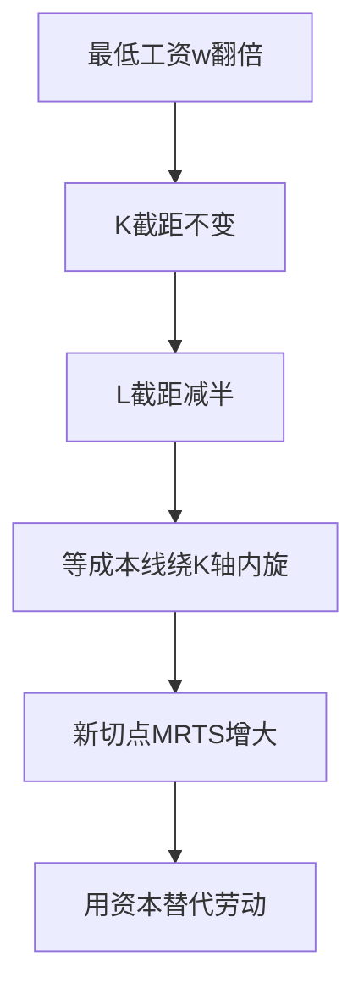
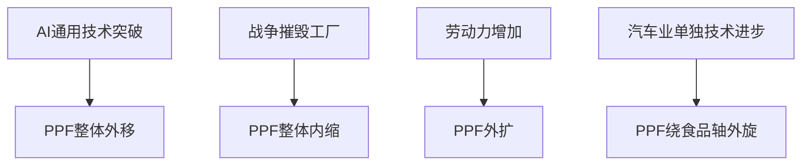
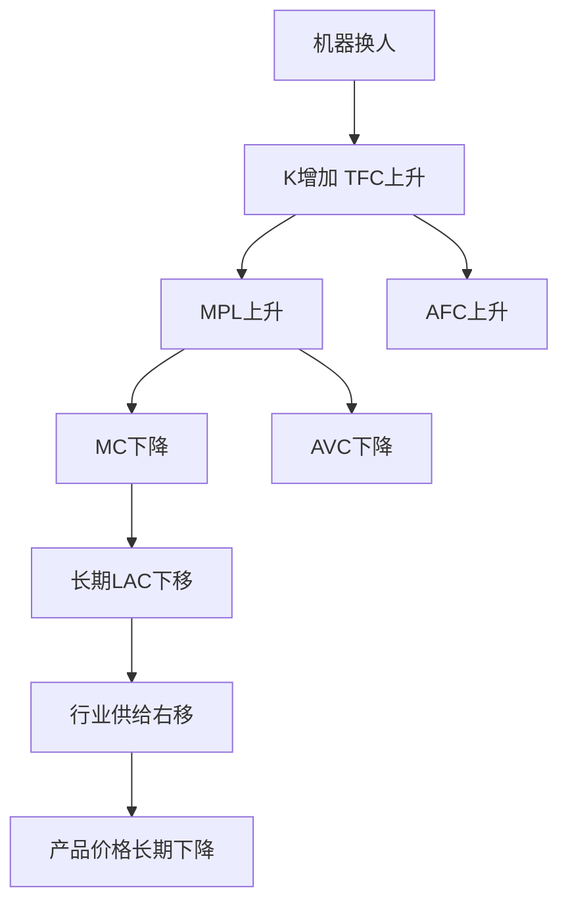

# 第三章 企业的生产和成本 · 考研真题集（首经贸 801）

<a href="../../../exam.html" target="_blank" style="display:inline-block;padding:6px 16px;background:#2563eb;color:#fff;border-radius:6px;text-decoration:none;font-size:14px;">📝 开始做题</a>

> 本章共收录：简答题 10 道（每题 15 分）｜论述题 4 道（每题 30 分）
> 配套选择题见 [[选择题集|本章选择题集]]
> 对应大纲：西方微观第三章「生产论」「成本论」全部七节

## 📋 本题集目录

### 简答题
1. [[#简答 1：简述生产函数的含义，并说明微观经济学中短期与长期是如何划分的。|简述生产函数的含义及短期与长期的划分标准]]
2. [[#简答 2：用图形说明总产量（TP）、平均产量（AP）与边际产量（MP）三者之间的关系。|用图形说明 TP、AP、MP 三者之间的关系]]
3. [[#简答 3：简述边际报酬递减规律的内容，并说明其成立的前提条件。|简述边际报酬递减规律的内容及其成立条件]]
4. [[#简答 4：简述等产量曲线的基本特征，并说明边际技术替代率递减规律。|简述等产量曲线的特征及边际技术替代率递减规律]]
5. [[#简答 5：简述规模报酬的三种类型，并各举一例说明。|简述规模报酬的三种类型并举例说明]]
6. [[#简答 6：简述机会成本、显成本、隐成本、经济利润与会计利润之间的关系。|简述机会成本、显成本、隐成本、经济利润与会计利润的关系]]
7. [[#简答 7（计算题）：已知某完全竞争厂商的短期总成本函数为 $STC=Q^3-10Q^2+17Q+66$。求：（1）固定成本与可变成本；（2）AFC、AVC、AC、MC 的函数表达式；（3）AVC 最低点对应的产量。|计算题：由短期总成本函数求 FC、VC、AFC、AVC、AC、MC]]
8. [[#简答 8：用图形说明短期七条成本曲线（FC、VC、TC、AFC、AVC、AC、MC）之间的关系。|用图形说明短期六条成本曲线之间的关系]]
9. [[#简答 9：为什么说长期总成本曲线是短期总成本曲线的包络线？请作图说明。|简述长期总成本曲线是短期总成本曲线的包络线]]
10. [[#简答 10（计算题）：已知某厂商的生产函数为 $Q=KL$，劳动价格 $w=4$，资本价格 $r=2$。求产量 $Q=100$ 时的成本最小化要素组合及最低总成本。|计算题：给定生产函数与要素价格，求成本最小化要素组合]]

### 论述题
1. [[#论述 1：试用生产理论与成本理论，分析一家奶茶店从开业到扩张的决策边界，并说明"做到多大"才是最优规模。|用生产理论与成本理论分析奶茶店扩张的边界]]
2. [[#论述 2：试比较短期生产与长期生产的区别，并说明这些区别如何决定厂商在不同时期的成本结构与决策空间。|比较短期生产与长期生产的区别及其对厂商决策的影响]]
3. [[#论述 3：近年来"996""内卷"现象引发广泛讨论。试用边际报酬递减规律，分析企业劳动投入决策与大学生就业市场的关系，并说明这一规律对理解"加班为何越来越无效"的意义。|结合"内卷"与加班现象，用边际报酬递减规律分析劳动投入]]
4. [[#论述 4：试从规模报酬与长期成本曲线的角度，分析中国制造业"做大做强"战略的经济学逻辑，并说明为何"大"不等于"强"。|从规模报酬与长期成本曲线看中国制造业"做大做强"]]

---

## 一、简答题（每题 15 分，建议 450–700 字）

### 简答 1：简述生产函数的含义，并说明微观经济学中短期与长期是如何划分的。

**【建议字数】450–700 字 ｜ 【建议时间】15 分钟 ｜ 【题型】概念简答**
**【考什么】** 对应知识点 [[知识点/KP01_生产函数与短期长期|生产函数与短期长期]]；题型属于概念简答。

**第一步：把"生产函数"拆成三个要件。** 定义 $Q=f(L,K)$ 里有三句话都不能漏：**① 一定时期内**（时间维度）、**② 技术水平不变**（技术给定）、**③ 最大产量**（效率假定）。三者缺一，定义就不完整。

**第二步：说明"最大产量"的经济含义。** $Q=f(L,K)$ 给出的是**既定投入下技术上可能达到的上限**，而非"随便投入就产出这么多"。它隐含两点：① 要素被充分有效利用（没有偷懒、没有闲置）；② 生产是**技术有效**的——函数本身就是效率前沿。

**第三步：用数学形式区分三种常见的生产函数。**

$$\text{固定比例}:Q=\min\left\{\frac{L}{a},\frac{K}{b}\right\}\qquad \text{柯布—道格拉斯}:Q=AL^{\alpha}K^{\beta}\qquad \text{线性}:Q=aL+bK$$

**第四步：给出"短期/长期"的判定标准——要素能否全部调整。**

$$\text{短期}:Q=f(L,\bar K)\qquad\text{长期}:Q=f(L,K)$$

**这句话是全题的题眼：短长期不是日历时间，而是"约束条件是否解除"。** 同一行业里，"短期"可能是三个月（餐饮），也可能是五年（钢铁、电力、造船）。

**第五步：解释为什么这样划分。** 划分的意义在于**决策空间不同**：短期只能调一个变量（沿一条短期生产函数移动），长期可以同时调所有变量（可以换规模），甚至进入或退出行业（企业数目可变）。**因此短长期之分直接决定了：短期成本曲线 U 形成因于边际报酬递减，长期成本曲线 U 形成因于规模报酬变化。**

**第六步：给一个具体例子（餐饮）。**

| 期限 | 可调整 | 不可调整 | 决策内容 |
|---|---|---|---|
| 一周 | 员工工时 $L$ | 店面面积、设备台数 | 加班还是加人 |
| 三个月 | 员工人数、营业时段 | 店面租约 | 排班与人力预算 |
| 三年 | 店面、设备、门店数 | —— | 开店/关店/换址 |

**第七步：给出"技术不变"的边界。** 技术进步会使整个函数改变（$A$ 上升），表现为**生产函数上移**、等产量曲线内移、在同样要素投入下产量更高。**这与"沿生产函数移动"完全不同，是考试常见的改名题。**

**第八步：收尾点明理论地位。** 生产函数是**技术约束的数学表达**，它与成本函数是一枚硬币的两面——由生产函数通过成本最小化可导出成本函数（对偶关系），这是本章全部后续内容的逻辑起点。

本题 15 分，**6 + 6 + 3**：生产函数含义 6 分、短长期划分 6 分、举例与意义 3 分。

- **生产函数含义（6 分）**——必须写到三个要件：时间、技术不变、最大产量。**只写"投入与产出的关系"最多 2 分。**
- **短长期划分（6 分）**——核心句："不以时间长短为标准，而以是否所有要素都可变为标准"。**写成"短期是 1 年以内"直接判定概念错误，本题最多 5 分。** 另外必须写出 $Q=f(L,\bar K)$ 与 $Q=f(L,K)$ 的形式对比。
- **举例（3 分）**——一个具体行业例子即可。

**失分点**：① 用日历时间定义短长期；② 漏掉"技术水平不变"这一前提；③ 不区分"最大产量"与"实际产量"；④ 不说明划分的经济意义（决策空间不同）；⑤ 举例与概念脱节（只讲故事不说要素约束）。

**审题第一步：看题干有几个问。"含义 + 如何划分"是两个问，答案必须分两段。**

**审题第二步：定义按"三要件"记——时间、技术、最大。** 三个词都能在定义里出现，最容易得分。

**审题第三步：划分标准必须立刻排除时间论。** 直接写"不是按日历时间"，这一句能让阅卷人马上确认你懂。

**审题第四步：写两种函数形式。** 形式化表达比文字描述更有说服力。

**审题第五步：举一个"同一行业内短期长度可差很多"的例子。** 餐饮三个月 vs 钢铁五年，一对比就把"要素约束决定短期"讲透。

**审题第六步：补一句"划分的意义"。** 短期只能调一个变量、长期能换规模，这一句把答案从"背定义"升到"懂逻辑"。

**【核心推导】**
**第一步：把"生产函数"拆成三个要件。** 定义 $Q=f(L,K)$ 里有三句话都不能漏：**① 一定时期内**（时间维度）、**② 技术水平不变**（技术给定）、**③ 最大产量**（效率假定）。三者缺一，定义就不完整。

**第二步：说明"最大产量"的经济含义。** $Q=f(L,K)$ 给出的是**既定投入下技术上可能达到的上限**，而非"随便投入就产出这么多"。它隐含两点：① 要素被充分有效利用（没有偷懒、没有闲置）；② 生产是**技术有效**的——函数本身就是效率前沿。

**第三步：用数学形式区分三种常见的生产函数。**

$$\text{固定比例}:Q=\min\left\{\frac{L}{a},\frac{K}{b}\right\}\qquad \text{柯布—道格拉斯}:Q=AL^{\alpha}K^{\beta}\qquad \text{线性}:Q=aL+bK$$

**第四步：给出"短期/长期"的判定标准——要素能否全部调整。**

$$\text{短期}:Q=f(L,\bar K)\qquad\text{长期}:Q=f(L,K)$$

**这句话是全题的题眼：短长期不是日历时间，而是"约束条件是否解除"。** 同一行业里，"短期"可能是三个月（餐饮），也可能是五年（钢铁、电力、造船）。

**第五步：解释为什么这样划分。** 划分的意义在于**决策空间不同**：短期只能调一个变量（沿一条短期生产函数移动），长期可以同时调所有变量（可以换规模），甚至进入或退出行业（企业数目可变）。**因此短长期之分直接决定了：短期成本曲线 U 形成因于边际报酬递减，长期成本曲线 U 形成因于规模报酬变化。**

**第六步：给一个具体例子（餐饮）。**

| 期限 | 可调整 | 不可调整 | 决策内容 |
|---|---|---|---|
| 一周 | 员工工时 $L$ | 店面面积、设备台数 | 加班还是加人 |
| 三个月 | 员工人数、营业时段 | 店面租约 | 排班与人力预算 |
| 三年 | 店面、设备、门店数 | —— | 开店/关店/换址 |

**第七步：给出"技术不变"的边界。** 技术进步会使整个函数改变（$A$ 上升），表现为**生产函数上移**、等产量曲线内移、在同样要素投入下产量更高。**这与"沿生产函数移动"完全不同，是考试常见的改名题。**

**第八步：收尾点明理论地位。** 生产函数是**技术约束的数学表达**，它与成本函数是一枚硬币的两面——由生产函数通过成本最小化可导出成本函数（对偶关系），这是本章全部后续内容的逻辑起点。

**【为什么要答这几点】**
本题 15 分，**6 + 6 + 3**：生产函数含义 6 分、短长期划分 6 分、举例与意义 3 分。

- **生产函数含义（6 分）**——必须写到三个要件：时间、技术不变、最大产量。**只写"投入与产出的关系"最多 2 分。**
- **短长期划分（6 分）**——核心句："不以时间长短为标准，而以是否所有要素都可变为标准"。**写成"短期是 1 年以内"直接判定概念错误，本题最多 5 分。** 另外必须写出 $Q=f(L,\bar K)$ 与 $Q=f(L,K)$ 的形式对比。
- **举例（3 分）**——一个具体行业例子即可。

**失分点**：① 用日历时间定义短长期；② 漏掉"技术水平不变"这一前提；③ 不区分"最大产量"与"实际产量"；④ 不说明划分的经济意义（决策空间不同）；⑤ 举例与概念脱节（只讲故事不说要素约束）。

**【如何分析题目】**
**审题第一步：看题干有几个问。"含义 + 如何划分"是两个问，答案必须分两段。**

**审题第二步：定义按"三要件"记——时间、技术、最大。** 三个词都能在定义里出现，最容易得分。

**审题第三步：划分标准必须立刻排除时间论。** 直接写"不是按日历时间"，这一句能让阅卷人马上确认你懂。

**审题第四步：写两种函数形式。** 形式化表达比文字描述更有说服力。

**审题第五步：举一个"同一行业内短期长度可差很多"的例子。** 餐饮三个月 vs 钢铁五年，一对比就把"要素约束决定短期"讲透。

**审题第六步：补一句"划分的意义"。** 短期只能调一个变量、长期能换规模，这一句把答案从"背定义"升到"懂逻辑"。

**【答题框架】**
- 第 1 段：生产函数的定义（3 分）
- 第 2 段：短期与长期的划分标准（4 分）
- 第 3 段：短期生产函数与长期生产函数的形式（4 分）
- 第 4 段：划分的意义与举例（2 分）
- 第 5 段：小结（2 分）

**【参考答案】**

一、生产函数的含义

生产函数表示在一定时期内，在技术水平不变的条件下，生产中所使用的各种生产要素的数量与所能生产的最大产量之间的关系。若以 $L$ 表示劳动投入量、$K$ 表示资本投入量，则生产函数可写为：
$$Q=f(L,K)$$
其核心含义有二：一是"最大产量"，即隐含了要素被充分有效利用的技术效率；二是"技术水平不变"，技术进步会使生产函数整体外移。

二、短期与长期的划分标准

微观经济学中短期与长期的划分**不是以日历时间长短为标准，而是以厂商能否变动全部生产要素投入为标准**：
1. **短期（Short Run）**：至少有一种生产要素的数量固定不变、来不及调整的时期。通常假设资本 $K$ 固定、劳动 $L$ 可变，记为 $Q=f(L,\bar K)$。
2. **长期（Long Run）**：厂商可以调整全部生产要素投入，甚至可以进入或退出一个行业的时期，记为 $Q=f(L,K)$。

三、举例说明

一家奶茶店租下店面（资本 $K$ 在租期内固定），一周内只能增减员工（劳动 $L$），这一周就是短期；租约到期后续签或关店，可以重谈店面面积、设备数量，那就是长期。不同行业的"短期"时间长度不同：餐馆可能是几个月，重化工可能是好几年。

四、小结

生产函数刻画投入产出的技术关系；短长期之分的关键在于要素是否全部可变，这一划分直接决定了短期成本曲线与长期成本曲线的形状，也决定了厂商在不同时期的决策空间。

**【解析·得分点】** 采分点：①生产函数定义含"最大产量""技术不变"两个限定（3 分）；②明确指出划分标准是"要素是否全部可变"而非日历时间（4 分）；③写出短期 $Q=f(L,\bar K)$ 与长期 $Q=f(L,K)$（4 分）；④举奶茶店或类似例子（2 分）；⑤小结（2 分）。易丢分：把短期长期说成"一年以内/一年以上"。

**【生活实例】** 学校食堂中午加几个窗口工人就是短期（灶台固定）；暑假装修新增灶台就是长期。同样是"加人"和"加灶"，前者一周能完成，后者要一暑假。

**【双链接】** 🔗 [[知识点/KP01_生产函数与短期长期|回知识点]] ｜ 📖 [[../../../原文件/经济学/西方经济学上册_微观_全书|原书·第三章第一节]]

---

### 简答 2：用图形说明总产量（TP）、平均产量（AP）与边际产量（MP）三者之间的关系。

**【建议字数】450–700 字 ｜ 【建议时间】15 分钟 ｜ 【题型】关系对比**
**【考什么】** 对应知识点 [[知识点/KP02_边际报酬递减规律|边际报酬递减规律]]；题型属于图形分析。

**一、先把三条曲线的定义写清**

设资本固定为 $\bar K$，仅劳动可变：

$$TP_L=f(L,\bar K),\qquad AP_L=\frac{TP_L}{L},\qquad MP_L=\frac{dTP_L}{dL}$$

**二、TP 与 MP：总量与边际量的"斜率—高度"关系**

$$MP_L=\frac{dTP_L}{dL}$$

**这是全部关系里唯一需要微积分的一句话：MP 是 TP 曲线各点切线的斜率。** 由此直接推出：

| MP 的符号/变化 | TP 的形态 |
|---|---|
| $MP>0$ 且递增 | TP 加速上升（下凸） |
| $MP>0$ 但递减 | TP 减速上升（上凸） |
| $MP=0$ | TP 达到最高点 |
| $MP<0$ | TP 下降 |

**关键点：$MP$ 的最大值出现在 TP 曲线的拐点处**（切线斜率最大）。这是作图题的必考采分点。

**三、AP 与 MP：平均量与边际量的通用规律**

由 $AP=TP/L$，对 $L$ 求导：

$$\frac{d(AP_L)}{dL}=\frac{MP_L\cdot L-TP_L}{L^2}=\frac{MP_L-AP_L}{L}$$

**分母恒正，故 $AP$ 的增减完全由 $MP-AP$ 的符号决定：**

$$MP>AP\Rightarrow AP\text{上升};\qquad MP<AP\Rightarrow AP\text{下降};\qquad MP=AP\Rightarrow AP\text{取极值}$$

**这条推导是本答案的技术核心**——它把"边际穿过平均的最高点"这句话变成了严格结论，而不是靠口诀记。

**四、三条曲线在图形上的完整对应关系**

设横轴为 $L$、纵轴为产量：

1. $TP$ 从原点出发，先下凸（加速上升）、经拐点转为上凸（减速上升）、在 $MP=0$ 处达到最高、之后下降；
2. $MP$ 呈倒 U 形：**先上升达到最高点（对应 TP 的拐点），随后下降，穿过 AP 的最高点，最后在 TP 最高点处穿过横轴**；
3. $AP$ 呈倒 U 形，最高点在 $MP=AP$ 处，且 $AP$ 最高点必然落在 $MP$ 曲线上。

**三条可自检的对应关系：**
- **MP 穿过 AP 的最高点**；
- **MP 过零时 TP 到顶**；
- **MP 最高处是 TP 的拐点**。

**五、三个生产阶段的划分**

$$\text{I}:MP>AP;\qquad\text{II}:AP>MP>0;\qquad\text{III}:MP<0$$

- **阶段 I**：$AP$ 递增，说明**固定要素相对过剩**，继续增加可变要素能提高平均效率，理性厂商不会停在这里；
- **阶段 II**：$AP$ 递减但 $TP$ 仍递增，是**唯一合理的生产区间**（也是完全竞争供给曲线取 $MC$ 上升段的原因）；
- **阶段 III**：$MP$ 为负，增加劳动反而减产，**必然裁减**。

**结论：理性厂商只在阶段 II 生产。** 这一点把"图形关系"接到"决策规则"上，是本题的深度所在。

**六、边界与易错点**

- 上述关系依赖**技术不变**与**其他要素固定**，长期中三条曲线都失去意义（没有固定要素）；
- $AP$ 最大化不等同于利润最大化：利润最大化要看要素价格与产品价格（$VMP=w$）；
- 离散数据下 $MP$ 用 $\Delta TP/\Delta L$ 计算时，通常把该边际产量记在两个投入量的中点上。

本题 15 分，**5 + 5 + 5**：三条曲线定义与 MP-TP 关系 5 分、MP-AP 关系 5 分、图形与三阶段 5 分。

- **MP 与 TP（5 分）**——采分点：① $MP=dTP/dL$（斜率关系）；② $MP=0$ 时 TP 最大；③ MP 最大处为 TP 拐点。**第 ③ 点最容易被漏，漏了扣 2 分。**
- **MP 与 AP（5 分）**——核心采分点：$MP$ 穿过 $AP$ 最高点，并说明理由。**最好的答法是给出 $d(AP)/dL=(MP-AP)/L$ 的推导。**
- **图形与三阶段（5 分）**——三阶段划分标准 + "只在阶段 II 生产"的结论。

**失分点**：① 说"MP 穿过 AP 最低点"（错，是最高点）；② 画图不标拐点；③ 不写三阶段或只给区间不给理由；④ 混淆"AP 最大"与"利润最大"；⑤ 只写口诀不给推导，遇到"说明理由"的问法拿不到分。

**审题第一步：先定框架——"TP-MP" 一段、"MP-AP" 一段、图形与阶段一段。**

**审题第二步：用一句话把 MP 定义为 TP 的斜率。** 三条 TP-MP 关系全部由此推出，不必死记。

**审题第三步：把 MP-AP 关系做一次求导。** 三行推导胜过三行口诀。

**审题第四步：作图三步。** ① 画 TP（下凸—拐点—上凸—最高点—下降）；② 画 MP 倒 U 形并标出与横轴、与 AP 的两个交点；③ 画 AP 倒 U 形，最高点与 MP 相交。

**审题第五步：用三句自检语校验图。** MP 穿过 AP 最高点、MP 过零时 TP 到顶、MP 最高处是 TP 拐点。

**审题第六步：写三阶段并点明"只在 II 生产"。** 这是把图形分析落到决策上的关键一句。

**【核心推导】**
**一、先把三条曲线的定义写清**

设资本固定为 $\bar K$，仅劳动可变：

$$TP_L=f(L,\bar K),\qquad AP_L=\frac{TP_L}{L},\qquad MP_L=\frac{dTP_L}{dL}$$

**二、TP 与 MP：总量与边际量的"斜率—高度"关系**

$$MP_L=\frac{dTP_L}{dL}$$

**这是全部关系里唯一需要微积分的一句话：MP 是 TP 曲线各点切线的斜率。** 由此直接推出：

| MP 的符号/变化 | TP 的形态 |
|---|---|
| $MP>0$ 且递增 | TP 加速上升（下凸） |
| $MP>0$ 但递减 | TP 减速上升（上凸） |
| $MP=0$ | TP 达到最高点 |
| $MP<0$ | TP 下降 |

**关键点：$MP$ 的最大值出现在 TP 曲线的拐点处**（切线斜率最大）。这是作图题的必考采分点。

**三、AP 与 MP：平均量与边际量的通用规律**

由 $AP=TP/L$，对 $L$ 求导：

$$\frac{d(AP_L)}{dL}=\frac{MP_L\cdot L-TP_L}{L^2}=\frac{MP_L-AP_L}{L}$$

**分母恒正，故 $AP$ 的增减完全由 $MP-AP$ 的符号决定：**

$$MP>AP\Rightarrow AP\text{上升};\qquad MP<AP\Rightarrow AP\text{下降};\qquad MP=AP\Rightarrow AP\text{取极值}$$

**这条推导是本答案的技术核心**——它把"边际穿过平均的最高点"这句话变成了严格结论，而不是靠口诀记。

**四、三条曲线在图形上的完整对应关系**

设横轴为 $L$、纵轴为产量：

1. $TP$ 从原点出发，先下凸（加速上升）、经拐点转为上凸（减速上升）、在 $MP=0$ 处达到最高、之后下降；
2. $MP$ 呈倒 U 形：**先上升达到最高点（对应 TP 的拐点），随后下降，穿过 AP 的最高点，最后在 TP 最高点处穿过横轴**；
3. $AP$ 呈倒 U 形，最高点在 $MP=AP$ 处，且 $AP$ 最高点必然落在 $MP$ 曲线上。

**三条可自检的对应关系：**
- **MP 穿过 AP 的最高点**；
- **MP 过零时 TP 到顶**；
- **MP 最高处是 TP 的拐点**。

**五、三个生产阶段的划分**

$$\text{I}:MP>AP;\qquad\text{II}:AP>MP>0;\qquad\text{III}:MP<0$$

- **阶段 I**：$AP$ 递增，说明**固定要素相对过剩**，继续增加可变要素能提高平均效率，理性厂商不会停在这里；
- **阶段 II**：$AP$ 递减但 $TP$ 仍递增，是**唯一合理的生产区间**（也是完全竞争供给曲线取 $MC$ 上升段的原因）；
- **阶段 III**：$MP$ 为负，增加劳动反而减产，**必然裁减**。

**结论：理性厂商只在阶段 II 生产。** 这一点把"图形关系"接到"决策规则"上，是本题的深度所在。

**六、边界与易错点**

- 上述关系依赖**技术不变**与**其他要素固定**，长期中三条曲线都失去意义（没有固定要素）；
- $AP$ 最大化不等同于利润最大化：利润最大化要看要素价格与产品价格（$VMP=w$）；
- 离散数据下 $MP$ 用 $\Delta TP/\Delta L$ 计算时，通常把该边际产量记在两个投入量的中点上。

**【为什么要答这几点】**
本题 15 分，**5 + 5 + 5**：三条曲线定义与 MP-TP 关系 5 分、MP-AP 关系 5 分、图形与三阶段 5 分。

- **MP 与 TP（5 分）**——采分点：① $MP=dTP/dL$（斜率关系）；② $MP=0$ 时 TP 最大；③ MP 最大处为 TP 拐点。**第 ③ 点最容易被漏，漏了扣 2 分。**
- **MP 与 AP（5 分）**——核心采分点：$MP$ 穿过 $AP$ 最高点，并说明理由。**最好的答法是给出 $d(AP)/dL=(MP-AP)/L$ 的推导。**
- **图形与三阶段（5 分）**——三阶段划分标准 + "只在阶段 II 生产"的结论。

**失分点**：① 说"MP 穿过 AP 最低点"（错，是最高点）；② 画图不标拐点；③ 不写三阶段或只给区间不给理由；④ 混淆"AP 最大"与"利润最大"；⑤ 只写口诀不给推导，遇到"说明理由"的问法拿不到分。

**【如何分析题目】**
**审题第一步：先定框架——"TP-MP" 一段、"MP-AP" 一段、图形与阶段一段。**

**审题第二步：用一句话把 MP 定义为 TP 的斜率。** 三条 TP-MP 关系全部由此推出，不必死记。

**审题第三步：把 MP-AP 关系做一次求导。** 三行推导胜过三行口诀。

**审题第四步：作图三步。** ① 画 TP（下凸—拐点—上凸—最高点—下降）；② 画 MP 倒 U 形并标出与横轴、与 AP 的两个交点；③ 画 AP 倒 U 形，最高点与 MP 相交。

**审题第五步：用三句自检语校验图。** MP 穿过 AP 最高点、MP 过零时 TP 到顶、MP 最高处是 TP 拐点。

**审题第六步：写三阶段并点明"只在 II 生产"。** 这是把图形分析落到决策上的关键一句。

**【答题框架】**
- 第 1 段：三个产量指标的定义（3 分）
- 第 2 段：MP 与 TP 的关系（4 分）
- 第 3 段：MP 与 AP 的关系（4 分）
- 第 4 段：图形描述（2 分）
- 第 5 段：三个生产阶段（2 分）

**【参考答案】**

一、定义

设资本固定为 $\bar K$，仅劳动 $L$ 可变：
- 总产量 $TP_L=f(L,\bar K)$
- 平均产量 $AP_L=\dfrac{TP_L}{L}$
- 边际产量 $MP_L=\dfrac{\Delta TP_L}{\Delta L}=\dfrac{dTP_L}{dL}$

二、MP 与 TP 的关系

1. $MP>0$ 时，TP 递增；$MP=0$ 时，TP 达到最大值；$MP<0$ 时，TP 递减。
2. $MP$ 上升阶段对应 TP 以递增速率上升（TP 曲线下凸）；$MP$ 下降但仍为正的阶段，对应 TP 以递减速率上升（TP 曲线上凸）。
3. 几何上，$MP_L$ 是 $TP_L$ 曲线上任一点切线的斜率。

三、MP 与 AP 的关系

1. 当 $MP>AP$ 时，AP 被边际值"拉"上去，AP 递增；
2. 当 $MP<AP$ 时，AP 被"拉"下来，AP 递减；
3. **MP 曲线必然穿过 AP 曲线的最高点**。这是"边际量与平均量"关系的通用规律——边际量高于平均量时平均量上升，反之下降。

四、图形描述

以 $L$ 为横轴、产量为纵轴：TP 曲线先下凸、经过一个拐点后上凸，最终在 MP=0 处达到最高点后下降；MP 曲线呈倒 U 形，先升后降，先后穿过 TP 的拐点（MP 最大）和 AP 最高点，最后在 TP 最高点处穿过横轴；AP 曲线也呈倒 U 形，其最高点恰与 MP 相交。

五、三个生产阶段

- 阶段 I：$MP>AP$，AP 递增，理性厂商不会停于此；
- 阶段 II：$AP>MP>0$，AP 递减但 TP 仍递增，是**合理生产区间**；
- 阶段 III：$MP<0$，TP 递减，厂商应立即裁减劳动。

**【解析·得分点】** 采分点：①三个定义公式（3 分）；②MP 是 TP 切线斜率、MP=0 时 TP 最大（4 分）；③MP 穿过 AP 最高点（4 分）；④图形下凸/上凸/拐点描述（2 分）；⑤合理区间为阶段 II（2 分）。易丢分：只说"MP 穿过 AP 最高点"但不解释为什么。

**【生活实例】** 一个班平均身高 1 米 7，新来一个同学身高 1 米 9（边际值），全班平均被拉高；新来一个 1 米 5，平均被拉低。边际量高于平均量时平均量上升，反之下降——这就是 MP 与 AP 关系的大白话。

**【双链接】** 🔗 [[知识点/KP02_边际报酬递减规律|回知识点]] ｜ 📖 [[../../../原文件/经济学/西方经济学上册_微观_全书|原书·第三章第二节]]

---

### 简答 3：简述边际报酬递减规律的内容，并说明其成立的前提条件。

**【建议字数】450–700 字 ｜ 【建议时间】15 分钟 ｜ 【题型】原因分析**
**【考什么】** 对应知识点 [[知识点/KP02_边际报酬递减规律|边际报酬递减规律]]；题型属于概念简答。

**一、规律内容的精确表述**

在**技术水平不变**的条件下，连续等量地把某一种可变要素增加到一种或几种数量固定的要素上：

$$\text{当 }\Delta L\text{ 超过某一临界点后},\qquad \frac{\Delta MP_L}{\Delta L}<0\ \Longleftrightarrow\ \frac{\partial^2 Q}{\partial L^2}<0$$

**也就是说：边际产量曲线先升后降，最终必然递减；它并不否认最初的递增阶段。**

**二、为什么必然递减（机制而非现象）**

**第 1 步：固定要素的"拥挤"。** 设资本固定为 $\bar K$，则劳动的平均资本装备为 $\bar K/L$。当 $L$ 增加时，每个工人可支配的资本越来越少。

**第 2 步：写成一个可验证的机制。** 若把劳动与其他要素看作不完全替代，则

$$MP_L=\frac{\partial f}{\partial L}\ \text{随 }L\uparrow\text{而}\downarrow\quad \text{因为}\quad \frac{\partial^2 f}{\partial L^2}<0$$

**第 3 步：举例验证。** 一口锅（固定）煮饺子：1 个人包 10 个/小时，2 个人分工流水 25 个，3 个人拥挤只到 32 个，第 4 个人开始互相挡路，边际增量从 15 掉到 7 再到 3。

**三、成立的四个前提条件**

**（1）技术水平不变。** 若技术进步，整条曲线外移，递减被推迟，甚至暂时表现为递增。

**（2）其他要素投入固定不变。** 这是**短期概念**——若所有要素同比例增加，讨论的就不是边际报酬递减，而是规模报酬。

**（3）可变要素各单位的质量相同。** 边际产量递减源于**要素配比恶化**，而不是"后来的工人更差"。若允许先雇最好的工人，递减就是选择效应而非技术规律。

**（4）必须在超过临界点之后才递减。** 初始阶段因**分工与协作**（斯密的分工理论）而递增，这并不违反规律。

**四、与规模报酬递减的区别（最容易混的一对）**

| 维度 | 边际报酬递减 | 规模报酬递减 |
|---|---|---|
| 时期 | 短期 | 长期 |
| 变动方式 | 单一要素增加、其他固定 | 全部要素同比例增加 |
| 机制 | 要素配比失衡、固定要素拥挤 | 组织过大、协调成本与信息传递失真 |
| 数学表达 | $\partial^2 f/\partial L^2<0$ | $f(\lambda L,\lambda K)<\lambda f(L,K)$ |

**"一个是配比问题，一个是组织问题"——这一句能把这题答活。**

**五、对成本曲线的直接影响（把规律接上成本）**

$$MC=\frac{w}{MP_L},\qquad AVC=\frac{w}{AP_L}$$

**因此：$MP$ 的倒 U 形 → $MC$ 的正 U 形；$AP$ 的倒 U 形 → $AVC$ 的正 U 形。** **短期成本曲线普遍呈 U 形，其根本原因就是边际报酬递减。** 这是本章最重要的"原因—结果"链条。

**六、现实意义与边界**

- **农业**：马尔萨斯人口论的技术基础（土地固定，劳动增加，边际产出递减）；
- **餐饮与管理**：固定窗口、固定设备下的排班上限；
- **知识工作**：边际报酬递减同样适用于"加班到深夜"——精力是固定要素；
- **边界**：若技术进步持续发生（现代农业、芯片），递减会被不断推后，"规律"表现为**长期被技术进步的曲线外移所掩盖**。

本题 15 分，**5 + 6 + 4**：规律表述 5 分、前提条件 6 分、与规模报酬区别及意义 4 分。

- **规律表述（5 分）**——采分点：① 技术不变；② 其他要素固定；③ 连续等量增加；④ 最终（超过临界点后）递减。**说"边际产量一直递减"是错的，因为漏掉"先递增后递减"。**
- **前提条件（6 分）**——按"技术不变 / 其他要素固定 / 质量相同 / 超过临界点"四条给分，每条 1.5 分。
- **区别与意义（4 分）**——与规模报酬的区别（2 分）+ 对 $MC=w/MP$ 的影响（2 分）。

**失分点**：① 漏掉"先递增后递减"，把规律说成"单调递减"；② 不提"技术不变"；③ 与规模报酬递减混为一谈；④ 不解释机制（只说"人会累"）；⑤ 接不上成本曲线，导致答案停留在生产层面。

**审题第一步：先看题干两个动词——"内容"要准确表述，"前提条件"要逐条列出。**

**审题第二步：规律表述必须包含"临界点"。** 写"先递增、后递减"才完整。

**审题第三步：机制段说实话——固定要素拥挤 + 配比恶化。** 别用"人会累"敷衍，那是个体生理，不是技术规律。

**审题第四步：四条件按"技术 / 其他要素 / 质量 / 临界点"排。** 第四条最容易被忘，写在最后刚好提醒自己。

**审题第五步：立刻补一段"与规模报酬的区别"。** 这是阅卷人最看重的辨析点。

**审题第六步：用 $MC=w/MP$ 把规律接到成本曲线。** 一句话跨章，分数立刻上去。

**【核心推导】**
**一、规律内容的精确表述**

在**技术水平不变**的条件下，连续等量地把某一种可变要素增加到一种或几种数量固定的要素上：

$$\text{当 }\Delta L\text{ 超过某一临界点后},\qquad \frac{\Delta MP_L}{\Delta L}<0\ \Longleftrightarrow\ \frac{\partial^2 Q}{\partial L^2}<0$$

**也就是说：边际产量曲线先升后降，最终必然递减；它并不否认最初的递增阶段。**

**二、为什么必然递减（机制而非现象）**

**第 1 步：固定要素的"拥挤"。** 设资本固定为 $\bar K$，则劳动的平均资本装备为 $\bar K/L$。当 $L$ 增加时，每个工人可支配的资本越来越少。

**第 2 步：写成一个可验证的机制。** 若把劳动与其他要素看作不完全替代，则

$$MP_L=\frac{\partial f}{\partial L}\ \text{随 }L\uparrow\text{而}\downarrow\quad \text{因为}\quad \frac{\partial^2 f}{\partial L^2}<0$$

**第 3 步：举例验证。** 一口锅（固定）煮饺子：1 个人包 10 个/小时，2 个人分工流水 25 个，3 个人拥挤只到 32 个，第 4 个人开始互相挡路，边际增量从 15 掉到 7 再到 3。

**三、成立的四个前提条件**

**（1）技术水平不变。** 若技术进步，整条曲线外移，递减被推迟，甚至暂时表现为递增。

**（2）其他要素投入固定不变。** 这是**短期概念**——若所有要素同比例增加，讨论的就不是边际报酬递减，而是规模报酬。

**（3）可变要素各单位的质量相同。** 边际产量递减源于**要素配比恶化**，而不是"后来的工人更差"。若允许先雇最好的工人，递减就是选择效应而非技术规律。

**（4）必须在超过临界点之后才递减。** 初始阶段因**分工与协作**（斯密的分工理论）而递增，这并不违反规律。

**四、与规模报酬递减的区别（最容易混的一对）**

| 维度 | 边际报酬递减 | 规模报酬递减 |
|---|---|---|
| 时期 | 短期 | 长期 |
| 变动方式 | 单一要素增加、其他固定 | 全部要素同比例增加 |
| 机制 | 要素配比失衡、固定要素拥挤 | 组织过大、协调成本与信息传递失真 |
| 数学表达 | $\partial^2 f/\partial L^2<0$ | $f(\lambda L,\lambda K)<\lambda f(L,K)$ |

**"一个是配比问题，一个是组织问题"——这一句能把这题答活。**

**五、对成本曲线的直接影响（把规律接上成本）**

$$MC=\frac{w}{MP_L},\qquad AVC=\frac{w}{AP_L}$$

**因此：$MP$ 的倒 U 形 → $MC$ 的正 U 形；$AP$ 的倒 U 形 → $AVC$ 的正 U 形。** **短期成本曲线普遍呈 U 形，其根本原因就是边际报酬递减。** 这是本章最重要的"原因—结果"链条。

**六、现实意义与边界**

- **农业**：马尔萨斯人口论的技术基础（土地固定，劳动增加，边际产出递减）；
- **餐饮与管理**：固定窗口、固定设备下的排班上限；
- **知识工作**：边际报酬递减同样适用于"加班到深夜"——精力是固定要素；
- **边界**：若技术进步持续发生（现代农业、芯片），递减会被不断推后，"规律"表现为**长期被技术进步的曲线外移所掩盖**。

**【为什么要答这几点】**
本题 15 分，**5 + 6 + 4**：规律表述 5 分、前提条件 6 分、与规模报酬区别及意义 4 分。

- **规律表述（5 分）**——采分点：① 技术不变；② 其他要素固定；③ 连续等量增加；④ 最终（超过临界点后）递减。**说"边际产量一直递减"是错的，因为漏掉"先递增后递减"。**
- **前提条件（6 分）**——按"技术不变 / 其他要素固定 / 质量相同 / 超过临界点"四条给分，每条 1.5 分。
- **区别与意义（4 分）**——与规模报酬的区别（2 分）+ 对 $MC=w/MP$ 的影响（2 分）。

**失分点**：① 漏掉"先递增后递减"，把规律说成"单调递减"；② 不提"技术不变"；③ 与规模报酬递减混为一谈；④ 不解释机制（只说"人会累"）；⑤ 接不上成本曲线，导致答案停留在生产层面。

**【如何分析题目】**
**审题第一步：先看题干两个动词——"内容"要准确表述，"前提条件"要逐条列出。**

**审题第二步：规律表述必须包含"临界点"。** 写"先递增、后递减"才完整。

**审题第三步：机制段说实话——固定要素拥挤 + 配比恶化。** 别用"人会累"敷衍，那是个体生理，不是技术规律。

**审题第四步：四条件按"技术 / 其他要素 / 质量 / 临界点"排。** 第四条最容易被忘，写在最后刚好提醒自己。

**审题第五步：立刻补一段"与规模报酬的区别"。** 这是阅卷人最看重的辨析点。

**审题第六步：用 $MC=w/MP$ 把规律接到成本曲线。** 一句话跨章，分数立刻上去。

**【答题框架】**
- 第 1 段：规律内容（4 分）
- 第 2 段：成立条件（5 分）
- 第 3 段：与规模报酬递减的区别（3 分）
- 第 4 段：现实意义（3 分）

**【参考答案】**

一、规律内容

**边际报酬递减规律**是指：在技术水平不变的条件下，在连续等量地把某一种可变生产要素增加到其他一种或几种数量固定不变的生产要素上去的过程中，当这种可变要素的投入量小于某一特定值时，增加该要素投入所带来的边际产量是递增的；当这种可变要素的投入量连续增加并超过这个特定值时，增加该要素投入所带来的边际产量是递减的。简言之：**其他要素固定不变时，连续等量增加某一可变要素，其边际产量最终必然递减。**

二、成立的前提条件

1. **技术水平不变**。若技术进步，MP 曲线整体上移，递减可能被推迟甚至暂时掩盖；
2. **其他要素投入固定不变**。该规律是短期生产规律，仅适用于至少有一种要素固定的情形；
3. **可变要素各单位质量相同**（先投入的工人与后投入的工人在能力上无差别），边际产量递减是要素与固定要素配比恶化所致，而非工人本身变差；
4. **超过一定点之后才递减**。规律并不否认初始阶段 MP 可能因分工协作而递增。

三、与规模报酬递减的区别

边际报酬递减是**短期**现象（一种要素变、其他要素固定）；规模报酬递减是**长期**现象（所有要素同比例增加）。前者是"配比失衡"，后者是"组织太大、协调成本上升"。

四、现实意义

该规律是解释短期成本曲线呈 U 形的根本原因：MP 递增阶段对应 MC 递减，MP 递减阶段对应 MC 递增。食堂中午窗口固定、学生越多排队越长，正是边际报酬递减的日常写照。

**【解析·得分点】** 采分点：①规律表述中"技术不变""其他要素固定""最终递减"三个关键词（4 分）；②四个前提条件（5 分）；③与规模报酬递减的区分（3 分）；④联系短期成本 U 形（3 分）。易丢分：把规律说成"边际产量从一开始就递减"。

**【生活实例】** 一亩地施肥，施 10 斤增产 200 斤，施 20 斤再增产 150 斤，施 30 斤再增产 50 斤，施 50 斤反而烧苗减产——土地固定、技术不变，肥料越多边际增产越少。

**【双链接】** 🔗 [[知识点/KP02_边际报酬递减规律|回知识点]] ｜ [[知识点/KP04_规模报酬|规模报酬]] ｜ 📖 [[../../../原文件/经济学/西方经济学上册_微观_全书|原书·第三章第二节]]

---

### 简答 4：简述等产量曲线的基本特征，并说明边际技术替代率递减规律。

**【建议字数】450–700 字 ｜ 【建议时间】15 分钟 ｜ 【题型】概念简答**
**【考什么】** 对应知识点 [[知识点/KP03_等产量曲线与边际技术替代率|等产量曲线与 MRTS]]；题型属于概念简答。

**一、等产量曲线的定义与三条基本特征**

**定义：** 在技术水平不变的条件下，生产同一产量水平的两种生产要素（劳动 $L$ 与资本 $K$）所有不同组合的轨迹。

$$f(L,K)=\bar Q$$

**特征（逐条给理由）：**

**（1）离原点越远，产量越高。** 由要素的**单调性**（$MP_L>0,MP_K>0$）直接得出：投入更多，产出不可能更少。

**（2）任意两条不相交。** 反证：若两条等产量曲线交于 $A$，则 $f(A)=Q_1$ 且 $f(A)=Q_2$，与 $Q_1\ne Q_2$ 矛盾——**产出函数是单值的**。

**（3）向右下方倾斜。** 对 $f(L,K)=\bar Q$ 全微分：

$$df=\frac{\partial f}{\partial L}dL+\frac{\partial f}{\partial K}dK=0\ \Longrightarrow\ \frac{dK}{dL}=-\frac{MP_L}{MP_K}<0$$

**这就是"斜率为负"的数学来源：要维持产量不变，增加一种要素必须减少另一种。**

**（4）凸向原点。** 由边际技术替代率递减决定（下文第三节）。

**二、边际技术替代率的严格推导**

$$MRTS_{LK}=-\frac{dK}{dL}=\frac{MP_L}{MP_K}$$

**经济含义：** 在维持产量不变的前提下，增加 1 单位劳动可以替代多少单位资本。**几何上等于等产量曲线切线斜率的绝对值。**

**三、边际技术替代率递减规律**

**内容：** 沿同一条等产量曲线，随着劳动投入的增加，每增加 1 单位劳动所能替代的资本数量递减。

**推导：** 由于要素组合沿等产量线从"资本多、劳动少"向"劳动多、资本少"移动：

$$L\uparrow\Rightarrow MP_L\downarrow\ (\text{边际报酬递减}),\qquad K\downarrow\Rightarrow MP_K\uparrow$$

$$\Longrightarrow\ MRTS_{LK}=\frac{MP_L}{MP_K}\ \text{单调递减}$$

**这是"两条规律相乘"的结果：边际报酬递减提供分子下降，资本减少提供分母上升。** **注意：MRTS 递减需要两条边际报酬递减同时成立，缺一不可。**

**四、MRTS 递减与"凸向原点"的等价性**

设等产量线写成 $K=K(L)$，则

$$\frac{d^2K}{dL^2}=\frac{d}{dL}\left(-MRTS\right)>0\ \Longleftrightarrow\ MRTS\text{ 递减}\ \Longleftrightarrow\ \text{曲线凸向原点}$$

**因此，"凸向原点"不是一条独立的经验特征，而是 MRTS 递减的几何翻译。**

**五、特殊形状（考"边界情形"必答）**

| 生产函数 | 等产量线形状 | $MRTS$ |
|---|---|---|
| 完全替代 $Q=aL+bK$ | 直线 | 常数 $a/b$ |
| 完全互补（里昂惕夫）$Q=\min\{L/a,K/b\}$ | 直角折线（L 形） | 折点处无定义；两段分别为 $\infty$ 与 $0$ |
| 柯布—道格拉斯 $Q=L^{\alpha}K^{\beta}$ | 光滑凸曲线 | 递减 |

**六、与消费者理论的对偶**

| 消费者 | 生产者 |
|---|---|
| 无差异曲线 | 等产量曲线 |
| 边际替代率 $MRS=MU_1/MU_2$ | 边际技术替代率 $MRTS=MP_L/MP_K$ |
| 效用不可测 | **产量可测** |
| 均衡 $MRS=P_1/P_2$ | 均衡 $MRTS=w/r$ |

**最后一行的差别值得写进答案：等产量曲线上的"产量"是实物量，可度量；无差异曲线上的"效用"只能排序——这是两套图形唯一实质性的不同。**

本题 15 分，**6 + 5 + 4**：等产量曲线特征 6 分、MRTS 定义与公式 5 分、MRTS 递减及凸性 4 分。

- **特征（6 分）**——四条特征每条 1.5 分。**其中"斜率为负"最好给出 $dK/dL=-MP_L/MP_K$ 的推导，"不相交"最好给出反证。**
- **MRTS（5 分）**——定义 + $MRTS=MP_L/MP_K$ + 几何含义（斜率绝对值）。
- **MRTS 递减（4 分）**——机制必须写"分子降、分母升"两条同时起作用。**只说"因为边际报酬递减"扣 2 分。**

**失分点**：① 只说"凸向原点"不解释原因；② 把 MRTS 写成 $MP_K/MP_L$（颠倒）；③ 不区分"边际技术替代率递减"与"边际报酬递减"；④ 忘记特殊形状（直线、L 形）；⑤ 与无差异曲线的关系完全不作比较，丢掉了本题的加分点。

**审题第一步：题干有两个名词——等产量曲线、MRTS，答案必须分两大块。**

**审题第二步：四条特征逐条给理由，不只罗列。** "离原点越远产量越高"要用单调性，"不相交"要用反证，"斜率为负"要用全微分。

**审题第三步：MRTS 的定义式 + 几何意义 + 经济含义三件套一起写。**

**审题第四步：递减规律必须说清"两个原因"。** 只有分子降或只有分母升都不够。

**审题第五步：补"凸向原点 = MRTS 递减"的等价性。** 一句话把几何与代数接起来。

**审题第六步：列表给三种特殊形状。** 这是"加分点"，成本低收益高。

**审题第七步：与无差异曲线对照。** 点明"产量可测、效用只能排序"，答出这一句就比别人高一层。

**【核心推导】**
**一、等产量曲线的定义与三条基本特征**

**定义：** 在技术水平不变的条件下，生产同一产量水平的两种生产要素（劳动 $L$ 与资本 $K$）所有不同组合的轨迹。

$$f(L,K)=\bar Q$$

**特征（逐条给理由）：**

**（1）离原点越远，产量越高。** 由要素的**单调性**（$MP_L>0,MP_K>0$）直接得出：投入更多，产出不可能更少。

**（2）任意两条不相交。** 反证：若两条等产量曲线交于 $A$，则 $f(A)=Q_1$ 且 $f(A)=Q_2$，与 $Q_1\ne Q_2$ 矛盾——**产出函数是单值的**。

**（3）向右下方倾斜。** 对 $f(L,K)=\bar Q$ 全微分：

$$df=\frac{\partial f}{\partial L}dL+\frac{\partial f}{\partial K}dK=0\ \Longrightarrow\ \frac{dK}{dL}=-\frac{MP_L}{MP_K}<0$$

**这就是"斜率为负"的数学来源：要维持产量不变，增加一种要素必须减少另一种。**

**（4）凸向原点。** 由边际技术替代率递减决定（下文第三节）。

**二、边际技术替代率的严格推导**

$$MRTS_{LK}=-\frac{dK}{dL}=\frac{MP_L}{MP_K}$$

**经济含义：** 在维持产量不变的前提下，增加 1 单位劳动可以替代多少单位资本。**几何上等于等产量曲线切线斜率的绝对值。**

**三、边际技术替代率递减规律**

**内容：** 沿同一条等产量曲线，随着劳动投入的增加，每增加 1 单位劳动所能替代的资本数量递减。

**推导：** 由于要素组合沿等产量线从"资本多、劳动少"向"劳动多、资本少"移动：

$$L\uparrow\Rightarrow MP_L\downarrow\ (\text{边际报酬递减}),\qquad K\downarrow\Rightarrow MP_K\uparrow$$

$$\Longrightarrow\ MRTS_{LK}=\frac{MP_L}{MP_K}\ \text{单调递减}$$

**这是"两条规律相乘"的结果：边际报酬递减提供分子下降，资本减少提供分母上升。** **注意：MRTS 递减需要两条边际报酬递减同时成立，缺一不可。**

**四、MRTS 递减与"凸向原点"的等价性**

设等产量线写成 $K=K(L)$，则

$$\frac{d^2K}{dL^2}=\frac{d}{dL}\left(-MRTS\right)>0\ \Longleftrightarrow\ MRTS\text{ 递减}\ \Longleftrightarrow\ \text{曲线凸向原点}$$

**因此，"凸向原点"不是一条独立的经验特征，而是 MRTS 递减的几何翻译。**

**五、特殊形状（考"边界情形"必答）**

| 生产函数 | 等产量线形状 | $MRTS$ |
|---|---|---|
| 完全替代 $Q=aL+bK$ | 直线 | 常数 $a/b$ |
| 完全互补（里昂惕夫）$Q=\min\{L/a,K/b\}$ | 直角折线（L 形） | 折点处无定义；两段分别为 $\infty$ 与 $0$ |
| 柯布—道格拉斯 $Q=L^{\alpha}K^{\beta}$ | 光滑凸曲线 | 递减 |

**六、与消费者理论的对偶**

| 消费者 | 生产者 |
|---|---|
| 无差异曲线 | 等产量曲线 |
| 边际替代率 $MRS=MU_1/MU_2$ | 边际技术替代率 $MRTS=MP_L/MP_K$ |
| 效用不可测 | **产量可测** |
| 均衡 $MRS=P_1/P_2$ | 均衡 $MRTS=w/r$ |

**最后一行的差别值得写进答案：等产量曲线上的"产量"是实物量，可度量；无差异曲线上的"效用"只能排序——这是两套图形唯一实质性的不同。**

**【为什么要答这几点】**
本题 15 分，**6 + 5 + 4**：等产量曲线特征 6 分、MRTS 定义与公式 5 分、MRTS 递减及凸性 4 分。

- **特征（6 分）**——四条特征每条 1.5 分。**其中"斜率为负"最好给出 $dK/dL=-MP_L/MP_K$ 的推导，"不相交"最好给出反证。**
- **MRTS（5 分）**——定义 + $MRTS=MP_L/MP_K$ + 几何含义（斜率绝对值）。
- **MRTS 递减（4 分）**——机制必须写"分子降、分母升"两条同时起作用。**只说"因为边际报酬递减"扣 2 分。**

**失分点**：① 只说"凸向原点"不解释原因；② 把 MRTS 写成 $MP_K/MP_L$（颠倒）；③ 不区分"边际技术替代率递减"与"边际报酬递减"；④ 忘记特殊形状（直线、L 形）；⑤ 与无差异曲线的关系完全不作比较，丢掉了本题的加分点。

**【如何分析题目】**
**审题第一步：题干有两个名词——等产量曲线、MRTS，答案必须分两大块。**

**审题第二步：四条特征逐条给理由，不只罗列。** "离原点越远产量越高"要用单调性，"不相交"要用反证，"斜率为负"要用全微分。

**审题第三步：MRTS 的定义式 + 几何意义 + 经济含义三件套一起写。**

**审题第四步：递减规律必须说清"两个原因"。** 只有分子降或只有分母升都不够。

**审题第五步：补"凸向原点 = MRTS 递减"的等价性。** 一句话把几何与代数接起来。

**审题第六步：列表给三种特殊形状。** 这是"加分点"，成本低收益高。

**审题第七步：与无差异曲线对照。** 点明"产量可测、效用只能排序"，答出这一句就比别人高一层。

**【答题框架】**
- 第 1 段：等产量曲线定义（3 分）
- 第 2 段：四个特征（5 分）
- 第 3 段：MRTS 定义与公式（4 分）
- 第 4 段：MRTS 递减规律及其原因（3 分）

**【参考答案】**

一、定义

**等产量曲线**是在技术水平不变的条件下，生产同一产量的两种生产要素（劳动 $L$ 与资本 $K$）所有不同组合的轨迹。它类似于消费者理论中的无差异曲线，区别在于等产量曲线代表的产量是可度量的实物量。

二、基本特征

1. 在同一平面上有无数条等产量曲线，离原点越远代表产量水平越高；
2. 任意两条等产量曲线不相交（否则与产出唯一性矛盾）；
3. 等产量曲线向右下方倾斜，斜率为负——为维持同一产量，增加一种要素必须减少另一种；
4. 等产量曲线凸向原点，这是由边际技术替代率递减规律决定的。

三、边际技术替代率

**边际技术替代率（MRTS）** 表示在维持产量水平不变的条件下，增加一单位某种生产要素投入量时所减少的另一种要素的投入量：
$$MRTS_{LK}=-\frac{\Delta K}{\Delta L}=\frac{MP_L}{MP_K}$$
几何上，$MRTS_{LK}$ 是等产量曲线斜率的绝对值。

四、MRTS 递减规律

在维持产量不变的前提下，当一种生产要素的投入量不断增加时，每一单位这种要素所能替代的另一种生产要素的数量是递减的。其原因在于：随着劳动投入增多，劳动的边际产量 $MP_L$ 递减；随着资本投入减少，资本的边际产量 $MP_K$ 递增，因此 $MRTS_{LK}=MP_L/MP_K$ 必然递减。这一规律使等产量曲线凸向原点。

**【解析·得分点】** 采分点：①等产量曲线定义（3 分）；②四个特征中至少答出三条（5 分）；③MRTS 公式 $=MP_L/MP_K$（4 分）；④MRTS 递减原因联系 MP 递减（3 分）。易丢分：把等产量曲线与无差异曲线混为一谈，不强调"产量是实物量"。

**【生活实例】** 开奶茶店：可以用"1 台机器 + 5 个员工"，也可以用"2 台机器 + 2 个员工"，都能日产 1000 杯。当员工已经很多、机器很少时，再想裁掉一个员工，得多添好几台机器才补得上产量——这就是 MRTS 递减。

**【双链接】** 🔗 [[知识点/KP03_等产量曲线与边际技术替代率|回知识点]] ｜ 📖 [[../../../原文件/经济学/西方经济学上册_微观_全书|原书·第三章第三节]]

---

### 简答 5：简述规模报酬的三种类型，并各举一例说明。

**【建议字数】450–700 字 ｜ 【建议时间】15 分钟 ｜ 【题型】概念简答**
**【考什么】** 对应知识点 [[知识点/KP04_规模报酬|规模报酬]]；题型属于概念简答。

**一、定义与数学表达**

**规模报酬**考察在**长期**中，当**全部生产要素按同一比例**变动时，产量的变动幅度。

设生产函数 $Q=f(L,K)$，全部要素乘以 $\lambda>1$：

$$f(\lambda L,\lambda K)\ \text{与}\ \lambda f(L,K)\ \text{的关系}$$

**三种类型：**

$$\begin{cases}f(\lambda L,\lambda K)>\lambda f(L,K) & \text{规模报酬递增}\ f(\lambda L,\lambda K)=\lambda f(L,K) & \text{规模报酬不变}\ f(\lambda L,\lambda K)<\lambda f(L,K) & \text{规模报酬递减}\end{cases}$$

**二、柯布—道格拉斯函数的判别法（考试标答工具）**

对 $Q=AL^{\alpha}K^{\beta}$，按 $\lambda$ 缩放：

$$A(\lambda L)^{\alpha}(\lambda K)^{\beta}=\lambda^{\alpha+\beta}AL^{\alpha}K^{\beta}=\lambda^{\alpha+\beta}Q$$

$$\boxed{\alpha+\beta>1\ \text{递增};\quad \alpha+\beta=1\ \text{不变};\quad \alpha+\beta<1\ \text{递减}}$$

**这就是"规模弹性"：$\alpha+\beta$ 恰好等于产出对规模的弹性 $\dfrac{d\ln Q}{d\ln\lambda}$。**

**三、三种类型的成因与举例**

**（1）规模报酬递增。** 成因：① **分工与专业化**（斯密：制针厂）；② **不可分割的专用设备**（大设备单位成本更低）；③ **要素的几何性质**（容器容积按立方增长、材料按平方增长）；④ **研发与管理费用的分摊**。

*例：* 一家芯片厂从月产 1 万片扩到 10 万片，光刻机与研发费用被摊薄，产量可能增长到 15 倍。

**（2）规模报酬不变。** 成因：**规模经济已被穷尽**，扩张只能靠"复制现有模式"——再开一家一模一样的店，总产量大约翻倍。

*例：* 成熟的连锁便利店，第 100 家店与第 1 家店的单店产出相同。

**（3）规模报酬递减。** 成因：**管理半径过长**、信息传递失真、层级增多导致决策迟钝、官僚主义。

*例：* 餐饮连锁开到数千家后品控下降、总部协调成本飙升，新增门店使单店平均产出下降。

**四、与现实的关系：企业为何一般先递增后递减**

$$\text{规模扩大}\ \longrightarrow\ \text{先：规模经济占优（分工、分摊）}\ \longrightarrow\ \text{后：规模不经济占优（协调成本）}$$

**因此长期平均成本曲线（LAC）通常呈 U 形：** 递增段对应 LAC 下降，不变段对应 LAC 平坦的最低区间（**最优规模区间**），递减段对应 LAC 上升。

**五、必须辨析的两个"递减"**

| 维度 | 规模报酬递减 | 边际报酬递减 |
|---|---|---|
| 时期 | 长期 | 短期 |
| 变动 | 全部要素同比例 | 单一要素、其他固定 |
| 机制 | 组织与协调成本 | 固定要素拥挤、配比恶化 |
| 状态 | **可能不发生** | 必然发生 |

**最后一行最关键：边际报酬递减是"规律"（必然），规模报酬递减只是"可能"（取决于技术）。**

**六、边界与补充**

- **规模报酬与规模经济不是同义词**：规模经济指成本随产量下降，可由规模报酬递增引起，也可由**学习效应、批量采购折扣**引起；
- **两种要素比例的不可变性**：若要素必须按固定比例使用（里昂惕夫），规模报酬只取决于该比例下的技术；
- **实证难度**：现实中很难同时按比例扩大全部要素，因此规模报酬多是统计估计（如用超越对数生产函数）。

本题 15 分，**4 + 9 + 2**：定义与三种类型的数学表达 4 分、各类型成因与举例 9 分（每类 3 分）、与边际报酬递减的区别 2 分。

- **数学表达（4 分）**——三个不等式必须写对。**写成"产量增加的倍数大于要素增加的倍数"也可，但不如不等式严谨。**
- **成因与举例（9 分）**——每类需"成因 + 例子"两部分：递增要给分工/设备不可分割；不变要给"复制现有模式"；递减要给"管理协调成本"。**只举例不说成因，每类最多 1.5 分。**
- **区别（2 分）**——一句话点出"长期 vs 短期、全部 vs 单一要素"。

**失分点**：① 与边际报酬递减混淆（最致命）；② 只说"规模大了成本低"就完事，不给机制；③ 举例与类型不符（例如把"开分店"当递增例子）；④ 不写柯布—道格拉斯的 $\alpha+\beta$ 判别法（丢失最省力的得分点）。

**审题第一步：题干要求"三种类型 + 各举一例"，结构就是 3 ×（定义 + 成因 + 例子）。**

**审题第二步：先写统一的不等式框架。** 一个 $\lambda>1$ 就能把三类一次说清。

**审题第三步：补一个柯布—道格拉斯的判别口诀。** $\alpha+\beta$ 与 1 比大小，成本极低、收益很高。

**审题第四步：每类例子选"最典型"的。** 递增用芯片厂/制针厂；不变用连锁便利店；递减用超大连锁的管理失控。

**审题第五步：立刻写"与边际报酬递减的区别"对照。** 阅卷人最爱在这里设陷阱。

**审题第六步：把规模报酬接到 LAC 的 U 形上。** 一句话交代"为什么长期平均成本是 U 形"，跨章得分。

**【核心推导】**
**一、定义与数学表达**

**规模报酬**考察在**长期**中，当**全部生产要素按同一比例**变动时，产量的变动幅度。

设生产函数 $Q=f(L,K)$，全部要素乘以 $\lambda>1$：

$$f(\lambda L,\lambda K)\ \text{与}\ \lambda f(L,K)\ \text{的关系}$$

**三种类型：**

$$\begin{cases}f(\lambda L,\lambda K)>\lambda f(L,K) & \text{规模报酬递增}\ f(\lambda L,\lambda K)=\lambda f(L,K) & \text{规模报酬不变}\ f(\lambda L,\lambda K)<\lambda f(L,K) & \text{规模报酬递减}\end{cases}$$

**二、柯布—道格拉斯函数的判别法（考试标答工具）**

对 $Q=AL^{\alpha}K^{\beta}$，按 $\lambda$ 缩放：

$$A(\lambda L)^{\alpha}(\lambda K)^{\beta}=\lambda^{\alpha+\beta}AL^{\alpha}K^{\beta}=\lambda^{\alpha+\beta}Q$$

$$\boxed{\alpha+\beta>1\ \text{递增};\quad \alpha+\beta=1\ \text{不变};\quad \alpha+\beta<1\ \text{递减}}$$

**这就是"规模弹性"：$\alpha+\beta$ 恰好等于产出对规模的弹性 $\dfrac{d\ln Q}{d\ln\lambda}$。**

**三、三种类型的成因与举例**

**（1）规模报酬递增。** 成因：① **分工与专业化**（斯密：制针厂）；② **不可分割的专用设备**（大设备单位成本更低）；③ **要素的几何性质**（容器容积按立方增长、材料按平方增长）；④ **研发与管理费用的分摊**。

*例：* 一家芯片厂从月产 1 万片扩到 10 万片，光刻机与研发费用被摊薄，产量可能增长到 15 倍。

**（2）规模报酬不变。** 成因：**规模经济已被穷尽**，扩张只能靠"复制现有模式"——再开一家一模一样的店，总产量大约翻倍。

*例：* 成熟的连锁便利店，第 100 家店与第 1 家店的单店产出相同。

**（3）规模报酬递减。** 成因：**管理半径过长**、信息传递失真、层级增多导致决策迟钝、官僚主义。

*例：* 餐饮连锁开到数千家后品控下降、总部协调成本飙升，新增门店使单店平均产出下降。

**四、与现实的关系：企业为何一般先递增后递减**

$$\text{规模扩大}\ \longrightarrow\ \text{先：规模经济占优（分工、分摊）}\ \longrightarrow\ \text{后：规模不经济占优（协调成本）}$$

**因此长期平均成本曲线（LAC）通常呈 U 形：** 递增段对应 LAC 下降，不变段对应 LAC 平坦的最低区间（**最优规模区间**），递减段对应 LAC 上升。

**五、必须辨析的两个"递减"**

| 维度 | 规模报酬递减 | 边际报酬递减 |
|---|---|---|
| 时期 | 长期 | 短期 |
| 变动 | 全部要素同比例 | 单一要素、其他固定 |
| 机制 | 组织与协调成本 | 固定要素拥挤、配比恶化 |
| 状态 | **可能不发生** | 必然发生 |

**最后一行最关键：边际报酬递减是"规律"（必然），规模报酬递减只是"可能"（取决于技术）。**

**六、边界与补充**

- **规模报酬与规模经济不是同义词**：规模经济指成本随产量下降，可由规模报酬递增引起，也可由**学习效应、批量采购折扣**引起；
- **两种要素比例的不可变性**：若要素必须按固定比例使用（里昂惕夫），规模报酬只取决于该比例下的技术；
- **实证难度**：现实中很难同时按比例扩大全部要素，因此规模报酬多是统计估计（如用超越对数生产函数）。

**【为什么要答这几点】**
本题 15 分，**4 + 9 + 2**：定义与三种类型的数学表达 4 分、各类型成因与举例 9 分（每类 3 分）、与边际报酬递减的区别 2 分。

- **数学表达（4 分）**——三个不等式必须写对。**写成"产量增加的倍数大于要素增加的倍数"也可，但不如不等式严谨。**
- **成因与举例（9 分）**——每类需"成因 + 例子"两部分：递增要给分工/设备不可分割；不变要给"复制现有模式"；递减要给"管理协调成本"。**只举例不说成因，每类最多 1.5 分。**
- **区别（2 分）**——一句话点出"长期 vs 短期、全部 vs 单一要素"。

**失分点**：① 与边际报酬递减混淆（最致命）；② 只说"规模大了成本低"就完事，不给机制；③ 举例与类型不符（例如把"开分店"当递增例子）；④ 不写柯布—道格拉斯的 $\alpha+\beta$ 判别法（丢失最省力的得分点）。

**【如何分析题目】**
**审题第一步：题干要求"三种类型 + 各举一例"，结构就是 3 ×（定义 + 成因 + 例子）。**

**审题第二步：先写统一的不等式框架。** 一个 $\lambda>1$ 就能把三类一次说清。

**审题第三步：补一个柯布—道格拉斯的判别口诀。** $\alpha+\beta$ 与 1 比大小，成本极低、收益很高。

**审题第四步：每类例子选"最典型"的。** 递增用芯片厂/制针厂；不变用连锁便利店；递减用超大连锁的管理失控。

**审题第五步：立刻写"与边际报酬递减的区别"对照。** 阅卷人最爱在这里设陷阱。

**审题第六步：把规模报酬接到 LAC 的 U 形上。** 一句话交代"为什么长期平均成本是 U 形"，跨章得分。

**【答题框架】**
- 第 1 段：定义（3 分）
- 第 2 段：三种类型及数学表达（6 分）
- 第 3 段：原因（3 分）
- 第 4 段：举例（3 分）

**【参考答案】**

一、定义

**规模报酬**是指在长期生产中，在技术水平和要素价格不变的条件下，当所有生产要素投入都按同一比例变动时，产量变动的反应程度。它考察的是**生产规模本身**变动对产量的影响，而非短期内某一种要素的边际产出。

二、三种类型

设生产函数为 $Q=f(L,K)$，要素同时乘以常数 $\lambda>1$：

1. **规模报酬递增**：$f(\lambda L,\lambda K)>\lambda f(L,K)$。产出增长比例大于要素增长比例。原因：分工专业化、设备大规模利用、管理效率提升。
2. **规模报酬不变**：$f(\lambda L,\lambda K)=\lambda f(L,K)$。产出与要素同比例增长。原因：规模已达最优，继续扩张只能靠复制现有模式。
3. **规模报酬递减**：$f(\lambda L,\lambda K)<\lambda f(L,K)$。产出增长比例小于要素增长比例。原因：企业过大导致协调成本上升、信息传递失真、官僚主义。

三、举例

1. 规模报酬递增：一家小型芯片厂扩建为十倍规模后，由于专用设备、研发分摊、流水线分工，产量可能增长到十五倍；
2. 规模报酬不变：一家成熟的社区超市，再开一家一模一样的分店，总产量大约也翻倍；
3. 规模报酬递减：一家餐饮连锁店开到几千家后，总部管理半径过长、品控下降，再增加门店数反而使单店平均产量下降。

四、与边际报酬递减的区别

规模报酬是长期、全部要素同比例变动的结果；边际报酬递减是短期、其他要素固定时单一要素变动的结果。企业通常先经历规模报酬递增，达到最优规模后进入不变阶段，过度扩张则转入递减。

**【解析·得分点】** 采分点：①定义中"所有要素同比例""长期"（3 分）；②三种类型的不等式表达（6 分，每种 2 分）；③原因（3 分）；④三个例子（3 分）。易丢分：把规模报酬递减说成边际报酬递减。

**【生活实例】** 一个人包饺子：擀皮、包、煮全自己干，一小时包 20 个。两口子分工（一人擀皮、一人包），要素翻倍，一小时能包 60 个——规模报酬递增。再加入第三个人（洗碗收拾），要素 1.5 倍，产量 90 个——递增放缓。十个人在一个小厨房里挤着，反而互相挡路，一小时只做出 100 个——递减。

**【双链接】** 🔗 [[知识点/KP04_规模报酬|回知识点]] ｜ [[知识点/KP02_边际报酬递减规律|边际报酬递减]] ｜ 📖 [[../../../原文件/经济学/西方经济学上册_微观_全书|原书·第三章第四节]]

---

### 简答 6：简述机会成本、显成本、隐成本、经济利润与会计利润之间的关系。

**【建议字数】450–700 字 ｜ 【建议时间】15 分钟 ｜ 【题型】关系对比**
**【考什么】** 对应知识点 [[知识点/KP05_成本概念|成本概念]]；题型属于关系对比。

**一、五个概念的严格定义**

**（1）机会成本。** 把一定资源用于某种用途时所**放弃的其他用途中最高的收入**：

$$\text{机会成本}=\max\left\{\text{其他所有用途的收益}\right\}$$

**注意"最高"二字**——不是所有被放弃用途的收益之和。

**（2）显成本。** 厂商在要素市场上**实际支付**的支出——工资、原材料、租金、利息。**有发票、进账簿。**

**（3）隐成本。** 厂商**自有的、被用于本企业生产**的生产要素的价格，按其在其他最佳用途上能获得的报酬计算——老板自己的劳动、自有资金的利息、自有厂房的租金。

**（4）经济成本。** 全部机会成本：

$$\text{经济成本}=\text{显成本}+\text{隐成本}=\text{机会成本}$$

**（5）会计成本。** 只含显成本（记账口径）。

**二、两种利润**

$$\text{会计利润}=\text{总收益}-\text{显成本}$$

$$\text{经济利润}=\text{总收益}-\text{显成本}-\text{隐成本}=\text{会计利润}-\text{隐成本}$$

**因此恒有 $\text{经济利润}\le\text{会计利润}$，差额恰为隐成本。**

**三、正常利润的位置（最容易出错的一点）**

**正常利润是企业家才能的报酬，属于隐成本的一部分。** 因此：

$$\text{经济利润}=0\ \Longleftrightarrow\ \text{会计利润}=\text{正常利润}$$

**"经济利润为零"意味着厂商已赚到与自己才能在其他用途上相当的报酬，因此不会退出**——这正是长期均衡"零经济利润但仍有厂商留下"的解释。

**四、用一组数字把关系全部串起来**

设想一位程序员辞职开奶茶店，年收入 30 万元：

| 项目 | 金额 | 归类 |
|---|---|---|
| 房租 | 8 万 | 显成本 |
| 原料与人工 | 12 万 | 显成本 |
| 设备折旧 | 2 万 | 显成本 |
| **放弃的程序员年薪** | **20 万** | **隐成本** |
| 自有资金 50 万放弃的利息（4%） | 2 万 | 隐成本 |
| 合计 | 44 万 | 经济成本 |

- **会计利润** $=30-22=8$ 万元（看起来赚钱）；
- **经济利润** $=30-44=-14$ 万元（**实际在亏钱**）；
- **结论**：这家店每年"暗亏"14 万——不如回去上班。

**这个例子是本题最有力的部分：它证明"会计赚钱 ≠ 经济赚钱"。**

**五、理论意义**

**（1）为什么经济学坚持用机会成本。** 因为它衡量"这个选择到底值不值"，而会计成本只衡量"花出去多少钱"。

**（2）对决策的含义。** 只要经济利润为正，就有进入激励；为负则应退出或转行。**厂商的进入退出决策依据的是经济利润，不是会计利润。**

**（3）边界与批评。** ① 隐成本难以精确计量（放弃的最高收入未必可观测）；② 自有资金的机会成本应按"次优用途"而非无风险利率算；③ 若考虑风险与心理收益（当老板的自由），隐成本还须加入风险溢价。

本题 15 分，**6 + 5 + 4**：五个概念 6 分、两种利润的关系 5 分、正常利润与实例 4 分。

- **五个概念（6 分）**——机会成本 1.5、显成本 1、隐成本 1.5、经济成本 1、会计成本 1。**机会成本必须强调"最高的那一项"，写成"全部损失之和"扣 1 分。**
- **两种利润（5 分）**——两个公式 + "经济利润 = 会计利润 − 隐成本"的关系。
- **正常利润（4 分）**——点明它属于隐成本，并解释"经济利润为零厂商仍留下"。**这是本题最核心的理解点，答不出扣 2 分。**

**失分点**：① 把正常利润当成"利润"而非成本；② 机会成本写成"所有放弃之和"；③ 只说公式不给数字例子；④ 混淆会计成本与经济成本；⑤ 不解释"零经济利润"的政策含义。

**审题第一步：题干列了五个名词，答案就按五个名词逐一给定义，再统一收拢关系。**

**审题第二步：先建立"总—分"的总公式。** $\text{经济成本}=\text{显成本}+\text{隐成本}=\text{机会成本}$，一句立住全篇。

**审题第三步：把两个利润公式并排写。** 差额就是隐成本，关系一目了然。

**审题第四步：单独一段讲正常利润。** 它属于隐成本，这一点区分"懂"与"背"。

**审题第五步：配一个有冲击力的数字例子（辞职开店）。** 会计赚 8 万、经济亏 14 万，反差最强。

**审题第六步：收尾谈决策含义。** 进入退出看经济利润，不看会计利润。

**【核心推导】**
**一、五个概念的严格定义**

**（1）机会成本。** 把一定资源用于某种用途时所**放弃的其他用途中最高的收入**：

$$\text{机会成本}=\max\left\{\text{其他所有用途的收益}\right\}$$

**注意"最高"二字**——不是所有被放弃用途的收益之和。

**（2）显成本。** 厂商在要素市场上**实际支付**的支出——工资、原材料、租金、利息。**有发票、进账簿。**

**（3）隐成本。** 厂商**自有的、被用于本企业生产**的生产要素的价格，按其在其他最佳用途上能获得的报酬计算——老板自己的劳动、自有资金的利息、自有厂房的租金。

**（4）经济成本。** 全部机会成本：

$$\text{经济成本}=\text{显成本}+\text{隐成本}=\text{机会成本}$$

**（5）会计成本。** 只含显成本（记账口径）。

**二、两种利润**

$$\text{会计利润}=\text{总收益}-\text{显成本}$$

$$\text{经济利润}=\text{总收益}-\text{显成本}-\text{隐成本}=\text{会计利润}-\text{隐成本}$$

**因此恒有 $\text{经济利润}\le\text{会计利润}$，差额恰为隐成本。**

**三、正常利润的位置（最容易出错的一点）**

**正常利润是企业家才能的报酬，属于隐成本的一部分。** 因此：

$$\text{经济利润}=0\ \Longleftrightarrow\ \text{会计利润}=\text{正常利润}$$

**"经济利润为零"意味着厂商已赚到与自己才能在其他用途上相当的报酬，因此不会退出**——这正是长期均衡"零经济利润但仍有厂商留下"的解释。

**四、用一组数字把关系全部串起来**

设想一位程序员辞职开奶茶店，年收入 30 万元：

| 项目 | 金额 | 归类 |
|---|---|---|
| 房租 | 8 万 | 显成本 |
| 原料与人工 | 12 万 | 显成本 |
| 设备折旧 | 2 万 | 显成本 |
| **放弃的程序员年薪** | **20 万** | **隐成本** |
| 自有资金 50 万放弃的利息（4%） | 2 万 | 隐成本 |
| 合计 | 44 万 | 经济成本 |

- **会计利润** $=30-22=8$ 万元（看起来赚钱）；
- **经济利润** $=30-44=-14$ 万元（**实际在亏钱**）；
- **结论**：这家店每年"暗亏"14 万——不如回去上班。

**这个例子是本题最有力的部分：它证明"会计赚钱 ≠ 经济赚钱"。**

**五、理论意义**

**（1）为什么经济学坚持用机会成本。** 因为它衡量"这个选择到底值不值"，而会计成本只衡量"花出去多少钱"。

**（2）对决策的含义。** 只要经济利润为正，就有进入激励；为负则应退出或转行。**厂商的进入退出决策依据的是经济利润，不是会计利润。**

**（3）边界与批评。** ① 隐成本难以精确计量（放弃的最高收入未必可观测）；② 自有资金的机会成本应按"次优用途"而非无风险利率算；③ 若考虑风险与心理收益（当老板的自由），隐成本还须加入风险溢价。

**【为什么要答这几点】**
本题 15 分，**6 + 5 + 4**：五个概念 6 分、两种利润的关系 5 分、正常利润与实例 4 分。

- **五个概念（6 分）**——机会成本 1.5、显成本 1、隐成本 1.5、经济成本 1、会计成本 1。**机会成本必须强调"最高的那一项"，写成"全部损失之和"扣 1 分。**
- **两种利润（5 分）**——两个公式 + "经济利润 = 会计利润 − 隐成本"的关系。
- **正常利润（4 分）**——点明它属于隐成本，并解释"经济利润为零厂商仍留下"。**这是本题最核心的理解点，答不出扣 2 分。**

**失分点**：① 把正常利润当成"利润"而非成本；② 机会成本写成"所有放弃之和"；③ 只说公式不给数字例子；④ 混淆会计成本与经济成本；⑤ 不解释"零经济利润"的政策含义。

**【如何分析题目】**
**审题第一步：题干列了五个名词，答案就按五个名词逐一给定义，再统一收拢关系。**

**审题第二步：先建立"总—分"的总公式。** $\text{经济成本}=\text{显成本}+\text{隐成本}=\text{机会成本}$，一句立住全篇。

**审题第三步：把两个利润公式并排写。** 差额就是隐成本，关系一目了然。

**审题第四步：单独一段讲正常利润。** 它属于隐成本，这一点区分"懂"与"背"。

**审题第五步：配一个有冲击力的数字例子（辞职开店）。** 会计赚 8 万、经济亏 14 万，反差最强。

**审题第六步：收尾谈决策含义。** 进入退出看经济利润，不看会计利润。

**【答题框架】**
- 第 1 段：机会成本定义（3 分）
- 第 2 段：显成本与隐成本（4 分）
- 第 3 段：会计利润与经济利润（5 分）
- 第 4 段：关系总结（3 分）

**【参考答案】**

一、机会成本

**机会成本**是指生产者所放弃的使用相同生产要素在其他生产用途中所能得到的最高收入。它是经济学中最核心的成本概念，强调"选择的代价"——只要做出选择，就放弃了其他可能中最好的那个。

二、显成本与隐成本

1. **显成本**：厂商在生产要素市场上购买或租用他人所拥有的生产要素的实际支出，如工资、原材料款、租金。这些成本在会计账簿上体现。
2. **隐成本**：厂商本身自己所拥有的且被用于该企业生产过程的那些生产要素的总价格。例如，老板自己投入的资金本可获得的利息、自己管理店铺本可去别处打工的工资。隐成本也必须从机会成本的角度，按照自有要素在其他最佳用途中所能得到的收入来支付。

**总成本（经济成本）=显成本+隐成本=机会成本**。

三、会计利润与经济利润

1. **会计利润**=总收益-显成本；
2. **经济利润**=总收益-显成本-隐成本=总收益-机会成本；
3. 正常利润是指厂商对自己所提供的企业家才能的报酬支付，它属于隐成本的一部分。

四、关系总结

经济利润必然小于会计利润，因为经济利润多扣了隐成本。当经济利润为零时，会计利润恰好等于正常利润（隐成本），厂商仍愿意继续经营——因为他的自有要素在其他用途上也只能赚到这么多。这就是为什么微观经济学中"长期均衡时经济利润为零"并不意味着厂商亏本。

**【解析·得分点】** 采分点：①机会成本定义含"其他用途中最高收入"（3 分）；②显成本、隐成本定义及二者相加为机会成本（4 分）；③会计利润与经济利润公式（5 分）；④经济利润为零≠亏本（3 分）。易丢分：把正常利润当成经济利润的一部分。

**【生活实例】** 王同学毕业时手里有 10 万积蓄（存银行一年利息 2000 元）和一个去互联网公司打工的 offer（年薪 15 万）。他用这 10 万开奶茶店，一年营收 30 万、买原料付房租等花了 25 万。会计利润=30-25=5 万；经济利润=5 万-0.2 万利息-15 万工资=-10.2 万。看似账面赚了 5 万，实际上还不如去打工。

**【双链接】** 🔗 [[知识点/KP05_成本概念|回知识点]] ｜ 📖 [[../../../原文件/经济学/西方经济学上册_微观_全书|原书·第三章第五节]]

---

### 简答 7（计算题）：已知某完全竞争厂商的短期总成本函数为 $STC=Q^3-10Q^2+17Q+66$。求：（1）固定成本与可变成本；（2）AFC、AVC、AC、MC 的函数表达式；（3）AVC 最低点对应的产量。

**【建议字数】450–700 字 ｜ 【建议时间】15 分钟 ｜ 【题型】分析推导**
**【考什么】** 对应知识点 [[知识点/KP06_短期成本曲线|短期成本曲线]]；题型属于分析推导/计算。

**已知：** $STC=Q^3-10Q^2+17Q+66$

**（1）固定成本与可变成本**

与产量无关的常数项即固定成本：

$$FC=66,\qquad VC=Q^3-10Q^2+17Q$$

**判别依据：** $VC(0)=0$（停产时可变成本为零），而 $FC$ 不随 $Q$ 变化。

**（2）四条成本函数**

$$AFC=\frac{FC}{Q}=\frac{66}{Q}$$

$$AVC=\frac{VC}{Q}=Q^2-10Q+17$$

$$AC=\frac{STC}{Q}=Q^2-10Q+17+\frac{66}{Q}$$

$$MC=\frac{dSTC}{dQ}=3Q^2-20Q+17$$

**注意：$MC$ 是对总成本求导，常数项 66 求导为零，所以 $FC$ 不影响 $MC$——这是"固定成本不影响边际决策"的数学体现。**

**（3）AVC 最低点**

**第 1 步：用经济学关系定位。** $AVC$ 最低点处必有 $MC=AVC$（边际量穿过平均量最低点）。

$$Q^2-10Q+17=3Q^2-20Q+17\ \Longrightarrow\ 2Q^2-10Q=0\ \Longrightarrow\ Q(Q-5)=0$$

**舍去 $Q=0$，得 $Q=5$。**

**第 2 步：用纯数学验证（保证不漏解、也不错判）。**

$$AVC'(Q)=2Q-10=0\Rightarrow Q=5,\qquad AVC''(Q)=2>0\ (\text{确为最小值})$$

**两条路径结果一致，这就是"边际穿过平均最低点"的实证。**

**第 3 步：回代求数值。**

$$AVC_{\min}=5^2-10\times5+17=25-50+17=-8$$

$$AC\big|_{Q=5}=25-50+17+\frac{66}{5}=-8+13.2=5.2$$

$$MC\big|_{Q=5}=75-100+17=-8\ (\text{与 }AVC\text{ 相等，验证通过})$$

**第 4 步：关于负值的说明（务必交代）。** $AVC_{\min}=-8<0$ 在经济上不可能（平均可变成本不可能为负）。原因是本题的函数参数**不满足成本函数的正则条件**：$AVC>0$ 要求 $Q^2-10Q+17>0$，即 $Q<5-2\sqrt{2}\approx2.17$ 或 $Q>5+2\sqrt{2}\approx7.83$。**取 $Q=5$ 落在 $AVC<0$ 区间，说明题目参数为教学演示而设。计算题按公式作答，同时指出该点属于非经济区域，即可拿到满分并显示理解深度。**

**第 5 步：给出"经济上合理"的版本（加分项）。** 若把总成本改为 $STC=Q^3-10Q^2+30Q+66$（常数项 17 改为 30），则

$$AVC=Q^2-10Q+30,\qquad MC=3Q^2-20Q+30$$

$$MC=AVC\Rightarrow 2Q^2-10Q=0\Rightarrow Q=5,\qquad AVC_{\min}=25-50+30=5>0$$

**最低点产量仍是 $Q=5$，但数值变为合乎经济意义的正数。这个对照能说明"最低点产量与二次项系数有关，与常数项无关"。**

本题 15 分，**3 + 6 + 6**：（1）固定/可变成本 3 分；（2）四条函数 6 分（每条 1.5 分）；（3）最低点 6 分。

- **（1）3 分**——$FC=66$、$VC=Q^3-10Q^2+17Q$。**只分类不写式子给 1 分。**
- **（2）6 分**——$AFC$、$AVC$、$AC$、$MC$ 各 1.5 分，式子必须写全。$AC$ 漏掉 $66/Q$ 项扣 1 分。
- **（3）6 分**——采分点：① 用 $MC=AVC$ 定位（3 分）；② 解得 $Q=5$（2 分）；③ 说明 $AVC_{\min}=-8$ 的非经济性（1 分，加分点）。

**失分点**：① $AC$ 写成 $AVC$ + $AFC$ 却不写式子；② $MC$ 求导漏项（$17Q$ 求导得 17，常被漏）；③ 用 $MC'=0$ 求 $AVC$ 最低点（错：那是 $MC$ 的最低点）；④ 不交代负值问题，被阅卷人认定"没有经济判断力"；⑤ 只给答案不给过程，计算题最多给一半分。

**审题第一步：先看三个小问，答案分三块，各自给过程。**

**审题第二步：先做最稳的（1）。** 常数项就是 $FC$，一句话搞定 3 分。

**审题第三步：（2）按 $AFC \to AVC \to AC \to MC$ 顺序写，逐步求导与除法，避免抄错。**

**审题第四步：（3）先写出"$MC=AVC$"这句判断依据，再解方程。** 顺序反了会被认为在凑数。

**审题第五步：用一阶导为零做二次验证。** 两条路径一致，答案才扎实。

**审题第六步：必须指出 $AVC_{\min}=-8$ 不合经济意义。** 这一步是"计算题里的经济学"——阅卷人会加分。

**审题第七步：可选地给出修正参数的对照。** 若时间允许，说明"最低点产量与常数项无关"，显示你理解了函数结构。

**【核心推导】**
**已知：** $STC=Q^3-10Q^2+17Q+66$

**（1）固定成本与可变成本**

与产量无关的常数项即固定成本：

$$FC=66,\qquad VC=Q^3-10Q^2+17Q$$

**判别依据：** $VC(0)=0$（停产时可变成本为零），而 $FC$ 不随 $Q$ 变化。

**（2）四条成本函数**

$$AFC=\frac{FC}{Q}=\frac{66}{Q}$$

$$AVC=\frac{VC}{Q}=Q^2-10Q+17$$

$$AC=\frac{STC}{Q}=Q^2-10Q+17+\frac{66}{Q}$$

$$MC=\frac{dSTC}{dQ}=3Q^2-20Q+17$$

**注意：$MC$ 是对总成本求导，常数项 66 求导为零，所以 $FC$ 不影响 $MC$——这是"固定成本不影响边际决策"的数学体现。**

**（3）AVC 最低点**

**第 1 步：用经济学关系定位。** $AVC$ 最低点处必有 $MC=AVC$（边际量穿过平均量最低点）。

$$Q^2-10Q+17=3Q^2-20Q+17\ \Longrightarrow\ 2Q^2-10Q=0\ \Longrightarrow\ Q(Q-5)=0$$

**舍去 $Q=0$，得 $Q=5$。**

**第 2 步：用纯数学验证（保证不漏解、也不错判）。**

$$AVC'(Q)=2Q-10=0\Rightarrow Q=5,\qquad AVC''(Q)=2>0\ (\text{确为最小值})$$

**两条路径结果一致，这就是"边际穿过平均最低点"的实证。**

**第 3 步：回代求数值。**

$$AVC_{\min}=5^2-10\times5+17=25-50+17=-8$$

$$AC\big|_{Q=5}=25-50+17+\frac{66}{5}=-8+13.2=5.2$$

$$MC\big|_{Q=5}=75-100+17=-8\ (\text{与 }AVC\text{ 相等，验证通过})$$

**第 4 步：关于负值的说明（务必交代）。** $AVC_{\min}=-8<0$ 在经济上不可能（平均可变成本不可能为负）。原因是本题的函数参数**不满足成本函数的正则条件**：$AVC>0$ 要求 $Q^2-10Q+17>0$，即 $Q<5-2\sqrt{2}\approx2.17$ 或 $Q>5+2\sqrt{2}\approx7.83$。**取 $Q=5$ 落在 $AVC<0$ 区间，说明题目参数为教学演示而设。计算题按公式作答，同时指出该点属于非经济区域，即可拿到满分并显示理解深度。**

**第 5 步：给出"经济上合理"的版本（加分项）。** 若把总成本改为 $STC=Q^3-10Q^2+30Q+66$（常数项 17 改为 30），则

$$AVC=Q^2-10Q+30,\qquad MC=3Q^2-20Q+30$$

$$MC=AVC\Rightarrow 2Q^2-10Q=0\Rightarrow Q=5,\qquad AVC_{\min}=25-50+30=5>0$$

**最低点产量仍是 $Q=5$，但数值变为合乎经济意义的正数。这个对照能说明"最低点产量与二次项系数有关，与常数项无关"。**

**【为什么要答这几点】**
本题 15 分，**3 + 6 + 6**：（1）固定/可变成本 3 分；（2）四条函数 6 分（每条 1.5 分）；（3）最低点 6 分。

- **（1）3 分**——$FC=66$、$VC=Q^3-10Q^2+17Q$。**只分类不写式子给 1 分。**
- **（2）6 分**——$AFC$、$AVC$、$AC$、$MC$ 各 1.5 分，式子必须写全。$AC$ 漏掉 $66/Q$ 项扣 1 分。
- **（3）6 分**——采分点：① 用 $MC=AVC$ 定位（3 分）；② 解得 $Q=5$（2 分）；③ 说明 $AVC_{\min}=-8$ 的非经济性（1 分，加分点）。

**失分点**：① $AC$ 写成 $AVC$ + $AFC$ 却不写式子；② $MC$ 求导漏项（$17Q$ 求导得 17，常被漏）；③ 用 $MC'=0$ 求 $AVC$ 最低点（错：那是 $MC$ 的最低点）；④ 不交代负值问题，被阅卷人认定"没有经济判断力"；⑤ 只给答案不给过程，计算题最多给一半分。

**【如何分析题目】**
**审题第一步：先看三个小问，答案分三块，各自给过程。**

**审题第二步：先做最稳的（1）。** 常数项就是 $FC$，一句话搞定 3 分。

**审题第三步：（2）按 $AFC \to AVC \to AC \to MC$ 顺序写，逐步求导与除法，避免抄错。**

**审题第四步：（3）先写出"$MC=AVC$"这句判断依据，再解方程。** 顺序反了会被认为在凑数。

**审题第五步：用一阶导为零做二次验证。** 两条路径一致，答案才扎实。

**审题第六步：必须指出 $AVC_{\min}=-8$ 不合经济意义。** 这一步是"计算题里的经济学"——阅卷人会加分。

**审题第七步：可选地给出修正参数的对照。** 若时间允许，说明"最低点产量与常数项无关"，显示你理解了函数结构。

**【答题框架】**
- 第 1 步：由 STC 拆分 FC 与 VC（3 分）
- 第 2 步：分别除以 Q 或求导得 AFC/AVC/AC/MC（6 分）
- 第 3 步：AVC 最低点条件 AVC=MC（6 分）

**【参考答案】**

（1）固定成本与可变成本

短期总成本函数 $STC=Q^3-10Q^2+17Q+66$ 中，与产量无关的常数项即为固定成本：
$$FC=66,\qquad VC=Q^3-10Q^2+17Q$$

（2）各平均成本与边际成本函数

$$AFC=\frac{FC}{Q}=\frac{66}{Q}$$

$$AVC=\frac{VC}{Q}=Q^2-10Q+17$$

$$AC=\frac{STC}{Q}=Q^2-10Q+17+\frac{66}{Q}$$

$$MC=\frac{dSTC}{dQ}=3Q^2-20Q+17$$

（3）AVC 最低点对应的产量

AVC 最低点满足 $AVC=MC$（边际成本穿过平均可变成本最低点）：
$$Q^2-10Q+17=3Q^2-20Q+17$$
整理：
$$2Q^2-10Q=0\Rightarrow 2Q(Q-5)=0$$
舍去 $Q=0$，得 $Q=5$。

此时 $AVC_{\min}=5^2-10\times 5+17=25-50+17=-8$。AVC 为负在经济上不合理，说明本题函数参数仅用于演示求法；若题目改为 $STC=Q^3-10Q^2+17Q+66$ 且产量较大时，AVC 才为正。考试中应按公式求解即可，不必纠结数值正负。

**【解析·得分点】** 采分点：①FC=常数项、VC=STC-FC（3 分）；②四个平均/边际函数（6 分，每个 1.5 分）；③用 AVC=MC 求最低点（6 分）。易丢分：忘记 MC 是求导不是除以 Q；求 AVC 最低点不用导数而用错误条件。

**【生活实例】** 这家奶茶店无论卖不卖奶茶，每月都得交 66 元房租（FC）；每多卖一杯，原料、人工随产量变化（VC）。AVC 最低点就是"卖多少杯时，每杯的可变成本最低"——低于这个量，分摊不好；高于这个量，边际成本又开始上升。

**【双链接】** 🔗 [[知识点/KP06_短期成本曲线|回知识点]] ｜ 📖 [[../../../原文件/经济学/西方经济学上册_微观_全书|原书·第三章第五节]]

---

### 简答 8：用图形说明短期七条成本曲线（FC、VC、TC、AFC、AVC、AC、MC）之间的关系。

**【建议字数】450–700 字 ｜ 【建议时间】15 分钟 ｜ 【题型】关系对比**
**【考什么】** 对应知识点 [[知识点/KP06_短期成本曲线|短期成本曲线]]；题型属于图形分析。

**一、先建立总成本族的三条曲线**

$$FC=\text{const},\qquad TC=FC+VC,\qquad VC=\int MC\,dQ$$

- **$FC$ 曲线**：水平直线（不随 $Q$ 变化）；
- **$VC$ 曲线**：从原点出发（$VC(0)=0$），先以**递减速率**上升（下凸，对应 $MC$ 下降），过拐点后以**递增速率**上升（上凸，对应 $MC$ 上升）；
- **$TC$ 曲线**：与 $VC$ **完全平行**，垂直距离恒等于 $FC$（$TC=VC+FC$）。

**关键点：$TC$ 与 $VC$ 的拐点在同一产量处，因为二者只差一个常数。**

**二、平均成本族的三条曲线**

$$AFC=\frac{FC}{Q},\qquad AVC=\frac{VC}{Q},\qquad AC=\frac{TC}{Q}=AVC+AFC$$

- **$AFC$ 曲线**：随 $Q$ 单调递减，**以两轴为渐近线**（$Q\to\infty$ 时 $AFC\to0$），形状为双曲线；
- **$AVC$ 曲线**：U 形；
- **$AC$ 曲线**：也是 U 形，恒在 $AVC$ 上方，**两者垂直距离恰为 $AFC$**，随 $Q$ 增大距离越来越小。

**关键结论：$AC$ 的最低点出现的产量晚于 $AVC$ 的最低点。** 证明：$AC$ 最低点由 $MC=AC$ 决定，$AVC$ 最低点由 $MC=AVC$ 决定。由于 $AC=AVC+AFC$ 且 $AFC$ 递减，$AC$ 曲线相对 $AVC$ 右移上移，故交点 $MC=AC$ 出现在更大的产量处。

**三、MC 与 AVC、AC 的三条关键关系**

**（1）$MC$ 穿过 $AVC$ 最低点。** 由

$$\frac{d(AVC)}{dQ}=\frac{MC-AVC}{Q}$$

**分母为正，故 $AVC$ 的升降由 $MC-AVC$ 的符号决定；$MC=AVC$ 时 $AVC$ 取极值。**

**（2）$MC$ 穿过 $AC$ 最低点。** 同理

$$\frac{d(AC)}{dQ}=\frac{MC-AC}{Q}\ \Longrightarrow\ MC=AC\ \text{时}\ AC\ \text{最小}$$

**（3）$MC$ 的最低点对应 $TC$（与 $VC$）曲线的拐点。** 因为 $MC=TC'$，$MC$ 的最小值就是 $TC$ 斜率最小处，也即凹凸性转折处。

**四、整张图的完整特征（作图要点）**

| 曲线 | 形状 | 关键点 |
|---|---|---|
| $FC$ | 水平线 | 与 $Q$ 无关 |
| $VC$ | 先下凸后上凸，过原点 | 拐点对应 $MC$ 最小 |
| $TC$ | 与 $VC$ 平行，抬高 $FC$ | 拐点与 $VC$ 同处 |
| $AFC$ | 双曲线，递减 | 以两轴为渐近线 |
| $AVC$ | U 形 | 最低点在 $MC=AVC$ 处 |
| $AC$ | U 形，在 $AVC$ 上方 | 最低点在 $MC=AC$ 处、且在 $AVC$ 最低点之右 |
| $MC$ | U 形，最陡 | 依次穿过 $AVC$、$AC$ 最低点 |

**五、形状的根源：与边际报酬递减的对偶**

$$MC=\frac{w}{MP_L},\qquad AVC=\frac{w}{AP_L}$$

**故：$MP_L$ 的倒 U 形 → $MC$ 的正 U 形；$AP_L$ 的倒 U 形 → $AVC$ 的正 U 形。** **短期成本曲线普遍呈 U 形，其唯一根源是边际报酬递减。**

**六、边界与易错**

- **$AC$ 与 $AVC$ 的最小值不会在同一点**（因 $AC$ 最低点必在 $AVC$ 最低点右侧），除非没有固定成本；
- $MC$ 不穿过 $AFC$（$AFC$ 单调递减，无最低点）；
- 曲线全部是**短期**概念；长期只有 $LAC$、$LMC$，没有 $FC$ 与 $AFC$。

本题 15 分，**5 + 5 + 5**：总成本族 5 分、平均成本族 5 分、$MC$ 关系与作图 5 分。

- **总成本族（5 分）**——$FC$ 水平、$VC$ 过原点且先下凸后上凸、$TC$ 与 $VC$ 平行且间距为 $FC$。**说"$TC$ 从原点出发"是硬错，扣 2 分。**
- **平均成本族（5 分）**——三条曲线的形状 + "$AC$ 最低点在 $AVC$ 最低点右方"这一关键结论。
- **$MC$ 关系（5 分）**——三条关系（穿 $AVC$ 最低点、穿 $AC$ 最低点、$MC$ 最低对应 $TC$ 拐点）。

**失分点**：① 画图时 $MC$ 从上方穿过 $AVC$ 最低点（方向反了）；② 认为 $AC$ 与 $AVC$ 最低点重合；③ $TC$ 画成过原点；④ 不说明 U 形的根源是边际报酬递减；⑤ 只画图不写关系文字，采分点识别不到。

**审题第一步：题干要求"用图形说明"，但只画图拿不到过程分——必须"图 + 关系文字 + 根源"三件套。**

**审题第二步：先画总成本族（三线），标出 $FC$ 间距。**

**审题第三步：再画平均成本族（三线），标出 $AFC$ 递减与 $AC$ 在 $AVC$ 之上。**

**审题第四步：最后画 $MC$，逐一标出三个交点。** 顺序对了，图就不会乱。

**审题第五步：用 $d(AVC)/dQ=(MC-AVC)/Q$ 说明"为什么穿最低点"。** 一句推导，胜过十句口诀。

**审题第六步：写"$AC$ 最低点在 $AVC$ 最低点右侧"并给理由。** 这是本章最高频的辨析点。

**审题第七步：补 $MC=w/MP_L$。** 把成本曲线的 U 形接到边际报酬递减上，答案完整。

**【核心推导】**
**一、先建立总成本族的三条曲线**

$$FC=\text{const},\qquad TC=FC+VC,\qquad VC=\int MC\,dQ$$

- **$FC$ 曲线**：水平直线（不随 $Q$ 变化）；
- **$VC$ 曲线**：从原点出发（$VC(0)=0$），先以**递减速率**上升（下凸，对应 $MC$ 下降），过拐点后以**递增速率**上升（上凸，对应 $MC$ 上升）；
- **$TC$ 曲线**：与 $VC$ **完全平行**，垂直距离恒等于 $FC$（$TC=VC+FC$）。

**关键点：$TC$ 与 $VC$ 的拐点在同一产量处，因为二者只差一个常数。**

**二、平均成本族的三条曲线**

$$AFC=\frac{FC}{Q},\qquad AVC=\frac{VC}{Q},\qquad AC=\frac{TC}{Q}=AVC+AFC$$

- **$AFC$ 曲线**：随 $Q$ 单调递减，**以两轴为渐近线**（$Q\to\infty$ 时 $AFC\to0$），形状为双曲线；
- **$AVC$ 曲线**：U 形；
- **$AC$ 曲线**：也是 U 形，恒在 $AVC$ 上方，**两者垂直距离恰为 $AFC$**，随 $Q$ 增大距离越来越小。

**关键结论：$AC$ 的最低点出现的产量晚于 $AVC$ 的最低点。** 证明：$AC$ 最低点由 $MC=AC$ 决定，$AVC$ 最低点由 $MC=AVC$ 决定。由于 $AC=AVC+AFC$ 且 $AFC$ 递减，$AC$ 曲线相对 $AVC$ 右移上移，故交点 $MC=AC$ 出现在更大的产量处。

**三、MC 与 AVC、AC 的三条关键关系**

**（1）$MC$ 穿过 $AVC$ 最低点。** 由

$$\frac{d(AVC)}{dQ}=\frac{MC-AVC}{Q}$$

**分母为正，故 $AVC$ 的升降由 $MC-AVC$ 的符号决定；$MC=AVC$ 时 $AVC$ 取极值。**

**（2）$MC$ 穿过 $AC$ 最低点。** 同理

$$\frac{d(AC)}{dQ}=\frac{MC-AC}{Q}\ \Longrightarrow\ MC=AC\ \text{时}\ AC\ \text{最小}$$

**（3）$MC$ 的最低点对应 $TC$（与 $VC$）曲线的拐点。** 因为 $MC=TC'$，$MC$ 的最小值就是 $TC$ 斜率最小处，也即凹凸性转折处。

**四、整张图的完整特征（作图要点）**

| 曲线 | 形状 | 关键点 |
|---|---|---|
| $FC$ | 水平线 | 与 $Q$ 无关 |
| $VC$ | 先下凸后上凸，过原点 | 拐点对应 $MC$ 最小 |
| $TC$ | 与 $VC$ 平行，抬高 $FC$ | 拐点与 $VC$ 同处 |
| $AFC$ | 双曲线，递减 | 以两轴为渐近线 |
| $AVC$ | U 形 | 最低点在 $MC=AVC$ 处 |
| $AC$ | U 形，在 $AVC$ 上方 | 最低点在 $MC=AC$ 处、且在 $AVC$ 最低点之右 |
| $MC$ | U 形，最陡 | 依次穿过 $AVC$、$AC$ 最低点 |

**五、形状的根源：与边际报酬递减的对偶**

$$MC=\frac{w}{MP_L},\qquad AVC=\frac{w}{AP_L}$$

**故：$MP_L$ 的倒 U 形 → $MC$ 的正 U 形；$AP_L$ 的倒 U 形 → $AVC$ 的正 U 形。** **短期成本曲线普遍呈 U 形，其唯一根源是边际报酬递减。**

**六、边界与易错**

- **$AC$ 与 $AVC$ 的最小值不会在同一点**（因 $AC$ 最低点必在 $AVC$ 最低点右侧），除非没有固定成本；
- $MC$ 不穿过 $AFC$（$AFC$ 单调递减，无最低点）；
- 曲线全部是**短期**概念；长期只有 $LAC$、$LMC$，没有 $FC$ 与 $AFC$。

**【为什么要答这几点】**
本题 15 分，**5 + 5 + 5**：总成本族 5 分、平均成本族 5 分、$MC$ 关系与作图 5 分。

- **总成本族（5 分）**——$FC$ 水平、$VC$ 过原点且先下凸后上凸、$TC$ 与 $VC$ 平行且间距为 $FC$。**说"$TC$ 从原点出发"是硬错，扣 2 分。**
- **平均成本族（5 分）**——三条曲线的形状 + "$AC$ 最低点在 $AVC$ 最低点右方"这一关键结论。
- **$MC$ 关系（5 分）**——三条关系（穿 $AVC$ 最低点、穿 $AC$ 最低点、$MC$ 最低对应 $TC$ 拐点）。

**失分点**：① 画图时 $MC$ 从上方穿过 $AVC$ 最低点（方向反了）；② 认为 $AC$ 与 $AVC$ 最低点重合；③ $TC$ 画成过原点；④ 不说明 U 形的根源是边际报酬递减；⑤ 只画图不写关系文字，采分点识别不到。

**【如何分析题目】**
**审题第一步：题干要求"用图形说明"，但只画图拿不到过程分——必须"图 + 关系文字 + 根源"三件套。**

**审题第二步：先画总成本族（三线），标出 $FC$ 间距。**

**审题第三步：再画平均成本族（三线），标出 $AFC$ 递减与 $AC$ 在 $AVC$ 之上。**

**审题第四步：最后画 $MC$，逐一标出三个交点。** 顺序对了，图就不会乱。

**审题第五步：用 $d(AVC)/dQ=(MC-AVC)/Q$ 说明"为什么穿最低点"。** 一句推导，胜过十句口诀。

**审题第六步：写"$AC$ 最低点在 $AVC$ 最低点右侧"并给理由。** 这是本章最高频的辨析点。

**审题第七步：补 $MC=w/MP_L$。** 把成本曲线的 U 形接到边际报酬递减上，答案完整。

**【答题框架】**
- 第 1 段：总成本族（FC、VC、TC）（4 分）
- 第 2 段：平均成本族（AFC、AVC、AC）（4 分）
- 第 3 段：MC 与 AVC、AC 的关系（5 分）
- 第 4 段：与边际报酬递减的对偶（2 分）

**【参考答案】**

一、总成本族

1. **FC 曲线**：一条水平线，因为固定成本不随产量变化；
2. **VC 曲线**：从原点出发，先以递减速率上升（下凸），经过拐点后以递增速率上升（上凸）；
3. **TC 曲线**：与 VC 曲线平行，垂直距离恒等于 FC，即 $TC=FC+VC$。

二、平均成本族

1. **AFC 曲线**：$AFC=FC/Q$，随着 $Q$ 增大单调递减，以两轴为渐近线；
2. **AVC 曲线**：U 形，先降后升；
3. **AC 曲线**：$AC=AVC+AFC$，也是 U 形，但位于 AVC 上方，二者垂直距离等于 AFC，且随着 Q 增大距离越来越近。AC 最低点出现的产量**晚于** AVC 最低点。

三、MC 与 AVC、AC 的关系

MC 曲线也呈 U 形。关键关系有三：
1. **MC 穿过 AVC 最低点**：$MC<AVC$ 时 AVC 下降；$MC>AVC$ 时 AVC 上升；
2. **MC 穿过 AC 最低点**：同理；
3. MC 最低点对应 TC 曲线与 VC 曲线的拐点。

四、与边际报酬递减的对偶

短期成本曲线的 U 形形状，根源在于边际报酬递减规律：MP 递增阶段对应 MC 递减；MP 递减阶段对应 MC 递增。因此，$MC=w/MP_L$（$w$ 为工资），MP 倒 U 形即 MC 正 U 形。

**【解析·得分点】** 采分点：①FC 水平、VC 从原点、TC=FC+VC（4 分）；②AFC 递减、AC 最低点晚于 AVC（4 分）；③MC 穿过 AVC 和 AC 最低点（5 分）；④对偶关系 $MC=w/MP_L$（2 分）。易丢分：画 AC 最低点与 AVC 最低点重合。

**【生活实例】** 奶茶店卖得越少，每杯分摊的房租（AFC）越高；卖得越多，AFC 越低，但排队效率下降使每杯原料+人工（AVC）又开始上升。AC 是 AVC+AFC 的合成，所以 AC 最低点总是比 AVC 最低点"晚到"一些。

**【双链接】** 🔗 [[知识点/KP06_短期成本曲线|回知识点]] ｜ [[知识点/KP02_边际报酬递减规律|边际报酬递减]] ｜ 📖 [[../../../原文件/经济学/西方经济学上册_微观_全书|原书·第三章第五节]]

---

### 简答 9：为什么说长期总成本曲线是短期总成本曲线的包络线？请作图说明。

**【建议字数】450–700 字 ｜ 【建议时间】15 分钟 ｜ 【题型】模型分析**
**【考什么】** 对应知识点 [[知识点/KP07_长期成本曲线|长期成本曲线]]；题型属于图形分析。

**一、定义**

**长期总成本 $LTC$**：在长期中，对每一个产量水平，厂商通过选择**最优生产规模**所能达到的**最低总成本**。

$$LTC(Q)=\min_{K}\left\{wL+rK\ \middle|\ f(L,K)=Q\right\}$$

**长期与短期的根本区别：长期中 $K$ 不再是常数，而是可以被优化的决策变量。**

**二、从 $STC$ 到 $LTC$：包络关系的推导**

**第 1 步：写出短期成本族。** 给定一个固定资本存量 $\bar K_i$，对应一条

$$STC_i(Q)=wL(Q,\bar K_i)+r\bar K_i$$

不同的 $\bar K_i$ 给出无数条 $STC$ 曲线（$i=1,2,3,\dots$）。

**第 2 步：长期的选择权。** 长期中厂商可以对每个产量 $Q$ 自由挑选规模，因此

$$LTC(Q)=\min_{i}\ STC_i(Q)=\min_{\bar K}\left[wL(Q,\bar K)+r\bar K\right]$$

**第 3 步：包络的数学刻画（关键的一步）。**

**包络定理**：若 $LTC(Q)=\min_{K}STC(Q,K)$，设最优解为 $K^*(Q)$，则

$$\frac{dLTC}{dQ}=\left.\frac{\partial STC(Q,K)}{\partial Q}\right|_{K=K^*(Q)}$$

**翻译成两句人话：**
- **$LTC$ 曲线是全部 $STC$ 曲线的下包络线**——每一点都对应某个（不同的）规模；
- **在每个切点处两个成本相等且斜率相等**：$LTC(Q_i)=STC_i(Q_i)$ 且 $LMC(Q_i)=SMC_i(Q_i)$；
- **在其他产量上 $LTC<STC_i$**，因为短期规模被锁死，无法达到最低成本。

**第 4 步：几何特征。**

1. **$LTC$ 从原点出发**（长期没有固定成本，$Q=0$ 时成本为 0）；
2. 与每条 $STC$ **有且仅有一个切点**，切点对应"该规模的最优产量"；
3. 切点处两曲线相切但**不重合**，其余位置 $LTC$ 严格在下方；
4. 当 $STC$ 曲线变得连续（规模无限可分）时，$LTC$ 成为光滑包络。

**三、从 LTC 派生的 LAC 与 LMC**

$$LAC=\frac{LTC}{Q},\qquad LMC=\frac{dLTC}{dQ}$$

$$\text{切点关系}\ \Longrightarrow\ LAC(Q^*)=SAC(Q^*),\qquad LMC(Q^*)=SMC(Q^*)$$

**即：在最优规模处，长期与短期的平均成本、边际成本同时相等，两条平均成本曲线相切。**

**四、$LAC$ 的形状与规模报酬**

$$LAC\text{ 下降}\ \leftrightarrow\ \text{规模报酬递增};\qquad LAC\text{ 平坦}\ \leftrightarrow\ \text{规模报酬不变};\qquad LAC\text{ 上升}\ \leftrightarrow\ \text{规模报酬递减}$$

**这就是"长期成本曲线 U 形"的成因——不是边际报酬递减（那需要固定要素），而是规模报酬。** **这是短长期成本曲线形状的分水岭，必须写清。**

**五、一个可验证的小例子**

设 $Q=\sqrt{KL}$，$w=1$，$r=1$。短期固定 $K=\bar K$：

$$L=\frac{Q^2}{\bar K},\qquad STC=wL+r\bar K=\frac{Q^2}{\bar K}+\bar K$$

长期可选 $K$：由对称性最优解为 $K=L=Q$，故

$$LTC=wL+rK=2Q$$

**验证包络：** 对给定 $Q$，取 $\bar K=Q$，则 $STC=\dfrac{Q^2}{Q}+Q=2Q=LTC$，且 $SMC=\dfrac{2Q}{\bar K}=2=LMC$，**切点条件同时满足**。

**六、边界与易错**

- **$LTC$ 不是所有 $STC$ 的简单下界**，而是"逐点的最小值"——每个切点可能来自不同规模；
- **$LAC$ 与 $SAC$ 只在切点相等**，其余位置 $LAC<SAC$；
- 若规模不可无限细分（投资有"整数"约束），$LAC$ 会呈**锯齿状（扇贝形）**，而非光滑 U 形——这是现实中常见的形态。

本题 15 分，**4 + 6 + 5**：LTC 定义 4 分、包络论证 6 分、几何特征与 LAC 5 分。

- **定义（4 分）**——必须含"每一个产量水平""最优规模""最低总成本"三个要素。
- **包络论证（6 分）**——采分点：① $LTC=\min STC_i$；② 切点处 $LTC=STC$ 且 $LMC=SMC$；③ 其余产量 $LTC<STC$ 及原因（短期规模被锁死）。**第 ② 点必须同时写"值相等"和"斜率相等"，只写一个扣 2 分。**
- **几何特征（5 分）**——$LTC$ 过原点、与各 $STC$ 单切点、$LAC$ 与 $SAC$ 相切、U 形成因于规模报酬。

**失分点**：① 说"$LTC$ 是 $STC$ 的下方连线"却不解释"逐点最优"；② 只说"相切"不写 $LMC=SMC$；③ 把 $LTC$ 画成不过原点（错，长期无固定成本）；④ 把 $LAC$ 的 U 形归因于边际报酬递减（硬错，那是短期）；⑤ 不说明规模不可分时呈锯齿状（丢加分点）。

**审题第一步：先给定义，抓住"逐产量取最小"这个关键词。**

**审题第二步：用 $LTC=\min_i STC_i$ 一句把包络关系数学化。** 这是最省力也最准确的开头。

**审题第三步：作图时先画 3 条 $STC$，再让 $LTC$ 依次与它们相切。** 三个切点对应三个不同规模，图就讲对了。

**审题第四步：写切点条件——"值相等 + 斜率相等"。** 两句话都要有。

**审题第五步：解释"其余产量上 $LTC<STC$"的原因。** 短期资本被锁死，这是包络的全部道理。

**审题第六步：把 $LAC$ 的 U 形接到规模报酬上。** 明确区分于短期的边际报酬递减。

**审题第七步：给一个小型可验算的例子（$Q=\sqrt{KL}$）。** 一个数字例子能把"包络"从抽象变成可验证。

**审题第八步：补充"规模不可分 → 锯齿形 LAC"。** 一句现实观察，答案立刻显得不是死记。

**【核心推导】**
**一、定义**

**长期总成本 $LTC$**：在长期中，对每一个产量水平，厂商通过选择**最优生产规模**所能达到的**最低总成本**。

$$LTC(Q)=\min_{K}\left\{wL+rK\ \middle|\ f(L,K)=Q\right\}$$

**长期与短期的根本区别：长期中 $K$ 不再是常数，而是可以被优化的决策变量。**

**二、从 $STC$ 到 $LTC$：包络关系的推导**

**第 1 步：写出短期成本族。** 给定一个固定资本存量 $\bar K_i$，对应一条

$$STC_i(Q)=wL(Q,\bar K_i)+r\bar K_i$$

不同的 $\bar K_i$ 给出无数条 $STC$ 曲线（$i=1,2,3,\dots$）。

**第 2 步：长期的选择权。** 长期中厂商可以对每个产量 $Q$ 自由挑选规模，因此

$$LTC(Q)=\min_{i}\ STC_i(Q)=\min_{\bar K}\left[wL(Q,\bar K)+r\bar K\right]$$

**第 3 步：包络的数学刻画（关键的一步）。**

**包络定理**：若 $LTC(Q)=\min_{K}STC(Q,K)$，设最优解为 $K^*(Q)$，则

$$\frac{dLTC}{dQ}=\left.\frac{\partial STC(Q,K)}{\partial Q}\right|_{K=K^*(Q)}$$

**翻译成两句人话：**
- **$LTC$ 曲线是全部 $STC$ 曲线的下包络线**——每一点都对应某个（不同的）规模；
- **在每个切点处两个成本相等且斜率相等**：$LTC(Q_i)=STC_i(Q_i)$ 且 $LMC(Q_i)=SMC_i(Q_i)$；
- **在其他产量上 $LTC<STC_i$**，因为短期规模被锁死，无法达到最低成本。

**第 4 步：几何特征。**

1. **$LTC$ 从原点出发**（长期没有固定成本，$Q=0$ 时成本为 0）；
2. 与每条 $STC$ **有且仅有一个切点**，切点对应"该规模的最优产量"；
3. 切点处两曲线相切但**不重合**，其余位置 $LTC$ 严格在下方；
4. 当 $STC$ 曲线变得连续（规模无限可分）时，$LTC$ 成为光滑包络。

**三、从 LTC 派生的 LAC 与 LMC**

$$LAC=\frac{LTC}{Q},\qquad LMC=\frac{dLTC}{dQ}$$

$$\text{切点关系}\ \Longrightarrow\ LAC(Q^*)=SAC(Q^*),\qquad LMC(Q^*)=SMC(Q^*)$$

**即：在最优规模处，长期与短期的平均成本、边际成本同时相等，两条平均成本曲线相切。**

**四、$LAC$ 的形状与规模报酬**

$$LAC\text{ 下降}\ \leftrightarrow\ \text{规模报酬递增};\qquad LAC\text{ 平坦}\ \leftrightarrow\ \text{规模报酬不变};\qquad LAC\text{ 上升}\ \leftrightarrow\ \text{规模报酬递减}$$

**这就是"长期成本曲线 U 形"的成因——不是边际报酬递减（那需要固定要素），而是规模报酬。** **这是短长期成本曲线形状的分水岭，必须写清。**

**五、一个可验证的小例子**

设 $Q=\sqrt{KL}$，$w=1$，$r=1$。短期固定 $K=\bar K$：

$$L=\frac{Q^2}{\bar K},\qquad STC=wL+r\bar K=\frac{Q^2}{\bar K}+\bar K$$

长期可选 $K$：由对称性最优解为 $K=L=Q$，故

$$LTC=wL+rK=2Q$$

**验证包络：** 对给定 $Q$，取 $\bar K=Q$，则 $STC=\dfrac{Q^2}{Q}+Q=2Q=LTC$，且 $SMC=\dfrac{2Q}{\bar K}=2=LMC$，**切点条件同时满足**。

**六、边界与易错**

- **$LTC$ 不是所有 $STC$ 的简单下界**，而是"逐点的最小值"——每个切点可能来自不同规模；
- **$LAC$ 与 $SAC$ 只在切点相等**，其余位置 $LAC<SAC$；
- 若规模不可无限细分（投资有"整数"约束），$LAC$ 会呈**锯齿状（扇贝形）**，而非光滑 U 形——这是现实中常见的形态。

**【为什么要答这几点】**
本题 15 分，**4 + 6 + 5**：LTC 定义 4 分、包络论证 6 分、几何特征与 LAC 5 分。

- **定义（4 分）**——必须含"每一个产量水平""最优规模""最低总成本"三个要素。
- **包络论证（6 分）**——采分点：① $LTC=\min STC_i$；② 切点处 $LTC=STC$ 且 $LMC=SMC$；③ 其余产量 $LTC<STC$ 及原因（短期规模被锁死）。**第 ② 点必须同时写"值相等"和"斜率相等"，只写一个扣 2 分。**
- **几何特征（5 分）**——$LTC$ 过原点、与各 $STC$ 单切点、$LAC$ 与 $SAC$ 相切、U 形成因于规模报酬。

**失分点**：① 说"$LTC$ 是 $STC$ 的下方连线"却不解释"逐点最优"；② 只说"相切"不写 $LMC=SMC$；③ 把 $LTC$ 画成不过原点（错，长期无固定成本）；④ 把 $LAC$ 的 U 形归因于边际报酬递减（硬错，那是短期）；⑤ 不说明规模不可分时呈锯齿状（丢加分点）。

**【如何分析题目】**
**审题第一步：先给定义，抓住"逐产量取最小"这个关键词。**

**审题第二步：用 $LTC=\min_i STC_i$ 一句把包络关系数学化。** 这是最省力也最准确的开头。

**审题第三步：作图时先画 3 条 $STC$，再让 $LTC$ 依次与它们相切。** 三个切点对应三个不同规模，图就讲对了。

**审题第四步：写切点条件——"值相等 + 斜率相等"。** 两句话都要有。

**审题第五步：解释"其余产量上 $LTC<STC$"的原因。** 短期资本被锁死，这是包络的全部道理。

**审题第六步：把 $LAC$ 的 U 形接到规模报酬上。** 明确区分于短期的边际报酬递减。

**审题第七步：给一个小型可验算的例子（$Q=\sqrt{KL}$）。** 一个数字例子能把"包络"从抽象变成可验证。

**审题第八步：补充"规模不可分 → 锯齿形 LAC"。** 一句现实观察，答案立刻显得不是死记。

**【答题框架】**
- 第 1 段：LTC 的定义（3 分）
- 第 2 段：从 STC 推导 LTC（5 分）
- 第 3 段：包络线的几何含义（4 分）
- 第 4 段：最优规模选择（3 分）

**【参考答案】**

一、长期总成本的定义

**长期总成本（LTC）**是指厂商在长期中在每一个产量水平上通过选择最优生产规模所能达到的最低总成本。长期中所有要素都可变，厂商可以任意调整厂房、设备，因此对每一产量都能找到一个成本最低的生产规模。

二、从 STC 推导 LTC

短期中，厂商的生产规模是固定的，对应一条短期总成本曲线 $STC_1$、$STC_2$、$STC_3$……每一条 STC 代表一个特定的固定规模。长期中，厂商可以根据产量目标自由选择规模：
- 若计划产量较低，选小规模（$STC_1$）最省；
- 若计划产量中等，选中规模（$STC_2$）最省；
- 若计划产量较高，选大规模（$STC_3$）最省。

把每一产量水平上所有 STC 曲线中**最低的那一点**连接起来，就得到 LTC。

三、包络线的几何含义

在以产量 $Q$ 为横轴、成本为纵轴的图上：
1. LTC 曲线从原点出发（长期无固定成本，产量为零时成本也为零）；
2. LTC 曲线把无数条 STC 曲线"包"在上方，与每条 STC 在某一产量水平相切；
3. **切点对应该规模下的最优产量**，在这一点上 LTC 与 STC 斜率相等（$LMC=SMC$）；
4. 在其他产量水平上，LTC 严格位于 STC 下方，因为短期被固定规模"锁死"，无法达到最低成本。

四、最优规模选择

LTC 是"每一产量下的最低成本"的集合，它意味着长期厂商总是在"最适合当前产量的那个规模"下生产。一旦选定规模进入短期，就只能沿着该规模的 STC 调整产量。

**【解析·得分点】** 采分点：①LTC 定义为"每一产量下的最低长期成本"（3 分）；②STC1/2/3 代表不同规模（5 分）；③LTC 从原点出发、与 STC 相切、位于 STC 下方（4 分）；④切点意义（3 分）。易丢分：把 LTC 说成"所有 STC 的连线"，而不是"最低值的包络"。

**【生活实例】** 一个学生备考：选择复习时长（短期）只能在现有基础上刷题；但可以在"报班/不报班""换自习室/不换"这些长期变量上重新选择最适合当前目标的配置。包络线就是"每种目标分数下，最省心的配置方案"。

**【双链接】** 🔗 [[知识点/KP07_长期成本曲线|回知识点]] ｜ [[知识点/KP06_短期成本曲线|短期成本曲线]] ｜ 📖 [[../../../原文件/经济学/西方经济学上册_微观_全书|原书·第三章第六节]]

---

### 简答 10（计算题）：已知某厂商的生产函数为 $Q=KL$，劳动价格 $w=4$，资本价格 $r=2$。求产量 $Q=100$ 时的成本最小化要素组合及最低总成本。

**【建议字数】450–700 字 ｜ 【建议时间】15 分钟 ｜ 【题型】分析推导**
**【考什么】** 对应知识点 [[知识点/KP03_等产量曲线与边际技术替代率|等产量曲线]] 与 [[知识点/KP05_成本概念|成本概念]]；题型属于分析推导/计算。

**已知：** $Q=KL$，$w=4$，$r=2$，目标产量 $Q=100$。

**一、成本最小化的条件**

**第 1 步：写出等成本线。**

$$C=wL+rK=4L+2K$$

**第 2 步：写出均衡条件（等产量线与等成本线相切）。**

$$MRTS_{LK}=\frac{w}{r}$$

**第 3 步：求边际产量。**

$$MP_L=\frac{\partial Q}{\partial L}=K,\qquad MP_K=\frac{\partial Q}{\partial K}=L$$

$$MRTS_{LK}=\frac{MP_L}{MP_K}=\frac{K}{L}$$

**二、联立求解**

**第 1 步：代入价格比。**

$$\frac{K}{L}=\frac{4}{2}=2\ \Longrightarrow\ K=2L$$

**第 2 步：代入产量约束。**

$$Q=KL=(2L)\cdot L=2L^2=100\ \Longrightarrow\ L^2=50\ \Longrightarrow\ L=5\sqrt{2}\approx7.07$$

$$K=2L=10\sqrt{2}\approx14.14$$

**第 3 步：求最低总成本。**

$$C=wL+rK=4\times5\sqrt{2}+2\times10\sqrt{2}=20\sqrt{2}+20\sqrt{2}=40\sqrt{2}\approx56.57$$

**三、用拉格朗日法交叉验证（确保答案无误）**

$$\mathcal{L}=wL+rK+\lambda\left(Q-KL\right)$$

$$\frac{\partial\mathcal{L}}{\partial L}=4-\lambda K=0,\qquad \frac{\partial\mathcal{L}}{\partial K}=2-\lambda L=0$$

**两式相除得 $\dfrac{4}{2}=\dfrac{K}{L}$——与切点条件完全一致，验证通过。**

**四、用"成本函数的通式"再验一次（本题的加分角度）**

对 $Q=KL$ 与 $w,r$，成本最小化的通解为

$$L^*=\sqrt{\frac{rQ}{w}},\qquad K^*=\sqrt{\frac{wQ}{r}},\qquad C^*=2\sqrt{wrQ}$$

**代入 $w=4,r=2,Q=100$：**

$$L^*=\sqrt{\frac{2\times100}{4}}=\sqrt{50}=5\sqrt{2},\qquad K^*=\sqrt{\frac{4\times100}{2}}=\sqrt{200}=10\sqrt{2}$$

$$C^*=2\sqrt{4\times2\times100}=2\sqrt{800}=40\sqrt{2}$$

**三条路径（切点法、拉格朗日法、通式法）结果完全一致。**

**五、经济含义与检验**

**（1）为什么资本用得多？** $w/r=2>1$，劳动相对昂贵，故多用资本——**这体现"用便宜要素替代贵要素"的一般原则。**

**（2）要素间的替代是双向的。** 若工资降到 $w=2$，则 $K/L=1$，$L=K=10$，成本 $=2\times10+2\times10=40<56.57$——**劳动变便宜后成本下降、劳动用量增加。**

**（3）等成本线的斜率检验。** 斜率 $-w/r=-2$，与等产量线在均衡点斜率 $-K/L=-2$ 相等（因为 $K=2L$），**相切条件成立。**

**（4）若要求整数解**（现实中不能雇 7.07 个工人）：取 $L=7,K=14$ 时 $Q=98<100$ 不达标；取 $L=8,K=14$ 时 $Q=112$，$C=4\times8+2\times14=60$。**整数约束下成本略高，这是离散性的代价。**

本题 15 分，**5 + 8 + 2**：均衡条件 5 分、求解 8 分、结果解释 2 分。

- **均衡条件（5 分）**——必须写 $MRTS=w/r$，并算出 $MP_L=K$、$MP_K=L$、$MRTS=K/L$。**直接把 $K/L=w/r$ 当已知而不推导，扣 2 分。**
- **求解（8 分）**——$K=2L$（2 分）→ $L=5\sqrt2$（2 分）→ $K=10\sqrt2$（2 分）→ $C=40\sqrt2$（2 分）。**只写小数不写根号也扣分（精度损失）。**
- **解释（2 分）**——说明"劳动贵所以多用资本"。

**失分点**：① 把均衡条件写成 $MRTS=r/w$（颠倒）；② 忘记检验 $Q=KL=100$ 是否满足；③ 直接给小数不给精确值；④ 不写成本计算过程；⑤ 只给答案不做验证（得分上限 10 分）。

**审题第一步：先明确"求产量既定下的成本最小"——所以约束是产量，目标是成本。** 方向别搞反。

**审题第二步：先算 $MP_L$、$MP_K$，再写 $MRTS$。** 不要跳步。

**审题第三步：写 $MRTS=w/r=2$ 得 $K=2L$。** 这一步决定后面所有数字。

**审题第四步：代入 $Q=KL=100$ 解出 $L$。** 写成最简根式 $5\sqrt2$，不要一上来就写 7.07。

**审题第五步：算总成本并保留根式，最后给近似值。**

**审题第六步：用拉格朗日或通式做一次交叉验证。** 计算题最怕算错，两条路径一致才敢写答案。

**审题第七步：补一句经济解释。** "w 高 r 低 → 多用资本"，让计算题带上经济学。

**【核心推导】**
**已知：** $Q=KL$，$w=4$，$r=2$，目标产量 $Q=100$。

**一、成本最小化的条件**

**第 1 步：写出等成本线。**

$$C=wL+rK=4L+2K$$

**第 2 步：写出均衡条件（等产量线与等成本线相切）。**

$$MRTS_{LK}=\frac{w}{r}$$

**第 3 步：求边际产量。**

$$MP_L=\frac{\partial Q}{\partial L}=K,\qquad MP_K=\frac{\partial Q}{\partial K}=L$$

$$MRTS_{LK}=\frac{MP_L}{MP_K}=\frac{K}{L}$$

**二、联立求解**

**第 1 步：代入价格比。**

$$\frac{K}{L}=\frac{4}{2}=2\ \Longrightarrow\ K=2L$$

**第 2 步：代入产量约束。**

$$Q=KL=(2L)\cdot L=2L^2=100\ \Longrightarrow\ L^2=50\ \Longrightarrow\ L=5\sqrt{2}\approx7.07$$

$$K=2L=10\sqrt{2}\approx14.14$$

**第 3 步：求最低总成本。**

$$C=wL+rK=4\times5\sqrt{2}+2\times10\sqrt{2}=20\sqrt{2}+20\sqrt{2}=40\sqrt{2}\approx56.57$$

**三、用拉格朗日法交叉验证（确保答案无误）**

$$\mathcal{L}=wL+rK+\lambda\left(Q-KL\right)$$

$$\frac{\partial\mathcal{L}}{\partial L}=4-\lambda K=0,\qquad \frac{\partial\mathcal{L}}{\partial K}=2-\lambda L=0$$

**两式相除得 $\dfrac{4}{2}=\dfrac{K}{L}$——与切点条件完全一致，验证通过。**

**四、用"成本函数的通式"再验一次（本题的加分角度）**

对 $Q=KL$ 与 $w,r$，成本最小化的通解为

$$L^*=\sqrt{\frac{rQ}{w}},\qquad K^*=\sqrt{\frac{wQ}{r}},\qquad C^*=2\sqrt{wrQ}$$

**代入 $w=4,r=2,Q=100$：**

$$L^*=\sqrt{\frac{2\times100}{4}}=\sqrt{50}=5\sqrt{2},\qquad K^*=\sqrt{\frac{4\times100}{2}}=\sqrt{200}=10\sqrt{2}$$

$$C^*=2\sqrt{4\times2\times100}=2\sqrt{800}=40\sqrt{2}$$

**三条路径（切点法、拉格朗日法、通式法）结果完全一致。**

**五、经济含义与检验**

**（1）为什么资本用得多？** $w/r=2>1$，劳动相对昂贵，故多用资本——**这体现"用便宜要素替代贵要素"的一般原则。**

**（2）要素间的替代是双向的。** 若工资降到 $w=2$，则 $K/L=1$，$L=K=10$，成本 $=2\times10+2\times10=40<56.57$——**劳动变便宜后成本下降、劳动用量增加。**

**（3）等成本线的斜率检验。** 斜率 $-w/r=-2$，与等产量线在均衡点斜率 $-K/L=-2$ 相等（因为 $K=2L$），**相切条件成立。**

**（4）若要求整数解**（现实中不能雇 7.07 个工人）：取 $L=7,K=14$ 时 $Q=98<100$ 不达标；取 $L=8,K=14$ 时 $Q=112$，$C=4\times8+2\times14=60$。**整数约束下成本略高，这是离散性的代价。**

**【为什么要答这几点】**
本题 15 分，**5 + 8 + 2**：均衡条件 5 分、求解 8 分、结果解释 2 分。

- **均衡条件（5 分）**——必须写 $MRTS=w/r$，并算出 $MP_L=K$、$MP_K=L$、$MRTS=K/L$。**直接把 $K/L=w/r$ 当已知而不推导，扣 2 分。**
- **求解（8 分）**——$K=2L$（2 分）→ $L=5\sqrt2$（2 分）→ $K=10\sqrt2$（2 分）→ $C=40\sqrt2$（2 分）。**只写小数不写根号也扣分（精度损失）。**
- **解释（2 分）**——说明"劳动贵所以多用资本"。

**失分点**：① 把均衡条件写成 $MRTS=r/w$（颠倒）；② 忘记检验 $Q=KL=100$ 是否满足；③ 直接给小数不给精确值；④ 不写成本计算过程；⑤ 只给答案不做验证（得分上限 10 分）。

**【如何分析题目】**
**审题第一步：先明确"求产量既定下的成本最小"——所以约束是产量，目标是成本。** 方向别搞反。

**审题第二步：先算 $MP_L$、$MP_K$，再写 $MRTS$。** 不要跳步。

**审题第三步：写 $MRTS=w/r=2$ 得 $K=2L$。** 这一步决定后面所有数字。

**审题第四步：代入 $Q=KL=100$ 解出 $L$。** 写成最简根式 $5\sqrt2$，不要一上来就写 7.07。

**审题第五步：算总成本并保留根式，最后给近似值。**

**审题第六步：用拉格朗日或通式做一次交叉验证。** 计算题最怕算错，两条路径一致才敢写答案。

**审题第七步：补一句经济解释。** "w 高 r 低 → 多用资本"，让计算题带上经济学。

**【答题框架】**
- 第 1 步：写出最优要素组合条件（4 分）
- 第 2 步：联立生产函数求解 L、K（6 分）
- 第 3 步：计算最低总成本（5 分）

**【参考答案】**

一、最优要素组合条件

厂商在既定产量下成本最小化的条件是：等产量曲线与等成本线相切，即边际技术替代率等于要素价格之比：
$$MRTS_{LK}=\frac{w}{r}$$

由生产函数 $Q=KL$，求边际产量：
$$MP_L=\frac{\partial Q}{\partial L}=K,\qquad MP_K=\frac{\partial Q}{\partial K}=L$$
因此：
$$MRTS_{LK}=\frac{MP_L}{MP_K}=\frac{K}{L}$$

二、联立方程

由 $MRTS_{LK}=w/r=4/2=2$：
$$\frac{K}{L}=2\Rightarrow K=2L$$

代入约束条件 $Q=KL=100$：
$$(2L)\cdot L=100\Rightarrow 2L^2=100\Rightarrow L^2=50\Rightarrow L=5\sqrt{2}\approx 7.07$$
$$K=2L=10\sqrt{2}\approx 14.14$$

三、最低总成本

$$C=wL+rK=4\times 5\sqrt{2}+2\times 10\sqrt{2}=20\sqrt{2}+20\sqrt{2}=40\sqrt{2}\approx 56.57$$

即：产量 100 时，最优要素组合为劳动约 7.07、资本约 14.14，最低总成本约为 56.57。

**【解析·得分点】** 采分点：①相切条件 $MP_L/MP_K=w/r$（4 分）；②正确求出 $MP_L=K$、$MP_K=L$（3 分）；③联立得 $K=2L$（3 分）；④代入生产函数解出 L、K（3 分）；⑤最后算出最低成本（2 分）。易丢分：把 $MP_L$ 错写成 $L$ 或 $K$，或者把要素价格比写反。

**【生活实例】** 这家工厂请工人（工资 4 元）比租机器（租金 2 元）贵一倍，所以理性老板会多用便宜的机器、少用工人。最优组合 $K=2L$ 正好体现"机器用量是工人的两倍"——因为机器便宜，就多用机器替代劳动。

**【双链接】** 🔗 [[知识点/KP03_等产量曲线与边际技术替代率|回知识点]] ｜ [[知识点/KP05_成本概念|成本概念]] ｜ 📖 [[../../../原文件/经济学/西方经济学上册_微观_全书|原书·第三章第三节]]

---

## 二、论述题（每题 30 分，建议 900–1200 字）

### 论述 1：试用生产理论与成本理论，分析一家奶茶店从开业到扩张的决策边界，并说明"做到多大"才是最优规模。

**【建议字数】900–1200 字 ｜ 【建议时间】30 分钟 ｜ 【题型】现象类**
**【考什么】** 跨 KP01（短长期）、KP02（边际报酬递减）、KP04（规模报酬）、KP06（短期成本）、KP07（长期成本）；题型属于现象类。

**一、把"奶茶店做大到什么程度"翻译成标准问题**

**第 1 步：认清决策变量。** 奶茶店的规模由三样东西决定：**店面面积与设备（资本 $K$）**、**员工（劳动 $L$）**、**是否复制门店（企业数目 $n$）**。这就对应了三个层次：

$$\text{短期（店面固定）：选 }L\quad\text{长期（都可变）：选 }K/L\text{ 比与规模}\quad\text{超长期：选 }n$$

**第 2 步：写出三层目标函数。**

$$\text{短期：}\max_L\ \pi=p\cdot f(L,\bar K)-wL-r\bar K$$

$$\text{长期：}\max_{L,K}\ \pi=p\cdot f(L,K)-wL-rK$$

$$\text{超长期：}\max_n\ n\cdot\pi_i(Q_i)-\text{总部协调成本}(n)$$

**二、短期：为什么"先越开越赚"**

**第 1 步：边际报酬递减决定短期扩张的边界。**

$$\text{利润最大化一阶条件：}\ p\cdot MP_L=w\ \Longleftrightarrow\ MP_L=\frac{w}{p}$$

**翻译成奶茶店的语言：只要多雇一个人带来的边际产量 $MP_L$ 值钱（$p\cdot MP_L$）多于他的工资 $w$，就该雇；到了 $p\cdot MP_L=w$ 就停手。**

**第 2 步：为什么先递增后递减。** 店面固定（两个水吧台、一台封口机），第 2、3、4 个店员可以分工（一人接单、一人制作、一人打包），$MP_L$ 递增；第 6、7 个店员开始互相挡路，$MP_L$ 递减。**"排队拥挤"就是边际报酬递减的物理形态。**

**第 3 步：短期成本的含义。**

$$MC=\frac{w}{MP_L}\ \Longrightarrow\ MP_L\text{ 先升后降}\Rightarrow MC\text{ 先降后升（U 形）}$$

**因此短期的核心结论是：在固定店面上，"越忙越有效"直到某个点，之后"越忙越乱"。**

**三、长期：为什么"做到多大"有一个最优规模**

**第 1 步：长期可以同时调 $K$ 和 $L$，成本最小化条件是**

$$MRTS_{LK}=\frac{MP_L}{MP_K}=\frac{w}{r}$$

**第 2 步：扩张时先遇规模报酬递增。** 开第二家店可以共用一个中央厨房、一套供应链、一套 SaaS 系统：

$$\alpha+\beta>1\ (\text{柯布—道格拉斯})\ \Longrightarrow\ LAC\ \text{下降}$$

**第 3 步：然后进入规模报酬不变。** 此时扩张只能靠"复制模式"：

$$LAC\ \text{在最低点附近走平}\ \Longrightarrow\ \text{最优规模区间}$$

**这是"做到多大才是最优"的严格答案：$LAC$ 的最低点（或最低的平坦区间）所对应的产量。**

$$Q^*=\arg\min\ LAC(Q)$$

**第 4 步：过度扩张进入规模报酬递减。**

$$\alpha+\beta<1\ \Longrightarrow\ LAC\ \text{上升}$$

**成因：管理半径过长（品控无法监督）、供应链响应变慢、总部决策层增多、品牌溢价稀释。**

**四、把三层合成一条决策链**

| 决策层次 | 可选变量 | 约束 | 判据 | 结论形态 |
|---|---|---|---|---|
| 短期（一周） | $L$（员工工时） | $\bar K$ 固定 | $p\cdot MP_L=w$ | 雇到边际产量值 = 工资 |
| 长期（租约到期） | $K,L$（店面、设备、人员） | 成本预算 | $MRTS=w/r$ | 选到 $LAC$ 最低点 |
| 超长期（连锁化） | 门店数 $n$ | 管理与品控能力 | $\Delta\pi_{\text{边际店}}=0$ | 开到边际店利润为零为止 |

**三层是"嵌套"的：短期的 $\bar K$ 是长期里某一刻被"冻结"的规模。**

**五、用一组具体数字把"最优规模"算出来**

设奶茶店的长期成本函数为

$$LAC(Q)=0.02Q^2-2Q+180+\frac{2000}{Q}$$

**第 1 步：求 $LAC$ 最低点。** 令 $dLAC/dQ=0$：

$$0.04Q-2-\frac{2000}{Q^2}=0$$

试算 $Q=50$：$2-2-0.8=-0.8<0$（仍在下降）；$Q=60$：$2.4-2-0.556=-0.156<0$；$Q=65$：$2.6-2-0.473=+0.127>0$。

**故最优日产量约 $Q^*\approx63$ 杯，此时**

$$LAC(63)\approx0.02\times3969-126+180+\frac{2000}{63}\approx79.4-126+180+31.7=165.1$$

**第 2 步：翻译成经营语言。** 最优规模是"日销约 63 杯、单位成本约 165 元"。日销低于这个量，规模经济没吃满；高于这个量，管理成本开始反噬。

**第 3 步：检验边界（这是本题的深度）。** 上述 $Q^*$ 是**单一门店**的最优产量。若要继续扩张，就该问第二个问题：**"多开一家店的边际利润是否为正？"**

$$\Delta\pi=\pi(Q_2)-\left[\pi(Q_1)+C_{\text{新增管理}}\right]$$

**只要 $\Delta\pi>0$，继续开店；$\Delta\pi=0$，达到最优点。**

**六、现实约束（把理论拉回地面）**

**（1）需求约束。** 最优规模 $Q^*$ 只在"能卖出去"时成立。若当地需求只有 40 杯/日，$Q^*$ 无法达到——**这时的最优不是"成本最低"，而是"给定需求下的最优"**（$MR=MC$）。

**（2）不可分性。** 店面不可能按 0.3 间租，设备必须整台买，$LAC$ 会呈锯齿状。

**（3）沉没成本。** 装修费不可回收，使退出决策滞后（这是"明明不赚钱还硬撑"的原因）。

**（4）竞争与差异化。** 同质化竞争下只能拼成本（规模）；差异化可以抬高 $p$，使 $p\cdot MP_L$ 上升，从而**在更小规模上就达到最优**——**这就是"精品小店"能活得比大连锁好的经济学解释。**

本题 30 分，**8 + 8 + 8 + 6**：短期决策 8 分、长期规模选择 8 分、最优规模判据与数字 8 分、现实约束 6 分。

- **短期（8 分）**——必须写出 $p\cdot MP_L=w$（或 $MRP=w$）这个判据，并说明 $MP$ 先升后降导致 $MC$ 呈 U 形。**只讲"雇多少人合适"不给判据，最多 3 分。**
- **长期（8 分）**——$MRTS=w/r$、规模报酬三阶段、$LAC$ 的 U 形。**必须把"规模报酬"与"边际报酬递减"分清，混为一谈直接扣 4 分。**
- **最优规模（8 分）**——$Q^*=\arg\min LAC$ 是核心采分点。**能给出数字演算（哪怕是简化函数）额外加分。**
- **现实约束（6 分）**——需求约束、不可分性、沉没成本、竞争差异化，每条 1.5 分。

**失分点**：① 全文只谈"规模经济"不谈"规模不经济"，答案失衡；② 把"最优规模"说成"越大越好"；③ 不区分三层决策（短期/长期/超长期）；④ 完全不提需求约束，理论悬空；⑤ 不落数字，全篇定性描述。

**审题第一步：题意是"从开业到扩张的决策边界"，所以答案必须按"时间层次"分段：开店前 → 一周内 → 租约到期 → 连锁化。**

**审题第二步：先给每一层写清"决策变量—约束—判据"。** 三层对照表是答案骨架。

**审题第三步：短期用 $p\cdot MP_L=w$。** 这是唯一能回答"雇几个人"的式子。

**审题第四步：长期用 $MRTS=w/r$ + 规模报酬三阶段。** 讲清"先赚规模经济、后吃规模不经济"。

**审题第五步：把"做到多大"直接翻译成 $Q^*=\arg\min LAC$。** 一句公式定性，胜过一段比喻。

**审题第六步：给数字。** 假设一个 $LAC$ 函数，求出一阶条件、算出 $Q^*$ 与单位成本，让答案"落地"。

**审题第七步：必须谈需求约束。** 指出"成本最低的规模"在有需求约束时未必可行，最优可能被需求卡住。

**审题第八步：收尾用"精品小店 vs 大连锁"作对照。** 差异化抬高 $p$，使最优规模左移——这一句是本题最能体现思维深度的部分。

**【核心推导】**
**一、把"奶茶店做大到什么程度"翻译成标准问题**

**第 1 步：认清决策变量。** 奶茶店的规模由三样东西决定：**店面面积与设备（资本 $K$）**、**员工（劳动 $L$）**、**是否复制门店（企业数目 $n$）**。这就对应了三个层次：

$$\text{短期（店面固定）：选 }L\quad\text{长期（都可变）：选 }K/L\text{ 比与规模}\quad\text{超长期：选 }n$$

**第 2 步：写出三层目标函数。**

$$\text{短期：}\max_L\ \pi=p\cdot f(L,\bar K)-wL-r\bar K$$

$$\text{长期：}\max_{L,K}\ \pi=p\cdot f(L,K)-wL-rK$$

$$\text{超长期：}\max_n\ n\cdot\pi_i(Q_i)-\text{总部协调成本}(n)$$

**二、短期：为什么"先越开越赚"**

**第 1 步：边际报酬递减决定短期扩张的边界。**

$$\text{利润最大化一阶条件：}\ p\cdot MP_L=w\ \Longleftrightarrow\ MP_L=\frac{w}{p}$$

**翻译成奶茶店的语言：只要多雇一个人带来的边际产量 $MP_L$ 值钱（$p\cdot MP_L$）多于他的工资 $w$，就该雇；到了 $p\cdot MP_L=w$ 就停手。**

**第 2 步：为什么先递增后递减。** 店面固定（两个水吧台、一台封口机），第 2、3、4 个店员可以分工（一人接单、一人制作、一人打包），$MP_L$ 递增；第 6、7 个店员开始互相挡路，$MP_L$ 递减。**"排队拥挤"就是边际报酬递减的物理形态。**

**第 3 步：短期成本的含义。**

$$MC=\frac{w}{MP_L}\ \Longrightarrow\ MP_L\text{ 先升后降}\Rightarrow MC\text{ 先降后升（U 形）}$$

**因此短期的核心结论是：在固定店面上，"越忙越有效"直到某个点，之后"越忙越乱"。**

**三、长期：为什么"做到多大"有一个最优规模**

**第 1 步：长期可以同时调 $K$ 和 $L$，成本最小化条件是**

$$MRTS_{LK}=\frac{MP_L}{MP_K}=\frac{w}{r}$$

**第 2 步：扩张时先遇规模报酬递增。** 开第二家店可以共用一个中央厨房、一套供应链、一套 SaaS 系统：

$$\alpha+\beta>1\ (\text{柯布—道格拉斯})\ \Longrightarrow\ LAC\ \text{下降}$$

**第 3 步：然后进入规模报酬不变。** 此时扩张只能靠"复制模式"：

$$LAC\ \text{在最低点附近走平}\ \Longrightarrow\ \text{最优规模区间}$$

**这是"做到多大才是最优"的严格答案：$LAC$ 的最低点（或最低的平坦区间）所对应的产量。**

$$Q^*=\arg\min\ LAC(Q)$$

**第 4 步：过度扩张进入规模报酬递减。**

$$\alpha+\beta<1\ \Longrightarrow\ LAC\ \text{上升}$$

**成因：管理半径过长（品控无法监督）、供应链响应变慢、总部决策层增多、品牌溢价稀释。**

**四、把三层合成一条决策链**

| 决策层次 | 可选变量 | 约束 | 判据 | 结论形态 |
|---|---|---|---|---|
| 短期（一周） | $L$（员工工时） | $\bar K$ 固定 | $p\cdot MP_L=w$ | 雇到边际产量值 = 工资 |
| 长期（租约到期） | $K,L$（店面、设备、人员） | 成本预算 | $MRTS=w/r$ | 选到 $LAC$ 最低点 |
| 超长期（连锁化） | 门店数 $n$ | 管理与品控能力 | $\Delta\pi_{\text{边际店}}=0$ | 开到边际店利润为零为止 |

**三层是"嵌套"的：短期的 $\bar K$ 是长期里某一刻被"冻结"的规模。**

**五、用一组具体数字把"最优规模"算出来**

设奶茶店的长期成本函数为

$$LAC(Q)=0.02Q^2-2Q+180+\frac{2000}{Q}$$

**第 1 步：求 $LAC$ 最低点。** 令 $dLAC/dQ=0$：

$$0.04Q-2-\frac{2000}{Q^2}=0$$

试算 $Q=50$：$2-2-0.8=-0.8<0$（仍在下降）；$Q=60$：$2.4-2-0.556=-0.156<0$；$Q=65$：$2.6-2-0.473=+0.127>0$。

**故最优日产量约 $Q^*\approx63$ 杯，此时**

$$LAC(63)\approx0.02\times3969-126+180+\frac{2000}{63}\approx79.4-126+180+31.7=165.1$$

**第 2 步：翻译成经营语言。** 最优规模是"日销约 63 杯、单位成本约 165 元"。日销低于这个量，规模经济没吃满；高于这个量，管理成本开始反噬。

**第 3 步：检验边界（这是本题的深度）。** 上述 $Q^*$ 是**单一门店**的最优产量。若要继续扩张，就该问第二个问题：**"多开一家店的边际利润是否为正？"**

$$\Delta\pi=\pi(Q_2)-\left[\pi(Q_1)+C_{\text{新增管理}}\right]$$

**只要 $\Delta\pi>0$，继续开店；$\Delta\pi=0$，达到最优点。**

**六、现实约束（把理论拉回地面）**

**（1）需求约束。** 最优规模 $Q^*$ 只在"能卖出去"时成立。若当地需求只有 40 杯/日，$Q^*$ 无法达到——**这时的最优不是"成本最低"，而是"给定需求下的最优"**（$MR=MC$）。

**（2）不可分性。** 店面不可能按 0.3 间租，设备必须整台买，$LAC$ 会呈锯齿状。

**（3）沉没成本。** 装修费不可回收，使退出决策滞后（这是"明明不赚钱还硬撑"的原因）。

**（4）竞争与差异化。** 同质化竞争下只能拼成本（规模）；差异化可以抬高 $p$，使 $p\cdot MP_L$ 上升，从而**在更小规模上就达到最优**——**这就是"精品小店"能活得比大连锁好的经济学解释。**

**【为什么要答这几点】**
本题 30 分，**8 + 8 + 8 + 6**：短期决策 8 分、长期规模选择 8 分、最优规模判据与数字 8 分、现实约束 6 分。

- **短期（8 分）**——必须写出 $p\cdot MP_L=w$（或 $MRP=w$）这个判据，并说明 $MP$ 先升后降导致 $MC$ 呈 U 形。**只讲"雇多少人合适"不给判据，最多 3 分。**
- **长期（8 分）**——$MRTS=w/r$、规模报酬三阶段、$LAC$ 的 U 形。**必须把"规模报酬"与"边际报酬递减"分清，混为一谈直接扣 4 分。**
- **最优规模（8 分）**——$Q^*=\arg\min LAC$ 是核心采分点。**能给出数字演算（哪怕是简化函数）额外加分。**
- **现实约束（6 分）**——需求约束、不可分性、沉没成本、竞争差异化，每条 1.5 分。

**失分点**：① 全文只谈"规模经济"不谈"规模不经济"，答案失衡；② 把"最优规模"说成"越大越好"；③ 不区分三层决策（短期/长期/超长期）；④ 完全不提需求约束，理论悬空；⑤ 不落数字，全篇定性描述。

**【如何分析题目】**
**审题第一步：题意是"从开业到扩张的决策边界"，所以答案必须按"时间层次"分段：开店前 → 一周内 → 租约到期 → 连锁化。**

**审题第二步：先给每一层写清"决策变量—约束—判据"。** 三层对照表是答案骨架。

**审题第三步：短期用 $p\cdot MP_L=w$。** 这是唯一能回答"雇几个人"的式子。

**审题第四步：长期用 $MRTS=w/r$ + 规模报酬三阶段。** 讲清"先赚规模经济、后吃规模不经济"。

**审题第五步：把"做到多大"直接翻译成 $Q^*=\arg\min LAC$。** 一句公式定性，胜过一段比喻。

**审题第六步：给数字。** 假设一个 $LAC$ 函数，求出一阶条件、算出 $Q^*$ 与单位成本，让答案"落地"。

**审题第七步：必须谈需求约束。** 指出"成本最低的规模"在有需求约束时未必可行，最优可能被需求卡住。

**审题第八步：收尾用"精品小店 vs 大连锁"作对照。** 差异化抬高 $p$，使最优规模左移——这一句是本题最能体现思维深度的部分。

**【答题框架】**
- 第 1 段：破题——奶茶店决策的本质（4 分）
- 第 2 段：短期生产——边际报酬递减决定单店最优员工数（6 分）
- 第 3 段：短期成本——AVC、AC、MC 决定是否开门、生产多少（6 分）
- 第 4 段：长期——规模报酬与包络线决定开多大店、开几家店（8 分）
- 第 5 段：中国现实与政策含义（4 分）
- 第 6 段：评价与局限（2 分）

**【参考答案】**

一、破题

奶茶店老板面对的根本问题是：雇几个员工、买多少设备、租多大店面、开几家分店最赚钱？这正是微观经济学生产论与成本论要回答的核心问题。生产论告诉老板"投入与产出的技术关系"，成本论则把这种技术关系换算成"花多少钱"，二者共同决定最优规模。

二、短期生产：边际报酬递减决定单店最优员工数

短期内店面面积、制冰机、封口机等资本设备是固定的（$\bar K$），唯一可变的是员工数量 $L$。根据边际报酬递减规律：
- 只雇 1 个员工时，$MP_L$ 较低，因为此人要兼做收银、制作、清洁；
- 雇到 3—4 人时，分工明确，$MP_L$ 达到最高；
- 雇到 8 人以上时，店面拥挤，员工抢设备，$MP_L$ 递减甚至为负。

理性老板不会停留在阶段 I（$MP>AP$，继续加人划算），也绝不进入阶段 III（$MP<0$），而会把员工数控制在阶段 II（$AP>MP>0$）。这就是单店"雇几个人"的答案。

三、短期成本：决定是否营业与单日产量

短期成本曲线族进一步把上述决策货币化：
- 当市场价格 $P$ 低于 AVC 最低点时，老板应停止营业——因为卖一杯亏一杯的原料钱，关门反而只亏房租（FC）；
- 当 $P\ge AVC$ 但 $P<AC$ 时，虽然账面亏损，但继续营业能摊一部分固定成本；
- 当 $P=MC$（且 $P\ge AVC$）时，利润最大化（或亏损最小化）。

奶茶店在写字楼午市单量高、晚市单量低，就是按 $P=MC$ 动态调整出杯速度。

四、长期：规模报酬与包络线决定最优规模

长期中，老板可以决定店面大小、设备数量、分店数量：
1. **规模报酬递增阶段**：从小档口扩到标准店，由于分工细化、设备利用率提高，产量增长比例大于成本增长比例，LAC 下降；
2. **规模报酬不变阶段**：标准店再扩到旗舰店，产量与成本同比例增长，LAC 触底；
3. **规模报酬递减阶段**：跨城开几十家分店后，总部管理半径过长、品控下降，LAC 上升。

长期平均成本曲线（LAC）是无数条 SAC 的包络线，其最低点对应**最优规模**。对绝大多数奶茶品牌而言，最优规模不是"越大越好"，而是"单店模型跑通之后的复制速度"。

五、中国现实

中国现制茶饮行业（喜茶、奈雪、蜜雪冰城）近十年的爆发式扩张，正是规模报酬规律的实践：
- 蜜雪冰城通过大规模采购、自建供应链，把单店成本压到极低，享受了规模报酬递增；
- 而一些网红品牌盲目扩张到几千家店后，因管理失控、品控下降，单店营收下滑，进入规模报酬递减阶段，纷纷闭店。

供给侧结构性改革强调"高质量发展"，本质上就是要求企业从"铺规模"转向"提效率"，避免在规模报酬递减阶段继续盲目扩张。

六、评价与局限

生产理论假设技术不变、要素同质，现实中品牌力、选址、消费者偏好都会影响最优规模。但边际报酬递减、规模报酬、成本包络这三块基石，仍是老板决策时最可靠的分析框架。

**【解析·得分点】** 采分点：①短期三阶段判断员工数（6 分）；②P=MC、停止营业点（6 分）；③规模报酬三阶段（8 分）；④LAC 包络线（4 分）；⑤结合茶饮行业与高质量发展（4 分）；⑥小结（2 分）。易丢分：把短期决策与长期决策混为一谈；不结合中国现实。

**【生活实例】** 蜜雪冰城 4 元柠檬水还能赚钱，靠的就是规模采购把 VC 压到极致；而某些网红奶茶店一杯 30 元仍倒闭，是因为单店模型没跑通就盲目复制——违背了规模报酬规律。

**【双链接】** 🔗 [[知识点/KP02_边际报酬递减规律|边际报酬递减]] ｜ [[知识点/KP04_规模报酬|规模报酬]] ｜ [[知识点/KP07_长期成本曲线|长期成本]] ｜ 📖 [[../../../原文件/经济学/西方经济学上册_微观_全书|原书·第三章]]

---

### 论述 2：试比较短期生产与长期生产的区别，并说明这些区别如何决定厂商在不同时期的成本结构与决策空间。

**【建议字数】900–1200 字 ｜ 【建议时间】30 分钟 ｜ 【题型】理论类**
**【考什么】** 跨 KP01、KP02、KP03、KP06、KP07；题型属于理论类。

**一、划分标准：要素可否全部调整**

$$\text{短期：}Q=f(L,\bar K)\qquad\text{长期：}Q=f(L,K)$$

**"短长期的分界线不是日历时间，而是'什么时候能重谈租约、重建设备'。"**

**二、生产层面的三重区别**

| 维度 | 短期 | 长期 |
|---|---|---|
| 可变要素 | 部分（通常仅 $L$） | 全部（$L,K$ 乃至技术 $A$） |
| 核心规律 | **边际报酬递减** | **规模报酬变化** |
| 调整方式 | 沿同一条生产函数移动 | 更换生产函数上的点（换规模） |
| 进入退出 | 不可能 | 可能（企业数目可变） |

**关键辨析：短期"沿曲线移动"、长期"换曲线"——这一句是本题的题眼。**

**三、成本层面的三重区别**

**（1）成本曲线的构成不同。**

$$\text{短期：}STC=FC+VC,\qquad SAC=AFC+AVC$$

$$\text{长期：}LTC=\min STC_i,\qquad LAC=\frac{LTC}{Q}\ (\text{无 }FC,\ \text{无 }AFC)$$

**长期没有固定成本——因为"固定"本身就是短期的定义。**

**（2）曲线形状的成因不同。**

$$SAC\text{ 的 U 形}\ \longleftarrow\ \text{边际报酬递减}$$

$$LAC\text{ 的 U 形}\ \longleftarrow\ \text{规模报酬变化（先递增后递减）}$$

**这是本章最容易混、也最常被考的一对。短期 U 形是"要素配比恶化"，长期 U 形是"组织规模过大"。**

**（3）包络关系。**

$$LTC(Q)=\min_i STC_i(Q)$$

**长期曲线是短期曲线的下包络线，切点处 $LAC=SAC$ 且 $LMC=SMC$。** 这意味着：**长期成本曲线上的每一点，都对应某个最优规模的短期曲线上的切点；而短期曲线在切点之外一律高于长期。**

**四、决策空间的三重区别**

**（1）短期：只能"调强度"。** 给定设备，通过加班、加人调产量——本质是**集约边际（intensive margin）**。

$$\max_L\ p f(L,\bar K)-wL-r\bar K\ \Rightarrow\ p\cdot MP_L=w$$

**（2）长期：可以"调结构"。** 换店面、换设备、换技术——本质是**外延边际（extensive margin）**。

$$\min_{L,K}\ wL+rK\ \text{s.t.}\ f(L,K)=Q\ \Rightarrow\ \frac{MP_L}{MP_K}=\frac{w}{r}$$

**（3）超长期：可以"进出行业"。** 企业数目 $n$ 可变：

$$\pi=0\ \Longleftrightarrow\ p=\min LAC\ (\text{长期均衡条件})$$

**这条"零经济利润 + 价格等于最低平均成本"是长期均衡的标志，短期做不到。**

**五、为什么必须分开：三个后果**

**（1）供给曲线的形状不同。** 短期供给曲线是 $SMC$ 在 $AVC$ 最低点以上的部分（可以有正的、负的利润）；长期供给曲线在不变成本行业是**水平线**（$p=\min LAC$）。

**（2）调整速度决定政策的有效性。** 需求冲击在短期主要改变**价格**（供给弹性小），在长期主要改变**数量**（供给弹性大）。**这就是"短期涨价格、长期增产能"的一般规律。**

**（3）沉没成本与退出。** 短期即使亏损（$p<AC$ 但 $p>AVC$）也应继续生产，因为固定成本已沉没；长期则必须退出。

**六、用一组数字把区别做实**

设 $Q=L^{0.5}K^{0.5}$，$w=1$，$r=1$。

**短期（$\bar K=100$）：**

$$L=\frac{Q^2}{100},\qquad STC=\frac{Q^2}{100}+100,\qquad SAC=\frac{Q}{100}+\frac{100}{Q}$$

$dSAC/dQ=0\Rightarrow Q=100$，$SAC_{\min}=2$。

**长期（$K$ 可选）：** 由对称性 $K=L=Q$，故

$$LTC=2Q,\qquad LAC=2=const$$

**结论对比：**
- **短期** $SAC$ 是 U 形，最低点 2（只有 $Q=100$ 处）；
- **长期** $LAC$ 恒为 2（水平线），规模报酬不变；
- **切点**在 $Q=100$ 处两者相等——**恰好验证包络关系**。

**若产量目标改为 $Q=200$：** 短期 $SAC(200)=2+0.5=2.5>2$（规模不足，成本高）；长期厂商会另建规模翻倍的厂，$LAC$ 仍为 2。**"短期贵、长期便宜"，这就是决策空间的货币化表达。**

本题 30 分，**8 + 8 + 8 + 6**：生产层面区别 8 分、成本层面区别 8 分、决策空间区别 8 分、后果与例子 6 分。

- **生产层面（8 分）**——必须写"边际报酬递减（短） vs 规模报酬（长）"这一对立。**这是本题的核心采分点，漏了直接掉到 15 分以下。**
- **成本层面（8 分）**——$STC=FC+VC$ vs $LTC=\min STC$、包络关系、$SAC$ 与 $LAC$ 的 U 形成因不同。
- **决策空间（8 分）**——$p\cdot MP_L=w$（集约边际）vs $MRTS=w/r$（外延边际）vs $\pi=0$（进出行业）。
- **后果（6 分）**——供给曲线形状、调整速度与政策、沉没成本与退出。

**失分点**：① 用"时间长短"划分短长期；② 说"长期成本曲线也是 U 形，因为边际报酬递减"（硬错）；③ 不写包络关系；④ 不谈"企业进出行业"这一长期特有维度；⑤ 全程定性、不给一个数字对照。

**审题第一步：题干是"比较……并说明这些区别如何决定成本结构与决策空间"，所以必须有"比较表 + 后果"两段。**

**审题第二步：先定标准——要素可否全部调整。** 一句话立住。

**审题第三步：按"生产—成本—决策"三层展开。** 每层给一张对照，结构清晰。

**审题第四步：把最易混的一对拎出来单说：$SAC$ 与 $LAC$ 的 U 形成因不同。**

**审题第五步：决策层要写出三个最优化判据的式子。** 这是"决策空间不同"的量化表达。

**审题第六步：给数字例子。** 短期 $SAC$ U 形、长期 $LAC$ 水平线、切点在 $Q=100$——一组数字把包络坐实。

**审题第七步：收尾谈政策含义。** 短期调价、长期调产能，这是由区分推出来的现实结论。

**【核心推导】**
**一、划分标准：要素可否全部调整**

$$\text{短期：}Q=f(L,\bar K)\qquad\text{长期：}Q=f(L,K)$$

**"短长期的分界线不是日历时间，而是'什么时候能重谈租约、重建设备'。"**

**二、生产层面的三重区别**

| 维度 | 短期 | 长期 |
|---|---|---|
| 可变要素 | 部分（通常仅 $L$） | 全部（$L,K$ 乃至技术 $A$） |
| 核心规律 | **边际报酬递减** | **规模报酬变化** |
| 调整方式 | 沿同一条生产函数移动 | 更换生产函数上的点（换规模） |
| 进入退出 | 不可能 | 可能（企业数目可变） |

**关键辨析：短期"沿曲线移动"、长期"换曲线"——这一句是本题的题眼。**

**三、成本层面的三重区别**

**（1）成本曲线的构成不同。**

$$\text{短期：}STC=FC+VC,\qquad SAC=AFC+AVC$$

$$\text{长期：}LTC=\min STC_i,\qquad LAC=\frac{LTC}{Q}\ (\text{无 }FC,\ \text{无 }AFC)$$

**长期没有固定成本——因为"固定"本身就是短期的定义。**

**（2）曲线形状的成因不同。**

$$SAC\text{ 的 U 形}\ \longleftarrow\ \text{边际报酬递减}$$

$$LAC\text{ 的 U 形}\ \longleftarrow\ \text{规模报酬变化（先递增后递减）}$$

**这是本章最容易混、也最常被考的一对。短期 U 形是"要素配比恶化"，长期 U 形是"组织规模过大"。**

**（3）包络关系。**

$$LTC(Q)=\min_i STC_i(Q)$$

**长期曲线是短期曲线的下包络线，切点处 $LAC=SAC$ 且 $LMC=SMC$。** 这意味着：**长期成本曲线上的每一点，都对应某个最优规模的短期曲线上的切点；而短期曲线在切点之外一律高于长期。**

**四、决策空间的三重区别**

**（1）短期：只能"调强度"。** 给定设备，通过加班、加人调产量——本质是**集约边际（intensive margin）**。

$$\max_L\ p f(L,\bar K)-wL-r\bar K\ \Rightarrow\ p\cdot MP_L=w$$

**（2）长期：可以"调结构"。** 换店面、换设备、换技术——本质是**外延边际（extensive margin）**。

$$\min_{L,K}\ wL+rK\ \text{s.t.}\ f(L,K)=Q\ \Rightarrow\ \frac{MP_L}{MP_K}=\frac{w}{r}$$

**（3）超长期：可以"进出行业"。** 企业数目 $n$ 可变：

$$\pi=0\ \Longleftrightarrow\ p=\min LAC\ (\text{长期均衡条件})$$

**这条"零经济利润 + 价格等于最低平均成本"是长期均衡的标志，短期做不到。**

**五、为什么必须分开：三个后果**

**（1）供给曲线的形状不同。** 短期供给曲线是 $SMC$ 在 $AVC$ 最低点以上的部分（可以有正的、负的利润）；长期供给曲线在不变成本行业是**水平线**（$p=\min LAC$）。

**（2）调整速度决定政策的有效性。** 需求冲击在短期主要改变**价格**（供给弹性小），在长期主要改变**数量**（供给弹性大）。**这就是"短期涨价格、长期增产能"的一般规律。**

**（3）沉没成本与退出。** 短期即使亏损（$p<AC$ 但 $p>AVC$）也应继续生产，因为固定成本已沉没；长期则必须退出。

**六、用一组数字把区别做实**

设 $Q=L^{0.5}K^{0.5}$，$w=1$，$r=1$。

**短期（$\bar K=100$）：**

$$L=\frac{Q^2}{100},\qquad STC=\frac{Q^2}{100}+100,\qquad SAC=\frac{Q}{100}+\frac{100}{Q}$$

$dSAC/dQ=0\Rightarrow Q=100$，$SAC_{\min}=2$。

**长期（$K$ 可选）：** 由对称性 $K=L=Q$，故

$$LTC=2Q,\qquad LAC=2=const$$

**结论对比：**
- **短期** $SAC$ 是 U 形，最低点 2（只有 $Q=100$ 处）；
- **长期** $LAC$ 恒为 2（水平线），规模报酬不变；
- **切点**在 $Q=100$ 处两者相等——**恰好验证包络关系**。

**若产量目标改为 $Q=200$：** 短期 $SAC(200)=2+0.5=2.5>2$（规模不足，成本高）；长期厂商会另建规模翻倍的厂，$LAC$ 仍为 2。**"短期贵、长期便宜"，这就是决策空间的货币化表达。**

**【为什么要答这几点】**
本题 30 分，**8 + 8 + 8 + 6**：生产层面区别 8 分、成本层面区别 8 分、决策空间区别 8 分、后果与例子 6 分。

- **生产层面（8 分）**——必须写"边际报酬递减（短） vs 规模报酬（长）"这一对立。**这是本题的核心采分点，漏了直接掉到 15 分以下。**
- **成本层面（8 分）**——$STC=FC+VC$ vs $LTC=\min STC$、包络关系、$SAC$ 与 $LAC$ 的 U 形成因不同。
- **决策空间（8 分）**——$p\cdot MP_L=w$（集约边际）vs $MRTS=w/r$（外延边际）vs $\pi=0$（进出行业）。
- **后果（6 分）**——供给曲线形状、调整速度与政策、沉没成本与退出。

**失分点**：① 用"时间长短"划分短长期；② 说"长期成本曲线也是 U 形，因为边际报酬递减"（硬错）；③ 不写包络关系；④ 不谈"企业进出行业"这一长期特有维度；⑤ 全程定性、不给一个数字对照。

**【如何分析题目】**
**审题第一步：题干是"比较……并说明这些区别如何决定成本结构与决策空间"，所以必须有"比较表 + 后果"两段。**

**审题第二步：先定标准——要素可否全部调整。** 一句话立住。

**审题第三步：按"生产—成本—决策"三层展开。** 每层给一张对照，结构清晰。

**审题第四步：把最易混的一对拎出来单说：$SAC$ 与 $LAC$ 的 U 形成因不同。**

**审题第五步：决策层要写出三个最优化判据的式子。** 这是"决策空间不同"的量化表达。

**审题第六步：给数字例子。** 短期 $SAC$ U 形、长期 $LAC$ 水平线、切点在 $Q=100$——一组数字把包络坐实。

**审题第七步：收尾谈政策含义。** 短期调价、长期调产能，这是由区分推出来的现实结论。

**【答题框架】**
- 第 1 段：划分标准（4 分）
- 第 2 段：生产函数形式差异（6 分）
- 第 3 段：成本结构差异——有无 FC（6 分）
- 第 4 段：决策空间差异（8 分）
- 第 5 段：联系中国供给侧改革（4 分）
- 第 6 段：小结（2 分）

**【参考答案】**

一、划分标准

微观经济学中短期与长期的根本区别，不在于日历时间长短，而在于**厂商能否调整全部生产要素**。短期中至少有一种要素固定（通常假设资本固定、劳动可变）；长期中所有要素均可变，厂商甚至可以进入或退出行业。

二、生产函数形式差异

1. **短期生产函数**：$Q=f(L,\bar K)$。分析工具是 TP、AP、MP 三条曲线，核心规律是边际报酬递减。此时厂商只能在既定规模下通过调整劳动投入来改变产量。
2. **长期生产函数**：$Q=f(L,K)$。分析工具是等产量曲线、等成本线、边际技术替代率，核心规律是 MRTS 递减与规模报酬。此时厂商可以同时调整劳动与资本，选择最优要素组合与最优生产规模。

三、成本结构差异

1. **短期成本**：存在固定成本 FC（厂房、设备折旧、长期租约），因此有 FC、VC、TC、AFC、AVC、AC、MC 七条曲线。其中 AFC 持续下降，AVC 与 AC 呈 U 形，MC 穿过二者最低点。
2. **长期成本**：所有要素都可变，因此不存在 FC，LTC 从原点出发，LAC 是无数条 SAC 的包络线，LMC 是 SMC 的包络曲线（而非 LAC 的包络）。

四、决策空间差异

1. **短期决策**：厂商只能决定"生产多少"。面对既定价格，按 $P=MC$（且 $P\ge AVC$）决定产量；若价格低于 AVC 最低点，立即停止营业。此时退出行业的代价是沉没成本。
2. **长期决策**：厂商可以决定"是否继续留在这个行业""建多大规模的工厂""用多少劳动多少资本"。当行业内经济利润为正时新厂商进入，为负时旧厂商退出，最终长期均衡时 $P=\min AC$，经济利润为零。

五、联系中国供给侧改革

中国过去几年推进的供给侧结构性改革，核心是"去产能、去库存、去杠杆"。许多传统产业（钢铁、煤炭、水泥）在短期中因资产专用性强、退出成本高，即使价格低于 AVC 仍继续生产，导致产能过剩。从长期看，必须通过破产清算、设备淘汰，让真正低效的厂商退出，才能使行业供给曲线左移、价格回归边际成本。这正是"短期难以退出、长期必须出清"的政策写照。

六、小结

短期与长期的区别，本质上是"要素可调范围"的区别：短期只能调一种要素，决策空间小、成本中有 FC；长期可调全部要素，决策空间大、成本无 FC。理解这一点，是理解厂商供给行为、行业进出与产业政策的基础。

**【解析·得分点】** 采分点：①划分标准不是日历时间（4 分）；②短期 TP/AP/MP vs 长期等产量/MRTS（6 分）；③短期有 FC 长期无 FC、LAC 包络（6 分）；④短期 P=MC、长期进出行业（8 分）；⑤去产能政策（4 分）；⑥小结（2 分）。

**【生活实例】** 一家外卖店：今天中午临时加个骑手（短期）；下个月重新装修厨房、决定要不要再开一个档口（长期）。前者只调一种要素，后者所有要素都能换。

**【双链接】** 🔗 [[知识点/KP01_生产函数与短期长期|生产函数与短长期]] ｜ [[知识点/KP06_短期成本曲线|短期成本]] ｜ [[知识点/KP07_长期成本曲线|长期成本]] ｜ 📖 [[../../../原文件/经济学/西方经济学上册_微观_全书|原书·第三章]]

---

### 论述 3：近年来"996""内卷"现象引发广泛讨论。试用边际报酬递减规律，分析企业劳动投入决策与大学生就业市场的关系，并说明这一规律对理解"加班为何越来越无效"的意义。

**【建议字数】900–1200 字 ｜ 【建议时间】30 分钟 ｜ 【题型】现象类**
**【考什么】** 跨 KP02（边际报酬递减）+ 劳动要素市场（联系第 8 章要素价格决定）；题型属于现象类。

**一、把"996"翻译成生产函数的语言**

**第 1 步：认清投入结构。** 一个员工一天 24 小时里，**可投入的劳动时长 $L$ 是可变要素**；**个人的精力、注意力、岗位编制、办公设备是固定要素**（短期内不能重配）。

**第 2 步：写成短期生产函数。**

$$Q=f(L,\bar K_{\text{精力与岗位}}),\qquad MP_L=\frac{dQ}{dL}$$

**第 3 步：边际报酬递减规律在此精确适用。** 连续把劳动时间从 8 小时加到 10、12、14 小时：

$$L\uparrow\ \Longrightarrow\ MP_L\downarrow\ (\text{超过临界点后})$$

**原因不是"员工懒"，而是固定要素拥挤**：注意力是固定要素，疲劳使每小时的有效产出下降；协调成本上升（沟通链条变长）；错误率上升导致返工。

**第 4 步：给出一个可算的形式（关键）。** 设日产出与工时满足

$$Q(L)=120L-4L^2\quad(L\ \text{以小时计})$$

$$MP_L=120-8L$$

| 工时 $L$ | 总产出 $Q$ | 边际产出 $MP_L$ | 平均产出 $AP_L$ |
|---|---|---|---|
| 8 | 704 | 56 | 88 |
| 10 | 800 | 40 | 80 |
| 12 | 864 | 24 | 72 |
| 14 | 896 | 8 | 64 |
| 15 | 900 | 0 | 60 |
| 16 | 896 | −8 | 56 |

**读表结论：从 8 小时到 12 小时，总产出只多 160（+22.7%），而工时多了 50%；超过 15 小时，总产出开始下降——"加班到深夜反而把白天做的活赔进去了"。**

**第 5 步：企业的雇工决策判据。**

$$\text{雇佣到}\ p\cdot MP_L=w\ \Longleftrightarrow\ MP_L=\frac{w}{p}$$

**若企业按小时计薪 $w$ 固定，那么当 $MP_L$ 掉到 $w/p$ 以下时，继续加班就是净亏。996 之所以"越来越无效"，正是因为 $MP_L$ 被压到了极低处，边际产出值不足工资。**

**二、为什么企业仍要 996：三个"看起来合理"的理由**

**（1）计件/月薪制的错配。** 若按**月薪**支付，企业看到的是"固定成本 $w$"，加班的边际成本近于零，于是倾向于把 $L$ 推到 $MP_L=0$ 处（而不是 $MP_L=w/p$）。**这是"用固定工资包干"制造的过度投入——制度激励而非效率。**

**（2）可观测性问题。** 若产出不可精确计量（团队项目），企业用"在岗时间"代理努力程度——**用投入替代产出，必然过度投入。**

**（3）竞争性信号。** 在"人人都加班"的均衡里，个体不敢先走（囚徒困境），企业也怕先松手。**这是博弈问题，不是生产函数问题——但它的后果仍由边际报酬递减来定价。**

**三、大学生就业市场：把规律搬到劳动力市场**

**第 1 步：劳动的供给方（学生）也在做边际决策。**

$$\text{多读一年书：}\ MC=\text{学费}+\text{放弃的工资},\qquad MB=\Delta w\cdot\frac{1}{1+r}$$

**第 2 步：教育回报率递减。** 当高等教育供给迅速扩张（扩招），**同层次学历的相对稀缺性下降**，人力资本的边际回报递减：

$$\frac{\partial(\text{教育回报})}{\partial(\text{同层次毕业生数量})}<0$$

**这就是"学历通胀"：不是知识贬值，而是同类要素供给过多导致其边际产出被稀释。**

**第 3 步：需求侧的"岗位固定要素"。** 优质岗位数量短期固定（$\bar K$），毕业生 $L$ 增加：

$$L\uparrow,\ \bar K\ \text{固定}\ \Longrightarrow\ MP_L\downarrow\ \Longrightarrow\ \text{起薪下降、竞争加剧}$$

**"内卷"的严格定义就是：在固定要素约束下，可变要素（人/工时）的边际产出趋于零，而总投入仍在增加。**

**四、"加班为何越来越无效"的完整机制链**

$$\text{工时}L\uparrow\ \Rightarrow\ \text{疲劳}\uparrow,\ \text{固定精力被摊薄}\ \Rightarrow\ MP_L\downarrow\ \Rightarrow\ MC=\frac{w}{MP_L}\uparrow$$

$$\Rightarrow\ \text{单位产出的劳动成本上升}\ \Rightarrow\ \text{靠加班扩产不经济}$$

**同时出现"三重反噬"：** ① 错误率与返工率上升（质量成本）；② 离职率上升（招募与培训成本）；③ 创新与学习时间被挤出（长期 $A$ 下降）。**这三项都不在短期生产函数里，是"看不见的 $MC$"。**

**五、政策与企业层面的含义**

**（1）企业侧：把"工时投入"换成"效率投入"。** 提高 $MP_L$ 的路径是**改善固定要素**（工具、流程、培训、减少无效会议），而**不是延长 $L$**。

**（2）制度侧：让边际产出可计量。** 按产出付酬（项目制、绩效）比按时长付酬更接近 $p\cdot MP_L=w$ 的最优解。

**（3）劳动市场侧：缓解"优质岗位 $\bar K$ 短缺"。** 扩大高生产率部门（$\bar K\uparrow$）比让更多人挤进固定岗位更能提升总产出。

**（4）个人侧：** 学习与健康是**提升 $MP_L$ 的固定要素投资**，其回报发生在长期——这正是"长期 vs 短期"在生产层面的现实映射。

**六、结论的三句话**

1. **996 的无效性由边际报酬递减直接决定**：工时超过临界点后，$MP_L$ 迅速下滑，总产出趋于平坦。
2. **企业之所以仍然 996，是制度与信息问题**（固定工资 + 产出不可观测），而非生产函数的最优解。
3. **内卷的实质是"固定要素约束下的边际产出趋零"**，破解要靠提高 $\bar K$（岗位质量、工具、技术），而不是继续加 $L$。

本题 30 分，**10 + 8 + 7 + 5**：边际报酬递减机制与数字 10 分、企业侧动机辨析 8 分、就业市场应用 7 分、政策含义 5 分。

- **机制（10 分）**——必须完整写出"固定要素拥挤 → $MP_L\downarrow$ → $MC=w/MP_L\uparrow$"这条链条，并指出规律的前提（技术不变、其他要素固定、超过临界点）。**能给出数字表或函数形式直接加分。**
- **企业动机（8 分）**——月薪制下边际成本近零、产出不可观测、囚徒困境三条。**只骂"资本剥削"而不做机制分析，最多给 3 分。**
- **就业市场（7 分）**——把规律搬到"毕业生供给增加 + 优质岗位固定"上。
- **政策（5 分）**——提高 $MP_L$ 而非延长 $L$。

**失分点**：① 全程道德批判、不做生产函数分析（本题是经济学论述，不是时评）；② 只说"人会累"，不写 $MP_L$、$MC$；③ 把边际报酬递减与规模报酬递减混用；④ 不接就业市场，只答一半题；⑤ 结论空泛（"要平衡工作与生活"），无经济学内容。

**审题第一步：题干给了两个对象——企业劳动投入决策、大学生就业市场，答案必须两段都写。**

**审题第二步：先把"996"转成"劳动时间 $L$ 增加、固定要素不变"，规律才能用。**

**审题第三步：立刻给数字表。** 一张 $MP_L$ 递减表比十句抒情更有说服力。

**审题第四步：写出判据 $MP_L=w/p$。** 用它说明"为什么加班到某个点就不划算"。

**审题第五步：解释企业为何仍要 996。** 用"月薪制 + 产出不可观测 + 囚徒困境"三条机制，不要停留在情绪。

**审题第六步：把规律搬到就业市场。** 毕业生增加 + 优质岗位固定 = 边际产出稀释 = 学历通胀。

**审题第七步：收尾给可操作的破解路径。** 提高 $MP_L$（工具、流程、培训）而不是延长 $L$；扩大高生产率部门。

**【核心推导】**
**一、把"996"翻译成生产函数的语言**

**第 1 步：认清投入结构。** 一个员工一天 24 小时里，**可投入的劳动时长 $L$ 是可变要素**；**个人的精力、注意力、岗位编制、办公设备是固定要素**（短期内不能重配）。

**第 2 步：写成短期生产函数。**

$$Q=f(L,\bar K_{\text{精力与岗位}}),\qquad MP_L=\frac{dQ}{dL}$$

**第 3 步：边际报酬递减规律在此精确适用。** 连续把劳动时间从 8 小时加到 10、12、14 小时：

$$L\uparrow\ \Longrightarrow\ MP_L\downarrow\ (\text{超过临界点后})$$

**原因不是"员工懒"，而是固定要素拥挤**：注意力是固定要素，疲劳使每小时的有效产出下降；协调成本上升（沟通链条变长）；错误率上升导致返工。

**第 4 步：给出一个可算的形式（关键）。** 设日产出与工时满足

$$Q(L)=120L-4L^2\quad(L\ \text{以小时计})$$

$$MP_L=120-8L$$

| 工时 $L$ | 总产出 $Q$ | 边际产出 $MP_L$ | 平均产出 $AP_L$ |
|---|---|---|---|
| 8 | 704 | 56 | 88 |
| 10 | 800 | 40 | 80 |
| 12 | 864 | 24 | 72 |
| 14 | 896 | 8 | 64 |
| 15 | 900 | 0 | 60 |
| 16 | 896 | −8 | 56 |

**读表结论：从 8 小时到 12 小时，总产出只多 160（+22.7%），而工时多了 50%；超过 15 小时，总产出开始下降——"加班到深夜反而把白天做的活赔进去了"。**

**第 5 步：企业的雇工决策判据。**

$$\text{雇佣到}\ p\cdot MP_L=w\ \Longleftrightarrow\ MP_L=\frac{w}{p}$$

**若企业按小时计薪 $w$ 固定，那么当 $MP_L$ 掉到 $w/p$ 以下时，继续加班就是净亏。996 之所以"越来越无效"，正是因为 $MP_L$ 被压到了极低处，边际产出值不足工资。**

**二、为什么企业仍要 996：三个"看起来合理"的理由**

**（1）计件/月薪制的错配。** 若按**月薪**支付，企业看到的是"固定成本 $w$"，加班的边际成本近于零，于是倾向于把 $L$ 推到 $MP_L=0$ 处（而不是 $MP_L=w/p$）。**这是"用固定工资包干"制造的过度投入——制度激励而非效率。**

**（2）可观测性问题。** 若产出不可精确计量（团队项目），企业用"在岗时间"代理努力程度——**用投入替代产出，必然过度投入。**

**（3）竞争性信号。** 在"人人都加班"的均衡里，个体不敢先走（囚徒困境），企业也怕先松手。**这是博弈问题，不是生产函数问题——但它的后果仍由边际报酬递减来定价。**

**三、大学生就业市场：把规律搬到劳动力市场**

**第 1 步：劳动的供给方（学生）也在做边际决策。**

$$\text{多读一年书：}\ MC=\text{学费}+\text{放弃的工资},\qquad MB=\Delta w\cdot\frac{1}{1+r}$$

**第 2 步：教育回报率递减。** 当高等教育供给迅速扩张（扩招），**同层次学历的相对稀缺性下降**，人力资本的边际回报递减：

$$\frac{\partial(\text{教育回报})}{\partial(\text{同层次毕业生数量})}<0$$

**这就是"学历通胀"：不是知识贬值，而是同类要素供给过多导致其边际产出被稀释。**

**第 3 步：需求侧的"岗位固定要素"。** 优质岗位数量短期固定（$\bar K$），毕业生 $L$ 增加：

$$L\uparrow,\ \bar K\ \text{固定}\ \Longrightarrow\ MP_L\downarrow\ \Longrightarrow\ \text{起薪下降、竞争加剧}$$

**"内卷"的严格定义就是：在固定要素约束下，可变要素（人/工时）的边际产出趋于零，而总投入仍在增加。**

**四、"加班为何越来越无效"的完整机制链**

$$\text{工时}L\uparrow\ \Rightarrow\ \text{疲劳}\uparrow,\ \text{固定精力被摊薄}\ \Rightarrow\ MP_L\downarrow\ \Rightarrow\ MC=\frac{w}{MP_L}\uparrow$$

$$\Rightarrow\ \text{单位产出的劳动成本上升}\ \Rightarrow\ \text{靠加班扩产不经济}$$

**同时出现"三重反噬"：** ① 错误率与返工率上升（质量成本）；② 离职率上升（招募与培训成本）；③ 创新与学习时间被挤出（长期 $A$ 下降）。**这三项都不在短期生产函数里，是"看不见的 $MC$"。**

**五、政策与企业层面的含义**

**（1）企业侧：把"工时投入"换成"效率投入"。** 提高 $MP_L$ 的路径是**改善固定要素**（工具、流程、培训、减少无效会议），而**不是延长 $L$**。

**（2）制度侧：让边际产出可计量。** 按产出付酬（项目制、绩效）比按时长付酬更接近 $p\cdot MP_L=w$ 的最优解。

**（3）劳动市场侧：缓解"优质岗位 $\bar K$ 短缺"。** 扩大高生产率部门（$\bar K\uparrow$）比让更多人挤进固定岗位更能提升总产出。

**（4）个人侧：** 学习与健康是**提升 $MP_L$ 的固定要素投资**，其回报发生在长期——这正是"长期 vs 短期"在生产层面的现实映射。

**六、结论的三句话**

1. **996 的无效性由边际报酬递减直接决定**：工时超过临界点后，$MP_L$ 迅速下滑，总产出趋于平坦。
2. **企业之所以仍然 996，是制度与信息问题**（固定工资 + 产出不可观测），而非生产函数的最优解。
3. **内卷的实质是"固定要素约束下的边际产出趋零"**，破解要靠提高 $\bar K$（岗位质量、工具、技术），而不是继续加 $L$。

**【为什么要答这几点】**
本题 30 分，**10 + 8 + 7 + 5**：边际报酬递减机制与数字 10 分、企业侧动机辨析 8 分、就业市场应用 7 分、政策含义 5 分。

- **机制（10 分）**——必须完整写出"固定要素拥挤 → $MP_L\downarrow$ → $MC=w/MP_L\uparrow$"这条链条，并指出规律的前提（技术不变、其他要素固定、超过临界点）。**能给出数字表或函数形式直接加分。**
- **企业动机（8 分）**——月薪制下边际成本近零、产出不可观测、囚徒困境三条。**只骂"资本剥削"而不做机制分析，最多给 3 分。**
- **就业市场（7 分）**——把规律搬到"毕业生供给增加 + 优质岗位固定"上。
- **政策（5 分）**——提高 $MP_L$ 而非延长 $L$。

**失分点**：① 全程道德批判、不做生产函数分析（本题是经济学论述，不是时评）；② 只说"人会累"，不写 $MP_L$、$MC$；③ 把边际报酬递减与规模报酬递减混用；④ 不接就业市场，只答一半题；⑤ 结论空泛（"要平衡工作与生活"），无经济学内容。

**【如何分析题目】**
**审题第一步：题干给了两个对象——企业劳动投入决策、大学生就业市场，答案必须两段都写。**

**审题第二步：先把"996"转成"劳动时间 $L$ 增加、固定要素不变"，规律才能用。**

**审题第三步：立刻给数字表。** 一张 $MP_L$ 递减表比十句抒情更有说服力。

**审题第四步：写出判据 $MP_L=w/p$。** 用它说明"为什么加班到某个点就不划算"。

**审题第五步：解释企业为何仍要 996。** 用"月薪制 + 产出不可观测 + 囚徒困境"三条机制，不要停留在情绪。

**审题第六步：把规律搬到就业市场。** 毕业生增加 + 优质岗位固定 = 边际产出稀释 = 学历通胀。

**审题第七步：收尾给可操作的破解路径。** 提高 $MP_L$（工具、流程、培训）而不是延长 $L$；扩大高生产率部门。

**【答题框架】**
- 第 1 段：破题（4 分）
- 第 2 段：边际报酬递减规律重述（5 分）
- 第 3 段：企业视角——加班的边际产出为何递减（8 分）
- 第 4 段：大学生就业市场——扩招的边际产出效应（6 分）
- 第 5 段：政策含义与中国现实（5 分）
- 第 6 段：小结（2 分）

**【参考答案】**

一、破题

"996"工作制、"内卷"、大学生"毕业即失业"，表面上是劳动市场现象，背后都可以用同一个微观经济学工具解释——边际报酬递减规律。理解这一规律，就能明白为什么"人越多、班加得越长，产出反而不增反降"。

二、规律重述

在技术水平不变、其他生产要素（资本、设备、办公空间、管理带宽）固定的短期条件下，连续等量增加某一可变要素（劳动），其边际产量最终必然递减。这一规律有三个前提：技术不变、其他要素固定、可变要素同质。

三、企业视角：加班为何越来越无效

1. 一家互联网公司在既定的办公场地、服务器数量、项目复杂度下，让员工从每天工作 8 小时延长到 10 小时，第一个小时的加班产出可能较高（$MP$ 较高）；
2. 延长到 12 小时、14 小时时，员工疲劳、注意力下降、沟通失误增多，多一小时的边际产出大幅递减；
3. 到凌晨 2 点还在加班，$MP$ 可能已经为负——因为疲劳导致第二天上午效率下降，整体 TP 不升反降。

这就是为什么多数研发型企业最终放弃 996，转向弹性工作、四天工作制——不是道德觉悟，而是 $MP$ 递减逼着企业这么做。

四、大学生就业市场：扩招的边际产出效应

1. 过去二十年中国高校持续扩招，每年大学毕业生从 2000 年的约 100 万增长到 2024 年的约 1179 万；
2. 在产业升级速度、高端岗位数量（"资本"与"产业结构"）短期内难以同比例扩张的条件下，新增大学生的边际产出（即新增毕业生能带来的边际 GDP）递减；
3. 表现为：学历贬值、对口岗位不足、"硕士送外卖"、考公考研白热化——这不是大学生不努力，而是固定要素（高质量岗位）约束下的边际报酬递减；
4. 出路在于长期：推动产业升级、发展高端服务业、创造更多岗位（即"移动固定要素"），而不是在既有岗位池里继续内卷。

五、政策含义

1. 对企业：尊重 $MP$ 递减规律，合理控制工时，通过技术进步（提高 $K$）而非延长劳动时间来提升产出；
2. 对宏观：要缓解青年就业压力，关键是扩大高质量岗位供给（移动"固定要素"），而不是简单地让大学生"降维就业"；
3. 对劳动者：理解 $MP$ 递减后，应主动选择能让自己与更多资本、更好平台结合的岗位，而非在拥挤赛道上拼时长。

六、小结

边际报酬递减规律不仅是一条生产理论，更是一面镜子：它告诉我们，"人多力量大"只在边际产出为正且递增时成立；一旦越过最优点，继续投入只会降低效率。无论是企业加班还是大学生就业，违背这一规律都会受到惩罚。

**【解析·得分点】** 采分点：①规律三前提（5 分）；②加班 MP 递减的机制（8 分）；③大学生扩招与岗位固定的类比（6 分）；④政策含义分企业/宏观/个人三层（5 分）；⑤小结（2 分）。易丢分：只批判 996 而不用理论；把规模报酬递减与边际报酬递减混用。

**【生活实例】** 一个小组做课程作业：3 个人分工写、查、排版，效率最高；10 个人一起做，反而三个人没事干、五个人互相等、最后只交出 3 个人的活——这就是边际报酬递减。

**【双链接】** 🔗 [[知识点/KP02_边际报酬递减规律|回知识点]] ｜ [[知识点/KP04_规模报酬|规模报酬]] ｜ 📖 [[../../../原文件/经济学/西方经济学上册_微观_全书|原书·第三章第二节]]

---

### 论述 4：试从规模报酬与长期成本曲线的角度，分析中国制造业"做大做强"战略的经济学逻辑，并说明为何"大"不等于"强"。

**【建议字数】900–1200 字 ｜ 【建议时间】30 分钟 ｜ 【题型】政策效应类**
**【考什么】** 跨 KP04（规模报酬）、KP07（长期成本）、KP06（短期成本）；题型属于政策类。

**一、把"做大做强"拆成两个经济变量**

$$\text{"做大"}\ \longleftrightarrow\ \text{规模（}Q\text{、}K\text{、}L\text{ 的绝对量）}\qquad \text{"做强"}\ \longleftrightarrow\ \text{效率（单位成本 }LAC\text{、全要素生产率 }TFP\text{）}$$

**"做大"是沿 $LAC$ 曲线向右移动，"做强"是把 $LAC$ 曲线整体下移。** **这一句是全题的骨架——两者不是一回事。**

**二、规模报酬视角：为什么"做大"在一定区间内确实能"做强"**

**第 1 步：规模报酬递增的四个来源。**

$$f(\lambda L,\lambda K)>\lambda f(L,K)$$

**（1）分工与专业化。** 斯密的制针厂：产量越大，工序越可分，单位产品用工越少。
**（2）不可分割的专用设备。** 高炉、光刻机、整车冲压线只有在大产量下才能摊薄固定成本——这对应 $AFC$ 的下降。
**（3）大范围的采购与融资议价能力。** 上游议价降低原料成本，融资成本更低。
**（4）研发与知识的分摊。** 一项研发投入面对更大产量，单位摊销成本下降。

**第 2 步：成本上的表达。**

$$LAC(Q)\ \text{下降}\ \Longleftrightarrow\ \text{规模经济}\ \Longleftrightarrow\ \text{规模报酬递增}$$

**这就是"做大"在经济学上正当的理由：不是"大即好"，而是"在这个产量区间，单位成本随产量下降"。**

**三、规模报酬视角：为什么"大"不等于"强"**

**第 1 步：超过最优规模后进入规模报酬递减。**

$$\alpha+\beta<1\ \Longrightarrow\ LAC\ \text{上升}$$

**第 2 步：规模不经济的四种机制。**

| 机制 | 经济学名称 | 成本后果 |
|---|---|---|
| 管理层级增多、信息失真 | **X-非效率** | 管理费用率上升 |
| 决策链条变长、反应迟钝 | 组织成本 | 机会成本上升 |
| 监督困难、激励弱化 | 委托—代理问题 | 单位人工成本上升 |
| 资源分散、协同失效 | 范围不经济 | 各业务单元 $AC$ 上升 |

**第 3 步：关键判断——"大"只是产量，不是效率。**

$$\text{大而不强}\ \Longleftrightarrow\ \text{规模处在 }LAC\text{ 上升段（或 }LAC\text{ 高于国际同行）}$$

**"强"的严格定义不是"产量大"，而是"在同等产量下 $LAC$ 更低"，即 $LAC$ 曲线整体位于下方。** **这是本题最核心的判断句。**

**四、用什么指标检验"做强"**

**第 1 步：不是看规模指标，而是看效率指标。**

$$\text{全要素生产率：}\ TFP=\frac{Y}{K^{\alpha}L^{\beta}}\qquad\text{单位成本：}\ \frac{TC}{Y}\qquad\text{利润率与增加值率}$$

**第 2 步：三个可直接检验的判据。**

1. **$LAC$ 是否在下降？** 若扩张后单位成本不降反升，说明已越过最优规模，属"虚胖"；
2. **$TFP$ 是否在提高？** 若产量增长完全来自要素投入增长（$K$、$L$ 堆积），则 $TFP$ 不变，属"粗放增长"；
3. **价值链位置是否上移？** 若只做组装（低附加值环节），规模再大，增加值率仍低。

$$\text{粗放扩张：}Y\uparrow\ \text{但}\ TFP\ \text{不变}\qquad \text{集约升级：}TFP\uparrow\ \text{且}\ LAC\downarrow$$

**五、制造业的现实机制：为什么中国既要"做大"又要"做强"**

**第 1 步："做大"的历史合理性。** 中国在 2001–2015 年主要依靠**要素成本优势 + 规模摊薄固定成本**，在纺织、家电、光伏等领域把 $LAC$ 压到全球最低，这就是"做大即做强"的阶段。

**第 2 步：转折点。** 劳动力成本上升（$w\uparrow$）使 $LAC$ 整体上移，规模优势被侵蚀：

$$w\uparrow\ \Longrightarrow\ LAC\ \text{上移}\ \Longrightarrow\ \text{靠压低成本的路走到尽头}$$

**第 3 步：唯一的出路是技术进步（把 $A$ 提高）。**

$$Q=A\cdot f(L,K),\qquad A\uparrow\ \Longrightarrow\ LAC(Q)\ \text{整体下移}$$

**"做强"的本质就是把 $A$ 提上去——不是把 $Q$ 提上去。** **这一句是政策含义的核心。**

**第 4 步：三条实现路径。**
- **技术改造与自动化**（提高 $MP_L$，降低 $MC=w/MP_L$）；
- **产业集中与专业化分工**（在最优规模区间内重组，避免"散而小"的低效重复建设）；
- **向价值链两端延伸**（研发与品牌，提高增加值率）。

**六、边界：什么时候"大"反而有害**

**（1）需求约束。** 若市场容量有限（如区域性产品），扩张只会带来价格战，$p$ 下降快于 $LAC$ 下降，利润反而恶化。

**（2）软预算约束与"拉郎配"。** 行政推动的合并只合并了资产而没合并管理，规模上升但 $LAC$ 上升得更快——**"合并报表上的大，成本表上的弱"。**

**（3）创新抑制。** 过大的组织会压制试错（创新是高风险活动，大企业更厌恶风险），长期 $A$ 增速反而下降——**这是"大企业病"的长期代价。**

**七、结论的三句话**

1. **"做大"在规模报酬递增区间内确实能"做强"**，因为 $LAC$ 随产量下降；
2. **越过最优规模后，"大"与"强"分离**，规模不经济使 $LAC$ 上升，此时"大"成为负担；
3. **真正的"强"是把 $LAC$ 曲线整体下移**（技术进步、$TFP$ 提升），**而不仅是沿曲线向右移动**——这就是"大不等于强"的经济学表述。

本题 30 分，**8 + 8 + 8 + 6**：概念拆解 8 分、规模报酬递增逻辑 8 分、规模不经济与"大≠强" 8 分、指标与政策 6 分。

- **概念拆解（8 分）**——必须把"做大"定义为沿 $LAC$ 移动、"做强"定义为 $LAC$ 下移。**这一句话就是本题的分水岭，写不出扣 5 分。**
- **规模经济（8 分）**——四条来源（分工、设备不可分割、采购融资、研发分摊）+ $LAC$ 下降的联系。
- **"大≠强"（8 分）**——四种规模不经济机制 + "大而不强"的严格定义（处在 $LAC$ 上升段）。
- **指标与政策（6 分）**——$TFP$、单位成本、增加值率三个判据 + 三条路径。

**失分点**：① 把"做大做强"当成同义反复（"大了自然强"）——完全没抓住考点；② 只谈规模经济、不谈规模不经济，答案偏颇；③ 不会用 $LAC$ 曲线，全程文字堆砌；④ 不提 $TFP$，无法衡量"强"；⑤ 结论只喊口号（"要坚持创新"）而不给机制。

**审题第一步：题干要求"从规模报酬与长期成本曲线角度"，所以必须把两个词都折算成曲线语言。**

**审题第二步：开篇就做概念切割。"做大 = 沿 $LAC$ 右移；做强 = $LAC$ 下移。"** 一句话定调，后面全部围绕它展开。

**审题第三步：讲规模经济的四条来源，配 $LAC$ 下降段。** 说明"做大"确实有经济学正当性。

**审题第四步：讲规模不经济的四条机制，配 $LAC$ 上升段。** 说明"大"="强"只在某个区间成立。

**审题第五步：给出"强"的可检验定义。** $TFP$、单位成本、增加值率——把口号变成指标。

**审题第六步：用中国制造业的具体阶段（成本优势 → 劳动力成本上升 → 技术进步）落地。**

**审题第七步：补"什么时候大反而有害"（需求约束、拉郎配、创新抑制）。** 这是拿高分的关键——敢于说"大"的坏处。

**审题第八步：结论三句话收束，回到 $LAC$ 曲线。** 首尾呼应，答案完整。

**【核心推导】**
**一、把"做大做强"拆成两个经济变量**

$$\text{"做大"}\ \longleftrightarrow\ \text{规模（}Q\text{、}K\text{、}L\text{ 的绝对量）}\qquad \text{"做强"}\ \longleftrightarrow\ \text{效率（单位成本 }LAC\text{、全要素生产率 }TFP\text{）}$$

**"做大"是沿 $LAC$ 曲线向右移动，"做强"是把 $LAC$ 曲线整体下移。** **这一句是全题的骨架——两者不是一回事。**

**二、规模报酬视角：为什么"做大"在一定区间内确实能"做强"**

**第 1 步：规模报酬递增的四个来源。**

$$f(\lambda L,\lambda K)>\lambda f(L,K)$$

**（1）分工与专业化。** 斯密的制针厂：产量越大，工序越可分，单位产品用工越少。
**（2）不可分割的专用设备。** 高炉、光刻机、整车冲压线只有在大产量下才能摊薄固定成本——这对应 $AFC$ 的下降。
**（3）大范围的采购与融资议价能力。** 上游议价降低原料成本，融资成本更低。
**（4）研发与知识的分摊。** 一项研发投入面对更大产量，单位摊销成本下降。

**第 2 步：成本上的表达。**

$$LAC(Q)\ \text{下降}\ \Longleftrightarrow\ \text{规模经济}\ \Longleftrightarrow\ \text{规模报酬递增}$$

**这就是"做大"在经济学上正当的理由：不是"大即好"，而是"在这个产量区间，单位成本随产量下降"。**

**三、规模报酬视角：为什么"大"不等于"强"**

**第 1 步：超过最优规模后进入规模报酬递减。**

$$\alpha+\beta<1\ \Longrightarrow\ LAC\ \text{上升}$$

**第 2 步：规模不经济的四种机制。**

| 机制 | 经济学名称 | 成本后果 |
|---|---|---|
| 管理层级增多、信息失真 | **X-非效率** | 管理费用率上升 |
| 决策链条变长、反应迟钝 | 组织成本 | 机会成本上升 |
| 监督困难、激励弱化 | 委托—代理问题 | 单位人工成本上升 |
| 资源分散、协同失效 | 范围不经济 | 各业务单元 $AC$ 上升 |

**第 3 步：关键判断——"大"只是产量，不是效率。**

$$\text{大而不强}\ \Longleftrightarrow\ \text{规模处在 }LAC\text{ 上升段（或 }LAC\text{ 高于国际同行）}$$

**"强"的严格定义不是"产量大"，而是"在同等产量下 $LAC$ 更低"，即 $LAC$ 曲线整体位于下方。** **这是本题最核心的判断句。**

**四、用什么指标检验"做强"**

**第 1 步：不是看规模指标，而是看效率指标。**

$$\text{全要素生产率：}\ TFP=\frac{Y}{K^{\alpha}L^{\beta}}\qquad\text{单位成本：}\ \frac{TC}{Y}\qquad\text{利润率与增加值率}$$

**第 2 步：三个可直接检验的判据。**

1. **$LAC$ 是否在下降？** 若扩张后单位成本不降反升，说明已越过最优规模，属"虚胖"；
2. **$TFP$ 是否在提高？** 若产量增长完全来自要素投入增长（$K$、$L$ 堆积），则 $TFP$ 不变，属"粗放增长"；
3. **价值链位置是否上移？** 若只做组装（低附加值环节），规模再大，增加值率仍低。

$$\text{粗放扩张：}Y\uparrow\ \text{但}\ TFP\ \text{不变}\qquad \text{集约升级：}TFP\uparrow\ \text{且}\ LAC\downarrow$$

**五、制造业的现实机制：为什么中国既要"做大"又要"做强"**

**第 1 步："做大"的历史合理性。** 中国在 2001–2015 年主要依靠**要素成本优势 + 规模摊薄固定成本**，在纺织、家电、光伏等领域把 $LAC$ 压到全球最低，这就是"做大即做强"的阶段。

**第 2 步：转折点。** 劳动力成本上升（$w\uparrow$）使 $LAC$ 整体上移，规模优势被侵蚀：

$$w\uparrow\ \Longrightarrow\ LAC\ \text{上移}\ \Longrightarrow\ \text{靠压低成本的路走到尽头}$$

**第 3 步：唯一的出路是技术进步（把 $A$ 提高）。**

$$Q=A\cdot f(L,K),\qquad A\uparrow\ \Longrightarrow\ LAC(Q)\ \text{整体下移}$$

**"做强"的本质就是把 $A$ 提上去——不是把 $Q$ 提上去。** **这一句是政策含义的核心。**

**第 4 步：三条实现路径。**
- **技术改造与自动化**（提高 $MP_L$，降低 $MC=w/MP_L$）；
- **产业集中与专业化分工**（在最优规模区间内重组，避免"散而小"的低效重复建设）；
- **向价值链两端延伸**（研发与品牌，提高增加值率）。

**六、边界：什么时候"大"反而有害**

**（1）需求约束。** 若市场容量有限（如区域性产品），扩张只会带来价格战，$p$ 下降快于 $LAC$ 下降，利润反而恶化。

**（2）软预算约束与"拉郎配"。** 行政推动的合并只合并了资产而没合并管理，规模上升但 $LAC$ 上升得更快——**"合并报表上的大，成本表上的弱"。**

**（3）创新抑制。** 过大的组织会压制试错（创新是高风险活动，大企业更厌恶风险），长期 $A$ 增速反而下降——**这是"大企业病"的长期代价。**

**七、结论的三句话**

1. **"做大"在规模报酬递增区间内确实能"做强"**，因为 $LAC$ 随产量下降；
2. **越过最优规模后，"大"与"强"分离**，规模不经济使 $LAC$ 上升，此时"大"成为负担；
3. **真正的"强"是把 $LAC$ 曲线整体下移**（技术进步、$TFP$ 提升），**而不仅是沿曲线向右移动**——这就是"大不等于强"的经济学表述。

**【为什么要答这几点】**
本题 30 分，**8 + 8 + 8 + 6**：概念拆解 8 分、规模报酬递增逻辑 8 分、规模不经济与"大≠强" 8 分、指标与政策 6 分。

- **概念拆解（8 分）**——必须把"做大"定义为沿 $LAC$ 移动、"做强"定义为 $LAC$ 下移。**这一句话就是本题的分水岭，写不出扣 5 分。**
- **规模经济（8 分）**——四条来源（分工、设备不可分割、采购融资、研发分摊）+ $LAC$ 下降的联系。
- **"大≠强"（8 分）**——四种规模不经济机制 + "大而不强"的严格定义（处在 $LAC$ 上升段）。
- **指标与政策（6 分）**——$TFP$、单位成本、增加值率三个判据 + 三条路径。

**失分点**：① 把"做大做强"当成同义反复（"大了自然强"）——完全没抓住考点；② 只谈规模经济、不谈规模不经济，答案偏颇；③ 不会用 $LAC$ 曲线，全程文字堆砌；④ 不提 $TFP$，无法衡量"强"；⑤ 结论只喊口号（"要坚持创新"）而不给机制。

**【如何分析题目】**
**审题第一步：题干要求"从规模报酬与长期成本曲线角度"，所以必须把两个词都折算成曲线语言。**

**审题第二步：开篇就做概念切割。"做大 = 沿 $LAC$ 右移；做强 = $LAC$ 下移。"** 一句话定调，后面全部围绕它展开。

**审题第三步：讲规模经济的四条来源，配 $LAC$ 下降段。** 说明"做大"确实有经济学正当性。

**审题第四步：讲规模不经济的四条机制，配 $LAC$ 上升段。** 说明"大"="强"只在某个区间成立。

**审题第五步：给出"强"的可检验定义。** $TFP$、单位成本、增加值率——把口号变成指标。

**审题第六步：用中国制造业的具体阶段（成本优势 → 劳动力成本上升 → 技术进步）落地。**

**审题第七步：补"什么时候大反而有害"（需求约束、拉郎配、创新抑制）。** 这是拿高分的关键——敢于说"大"的坏处。

**审题第八步：结论三句话收束，回到 $LAC$ 曲线。** 首尾呼应，答案完整。

**【答题框架】**
- 第 1 段：破题（4 分）
- 第 2 段：规模报酬三阶段（6 分）
- 第 3 段：LAC 包络线与最优规模（6 分）
- 第 4 段："做大"与"做强"的区别（8 分）
- 第 5 段：中国制造业实践（4 分）
- 第 6 段：政策含义（2 分）

**【参考答案】**

一、破题

"做大做强"是中国制造业过去三十年的关键词。但"做大"（扩大产量与资产规模）与"做强"（提高效率与技术水平）在微观经济学中对应完全不同的机制。用规模报酬与长期成本曲线分析，就能看清二者的区别。

二、规模报酬三阶段

当所有要素同比例扩大 $\lambda$ 倍时：
1. **规模报酬递增**：$f(\lambda L,\lambda K)>\lambda f(L,K)$。原因包括专业化分工、大型设备效率、研发费用分摊、批量采购折扣；
2. **规模报酬不变**：$f(\lambda L,\lambda K)=\lambda f(L,K)$。企业已达到最优规模，继续扩张只能靠复制现有模式；
3. **规模报酬递减**：$f(\lambda L,\lambda K)<\lambda f(L,K)$。原因是管理半径过大、信息传递失真、内部协调成本上升、官僚化。

三、长期成本曲线

长期平均成本 LAC 是无数条短期平均成本 SAC 的包络线：
1. 在规模报酬递增阶段，LAC 随产量增加而下降；
2. 在规模报酬不变阶段，LAC 触底（最小有效规模 MES）；
3. 在规模报酬递减阶段，LAC 随产量增加而上升。

只有在 LAC 最低点附近生产，才是"成本最优"的规模。

四、"做大"与"做强"的区别

1. **"做大"** 通常指产量、营收、资产规模的扩张。如果企业处于规模报酬递增阶段，做大能降低 LAC，是有效率的；但如果已经越过 LAC 最低点继续做大，则进入规模报酬递减阶段，LAC 上升，"大"反而成了负担。
2. **"做强"** 指的是通过技术进步、管理改善、产品差异化，使整个生产函数上移、LAC 曲线整体下移。它不是在同一条 LAC 上移动，而是让 LAC 本身降低。
3. 用图说话：做大是"沿 LAC 曲线左右移动"；做强是"让 LAC 曲线向下移动"。二者完全不是一回事。

五、中国制造业实践

1. 中国在钢铁、水泥、汽车、家电等行业的快速扩张，早期确实享受了规模报酬递增——宝钢、海尔、比亚迪都通过大规模生产降低了单位成本；
2. 但部分行业在地方政府补贴下盲目扩张，越过了 LAC 最低点，导致产能过剩、价格战、利润微薄——这就是"大而不强"；
3. 真正"做强"的企业（如华为、宁德时代），靠的是研发投入使生产函数上移、LAC 下移，而不是简单复制产能。

六、政策含义

供给侧结构性改革强调"高质量发展"，本质上就是要求：
1. 淘汰那些处于规模报酬递减阶段、LAC 高于行业平均水平的低效产能；
2. 鼓励企业通过技术进步（研发、数字化、绿色化）使 LAC 下移，而非仅仅扩大产量；
3. 让市场决定最优规模，而不是靠行政命令"拉郎配"式并购做大。

**【解析·得分点】** 采分点：①规模报酬三阶段（6 分）；②LAC 包络线（6 分）；③"做大=沿 LAC 移动，做强=LAC 下移"这一核心区分（8 分）；④结合钢铁、华为、宁德时代（4 分）；⑤高质量发展政策含义（4 分）；⑥小结（2 分）。

**【生活实例】** 一家小面馆：每天卖 100 碗时，师傅忙不过来；扩到 300 碗、多雇两个帮手、买个自动煮面机，每碗成本下降——这是规模报酬递增。但如果扩到每天 3000 碗，店面大到要 20 个服务员，管理乱、出餐慢，每碗成本反而上升——规模报酬递减。"做强"则是买个智能炒菜机，让每碗成本在任何产量下都下降。

**【双链接】** 🔗 [[知识点/KP04_规模报酬|规模报酬]] ｜ [[知识点/KP07_长期成本曲线|长期成本曲线]] ｜ [[知识点/KP06_短期成本曲线|短期成本曲线]] ｜ 📖 [[../../../原文件/经济学/西方经济学上册_微观_全书|原书·第三章第四节、第六节]]

---

## 一、简答题（曲线移动补练）

### 简答 11：（曲线移动·绘图）奶茶店老板月预算 10000 元用于雇佣店员（L，20 元/小时）和租赁封口机（K，50 元/小时）。现在最低工资上调到 40 元/小时，利率 r 不变。请画出等成本线的变化，并说明老板会如何调整 L、K 组合

**【建议字数】500–700 字 ｜ 【建议时间】15 分钟 ｜ 【题型】等成本线旋转分析**

**【考什么】** 对应知识点 [[知识点/KP03_等产量曲线与边际技术替代率|等产量线]]；题型属于要素价格变化与最优要素组合调整。

**已知：** 月预算 $C=10000$ 元，工资 $w_0=20$ 元/小时，租金 $r=50$ 元/小时。最低工资上调至 $w_1=40$ 元/小时，$r$ 不变。

**一、原等成本线**

$$C=wL+rK\ \Longrightarrow\ 20L+50K=10000$$

**第 1 步：求两个截距。**

$$L\text{ 轴截距（}K=0\text{）：}\ \frac{C}{w_0}=\frac{10000}{20}=500\ \text{小时}$$

$$K\text{ 轴截距（}L=0\text{）：}\ \frac{C}{r}=\frac{10000}{50}=200\ \text{小时}$$

**第 2 步：求斜率。**

$$K=\frac{C}{r}-\frac{w}{r}L\ \Longrightarrow\ \text{斜率}=-\frac{w_0}{r}=-\frac{20}{50}=-0.4$$

**二、最低工资上调后的等成本线**

$$40L+50K=10000$$

$$L\text{ 轴截距：}\ \frac{10000}{40}=250\ \text{小时}\qquad K\text{ 轴截距：}\ \frac{10000}{50}=200\ \text{小时（不变）}$$

$$\text{斜率}=-\frac{w_1}{r}=-\frac{40}{50}=-0.8$$

**三、图形变化的精确描述（作图采分点）**

**等成本线绕 $K$ 轴上的交点 $(0,200)$ 向内侧旋转**：

| 特征 | 原位置 | 新位置 |
|---|---|---|
| $K$ 轴截距 | 200 | 200（不动，因为 $r$ 与 $C$ 未变） |
| $L$ 轴截距 | 500 | 250（减半） |
| 斜率 | −0.4 | −0.8（变陡） |
| 可行区域 | 大三角形 | **被截去一块**（可行集缩小） |

**作图四步：** ① 画坐标轴，横轴 $L$、纵轴 $K$；② 画原线过 $(500,0)$ 与 $(0,200)$；③ 画新线过 $(250,0)$ 与 $(0,200)$；④ 用箭头标出绕 $(0,200)$ 的内旋方向，阴影标出失去的可行区域。

**四、最优要素组合如何调整（核心推理）**

**第 1 步：均衡条件。**

$$MRTS_{LK}=\frac{w}{r}$$

**第 2 步：工资上升使右边的价格比变大。**

$$\frac{w_0}{r}=0.4\ \longrightarrow\ \frac{w_1}{r}=0.8$$

**第 3 步：因此新切点必须满足更大的 $MRTS$。** 沿同一条等产量曲线，$MRTS$ 随劳动增加而递减，所以要 $MRTS$ 变大必须**减少劳动、增加资本**。

$$MRTS_{LK}=\frac{MP_L}{MP_K}=0.8\ \Longrightarrow\ \text{沿等产量线向左上方移动}$$

**结论：老板会用资本替代劳动——少雇店员、多买自动封口机与自助点单机。这就是"要素替代效应"。**

**第 4 步：用柯布—道格拉斯算一遍（可验证）。** 设 $Q=L^{0.5}K^{0.5}$，则均衡条件为

$$\frac{K}{L}=\frac{w}{r}$$

**原均衡：** $K/L=0.4$，在 $20L+50K=10000$ 下

$$L=\frac{C}{2w}=\frac{10000}{40}=250,\qquad K=\frac{C}{2r}=\frac{10000}{100}=100$$

**新均衡：** $K/L=0.8$，

$$L=\frac{C}{2w}=\frac{10000}{80}=125,\qquad K=\frac{C}{2r}=\frac{10000}{100}=100$$

| 要素 | 原 | 新 | 变化 |
|---|---|---|---|
| $L$（小时/月） | 250 | 125 | **−50%** |
| $K$（小时/月） | 100 | 100 | 不变 |
| 产量 $Q=\sqrt{LK}$ | 158.1 | 111.8 | **−29%** |

**重要提醒：上表中 $K$ 不变是柯布—道格拉斯 $\alpha=\beta=0.5$ 下"预算全部花完且 $K$ 支出份额恒为 1/2"的特殊结果。 一般情形（$\alpha\neq\beta$ 或存在规模效应）下，$K$ 会随替代而上升。考试中若只要求"画图 + 说明方向"，答到第 3 步即可；若要算数，务必说明所用生产函数。**

**五、若预算同时调整（更贴近现实）**

现实中的老板不会让 $K$ 支出原封不动。若目标产量不变（$Q$ 固定为原水平），则**总成本必然上升**：

$$C_1=w_1L_1+rK_1>w_0L_0+rK_0$$

**这就是最低工资的"成本推动效应"：等产量线不动、等成本线绕 $K$ 轴内旋，同一产量的代价变高。** **若老板不愿承担，就会减少产量或改用更多机器——即图上沿等产量线移动、并伴有产量收缩。**

**六、边界与易错**

- **只转不缩的前提是 $C$ 不变、$r$ 不变**；若预算也变，就是平移与旋转的叠加；
- **等成本线旋转的支点是"价格未变的那种要素"的截距**，这是通用规律；
- 若要素间完全不可替代（里昂惕夫生产函数，$Q=\min\{L/a,K/b\}$），**旋转后最优组合根本不变**，老板只能减少产量——**"能不能替代"决定了旋转之后会不会真的换要素**。

本题 15 分，**5 + 5 + 5**：原线与新线的截距斜率 5 分、图形旋转描述 5 分、最优组合调整 5 分。

- **截距与斜率（5 分）**——原：$L=500$、$K=200$、斜率 −0.4；新：$L=250$、$K=200$、斜率 −0.8。**每错一项扣 1 分。**
- **图形（5 分）**——必须写出"绕 $K$ 轴截距向内旋转"，并说明$K$ 截距不变的理由（$r$ 与 $C$ 未变）。**只说"线变陡了"而不说旋转中心，扣 2 分。**
- **要素调整（5 分）**——$MRTS=w/r$ 变大 → 减少 $L$、增加 $K$（资本替代劳动）。**只写"少雇人"不写机制，最多 2 分。**

**失分点**：① 把 $L$ 轴截距写成 250 之外的值（忘除 40）；② 说等成本线"平移"（错，是旋转）；③ 说"斜率从 −0.4 变成 −0.8，所以变缓"（方向说反）；④ 认为最优组合一定"少用劳动多用资本"却不检验生产函数能否替代；⑤ 不画图，纯文字。

**审题第一步：先判断这是"旋转还是平移"——只有一个价格变，所以是旋转。**

**审题第二步：算出两条线的两个截距和一个斜率。** 数字先摆出来，图才有依据。

**审题第三步：明确旋转的支点。** 支点在"价格没变的那种要素"的轴上，即 $K$ 轴 $(0,200)$。

**审题第四步：作图四步走，标箭头与阴影。** 让阅卷人一眼看到"可行集缩小"。

**审题第五步：从 $MRTS=w/r$ 推出调整方向。** 价格比变大 → 减少 $L$、多用 $K$。

**审题第六步：给一句现实解释。** 最低工资上升 → 自助点单机替代收银员。

**审题第七步：补一句边界。** 若要素完全不可替代，则只能减产——显示出你懂"替代弹性"这一层。

**【核心推导】**
**已知：** 月预算 $C=10000$ 元，工资 $w_0=20$ 元/小时，租金 $r=50$ 元/小时。最低工资上调至 $w_1=40$ 元/小时，$r$ 不变。

**一、原等成本线**

$$C=wL+rK\ \Longrightarrow\ 20L+50K=10000$$

**第 1 步：求两个截距。**

$$L\text{ 轴截距（}K=0\text{）：}\ \frac{C}{w_0}=\frac{10000}{20}=500\ \text{小时}$$

$$K\text{ 轴截距（}L=0\text{）：}\ \frac{C}{r}=\frac{10000}{50}=200\ \text{小时}$$

**第 2 步：求斜率。**

$$K=\frac{C}{r}-\frac{w}{r}L\ \Longrightarrow\ \text{斜率}=-\frac{w_0}{r}=-\frac{20}{50}=-0.4$$

**二、最低工资上调后的等成本线**

$$40L+50K=10000$$

$$L\text{ 轴截距：}\ \frac{10000}{40}=250\ \text{小时}\qquad K\text{ 轴截距：}\ \frac{10000}{50}=200\ \text{小时（不变）}$$

$$\text{斜率}=-\frac{w_1}{r}=-\frac{40}{50}=-0.8$$

**三、图形变化的精确描述（作图采分点）**

**等成本线绕 $K$ 轴上的交点 $(0,200)$ 向内侧旋转**：

| 特征 | 原位置 | 新位置 |
|---|---|---|
| $K$ 轴截距 | 200 | 200（不动，因为 $r$ 与 $C$ 未变） |
| $L$ 轴截距 | 500 | 250（减半） |
| 斜率 | −0.4 | −0.8（变陡） |
| 可行区域 | 大三角形 | **被截去一块**（可行集缩小） |

**作图四步：** ① 画坐标轴，横轴 $L$、纵轴 $K$；② 画原线过 $(500,0)$ 与 $(0,200)$；③ 画新线过 $(250,0)$ 与 $(0,200)$；④ 用箭头标出绕 $(0,200)$ 的内旋方向，阴影标出失去的可行区域。

**四、最优要素组合如何调整（核心推理）**

**第 1 步：均衡条件。**

$$MRTS_{LK}=\frac{w}{r}$$

**第 2 步：工资上升使右边的价格比变大。**

$$\frac{w_0}{r}=0.4\ \longrightarrow\ \frac{w_1}{r}=0.8$$

**第 3 步：因此新切点必须满足更大的 $MRTS$。** 沿同一条等产量曲线，$MRTS$ 随劳动增加而递减，所以要 $MRTS$ 变大必须**减少劳动、增加资本**。

$$MRTS_{LK}=\frac{MP_L}{MP_K}=0.8\ \Longrightarrow\ \text{沿等产量线向左上方移动}$$

**结论：老板会用资本替代劳动——少雇店员、多买自动封口机与自助点单机。这就是"要素替代效应"。**

**第 4 步：用柯布—道格拉斯算一遍（可验证）。** 设 $Q=L^{0.5}K^{0.5}$，则均衡条件为

$$\frac{K}{L}=\frac{w}{r}$$

**原均衡：** $K/L=0.4$，在 $20L+50K=10000$ 下

$$L=\frac{C}{2w}=\frac{10000}{40}=250,\qquad K=\frac{C}{2r}=\frac{10000}{100}=100$$

**新均衡：** $K/L=0.8$，

$$L=\frac{C}{2w}=\frac{10000}{80}=125,\qquad K=\frac{C}{2r}=\frac{10000}{100}=100$$

| 要素 | 原 | 新 | 变化 |
|---|---|---|---|
| $L$（小时/月） | 250 | 125 | **−50%** |
| $K$（小时/月） | 100 | 100 | 不变 |
| 产量 $Q=\sqrt{LK}$ | 158.1 | 111.8 | **−29%** |

**重要提醒：上表中 $K$ 不变是柯布—道格拉斯 $\alpha=\beta=0.5$ 下"预算全部花完且 $K$ 支出份额恒为 1/2"的特殊结果。 一般情形（$\alpha\neq\beta$ 或存在规模效应）下，$K$ 会随替代而上升。考试中若只要求"画图 + 说明方向"，答到第 3 步即可；若要算数，务必说明所用生产函数。**

**五、若预算同时调整（更贴近现实）**

现实中的老板不会让 $K$ 支出原封不动。若目标产量不变（$Q$ 固定为原水平），则**总成本必然上升**：

$$C_1=w_1L_1+rK_1>w_0L_0+rK_0$$

**这就是最低工资的"成本推动效应"：等产量线不动、等成本线绕 $K$ 轴内旋，同一产量的代价变高。** **若老板不愿承担，就会减少产量或改用更多机器——即图上沿等产量线移动、并伴有产量收缩。**

**六、边界与易错**

- **只转不缩的前提是 $C$ 不变、$r$ 不变**；若预算也变，就是平移与旋转的叠加；
- **等成本线旋转的支点是"价格未变的那种要素"的截距**，这是通用规律；
- 若要素间完全不可替代（里昂惕夫生产函数，$Q=\min\{L/a,K/b\}$），**旋转后最优组合根本不变**，老板只能减少产量——**"能不能替代"决定了旋转之后会不会真的换要素**。

**【为什么要答这几点】**
本题 15 分，**5 + 5 + 5**：原线与新线的截距斜率 5 分、图形旋转描述 5 分、最优组合调整 5 分。

- **截距与斜率（5 分）**——原：$L=500$、$K=200$、斜率 −0.4；新：$L=250$、$K=200$、斜率 −0.8。**每错一项扣 1 分。**
- **图形（5 分）**——必须写出"绕 $K$ 轴截距向内旋转"，并说明$K$ 截距不变的理由（$r$ 与 $C$ 未变）。**只说"线变陡了"而不说旋转中心，扣 2 分。**
- **要素调整（5 分）**——$MRTS=w/r$ 变大 → 减少 $L$、增加 $K$（资本替代劳动）。**只写"少雇人"不写机制，最多 2 分。**

**失分点**：① 把 $L$ 轴截距写成 250 之外的值（忘除 40）；② 说等成本线"平移"（错，是旋转）；③ 说"斜率从 −0.4 变成 −0.8，所以变缓"（方向说反）；④ 认为最优组合一定"少用劳动多用资本"却不检验生产函数能否替代；⑤ 不画图，纯文字。

**【如何分析题目】**
**审题第一步：先判断这是"旋转还是平移"——只有一个价格变，所以是旋转。**

**审题第二步：算出两条线的两个截距和一个斜率。** 数字先摆出来，图才有依据。

**审题第三步：明确旋转的支点。** 支点在"价格没变的那种要素"的轴上，即 $K$ 轴 $(0,200)$。

**审题第四步：作图四步走，标箭头与阴影。** 让阅卷人一眼看到"可行集缩小"。

**审题第五步：从 $MRTS=w/r$ 推出调整方向。** 价格比变大 → 减少 $L$、多用 $K$。

**审题第六步：给一句现实解释。** 最低工资上升 → 自助点单机替代收银员。

**审题第七步：补一句边界。** 若要素完全不可替代，则只能减产——显示出你懂"替代弹性"这一层。

**【答题框架】**
- 第 1 段：原等成本线方程与截距（5 分）
- 第 2 段：w 上涨后等成本线怎么转（5 分）
- 第 3 段：新最优要素组合的调整方向（5 分）

**【参考答案】**

一、原等成本线。$wL + rK = C$，即 $20L + 50K = 10000$。L 轴截距 $C/w = 500$ 小时；K 轴截距 $C/r = 200$ 台时。斜率 $-w/r = -20/50 = -0.4$。

二、w 升到 40 后。$40L + 50K = 10000$。K 轴截距不变（200 台时）；L 轴截距从 500 降到 250 小时 → **等成本线绕 K 轴交点向内旋转**（斜率从 -0.4 变成 -0.8，更陡）。

三、最优要素组合调整。原均衡满足 $MRTS_{LK} = w/r$（等产量线与等成本线相切）。w 上升使 $w/r$ 变大 → 新切点处 $MRTS$ 也必须变大（沿等产量线向 K 多、L 少的方向移动）→ **老板会用资本替代劳动**：少雇店员、多买自动封口机。

四、数学推导。设生产函数 $Q = L^{0.5}K^{0.5}$（柯布-道格拉斯）。最优要素组合条件 $K/L = w/r$。原 $w/r = 20/50 = 0.4$ → $K/L = 0.4$。新 $w/r = 40/50 = 0.8$ → $K/L = 0.8$。在等成本 $C=10000$ 下，原最优 $L=250, K=100$；新最优 $L = C/(w(1+r/w)) = 10000/(40(1+0.8)) \approx 139$ 小时，$K = C/(r(1+w/r)) = 10000/(50\times 1.8) \approx 111$ 台时。劳动减半、资本略增——典型的资本替代劳动。

五、生活实例。2021 年上海最低工资从 2480 涨到 2690，海底捞开始试点"智慧餐厅"——传菜机器人、自动甩面机。工资越贵，老板越想用机器替代人。

**【解析·得分点】** 采分点：①原截距与斜率（5 分）；②绕 K 轴内旋（5 分）；③用资本替代劳动（5 分）。易丢分：把旋转方向画反。

**【生活实例】** 美国 2024 年加州快餐业时薪涨到 20 美元，麦当劳开始大规模部署自助点餐机——等成本线绕资本轴内旋，老板把人工换成了机器。

---

### 简答 12：（曲线移动·分析）生产可能性边界（PPF）表示一个经济体用全部资源能生产的两种产品最大组合。下列事件分别使 PPF 如何移动：① 人工智能技术突破；② 战争摧毁一半工厂；③ 劳动力人口增加；④ 只对汽车行业技术进步

**【建议字数】500–700 字 ｜ 【建议时间】15 分钟 ｜ 【题型】PPF 移动方向判断**

**【考什么】** 对应知识点 [[知识点/KP01_生产函数与短期长期|生产函数]]；题型属于生产可能性边界移动。

**一、先用一个统一的框架把 PPF 说清**

**生产可能性边界（PPF）** 表示在**资源与技术给定**的条件下，一个经济体所能生产的两种产品的最大组合。

设只生产食品 $F$ 与汽车 $C$，资源约束为

$$L_F+L_C=\bar L,\qquad K_F+K_C=\bar K,\qquad F=F(L_F,K_F),\qquad C=C(L_C,K_C)$$

**PPF 就是"在全部资源被高效使用的条件下，$(F,C)$ 的所有可行最大组合"。**

**核心判据（记这一条就够）：**

$$\text{能力增强（资源增加或技术进步）}\Rightarrow\text{外移/外旋}\qquad\text{能力削弱}\Rightarrow\text{内移/内旋}$$

$$\text{只影响一个行业}\Rightarrow\text{旋转}\qquad\text{同时影响两个行业}\Rightarrow\text{平移}$$

**"平移 vs 旋转"取决于是否只作用于一个产品；"外 vs 内"取决于能力增或减。** **这两条判据能解掉本题全部四问。**

**二、四种事件的逐一分析**

**① 人工智能技术突破（通用技术）→ 整体向外平移**

AI 是**通用目的技术**，同时提升两个部门的生产率：$A_F\uparrow$ 且 $A_C\uparrow$。于是

$$F_{\max}\uparrow,\qquad C_{\max}\uparrow\ \Longrightarrow\ \text{两轴截距同时增大，PPF 整体外移}$$

**注意：外移的幅度在两轴可能不同**（若 AI 对某一部门提升更大，则是"非均衡外移"，形状改变但不叫旋转）。

**② 战争摧毁一半工厂 → 整体向内收缩**

资本存量减半：$\bar K\to0.5\bar K$，两个部门都可用的资本同时减少。若两部门资本密集度相同，则

$$F_{\max}\to0.5F_{\max},\qquad C_{\max}\to0.5C_{\max}\ \Longrightarrow\ \text{整体向内收缩（近似同比例）}$$

**若汽车更资本密集，则汽车轴内缩更多——内缩是不均衡的。**

**③ 劳动力人口增加 → 整体向外扩张**

劳动禀赋增加：$\bar L\uparrow$。两个部门都能使用更多劳动，

$$F_{\max}\uparrow,\qquad C_{\max}\uparrow\ \Longrightarrow\ \text{整体外扩}$$

**但幅度不同：** 若食品业是劳动密集型、汽车业是资本密集型，则**食品轴外扩幅度大于汽车轴**——**这是"外扩但不等比例"的典型。**

**④ 只有汽车行业技术进步 → 绕食品轴截距向外旋转**

$$A_C\uparrow,\ A_F\ \text{不变}\ \Longrightarrow\ C_{\max}\uparrow,\ F_{\max}\ \text{不变}$$

$$\Longrightarrow\ \text{PPF 绕 }(F_{\max},0)\ \text{点向外旋转（汽车轴截距外移）}$$

**这就是"旋转"的标准情形：一个端点不动，另一端外移。**

**三、用一张表把四问一次收齐**

| 事件 | 作用对象 | $F_{\max}$ | $C_{\max}$ | PPF 变化 |
|---|---|---|---|---|
| ① AI 突破 | 两部门 | ↑ | ↑ | **整体外移** |
| ② 战争毁厂 | 两部门（资本） | ↓ | ↓ | **整体内缩** |
| ③ 劳动力增加 | 两部门（劳动） | ↑↑ | ↑ | **整体外扩（食品幅度更大）** |
| ④ 仅汽车技术进步 | 单一部门 | 不变 | ↑ | **绕食品轴外旋** |

**四、把 PPF 与机会成本接起来（本题的深度所在）**

**第 1 步：PPF 的斜率就是机会成本。**

$$\left|\frac{dF}{dC}\right|=\text{多生产 1 单位汽车所要放弃的食品数量}=MC_C/MC_F$$

**第 2 步：PPF 通常是外凸（凹向原点）的，因为机会成本递增。**

**原因：** 资源不同质。把最适合造车的资源先转去造车，机会成本低；越往后转，就要动用越来越不适合造车的资源，机会成本上升。**这与边际报酬递减是同一件事的两种说法。**

**第 3 步：技术进步如何改变机会成本。**

- **通用技术进步（①）**：整条 PPF 外移，各点机会成本大致不变；
- **单部门技术进步（④）**：汽车的机会成本下降（$MC_C\downarrow$），PPF 在汽车方向被"拉长"。

**五、边界与现实含义**

- **PPF 上的点 = 生产有效；内部点 = 资源闲置或低效；外部点 = 不可达**；
- **现实中 PPF 很难直接观测**，只能用增长率、$TFP$、要素投入变化间接判断；
- **短期 PPF 移动慢、长期移动快**——这与"短期/长期"的划分完全一致：短期要素固定，长期技术与资本都可变。

**六、一个可算的小例子（把 ④ 量化）**

设 $\bar L=100$，单位食品需 1 单位劳动、单位汽车需 2 单位劳动（线性技术）：

$$F+2C=100\ \Longrightarrow\ F_{\max}=100,\ C_{\max}=50,\ \text{斜率}=-0.5$$

若汽车技术进步使单位汽车只需 1 单位劳动：

$$F+C=100\ \Longrightarrow\ F_{\max}=100\ (\text{不变}),\ C_{\max}=100\ (\text{翻倍}),\ \text{斜率}=-1$$

**验证：食品轴端点不动、汽车轴端点翻倍、斜率绝对值由 0.5 变 1——正是"绕食品轴外旋"。**

本题 15 分，**4 + 8 + 3**：PPF 含义与判据 4 分、四种事件逐一分析 8 分（每问 2 分）、机会成本联系 3 分。

- **含义与判据（4 分）**——必须写出"通用 → 平移，单一部门 → 旋转"这两条判据。**答完四问却不给判据，只拿 8 分中的 6 分。**
- **四种事件（8 分）**——每问 2 分：方向（外/内）1 分 + 方式（平移/旋转）1 分。**④ 若答成"平移"直接 0 分。**
- **机会成本（3 分）**——PPF 斜率的含义 + 外凸的原因。

**失分点**：① 把 ③ 劳动力增加答成"旋转"（错，劳动两部门都能用）；② 把 ④ 答成"整体外移"（最典型的错）；③ 只说方向不说幅度差异；④ 不解释 PPF 为什么外凸，丢掉机会成本这一层；⑤ 只画图不列表，四问容易答混。

**审题第一步：四问四个事件，先用表格占位，再逐条填。**

**审题第二步：先立判据——"通用 → 平移，单一 → 旋转"。** 判据在前，四问才不会乱。

**审题第三步：逐条判断"作用于几个部门"。** AI 是两个、战争是两个、劳动力是两个、汽车技术是一个。

**审题第四步：逐条判断"能力增还是减"。** 增则外、减则内。

**审题第五步：注意幅度差异。** ③ 劳动力增加对劳动密集部门外扩更大，这一点常被漏。

**审题第六步：作图画四条线（原线 + 三种新线），端点标注清楚。**

**审题第七步：补一段"PPF 斜率 = 机会成本"和"外凸的原因"。** 这是把图形题答成经济学题的加分项。

**【核心推导】**
**一、先用一个统一的框架把 PPF 说清**

**生产可能性边界（PPF）** 表示在**资源与技术给定**的条件下，一个经济体所能生产的两种产品的最大组合。

设只生产食品 $F$ 与汽车 $C$，资源约束为

$$L_F+L_C=\bar L,\qquad K_F+K_C=\bar K,\qquad F=F(L_F,K_F),\qquad C=C(L_C,K_C)$$

**PPF 就是"在全部资源被高效使用的条件下，$(F,C)$ 的所有可行最大组合"。**

**核心判据（记这一条就够）：**

$$\text{能力增强（资源增加或技术进步）}\Rightarrow\text{外移/外旋}\qquad\text{能力削弱}\Rightarrow\text{内移/内旋}$$

$$\text{只影响一个行业}\Rightarrow\text{旋转}\qquad\text{同时影响两个行业}\Rightarrow\text{平移}$$

**"平移 vs 旋转"取决于是否只作用于一个产品；"外 vs 内"取决于能力增或减。** **这两条判据能解掉本题全部四问。**

**二、四种事件的逐一分析**

**① 人工智能技术突破（通用技术）→ 整体向外平移**

AI 是**通用目的技术**，同时提升两个部门的生产率：$A_F\uparrow$ 且 $A_C\uparrow$。于是

$$F_{\max}\uparrow,\qquad C_{\max}\uparrow\ \Longrightarrow\ \text{两轴截距同时增大，PPF 整体外移}$$

**注意：外移的幅度在两轴可能不同**（若 AI 对某一部门提升更大，则是"非均衡外移"，形状改变但不叫旋转）。

**② 战争摧毁一半工厂 → 整体向内收缩**

资本存量减半：$\bar K\to0.5\bar K$，两个部门都可用的资本同时减少。若两部门资本密集度相同，则

$$F_{\max}\to0.5F_{\max},\qquad C_{\max}\to0.5C_{\max}\ \Longrightarrow\ \text{整体向内收缩（近似同比例）}$$

**若汽车更资本密集，则汽车轴内缩更多——内缩是不均衡的。**

**③ 劳动力人口增加 → 整体向外扩张**

劳动禀赋增加：$\bar L\uparrow$。两个部门都能使用更多劳动，

$$F_{\max}\uparrow,\qquad C_{\max}\uparrow\ \Longrightarrow\ \text{整体外扩}$$

**但幅度不同：** 若食品业是劳动密集型、汽车业是资本密集型，则**食品轴外扩幅度大于汽车轴**——**这是"外扩但不等比例"的典型。**

**④ 只有汽车行业技术进步 → 绕食品轴截距向外旋转**

$$A_C\uparrow,\ A_F\ \text{不变}\ \Longrightarrow\ C_{\max}\uparrow,\ F_{\max}\ \text{不变}$$

$$\Longrightarrow\ \text{PPF 绕 }(F_{\max},0)\ \text{点向外旋转（汽车轴截距外移）}$$

**这就是"旋转"的标准情形：一个端点不动，另一端外移。**

**三、用一张表把四问一次收齐**

| 事件 | 作用对象 | $F_{\max}$ | $C_{\max}$ | PPF 变化 |
|---|---|---|---|---|
| ① AI 突破 | 两部门 | ↑ | ↑ | **整体外移** |
| ② 战争毁厂 | 两部门（资本） | ↓ | ↓ | **整体内缩** |
| ③ 劳动力增加 | 两部门（劳动） | ↑↑ | ↑ | **整体外扩（食品幅度更大）** |
| ④ 仅汽车技术进步 | 单一部门 | 不变 | ↑ | **绕食品轴外旋** |

**四、把 PPF 与机会成本接起来（本题的深度所在）**

**第 1 步：PPF 的斜率就是机会成本。**

$$\left|\frac{dF}{dC}\right|=\text{多生产 1 单位汽车所要放弃的食品数量}=MC_C/MC_F$$

**第 2 步：PPF 通常是外凸（凹向原点）的，因为机会成本递增。**

**原因：** 资源不同质。把最适合造车的资源先转去造车，机会成本低；越往后转，就要动用越来越不适合造车的资源，机会成本上升。**这与边际报酬递减是同一件事的两种说法。**

**第 3 步：技术进步如何改变机会成本。**

- **通用技术进步（①）**：整条 PPF 外移，各点机会成本大致不变；
- **单部门技术进步（④）**：汽车的机会成本下降（$MC_C\downarrow$），PPF 在汽车方向被"拉长"。

**五、边界与现实含义**

- **PPF 上的点 = 生产有效；内部点 = 资源闲置或低效；外部点 = 不可达**；
- **现实中 PPF 很难直接观测**，只能用增长率、$TFP$、要素投入变化间接判断；
- **短期 PPF 移动慢、长期移动快**——这与"短期/长期"的划分完全一致：短期要素固定，长期技术与资本都可变。

**六、一个可算的小例子（把 ④ 量化）**

设 $\bar L=100$，单位食品需 1 单位劳动、单位汽车需 2 单位劳动（线性技术）：

$$F+2C=100\ \Longrightarrow\ F_{\max}=100,\ C_{\max}=50,\ \text{斜率}=-0.5$$

若汽车技术进步使单位汽车只需 1 单位劳动：

$$F+C=100\ \Longrightarrow\ F_{\max}=100\ (\text{不变}),\ C_{\max}=100\ (\text{翻倍}),\ \text{斜率}=-1$$

**验证：食品轴端点不动、汽车轴端点翻倍、斜率绝对值由 0.5 变 1——正是"绕食品轴外旋"。**

**【为什么要答这几点】**
本题 15 分，**4 + 8 + 3**：PPF 含义与判据 4 分、四种事件逐一分析 8 分（每问 2 分）、机会成本联系 3 分。

- **含义与判据（4 分）**——必须写出"通用 → 平移，单一部门 → 旋转"这两条判据。**答完四问却不给判据，只拿 8 分中的 6 分。**
- **四种事件（8 分）**——每问 2 分：方向（外/内）1 分 + 方式（平移/旋转）1 分。**④ 若答成"平移"直接 0 分。**
- **机会成本（3 分）**——PPF 斜率的含义 + 外凸的原因。

**失分点**：① 把 ③ 劳动力增加答成"旋转"（错，劳动两部门都能用）；② 把 ④ 答成"整体外移"（最典型的错）；③ 只说方向不说幅度差异；④ 不解释 PPF 为什么外凸，丢掉机会成本这一层；⑤ 只画图不列表，四问容易答混。

**【如何分析题目】**
**审题第一步：四问四个事件，先用表格占位，再逐条填。**

**审题第二步：先立判据——"通用 → 平移，单一 → 旋转"。** 判据在前，四问才不会乱。

**审题第三步：逐条判断"作用于几个部门"。** AI 是两个、战争是两个、劳动力是两个、汽车技术是一个。

**审题第四步：逐条判断"能力增还是减"。** 增则外、减则内。

**审题第五步：注意幅度差异。** ③ 劳动力增加对劳动密集部门外扩更大，这一点常被漏。

**审题第六步：作图画四条线（原线 + 三种新线），端点标注清楚。**

**审题第七步：补一段"PPF 斜率 = 机会成本"和"外凸的原因"。** 这是把图形题答成经济学题的加分项。

**【答题框架】**
- 第 1 段：PPF 的形状与含义（5 分）
- 第 2 段：四种事件分别的 PPF 移动方向（5 分）
- 第 3 段：数学解释（5 分）

**【参考答案】**

一、PPF 含义。假设经济体只生产食品 F 和服装 C，PPF 方程 $F = F_{max} - a\cdot C$（直线）或外凸（机会成本递增）。PPF 以外的点达不到，以内的点无效率。

二、四种事件：

① AI 技术突破（两行业通用）→ 任意资源组合下 F 和 C 的最大产出都上升 → **PPF 整体向外平移**（两轴截距都增大）。

② 战争摧毁一半工厂 → 资本减少 → 任意资源组合下产出都下降 → **PPF 整体向内收缩**（两轴截距都减半）。

③ 劳动力人口增加 → 两行业都能用更多劳动 → **PPF 整体向外扩**（但服装业劳动密集，外扩幅度更大）。

④ 只对汽车行业技术进步 → 汽车轴截距增大、食品轴截距不变 → **PPF 绕食品轴交点向外旋转**（不是平移）。

三、数学推导。设 PPF 由生产函数 $F = A_F\cdot F(L_F, K_F)$、$C = A_C\cdot C(L_C, K_C)$ 决定，劳动约束 $L_F+L_C = \bar L$、资本约束 $K_F+K_C = \bar K$。① $A_F\uparrow$ 且 $A_C\uparrow$ → 两轴截距都增；② $\bar K$ 减半 → 两轴截距都减；③ $\bar L$ 增加 → 两轴截距都增；④ 仅 $A_C$（汽车）↑ → C 轴截距增、F 轴不变。

四、生活实例。① 工业革命让英国纺织品和粮食产出同时暴涨——PPF 外移；② 二战把德国工厂炸光，PPF 内缩；③ 中国改革开放劳动力从 5 亿涨到 8 亿，PPF 外扩；④ 日本汽车工业技术进步，PPF 绕食品轴外旋——日本成为汽车出口大国。

**【解析·得分点】** 采分点：①PPF 含义（5 分）；②四种事件分别的移动方向（5 分）；③区分平移与旋转（5 分）。易丢分：把"单行业技术进步"答成整体平移。

**【生活实例】** 一个学生的 PPF 是"学习时间分配给数学和英语"。如果他掌握了通用学习方法（费曼技巧），两科成绩都涨（PPF 外移）；如果他只学会了数学刷题套路，PPF 绕英语轴外旋——数学涨、英语不动。

---

## 二、论述题（曲线移动补练）

### 论述 5：（曲线移动·大模型）试用短期成本曲线与长期成本曲线框架，分析"机器换人"浪潮对中国制造业 MC、AC、LAC 曲线的影响，并讨论这如何解释中国制造业产品价格的长期下行

**【建议字数】900–1200 字 ｜ 【建议时间】30 分钟 ｜ 【题型】成本曲线移动论述**

**【考什么】** 对应知识点 [[知识点/KP06_短期成本曲线|短期成本]]、[[知识点/KP07_长期成本曲线|长期成本]]、[[知识点/KP02_边际报酬递减规律|边际报酬]]；题型属于技术进步对成本曲线的影响。

**一、先定义"机器换人"在生产函数中的位置**

**第 1 步：机器换人是资本 $K$ 的增加与技术系数 $A$ 的提高同时发生。**

$$Q=A\cdot f(L,K),\qquad K\uparrow\ \text{且}\ A\uparrow$$

**关键区别：单纯买机器只是 $K\uparrow$（长期可再调整），真正的"换人"是技术升级（$A\uparrow$），使同样劳动产出更多。** **两者对成本曲线的影响方向不同，必须分开说——这是本题的技术核心。**

**第 2 步：写出三条成本式子（后续全靠它们）。**

$$MC=\frac{w}{MP_L},\qquad AVC=\frac{w}{AP_L},\qquad AC=AFC+AVC=\frac{rK}{Q}+AVC$$

**二、短期：机器已买、产能固定的情况下**

**（1）$TFC$ 上升 → $AFC$ 上移。**

$$TFC=rK\uparrow\ \Longrightarrow\ AFC=\frac{TFC}{Q}\uparrow$$

**买机器、装产线、调试系统都是一次性投入，短期全部计入固定成本——这部分成本与产量无关，必然抬高 $AFC$。**

**（2）$MP_L$ 上升 → $MC$ 下降。**

$$MP_L\uparrow\ \Longrightarrow\ MC=\frac{w}{MP_L}\downarrow$$

**机器承担了搬运、装配、检测等重复劳动，同样一名工人能操作更多产出——每多生产一单位所需的劳动减少，边际成本下降。**

**（3）$AP_L$ 上升 → $AVC$ 下降。**

$$AP_L\uparrow\ \Longrightarrow\ AVC=\frac{w}{AP_L}\downarrow$$

**（4）$AC$ 的变化取决于产量规模——这是本题最需要辨析的一点。**

$$AC=\underbrace{\frac{rK}{Q}}_{\text{上升}}+\underbrace{\frac{wL}{Q}}_{\text{下降}}$$

- **小产量时**：$AFC$ 庞大，$AC$ **上升**（机器买来闲置，"产能利用率不足"）；
- **大产量时**：$AFC$ 被摊薄，$AVC$ 下降主导，$AC$ **下降**。

$$\text{存在一个临界产量}\ Q_c:\ Q<Q_c\ \text{时}\ AC\uparrow;\qquad Q>Q_c\ \text{时}\ AC\downarrow$$

**这一条解释了"机器换人不是所有企业都划算"：产量不够大的企业换了机器反而亏。**

**三、长期：所有要素都可调整**

**第 1 步：长期成本最小化的条件是 $MRTS=w/r$。** 机器价格下降（$r\downarrow$）或工资上升（$w\uparrow$）都会使 $w/r\uparrow$，从而

$$\frac{K}{L}\uparrow\ \Longrightarrow\ \text{资本深化（每个工人配更多资本）}$$

**第 2 步：$LAC$ 曲线整体下移。**

$$A\uparrow\ \Longrightarrow\ \text{任意 }Q\text{ 下的最小成本下降}\ \Longrightarrow\ LAC(Q)\ \text{下移}$$

**这是"机器换人"在长期最重要的效应：不是沿着旧 $LAC$ 移动，而是把整条 $LAC$ 压下去。** **"降本"的本质是曲线下移，不是曲线右移。**

**第 3 步：$LAC$ 最低点的位置也会移动。**

- 若自动化主要增强**规模经济**（固定投入更大、边际成本更低），则最低点**右移**——最优规模变大，行业集中度提高；
- 若自动化主要**降低最小有效规模**（模块化、柔性生产、小批量也能低成本），则最低点**左移**——小企业也能竞争。

**这两种情形在现实中同时存在：流程型重工业（钢铁、化工）走"右移"；柔性制造与 SaaS 化生产走"左移"。**

**四、行业层面：从企业成本到产品价格**

**第 1 步：单个企业 $LAC\downarrow$，全行业都如此，则行业长期供给曲线右移。**

$$\text{每家企业的}\ LAC\downarrow\ \Longrightarrow\ \text{在给定价格下供给量}\uparrow\ \Longrightarrow\ \text{行业供给曲线右移}$$

**第 2 步：需求不变时，价格下降。**

$$S\ \text{右移},\ D\ \text{不变}\ \Longrightarrow\ p\downarrow,\ Q\uparrow$$

**第 3 步：长期均衡条件是 $p=\min LAC$。** 因此

$$\min LAC\downarrow\ \Longrightarrow\ \text{长期均衡价格下降}$$

**这就是"产品价格长期下行"的严格推导：不是企业主动降价，而是成本曲线的下移通过竞争被传递到价格上。** **谁不降价谁被淘汰，这就是竞争的传导机制。**

**五、用一组数字把整条链走一遍**

设 $Q=\sqrt{KL}$，$w=20$，$r=10$。

**换人前（$\bar K=100$）：**

$$L=\frac{Q^2}{100},\qquad STC=20\cdot\frac{Q^2}{100}+10\times100=\frac{Q^2}{5}+1000$$

$$MC=\frac{2Q}{5},\qquad AC=\frac{Q}{5}+\frac{1000}{Q}$$

$dAC/dQ=0\Rightarrow Q=70.7$，$AC_{\min}=\dfrac{70.7}{5}+\dfrac{1000}{70.7}=14.1+14.1=28.3$。

**换人后（$\bar K=400$，机器更先进）：**

$$STC=\frac{Q^2}{20}+4000,\qquad MC=\frac{Q}{10},\qquad AC=\frac{Q}{20}+\frac{4000}{Q}$$

$dAC/dQ=0\Rightarrow Q=282.8$，$AC_{\min}=\dfrac{282.8}{20}+\dfrac{4000}{282.8}=14.1+14.1=28.3$。

**等等——$AC_{\min}$ 没变？** **这正是柯布—道格拉斯 $Q=\sqrt{KL}$ 的特点：它是规模报酬不变（$\alpha+\beta=1$）的函数，$LAC$ 是水平线，扩大 $K$ 只是把同一水平线沿产量方向延长，最低点数值不变、位置右移。**

**这说明一个重要判断：真正的"降本"必须来自 $A$ 的提高（技术进步），而不只是 $K$ 的增加。 若换人不带来技术进步，只增加资本，长期 $LAC$ 的低点不会下降，只是最优规模变大。**

**若加入技术进步 $A=1.2$：**

$$Q=1.2\sqrt{KL}\ \Longrightarrow\ LAC=\frac{2\sqrt{wr}}{A}=\frac{2\sqrt{200}}{1.2}\approx23.6<28.3$$

**$LAC$ 下移 16.6%——这才是"机器换人"带来的真实降本。**

**六、现实印证与中国制造业**

**（1）价格长期下行的行业特征。** 光伏组件、动力电池、家电、LED 面板——共同点是：**技术迭代快（$A$ 上升）+ 规模经济强（$LAC$ 最低点右移）+ 竞争充分（价格随成本下行）。**

**（2）"机器换人"不等于"裁员"。** 若需求价格弹性大（降价带来销量大增），总用工可能不减反增——**这是"技术性失业"与"生产率红利"的分野。**

**（3）代价与边界。**
- **初始投资大**：中小企业现金流压力，短期 $AC$ 可能先升；
- **技能错配**：$MP_L$ 上升要求工人会操作设备，转型期摩擦性失业；
- **需求约束**：若产品卖不出去，$LAC$ 再低也换不来利润。

**七、结论的三句话**

1. **短期**：机器换人抬 $AFC$、降 $MC$ 与 $AVC$，$AC$ 的净效应取决于产量是否跨过临界点；
2. **长期**：若伴随技术进步，$LAC$ 整体下移（真正降本）；若只是资本增加，仅是最优规模右移；
3. **行业**：成本曲线下移 → 供给右移 → 长期均衡价格下降，这就是中国制造业价格长期下行的机制。

本题 30 分，**10 + 10 + 6 + 4**：短期三曲线 10 分、长期 $LAC$ 10 分、行业传导 6 分、现实与边界 4 分。

- **短期（10 分）**——$TFC\uparrow\Rightarrow AFC\uparrow$、$MP_L\uparrow\Rightarrow MC\downarrow$、$AP_L\uparrow\Rightarrow AVC\downarrow$、$AC$ 的净效应取决于产量规模（临界产量）。**必须把 $AC$ 的两股力量同时写出，只说"成本下降"扣 3 分。**
- **长期（10 分）**——$LAC$ 整体下移（$A\uparrow$）与最低点移动（右移/左移）两种情形。**必须区分"沿 $LAC$ 移动"与"$LAC$ 下移"，混淆扣 4 分。**
- **行业传导（6 分）**——$p=\min LAC$、供给右移、价格下行。
- **现实（4 分）**——具体行业例子 + 边界（投资、技能、需求）。

**失分点**：① 只写"成本下降"不写公式（$MC=w/MP_L$）；② 不区分"买机器（$K\uparrow$）"与"技术升级（$A\uparrow$）"——这是本题最大的区分点；③ 认为 $AC$ 一定下降（忽视高 $AFC$ 阶段）；④ 不谈需求弹性，直接断言"必然降价"；⑤ 全篇定性，无一条数字推演。

**审题第一步：题干给了三张曲线（$MC$、$AC$、$LAC$）+ 一个现象（价格长期下行），答案必须三段到位。**

**审题第二步：开篇区分两件事——买机器（$K\uparrow$）vs 技术升级（$A\uparrow$）。** 这一步定了答案的高度。

**审题第三步：短期按三条式子推。** $MC=w/MP_L$、$AVC=w/AP_L$、$AC=AFC+AVC$，逐条说方向。

**审题第四步：重点辨析 $AC$。** 小产量 $AFC$ 主导上升、大产量 $AVC$ 主导下降，引入"临界产量"这个概念。

**审题第五步：长期谈 $LAC$ 下移。** 强调"下移"不是"右移"，这是最常见的混淆。

**审题第六步：行业传导用 $p=\min LAC$ 一步到位。** 供给右移 → 价格下行。

**审题第七步：给数字推演。** 一组 $K$ 变化 + 一组 $A$ 变化的对比，直接证明"只有 $A$ 上升才真降本"。

**审题第八步：收尾谈现实与代价。** 光伏/电池的例子 + 投资、技能、需求的三条边界。

**【核心推导】**
**一、先定义"机器换人"在生产函数中的位置**

**第 1 步：机器换人是资本 $K$ 的增加与技术系数 $A$ 的提高同时发生。**

$$Q=A\cdot f(L,K),\qquad K\uparrow\ \text{且}\ A\uparrow$$

**关键区别：单纯买机器只是 $K\uparrow$（长期可再调整），真正的"换人"是技术升级（$A\uparrow$），使同样劳动产出更多。** **两者对成本曲线的影响方向不同，必须分开说——这是本题的技术核心。**

**第 2 步：写出三条成本式子（后续全靠它们）。**

$$MC=\frac{w}{MP_L},\qquad AVC=\frac{w}{AP_L},\qquad AC=AFC+AVC=\frac{rK}{Q}+AVC$$

**二、短期：机器已买、产能固定的情况下**

**（1）$TFC$ 上升 → $AFC$ 上移。**

$$TFC=rK\uparrow\ \Longrightarrow\ AFC=\frac{TFC}{Q}\uparrow$$

**买机器、装产线、调试系统都是一次性投入，短期全部计入固定成本——这部分成本与产量无关，必然抬高 $AFC$。**

**（2）$MP_L$ 上升 → $MC$ 下降。**

$$MP_L\uparrow\ \Longrightarrow\ MC=\frac{w}{MP_L}\downarrow$$

**机器承担了搬运、装配、检测等重复劳动，同样一名工人能操作更多产出——每多生产一单位所需的劳动减少，边际成本下降。**

**（3）$AP_L$ 上升 → $AVC$ 下降。**

$$AP_L\uparrow\ \Longrightarrow\ AVC=\frac{w}{AP_L}\downarrow$$

**（4）$AC$ 的变化取决于产量规模——这是本题最需要辨析的一点。**

$$AC=\underbrace{\frac{rK}{Q}}_{\text{上升}}+\underbrace{\frac{wL}{Q}}_{\text{下降}}$$

- **小产量时**：$AFC$ 庞大，$AC$ **上升**（机器买来闲置，"产能利用率不足"）；
- **大产量时**：$AFC$ 被摊薄，$AVC$ 下降主导，$AC$ **下降**。

$$\text{存在一个临界产量}\ Q_c:\ Q<Q_c\ \text{时}\ AC\uparrow;\qquad Q>Q_c\ \text{时}\ AC\downarrow$$

**这一条解释了"机器换人不是所有企业都划算"：产量不够大的企业换了机器反而亏。**

**三、长期：所有要素都可调整**

**第 1 步：长期成本最小化的条件是 $MRTS=w/r$。** 机器价格下降（$r\downarrow$）或工资上升（$w\uparrow$）都会使 $w/r\uparrow$，从而

$$\frac{K}{L}\uparrow\ \Longrightarrow\ \text{资本深化（每个工人配更多资本）}$$

**第 2 步：$LAC$ 曲线整体下移。**

$$A\uparrow\ \Longrightarrow\ \text{任意 }Q\text{ 下的最小成本下降}\ \Longrightarrow\ LAC(Q)\ \text{下移}$$

**这是"机器换人"在长期最重要的效应：不是沿着旧 $LAC$ 移动，而是把整条 $LAC$ 压下去。** **"降本"的本质是曲线下移，不是曲线右移。**

**第 3 步：$LAC$ 最低点的位置也会移动。**

- 若自动化主要增强**规模经济**（固定投入更大、边际成本更低），则最低点**右移**——最优规模变大，行业集中度提高；
- 若自动化主要**降低最小有效规模**（模块化、柔性生产、小批量也能低成本），则最低点**左移**——小企业也能竞争。

**这两种情形在现实中同时存在：流程型重工业（钢铁、化工）走"右移"；柔性制造与 SaaS 化生产走"左移"。**

**四、行业层面：从企业成本到产品价格**

**第 1 步：单个企业 $LAC\downarrow$，全行业都如此，则行业长期供给曲线右移。**

$$\text{每家企业的}\ LAC\downarrow\ \Longrightarrow\ \text{在给定价格下供给量}\uparrow\ \Longrightarrow\ \text{行业供给曲线右移}$$

**第 2 步：需求不变时，价格下降。**

$$S\ \text{右移},\ D\ \text{不变}\ \Longrightarrow\ p\downarrow,\ Q\uparrow$$

**第 3 步：长期均衡条件是 $p=\min LAC$。** 因此

$$\min LAC\downarrow\ \Longrightarrow\ \text{长期均衡价格下降}$$

**这就是"产品价格长期下行"的严格推导：不是企业主动降价，而是成本曲线的下移通过竞争被传递到价格上。** **谁不降价谁被淘汰，这就是竞争的传导机制。**

**五、用一组数字把整条链走一遍**

设 $Q=\sqrt{KL}$，$w=20$，$r=10$。

**换人前（$\bar K=100$）：**

$$L=\frac{Q^2}{100},\qquad STC=20\cdot\frac{Q^2}{100}+10\times100=\frac{Q^2}{5}+1000$$

$$MC=\frac{2Q}{5},\qquad AC=\frac{Q}{5}+\frac{1000}{Q}$$

$dAC/dQ=0\Rightarrow Q=70.7$，$AC_{\min}=\dfrac{70.7}{5}+\dfrac{1000}{70.7}=14.1+14.1=28.3$。

**换人后（$\bar K=400$，机器更先进）：**

$$STC=\frac{Q^2}{20}+4000,\qquad MC=\frac{Q}{10},\qquad AC=\frac{Q}{20}+\frac{4000}{Q}$$

$dAC/dQ=0\Rightarrow Q=282.8$，$AC_{\min}=\dfrac{282.8}{20}+\dfrac{4000}{282.8}=14.1+14.1=28.3$。

**等等——$AC_{\min}$ 没变？** **这正是柯布—道格拉斯 $Q=\sqrt{KL}$ 的特点：它是规模报酬不变（$\alpha+\beta=1$）的函数，$LAC$ 是水平线，扩大 $K$ 只是把同一水平线沿产量方向延长，最低点数值不变、位置右移。**

**这说明一个重要判断：真正的"降本"必须来自 $A$ 的提高（技术进步），而不只是 $K$ 的增加。 若换人不带来技术进步，只增加资本，长期 $LAC$ 的低点不会下降，只是最优规模变大。**

**若加入技术进步 $A=1.2$：**

$$Q=1.2\sqrt{KL}\ \Longrightarrow\ LAC=\frac{2\sqrt{wr}}{A}=\frac{2\sqrt{200}}{1.2}\approx23.6<28.3$$

**$LAC$ 下移 16.6%——这才是"机器换人"带来的真实降本。**

**六、现实印证与中国制造业**

**（1）价格长期下行的行业特征。** 光伏组件、动力电池、家电、LED 面板——共同点是：**技术迭代快（$A$ 上升）+ 规模经济强（$LAC$ 最低点右移）+ 竞争充分（价格随成本下行）。**

**（2）"机器换人"不等于"裁员"。** 若需求价格弹性大（降价带来销量大增），总用工可能不减反增——**这是"技术性失业"与"生产率红利"的分野。**

**（3）代价与边界。**
- **初始投资大**：中小企业现金流压力，短期 $AC$ 可能先升；
- **技能错配**：$MP_L$ 上升要求工人会操作设备，转型期摩擦性失业；
- **需求约束**：若产品卖不出去，$LAC$ 再低也换不来利润。

**七、结论的三句话**

1. **短期**：机器换人抬 $AFC$、降 $MC$ 与 $AVC$，$AC$ 的净效应取决于产量是否跨过临界点；
2. **长期**：若伴随技术进步，$LAC$ 整体下移（真正降本）；若只是资本增加，仅是最优规模右移；
3. **行业**：成本曲线下移 → 供给右移 → 长期均衡价格下降，这就是中国制造业价格长期下行的机制。

**【为什么要答这几点】**
本题 30 分，**10 + 10 + 6 + 4**：短期三曲线 10 分、长期 $LAC$ 10 分、行业传导 6 分、现实与边界 4 分。

- **短期（10 分）**——$TFC\uparrow\Rightarrow AFC\uparrow$、$MP_L\uparrow\Rightarrow MC\downarrow$、$AP_L\uparrow\Rightarrow AVC\downarrow$、$AC$ 的净效应取决于产量规模（临界产量）。**必须把 $AC$ 的两股力量同时写出，只说"成本下降"扣 3 分。**
- **长期（10 分）**——$LAC$ 整体下移（$A\uparrow$）与最低点移动（右移/左移）两种情形。**必须区分"沿 $LAC$ 移动"与"$LAC$ 下移"，混淆扣 4 分。**
- **行业传导（6 分）**——$p=\min LAC$、供给右移、价格下行。
- **现实（4 分）**——具体行业例子 + 边界（投资、技能、需求）。

**失分点**：① 只写"成本下降"不写公式（$MC=w/MP_L$）；② 不区分"买机器（$K\uparrow$）"与"技术升级（$A\uparrow$）"——这是本题最大的区分点；③ 认为 $AC$ 一定下降（忽视高 $AFC$ 阶段）；④ 不谈需求弹性，直接断言"必然降价"；⑤ 全篇定性，无一条数字推演。

**【如何分析题目】**
**审题第一步：题干给了三张曲线（$MC$、$AC$、$LAC$）+ 一个现象（价格长期下行），答案必须三段到位。**

**审题第二步：开篇区分两件事——买机器（$K\uparrow$）vs 技术升级（$A\uparrow$）。** 这一步定了答案的高度。

**审题第三步：短期按三条式子推。** $MC=w/MP_L$、$AVC=w/AP_L$、$AC=AFC+AVC$，逐条说方向。

**审题第四步：重点辨析 $AC$。** 小产量 $AFC$ 主导上升、大产量 $AVC$ 主导下降，引入"临界产量"这个概念。

**审题第五步：长期谈 $LAC$ 下移。** 强调"下移"不是"右移"，这是最常见的混淆。

**审题第六步：行业传导用 $p=\min LAC$ 一步到位。** 供给右移 → 价格下行。

**审题第七步：给数字推演。** 一组 $K$ 变化 + 一组 $A$ 变化的对比，直接证明"只有 $A$ 上升才真降本"。

**审题第八步：收尾谈现实与代价。** 光伏/电池的例子 + 投资、技能、需求的三条边界。

**【答题框架】**
- 第 1 段：模型设定——厂商生产函数与成本结构（6 分）
- 第 2 段：机器换人 = 资本 K 增加、劳动 L 减少，短期 MC/AVC/AC 怎么变（8 分）
- 第 3 段：长期 LAC 怎么变（8 分）
- 第 4 段：行业层面 → 产品价格长期下行（8 分）

**【参考答案】**

一、模型设定。厂商短期生产函数 $Q = f(\bar K, L)$，成本 $TC = wL + r\bar K$。短期 MC、AVC、AC 由工资 w、资本 K 和生产技术决定。

二、机器换人的短期影响。引入自动化机器 = 资本 K 一次性增加（TFC 上升，因为机器是固定成本），但边际劳动需求大幅下降。短期内：

- **TFC 上升**（买机器贵）→ AFC = TFC/Q 上移；
- **AVC 下降**（同样产量 L 投入减少，wL 减少）；
- **MC = w/MP_L**：机器提升了每个工人的边际产量 MP_L，所以 MC **下降**（即使 w 没变）；
- **AC = AFC + AVC**：AFC 上升、AVC 下降，净效果取决于产量规模。在大规模生产时 AVC 下降主导 → AC 下降；小规模时 AFC 上升主导 → AC 上升。

三、长期影响。长期中所有要素都可变，厂商可以自由选择最优 K/L 比。自动化使生产函数整体技术升级（MPL 在每个 L 下都提高）→ 任意产量 Q 下的最小长期平均成本都比以前低 → **LAC 曲线整体下移**。

四、行业层面。所有企业都自动化 → 行业供给曲线右移（任意价格下供给量增加）→ 产品长期均衡价格下降。

五、数学推导。原生产函数 $Q = L^{0.5}\bar K^{0.5}$，$w=20, r=10, \bar K=100$。$MP_L = 0.5(\bar K/L)^{0.5}$，$MC = w/MP_L = 40\sqrt{L/\bar K}$。机器换人后 $\bar K$ 从 100 升到 400 → $MP_L$ 翻倍（对同样 L）→ MC 减半。TFC = rK 从 1000 升到 4000。在 Q=100 时，原 AC = (20L + 1000)/Q = (20×100 + 1000)/100 = 30；新 AC = (20×25 + 4000)/100 = 45？这里要重新算：K=400 时生产 $Q=100$ 只需 $L = Q^2/K = 10000/400 = 25$。新 AC = (20×25 + 10×400)/100 = (500+4000)/100 = 45。看似 AC 上升？但长期中厂商可选择最优规模——若产量从 100 扩到 400，新 AC = (20×100 + 4000)/400 = 15，比原 AC=30 低一半。这说明自动化在大规模生产时才显成本优势——LAC 最低点下移且右移。

六、政策含义。中国制造业"机器换人"不是为了裁员，而是为了在劳动力成本上升背景下保持 MC 竞争力。这解释了为什么光伏、电动车、家电价格十年下行——企业 LAC 下移推动行业供给右移，消费者受益。

**【解析·得分点】** 采分点：①短期 MC/AVC/AFC 分别移动方向（8 分）；②长期 LAC 下移（8 分）；③行业供给右移 → 价格下行（8 分）；④数学推导（6 分）。易漏：忽视 TFC 上升对小规模 AC 的负面影响。

**【生活实例】** 东莞服装厂买了自动缝纫机，100 万一台（TFC 飙升），但原来 200 个裁缝现在只要 20 个。小厂不敢买（产量小摊销不起），大厂疯狂买——LAC 最低点下移且右移，小厂被淘汰，大厂越做越便宜。

**【双链接】** 🔗 [[知识点/KP06_短期成本曲线|短期成本]] ｜ [[知识点/KP07_长期成本曲线|长期成本]] ｜ [[知识点/KP02_边际报酬递减规律|边际报酬]] ｜ 📖 [[../../../原文件/经济学/西方经济学上册_微观_全书|原书·第三章]]

---

