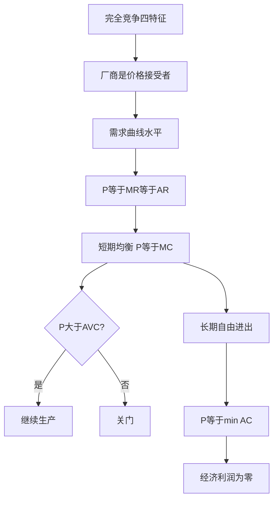

# 第四章 完全竞争市场 章节总结

> 所属：[[../README|06 西方经济学]]

## 这一章在回答什么问题

当市场上有无数个小老板、产品一模一样、信息完全畅通时，价格怎么定？厂商怎么决定产量？答案：厂商是"价格接受者"，按 P = MC 生产，长期经济利润为 0。

## 核心概念清单

- **四个特征**：无数买卖者、产品同质、自由进出、信息完全。
- **P = MR = AR**：厂商面对水平需求曲线。
- **短期均衡**：P = MC 且 P ≥ AVC。
- **长期均衡**：P = MC = min(AC)，经济利润为 0。

## 框架图

## 本章 KP 列表

- [[KP01_完全竞争市场的特征|KP01 完全竞争市场的特征]]
- [[KP02_完全竞争厂商的需求与收益|KP02 完全竞争厂商的需求与收益]]
- [[KP03_短期均衡与停止营业点|KP03 短期均衡与停止营业点]]
- [[KP04_长期均衡与供给曲线|KP04 长期均衡与行业供给曲线]]

## 与前后章的关系

本章是"理想基准"——第 5 章讲偏离它的各种市场结构（垄断、垄断竞争、寡头）。
