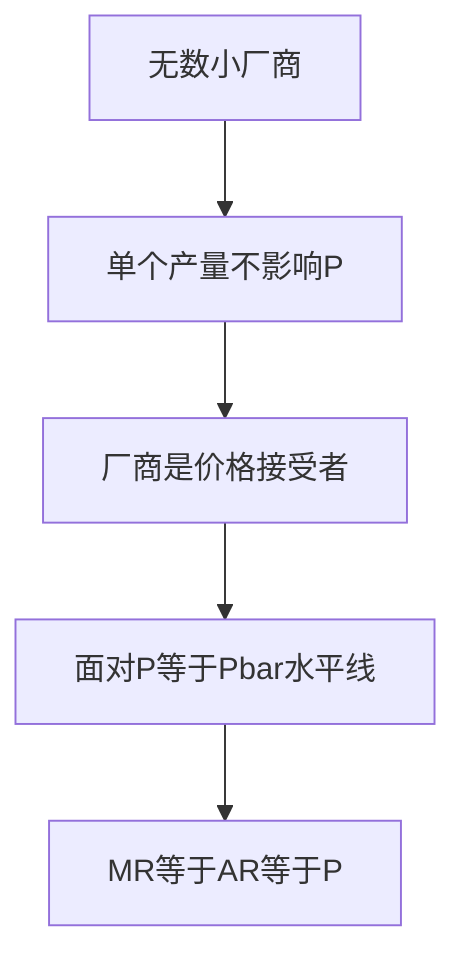

# KP02 完全竞争厂商的需求与收益

<a href="../../../../exam.html" target="_blank" style="display:inline-block;padding:6px 16px;background:#2563eb;color:#fff;border-radius:6px;text-decoration:none;font-size:14px;">📝 开始做题</a>

> 所属：[[00_章节总结|第4章 完全竞争市场]]

## 1. 一句话先懂（小白版）

你是菜市场一个白菜小贩。市场价 2 块一斤，你卖 2.5 块没人买；你卖 1.5 块没必要（反正能全卖光）。所以你面对的需求曲线是一条**水平线**——在 2 块这个价，你想卖多少卖多少。

## 2. 严格定义

**厂商需求曲线**：完全竞争厂商面对的需求曲线是一条由市场均衡价格决定的**水平线**。

**总收益（TR）**：
$$TR = P \cdot Q$$

**平均收益（AR）**：
$$AR = \frac{TR}{Q} = P$$

**边际收益（MR）**：
$$MR = \frac{\Delta TR}{\Delta Q} = P$$

**关键结论**：在完全竞争下，$P = AR = MR$，三者重合。

## 3. 为什么（原理/机制）

- 厂商是价格接受者，P 是常数。
- 每多卖一单位，多收 P 元 → MR = P。
- 每单位平均收 P 元 → AR = P。
- 所以三线合一。

## 4. 怎么用（手把手算）

**场景**：白菜市场价 P = 2 元/斤。

| Q（斤） | TR = P·Q | AR = TR/Q | MR = ΔTR/ΔQ |
|---|---|---|---|
| 0 | 0 | — | — |
| 10 | 20 | 2 | 2 |
| 20 | 40 | 2 | 2 |
| 30 | 60 | 2 | 2 |

**观察**：AR 和 MR 永远等于 P = 2，与 Q 无关。

## 5. 与市场需求曲线的区别

- **市场需求曲线**：向右下倾斜（价格越高，全市场买得越少）。
- **厂商需求曲线**：水平线（单个厂商无论卖多少，价格不变）。

**直觉**：一滴水对大海水位没影响。

## 5.5 理论推导（一步步推）

> 本节补充：为什么完全竞争厂商面对的需求曲线是水平线。

**假设起点**：
1. 市场上有无数小厂商，每家产量占行业产量微不足道。
2. 产品同质（无差异）。
3. 信息完全、要素自由流动。

**推导过程**：
- 第一步：单个厂商产量变化对市场供给影响可忽略 → 市场均衡价格 P 不变。
- 第二步：厂商是"价格接受者"——它想卖什么价都行（P 由市场定），想卖多少就卖多少（在 P 水平上）。
- 第三步：厂商面对的需求曲线就是 $P = ar P$，一条水平线。
- 第四步：$TR = P\cdot q$，$MR = dTR/dq = P$，$AR = TR/q = P$ → MR = AR = P，三线重合。

## 5.6 数学推导（公式怎么来的）

> 每个符号第一次出现必须解释。

设市场需求 $Q^d = 1000 - P$，行业有 1000 家相同厂商，单个厂商供给 $q^s = -0.1 + 0.1P$。行业供给 $Q^s = 1000q^s = -100 + 100P$。

均衡：$1000 - P = -100 + 100P$ → $P^* = 1100/101 pprox 10.89$。

单个厂商面对的需求：$P = 10.89$（水平线）。若某厂想卖 11，没人买（产品同质）；若卖 10.89，能卖光所有产量。

$$TR = 10.89 \cdot q, \quad MR = AR = 10.89$$

## 6. 容易混淆什么

| 概念 | 区别 |
|---|---|
| 厂商需求 vs 市场需求 | 水平 vs 向右下倾斜。 |
| MR vs P | 完全竞争下 MR = P；垄断下 MR < P。 |

## 7. 现实意义

- 为啥农民不敢涨价？一涨价消费者立刻换隔壁摊。
- 为啥农产品收购价波动大？市场供需决定 P，单个农民只能接受。
- 为啥股票散户挂单不影响价格？单笔交易太小，对股价无影响。

---

## 🔗 相关知识点

**同章关联：** [[KP01_完全竞争市场的特征|市场特征]] ｜ [[KP03_短期均衡与停止营业点|短期均衡]]

**跨章关联：** [[../../05_不完全竞争市场/知识点/KP02_垄断厂商的短期与长期均衡|垄断的 MR 小于 P]]

**📖 原书原文：** [[../../../../原文件/经济学/西方经济学上册_微观_全书|原书·第四章第二节]]

---

## 🐮 小白教程入门

> 看不懂下面这个KP？先看通俗版教程建立直觉：

- [[../../../../经济统计学论文从0基础到精通/13_微观经济学基础/09_完全竞争市场是什么|🐮 教程·完全竞争市场是什么]]

---

## 📝 考研真题（首经贸 801）

**配套主观题：** 见同目录 [[../考研真题集|本章考研真题集]]
**配套选择题：** 见同目录 [[../选择题集|本章选择题集]]

### 高频简答
- 为什么完全竞争厂商是价格接受者？其需求曲线有何特征 → 见 [[../考研真题集#s2|真题集·简答]]

### 高频论述
- 评价完全竞争市场的资源配置效率 → 见 [[../考研真题集#l1|真题集·论述]]

### 易错选择
- 本知识点选择题见 [[../选择题集#KP02 完全竞争厂商的需求与收益|选择题集]]
