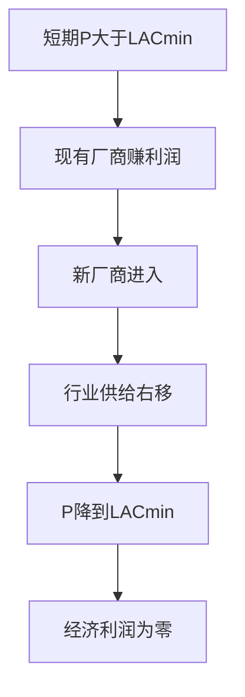

# KP04 长期均衡与行业供给曲线

<a href="../../../../exam.html" target="_blank" style="display:inline-block;padding:6px 16px;background:#2563eb;color:#fff;border-radius:6px;text-decoration:none;font-size:14px;">📝 开始做题</a>

> 所属：[[00_章节总结|第4章 完全竞争市场]]

## 1. 一句话先懂（小白版）

长期里，奶茶店能关门、能换大店面。如果大家都赚钱，新老板就会进来；如果大家都亏钱，老老板就会退出。**最后稳定在"经济利润 = 0"——老板们不赚不亏，刚好愿意继续干。**

## 2. 严格定义

**长期均衡条件**：
$$P = MC = \min(AC)$$

此时：
- 厂商利润最大（P = MC）。
- 经济利润 = 0（P = min(AC)）。
- 没有新厂商进入，也没有老厂商退出。

**长期经济利润为 0 不等于会计利润为 0**——会计利润等于正常利润（隐成本）。

## 3. 为什么（原理/机制）

- 短期有利润 → 新厂商进入 → 行业供给增加 → 价格下降 → 利润消失。
- 短期有亏损 → 老厂商退出 → 行业供给减少 → 价格上升 → 亏损消失。
- 最终停在 P = min(AC)。

## 4. 怎么用（手把手算）

**场景**：奶茶店长期成本 LAC 最低点在 Q = 400，LAC = 10 元。

**第一步**：长期均衡价格 P = 10 元。

**第二步**：每个厂商生产 Q = 400 杯。

**第三步**：假设市场需求 Qd = 40000 杯，则厂商数量 = 40000 / 400 = 100 家。

**第四步**：如果需求增加到 Qd = 60000：
- 短期价格上涨，老厂商赚超额利润。
- 长期新厂商进入，供给增加，价格回落到 10 元。
- 厂商数量 = 60000 / 400 = 150 家。

## 5. 行业长期供给曲线

| 行业类型 | 成本变化 | 长期供给曲线 |
|---|---|---|
| 成本不变行业 | 要素价格不随产量变 | 水平线 |
| 成本递增行业 | 扩产推高要素价格 | 向右上倾斜 |
| 成本递减行业 | 规模经济使成本下降 | 向右下倾斜 |

## 5.5 理论推导（一步步推）

> 本节补充：长期均衡和行业长期供给曲线怎么推。

**假设起点**：
1. 长期中厂商可自由进入退出。
2. 所有厂商成本结构相同（对称）。
3. 要素价格可能随行业扩张变化（决定成本递增/不变/递减）。

**推导过程**：
- 第一步：短期均衡 $P = MC$，可能赚利润也可能亏损。
- 第二步：若 $P > LAC_{min}$，现有厂商赚超额利润 → 新厂商进入。
- 第三步：新厂商进入 → 行业短期供给右移 → P 下降，直到 $P = LAC_{min}$，利润归零。
- 第四步：若 $P < LAC_{min}$，亏损 → 厂商退出 → 供给左移 → P 上升。
- 第五步：长期均衡 $P = LAC_{min} = MC_{长期}$，经济利润为零。

## 5.6 数学推导（公式怎么来的）

> 每个符号第一次出现必须解释。

**成本不变行业**：行业扩张不影响要素价格 → 所有厂商 $LAC_{min}$ 不变 → 长期供给曲线 LS 是水平线 $P = LAC_{min}$。

**成本递增行业**：行业扩张推高要素价格 → $LAC_{min}$ 上移 → LS 向右上倾斜。

**成本递减行业**：行业扩张带来集聚经济 → $LAC_{min}$ 下移 → LS 向右下倾斜。

数学上，LS 曲线是长期均衡点 $(Q, P^*)$ 的轨迹，其中 $P^*$ 是对应行业产量下的 $LAC_{min}$。

## 6. 容易混淆什么

| 概念 | 区别 |
|---|---|
| 长期均衡 vs 短期均衡 | 长期 P = min(AC)，短期只要求 P = MC。 |
| 经济利润为 0 vs 关门 | 经济利润为 0 时会计利润 > 0，老板愿意继续干。 |

## 7. 现实意义

- 为啥奶茶店开了又关？短期赚钱 → 大家涌入 → 长期利润归零 → 有人退出。
- 为啥程序员工资高但趋稳？行业扩张吸引新人，工资被拉低。
- 为啥完全竞争行业长期没有"暴利"？自由进出把利润抹平。

---

## 🔗 相关知识点

**同章关联：** [[KP03_短期均衡与停止营业点|短期均衡]]

**跨章关联：** [[../../03_生产与成本/知识点/KP07_长期成本曲线|长期成本曲线]] ｜ [[../../05_不完全竞争市场/知识点/KP02_垄断厂商的短期与长期均衡|垄断长期有利润]]

**📖 原书原文：** [[../../../../原文件/经济学/西方经济学上册_微观_全书#第四节 完全竞争企业和市场的长期均衡|原书·第四章第四节]]

---

## 🐮 小白教程入门

> 看不懂下面这个KP？先看通俗版教程建立直觉：

- [[../../../../经济统计学论文从0基础到精通/13_微观经济学基础/09_完全竞争市场是什么|🐮 教程·完全竞争市场是什么]]

---

## 📝 考研真题（首经贸 801）

**配套主观题：** 见同目录 [[../考研真题集|本章考研真题集]]
**配套选择题：** 见同目录 [[../选择题集|本章选择题集]]

### 高频简答
- 简述完全竞争厂商长期均衡的条件及其经济含义 → 见 [[../考研真题集#s7|真题集·简答]]

### 高频论述
- 从完全竞争长期均衡看零经济利润是否意味着厂商亏损 → 见 [[../考研真题集#l2|真题集·论述]]

### 易错选择
- 本知识点选择题见 [[../选择题集#KP04 长期均衡与供给曲线|选择题集]]
