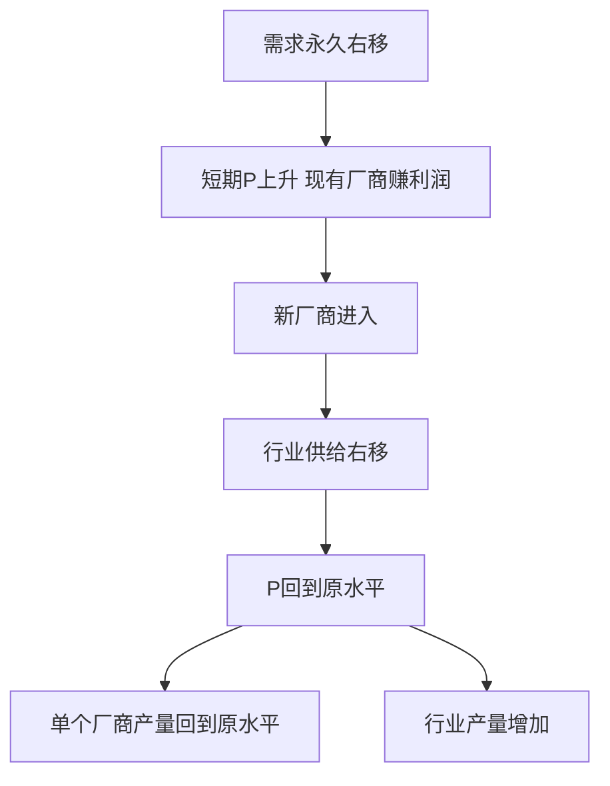
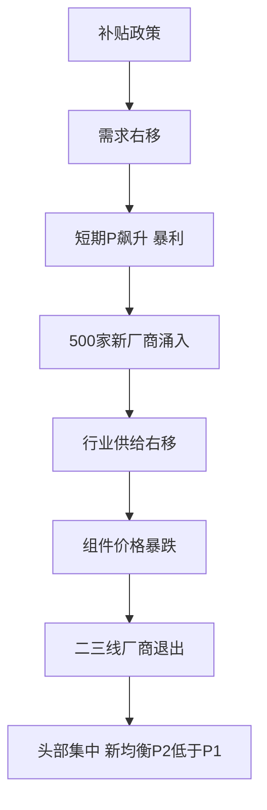

# 第四章 完全竞争市场 · 考研真题集（首经贸 801）

<a href="../../../exam.html" target="_blank" style="display:inline-block;padding:6px 16px;background:#2563eb;color:#fff;border-radius:6px;text-decoration:none;font-size:14px;">📝 开始做题</a>

> 本章共收录：简答题 8 道（每题 15 分）｜论述题 3 道（每题 30 分）
> 配套选择题见 [[选择题集|本章选择题集]]
> 对应大纲：西方微观第四章「完全竞争市场」全部四节

## 📋 本题集目录

### 简答题
1. [[#简答 1：简述完全竞争市场的基本条件。|简述完全竞争市场的基本条件]]
2. [[#简答 2：为什么完全竞争厂商是"价格接受者"？其面临的需求曲线有何特征？|为什么完全竞争厂商是"价格接受者"？其需求曲线有何特征]]
3. [[#简答 3：简述完全竞争厂商的平均收益 AR、边际收益 MR 与价格 P 三条曲线之间的关系。|简述完全竞争厂商 AR、MR、P 三条收益曲线的关系]]
4. [[#简答 4（计算题）：已知某完全竞争厂商的短期总成本函数为 $STC=Q^3-10Q^2+30Q+160$，产品市场价格 $P=50$。求：（1）利润最大化产量；（2）最大利润（或最小亏损）；（3）判断厂商是否应继续营业。|计算题：由 STC 函数与既定价格求利润最大化产量与盈亏状况]]
5. [[#简答 5：用图形说明完全竞争厂商短期均衡的五种情况。|用图形说明完全竞争厂商短期均衡的五种情况]]
6. [[#简答 6：简述完全竞争厂商短期供给曲线是如何推导出来的。|简述完全竞争厂商短期供给曲线的推导]]
7. [[#简答 7：简述完全竞争厂商长期均衡的条件，并说明其经济含义。|简述完全竞争厂商长期均衡的条件及其经济含义]]
8. [[#简答 8：简述成本不变行业、成本递增行业和成本递减行业的长期供给曲线形状。|简述成本不变、成本递增、成本递减行业的长期供给曲线]]

### 论述题
1. [[#论述 1：试评价完全竞争市场的资源配置效率，并说明现实市场为何往往偏离这一理想状态。|评价完全竞争市场的资源配置效率]]
2. [[#论述 2：试分析完全竞争厂商长期均衡时"经济利润为零"是否意味着厂商亏损？这一结论对理解现实企业经营有何启示？|从完全竞争长期均衡看"零经济利润"是否意味着厂商亏损]]
3. [[#论述 3：中国小麦、水稻等粮食市场最接近完全竞争。试结合完全竞争理论，分析国家粮食最低收购价政策的经济学逻辑，并说明其利弊。|结合中国粮食市场分析完全竞争特征与最低收购价政策]]

---

## 一、简答题（每题 15 分，建议 450–700 字）

### 简答 1：简述完全竞争市场的基本条件。

**【建议字数】450–700 字 ｜ 【建议时间】15 分钟 ｜ 【题型】概念简答**
**【考什么】** 对应知识点 [[知识点/KP01_完全竞争市场的特征|完全竞争市场的特征]]；题型属于概念简答。

**【核心推导】**
**第一步：把四个条件翻译成数学语言。**

完全竞争市场的四个条件看似是文字描述，其实每一条都对应一个可检验的数学假设，这是全部后续结论的来源。

1. **大量买者卖者** → 单个厂商产量 $q_i$ 占行业总产量 $Q=\sum q_i$ 的比重 $q_i/Q \to 0$。这意味着厂商产量的微小变化对市场供给曲线的影响可以忽略，市场价格 $P$ 与 $q_i$ 无关，即 $\dfrac{\partial P}{\partial q_i}=0$。
2. **产品完全同质** → 所有厂商产品在消费者效用函数中是完全替代品，需求的价格弹性趋于无穷。数学上，若某厂商定价 $P_i>P$，则其需求量 $q_i^d(P_i)\to 0$。
3. **资源自由流动** → 长期内厂商数目 $n$ 是可变的自由变量，且不存在进入的固定沉没成本壁垒。
4. **信息完全** → 所有主体知道同一组价格，市场不存在同一时点同一商品的两个价格，即"一价定律"成立。

**第二步：由 $P$ 与 $q_i$ 无关推出厂商面临的需求曲线。**

因为 $\partial P/\partial q_i=0$，对单个厂商而言价格是外生参数。把它写成厂商的需求函数：$P=P^*$（常数），这正是坐标平面上的一条水平线。与之对照，行业需求函数 $Q^d=f(P)$ 满足 $f'(P)<0$，即向右下方倾斜。

**第三步：推出长期均衡的结果。**

设单个厂商成本函数 $C(q)$，利润 $\pi_i=P^*q_i-C(q_i)$，一阶条件 $\dfrac{d\pi_i}{dq_i}=P^*-C'(q_i)=0$，即 $P^*=MC(q_i)$。

叠加条件 3（自由进出）：若 $\pi_i>0$，则 $n$ 增加 → 行业供给右移 → $P^*$ 下降 → 直到 $\pi_i=0$；若 $\pi_i<0$，则 $n$ 减少 → $P^*$ 上升 → 直到 $\pi_i=0$。故长期均衡必有 $\pi_i=0$，即 $P^*=AC(q_i)$。

联立 $P^*=MC$ 与 $P^*=AC$ 得 $MC=AC$，而 $MC$ 与 $AC$ 的交点恰是 $AC$ 的最低点（因为 $AC$ 最小时 $\frac{d}{dq}\left(\frac{C}{q}\right)=\frac{qC'-C}{q^2}=0 \Rightarrow C'=C/q$），所以：

$$P^*=MC=AC_{\min}=LAC_{\min},\qquad \pi=0$$

**第四步：把"效率"量化。**

配置效率要求 $P=MC$，即消费者对最后一单位的边际评价等于社会生产它的边际成本。若 $P>MC$，则增产一单位的社会净福利为 $P-MC>0$，说明产量不足；若 $P<MC$，则减产一单位可提高福利。完全竞争的长期均衡恰好使 $P=MC$，故无谓损失为零。

**条件放松时的边界：**四条中任何一条被破坏，$P=MC$ 就不再成立。破坏条件 1（厂商很少）→ 垄断，$P>MC$；破坏条件 2（产品差异）→ 垄断竞争，$P>AC_{\min}$ 处相切；破坏条件 3（进入壁垒）→ 长期正利润无法被竞争消除；破坏条件 4（信息不对称）→ 逆向选择与道德风险，价格不再反映真实成本。

**【为什么要答这几点】**
**逐条对应分值（按 10 分制）**

1. **大量买者卖者（2 分）**：不能只写"人很多"，必须点出"份额微不足道 → 无法影响价格 → 价格接受者"。阅卷时"价格接受者"是采分关键词，缺了这层因果扣 1 分。
2. **产品同质（2 分）**：要点出"无偏好差异 → 提价即失去全部顾客 → 需求弹性无穷大"。只写"产品一样"给 1 分。
3. **资源自由流动（2 分）**：必须强调"长期"维度，写清"自由进出 → 超额利润被消除 → 长期零经济利润"。这条是后面长期均衡结论的唯一来源，漏了它整道题后半部分会失分。
4. **信息完全（2 分）**：要点出一价定律或"不会有人高价买低价卖"。
5. **现实性与评价（2 分）**：要举出最接近的实例（农产品），并说明它作为"效率基准"的方法论地位。

**常见失分点**
- 把四个条件写成四句口号，不解释各条件的经济后果，最多给一半分。
- 漏掉"价格接受者"这一核心推断，只罗列条件不推导结论，属于答非所问。
- 只讲条件不讲现实意义，读者无法判断这个模型为什么有用。
- 误说"完全竞争现实中不存在所以没用"——恰恰相反，它是判断其他市场结构效率损失的标尺，这个方法论定位必须写出来。

**【如何分析题目】**
**第一步：拆题干关键词。**"完全竞争市场的基本条件"是标准概念题，答题结构应固定为「定义 → 条件逐条 → 条件的经济后果 → 现实评价」四段，不要写成散文。

**第二步：先想清楚条件之间的逻辑层级。**四个条件不是并列的，而是有推导顺序的：条件 1 决定"价格接受"（厂商层面），条件 2、4 强化这一点，条件 3 决定长期均衡能否达到（行业层面）。答的时候如果按这个逻辑组织，评卷人一眼能看出你理解了模型结构，而不是在背书。

**第三步：把每个条件换算成它的经济后果。**每写完一条条件，紧跟一句"因此……"。这既是采分点，也是自检方式——如果你说不出后果，说明这条你只是记住了文字。

**第四步：收尾给出方法论定位。**完全竞争不是对现实的描述，而是效率的参照系。收尾点明"它是最接近的农产品市场的近似"以及"作为衡量其他市场结构效率损失的基准"，能把分数从"背得熟"提到"理解深"。

**时间分配建议（10 分题约 8 分钟）：** 定义 1 分钟，四条条件每条 1 分钟，现实评价与收尾 2 分钟。留 1 分钟检查是否写出了"价格接受者"和"长期零利润"这两个关键词。

**【答题框架】**
- 第 1 段：完全竞争市场的定义（2 分）
- 第 2 段：四个基本条件（8 分）
- 第 3 段：现实中是否存在（3 分）
- 第 4 段：小结（2 分）

**【参考答案】**

一、定义

完全竞争市场是指一种竞争不受任何阻碍和干扰、没有任何垄断因素的市场结构。在这种市场中，无数个买者和卖者共同决定市场价格，单个厂商只能接受这一价格。

二、四个基本条件

1. **市场上有大量的买者和卖者**。每个买者的购买量和每个卖者的销售量在整个市场中所占份额都微不足道，以至于任何一个人都无法通过自己的买卖行为影响市场价格。每个主体都是"价格接受者"（price taker）。
2. **市场上每一个厂商提供的产品都是完全同质的**。厂商之间的产品在质量、规格、商标、售后服务上毫无差别，以至于买者不会对任何一个卖者产生偏好，从而排除了垄断因素。
3. **所有资源可以完全自由流动**。厂商可以自由进入或退出该行业，劳动、资本等要素可以在行业间无障碍转移，不存在法律、技术、规模上的进入壁垒。
4. **市场信息是完全的**。买者和卖者都掌握与自己经济决策有关的一切信息，不会有任何人以高于市场价格购买或低于市场价格出售。

三、现实中是否存在

严格符合这四个条件的市场在现实生活中几乎不存在。农产品市场（如小麦、大米）最接近完全竞争：农户众多、产品同质、进出相对自由、信息较充分。微观经济学把完全竞争市场作为一个理想基准，用于衡量其他市场结构的效率损失。

四、小结

四个条件共同决定了完全竞争厂商是价格接受者、面临水平需求曲线，并最终在长期达到 $P=\min AC$、经济利润为零的均衡。

**【解析·得分点】** 采分点：①四个条件各 2 分（大量买卖者、产品同质、自由进出、信息完全）；②指出厂商是价格接受者（3 分）；③举农产品为例（2 分）；④小结（2 分）。易丢分：漏掉"产品同质"或"信息完全"其中一条。

**【生活实例】** 学校周边卖煎饼的小摊虽然多，但每家口味略有差异、顾客有偏好，更接近垄断竞争。真正接近完全竞争的是批发市场上的大蒜、白菜——谁家的蒜都一样，你不卖有人卖，价格由整个批发市场定。

**【双链接】** 🔗 [[知识点/KP01_完全竞争市场的特征|回知识点]] ｜ 📖 [[../../../原文件/经济学/西方经济学上册_微观_全书|原书·第四章第一节]]

---

### 简答 2：为什么完全竞争厂商是"价格接受者"？其面临的需求曲线有何特征？

**【建议字数】450–700 字 ｜ 【建议时间】15 分钟 ｜ 【题型】原因分析**
**【考什么】** 对应知识点 [[知识点/KP02_完全竞争厂商的需求与收益|完全竞争厂商的需求与收益]]；题型属于原因分析。

**【核心推导】**
**第一步：从"厂商是价格接受者"这一命题出发，逆向找它的数学条件。**

价格接受（price taker）的严格含义是：厂商面对的需求函数是价格的恒等函数而非自己的产量的函数，即 $P(q)\equiv P^*$，$\dfrac{dP}{dq}=0$。要在什么条件下才成立？

考虑市场反需求函数 $P=P(Q^d)$，行业总供给 $Q^s=Q_{-i}^s+q_i$，市场出清 $Q^s=Q^d$。对均衡价格关于 $q_i$ 求导：

$$\frac{dP}{dq_i}=P'(Q^d)\cdot\frac{dQ^d}{dq_i}=P'(Q^d)\cdot\frac{\partial Q^s/\partial q_i}{\partial Q^s/\partial P-\partial Q^d/\partial P}$$

由于 $\partial Q^s/\partial q_i=1$，得到

$$\frac{dP}{dq_i}=\frac{P'}{\partial Q^s/\partial P-\partial Q^d/\partial P}=\frac{1}{\dfrac{\partial Q^s}{\partial P}-\dfrac{\partial Q^d}{\partial P}}\cdot P'$$

当厂商数目 $n\to\infty$ 且各厂商规模相当时，$\partial Q^s/\partial P=\sum_i \partial q_i/\partial P$ 随 $n$ 增大而趋于无穷，故 $\dfrac{dP}{dq_i}\to 0$。这就把"数量众多"这一文字条件转化成了"厂商对价格的影响趋于零"的数学命题。

**第二步：把这一结果代回利润最大化。**

$\pi(q)=P(q)q-C(q)$，一阶条件：

$$P(q)+q\frac{dP}{dq}=C'(q)$$

其中 $P+q\dfrac{dP}{dq}=MR$。当 $\dfrac{dP}{dq}=0$ 时 $MR=P$。这正是"价格接受者"的收益学表述：厂商每多卖一单位，收入增加恰好等于市场价格，不会被自己压价侵蚀。

**第三步：推出需求曲线的形状。**

厂商的需求弹性 $\varepsilon_i=\dfrac{dq_i}{q_i}\Big/\dfrac{dP}{P}$。由上式，$\dfrac{dP}{dq_i}\to0$ 等价于 $\varepsilon_i\to\infty$。在 $(q,P)$ 平面上，弹性无穷大的需求曲线就是水平线 $P=P^*$。

**第四步：区分两条需求曲线的斜率。**

行业需求 $Q^d=f(P)$，$f'<0$，是一条负斜率曲线；厂商需求 $q_i^d(P)=0$（当 $P>P^*$）、$=+\infty$（当 $P=P^*$）、$=0$（当 $P<P^*$ 时买者全来但供给受限，逻辑上视为可售出任意量）。二者在 $P=P^*$ 处相交：水平线在 $P^*$ 高度上"覆盖"了整条行业曲线的对应点，但斜率完全不同。**混淆这两条曲线是本章最常见的概念错误。**

**【为什么要答这几点】**
**逐条对应分值（10 分制）**

1. **定义（2 分）**：必须写出"不能影响价格、只能接受市场既定价格"两层意思。只写"接受价格"给 1 分。
2. **原因分析（4 分）**：这是主体。要给出三条独立理由：份额极小、产品同质、信息完全。每条 1 分，外加"三者如何共同导致 $\frac{dP}{dq}=0$"的整合 1 分。
3. **需求曲线特征（3 分）**：必须画出或描述"水平线"，并说明两个含义——可按 $P^*$ 卖出任意量、提价则销量归零。只说"水平的"不给分，必须要两个经济学含义。
4. **与行业需求曲线的区别（1 分）**：点出行业曲线向下倾斜、厂商曲线水平，二者在 $P^*$ 处重合。

**常见失分点**
- 只写"厂商很多"，不解释"很多"如何推出"不能影响价格"，因果链断了扣 2 分。
- 把厂商需求曲线和行业需求曲线混为一谈，画一条向下倾斜的线，直接扣 3 分。
- 只讲需求曲线形状不讲 AR、MR 的含义，后续第 3 题（$AR=MR=P$）会连带失分。
- 忘记强调"厂商面临的需求弹性为无穷大"，这是"水平线"的等价说法，写出来显示理解深度。

**【如何分析题目】**
**第一步：审题，识别这是"原因—结果"型题目。**"为什么是价格接受者"问的是原因，"需求曲线有何特征"问的是结果。答案必须先因后果，不能倒过来先画图再说理由。

**第二步：把"价格接受者"翻译成可推导的语言。**自问：什么叫"不能影响价格"？答：$\frac{dP}{dq}=0$。一旦完成这一步翻译，后面的原因分析就有了统一指向——凡是能推出 $\frac{dP}{dq}=0$ 的条件都是理由。

**第三步：按"市场结构 → 厂商行为"的顺序组织。**先说市场层面的三个条件（人数、同质性、信息），再说厂商层面的结果（水平需求曲线），最后说与行业曲线的区别。这个顺序与题目结构一一对应，评卷人好找分。

**第四步：用一句话锁定"无穷弹性"。**写作时把"水平需求曲线"和"需求价格弹性为无穷大"当同一件事的两种说法交替使用，既显示理解，也免得只画图不解释。

**时间分配（8 分钟）：**定义 1 分钟，三条原因 3 分钟，曲线特征 2 分钟，区别与收尾 2 分钟。

**【答题框架】**
- 第 1 段：价格接受者的含义（3 分）
- 第 2 段：原因（5 分）
- 第 3 段：厂商需求曲线的形状（5 分）
- 第 4 段：与行业需求曲线的区别（2 分）

**【参考答案】**

一、价格接受者的含义

"价格接受者"是指单个厂商不能通过改变自己的产量来影响市场价格，只能按市场供求决定的价格出售产品。它定价的能力为零。

二、原因

1. 行业内厂商数量众多，单个厂商的产量占整个行业总产量的比重极小，即使该厂商把产量增加一倍或减少为零，对行业供给的影响也微乎其微，不足以引起市场价格变动；
2. 产品完全同质，买者对任何一家厂商的产品都没有偏好。如果某厂商把价格提高一分钱，顾客会全部转向其他厂商；它也没有动机降价，因为按市场价格它已经能卖掉全部产量；
3. 信息完全，买者清楚市场价格，不会接受更高价格。

三、厂商需求曲线的形状

在以产量为横轴、价格为纵轴的坐标中：
- 行业（市场）的需求曲线仍向右下方倾斜，符合需求定律；
- 但**单个完全竞争厂商面临的需求曲线是一条由市场均衡价格决定的水平线**。它表示：在既定价格下，厂商可以卖出任意数量的产品；一旦提价，需求量立即降为零。

四、与行业需求曲线的区别

行业需求曲线反映全体消费者对整个行业产品的购买意愿，向右下方倾斜；厂商需求曲线反映单个厂商在市场价格下能卖出的数量，是水平的。二者斜率截然不同，但在 $P=P^*$（市场均衡价格）处重合。

**【解析·得分点】** 采分点：①价格接受者定义（3 分）；②三个原因（5 分）；③厂商需求曲线水平（5 分）；④与行业需求曲线的区别（2 分）。易丢分：把行业需求曲线画成水平。

**【生活实例】** 一个种小麦的农民，无论他今年多卖还是少卖几千斤小麦，对全国小麦市场价都没有影响。他只能按国家粮油交易中心公布的价格卖——这就是价格接受者。

**【双链接】** 🔗 [[知识点/KP02_完全竞争厂商的需求与收益|回知识点]] ｜ [[知识点/KP01_完全竞争市场的特征|市场特征]] ｜ 📖 [[../../../原文件/经济学/西方经济学上册_微观_全书|原书·第四章第二节]]

---

### 简答 3：简述完全竞争厂商的平均收益 AR、边际收益 MR 与价格 P 三条曲线之间的关系。

**【建议字数】450–700 字 ｜ 【建议时间】15 分钟 ｜ 【题型】关系对比**
**【考什么】** 对应知识点 [[知识点/KP02_完全竞争厂商的需求与收益|完全竞争厂商的需求与收益]]；题型属于关系对比。

**【核心推导】**
**第一步：写出三个收益的定义式。**

总收益 $TR=P\cdot Q$；平均收益 $AR=\dfrac{TR}{Q}$；边际收益 $MR=\dfrac{dTR}{dQ}$。

**第二步：注意这里的关键——$P$ 不是 $Q$ 的函数。**

在完全竞争下厂商是价格接受者，$P\equiv P^*$ 为常数。这一点是全部证明的支点。于是：

$$AR=\frac{P^*Q}{Q}=P^*$$

$$MR=\frac{d(P^*Q)}{dQ}=P^*\frac{dQ}{dQ}+Q\frac{dP^*}{dQ}=P^*+0=P^*$$

注意第二个等号用的是乘积法则，第二项 $Q\dfrac{dP^*}{dQ}=0$ 正是因为 $P^*$ 与 $Q$ 无关。这一步是阅卷的关键区分点：写不出这一项为零的理由，说明只是背了结论。

**第三步：得到三线合一的结论。**

$$d:\ P=P^*;\qquad AR=P^*;\qquad MR=P^*$$

三条曲线在图上完全重合为同一条水平线。

**第四步：做一个对照推导，验证结论的边界。**

设厂商面对向下倾斜的需求曲线 $P=a-bQ$（垄断情形），则

$$TR=aQ-bQ^2,\quad AR=a-bQ=P,\quad MR=a-2bQ$$

$MR$ 与 $AR$ 的差为 $bQ>0$，即 $MR<AR=P$，且 $MR$ 的斜率是 $AR$ 的两倍。这说明 $MR=P$ **不是普遍规律**，而是 $\frac{dP}{dQ}=0$ 这一特定条件的产物。

**第五步：联系利润最大化条件。**

一般厂商的利润最大化条件是 $MR=MC$；完全竞争下 $MR=P$，故简化为 $P=MC$。这个简化是整个完全竞争效率分析的起点——因为 $P=MC$ 同时就是配置效率的条件。换言之，"三线合一"不是一个小结论，而是竞争市场之所以有效率的技术根源。

**【为什么要答这几点】**
**逐条对应分值（8 分制）**

1. **三个定义式（2 分）**：$TR=PQ$、$AR=TR/Q$、$MR=dTR/dQ$ 各约 0.5 分，写对即可。
2. **$AR=P$ 的证明（1 分）**：约分即得，属于送分点。
3. **$MR=P$ 的证明（2 分）**：必须写出"$P$ 为常数 → 对 $Q$ 求导时 $dP/dQ=0$"。**这是本题唯一的技术难点，也是唯一的分水岭。**只写"因为价格不变所以 $MR=P$"给 1 分；写出乘积法则并指出第二项为零给满分。
4. **几何表述（1 分）**：三线重合为一条水平线，同时是需求曲线 $d$。
5. **与不完全竞争的对比（2 分）**：写出 $MR<P$，说明垄断下多卖必须降价，$MR$ 被"降价损失"拉低。

**常见失分点**
- 把 $AR=P$ 与 $MR=P$ 混为一谈，认为两者都"显然"成立。实际上 $AR=P$ 对所有市场结构都成立（$AR\equiv P$ 是恒等式），只有 $MR=P$ 需要完全竞争条件。
- 忘记强调 $MR=P$ 是"$P=MC$ 简化"的原因，导致结论悬空。
- 画图时把水平线画在成本曲线下方或者与 MC 相交不止一次，图形与文字对不上。
- 不写 $MR$ 的斜率对比，失去展示深度分的机会。

**【如何分析题目】**
**第一步：判断题型。**这是"推导证明型"题，不是"描述型"题。答题必须给公式推导，只画图只描述最多拿一半分。

**第二步：先写定义，再找关键条件。**三个收益的定义是死的，先写下来占位。然后立刻问自己：这道题的关键假设是哪一条？答案是"$P$ 与 $Q$ 无关"。把这一条写在最显眼的位置，后面所有推导都挂在它上面。

**第三步：推导时故意暴露"为什么第二项为零"。**很多人推导写得太快，阅卷人看不出你是理解还是背的。写得慢一点，把 $\frac{dP}{dQ}=0$ 这一步单独指出来，这是性价比最高的一句话。

**第四步：用反例划定结论边界。**加一段垄断情形的对照，说明 $MR<P$。这一步不占多少篇幅，但能把"我知道结论"变成"我知道结论成立的条件"，是拉开档次的地方。

**第五步：收尾回扣利润最大化。**点出 $MR=P \Rightarrow MR=MC \Rightarrow P=MC$，为效率分析埋伏笔。这样答完，读者明白三线合并不只是个几何巧合，而是效率结论的技术基础。

**时间分配（7 分钟）：**定义 1 分钟，$AR$ 与 $MR$ 推导 3 分钟，几何表述 1 分钟，对照与收尾 2 分钟。

**【答题框架】**
- 第 1 段：三个收益概念的定义（5 分）
- 第 2 段：三者重合的证明（6 分）
- 第 3 段：经济含义（4 分）

**【参考答案】**

一、三个收益概念

设总收益 $TR=P\cdot Q$，其中 $P$ 为市场既定价格：
- 总收益 $TR$：厂商按既定价格出售一定数量产品所获得的全部收入；
- 平均收益 $AR=\dfrac{TR}{Q}=\dfrac{P\cdot Q}{Q}=P$，即每单位产品的销售收入；
- 边际收益 $MR=\dfrac{\Delta TR}{\Delta Q}=\dfrac{d(PQ)}{dQ}$，即每多销售一单位产品所增加的收入。

二、三者重合的证明

在完全竞争市场中，厂商是价格接受者，$P$ 不随厂商产量 $Q$ 变化。因此：
$$MR=\frac{d(PQ)}{dQ}=P$$
同时 $AR=P$。于是：
$$AR=MR=P$$

几何上，厂商的需求曲线、AR 曲线、MR 曲线三条线完全重合，都是由市场价格决定的那条水平线。这条线既是厂商的需求曲线 $d$，也是平均收益曲线 AR，也是边际收益曲线 MR。

三、经济含义

1. $AR=P$ 对所有市场结构都成立（因为平均收益恒等于价格）；
2. 但 $MR=P$ 只在完全竞争市场成立。在垄断、垄断竞争等其他市场结构中，厂商面临向右下方倾斜的需求曲线，要多卖必须降价，因此 $MR<P$；
3. 正是因为 $MR=P$，完全竞争厂商利润最大化条件 $MR=MC$ 才简化为 $P=MC$，这是完全竞争市场效率分析的基础。

**【解析·得分点】** 采分点：①三个定义公式（5 分）；②推导 MR=P（6 分）；③指出 MR=P 只在完全竞争成立（4 分）。易丢分：以为 AR=P 是完全竞争独有。

**【生活实例】** 小麦市场价 1.5 元/斤。农民多卖一斤小麦，总收入多 1.5 元（MR=1.5），每斤平均收入也是 1.5 元（AR=1.5），价格也是 1.5 元（P=1.5）——三条线重合。

**【双链接】** 🔗 [[知识点/KP02_完全竞争厂商的需求与收益|回知识点]] ｜ 📖 [[../../../原文件/经济学/西方经济学上册_微观_全书|原书·第四章第二节]]

---

### 简答 4（计算题）：已知某完全竞争厂商的短期总成本函数为 $STC=Q^3-10Q^2+30Q+160$，产品市场价格 $P=50$。求：（1）利润最大化产量；（2）最大利润（或最小亏损）；（3）判断厂商是否应继续营业。

**【建议字数】450–700 字 ｜ 【建议时间】15 分钟 ｜ 【题型】分析推导**
**【考什么】** 对应知识点 [[知识点/KP03_短期均衡与停止营业点|短期均衡与停止营业点]]；题型属于分析推导/计算。

**【核心推导】**
**第一步：写出利润函数并求一阶条件。**

已知 $STC=Q^3-10Q^2+30Q+160$，$P=50$ 为外生常数。

$$\pi(Q)=TR-STC=50Q-(Q^3-10Q^2+30Q+160)$$

一阶条件 $\dfrac{d\pi}{dQ}=0$：

$$50-3Q^2+20Q-30=0 \Rightarrow 3Q^2-20Q-20=0$$

**第二步：解二次方程并用二阶条件筛根。**

$$Q=\frac{20\pm\sqrt{400+240}}{6}=\frac{20\pm\sqrt{640}}{6}$$

$\sqrt{640}=8\sqrt{10}\approx25.298$，故 $Q_1\approx 7.550$，$Q_2\approx -0.883$（舍去，产量非负）。

二阶条件：$\dfrac{d^2\pi}{dQ^2}=-6Q+20$，在 $Q=7.55$ 处为 $-45.3+20=-25.3<0$，确为极大值点。

**第三步：验证停止营业点（这是最容易漏的一步）。**

$VC=Q^3-10Q^2+30Q$，$AVC=Q^2-10Q+30$。

$AVC$ 最小处满足 $\dfrac{dAVC}{dQ}=2Q-10=0 \Rightarrow Q=5$，此时 $AVC_{\min}=25-50+30=5$。

（也可用 $MC=AVC$ 求：$3Q^2-20Q+30=Q^2-10Q+30 \Rightarrow 2Q^2-10Q=0 \Rightarrow Q=5$，两种方法等价，这一点值得在卷面上点明。）

因 $P=50>AVC_{\min}=5$，厂商应继续生产，且 $P>AC$ 意味着正利润。

**第四步：算利润与平均成本。**

$Q=7.55$ 时：
- $TR=50\times7.55=377.5$
- $Q^2\approx57.00$，$Q^3\approx430.4$
- $STC=430.4-10\times57.00+30\times7.55+160=430.4-570.0+226.5+160=246.9$
- $\pi=377.5-246.9\approx130.6$

$AC=246.9/7.55\approx32.7$，$P-AC\approx17.3>0$，与前述判断一致。

**第五步：边界检查。**若题干改为 $P=20$，则一阶条件 $3Q^2-20Q+10=0$，$Q\approx(20+\sqrt{280})/6\approx6.12$，此时 $P=20>AVC_{\min}=5$ 仍应生产但亏损；若 $P=3<AVC_{\min}$，则最优产量为 $Q=0$，停产。这说明 $P=MC$ 的适用前提是 $P\ge AVC_{\min}$，超出该区间解出的 $Q$ 是"伪最优"。

**【为什么要答这几点】**
**按步骤给分（15 分制，计算题按步骤采分）**

1. **求 MC（2 分）**：$MC=3Q^2-20Q+30$。求导正确即可，漏常数项（$160$ 的导数为 $0$）不扣分，但把 $160$ 保留在 $MC$ 里是严重错误。
2. **一阶条件 $P=MC$ 并解方程（4 分）**：方程 $3Q^2-20Q-20=0$、求根公式、舍去负根各约 1 分，$Q\approx7.55$ 得 1 分。保留根号 $Q=(10+4\sqrt{10})/3$ 同样给满分。
3. **二阶条件或图形说明（2 分）**：说明是极大而非极小。计算题里此项常被忽略，但阅卷细则里通常设点。
4. **停止营业点检验（4 分）**：求 $AVC_{\min}$（2 分）+ 比较 $P$ 与 $AVC_{\min}$（1 分）+ 得出"继续生产"结论（1 分）。**这一步是本题的核心区分点**，只算 $Q$ 而不检验停产条件属于未完成。
5. **利润计算（3 分）**：$TR$（1 分）、$STC$ 回代（1 分）、$\pi$（1 分）。数值误差在合理范围不扣分。

**常见失分点**
- 忘记检验 $P\ge AVC_{\min}$，直接给出正产量——若题目改成低价情形，这个答案就是错的，因此必须写。
- 把 $MC$ 求错（漏项、求导把 $Q^3$ 写成 $3Q^3$）连带后面全错，但阅卷通常按步骤给分，所以务必把步骤写全。
- 只写数值不写单位与含义，例如只答"$7.55$"而不说"这是利润最大化产量"，会被视为表述不清。
- 忘记说明负根舍去的理由（产量非负）。

**【如何分析题目】**
**第一步：识别题型，锁定解题流水线。**这是标准计算题，只有一条路：$MC \to P=MC$ 解 $Q \to$ 二阶条件 $\to$ 停产条件检验 $\to$ 算利润。做题时先在草稿上把这五步写出来，按顺序填，不要跳步。

**第二步：先做代数化简再代数字。**$50=3Q^2-20Q+30$ 先整理成 $3Q^2-20Q-20=0$，再套公式。很多人在原式上直接代数，容易漏项。

**第三步：警惕"数字不整"。**本题判别式 $\sqrt{640}$ 不是整数，这是故意设置的。正确应对是保留根号形式并给出近似值，二者都写。不要因为算不出整数就怀疑自己算错，也不要为了凑整而篡改系数。

**第四步：把"应否生产"当作独立的第二问。**题目问"利润最大化产量"时，容易误以为解出 $Q$ 就完事。必须主动加一步 $AVC_{\min}$ 检验：$P\ge AVC_{\min}$ 才是有效解。这一步答对往往直接决定名次。

**第五步：写完用直觉校验。**$P=50$ 远高于 $AVC_{\min}=5$，说明这个厂商日子非常好过，正利润合理；若算出负利润就要回头检查。

**时间分配（12 分钟）：**求 $MC$ 1 分钟，解方程 3 分钟，二阶条件 1 分钟，停产检验 3 分钟，利润计算 3 分钟，检查 1 分钟。

**【答题框架】**
- 第 1 步：求 MC（3 分）
- 第 2 步：由 P=MC 解产量（5 分）
- 第 3 步：计算利润并与停止营业点比较（7 分）

**【参考答案】**

（1）利润最大化产量

完全竞争厂商利润最大化条件为 $P=MC$。由 STC 求导：
$$MC=\frac{dSTC}{dQ}=3Q^2-20Q+30$$
令 $P=MC$，即 $50=3Q^2-20Q+30$：
$$3Q^2-20Q-20=0$$
用求根公式：
$$Q=\frac{20+\sqrt{400+240}}{6}=\frac{20+\sqrt{640}}{6}\approx \frac{20+25.3}{6}\approx 7.55$$
取整数近似 $Q\approx 7.5$（考试中若数字不整，可保留根号或写 $Q=(10+\sqrt{160})/3$）。

（2）利润计算

$$TR=P\cdot Q=50\times 7.55\approx 377.5$$
$$STC=Q^3-10Q^2+30Q+160$$
代入 $Q=7.55$：
$$STC\approx 429-570+226.5+160\approx 245.5$$
$$\pi=TR-STC\approx 377.5-245.5\approx 132$$

（3）是否应继续营业

计算 AVC 最低点以判断停止营业点：
$$VC=Q^3-10Q^2+30Q,\qquad AVC=Q^2-10Q+30$$
令 $AVC=MC$：
$$Q^2-10Q+30=3Q^2-20Q+30\Rightarrow 2Q^2-10Q=0\Rightarrow Q=5$$
$$AVC_{\min}=25-50+30=5$$

市场价格 $P=50>AVC_{\min}=5$，厂商不仅应继续营业，而且获得正经济利润 132。

**【解析·得分点】** 采分点：①MC 求导正确（3 分）；②P=MC 列方程并解出 Q（5 分）；③利润=TR-STC（4 分）；④AVC 最低点用 AVC=MC 求出（3 分）。易丢分：忘记判断 P 与 AVC_min 的关系。

**【生活实例】** 这家奶茶店一杯卖 50 元（假设是高端款），每杯成本 32 元左右，卖 7-8 杯就赚钱。即使生意差、一杯只卖 5 元（AVC 最低点），也至少能摊房租。

**【双链接】** 🔗 [[知识点/KP03_短期均衡与停止营业点|回知识点]] ｜ 📖 [[../../../原文件/经济学/西方经济学上册_微观_全书|原书·第四章第三节]]

---

### 简答 5：用图形说明完全竞争厂商短期均衡的五种情况。

**【建议字数】450–700 字 ｜ 【建议时间】15 分钟 ｜ 【题型】模型分析**
**【考什么】** 对应知识点 [[知识点/KP03_短期均衡与停止营业点|短期均衡与停止营业点]]；题型属于图形分析。

**【核心推导】**
**第一步：确定均衡条件与三条曲线的关系。**

短期中厂商规模固定（存在固定成本 $TFC$），按 $P=MC$ 决定产量。画图时先摆好三条 U 形曲线及其相互位置关系，这是本题的几何基础：

$$MC \text{ 穿过 } AVC \text{ 与 } AC \text{ 的最低点}$$

证明：令 $\dfrac{dAVC}{dQ}=0$，有 $\dfrac{d(VC/Q)}{dQ}=\dfrac{Q\cdot MVC-VC}{Q^2}=0\Rightarrow MVC=AVC$，而 $MVC=MC$（因为固定成本导数为零），故 $MC=AVC$；同理 $MC=AC$ 于 $AC$ 最低点。这解释了为什么图上 $MC$ 必须自下而上穿过两条 U 形曲线的最低点。

**第二步：按市场价格相对位置分五种情况。**

由 $\pi=TR-TC=Q(P-AC)$，利润的符号完全由 $P$ 与 $AC$ 的大小关系决定；而是否停产由 $P$ 与 $AVC$ 的关系决定。两个判据组合出五种情形：

| 情形 | 价格位置 | $\pi$ 符号 | 短期决策 |
|---|---|---|---|
| ① | $P>AC_{\min}$ | $\pi=(P-AC)Q>0$ | 生产，获超额利润 |
| ② | $P=AC_{\min}$ | $\pi=0$ | 生产，仅获正常利润（收支相抵点） |
| ③ | $AVC_{\min}<P<AC_{\min}$ | $\pi<0$ 但 $|\pi|<TFC$ | 生产，亏损小于停产 |
| ④ | $P=AVC_{\min}$ | $\pi=-TFC$ | 生产与停产无差异（停止营业点） |
| ⑤ | $P<AVC_{\min}$ | $\pi<-TFC$ | 停产 |

**第三步：证明情形③为什么仍要生产。**

停产时 $\pi=-TFC$。生产时 $\pi=TR-TVC-TFC=Q(P-AVC)-TFC$。当 $P>AVC$ 时 $Q(P-AVC)>0$，故 $\pi=Q(P-AVC)-TFC>-TFC$，即"生产的亏损小于停产的亏损"。这就是"亏损还要生产"的数学理由——不是在追求利润，而是在最小化亏损。

**第四步：说明⑤为什么必须停产。**

$P<AVC$ 时 $Q(P-AVC)<0$，$\pi=-TFC+Q(P-AVC)<-TFC$，生产反而亏得更多，故 $Q=0$。

**第五步：把这五种情况连成供给曲线。**

情形①②③④中，厂商的供给量都是 $P=MC$ 的解；情形⑤中供给量为零。因此短期供给曲线就是 **$MC$ 曲线位于 $AVC_{\min}$ 以上的部分**，且当 $P<AVC_{\min}$ 时供给量恒为零——供给曲线在价格轴上出现"断裂"，从 $P=0$ 到 $P=AVC_{\min}$ 之间供给量为零。

**【为什么要答这几点】**
**按情形给分（12 分制）**

1. **均衡条件 $P=MC$（2 分）**：写清短期按 $P=MC$ 定产量，且这是"利润最大或亏损最小"的条件。
2. **五种情形逐一列举（5 分）**：每种 1 分。每种必须同时给出"价格位置 + 利润状态 + 决策"三要素，缺一不全。
3. **图形说明（2 分）**：画出 $MC$、$AC$、$AVC$ 三条 U 形曲线及五条不同高度的水平需求线，标出两个关键点。
4. **两个临界点的命名与含义（2 分）**：$AC_{\min}$ = 收支相抵点（盈亏平衡点），$AVC_{\min}$ = 停止营业点（shut-down point）。这两个名字是硬采分点。
5. **亏损仍生产的经济解释（1 分）**：说明"生产能收回部分固定成本，亏损小于停产"。

**常见失分点**
- 只列五种情况不画图，扣图形分 2 分。
- 把收支相抵点与停止营业点搞反，或只写一个，扣 2 分。
- 情形③解释成"为了保住市场份额"或"为了维持工人"——这是管理学理由，不是经济学理由，不给分。经济理由只有一个：$P>AVC$ 时生产使亏损小于 $TFC$。
- 忘记 $MC$ 必过 $AC$、$AVC$ 最低点这一几何关系，导致图形自相矛盾。
- 情形④说"停产更好"，错。两者亏损都等于 $TFC$，是无差异点。

**【如何分析题目】**
**第一步：审题，识别这是"图形 + 分类"题。**题目明确要求"用图形说明"，因此必须动手画图，不能纯文字作答。落笔顺序：先画三条 U 形曲线，再标两个最低点，最后画五条水平线。

**第二步：先想清楚分类的逻辑维度，再列情况。**五种情况不是靠记忆，而是两个二元判据的组合：$P$ 与 $AC$ 比（利润正负）、$P$ 与 $AVC$ 比（是否停产）。想清这一点，五种情况自然长出来，考场上就不会漏。

**第三步：画图时严格遵守几何约束。**$MC$ 必须穿过 $AC$ 与 $AVC$ 的最低点，$AC$ 在 $AVC$ 上方且二者垂直距离随 $Q$ 增加而缩小（因为 $AFC$ 递减）。这三条约束任何一条画错，图形就自相矛盾。

**第四步：把"为什么亏损还要生产"当作必答的推理题。**用 $\pi=Q(P-AVC)-TFC$ 这个式子解释，而不是用大白话。式子一写，逻辑无可辩驳。

**第五步：收尾连到供给曲线。**五种情况讲完，顺势指出"$AVC_{\min}$ 以上的 $MC$ 段就是供给曲线"，为下一题埋伏笔，显示知识的连贯性。

**时间分配（12 分钟）：**画图 3 分钟，五种情况 5 分钟，亏损生产解释 2 分钟，收尾 2 分钟。

**【答题框架】**
- 第 1 段：均衡条件（3 分）
- 第 2 段：五种情况（8 分）
- 第 3 段：停止营业点（4 分）

**【参考答案】**

一、均衡条件

短期中，厂商在既定生产规模下，按 $MR=MC$（完全竞争下即 $P=MC$）决定产量。由于市场价格 $P$ 可能位于不同高度，短期均衡出现五种情况。

二、五种情况

在以产量 $Q$ 为横轴、价格/成本为纵轴的图上，画出 MC、AC、AVC 三条 U 形曲线，以及一条由市场价格决定的水平需求线 $d$：

1. **P > AC 最低点**：需求线位于 AC 最低点上方。$P=MC$ 决定的产量处，$P>AC$，厂商获得**正经济利润**（矩形面积 $\pi=(P-AC)\cdot Q$）。
2. **P = AC 最低点**：需求线恰好切于 AC 最低点。此时 $P=MC=AC$，经济利润为零，厂商获得**正常利润**。这一点称为盈亏平衡点（收支相抵点）。
3. **AVC 最低点 < P < AC 最低点**：需求线位于 AC 最低点下方、AVC 最低点上方。$P<AC$ 但 $P>AVC$，厂商亏损，但继续生产不仅能收回全部可变成本，还能补偿一部分固定成本，因此**应继续生产**，亏损额小于关门时的 FC。
4. **P = AVC 最低点**：需求线恰好切于 AVC 最低点。生产与关门都亏 FC，这一点称为**停止营业点**（shut-down point）。
5. **P < AVC 最低点**：需求线位于 AVC 最低点下方。生产连可变成本都收不回，生产比关门亏得更多，厂商应**立即停止营业**。

三、停止营业点

第 4 种情况的 AVC 最低点是关键阈值。价格高于此点，短期供给曲线沿 MC 向上延伸；低于此点，厂商供给为零。因此完全竞争厂商短期供给曲线就是 MC 曲线在 AVC 最低点以上的部分。

**【解析·得分点】** 采分点：①P=MC 均衡条件（3 分）；②五种情况各 1.6 分（8 分）；③盈亏平衡点与停止营业点（4 分）。易丢分：把"AVC<P<AC 时关门"这种错误观点写上去。

**【生活实例】** 一家小餐馆：午餐满座时（P>AC）赚钱；只收回菜钱房租亏一点（AVC<P<AC）时仍开门，因为房租已交、开门还能摊回一点；连菜钱都收不回（P<AVC）时就该关门了。

**【双链接】** 🔗 [[知识点/KP03_短期均衡与停止营业点|回知识点]] ｜ 📖 [[../../../原文件/经济学/西方经济学上册_微观_全书|原书·第四章第三节]]

---

### 简答 6：简述完全竞争厂商短期供给曲线是如何推导出来的。

**【建议字数】450–700 字 ｜ 【建议时间】15 分钟 ｜ 【题型】分析推导**
**【考什么】** 对应知识点 [[知识点/KP03_短期均衡与停止营业点|短期均衡与停止营业点]]；题型属于推导分析。

**【核心推导】**
**第一步：明确"供给曲线"的严格定义。**

厂商供给曲线是价格与最优供给量之间的对应关系：$q^s(P)=\arg\max_q \pi(q;P)$，且要求 $\pi(q^s)\ge \pi(0)$。注意括号里那句"愿意且能够"——供给不仅是技术能力，还必须满足"生产不比停产更差"。

**第二步：对每个价格解出最优产量。**

给定 $P$，一阶条件 $P=MC(q)$。若 $MC$ 单调递增，则存在唯一的反函数

$$q^s(P)=MC^{-1}(P)\quad\text{即}\quad P=MC(q^s)$$

几何上：在纵轴上任取一个价格，作水平线交 $MC$ 曲线，交点的横坐标就是供给量。价格上移，交点右移，供给量增加，因此曲线向右上方倾斜——这就是"供给定律"的微观基础。

**第三步：找出这个解的失效区间。**

$P=MC$ 的解只有在"生产优于停产"时才是有效供给。比较：

$$\pi(q^s)-\pi(0)=\big[P q^s - TVC(q^s)-TFC\big]-[-TFC]=q^s\big(P-AVC(q^s)\big)$$

要求 $P\ge AVC(q^s)$。而 $q^s$ 处 $P=MC$，故条件化为 $MC(q^s)\ge AVC(q^s)$。又因 $MC$ 与 $AVC$ 相交于 $AVC$ 最低点，且 $MC$ 在该点右侧高于 $AVC$，故条件等价于

$$q^s \ge q(AVC_{\min})$$

**第四步：写出分段函数形式的供给曲线。**

$$q^s(P)=\begin{cases}0, & P<AVC_{\min}\\ MC^{-1}(P), & P\ge AVC_{\min}\end{cases}$$

这就是"$MC$ 曲线在 $AVC_{\min}$ 以上部分构成短期供给曲线"的严格表述。它不是一条连续曲线，而是在 $P=AVC_{\min}$ 处从 $0$ 跳到 $q(AVC_{\min})$ 的跳跃函数。

**第五步：行业加总。**

行业短期供给 $Q^s(P)=\sum_{i=1}^{n}q_i^s(P)$，$n$ 固定（短期无进出），故水平加总：在每一价格上把各厂商供给量相加。由于每条 $q_i^s$ 都向右上方倾斜，加总后仍向右上方倾斜，且更平坦（弹性更大）。

**【为什么要答这几点】**
**按环节给分（10 分制）**

1. **供给曲线定义（1 分）**：价格与最优供给量的对应关系。
2. **$P=MC$ 决定产量（2 分）**：说明利润最大化条件，并指出"给定价格水平线交 $MC$ 得产量"的几何操作。
3. **价格变动的轨迹（2 分）**：说明价格上升时交点右移，一系列"价格—产量"组合点即构成 $MC$ 曲线本身。
4. **排除 $AVC_{\min}$ 以下部分（3 分）**：这是本题核心。必须写清"价格低于 $AVC_{\min}$ 时厂商停产、供给为零"，因此供给曲线只取 $MC$ 在 $AVC_{\min}$ 以上的部分。
5. **行业供给曲线加总（2 分）**：水平加总、$n$ 固定。

**常见失分点**
- 直接说"供给曲线就是 $MC$ 曲线"，漏掉 $AVC_{\min}$ 以上这个限定，扣 3 分——这是本题最重要的考点。
- 不解释"为什么"排除，只写结论，最多给一半。
- 把行业供给曲线说成"垂直加总"，方向完全错误。
- 混淆长短期：长期无固定成本，判据是 $P\ge LAC_{\min}$ 而非 $AVC_{\min}$。
- 忘记指出供给曲线在 $AVC_{\min}$ 处的不连续性（严格说供给函数在此处跳跃），失去深度分。

**【如何分析题目】**
**第一步：判断题型。**"简述……如何推导出来"是过程题，必须呈现推导步骤而不是陈述结论。答题骨架固定：定义 → 一阶条件 → 逐价格映射 → 排除无效区间 → 行业加总。

**第二步：先补一步容易被忽略的严谨性。**很多人只写 $P=MC$，"愿意供给"这一半就落空了。加一句"而且必须满足生产不比停产更差，即 $P\ge AVC$"。这一句是本题的分水岭。

**第三步：用几何语言与代数语言交替说明。**先说"水平线交 $MC$ 得产量"（几何），再写 $q^s=MC^{-1}(P)$（代数）。两种语言相互印证，评卷人一眼看出理解到位。

**第四步：讲清"为什么恰好是 $AVC_{\min}$ 以上"。**不要停留在"因为低于就停产"，要补一句"$MC$ 与 $AVC$ 在 $AVC$ 最低点相交，故在该点右侧 $MC\ge AVC$，生产优于停产"。这样结论就有了机制。

**第五步：顺势过渡到行业供给。**"水平加总"这四个字必须出现，并解释 $n$ 固定是短期特征。

**时间分配（10 分钟）：**定义 1 分钟，$P=MC$ 与映射 3 分钟，$AVC_{\min}$ 讨论 4 分钟，行业加总 2 分钟。

**【答题框架】**
- 第 1 段：供给曲线的含义（2 分）
- 第 2 段：P=MC 决定产量（5 分）
- 第 3 段：AVC 最低点以上的部分（5 分）
- 第 4 段：行业短期供给曲线（3 分）

**【参考答案】**

一、供给曲线的含义

厂商的短期供给曲线表示：在其他条件不变时，对于每一个市场价格，厂商愿意并且能够提供的产量。它反映价格与最优产量之间的对应关系。

二、P=MC 决定产量

在完全竞争市场中，厂商按 $P=MC$ 决定利润最大化（或亏损最小化）产量。给定一个市场价格 $P_1$，作一条水平线与 MC 曲线相交，交点对应的产量 $Q_1$ 就是厂商在 $P_1$ 下愿意供给的数量。

随着市场价格从 $P_1$ 上升到 $P_2$、$P_3$，水平线依次上移，与 MC 曲线的交点对应的产量也依次增加。这一系列"价格—最优产量"组合点，恰好就是 MC 曲线上的点。

三、AVC 最低点以上的部分

但 MC 曲线有一段不能作为供给曲线：当市场价格低于 AVC 最低点时，厂商停止营业、供给为零。因此：
- **完全竞争厂商的短期供给曲线 = MC 曲线在 AVC 最低点以上的部分**；
- 它是一条向右上方倾斜的曲线，符合供给定律。

四、行业短期供给曲线

行业短期供给曲线由所有厂商短期供给曲线水平加总得到。在每一个价格下，把所有厂商愿意供给的产量相加，即得行业供给量。由于短期内厂商数量固定，行业短期供给曲线也是向右上方倾斜的。

**【解析·得分点】** 采分点：①供给曲线含义（2 分）；②P=MC 决定产量（5 分）；③MC 在 AVC 最低点以上（5 分）；④行业供给曲线是水平加总（3 分）。易丢分：把整条 MC 都说成供给曲线。

**【生活实例】** 大蒜价格涨到 5 元一斤时，每个蒜农都愿意多挖几亩；跌到 1 元时，连采摘工钱都不够，很多蒜农干脆让蒜烂在地里——供给曲线就是 MC 高出"采摘工钱线"的那一段。

**【双链接】** 🔗 [[知识点/KP03_短期均衡与停止营业点|回知识点]] ｜ 📖 [[../../../原文件/经济学/西方经济学上册_微观_全书|原书·第四章第三节]]

---

### 简答 7：简述完全竞争厂商长期均衡的条件，并说明其经济含义。

**【建议字数】450–700 字 ｜ 【建议时间】15 分钟 ｜ 【题型】概念简答**
**【考什么】** 对应知识点 [[知识点/KP04_长期均衡与供给曲线|长期均衡与供给曲线]]；题型属于概念简答。

**【核心推导】**
**第一步：列出长期可以调整的两个维度。**

1. **规模可调**：厂商可选择任意工厂规模，即在所有 $SAC$ 曲线中选一条，故短期成本约束放松为长期成本 $LAC$、$LMC$；
2. **厂商数目 $n$ 可变**：正利润吸引进入，亏损迫使退出。

**第二步：由"最优规模"得第一个条件。**

规模可调意味着厂商必选使成本最低的规模，即 $SAC$ 与 $LAC$ 相切。相切处两个条件同时成立：

$$SAC(Q)=LAC(Q),\qquad SMC(Q)=LMC(Q)$$

（相切 = 函数值相等 + 导数相等；若不相切而是相交，则还存在一个成本更低的规模。）

**第三步：由"自由进出"得第二个条件。**

长期均衡时留存厂商的利润必须为零。证明用反证：若 $\pi>0$，则 $n$ 增加 → 行业供给右移 → $P$ 下降 → 直到 $\pi=0$；若 $\pi<0$，则 $n$ 减少 → $P$ 上升 → 直到 $\pi=0$。故

$$\pi=0 \Rightarrow P=AC(Q)$$

**第四步：联立两个条件，推出完整均衡条件组。**

利润最大化给出 $P=MC$；零利润给出 $P=AC$。联立 $MC=AC$ 得 $Q$ 在 $AC$ 最低点，故

$$P=MR=SMC=LMC=SAC_{\min}=LAC_{\min}$$

其中 $SAC_{\min}$ 指所选规模下 $SAC$ 的最低点，而该规模恰好是使 $LAC$ 最低的那个工厂规模，因此 $SAC_{\min}=LAC_{\min}$。

**第五步：把条件翻译为三条经济含义。**

- $P=LMC$ → **配置效率**：消费者边际评价 = 社会边际成本，无谓损失为零。
- $P=LAC_{\min}$ → **生产效率**：以最低平均成本生产，不存在规模不经济的浪费。
- $\pi=0$ → **动态均衡**：行业既无进入也无退出，处于"零租金"状态——厂商赚的只是企业家才能的正常报酬（隐成本的一部分）。

**第六步：边界检查。**若存在进入壁垒（许可证、专利、规模经济），则 $\pi>0$ 无法被消除，长期均衡条件退化；若为成本递增行业，则 $P$ 不会回到原 $LAC_{\min}$ 而是停在更高的新 $LAC_{\min}$，但"$P=LAC_{\min}$ + 零利润"仍然成立，只是每条 $LAC$ 曲线位置不同。

**【为什么要答这几点】**
**按环节给分（12 分制）**

1. **长期调整的两方面（2 分）**：规模可调 + 自由进出，各 1 分。
2. **均衡条件公式（3 分）**：$P=MR=SMC=LMC=SAC_{\min}=LAC_{\min}$。写全给 3 分，每漏一项扣 0.5 分。
3. **三条经济含义（4 分）**：配置效率（$P=LMC$）、生产效率（$P=LAC_{\min}$）、零经济利润及其原因（自由进出），每条约 1.3 分。
4. **零利润的机制说明（2 分）**：正利润吸引进入 → 供给右移 → 价格下降 → 利润消失；亏损情形反之。必须写出这个动态过程，只写结论扣 1 分。
5. **零利润不等于亏损（1 分）**：说明正常利润包含在成本中，厂商获得的是企业家才能的报酬。

**常见失分点**
- 只写 $P=MC$，漏掉 $P=LAC_{\min}$，退化成短期均衡，最多给 4 分。
- 混淆 $SAC_{\min}$ 与 $LAC_{\min}$：前者是"某个既定规模的最低点"，后者是"所有规模中最低的那个最低点"。长期均衡时二者恰好重合，但概念不同。
- 说"长期均衡厂商没有利润所以会退出"，完全误解了经济利润与正常利润的区别。
- 不说明为什么 $MC$ 与 $AC$ 的交点是最低点，公式记得但不会证。
- 忘记提"长期中 $n$ 可变"这一前提，导致零利润结论无来源。

**【如何分析题目】**
**第一步：审题，抓住"并说明其经济含义"。**这是"条件 + 解释"的复合题，条件只占一半分，含义解释占一半。很多人条件写得很漂亮，含义只写一句"实现了效率"，丢一半分。

**第二步：先想清楚两个条件的来源。**问自己：$P=MR$ 从哪来？从利润最大化。$P=LAC_{\min}$ 从哪来？从自由进出导致零利润。想清来源，写的时候因果链自然就顺。

**第三步：写条件时用完整等式链。**不要分散成几行，写成 $P=MR=SMC=LMC=SAC_{\min}=LAC_{\min}$ 一条链，视觉上就是"全部对齐"，评卷人一眼看到满分点。

**第四步：解释含义时按"效率—成本—利润"三层展开。**配置效率、生产效率、零利润各一层，每层一句话点明"它意味着什么"和"它为什么重要"。

**第五步：主动防雷。**预判评卷人可能误会的地方，加一句"零经济利润是指会计利润恰好等于正常利润，厂商并未亏损"。这句话是主动得分项。

**时间分配（12 分钟）：**调整维度 2 分钟，条件推导 4 分钟，经济含义 4 分钟，防雷与收尾 2 分钟。

**【答题框架】**
- 第 1 段：长期调整的两个方面（4 分）
- 第 2 段：均衡条件（5 分）
- 第 3 段：经济含义（6 分）

**【参考答案】**

一、长期调整的两个方面

长期中，完全竞争厂商可以从两方面调整：
1. **调整生产规模**：选择最优工厂规模（即 SAC 与 LAC 相切的产量水平）；
2. **进入或退出行业**：当行业内经济利润为正时，新厂商进入；为负时，旧厂商退出。

二、均衡条件

经过长期调整，最终达到：
$$P=MR=SMC=LMC=SAC_{\min}=LAC_{\min}$$
其核心特征是：
1. 价格等于长期边际成本 $P=LMC$（效率条件）；
2. 价格等于长期平均成本最低点 $P=LAC_{\min}$（零经济利润条件）；
3. 此时选择的工厂规模恰好使 $SAC$ 与 $LAC$ 相切于 $LAC$ 最低点，$SMC=LMC$。

三、经济含义

1. **经济利润为零**：由于自由进出，任何正利润都会吸引新厂商进入、增加行业供给、压低价格，直到利润消失；任何亏损都会迫使厂商退出、减少供给、抬高价格，直到亏损消失。长期均衡时，厂商只获得正常利润。
2. **生产效率最高**：每个厂商都在 LAC 最低点生产，规模最优，资源利用最充分。
3. **配置效率最优**：$P=LMC$，价格等于边际成本，消费者支付的价格恰好等于生产的边际社会成本，不存在无谓损失。
4. **零利润不等于失败**：它意味着该行业已无法吸引新进入者，现有厂商的自有要素在其他用途上也只能赚到同样多的报酬。

**【解析·得分点】** 采分点：①长期调整两方面（4 分）；②均衡条件公式（5 分）；③零经济利润、生产效率、配置效率（6 分）。易丢分：把长期均衡条件只写成 P=MC，漏掉 P=LAC_min。

**【生活实例】** 大学门口的奶茶店：开学时生意火爆有利润，一年后门口又开了三家奶茶店，分流后每家的利润降到零——这就是自由进出带来的长期均衡。老板还在干，因为他去别处打工也只能赚这么多。

**【双链接】** 🔗 [[知识点/KP04_长期均衡与供给曲线|回知识点]] ｜ [[知识点/KP03_短期均衡与停止营业点|短期均衡]] ｜ 📖 [[../../../原文件/经济学/西方经济学上册_微观_全书|原书·第四章第四节]]

---

### 简答 8：简述成本不变行业、成本递增行业和成本递减行业的长期供给曲线形状。

**【建议字数】450–700 字 ｜ 【建议时间】15 分钟 ｜ 【题型】概念简答**
**【考什么】** 对应知识点 [[知识点/KP04_长期均衡与供给曲线|长期均衡与行业供给曲线]]；题型属于概念简答。

**【核心推导】**
**第一步：确定推导对象与方法。**

长期供给曲线连接的是**一系列长期均衡点**，不是某一条曲线的片段。因此在图上每移动一次需求，都要完整走一遍"短期均衡 → 进入/退出 → 新长期均衡"的调整，再把这些点连起来。要素价格是否随行业扩张而改变，决定了新均衡点的高度。

**第二步：成本不变行业 —— 为什么是水平线。**

设行业扩张不改变要素价格（该行业对要素需求占要素市场比重极小，要素供给曲线水平）。则每家厂商的 $LAC$ 曲线位置不变。

需求从 $D_1$ 右移到 $D_2$：短期 $P$ 升至 $P_1'>LAC_{\min}$，厂商获利 → 新厂商进入，行业短期供给 $S_1$ 右移到 $S_2$，直到 $P$ 回到 $LAC_{\min}$。故新长期均衡价格 $P_2=P_1=LAC_{\min}$，产量 $Q_2>Q_1$。

连接 $(Q_1,P_1)$ 与 $(Q_2,P_2)$，得到**水平**的长期供给曲线 $LS$。

**第三步：成本递增行业 —— 为什么向右上方倾斜。**

行业扩张推高稀缺要素（土地、熟练劳动）的价格 $w$、$r$，使每家厂商的 $LAC$ 整条上移。设新均衡处 $LAC_{\min}'$ 上移了 $\Delta$，则

$$P_2=LAC_{\min}'=LAC_{\min}+\Delta>P_1$$

连接两点得**右上方倾斜**的 $LS$，其斜率反映要素价格对行业规模的敏感度。

**第四步：成本递减行业 —— 为什么向右下方倾斜。**

行业扩张带来外部经济：专业化供应商出现、基础设施与集群形成、干中学使技术外溢（马歇尔外部性），要素平均成本下降。$LAC$ 整条下移，故

$$P_2=LAC_{\min}'<P_1$$

得**右下方倾斜**的 $LS$。

**第五步：给出统一的分析框架。**

三类行业的差别只在一条链上：

$$\text{需求}\uparrow\ \to\ n\uparrow\ \to\ \text{要素价格}\begin{cases}\text{不变}\Rightarrow LS\text{ 水平}\\\text{上升}\Rightarrow LS\text{ 上斜}\\\text{下降}\Rightarrow LS\text{ 下斜}\end{cases}$$

**第六步：讨论 $LS$ 与短期供给的对比及其政策含义。**短期供给总是向右上方倾斜（$MC$ 递增）；长期供给的斜率反映的是行业层面的外部性，可以向下。成本递增行业解释了"产业扩张受制于稀缺要素、长期价格上涨"，成本递减行业解释了"为什么某些产业能持续降价"（如光伏、芯片）。

**【为什么要答这几点】**
**按环节给分（12 分制）**

1. **推导方法说明（1 分）**：$LS$ 是长期均衡点的连线，需完整走"需求变 → 短期均衡 → 进出 → 新长期均衡"。
2. **成本不变行业（3 分）**：要素价格不变的原因（份额小、要素供给水平线）1 分 + 调整过程 1 分 + 结论"水平线、高度等于 $LAC_{\min}$" 1 分。
3. **成本递增行业（3 分）**：要素价格上升的原因（稀缺要素需求大）1 分 + $LAC$ 上移机制 1 分 + 结论"右上方倾斜" 1 分。
4. **成本递减行业（3 分）**：外部经济/集聚经济/干中学 1 分 + $LAC$ 下移 1 分 + 结论"右下方倾斜" 1 分。
5. **三者对照小结（2 分）**：表格或一句话总结，最好点出"长期供给曲线的斜率取决于行业外部性"。

**常见失分点**
- 把长期供给曲线画成"$MC$ 曲线的延伸"或"各厂商供给曲线的加总"，这是短期做法，方向性错误。
- 漏掉"要素价格变化"这一核心机制，只写"新厂商进入供给增加"，会得出三条都水平的错误结论。
- 成本递减行业说成"成本下降所以厂商更多"，因果顺序颠倒：是行业扩张带来外部经济才使成本下降。
- 忘记指出成本不变行业 $LS$ 的高度就是 $LAC_{\min}$。
- 混淆成本递减行业与规模经济：规模经济是**单个厂商**的，成本递减行业指**整个行业**扩张带来的外部性。

**【如何分析题目】**
**第一步：审题，识别三个子问题。**题干点名了三种行业，答题必须三者都答，且每种的结构一致：要素价格是否变化 → 调整过程 → 曲线形状。三者对比着写，便于评卷人逐条对照。

**第二步：抓住唯一的关键变量。**这道题千头万绪，其实只有一个决定量：行业扩张是否改变要素价格。一开始就在卷面上写明这个变量，后面三种情况都是它的三个取值，逻辑立刻清晰。

**第三步：每种行业都走完"链条"。**需求右移 → 短期价格上升 → 利润为正 → 进入 → 要素价格变化 → $LAC$ 移动 → 新均衡价格。三步以上的链条必须写全，只写首尾是不完整的。

**第四步：给出对照表。**三种情况写完后，用一张三行表收束（要素价格变化 / $LAC$ 移动方向 / $LS$ 形状）。表格是低成本高分项，也帮评卷人确认没漏项。

**第五步：顺手区分易混概念。**主动写一句"成本递减行业的外部经济 ≠ 单个厂商的规模经济"，显示概念边界清楚。

**时间分配（12 分钟）：**方法说明 2 分钟，三种行业各 2.5 分钟，小结表 2.5 分钟。

**【答题框架】**
- 第 1 段：行业长期供给曲线的推导思路（3 分）
- 第 2 段：成本不变行业（4 分）
- 第 3 段：成本递增行业（4 分）
- 第 4 段：成本递减行业（4 分）

**【参考答案】**

一、推导思路

长期中，市场需求变化会引起行业产量变化，进而影响生产要素价格。根据要素价格是否随行业产量变化，行业长期供给曲线分为三种情况。

二、成本不变行业

**成本不变行业**是指行业产量变化引起的生产要素需求变化，不对要素价格产生影响。原因：该行业对要素的需求占要素市场的比重很小，要素供给曲线水平。

此时，市场需求增加导致短期价格上升、现有厂商获得正利润 → 新厂商进入、行业供给增加 → 价格回落到原 LAC 最低点水平。连接各长期均衡点，得到一条**水平线**。

几何上：成本不变行业长期供给曲线 $LS$ 是一条水平线，其高度等于 LAC 最低点。

三、成本递增行业

**成本递增行业**是指行业产量增加引起生产要素需求增加，导致要素价格上升。原因：该行业对某种稀缺要素（如土地、熟练工人）的需求较大，要素供给曲线向上倾斜。

此时，需求增加 → 短期价格上升 → 新厂商进入 → 要素价格上升 → 厂商成本曲线整体上移 → 新的长期均衡价格高于原价格。连接各长期均衡点，得到一条**向右上方倾斜**的长期供给曲线。

四、成本递减行业

**成本递减行业**是指行业产量增加反而使要素价格下降。原因：行业扩张带动了专业化要素供应、基础设施改善、集聚经济，使要素平均成本下降。

此时，需求增加 → 新厂商进入 → 要素价格下降 → 厂商成本曲线下移 → 新的长期均衡价格低于原价格。长期供给曲线**向右下方倾斜**。

五、小结

| 行业类型 | 要素价格变化 | 长期供给曲线形状 |
|---|---|---|
| 成本不变 | 不变 | 水平线 |
| 成本递增 | 上升 | 向右上方倾斜 |
| 成本递减 | 下降 | 向右下方倾斜 |

**【解析·得分点】** 采分点：①推导思路（3 分）；②三种行业要素价格变化（4 分）；③三种长期供给曲线形状（4 分）；④连接各长期均衡点（4 分）。易丢分：把成本递减行业的长期供给曲线画成向右上方倾斜。

**【生活实例】** 一家小印刷厂扩张不会影响纸张价格——成本不变。但北京周边的蔬菜种植行业扩张会推高蔬菜用地价格——成本递增。而深圳电子制造业集聚后，元器件供应链成熟、采购成本下降——成本递减。

**【双链接】** 🔗 [[知识点/KP04_长期均衡与供给曲线|回知识点]] ｜ 📖 [[../../../原文件/经济学/西方经济学上册_微观_全书|原书·第四章第四节]]

---

## 二、论述题（每题 30 分，建议 900–1200 字）

### 论述 1：试评价完全竞争市场的资源配置效率，并说明现实市场为何往往偏离这一理想状态。

**【建议字数】900–1200 字 ｜ 【建议时间】30 分钟 ｜ 【题型】理论类**
**【考什么】** 跨 KP01（特征）、KP02（收益）、KP03（短期均衡）、KP04（长期均衡）；题型属于理论类。

**【核心推导】**
**第一步：把"配置效率"写成可检验的等式条件。**

配置效率的规范含义是：社会从最后一单位产品获得的边际收益等于生产它的边际成本。若社会边际收益为 $P$（消费者愿付价格），边际成本为 $MC$，则

$$\text{配置效率}\iff P=MC$$

社会总福利 $W(Q)=\int_0^Q P(x)dx-C(Q)$，一阶条件 $P(Q)=MC(Q)$ 即得此结论。若 $P>MC$，增产一单位的净福利增量为 $P-MC>0$，说明存在无谓损失，损失面积为 $P=MC$ 均衡量与现产量之间 $P$ 与 $MC$ 之间的三角形。

**第二步：验证完全竞争长期均衡满足该条件。**

长期均衡有 $P=MR=SMC=LMC$，故 $P=LMC$，配置效率成立，无谓损失为零。

**第三步：把"生产效率"写成成本条件。**

生产效率指以最低可能平均成本生产。长期均衡 $P=LAC_{\min}$ 且各厂商 $SAC$ 与 $LAC$ 相切于 $LAC$ 最低点，故每单位产品的资源耗费最小；同时 $P$ 也最低，消费者剩余最大。

用包络定理看更清楚：$LAC=\min_k \frac{C(q,k)}{q}$，均衡在 $q$ 与规模 $k$ 上同时取最小，故没有"资源配置之外"的浪费。

**第四步：量化"完全竞争是社会最优"。**

把总剩余 $W=CS+PS$ 最大化，在完全竞争下 $CS$ 与 $PS$ 之和最大；任何 $P>MC$ 的偏离都会产生无谓损失

$$DWL=\frac{1}{2}(P_m-MC)(Q_c-Q_m)>0$$

这一式子把"效率损失"变成了可测量的大小，是后面反垄断、价格管制政策评估的基础。

**第五步：分析现实为何偏离——逐条对应四个前提。**

| 前提 | 现实破坏因素 | 后果 |
|---|---|---|
| 大量买者卖者 | 规模经济、自然垄断（电网、铁路、自来水） | 少数厂商定价，$P>MC$ |
| 产品同质 | 品牌、质量、区位、服务差异 | 差异化 → 需求曲线向下倾斜（垄断竞争） |
| 自由进出 | 专利、牌照、资本门槛、网络效应、转换成本 | 长期正利润无法消除 |
| 信息完全 | 信息不对称（旧车、保险、劳动市场） | 逆向选择、道德风险，价格失真 |

**第六步：给出政策路径的三种类型。**

1. **自然垄断**（规模经济使独家生产最省）：无法靠拆分实现竞争，改用价格管制（如 $P=MC$ 会亏损，故采用拉姆齐定价或平均成本定价）、特许经营竞标。
2. **可竞争但被壁垒保护**（如平台经济）：反垄断执法、降低进入壁垒，恢复"可竞争性"。
3. **信息不对称市场**：强制信息披露、认证与标准、声誉机制（第三方评价）、激励相容契约。

**第七步：指出这一基准的局限。**完全竞争只保证**静态**配置效率，不处理动态效率（创新）、不处理外部性（$P=MC$ 但 $MC$ 未含社会成本）、不处理分配公平（帕累托效率不涉及公平，可能同时存在极端不平等）。这正是"市场失灵"与"政府干预"的理论接口。

**【为什么要答这几点】**
**按层次给分（30 分制，论述题按论点采分）**

1. **效率标准的界定（5 分）**：分别明确写出配置效率 $P=LMC$ 与生产效率 $P=LAC_{\min}$，各 2.5 分。只写"效率最高"这类空话不给分。
2. **完全竞争满足效率的证明（6 分）**：$P=MC$ 的福利含义（3 分）+ $P=LAC_{\min}$ 与最优规模（3 分）。需要给出 $W(Q)=\int P\,dQ-C(Q)$ 或 $DWL$ 三角形的推导，纯文字描述最多拿一半。
3. **现实偏离的三大原因（9 分）**：产品差异化、规模经济、进入壁垒，每条 3 分（机制 2 分 + 后果 1 分）。笼统说"现实不完美"不给分。
4. **中国案例分析（6 分）**：至少举三类市场（粮食/自然垄断/竞争性平台）并各给一条政策对应，每条 2 分。
5. **效率基准的局限与"有效市场+有为政府"（4 分）**：动态效率、外部性、分配公平三点至少提两点。

**常见失分点**
- 把"效率"当形容词用，全程不出现 $P=MC$、$P=LAC_{\min}$ 两个等式，这种答案通常不到 12 分。
- 只讲优点不讲现实偏离，题目要求"并说明现实市场为何偏离"，漏答直接损失 9 分。
- 混淆配置效率与生产效率：前者讲"产量对不对"，后者讲"成本低不低"，是两个维度，不能合并成一类。
- 举例只提"垄断"，没有分类型讨论，缺乏层次。
- 认为"完全竞争不存在所以理论无用"，恰恰相反，题目问的就是它的基准价值。

**【如何分析题目】**
**第一步：拆题干成两问。**"评价效率"和"说明为何偏离"是两个独立的答题板块，必须各占一半篇幅。全文结构定为：效率标准 → 证明满足 → 现实偏离 → 政策启示 → 局限。

**第二步：先确立"标准"再谈"评价"。**不先写清 $P=MC$、$P=LAC_{\min}$ 这两个判据，"评价"就没有标尺，会写成空泛赞美。落笔第一段就是两个等式，这是本题的地基。

**第三步：用"如果不等会怎样"来论证效率。**反证法最省力：若 $P>MC$ 则增产有利，若 $P<MC$ 则减产有利，唯 $P=MC$ 时无改进空间。这一逻辑能独立支撑"最优"的判断。

**第四步：现实偏离按"前提 — 破坏者 — 后果"三段式写。**每个前提对应一类现实因素，写出后果（效率损失的具体形式，如无谓损失三角形、X-非效率、长期超额利润）。这样答不会散。

**第五步：中国案例要分层。**至少给出三种不同类型市场的政策工具，体现"分类施策"。粮食=近完全竞争 + 支持价格；电网铁路=自然垄断 + 价格管制；平台=可竞争但需反垄断。三类一摆，说明你懂政策工具箱。

**第六步：结尾抬升到方法论。**"帕累托效率不涉及公平"和"静态效率不等于动态效率"这两句，是把 30 分题从 24 分提到 27 分的关键。

**时间分配（30 分钟）：**效率标准 4 分钟，证明 7 分钟，现实偏离 9 分钟，案例分析 7 分钟，局限与收尾 3 分钟。

**【答题框架】**
- 第 1 段：破题（4 分）
- 第 2 段：配置效率 P=LMC（8 分）
- 第 3 段：生产效率 P=LAC_min（8 分）
- 第 4 段：现实偏离（6 分）
- 第 5 段：中国实际与政策（4 分）

**【参考答案】**

一、破题

完全竞争市场是微观经济学衡量市场效率的"理想标尺"。长期均衡时，它同时满足配置效率与生产效率。但现实世界几乎不存在严格意义上的完全竞争，因此这一理想标尺主要用于判断其他市场结构的效率损失。

二、配置效率：P=LMC

配置效率的含义是：消费者为最后一单位产品支付的价格，恰好等于社会为生产这一单位产品所付出的边际成本。在长期均衡中：
$$P=LMC$$

- 若 $P>LMC$，说明消费者对额外一单位产品的评价高于其生产成本，社会应增产；
- 若 $P<LMC$，说明生产这一单位产品耗费的资源价值高于消费者评价，社会应减产；
- 完全竞争长期均衡恰好使二者相等，不存在无谓损失（deadweight loss）。

三、生产效率：P=LAC_min

生产效率的含义是：每一产量都以最低平均成本生产。完全竞争长期均衡时：
$$P=LAC_{\min}$$

- 每个厂商都在最优规模下生产，$SAC$ 与 $LAC$ 相切于 $LAC$ 最低点；
- 经济利润为零，消费者以最低可能价格购买产品；
- 不存在"X-非效率"（企业内部管理松弛），因为自由进出的竞争压力迫使厂商不断降本。

四、现实偏离

现实市场往往偏离完全竞争，主要原因有三：
1. **产品差异化**：绝大多数产品在质量、品牌、包装、服务上存在差异，厂商因此有一定定价能力（垄断竞争市场）；
2. **规模经济**：许多行业（汽车、芯片、电网）存在显著规模报酬递增，由少数大企业生产更有效率，完全竞争反而不经济（自然垄断）；
3. **进入壁垒**：专利、牌照、资本要求、网络效应使新厂商难以自由进入，在位厂商可以长期获得正利润。

这些偏离导致 $P>MC$，出现无谓损失，即市场失灵。

五、中国实际与政策

1. 中国的粮食市场最接近完全竞争，国家通过最低收购价政策保护农民，但长期看仍需推进市场化改革；
2. 对自然垄断行业（电网、铁路、自来水），政府通过价格管制、国有企业经营来逼近完全竞争的效率结果；
3. 对竞争性行业（家电、服装、互联网平台），政府通过反垄断、反不正当竞争法防止垄断势力形成，维持市场可竞争性；
4. 高质量发展的核心，就是在规模经济与竞争效率之间取得平衡，让"有效市场"与"有为政府"结合。

**【解析·得分点】** 采分点：①配置效率 P=LMC（8 分）；②生产效率 P=LAC_min（8 分）；③现实偏离三原因（6 分）；④中国政策（4 分）；⑤小结（4 分）。

**【生活实例】** 完全竞争就像理想体育比赛：所有选手装备一样、水平差不多、谁都能报名。现实比赛总有明星选手（垄断者）、赞助壁垒（专利）、装备差异（品牌），比赛结果自然不同。

**【双链接】** 🔗 [[知识点/KP04_长期均衡与供给曲线|长期均衡]] ｜ [[知识点/KP01_完全竞争市场的特征|市场特征]] ｜ 📖 [[../../../原文件/经济学/西方经济学上册_微观_全书|原书·第四章]]

---

### 论述 2：试分析完全竞争厂商长期均衡时"经济利润为零"是否意味着厂商亏损？这一结论对理解现实企业经营有何启示？

**【建议字数】900–1200 字 ｜ 【建议时间】30 分钟 ｜ 【题型】理论类**
**【考什么】** 跨 KP04（长期均衡）+ 第三章成本概念（KP05）；题型属于理论类。

**【核心推导】**
**第一步：把"零利润"精确化为"零经济利润"，并用定义展开。**

$$\pi_{\text{会计}}=TR-\text{显成本}$$
$$\pi_{\text{经济}}=TR-\text{显成本}-\text{隐成本}=TR-\text{机会成本}$$

正常利润 $=$ 企业家才能的报酬 $=$ 隐成本的一部分。于是

$$\pi_{\text{经济}}=0\iff TR=\text{显成本}+\text{隐成本}\iff \pi_{\text{会计}}=\text{隐成本}=\text{正常利润}$$

这一步是整道题的枢纽：经济利润为零时，会计利润恰好等于正常利润，即老板拿到的回报恰好等于他放弃的最佳替代用途的报酬。

**第二步：把"自由进出"写成动态调整机制。**

设行业现有利润为 $\pi$，进入成本（沉没成本）为 $K$。进入条件 $\pi>K$，退出条件 $\pi<-K$。长期均衡要求进入与退出都无利可图：

$$\pi\le K \ \text{且}\ \pi\ge -K$$

若 $K\to 0$（无壁垒），则 $\pi\to0$。注意这条逻辑的两层含义：**其一**，零利润不是"恰好为零"的巧合，而是"无法更好也无法更差"的均衡条件；**其二**，若 $K>0$，长期利润可以是正的——这正是品牌、专利、牌照存在的经济学后果。

**第三步：推出零利润时的价格与成本关系。**

$\pi=0 \Rightarrow P=AC$。结合利润最大化 $P=MC$ 得 $MC=AC$，故 $P=LAC_{\min}$。这意味着零利润时，厂商的售价恰好等于最低平均成本——消费者支付的价格里没有任何超额成分。

**第四步：用数字验证，界定"该不该关门"的判断规则。**

设老板自有资金 50 万，市场利率 4%（机会成本 2 万），老板在别处可得年薪 15 万。若账面利润 18 万，则

$$\pi_{\text{经济}}=18-2-15=1\ \text{万}>0$$

若账面利润降到 16.5 万，则 $\pi_{\text{经济}}=-0.5$ 万，理论上该退出。若恰好 17 万，则 $\pi_{\text{经济}}=0$——老板"不赚不亏"，即赚到的正是自己该赚的工资与利息。

**第五步：指出零利润的三重功能含义。**

1. **退出信号**：$\pi_{\text{经济}}<0$ 是资源该流出的信号，比会计亏损灵敏得多；
2. **进入门槛**：$\pi_{\text{经济}}=0$ 意味着该行业已无超额租金，新进入者不该进来；
3. **企业目标的正确表述**：企业应追求"高于正常利润的超额利润"，而会计利润为正并不代表创造了价值。

**第六步：讨论这一结论的边界。**

- **动态视角**：零利润是长期均衡的静态结论，短期内必然有盈亏波动；
- **创新与垄断租金**：熊彼特式创新能带来暂时超额利润，被模仿侵蚀后回归为零——这是"创造性破坏"的成本与动力来源；
- **风险溢价**：若隐成本中包含风险补偿，则观察到的会计利润高于正常利润可能是风险报酬而非超额利润；
- **进入壁垒**：$K>0$ 时长期正利润并不违反均衡，判断"是否垄断"要看的不是利润高低，而是壁垒是否人为设置。

**【为什么要答这几点】**
**按论点给分（30 分制）**

1. **点破误解（3 分）**：明确指出"零利润"指经济利润而非会计利润，这是本题的第一采分点。
2. **会计利润 vs 经济利润 vs 正常利润的区分（6 分）**：三个概念的定义（3 分）+ 三者关系式 $\pi_{\text{会计}}=\pi_{\text{经济}}+\text{隐成本}$（3 分）。概念没说清，后面全是空谈。
3. **隐成本的具体构成（3 分）**：自有资金利息、业主劳动的机会工资、自有房产租金，举三种即可。
4. **零经济利润 ⟺ 获得正常利润的证明（5 分）**：必须给出等式推导；只写结论给 2 分。
5. **自由进出机制（5 分）**：正利润 → 进入 → 供给右移 → 价格下降 → 利润消失；负利润反之。要写出完整链条，只写"竞争使利润消失"给 2 分。
6. **现实启示与经营判断（5 分）**：最好带一个数字案例（如账面 18 万、机会成本 17 万），并指出"会计利润为正 ≠ 创造了经济价值"。
7. **边界讨论（3 分）**：进入壁垒、创新租金、风险溢价中任答两点。

**常见失分点**
- 把"零利润"直接理解为"亏损"或"白干"，这是本题最典型的致命错误，一旦写错直接扣 8 分以上。
- 只说"竞争激烈所以没利润"，不引入隐成本概念，答案是常识而非经济学。
- 混淆正常利润与超额利润，认为"没有利润"就等于"企业家白干"。
- 不举例、不与现实经营结合，题目明确要求"对理解现实企业经营有何启示"，漏答扣 5 分。
- 忽略 $K>0$ 的边界讨论，把所有正利润都当成垄断租金。

**【如何分析题目】**
**第一步：识别题干里埋的陷阱。**"是否意味着厂商亏损"是一个诱饵——真正的考点是"经济利润 ≠ 会计利润"。答题第一段就要把这个陷阱点破，直接说"零利润指经济利润为零，此时厂商仍获得正常利润，并未亏损"。先定调，后面才好展开。

**第二步：从成本概念入手，不从竞争机制入手。**很多人上来就讲"竞争使利润消失"，这是机制层面的答案，但题目问的是"是否亏损"，必须先做概念澄清。顺序应是：概念 → 恒等式 → 机制 → 启示。

**第三步：用一条恒等式统摄三个概念。**写出 $\pi_{\text{会计}}=\pi_{\text{经济}}+\text{隐成本}$，三者的关系一目了然，比三段分别定义清楚得多。

**第四步：举一个能算的例子。**数字例子是这道题的高分点：账面利润 18 万、自有资金 50 万按 4% 计 2 万、放弃年薪 15 万，经济利润 1 万。算一遍，读者立刻懂。

**第五步：启示要落回"怎么经营"。**至少三条：①判断一门生意值不值得做，看经济利润不是看账面；②账面利润为正可能只是给自己发了工资；③想获得超额利润必须有创新或壁垒，纯竞争行业必然回归零利润。

**第六步：结尾用边界收束。**提一句"若存在进入壁垒，长期正利润并不违反均衡"，避免把理论用死。

**时间分配（30 分钟）：**澄清概念 6 分钟，恒等式与推导 8 分钟，进出机制 6 分钟，数字案例 5 分钟，启示与边界 5 分钟。

**【答题框架】**
- 第 1 段：破题（4 分）
- 第 2 段：经济利润与会计利润的区别（8 分）
- 第 3 段：正常利润的位置（8 分）
- 第 4 段：自由进出的机制（6 分）
- 第 5 段：现实启示（4 分）

**【参考答案】**

一、破题

许多初学者以为"长期均衡时经济利润为零"就是厂商不赚钱、应该关门。这是误解。要理解这一结论，必须回到第三章的成本概念——经济成本与会计成本不同。

二、经济利润与会计利润的区别

1. **会计利润** = 总收益 - 显成本（账簿上的支出）；
2. **经济利润** = 总收益 - 显成本 - 隐成本 = 总收益 - 机会成本。

隐成本包括：
- 老板自己投入资金本可获得的利息；
- 老板自己管理企业本可去别处打工的工资；
- 自有厂房若出租可获得的租金。

这些成本在会计账上不体现，但在经济学中必须补偿。

三、正常利润的位置

**正常利润**是指厂商对自己所提供的企业家才能的报酬，它属于隐成本的一部分。当经济利润为零时：
$$\text{总收益}=\text{显成本}+\text{隐成本}$$
$$\text{会计利润}=\text{隐成本}=\text{正常利润}$$

也就是说，厂商的会计利润恰好等于正常利润——老板自己拿了一份"市场工资"，没有多余的超额利润。因此厂商不会退出，因为他的自有要素在其他行业也只能赚到这么多。

四、自由进出的机制

为什么长期均衡时经济利润必然为零？
1. 若行业内经济利润为正（>0），说明留在本行业比去其他行业更赚，新厂商被吸引进入，行业供给增加、价格下降，直到利润消失；
2. 若经济利润为负（<0），说明留在本行业不如去其他行业，旧厂商退出，行业供给减少、价格回升，直到亏损消失；
3. 只有经济利润为零时，行业既无进入也无退出，达到长期均衡。

五、现实启示

1. 开一家餐馆，如果一年账面利润 20 万，但老板自己去打工能赚 15 万、投入的 50 万资金若理财能赚 3 万，那么经济利润 = 20 - 15 - 3 = 2 万。若开了三年后竞争加剧，账面利润降到 18 万，经济利润 ≈ 0，老板就该考虑转行；
2. 现实中，许多充分竞争的行业（服装、餐饮、理发）长期利润率确实接近零，老板只是给自己"发工资"；
3. 企业要获得正经济利润，必须通过技术创新、品牌差异化、成本领先，在竞争中暂时领先——但这种超额利润会被模仿者迅速侵蚀。

**【解析·得分点】** 采分点：①经济利润与会计利润公式（8 分）；②正常利润=隐成本（8 分）；③自由进出机制（6 分）；④现实例子（4 分）；⑤小结（4 分）。

**【生活实例】** 王同学毕业开奶茶店，一年账面赚 15 万。但他本来去互联网公司年薪 20 万——经济利润 = 15 - 20 = -5 万。看似赚钱，实际上还不如去打工。这就是经济利润为零或为负的现实含义。

**【双链接】** 🔗 [[知识点/KP04_长期均衡与供给曲线|长期均衡]] ｜ [[../03_生产与成本/知识点/KP05_成本概念|成本概念]] ｜ 📖 [[../../../原文件/经济学/西方经济学上册_微观_全书|原书·第四章第四节]]

---

### 论述 3：中国小麦、水稻等粮食市场最接近完全竞争。试结合完全竞争理论，分析国家粮食最低收购价政策的经济学逻辑，并说明其利弊。

**【建议字数】900–1200 字 ｜ 【建议时间】30 分钟 ｜ 【题型】政策效应类**
**【考什么】** 跨 KP01（市场特征）、KP03（短期均衡）、KP04（长期均衡）；题型属于政策类/现象类。

**【核心推导】**
**第一步：验证粮食市场接近完全竞争的结构条件。**

农户数量以千万计，单户产量占全国比重可忽略（$\frac{q_i}{Q}\approx0$），故 $\partial P/\partial q_i\approx0$，农户是价格接受者；同品种粮食（如国标三等小麦）在质量、规格上有国家统一标准，近似同质；地块可转种其他作物，进出相对自由；价格信息由粮油信息中心、期货市场公开。四条基本满足，故可用完全竞争框架分析。

**第二步：先推出无干预时的均衡及其问题——"谷贱伤农"的数学化。**

粮食需求缺乏价格弹性（$|E_d|<1$）。设需求 $Q^d=A P^{-\varepsilon}$，$\varepsilon<1$。丰收使供给从 $S_1$ 右移到 $S_2$：

$$\frac{d(TR)}{dQ^s}=\frac{d(P(Q^s)Q^s)}{dQ^s}=P\left(1+\frac{1}{E_d'}\right)$$

当需求弹性 $|E_d|<1$ 时，供给增加导致价格下降的幅度超过产量增加的幅度，故 $TR=P\cdot Q$ 下降——农户增产不增收。这就是"谷贱伤农"的严格表述。

长期看，若 $P<AVC$，农户减少播种，供给左移，价格回升，形成蛛网式波动。粮食生产周期长（一年一季），蛛网是**发散型**的（供给弹性大于需求弹性），波动会放大。

**第三步：最低收购价的价格支持模型。**

政府设定支持价格 $P_f>P^*$（$P^*$ 为市场均衡价，且 $P_f\ge LAC_{\min}$ 才能让农户获得正经济利润）。此时：

$$\text{供给}\ Q_s=S(P_f),\qquad \text{需求}\ Q_d=D(P_f),\qquad Q_s>Q_d$$

过剩量 $Q_s-Q_d$ 必须由政府按 $P_f$ 敞开收购，否则价格会跌回 $P^*$。

财政成本 = 收购支出 + 仓储成本 + 利息成本 + 陈化损失：

$$C_{\text{财政}}=(Q_s-Q_d)P_f+\text{储存与损耗}$$

社会无谓损失由两部分构成：①过度生产造成的资源浪费（$Q_s$ 对应的高成本产量），②消费者剩余的转移与扭曲。用福利三角形表示：

$$DWL=\int_{Q_d}^{Q_s}\big[MC(Q)-P_f\big]dQ+\text{（消费者剩余的净损失）}$$

**第四步：与替代方案对比——目标价格补贴。**

目标价格 $P_t$：市场按供求定 $P^*$，政府对农户补贴差额 $(P_t-P^*)Q$。此时价格信号不被扭曲，产量由市场决定，财政支出为直接补贴。

| 维度 | 最低收购价 | 目标价格补贴 |
|---|---|---|
| 价格信号 | 被抬高，扭曲 | 保持市场价 |
| 产量 | 过剩，库存积压 | 由市场决定 |
| 财政支出 | 收购+仓储+损耗 | 直接补贴 |
| WTO 规则 | 属"黄箱"（扭曲贸易） | 更接近"蓝箱/绿箱" |
| 执行难度 | 需国家敞开收购、大仓储 | 需核定面积与产量，易骗补 |

**第五步：用完全竞争框架判断政策的效率代价。**

最低收购价把均衡从 $(Q^*,P^*)$ 推到 $(Q_s,P_f)$。因为在 $P_f>MC$ 处仍继续生产，超额产量 $Q_s-Q^*$ 的每一单位都是"社会成本高于消费者评价"的，属纯粹的资源浪费。同时农户失去了降本动力——$P_f$ 保证不亏，$LAC$ 不会像竞争压力下那样下移。

**第六步：给出政策演进逻辑。**

完全竞争的结论是"长期 $P=LAC_{\min}$、农户只获正常利润"，这在效率上最优但在收入分配与粮食安全上不可接受（粮食是战略品，供给中断的社会成本远超无谓损失）。因此政策目标不是"实现完全竞争"，而是"在保留价格支持的同时把扭曲降到最小"：从价格支持转向直接补贴、推进规模化降低 $LAC$、用储备吞吐替代长期价格托底。这是次优理论（theory of second best）在粮食政策上的典型应用。

**【为什么要答这几点】**
**按板块给分（30 分制）**

1. **完全竞争特征验证（5 分）**：四条条件逐一对照粮食市场（数量、同质、进出、信息），每条 1 分，另加 1 分得出"农户是价格接受者"的结论。
2. **无干预均衡与谷贱伤农（6 分）**：$P^*=LAC_{\min}$ 的长期均衡（2 分）+ 需求弹性小于 1 导致增产不增收的机制（3 分）+ 蛛网波动（1 分）。
3. **最低收购价模型（7 分）**：$P_f>P^*$ 的图示（3 分）+ 过剩供给 $Q_s-Q_d$ 与政府收购（2 分）+ 财政成本构成（2 分）。
4. **福利分析（5 分）**：无谓损失的来源（过度生产 + 消费者剩余转移），要求指出"超过 $Q^*$ 的产量每一单位都在浪费资源"。
5. **利弊与改革方向（7 分）**：利至少两条（收入稳定、粮食安全）、弊至少三条（财政负担、价格扭曲、库存积压、降本动力丧失）、改革方向（目标价格补贴、规模化、储备吞吐）。

**常见失分点**
- 只讲政策好处不讲效率损失，"并说明其利弊"漏一半。
- 不会用图示：最低收购价必须画支持价格水平线 + 过剩区间，纯文字答最多 20 分。
- 把最低收购价与保护价收购混为一谈，或说成"政府补贴消费者"。
- 不区分"价格支持"与"直接补贴"两种工具，无法给出改革路径。
- 忽视粮食需求的低弹性这一关键前提，"谷贱伤农"就讲不通。

**【如何分析题目】**
**第一步：审题，识别三段式要求。**题干要求"结合理论分析逻辑"+"说明利弊"，因此必须有理论框架（完全竞争 + 价格支持模型）、有福利分析（无谓损失）、有政策评价。三块缺一不可。

**第二步：先用理论定位市场性质。**先用几行验证粮食市场确实接近完全竞争，这一步不能省——它是"可以套用该框架"的合法性前提。落笔就验证四条，再一句话收口。

**第三步：把"谷贱伤农"当作理论问题而非俗语。**用 $|E_d|<1$ 推出增产不增收，这是把民间智慧上升为经济学命题的关键一步，也是拉开档次的点。蛛网模型也顺手写出。

**第四步：画图 + 列式，把政策变成模型。**支持价格 $P_f$、过剩量 $Q_s-Q_d$、政府收购、财政成本公式。图上标清 $P^*$ 与 $P_f$ 的位置关系及过剩区间。

**第五步：利弊按"目标—代价"对写。**利：收入稳定、粮食安全、平抑波动。弊：财政负担、价格扭曲、库存积压、失去降本动力、WTO 黄箱约束。逐条对应，不要写成抒情。

**第六步：改革方向落到工具替换。**明确写出"从价格支持转向目标价格补贴"，并用表格对比两种工具，体现政策设计能力。

**时间分配（30 分钟）：**验证市场特征 4 分钟，谷贱伤农 5 分钟，政策模型 7 分钟，福利分析 5 分钟，利弊与改革 7 分钟，检查 2 分钟。

**【答题框架】**
- 第 1 段：粮食市场的完全竞争特征（4 分）
- 第 2 段：无干预时的长期均衡（6 分）
- 第 3 段：最低收购价政策的经济学逻辑（8 分）
- 第 4 段：政策利弊（8 分）
- 第 5 段：改革方向（4 分）

**【参考答案】**

一、粮食市场的完全竞争特征

中国小麦、水稻市场几乎具备完全竞争的所有条件：
1. 农户数量庞大（数千万小农户），每户产量占全国比重微乎其微；
2. 同种粮食产品高度同质；
3. 农户进出种植业相对自由（虽然有土地承包约束）；
4. 信息较充分（国家粮油信息中心公布价格）。

因此，单个农户是价格接受者，市场价格由全国供求决定。

二、无干预时的长期均衡

在没有政府干预时：
- 若某年粮食丰收，供给曲线右移，市场价格下降；
- 当价格低于 AVC（如低于种植成本），部分农户第二年减少种植甚至退出；
- 长期均衡时 $P=\min AC$，农户只获得正常利润。

问题在于：粮食是需求价格弹性极低的必需品（ED<1），丰收时供给小幅增加会导致价格大幅下跌，"谷贱伤农"。

三、最低收购价政策的经济学逻辑

为保护农户收入，国家在粮食价格低于某一水平时按"最低收购价"敞开收购。其经济学逻辑：

1. **支持价格**：最低收购价 $P_f$ 高于市场均衡价格 $P^*$。在 $P_f$ 下，农户愿意供给 $Q_s$，消费者需求 $Q_d$，过剩供给 $Q_s-Q_d$ 由国家收购；
2. **保护农户收入**：$P_f$ 高于农户长期平均成本最低点，使农户获得正经济利润，鼓励种粮积极性；
3. **保障粮食安全**：通过维持种粮收益，稳定播种面积，避免粮食供给大幅波动；
4. **平滑周期**：国家收购的过剩粮食在歉年抛向市场，平抑价格。

四、政策利弊

利：
1. 稳定了农户收入，保障了国家粮食安全（中国人均耕地少，粮食安全是底线）；
2. 通过储备吞吐平抑了市场波动；
3. 避免了"谷贱伤农"引发的生产大幅倒退。

弊：
1. **财政负担**：国家每年需巨额财政资金收购、储存粮食；
2. **价格扭曲**：长期支持价格使农户缺乏降本动力，LAC 居高不下；
3. **库存积压**：最低收购价高于均衡价格，持续产生过剩供给，形成庞大库存；
4. **市场化改革滞后**：价格信号被政策掩盖，资源配置效率低于完全竞争理想状态。

五、改革方向

近年来，国家逐步推进粮食价格市场化改革：
1. 从"最低收购价"转向"目标价格补贴"——市场由供求决定，国家对低于目标价的部分直接补贴农户；
2. 推进农业现代化、规模化经营，降低 LAC；
3. 完善粮食储备体系，用储备吞吐替代长期价格支持。

这一改革的方向，正是在完全竞争效率与国家粮食安全之间寻求平衡。

**【解析·得分点】** 采分点：①粮食市场四特征（4 分）；②弹性低导致谷贱伤农（6 分）；③支持价格分析（8 分）；④利弊各 4 分（8 分）；⑤改革方向（4 分）。易丢分：只讲政策好处不讲弊端。

**【生活实例】** 今年大蒜大丰收，地头价从 5 元跌到 5 毛。蒜农一年白干。如果国家按 3 元收购，蒜农还能赚钱——但明年大家都种大蒜，过剩更严重，国库堆满大蒜。这就是最低收购价政策的两难。

**【双链接】** 🔗 [[知识点/KP01_完全竞争市场的特征|市场特征]] ｜ [[知识点/KP03_短期均衡与停止营业点|短期均衡]] ｜ [[知识点/KP04_长期均衡与供给曲线|长期均衡]] ｜ 📖 [[../../../原文件/经济学/西方经济学上册_微观_全书|原书·第四章]]

---

## 一、简答题（曲线移动补练）

### 简答 9：（曲线移动·分析）在成本不变的完全竞争行业中，市场需求一次性永久增加。请用"厂商短期均衡 → 行业长期均衡"两步图，分析价格、行业产量、单个厂商产量和厂商数在短期与长期的变化

**【建议字数】500–700 字 ｜ 【建议时间】15 分钟 ｜ 【题型】行业长短期调整**

**【考什么】** 对应知识点 [[知识点/KP04_长期均衡与供给曲线|长期均衡]]；题型属于需求永久扩张后的行业调整。

**【核心推导】**
**第一步：设定初始长期均衡。**

成本不变行业中，长期供给曲线为水平线 $P_1=LAC_{\min}$。设初始点 $E_1$：行业产量 $Q_1$，单个厂商产量 $q_1$，厂商数 $n_1$，且 $Q_1=n_1q_1$，利润为零。数值例：$D_1:\ Q=100-P$；短期供给 $S_1:\ Q=-20+2P$。解得

$$100-P=-20+2P \Rightarrow P_1=40,\ Q_1=60$$

**第二步：短期调整——需求右移，价格上升，厂商沿 $MC$ 扩产。**

需求永久右移到 $D_2:\ Q=160-P$。短期内厂商数 $n_1$ 不变，行业短期供给仍为 $S_1$：

$$160-P=-20+2P \Rightarrow P_s=60,\ Q_s=100$$

单个厂商面对新的水平价格线 $P_s=60$，重新满足 $P=MC$，产量从 $q_1$ 增至 $q_s$。因 $P_s>LAC_{\min}=40$，每家厂商获超额利润 $\pi=(60-LAC(q_s))q_s>0$。

**第三步：长期调整——进入使供给右移，价格回落。**

超额利润吸引新厂商进入，$n$ 从 $n_1$ 增至 $n_2$，行业供给曲线不断右移。均衡不再移动的条件是 $P$ 回到 $LAC_{\min}=40$。代入 $D_2$：

$$160-P=Q_2 \Rightarrow Q_2=160-40=120$$

于是 $P_2=P_1=40$，行业产量从 $Q_1=60$ 增至 $Q_2=120$。

**第四步：分解新均衡的产量构成（本题关键结论）。**

由于 $P_2=P_1=40$，单个厂商的产量回到 $q_2=q_1$（价格未变，$P=MC$ 的解同前）。因此：

$$\Delta Q=\underbrace{Q_2-Q_1}_{60}=\underbrace{n_2(q_1)}_{新增厂商产出}+\underbrace{0}_{\text{存量厂商不变}}$$

即**行业产量的全部增量由新进入厂商提供，存量厂商的产量与利润均回到原水平**。这解释了为什么"需求永久增长"在竞争性行业中最终只体现为厂商数量增加，而不体现为原有厂商变富。

**第五步：校验均衡条件并说明 $LS$。**

新均衡满足 $P_2=40=LAC_{\min}$、$\pi=0$，行业长期供给曲线为 $P=40$ 的水平线。连接 $E_1(60,40)$ 与 $E_2(120,40)$，得到水平长期供给曲线，斜率 $\dfrac{dP}{dQ}=0$。

**第六步：讨论边界的三种变形。**若为成本递增行业，则 $LAC$ 上移使 $P_2>P_1$，存量厂商部分保留利润；若需求增量是暂时的（一次性冲击后回落），则短期获利后 $S$ 右移、$D$ 回落，价格可能跌破 $LAC_{\min}$ 引发退出，形成过度进入—过度退出的周期；若有进入时滞，则利润在时滞期内持续存在。

**【为什么要答这几点】**
**按步骤给分（15 分制）**

1. **初始均衡（2 分）**：$P_1=LAC_{\min}$、$\pi=0$、$Q_1=n_1q_1$。
2. **短期调整（4 分）**：$n$ 不变（1 分）+ 价格升至 $P_s$（1 分）+ 厂商沿 $MC$ 扩产至 $q_s$（1 分）+ 出现超额利润（1 分）。
3. **长期调整（4 分）**：进入 → 供给右移（2 分）+ 价格回落至 $P_1$（1 分）+ 行业产量增至 $Q_2$（1 分）。
4. **产量构成分解（3 分）**：明确指出"单个厂商产量回到 $q_1$，增量全部来自新进入厂商"。这是本题的核心结论，只写"行业产量增加"给 1 分。
5. **图形与 $LS$（2 分）**：画出两步图或说明 $LS$ 为水平线。

**常见失分点**
- 只在图上画一次移动，把短期均衡当成最终结果，漏掉长调整，扣一半分。
- 答"价格永久上升、厂商永久获利"，完全反了长期结论。
- 不解释为什么单个厂商产量回到原水平（因为 $P$ 回到 $LAC_{\min}$），只是机械重复。
- 忘记说明成本不变行业这一前提，若按成本递增行业答则价格回不到原点，会失分。
- 混淆"行业产量"与"厂商产量"，用同一个符号表述。

**【如何分析题目】**
**第一步：审题，抓住"两步图"这个指令。**题干明确要求"厂商短期均衡 → 行业长期均衡"，说明必须分两段画图、两段叙述。合并成一段是结构错误。

**第二步：先定数值再画图，避免图上对不上。**先算出 $P_1=40,Q_1=60$、$P_s=60,Q_s=100$、$Q_2=120$，再在图上标点。图形与数字对齐，答案才可信。

**第三步：每一步都问"谁在变、谁不变"。**短期：$D$ 变、$n$ 与 $S$ 不变；长期：$n$ 与 $S$ 变、$P$ 回到原值。把变量变化写清楚，这道题就通了。

**第四步：把结论说到"分解"层面。**这道题的高分点不是"产量增加"，而是"增量全由新厂商贡献、存量厂商回到原点"。写完一句 $\Delta Q=n_2q_1$，档次立现。

**第五步：收尾用前提约束。**加一句"以上结论依赖成本不变假设；若成本递增，则 $P_2>P_1$，存量厂商可保留部分利润"。显示你知道结论的适用边界。

**时间分配（15 分钟）：**初始均衡 2 分钟，短期 3 分钟，长期 3 分钟，分解 2 分钟，画图 3 分钟，边界 2 分钟。

**【答题框架】**
- 第 1 段：短期——现有厂商沿 MC 上调产量（5 分）
- 第 2 段：长期——新厂商进入、行业供给右移（5 分）
- 第 3 段：长期均衡价格、产量、厂商数最终位置（5 分）

**【参考答案】**

一、初始长期均衡。行业 $D_1$ 与短期供给 $S_1$ 交于 $E_1$，价格 $P_1 = LAC_{min}$，行业产量 $Q_1$，单个厂商产量 $q_1$，经济利润为零。

二、短期调整。需求从 $D_1$ 右移到 $D_2$，短期内厂商数不变、行业短期供给 $S_1$ 不动 → 新短期均衡在 $E_s$，价格升到 $P_s > P_1$。每个现有厂商面对更高水平线 $P_s$，沿自身 MC 曲线向右下找 $P_s = MC$ 均衡点 → 单个厂商产量从 $q_1$ 增到 $q_s$。此时 $P_s > LAC_{min}$，现有厂商赚超额利润。

三、长期调整。超额利润吸引新厂商进入 → 行业短期供给曲线 $S$ 不断右移，直到 $S_2$ 与 $D_2$ 交于 $E_2$，价格回落到 $P_2 = P_1 = LAC_{min}$。此时单个厂商产量回到 $q_1$（因为价格回到原水平），但行业总产量 $Q_2 > Q_1$——多出来的产量全部由**新增厂商**提供。

四、数学推导。成本不变行业长期供给曲线 $LS$ 是水平线 $P = P^* = LAC_{min}$。需求 $D_1: Q = 100 - P$，原短期供给 $S_1: Q = -20 + 2P$。原均衡 $P_1 = 40, Q_1 = 60$。需求右移到 $D_2: Q = 160 - P$。短期 $S_1$ 不动 → 短期均衡 $160-P = -20+2P$ → $P_s = 60, Q_s = 100$。长期中 $S$ 右移直到 $P = 40$，新行业产量 $Q_2 = 160-40 = 120$。单个厂商产量回到原水平（$P=40$ 对应的 MC 均衡量），新增产量 $Q_2 - Q_1 = 60$ 由新厂商提供。

五、生活实例。2020 年奶茶需求爆发，大学城原有 10 家店短期涨价赚大钱；2021-2023 年蜜雪冰城、霸王茶姬、古茗疯狂开店到 50 家——奶茶价格回落到 12 元（原均衡价），但行业总杯数翻了好几倍。

**【解析·得分点】** 采分点：①短期 P 上升、单个厂商增产（5 分）；②新厂商进入、行业供给右移（5 分）；③长期 P 回到原水平、行业量增（5 分）。易丢分：说长期价格永久上升。

**【生活实例】** 2015 年外卖需求爆发，美团/饿了么短期补贴大战后商家赚翻；2018 年商家数量从 200 万涨到 800 万，单均利润从 5 元降到 1 元——长期供给右移把利润压回零。

---

## 二、论述题（曲线移动补练）

### 论述 4：（曲线移动·大模型）试用完全竞争行业长期均衡与长期供给曲线理论，分析中国光伏产业 2010-2025 年"暴利 → 产能过剩 → 价格血战 → 出海求生"的完整周期，并讨论为什么政府补贴反而加速了这一周期

**【建议字数】900–1200 字 ｜ 【建议时间】30 分钟 ｜ 【题型】行业周期 + 政策扭曲论述**

**【考什么】** 对应知识点 [[知识点/KP04_长期均衡与供给曲线|长期均衡]]、[[知识点/KP02_完全竞争厂商的需求与收益|厂商需求]]；题型属于行业长期调整的现实案例。

**【核心推导】**
**第一步：把产业周期对应到理论的三个状态。**

完全竞争长期均衡的三要素是 $P=LAC_{\min}$、$\pi=0$、$n$ 内生。光伏 2010—2025 年的轨迹恰好是一次完整的三态循环：

- **2010—2011 初始均衡**：行业刚起步，$P_1\approx LAC_{\min}$，$n$ 小，产量小；
- **2011—2017 冲击—暴利期**：补贴使需求外移，$P_s>LAC_{\min}$，$\pi>0$；
- **2018—2025 出清—新均衡**：$n$ 激增后价格跌破多数厂商 $LAC_{\min}$，亏损退出，头部集中，新均衡 $P_2<P_1$。

**第二步：把补贴写成需求外移的数学形式。**

设下游装机需求 $Q^d=D(P)+\Delta$，$\Delta$ 为补贴带来的外生增量。初始均衡 $D(P_1)=S_1(P_1)$。补贴后短期：

$$D(P)+\Delta=S_1(P)\Rightarrow P_s>P_1$$

涨价的幅度取决于需求弹性：$\dfrac{dP_s}{d\Delta}=\dfrac{1}{S_1'-D'}$，供给越不弹性（产能建设周期长），涨价越大。这就是"补贴先被在产企业吃掉"的机制。

**第三步：用进入方程刻画"潮涌"。**

设潜在进入者观察到利润 $\pi(P_s)$，进入后产能 $k$。存在时滞 $T$（建厂周期 1—2 年），因此进入决策依据的是 $t-T$ 期的利润：

$$n_{t}=n_{t-1}+\gamma\cdot\pi(P_{t-T}),\quad \gamma>0$$

这个一阶滞后差分方程是**产能潮涌的数学根源**：高利润信号与产能落地之间存在时滞，等产能到位时价格已经变了，于是过度进入。光伏 2010—2015 年组件企业从约 50 家增至 500 家即是此机制的现实表现。

**第四步：引入成本递减行业，解释"价格跌破初始水平"。**

光伏是典型的成本递减行业：规模经济 + 干中学（learning by doing）+ 产业集群。用学习曲线表示：

$$LAC_t=LAC_0\cdot\left(\frac{Q_{\text{cum},t}}{Q_{\text{cum},0}}\right)^{-\lambda},\quad \lambda>0$$

累计产量每翻一番，单位成本按固定比例下降（光伏历史上约 20%—25% 的学习率）。因此长期均衡点不只在 $P$ 轴上平移，$LAC_{\min}$ 本身在下移，故 $P_2<P_1$。

**第五步：写出出清条件。**

设第 $i$ 家厂商成本 $c_i$，行业价格 $P$ 决定存活集合：

$$\{i:\ c_i\le P\}$$

价格下跌到 $P'$ 时，所有 $c_i>P'$ 的厂商亏损退出，行业 $LAC_{\min}$ 收敛到"存活厂商中的最低成本"。这就是"价格血战—二三线出清—头部集中"的数学表述，也是完全竞争长期均衡在成本异质企业下的自然推广。

**第六步：数值演示。**

设 $Q^d=100-P$，初始 $n_1=50$，单厂供给 $q^s=-2+P$，则 $S_1:\ Q=-100+50P$。初始均衡 $100-P=-100+50P\Rightarrow P_1=200/51\approx3.92$。

补贴使需求变为 $Q^d=150-P$，短期 $n=50$ 不变：$150-P=-100+50P\Rightarrow P_s=250/51\approx4.90$（+25%）。

长期 $n$ 增至 200，$S_2:\ Q=-400+200P$：$150-P=-400+200P\Rightarrow P_2=550/201\approx2.74$（较初始 $-30\%$）。

价格路径 3.92 → 4.90 → 2.74，正是"暴利 → 血战"的量化写照。

**第七步：分析补贴的三重扭曲。**

1. **过度进入**：$P_s$ 抬高了所有人的预期利润，包括高成本企业，使本不该进入的产能进入；
2. **私人成本低于社会成本**：地方政府的低价土地、税收返还、电价优惠使企业私人 $LAC$ 低于社会 $LAC$，进入条件被系统性放宽——这在完全竞争框架里等价于"价格信号被补贴人为抬高"；
3. **退坡冲击**：补贴退坡（2018 年"531 新政"）相当于 $\Delta$ 骤降，需求曲线左移，价格瞬间跌到多数厂商 $LAC_{\min}$ 之下，全行业亏损。政策本身成了周期性冲击源。

**第八步：给出政策含义。**

完全竞争理论给出的判断是：补贴改善的是**短期利润**而非**长期效率**；在成本递减行业，真正提升福利的是推动 $LAC$ 下移（技术进步、规模扩张、学习曲线），而不是维持高价。政策应从"补装机"转向"补研发 + 竞争性招标 + 电网消纳配套"，让价格回归 $LAC_{\min}$，避免产能潮涌。同时要用"竞争性配置"替代固定电价，把补贴从"价格支持"变为"数量竞争"，这与粮食最低收购价改目标价格补贴是同一逻辑。

**【为什么要答这几点】**
**按层次给分（30 分制）**

1. **三阶段识别（5 分）**：把 2010—2025 划为初始均衡、暴利、出清三阶段，并与 $P=LAC_{\min}$、$\pi=0$、$n$ 内生三要素对应。
2. **短期需求外移机制（5 分）**：补贴 → $D$ 右移 → $P_s>LAC_{\min}$ → 超额利润。要求指出"涨价幅度取决于供给弹性"。
3. **长期进入与供给右移（6 分）**：$n$ 激增 → $S$ 右移 → 价格暴跌。要写出数据（企业数从数十家到数百家、组件价格从约 15 元/W 降至 3 元/W 量级）。
4. **成本递减行业的特殊性（5 分）**：$LAC$ 下移使新均衡价格低于初始价格，这是本题的深度点，只讲"价格回落"不讲"跌破原点"扣分。
5. **产能潮涌与时滞（4 分）**：进入依赖滞后利润信号 → 过度进入。能写出"时滞导致过度进入"即得分。
6. **补贴扭曲与政策含义（5 分）**：私人成本低于社会成本、退坡造成冲击、政策应从价格补贴转向竞争性配置与研发支持。

**常见失分点**
- 只讲"竞争激烈价格下跌"，不套用完全竞争长期均衡框架，变成产业新闻综述，最多 12 分。
- 忽略成本递减行业特征，答"价格回到原水平"，与事实相反。
- 不谈政策扭曲，把产业周期当成纯粹市场现象，漏掉一半因果。
- 数据全无，"暴利—过剩—血战"停留在形容词层面。
- 不提"时滞导致过度进入"，无法解释为何总是过度而非恰好。

**【如何分析题目】**
**第一步：审题，识别这是"理论套现实"的大题。**题干要求用长期均衡与长期供给曲线理论分析，因此答案必须"理论在前、事实在后"，不能写成产业史。结构定为：三阶段对应 → 短期机制 → 长期机制 → 成本递减特性 → 政策扭曲 → 政策含义。

**第二步：先画出理论骨架。**在草稿上写好"需求右移 → 短期 $P$ 升 → 进入 → 供给右移 → 价格回落"，这条链贯穿全题。再想清楚光伏与标准模型的唯一差别在哪：**成本递减行业**。抓住这个差别，答案就有深度。

**第三步：用数字支撑每个阶段。**至少给出三个价格数字（3.92 / 4.90 / 2.74）或三个产业数字（企业数、组件价格）。纯定性描述在 30 分题里拿不到高分。

**第四步：把"潮涌"讲成机制而非现象。**用时滞 $\pi(P_{t-T})$ 解释过度进入，这是本题最有区分度的一句话——它把"为什么总是过度"从描述升级为解释。

**第五步：政策分析落到工具层面。**不要停在"补贴不好"，要给出替代方案：竞争性配置、研发补贴、消纳配套，并指出这与粮食政策从价格支持转向直接补贴同构。

**第六步：结尾回到理论。**说明完全竞争长期均衡的意义不在于现实中实现，而在于提供一个判断"何时该退出、补贴扭曲了什么"的标尺。

**时间分配（30 分钟）：**三阶段 5 分钟，短期 4 分钟，长期 6 分钟，成本递减 4 分钟，潮涌 3 分钟，政策 6 分钟，检查 2 分钟。

**【答题框架】**
- 第 1 段：起始点——2010 年光伏补贴政策与初始均衡（6 分）
- 第 2 段：补贴 → 短期暴利 → 大量新厂商进入（8 分）
- 第 3 段：长期供给右移 → 价格血战 → 部分厂商退出（8 分）
- 第 4 段：政府补贴如何扭曲了长期调整路径（8 分）

**【参考答案】**

一、初始状态。2010 年前中国光伏产业刚起步，行业长期均衡价格 $P_1 = LAC_{min}$，厂商数少，行业产量小。

二、补贴政策短期效应。2011 年起国家"金太阳工程"、光伏领跑者计划对下游电站补贴 → 国内光伏需求曲线 $D$ **右移**。短期行业供给 $S_1$ 不动 → 均衡价格飙升到 $P_s > P_1$，现有厂商赚超额利润（毛利率一度 50%+）。

三、长期进入与供给右移。暴利吸引大量新厂商进入：2010-2015 年中国光伏组件厂商从 50 家暴增到 500 家。行业短期供给曲线 $S$ **持续右移**，组件价格从 15 元/W 暴跌到 3 元/W。由于光伏是**成本递减行业**（干中学、规模经济），企业 LAC 本身也在下移，新长期均衡价格 $P_2 < P_1$——价格比补贴前还低。

四、产能过剩与出清。价格跌破大量二三线厂商的 LAC_min → 这些厂商亏损退出（2018 年"531 新政"后一年倒闭 100+ 家）。行业重新集中到隆基、通威、晶科等头部企业，长期均衡价格 $P_2$ 由头部企业的 LAC_min 决定。

五、政府补贴的扭曲作用。补贴本想扶持国内产业，但：① 补贴抬高了短期价格 $P_s$，给了所有进入者（包括低效率企业）错误信号，导致过度进入；② 地方政府为 GDP 招商引资，给低价土地、税收返还，使二三线企业的私人 LAC 低于社会 LAC——它们本不该进入，却靠补贴活了下来；③ 补贴退坡时（2018 年 531 新政），整个行业遭遇产能过剩、价格血战，中国光伏一度全行业亏损。

六、数学推导。设行业需求 $Q^d = 100 - P$，初始 $n_1=50$ 家相同厂商，单个供给 $q^s = -2 + P$，行业 $S_1: Q = -100 + 50P$。初始均衡 $100-P = -100+50P$ → $P_1 = 200/51 \approx 3.92$。补贴使需求右移到 $Q^d = 150 - P$。短期 $n=50$ 不变 → $150-P = -100+50P$ → $P_s = 250/51 \approx 4.90$。长期新厂商进入使 $n$ 增到 200 → $S_2: Q = -400 + 200P$。长期均衡 $150-P = -400+200P$ → $P_2 = 550/201 \approx 2.74$。价格从 3.92 短期涨到 4.90，长期跌到 2.74——这就是光伏价格曲线的数学解释。

**【解析·得分点】** 采分点：①补贴→需求右移（6 分）；②短期暴利→新厂商进入（8 分）；③长期供给右移→价格暴跌（8 分）；④补贴扭曲路径（8 分）。易漏：忽视成本递减行业 LS 向右下倾斜。

**【生活实例】** 2023 年光伏组件从 2 元/W 跌到 0.7 元/W，二三线厂商现金流断裂停产——不是它们技术差，是 2015 年暴利吸引了太多玩家，行业供给曲线右移速度远超需求增长，价格被打穿地板。

**【双链接】** 🔗 [[知识点/KP04_长期均衡与供给曲线|长期均衡]] ｜ [[知识点/KP02_完全竞争厂商的需求与收益|厂商需求]] ｜ 📖 [[../../../原文件/经济学/西方经济学上册_微观_全书|原书·第四章]]

---

