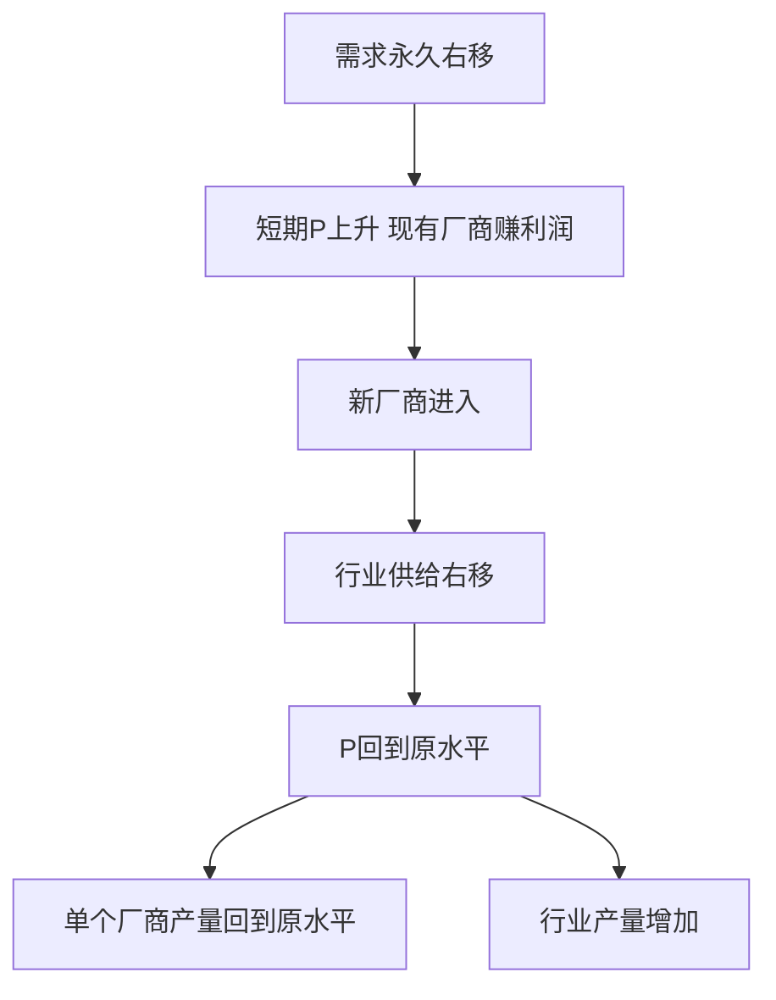
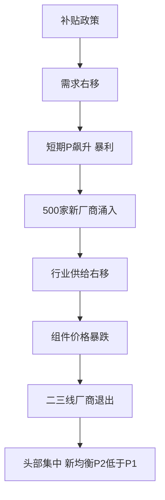

# 第四章 完全竞争市场 · 考研真题集（首经贸 801）

<a href="../../../exam.html" target="_blank" style="display:inline-block;padding:6px 16px;background:#2563eb;color:#fff;border-radius:6px;text-decoration:none;font-size:14px;">📝 开始做题</a>

> 本章共收录：简答题 8 道（每题 15 分）｜论述题 3 道（每题 30 分）
> 配套选择题见 [[选择题集|本章选择题集]]
> 对应大纲：西方微观第四章「完全竞争市场」全部四节

## 📋 本题集目录

### 简答题
1. [简述完全竞争市场的基本条件](#s1)
2. [为什么完全竞争厂商是"价格接受者"？其需求曲线有何特征](#s2)
3. [简述完全竞争厂商 AR、MR、P 三条收益曲线的关系](#s3)
4. [计算题：由 STC 函数与既定价格求利润最大化产量与盈亏状况](#s4)
5. [用图形说明完全竞争厂商短期均衡的五种情况](#s5)
6. [简述完全竞争厂商短期供给曲线的推导](#s6)
7. [简述完全竞争厂商长期均衡的条件及其经济含义](#s7)
8. [简述成本不变、成本递增、成本递减行业的长期供给曲线](#s8)

### 论述题
1. [评价完全竞争市场的资源配置效率](#l1)
2. [从完全竞争长期均衡看"零经济利润"是否意味着厂商亏损](#l2)
3. [结合中国粮食市场分析完全竞争特征与最低收购价政策](#l3)

---

## 一、简答题（每题 15 分，建议 450–700 字）

### 简答 1：简述完全竞争市场的基本条件。{#s1}

**【建议字数】450–700 字 ｜ 【建议时间】15 分钟 ｜ 【题型】概念简答**
**【考什么】** 对应知识点 [[知识点/KP01_完全竞争市场的特征|完全竞争市场的特征]]；题型属于概念简答。

**【答题框架】**
- 第 1 段：完全竞争市场的定义（2 分）
- 第 2 段：四个基本条件（8 分）
- 第 3 段：现实中是否存在（3 分）
- 第 4 段：小结（2 分）

**【参考答案】**

一、定义

完全竞争市场是指一种竞争不受任何阻碍和干扰、没有任何垄断因素的市场结构。在这种市场中，无数个买者和卖者共同决定市场价格，单个厂商只能接受这一价格。

二、四个基本条件

1. **市场上有大量的买者和卖者**。每个买者的购买量和每个卖者的销售量在整个市场中所占份额都微不足道，以至于任何一个人都无法通过自己的买卖行为影响市场价格。每个主体都是"价格接受者"（price taker）。
2. **市场上每一个厂商提供的产品都是完全同质的**。厂商之间的产品在质量、规格、商标、售后服务上毫无差别，以至于买者不会对任何一个卖者产生偏好，从而排除了垄断因素。
3. **所有资源可以完全自由流动**。厂商可以自由进入或退出该行业，劳动、资本等要素可以在行业间无障碍转移，不存在法律、技术、规模上的进入壁垒。
4. **市场信息是完全的**。买者和卖者都掌握与自己经济决策有关的一切信息，不会有任何人以高于市场价格购买或低于市场价格出售。

三、现实中是否存在

严格符合这四个条件的市场在现实生活中几乎不存在。农产品市场（如小麦、大米）最接近完全竞争：农户众多、产品同质、进出相对自由、信息较充分。微观经济学把完全竞争市场作为一个理想基准，用于衡量其他市场结构的效率损失。

四、小结

四个条件共同决定了完全竞争厂商是价格接受者、面临水平需求曲线，并最终在长期达到 $P=\min AC$、经济利润为零的均衡。

**【解析·得分点】** 采分点：①四个条件各 2 分（大量买卖者、产品同质、自由进出、信息完全）；②指出厂商是价格接受者（3 分）；③举农产品为例（2 分）；④小结（2 分）。易丢分：漏掉"产品同质"或"信息完全"其中一条。

**【生活实例】** 学校周边卖煎饼的小摊虽然多，但每家口味略有差异、顾客有偏好，更接近垄断竞争。真正接近完全竞争的是批发市场上的大蒜、白菜——谁家的蒜都一样，你不卖有人卖，价格由整个批发市场定。

**【双链接】** 🔗 [[知识点/KP01_完全竞争市场的特征|回知识点]] ｜ 📖 [[../../../原文件/经济学/西方经济学上册_微观_全书|原书·第四章第一节]]

---

### 简答 2：为什么完全竞争厂商是"价格接受者"？其面临的需求曲线有何特征？{#s2}

**【建议字数】450–700 字 ｜ 【建议时间】15 分钟 ｜ 【题型】原因分析**
**【考什么】** 对应知识点 [[知识点/KP02_完全竞争厂商的需求与收益|完全竞争厂商的需求与收益]]；题型属于原因分析。

**【答题框架】**
- 第 1 段：价格接受者的含义（3 分）
- 第 2 段：原因（5 分）
- 第 3 段：厂商需求曲线的形状（5 分）
- 第 4 段：与行业需求曲线的区别（2 分）

**【参考答案】**

一、价格接受者的含义

"价格接受者"是指单个厂商不能通过改变自己的产量来影响市场价格，只能按市场供求决定的价格出售产品。它定价的能力为零。

二、原因

1. 行业内厂商数量众多，单个厂商的产量占整个行业总产量的比重极小，即使该厂商把产量增加一倍或减少为零，对行业供给的影响也微乎其微，不足以引起市场价格变动；
2. 产品完全同质，买者对任何一家厂商的产品都没有偏好。如果某厂商把价格提高一分钱，顾客会全部转向其他厂商；它也没有动机降价，因为按市场价格它已经能卖掉全部产量；
3. 信息完全，买者清楚市场价格，不会接受更高价格。

三、厂商需求曲线的形状

在以产量为横轴、价格为纵轴的坐标中：
- 行业（市场）的需求曲线仍向右下方倾斜，符合需求定律；
- 但**单个完全竞争厂商面临的需求曲线是一条由市场均衡价格决定的水平线**。它表示：在既定价格下，厂商可以卖出任意数量的产品；一旦提价，需求量立即降为零。

四、与行业需求曲线的区别

行业需求曲线反映全体消费者对整个行业产品的购买意愿，向右下方倾斜；厂商需求曲线反映单个厂商在市场价格下能卖出的数量，是水平的。二者斜率截然不同，但在 $P=P^*$（市场均衡价格）处重合。

**【解析·得分点】** 采分点：①价格接受者定义（3 分）；②三个原因（5 分）；③厂商需求曲线水平（5 分）；④与行业需求曲线的区别（2 分）。易丢分：把行业需求曲线画成水平。

**【生活实例】** 一个种小麦的农民，无论他今年多卖还是少卖几千斤小麦，对全国小麦市场价都没有影响。他只能按国家粮油交易中心公布的价格卖——这就是价格接受者。

**【双链接】** 🔗 [[知识点/KP02_完全竞争厂商的需求与收益|回知识点]] ｜ [[知识点/KP01_完全竞争市场的特征|市场特征]] ｜ 📖 [[../../../原文件/经济学/西方经济学上册_微观_全书|原书·第四章第二节]]

---

### 简答 3：简述完全竞争厂商的平均收益 AR、边际收益 MR 与价格 P 三条曲线之间的关系。{#s3}

**【建议字数】450–700 字 ｜ 【建议时间】15 分钟 ｜ 【题型】关系对比**
**【考什么】** 对应知识点 [[知识点/KP02_完全竞争厂商的需求与收益|完全竞争厂商的需求与收益]]；题型属于关系对比。

**【答题框架】**
- 第 1 段：三个收益概念的定义（5 分）
- 第 2 段：三者重合的证明（6 分）
- 第 3 段：经济含义（4 分）

**【参考答案】**

一、三个收益概念

设总收益 $TR=P\cdot Q$，其中 $P$ 为市场既定价格：
- 总收益 $TR$：厂商按既定价格出售一定数量产品所获得的全部收入；
- 平均收益 $AR=\dfrac{TR}{Q}=\dfrac{P\cdot Q}{Q}=P$，即每单位产品的销售收入；
- 边际收益 $MR=\dfrac{\Delta TR}{\Delta Q}=\dfrac{d(PQ)}{dQ}$，即每多销售一单位产品所增加的收入。

二、三者重合的证明

在完全竞争市场中，厂商是价格接受者，$P$ 不随厂商产量 $Q$ 变化。因此：
$$MR=\frac{d(PQ)}{dQ}=P$$
同时 $AR=P$。于是：
$$AR=MR=P$$

几何上，厂商的需求曲线、AR 曲线、MR 曲线三条线完全重合，都是由市场价格决定的那条水平线。这条线既是厂商的需求曲线 $d$，也是平均收益曲线 AR，也是边际收益曲线 MR。

三、经济含义

1. $AR=P$ 对所有市场结构都成立（因为平均收益恒等于价格）；
2. 但 $MR=P$ 只在完全竞争市场成立。在垄断、垄断竞争等其他市场结构中，厂商面临向右下方倾斜的需求曲线，要多卖必须降价，因此 $MR<P$；
3. 正是因为 $MR=P$，完全竞争厂商利润最大化条件 $MR=MC$ 才简化为 $P=MC$，这是完全竞争市场效率分析的基础。

**【解析·得分点】** 采分点：①三个定义公式（5 分）；②推导 MR=P（6 分）；③指出 MR=P 只在完全竞争成立（4 分）。易丢分：以为 AR=P 是完全竞争独有。

**【生活实例】** 小麦市场价 1.5 元/斤。农民多卖一斤小麦，总收入多 1.5 元（MR=1.5），每斤平均收入也是 1.5 元（AR=1.5），价格也是 1.5 元（P=1.5）——三条线重合。

**【双链接】** 🔗 [[知识点/KP02_完全竞争厂商的需求与收益|回知识点]] ｜ 📖 [[../../../原文件/经济学/西方经济学上册_微观_全书|原书·第四章第二节]]

---

### 简答 4（计算题）：已知某完全竞争厂商的短期总成本函数为 $STC=Q^3-10Q^2+30Q+160$，产品市场价格 $P=50$。求：（1）利润最大化产量；（2）最大利润（或最小亏损）；（3）判断厂商是否应继续营业。{#s4}

**【建议字数】450–700 字 ｜ 【建议时间】15 分钟 ｜ 【题型】分析推导**
**【考什么】** 对应知识点 [[知识点/KP03_短期均衡与停止营业点|短期均衡与停止营业点]]；题型属于分析推导/计算。

**【答题框架】**
- 第 1 步：求 MC（3 分）
- 第 2 步：由 P=MC 解产量（5 分）
- 第 3 步：计算利润并与停止营业点比较（7 分）

**【参考答案】**

（1）利润最大化产量

完全竞争厂商利润最大化条件为 $P=MC$。由 STC 求导：
$$MC=\frac{dSTC}{dQ}=3Q^2-20Q+30$$
令 $P=MC$，即 $50=3Q^2-20Q+30$：
$$3Q^2-20Q-20=0$$
用求根公式：
$$Q=\frac{20+\sqrt{400+240}}{6}=\frac{20+\sqrt{640}}{6}\approx \frac{20+25.3}{6}\approx 7.55$$
取整数近似 $Q\approx 7.5$（考试中若数字不整，可保留根号或写 $Q=(10+\sqrt{160})/3$）。

（2）利润计算

$$TR=P\cdot Q=50\times 7.55\approx 377.5$$
$$STC=Q^3-10Q^2+30Q+160$$
代入 $Q=7.55$：
$$STC\approx 429-570+226.5+160\approx 245.5$$
$$\pi=TR-STC\approx 377.5-245.5\approx 132$$

（3）是否应继续营业

计算 AVC 最低点以判断停止营业点：
$$VC=Q^3-10Q^2+30Q,\qquad AVC=Q^2-10Q+30$$
令 $AVC=MC$：
$$Q^2-10Q+30=3Q^2-20Q+30\Rightarrow 2Q^2-10Q=0\Rightarrow Q=5$$
$$AVC_{\min}=25-50+30=5$$

市场价格 $P=50>AVC_{\min}=5$，厂商不仅应继续营业，而且获得正经济利润 132。

**【解析·得分点】** 采分点：①MC 求导正确（3 分）；②P=MC 列方程并解出 Q（5 分）；③利润=TR-STC（4 分）；④AVC 最低点用 AVC=MC 求出（3 分）。易丢分：忘记判断 P 与 AVC_min 的关系。

**【生活实例】** 这家奶茶店一杯卖 50 元（假设是高端款），每杯成本 32 元左右，卖 7-8 杯就赚钱。即使生意差、一杯只卖 5 元（AVC 最低点），也至少能摊房租。

**【双链接】** 🔗 [[知识点/KP03_短期均衡与停止营业点|回知识点]] ｜ 📖 [[../../../原文件/经济学/西方经济学上册_微观_全书|原书·第四章第三节]]

---

### 简答 5：用图形说明完全竞争厂商短期均衡的五种情况。{#s5}

**【建议字数】450–700 字 ｜ 【建议时间】15 分钟 ｜ 【题型】模型分析**
**【考什么】** 对应知识点 [[知识点/KP03_短期均衡与停止营业点|短期均衡与停止营业点]]；题型属于图形分析。

**【答题框架】**
- 第 1 段：均衡条件（3 分）
- 第 2 段：五种情况（8 分）
- 第 3 段：停止营业点（4 分）

**【参考答案】**

一、均衡条件

短期中，厂商在既定生产规模下，按 $MR=MC$（完全竞争下即 $P=MC$）决定产量。由于市场价格 $P$ 可能位于不同高度，短期均衡出现五种情况。

二、五种情况

在以产量 $Q$ 为横轴、价格/成本为纵轴的图上，画出 MC、AC、AVC 三条 U 形曲线，以及一条由市场价格决定的水平需求线 $d$：

1. **P > AC 最低点**：需求线位于 AC 最低点上方。$P=MC$ 决定的产量处，$P>AC$，厂商获得**正经济利润**（矩形面积 $\pi=(P-AC)\cdot Q$）。
2. **P = AC 最低点**：需求线恰好切于 AC 最低点。此时 $P=MC=AC$，经济利润为零，厂商获得**正常利润**。这一点称为盈亏平衡点（收支相抵点）。
3. **AVC 最低点 < P < AC 最低点**：需求线位于 AC 最低点下方、AVC 最低点上方。$P<AC$ 但 $P>AVC$，厂商亏损，但继续生产不仅能收回全部可变成本，还能补偿一部分固定成本，因此**应继续生产**，亏损额小于关门时的 FC。
4. **P = AVC 最低点**：需求线恰好切于 AVC 最低点。生产与关门都亏 FC，这一点称为**停止营业点**（shut-down point）。
5. **P < AVC 最低点**：需求线位于 AVC 最低点下方。生产连可变成本都收不回，生产比关门亏得更多，厂商应**立即停止营业**。

三、停止营业点

第 4 种情况的 AVC 最低点是关键阈值。价格高于此点，短期供给曲线沿 MC 向上延伸；低于此点，厂商供给为零。因此完全竞争厂商短期供给曲线就是 MC 曲线在 AVC 最低点以上的部分。

**【解析·得分点】** 采分点：①P=MC 均衡条件（3 分）；②五种情况各 1.6 分（8 分）；③盈亏平衡点与停止营业点（4 分）。易丢分：把"AVC<P<AC 时关门"这种错误观点写上去。

**【生活实例】** 一家小餐馆：午餐满座时（P>AC）赚钱；只收回菜钱房租亏一点（AVC<P<AC）时仍开门，因为房租已交、开门还能摊回一点；连菜钱都收不回（P<AVC）时就该关门了。

**【双链接】** 🔗 [[知识点/KP03_短期均衡与停止营业点|回知识点]] ｜ 📖 [[../../../原文件/经济学/西方经济学上册_微观_全书|原书·第四章第三节]]

---

### 简答 6：简述完全竞争厂商短期供给曲线是如何推导出来的。{#s6}

**【建议字数】450–700 字 ｜ 【建议时间】15 分钟 ｜ 【题型】分析推导**
**【考什么】** 对应知识点 [[知识点/KP03_短期均衡与停止营业点|短期均衡与停止营业点]]；题型属于推导分析。

**【答题框架】**
- 第 1 段：供给曲线的含义（2 分）
- 第 2 段：P=MC 决定产量（5 分）
- 第 3 段：AVC 最低点以上的部分（5 分）
- 第 4 段：行业短期供给曲线（3 分）

**【参考答案】**

一、供给曲线的含义

厂商的短期供给曲线表示：在其他条件不变时，对于每一个市场价格，厂商愿意并且能够提供的产量。它反映价格与最优产量之间的对应关系。

二、P=MC 决定产量

在完全竞争市场中，厂商按 $P=MC$ 决定利润最大化（或亏损最小化）产量。给定一个市场价格 $P_1$，作一条水平线与 MC 曲线相交，交点对应的产量 $Q_1$ 就是厂商在 $P_1$ 下愿意供给的数量。

随着市场价格从 $P_1$ 上升到 $P_2$、$P_3$，水平线依次上移，与 MC 曲线的交点对应的产量也依次增加。这一系列"价格—最优产量"组合点，恰好就是 MC 曲线上的点。

三、AVC 最低点以上的部分

但 MC 曲线有一段不能作为供给曲线：当市场价格低于 AVC 最低点时，厂商停止营业、供给为零。因此：
- **完全竞争厂商的短期供给曲线 = MC 曲线在 AVC 最低点以上的部分**；
- 它是一条向右上方倾斜的曲线，符合供给定律。

四、行业短期供给曲线

行业短期供给曲线由所有厂商短期供给曲线水平加总得到。在每一个价格下，把所有厂商愿意供给的产量相加，即得行业供给量。由于短期内厂商数量固定，行业短期供给曲线也是向右上方倾斜的。

**【解析·得分点】** 采分点：①供给曲线含义（2 分）；②P=MC 决定产量（5 分）；③MC 在 AVC 最低点以上（5 分）；④行业供给曲线是水平加总（3 分）。易丢分：把整条 MC 都说成供给曲线。

**【生活实例】** 大蒜价格涨到 5 元一斤时，每个蒜农都愿意多挖几亩；跌到 1 元时，连采摘工钱都不够，很多蒜农干脆让蒜烂在地里——供给曲线就是 MC 高出"采摘工钱线"的那一段。

**【双链接】** 🔗 [[知识点/KP03_短期均衡与停止营业点|回知识点]] ｜ 📖 [[../../../原文件/经济学/西方经济学上册_微观_全书|原书·第四章第三节]]

---

### 简答 7：简述完全竞争厂商长期均衡的条件，并说明其经济含义。{#s7}

**【建议字数】450–700 字 ｜ 【建议时间】15 分钟 ｜ 【题型】概念简答**
**【考什么】** 对应知识点 [[知识点/KP04_长期均衡与供给曲线|长期均衡与供给曲线]]；题型属于概念简答。

**【答题框架】**
- 第 1 段：长期调整的两个方面（4 分）
- 第 2 段：均衡条件（5 分）
- 第 3 段：经济含义（6 分）

**【参考答案】**

一、长期调整的两个方面

长期中，完全竞争厂商可以从两方面调整：
1. **调整生产规模**：选择最优工厂规模（即 SAC 与 LAC 相切的产量水平）；
2. **进入或退出行业**：当行业内经济利润为正时，新厂商进入；为负时，旧厂商退出。

二、均衡条件

经过长期调整，最终达到：
$$P=MR=SMC=LMC=SAC_{\min}=LAC_{\min}$$
其核心特征是：
1. 价格等于长期边际成本 $P=LMC$（效率条件）；
2. 价格等于长期平均成本最低点 $P=LAC_{\min}$（零经济利润条件）；
3. 此时选择的工厂规模恰好使 $SAC$ 与 $LAC$ 相切于 $LAC$ 最低点，$SMC=LMC$。

三、经济含义

1. **经济利润为零**：由于自由进出，任何正利润都会吸引新厂商进入、增加行业供给、压低价格，直到利润消失；任何亏损都会迫使厂商退出、减少供给、抬高价格，直到亏损消失。长期均衡时，厂商只获得正常利润。
2. **生产效率最高**：每个厂商都在 LAC 最低点生产，规模最优，资源利用最充分。
3. **配置效率最优**：$P=LMC$，价格等于边际成本，消费者支付的价格恰好等于生产的边际社会成本，不存在无谓损失。
4. **零利润不等于失败**：它意味着该行业已无法吸引新进入者，现有厂商的自有要素在其他用途上也只能赚到同样多的报酬。

**【解析·得分点】** 采分点：①长期调整两方面（4 分）；②均衡条件公式（5 分）；③零经济利润、生产效率、配置效率（6 分）。易丢分：把长期均衡条件只写成 P=MC，漏掉 P=LAC_min。

**【生活实例】** 大学门口的奶茶店：开学时生意火爆有利润，一年后门口又开了三家奶茶店，分流后每家的利润降到零——这就是自由进出带来的长期均衡。老板还在干，因为他去别处打工也只能赚这么多。

**【双链接】** 🔗 [[知识点/KP04_长期均衡与供给曲线|回知识点]] ｜ [[知识点/KP03_短期均衡与停止营业点|短期均衡]] ｜ 📖 [[../../../原文件/经济学/西方经济学上册_微观_全书|原书·第四章第四节]]

---

### 简答 8：简述成本不变行业、成本递增行业和成本递减行业的长期供给曲线形状。{#s8}

**【建议字数】450–700 字 ｜ 【建议时间】15 分钟 ｜ 【题型】概念简答**
**【考什么】** 对应知识点 [[知识点/KP04_长期均衡与供给曲线|长期均衡与行业供给曲线]]；题型属于概念简答。

**【答题框架】**
- 第 1 段：行业长期供给曲线的推导思路（3 分）
- 第 2 段：成本不变行业（4 分）
- 第 3 段：成本递增行业（4 分）
- 第 4 段：成本递减行业（4 分）

**【参考答案】**

一、推导思路

长期中，市场需求变化会引起行业产量变化，进而影响生产要素价格。根据要素价格是否随行业产量变化，行业长期供给曲线分为三种情况。

二、成本不变行业

**成本不变行业**是指行业产量变化引起的生产要素需求变化，不对要素价格产生影响。原因：该行业对要素的需求占要素市场的比重很小，要素供给曲线水平。

此时，市场需求增加导致短期价格上升、现有厂商获得正利润 → 新厂商进入、行业供给增加 → 价格回落到原 LAC 最低点水平。连接各长期均衡点，得到一条**水平线**。

几何上：成本不变行业长期供给曲线 $LS$ 是一条水平线，其高度等于 LAC 最低点。

三、成本递增行业

**成本递增行业**是指行业产量增加引起生产要素需求增加，导致要素价格上升。原因：该行业对某种稀缺要素（如土地、熟练工人）的需求较大，要素供给曲线向上倾斜。

此时，需求增加 → 短期价格上升 → 新厂商进入 → 要素价格上升 → 厂商成本曲线整体上移 → 新的长期均衡价格高于原价格。连接各长期均衡点，得到一条**向右上方倾斜**的长期供给曲线。

四、成本递减行业

**成本递减行业**是指行业产量增加反而使要素价格下降。原因：行业扩张带动了专业化要素供应、基础设施改善、集聚经济，使要素平均成本下降。

此时，需求增加 → 新厂商进入 → 要素价格下降 → 厂商成本曲线下移 → 新的长期均衡价格低于原价格。长期供给曲线**向右下方倾斜**。

五、小结

| 行业类型 | 要素价格变化 | 长期供给曲线形状 |
|---|---|---|
| 成本不变 | 不变 | 水平线 |
| 成本递增 | 上升 | 向右上方倾斜 |
| 成本递减 | 下降 | 向右下方倾斜 |

**【解析·得分点】** 采分点：①推导思路（3 分）；②三种行业要素价格变化（4 分）；③三种长期供给曲线形状（4 分）；④连接各长期均衡点（4 分）。易丢分：把成本递减行业的长期供给曲线画成向右上方倾斜。

**【生活实例】** 一家小印刷厂扩张不会影响纸张价格——成本不变。但北京周边的蔬菜种植行业扩张会推高蔬菜用地价格——成本递增。而深圳电子制造业集聚后，元器件供应链成熟、采购成本下降——成本递减。

**【双链接】** 🔗 [[知识点/KP04_长期均衡与供给曲线|回知识点]] ｜ 📖 [[../../../原文件/经济学/西方经济学上册_微观_全书|原书·第四章第四节]]

---

## 二、论述题（每题 30 分，建议 900–1200 字）

### 论述 1：试评价完全竞争市场的资源配置效率，并说明现实市场为何往往偏离这一理想状态。{#l1}

**【建议字数】900–1200 字 ｜ 【建议时间】30 分钟 ｜ 【题型】理论类**
**【考什么】** 跨 KP01（特征）、KP02（收益）、KP03（短期均衡）、KP04（长期均衡）；题型属于理论类。

**【答题框架】**
- 第 1 段：破题（4 分）
- 第 2 段：配置效率 P=LMC（8 分）
- 第 3 段：生产效率 P=LAC_min（8 分）
- 第 4 段：现实偏离（6 分）
- 第 5 段：中国实际与政策（4 分）

**【参考答案】**

一、破题

完全竞争市场是微观经济学衡量市场效率的"理想标尺"。长期均衡时，它同时满足配置效率与生产效率。但现实世界几乎不存在严格意义上的完全竞争，因此这一理想标尺主要用于判断其他市场结构的效率损失。

二、配置效率：P=LMC

配置效率的含义是：消费者为最后一单位产品支付的价格，恰好等于社会为生产这一单位产品所付出的边际成本。在长期均衡中：
$$P=LMC$$

- 若 $P>LMC$，说明消费者对额外一单位产品的评价高于其生产成本，社会应增产；
- 若 $P<LMC$，说明生产这一单位产品耗费的资源价值高于消费者评价，社会应减产；
- 完全竞争长期均衡恰好使二者相等，不存在无谓损失（deadweight loss）。

三、生产效率：P=LAC_min

生产效率的含义是：每一产量都以最低平均成本生产。完全竞争长期均衡时：
$$P=LAC_{\min}$$

- 每个厂商都在最优规模下生产，$SAC$ 与 $LAC$ 相切于 $LAC$ 最低点；
- 经济利润为零，消费者以最低可能价格购买产品；
- 不存在"X-非效率"（企业内部管理松弛），因为自由进出的竞争压力迫使厂商不断降本。

四、现实偏离

现实市场往往偏离完全竞争，主要原因有三：
1. **产品差异化**：绝大多数产品在质量、品牌、包装、服务上存在差异，厂商因此有一定定价能力（垄断竞争市场）；
2. **规模经济**：许多行业（汽车、芯片、电网）存在显著规模报酬递增，由少数大企业生产更有效率，完全竞争反而不经济（自然垄断）；
3. **进入壁垒**：专利、牌照、资本要求、网络效应使新厂商难以自由进入，在位厂商可以长期获得正利润。

这些偏离导致 $P>MC$，出现无谓损失，即市场失灵。

五、中国实际与政策

1. 中国的粮食市场最接近完全竞争，国家通过最低收购价政策保护农民，但长期看仍需推进市场化改革；
2. 对自然垄断行业（电网、铁路、自来水），政府通过价格管制、国有企业经营来逼近完全竞争的效率结果；
3. 对竞争性行业（家电、服装、互联网平台），政府通过反垄断、反不正当竞争法防止垄断势力形成，维持市场可竞争性；
4. 高质量发展的核心，就是在规模经济与竞争效率之间取得平衡，让"有效市场"与"有为政府"结合。

**【解析·得分点】** 采分点：①配置效率 P=LMC（8 分）；②生产效率 P=LAC_min（8 分）；③现实偏离三原因（6 分）；④中国政策（4 分）；⑤小结（4 分）。

**【生活实例】** 完全竞争就像理想体育比赛：所有选手装备一样、水平差不多、谁都能报名。现实比赛总有明星选手（垄断者）、赞助壁垒（专利）、装备差异（品牌），比赛结果自然不同。

**【双链接】** 🔗 [[知识点/KP04_长期均衡与供给曲线|长期均衡]] ｜ [[知识点/KP01_完全竞争市场的特征|市场特征]] ｜ 📖 [[../../../原文件/经济学/西方经济学上册_微观_全书|原书·第四章]]

---

### 论述 2：试分析完全竞争厂商长期均衡时"经济利润为零"是否意味着厂商亏损？这一结论对理解现实企业经营有何启示？{#l2}

**【建议字数】900–1200 字 ｜ 【建议时间】30 分钟 ｜ 【题型】理论类**
**【考什么】** 跨 KP04（长期均衡）+ 第三章成本概念（KP05）；题型属于理论类。

**【答题框架】**
- 第 1 段：破题（4 分）
- 第 2 段：经济利润与会计利润的区别（8 分）
- 第 3 段：正常利润的位置（8 分）
- 第 4 段：自由进出的机制（6 分）
- 第 5 段：现实启示（4 分）

**【参考答案】**

一、破题

许多初学者以为"长期均衡时经济利润为零"就是厂商不赚钱、应该关门。这是误解。要理解这一结论，必须回到第三章的成本概念——经济成本与会计成本不同。

二、经济利润与会计利润的区别

1. **会计利润** = 总收益 - 显成本（账簿上的支出）；
2. **经济利润** = 总收益 - 显成本 - 隐成本 = 总收益 - 机会成本。

隐成本包括：
- 老板自己投入资金本可获得的利息；
- 老板自己管理企业本可去别处打工的工资；
- 自有厂房若出租可获得的租金。

这些成本在会计账上不体现，但在经济学中必须补偿。

三、正常利润的位置

**正常利润**是指厂商对自己所提供的企业家才能的报酬，它属于隐成本的一部分。当经济利润为零时：
$$\text{总收益}=\text{显成本}+\text{隐成本}$$
$$\text{会计利润}=\text{隐成本}=\text{正常利润}$$

也就是说，厂商的会计利润恰好等于正常利润——老板自己拿了一份"市场工资"，没有多余的超额利润。因此厂商不会退出，因为他的自有要素在其他行业也只能赚到这么多。

四、自由进出的机制

为什么长期均衡时经济利润必然为零？
1. 若行业内经济利润为正（>0），说明留在本行业比去其他行业更赚，新厂商被吸引进入，行业供给增加、价格下降，直到利润消失；
2. 若经济利润为负（<0），说明留在本行业不如去其他行业，旧厂商退出，行业供给减少、价格回升，直到亏损消失；
3. 只有经济利润为零时，行业既无进入也无退出，达到长期均衡。

五、现实启示

1. 开一家餐馆，如果一年账面利润 20 万，但老板自己去打工能赚 15 万、投入的 50 万资金若理财能赚 3 万，那么经济利润 = 20 - 15 - 3 = 2 万。若开了三年后竞争加剧，账面利润降到 18 万，经济利润 ≈ 0，老板就该考虑转行；
2. 现实中，许多充分竞争的行业（服装、餐饮、理发）长期利润率确实接近零，老板只是给自己"发工资"；
3. 企业要获得正经济利润，必须通过技术创新、品牌差异化、成本领先，在竞争中暂时领先——但这种超额利润会被模仿者迅速侵蚀。

**【解析·得分点】** 采分点：①经济利润与会计利润公式（8 分）；②正常利润=隐成本（8 分）；③自由进出机制（6 分）；④现实例子（4 分）；⑤小结（4 分）。

**【生活实例】** 王同学毕业开奶茶店，一年账面赚 15 万。但他本来去互联网公司年薪 20 万——经济利润 = 15 - 20 = -5 万。看似赚钱，实际上还不如去打工。这就是经济利润为零或为负的现实含义。

**【双链接】** 🔗 [[知识点/KP04_长期均衡与供给曲线|长期均衡]] ｜ [[../03_生产与成本/知识点/KP05_成本概念|成本概念]] ｜ 📖 [[../../../原文件/经济学/西方经济学上册_微观_全书|原书·第四章第四节]]

---

### 论述 3：中国小麦、水稻等粮食市场最接近完全竞争。试结合完全竞争理论，分析国家粮食最低收购价政策的经济学逻辑，并说明其利弊。{#l3}

**【建议字数】900–1200 字 ｜ 【建议时间】30 分钟 ｜ 【题型】政策效应类**
**【考什么】** 跨 KP01（市场特征）、KP03（短期均衡）、KP04（长期均衡）；题型属于政策类/现象类。

**【答题框架】**
- 第 1 段：粮食市场的完全竞争特征（4 分）
- 第 2 段：无干预时的长期均衡（6 分）
- 第 3 段：最低收购价政策的经济学逻辑（8 分）
- 第 4 段：政策利弊（8 分）
- 第 5 段：改革方向（4 分）

**【参考答案】**

一、粮食市场的完全竞争特征

中国小麦、水稻市场几乎具备完全竞争的所有条件：
1. 农户数量庞大（数千万小农户），每户产量占全国比重微乎其微；
2. 同种粮食产品高度同质；
3. 农户进出种植业相对自由（虽然有土地承包约束）；
4. 信息较充分（国家粮油信息中心公布价格）。

因此，单个农户是价格接受者，市场价格由全国供求决定。

二、无干预时的长期均衡

在没有政府干预时：
- 若某年粮食丰收，供给曲线右移，市场价格下降；
- 当价格低于 AVC（如低于种植成本），部分农户第二年减少种植甚至退出；
- 长期均衡时 $P=\min AC$，农户只获得正常利润。

问题在于：粮食是需求价格弹性极低的必需品（ED<1），丰收时供给小幅增加会导致价格大幅下跌，"谷贱伤农"。

三、最低收购价政策的经济学逻辑

为保护农户收入，国家在粮食价格低于某一水平时按"最低收购价"敞开收购。其经济学逻辑：

1. **支持价格**：最低收购价 $P_f$ 高于市场均衡价格 $P^*$。在 $P_f$ 下，农户愿意供给 $Q_s$，消费者需求 $Q_d$，过剩供给 $Q_s-Q_d$ 由国家收购；
2. **保护农户收入**：$P_f$ 高于农户长期平均成本最低点，使农户获得正经济利润，鼓励种粮积极性；
3. **保障粮食安全**：通过维持种粮收益，稳定播种面积，避免粮食供给大幅波动；
4. **平滑周期**：国家收购的过剩粮食在歉年抛向市场，平抑价格。

四、政策利弊

利：
1. 稳定了农户收入，保障了国家粮食安全（中国人均耕地少，粮食安全是底线）；
2. 通过储备吞吐平抑了市场波动；
3. 避免了"谷贱伤农"引发的生产大幅倒退。

弊：
1. **财政负担**：国家每年需巨额财政资金收购、储存粮食；
2. **价格扭曲**：长期支持价格使农户缺乏降本动力，LAC 居高不下；
3. **库存积压**：最低收购价高于均衡价格，持续产生过剩供给，形成庞大库存；
4. **市场化改革滞后**：价格信号被政策掩盖，资源配置效率低于完全竞争理想状态。

五、改革方向

近年来，国家逐步推进粮食价格市场化改革：
1. 从"最低收购价"转向"目标价格补贴"——市场由供求决定，国家对低于目标价的部分直接补贴农户；
2. 推进农业现代化、规模化经营，降低 LAC；
3. 完善粮食储备体系，用储备吞吐替代长期价格支持。

这一改革的方向，正是在完全竞争效率与国家粮食安全之间寻求平衡。

**【解析·得分点】** 采分点：①粮食市场四特征（4 分）；②弹性低导致谷贱伤农（6 分）；③支持价格分析（8 分）；④利弊各 4 分（8 分）；⑤改革方向（4 分）。易丢分：只讲政策好处不讲弊端。

**【生活实例】** 今年大蒜大丰收，地头价从 5 元跌到 5 毛。蒜农一年白干。如果国家按 3 元收购，蒜农还能赚钱——但明年大家都种大蒜，过剩更严重，国库堆满大蒜。这就是最低收购价政策的两难。

**【双链接】** 🔗 [[知识点/KP01_完全竞争市场的特征|市场特征]] ｜ [[知识点/KP03_短期均衡与停止营业点|短期均衡]] ｜ [[知识点/KP04_长期均衡与供给曲线|长期均衡]] ｜ 📖 [[../../../原文件/经济学/西方经济学上册_微观_全书|原书·第四章]]

---

## 一、简答题（曲线移动补练）

### 简答 9：（曲线移动·分析）在成本不变的完全竞争行业中，市场需求一次性永久增加。请用"厂商短期均衡 → 行业长期均衡"两步图，分析价格、行业产量、单个厂商产量和厂商数在短期与长期的变化 {#s9}

**【建议字数】500–700 字 ｜ 【建议时间】15 分钟 ｜ 【题型】行业长短期调整**

**【考什么】** 对应知识点 [[知识点/KP04_长期均衡与供给曲线|长期均衡]]；题型属于需求永久扩张后的行业调整。

**【答题框架】**
- 第 1 段：短期——现有厂商沿 MC 上调产量（5 分）
- 第 2 段：长期——新厂商进入、行业供给右移（5 分）
- 第 3 段：长期均衡价格、产量、厂商数最终位置（5 分）

**【参考答案】**

一、初始长期均衡。行业 $D_1$ 与短期供给 $S_1$ 交于 $E_1$，价格 $P_1 = LAC_{min}$，行业产量 $Q_1$，单个厂商产量 $q_1$，经济利润为零。

二、短期调整。需求从 $D_1$ 右移到 $D_2$，短期内厂商数不变、行业短期供给 $S_1$ 不动 → 新短期均衡在 $E_s$，价格升到 $P_s > P_1$。每个现有厂商面对更高水平线 $P_s$，沿自身 MC 曲线向右下找 $P_s = MC$ 均衡点 → 单个厂商产量从 $q_1$ 增到 $q_s$。此时 $P_s > LAC_{min}$，现有厂商赚超额利润。

三、长期调整。超额利润吸引新厂商进入 → 行业短期供给曲线 $S$ 不断右移，直到 $S_2$ 与 $D_2$ 交于 $E_2$，价格回落到 $P_2 = P_1 = LAC_{min}$。此时单个厂商产量回到 $q_1$（因为价格回到原水平），但行业总产量 $Q_2 > Q_1$——多出来的产量全部由**新增厂商**提供。

四、数学推导。成本不变行业长期供给曲线 $LS$ 是水平线 $P = P^* = LAC_{min}$。需求 $D_1: Q = 100 - P$，原短期供给 $S_1: Q = -20 + 2P$。原均衡 $P_1 = 40, Q_1 = 60$。需求右移到 $D_2: Q = 160 - P$。短期 $S_1$ 不动 → 短期均衡 $160-P = -20+2P$ → $P_s = 60, Q_s = 100$。长期中 $S$ 右移直到 $P = 40$，新行业产量 $Q_2 = 160-40 = 120$。单个厂商产量回到原水平（$P=40$ 对应的 MC 均衡量），新增产量 $Q_2 - Q_1 = 60$ 由新厂商提供。

五、生活实例。2020 年奶茶需求爆发，大学城原有 10 家店短期涨价赚大钱；2021-2023 年蜜雪冰城、霸王茶姬、古茗疯狂开店到 50 家——奶茶价格回落到 12 元（原均衡价），但行业总杯数翻了好几倍。

**【解析·得分点】** 采分点：①短期 P 上升、单个厂商增产（5 分）；②新厂商进入、行业供给右移（5 分）；③长期 P 回到原水平、行业量增（5 分）。易丢分：说长期价格永久上升。

**【生活实例】** 2015 年外卖需求爆发，美团/饿了么短期补贴大战后商家赚翻；2018 年商家数量从 200 万涨到 800 万，单均利润从 5 元降到 1 元——长期供给右移把利润压回零。

---

## 二、论述题（曲线移动补练）

### 论述 4：（曲线移动·大模型）试用完全竞争行业长期均衡与长期供给曲线理论，分析中国光伏产业 2010-2025 年"暴利 → 产能过剩 → 价格血战 → 出海求生"的完整周期，并讨论为什么政府补贴反而加速了这一周期 {#l4}

**【建议字数】900–1200 字 ｜ 【建议时间】30 分钟 ｜ 【题型】行业周期 + 政策扭曲论述**

**【考什么】** 对应知识点 [[知识点/KP04_长期均衡与供给曲线|长期均衡]]、[[知识点/KP02_完全竞争厂商的需求与收益|厂商需求]]；题型属于行业长期调整的现实案例。

**【答题框架】**
- 第 1 段：起始点——2010 年光伏补贴政策与初始均衡（6 分）
- 第 2 段：补贴 → 短期暴利 → 大量新厂商进入（8 分）
- 第 3 段：长期供给右移 → 价格血战 → 部分厂商退出（8 分）
- 第 4 段：政府补贴如何扭曲了长期调整路径（8 分）

**【参考答案】**

一、初始状态。2010 年前中国光伏产业刚起步，行业长期均衡价格 $P_1 = LAC_{min}$，厂商数少，行业产量小。

二、补贴政策短期效应。2011 年起国家"金太阳工程"、光伏领跑者计划对下游电站补贴 → 国内光伏需求曲线 $D$ **右移**。短期行业供给 $S_1$ 不动 → 均衡价格飙升到 $P_s > P_1$，现有厂商赚超额利润（毛利率一度 50%+）。

三、长期进入与供给右移。暴利吸引大量新厂商进入：2010-2015 年中国光伏组件厂商从 50 家暴增到 500 家。行业短期供给曲线 $S$ **持续右移**，组件价格从 15 元/W 暴跌到 3 元/W。由于光伏是**成本递减行业**（干中学、规模经济），企业 LAC 本身也在下移，新长期均衡价格 $P_2 < P_1$——价格比补贴前还低。

四、产能过剩与出清。价格跌破大量二三线厂商的 LAC_min → 这些厂商亏损退出（2018 年"531 新政"后一年倒闭 100+ 家）。行业重新集中到隆基、通威、晶科等头部企业，长期均衡价格 $P_2$ 由头部企业的 LAC_min 决定。

五、政府补贴的扭曲作用。补贴本想扶持国内产业，但：① 补贴抬高了短期价格 $P_s$，给了所有进入者（包括低效率企业）错误信号，导致过度进入；② 地方政府为 GDP 招商引资，给低价土地、税收返还，使二三线企业的私人 LAC 低于社会 LAC——它们本不该进入，却靠补贴活了下来；③ 补贴退坡时（2018 年 531 新政），整个行业遭遇产能过剩、价格血战，中国光伏一度全行业亏损。

六、数学推导。设行业需求 $Q^d = 100 - P$，初始 $n_1=50$ 家相同厂商，单个供给 $q^s = -2 + P$，行业 $S_1: Q = -100 + 50P$。初始均衡 $100-P = -100+50P$ → $P_1 = 200/51 \approx 3.92$。补贴使需求右移到 $Q^d = 150 - P$。短期 $n=50$ 不变 → $150-P = -100+50P$ → $P_s = 250/51 \approx 4.90$。长期新厂商进入使 $n$ 增到 200 → $S_2: Q = -400 + 200P$。长期均衡 $150-P = -400+200P$ → $P_2 = 550/201 \approx 2.74$。价格从 3.92 短期涨到 4.90，长期跌到 2.74——这就是光伏价格曲线的数学解释。

**【解析·得分点】** 采分点：①补贴→需求右移（6 分）；②短期暴利→新厂商进入（8 分）；③长期供给右移→价格暴跌（8 分）；④补贴扭曲路径（8 分）。易漏：忽视成本递减行业 LS 向右下倾斜。

**【生活实例】** 2023 年光伏组件从 2 元/W 跌到 0.7 元/W，二三线厂商现金流断裂停产——不是它们技术差，是 2015 年暴利吸引了太多玩家，行业供给曲线右移速度远超需求增长，价格被打穿地板。

**【双链接】** 🔗 [[知识点/KP04_长期均衡与供给曲线|长期均衡]] ｜ [[知识点/KP02_完全竞争厂商的需求与收益|厂商需求]] ｜ 📖 [[../../../原文件/经济学/西方经济学上册_微观_全书|原书·第四章]]

---

