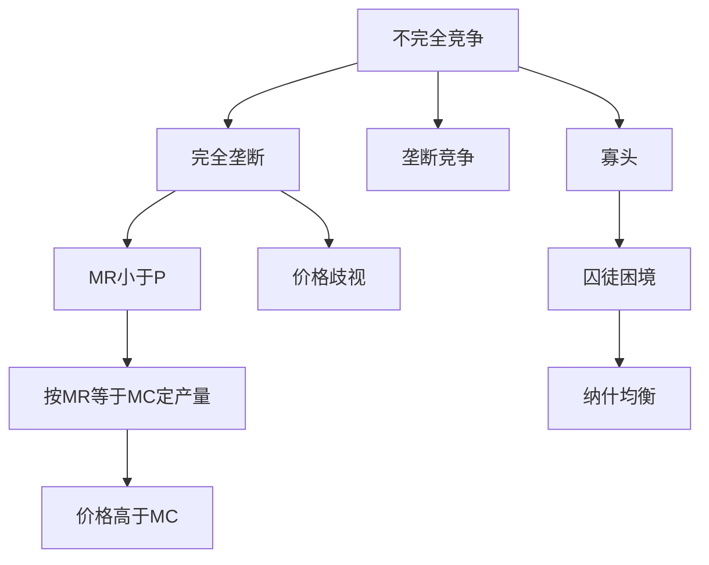

# 第五章 不完全竞争市场 章节总结

> 所属：[[../README|06 西方经济学]]

## 这一章在回答什么问题

当市场不是"无数小老板"时——一家独大（垄断）、几家联手（寡头）、品牌林立（垄断竞争）——价格怎么定？厂商还能像完全竞争那样只看 P = MC 吗？

## 核心概念清单

- **垄断**：唯一卖者，能定价格。
- **垄断竞争**：很多卖者，产品有差异（奶茶店）。
- **寡头**：少数几家互相牵制（航空、运营商）。
- **价格歧视**：同一种商品卖给不同人不同价。
- **囚徒困境**：寡头合作难，背叛是优势策略。

## 框架图

## 本章 KP 列表

- [[KP01_完全垄断市场|KP01 完全垄断市场]]
- [[KP02_垄断厂商的短期与长期均衡|KP02 垄断厂商的短期与长期均衡]]
- [[KP03_价格歧视|KP03 价格歧视]]
- [[KP04_垄断竞争市场|KP04 垄断竞争市场]]
- [[KP05_寡头市场与囚徒困境|KP05 寡头市场与囚徒困境]]
- [[KP06_不同市场结构比较|KP06 不同市场结构比较]]

## 与前后章的关系

第 4 章是理想基准，本章是现实世界。第 8 章讲这些不完全竞争导致的"市场失灵"。
