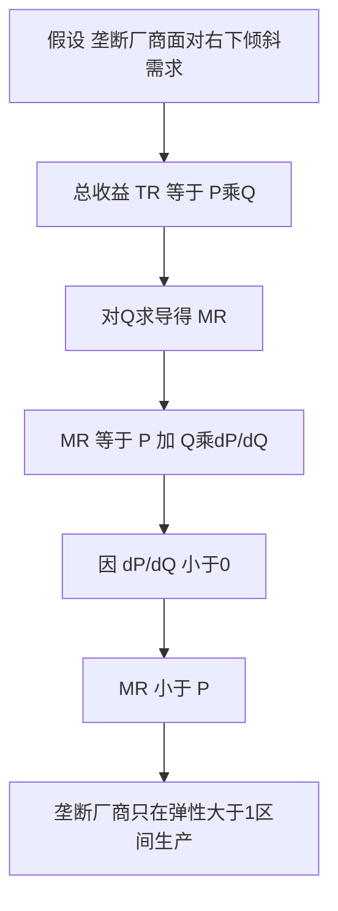

# KP01 完全垄断市场

<a href="../../../../exam.html" target="_blank" style="display:inline-block;padding:6px 16px;background:#2563eb;color:#fff;border-radius:6px;text-decoration:none;font-size:14px;">📝 开始做题</a>

> 所属：[[00_章节总结|第5章 不完全竞争市场]]

## 1. 一句话先懂（小白版）

整个城市只有一家自来水公司，你不喝也得喝——它想定什么价就定什么价。这就是垄断：**唯一卖者，没有替代品，别人进不来。**

## 2. 严格定义

**完全垄断（Monopoly）**：整个行业只有一个厂商，产品没有相近替代品，其他厂商无法进入。

**形成原因**：
1. **资源垄断**：独家控制关键资源（如南非钻石公司 De Beers）。
2. **政府特许**：专利、牌照（烟草、食盐）。
3. **自然垄断**：规模经济极强（自来水、电网），一家生产最划算。
4. **成本优势**：先行者成本远低于新进入者。

## 3. 垄断厂商的需求与收益

垄断厂商面对**整个市场的需求曲线**——向右下倾斜。

**关键结论**：垄断厂商的 **MR < P**。

为什么？垄断厂商要多卖一件，必须给所有商品降价。所以：
- 多卖一件多收 P 元（新增收益）。
- 但之前所有商品都要降价（损失）。
- 净收益 MR = P - 降价损失 < P。

## 4. 怎么用（手把手算）

**场景**：市场需求 $P = 100 - Q$。

**第一步**：写总收益：
$$TR = P \cdot Q = (100 - Q) Q = 100Q - Q^2$$

**第二步**：求 MR：
$$MR = \frac{dTR}{dQ} = 100 - 2Q$$

**第三步**：对比 P 和 MR。

| Q | P = 100-Q | TR = P·Q | MR = ΔTR/ΔQ |
|---|---|---|---|
| 0 | 100 | 0 | — |
| 10 | 90 | 900 | 90 |
| 20 | 80 | 1600 | 70 |
| 30 | 70 | 2100 | 50 |
| 40 | 60 | 2400 | 30 |

观察：MR = 100 - 2Q，P = 100 - Q，MR 永远比 P 小 Q。

## 理论推导（一步步推）

> 本节补充：垄断厂商 MR < P 这个结论，从什么假设出发，怎么一步步推出来的。

**假设起点**：
1. 垄断厂商是整个行业唯一卖者，面对**向右下倾斜的市场需求曲线** P = P(Q)——要多卖必须降价。
2. 厂商追求利润最大化，产量 Q 由自己决定。
3. 产品不能分割、不能转卖（否则顾客会套利）。

**推导过程**：
- 第一步：总收益 $TR(Q) = P(Q) \cdot Q$。价格 $P$ 不是常数，而是随 $Q$ 上升而下降的函数。
- 第二步：边际收益是总收益对产量的导数：
$$MR = \frac{dTR}{dQ} = \frac{d[P(Q)\cdot Q]}{dQ} = P(Q) + Q \cdot \frac{dP}{dQ}$$
- 第三步：因为需求曲线向右下倾斜，$\frac{dP}{dQ} < 0$。所以第二项 $Q \cdot \frac{dP}{dQ} < 0$。
- 第四步：代入得 $MR = P + (\text{负数}) < P$。
- 结论：**垄断厂商的边际收益永远小于价格**。多卖一件不仅要按新价格卖出这件（+P），还要把之前所有商品的价格都降下来（负损失）。

**对比完全竞争**：完全竞争厂商面对水平需求曲线，$\frac{dP}{dQ} = 0$，所以 $MR = P$。这是两者的根本区别。

## 数学推导（公式怎么来的）

> 每个符号第一次出现必须解释。

设市场反需求函数为线性形式（最常用）：
$$P = a - bQ$$
其中 $a$ 是需求曲线在纵轴的截距（价格为 0 时最大需求量对应的价格上限），$b > 0$ 是需求曲线斜率的绝对值，$Q$ 是产量。

**第一步：求总收益**
$$TR = P \cdot Q = (a - bQ)Q = aQ - bQ^2$$

**第二步：对 Q 求导得 MR**
$$MR = \frac{dTR}{dQ} = a - 2bQ$$

**第三步：对比 P 和 MR**
- 价格：$P = a - bQ$
- 边际收益：$MR = a - 2bQ$
- 两者在纵轴截距相同（都是 $a$），但 MR 的斜率是 $-2b$，是需求曲线斜率 $-b$ 的两倍。

**图形说明**：纵轴 P（价格），横轴 Q（数量）。需求曲线从 $(0, a)$ 出发以斜率 $-b$ 向右下倾斜；MR 曲线从同一点 $(0, a)$ 出发以斜率 $-2b$ 向右下倾斜，位于需求曲线下方。当 $Q = a/(2b)$ 时 $MR = 0$；当 $Q = a/b$ 时 $P = 0$。

**MR 与需求价格弹性的关系**（重要推论）：
$$MR = P\left(1 - \frac{1}{|E_d|}\right)$$
其中 $E_d = \frac{dQ}{dP}\cdot\frac{P}{Q}$ 是需求价格弹性。当 $|E_d| > 1$（富有弹性）时 $MR > 0$；当 $|E_d| = 1$ 时 $MR = 0$；当 $|E_d| < 1$（缺乏弹性）时 $MR < 0$。垄断厂商只在富有弹性的区间生产——这就是为什么垄断价格总落在需求曲线弹性大于 1 的部分。

**生活实例**：某城市只有一家网红蛋糕店，每天能卖 100 个蛋糕定价 50 元。想多卖 1 个到 101 个，必须把所有蛋糕降到 49.5 元。多卖这个蛋糕只多收 49.5 元，但之前 100 个每个少收 0.5 元共少收 50 元——净边际收益 = 49.5 - 50 = -0.5 元。所以它绝不会卖到 101 个。

## 5. 与完全竞争对比

| | 完全竞争 | 垄断 |
|---|---|---|
| 厂商数量 | 无数 | 1 |
| 需求曲线 | 水平 | 向右下倾斜 |
| MR 与 P | MR = P | MR < P |
| 定价权 | 无 | 有 |
| 长期利润 | 0 | > 0 |

## 6. 现实例子

- 自来水、电力、天然气（自然垄断）。
- 专利药（专利期内独家）。
- 地方铁路（资源垄断）。

## 7. 容易混淆什么

| 概念 | 区别 |
|---|---|
| 垄断 vs 寡头 | 独家 vs 少数几家。 |
| 自然垄断 vs 行政垄断 | 前者因规模经济；后者因政府特许。 |

---

## 🔗 相关知识点

**同章关联：** [[KP02_垄断厂商的短期与长期均衡|垄断均衡]] ｜ [[KP03_价格歧视|价格歧视]]

**跨章关联：** [[../../08_市场失灵与微观经济政策/知识点/KP01_垄断与政府管制|政府管制垄断]]

**📖 原书原文：** [[../../../../原文件/经济学/西方经济学上册_微观_全书#第一节 垄断|原书·第五章第一节]]

---

## 🐮 小白教程入门

> 看不懂下面这个KP？先看通俗版教程建立直觉：

- [[../../../../经济统计学论文从0基础到精通/13_微观经济学基础/10_完全垄断与价格歧视是什么|🐮 教程·完全垄断与价格歧视是什么]]

---

## 📝 考研真题（首经贸 801）

**配套主观题：** 见同目录 [[../考研真题集|本章考研真题集]]
**配套选择题：** 见同目录 [[../选择题集|本章选择题集]]

### 高频简答
- 简述完全垄断市场的特征及形成原因 → 见 [[../考研真题集#s1|真题集·简答]]

### 高频论述
- 试分析完全垄断的效率损失及其政府管制的对策 → 见 [[../考研真题集#l1|真题集·论述]]

### 易错选择
- 本知识点选择题见 [[../选择题集#KP01 完全垄断市场|选择题集]]
