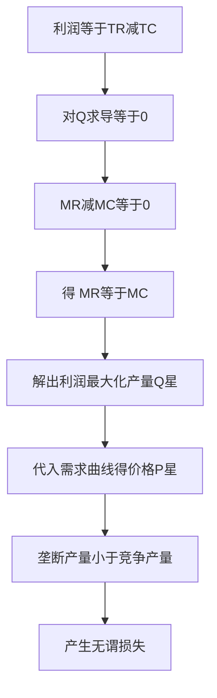

# KP02 垄断厂商的短期与长期均衡

<a href="../../../../exam.html" target="_blank" style="display:inline-block;padding:6px 16px;background:#2563eb;color:#fff;border-radius:6px;text-decoration:none;font-size:14px;">📝 开始做题</a>

> 所属：[[00_章节总结|第5章 不完全竞争市场]]

## 1. 一句话先懂（小白版）

垄断老板定价的步骤：先按"多卖一件的边际收益 = 多生产一件的边际成本"决定产量，再按这个产量从需求曲线上找最高价。**产量由 MR=MC 决定，价格由需求曲线决定。**

## 2. 严格定义

**垄断厂商利润最大化条件**：
$$MR = MC$$

但因为 MR < P，所以：
$$P > MC$$

这是垄断与完全竞争的根本区别——完全竞争 P = MC，垄断 P > MC。

## 3. 怎么用（手把手算）

**场景**：需求 $P = 100 - Q$，成本 $TC = 100 + 20Q$。

**第一步**：MR = 100 - 2Q（上一 KP 算过）。

**第二步**：MC = dTC/dQ = 20。

**第三步**：令 MR = MC：
$$100 - 2Q = 20$$
$$2Q = 80$$
$$Q^* = 40$$

**第四步**：代入需求曲线求价格：
$$P^* = 100 - 40 = 60$$

**第五步**：算利润。
- $TR = 60 \times 40 = 2400$
- $TC = 100 + 20 \times 40 = 900$
- $\pi = 2400 - 900 = 1500$

**对比完全竞争**（如果 P = MC）：
- 令 100 - Q = 20 → Q = 80，P = 20。
- 垄断者把产量从 80 压到 40，把价格从 20 抬到 60，赚走 1500。

## 理论推导（一步步推）

> 本节补充：垄断厂商按 MR = MC 定产量、再从需求曲线找价格，这个规则怎么推出来的。

**假设起点**：
1. 厂商目标是利润最大化，利润 $\pi(Q) = TR(Q) - TC(Q)$。
2. TR 是总收益（已知垄断厂商 $MR < P$），TC 是总成本。
3. 产量 Q 连续可微。

**推导过程**：
- 第一步：利润 $\pi(Q) = TR(Q) - TC(Q)$。
- 第二步：利润最大的一阶条件是导数为零：
$$\frac{d\pi}{dQ} = \frac{dTR}{dQ} - \frac{dTC}{dQ} = 0$$
- 第三步：即 $MR - MC = 0$，得 **$MR = MC$**。
- 第四步：二阶条件 $\frac{d^2\pi}{dQ^2} < 0$，要求 $MR$ 下降得比 $MC$ 快（即 $MR$ 曲线从上方穿过 $MC$ 曲线）。
- 第五步：找到 $Q^*$ 后，价格不是由 $MC$ 决定，而是由消费者愿意为这一产量付多少决定——即把 $Q^*$ 代入**需求曲线** $P = P(Q^*)$。
- 结论：**产量由 MR=MC 决定，价格由需求曲线决定**。这与完全竞争不同——完全竞争 P=MC 是因为 MR=P。

## 数学推导（公式怎么来的）

> 每个符号第一次出现必须解释。

设反需求函数 $P = a - bQ$，总成本 $TC = FC + cQ$（$FC$ 是固定成本，$c$ 是常数边际成本）。

**第一步：总收益**
$$TR = P\cdot Q = (a - bQ)Q = aQ - bQ^2$$

**第二步：MR**
$$MR = \frac{dTR}{dQ} = a - 2bQ$$

**第三步：MC**
$$MC = \frac{dTC}{dQ} = c$$

**第四步：令 MR = MC**
$$a - 2bQ = c$$
$$Q^* = \frac{a - c}{2b}$$

**第五步：代入需求曲线求 P**
$$P^* = a - b\cdot\frac{a-c}{2b} = a - \frac{a-c}{2} = \frac{a+c}{2}$$

**第六步：求利润**
$$\pi = P^*Q^* - TC(Q^*) = \frac{a+c}{2}\cdot\frac{a-c}{2b} - \left(FC + c\cdot\frac{a-c}{2b}\right)$$
$$= \frac{(a+c)(a-c)}{4b} - \frac{2c(a-c)}{4b} - FC = \frac{(a-c)^2}{4b} - FC$$

**对比完全竞争**（若按 P=MC 定价）：
- 竞争产量：令 $P = MC$，$a - bQ = c$，得 $Q_c = \frac{a-c}{b}$。
- 垄断产量：$Q_m = \frac{a-c}{2b}$，恰好是竞争产量的一半（在线性需求 + 常数 MC 下）。
- 垄断价格：$P_m = \frac{a+c}{2}$；竞争价格：$P_c = c$。

**无谓损失的数学表达**：垄断把产量从 $Q_c$ 压到 $Q_m$，在区间 $[Q_m, Q_c]$ 上，需求曲线（消费者边际评价）高于 MC（生产者边际成本），但这部分剩余没被实现。无谓损失三角形面积：
$$DWL = \frac{1}{2}(P_m - MC)\cdot(Q_c - Q_m) = \frac{1}{2}\left(\frac{a+c}{2} - c\right)\left(\frac{a-c}{b} - \frac{a-c}{2b}\right) = \frac{(a-c)^2}{8b}$$

**图形说明**：纵轴 P，横轴 Q。MR 曲线从 $(0,a)$ 以斜率 $-2b$ 下降；MC 是水平线 $c$。MR 与 MC 交点对应产量 $Q_m$；从 $Q_m$ 向上画垂直线与需求曲线交点对应垄断价格 $P_m$。需求曲线与 MC 交点对应完全竞争产量 $Q_c$。三角形 $(Q_m, Q_c)$ 之间、需求曲线与 MC 曲线之间的面积就是无谓损失。

**生活实例**：某城市只有一家出租车公司（牌照垄断）。需求 $P = 100 - Q$，每单成本 MC = 20。垄断产量 $Q_m = (100-20)/2 = 40$ 单，价格 $P_m = 60$ 元。若放开竞争，$Q_c = 80$ 单，$P_c = 20$ 元。本来可以有 41–80 单的乘客（愿意付 20–60 元）坐上便宜车，但垄断不让——这就是无谓损失。

## 4. 长期均衡

垄断厂商能长期保持利润，因为**别人进不来**。长期均衡仍然是 MR = LMC。

## 5. 垄断的效率损失

- 产量太少（Q=40 vs 社会最优 Q=80）。
- 价格太高（P=60 vs MC=20）。
- 产生**无谓损失（Deadweight Loss）**——本来可以成交但没成交的那部分。

## 6. 容易混淆什么

| 概念 | 区别 |
|---|---|
| 垄断均衡 vs 完全竞争均衡 | P > MC vs P = MC。 |
| 垄断利润 vs 经济利润 | 垄断长期经济利润 > 0；完全竞争长期 = 0。 |

## 7. 现实意义

- 为啥专利药贵？专利期内垄断，MR = MC 定产量，价格远高于成本。
- 为啥垄断企业要打广告？不是抢客户（没有对手），是培养偏好，把需求曲线外推。
- 为啥政府要反垄断？因为垄断导致无谓损失，社会效率低。

---

## 🔗 相关知识点

**同章关联：** [[KP01_完全垄断市场|垄断市场]] ｜ [[KP03_价格歧视|价格歧视]]

**跨章关联：** [[../../04_完全竞争市场/知识点/KP04_长期均衡与供给曲线|完全竞争长期均衡]] ｜ [[../../08_市场失灵与微观经济政策/知识点/KP01_垄断与政府管制|反垄断]]

**📖 原书原文：** [[../../../../原文件/经济学/西方经济学上册_微观_全书|原书·第五章第一节]]

---

## 🐮 小白教程入门

> 看不懂下面这个KP？先看通俗版教程建立直觉：

- [[../../../../经济统计学论文从0基础到精通/13_微观经济学基础/10_完全垄断与价格歧视是什么|🐮 教程·完全垄断与价格歧视是什么]]

---

## 📝 考研真题（首经贸 801）

**配套主观题：** 见同目录 [[../考研真题集|本章考研真题集]]
**配套选择题：** 见同目录 [[../选择题集|本章选择题集]]

### 高频简答
- 计算题：由线性需求函数与成本函数求垄断厂商利润最大化 P、Q、π → 见 [[../考研真题集#s3|真题集·简答]]

### 高频论述
- 试分析完全垄断的效率损失及其政府管制的对策 → 见 [[../考研真题集#l1|真题集·论述]]

### 易错选择
- 本知识点选择题见 [[../选择题集#KP02 垄断厂商的短期与长期均衡|选择题集]]
