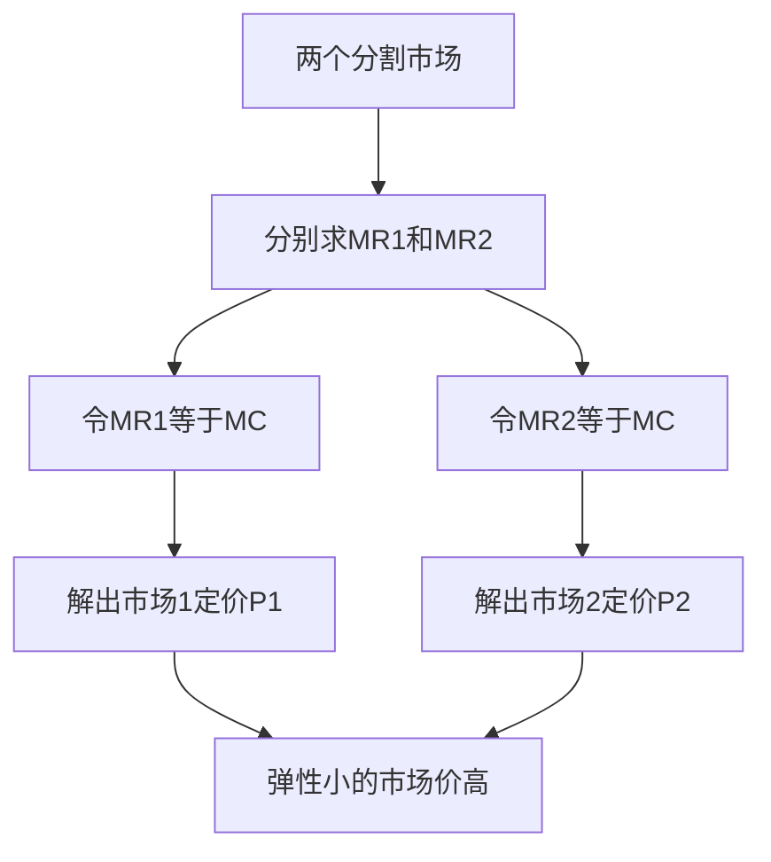

# KP03 价格歧视

<a href="../../../../exam.html" target="_blank" style="display:inline-block;padding:6px 16px;background:#2563eb;color:#fff;border-radius:6px;text-decoration:none;font-size:14px;">📝 开始做题</a>

> 所属：[[00_章节总结|第5章 不完全竞争市场]]

## 1. 一句话先懂（小白版）

同一杯奶茶：
- 学生凭学生证 8 折。
- 外卖平台会员减 5 元。
- 门店原价 20 元。

**同一种商品，卖给不同人不同价——这就是价格歧视。**

## 2. 严格定义

**价格歧视（Price Discrimination）**：垄断厂商在同一时间对同一种商品向不同购买者收取不同价格。

**三个条件**：
1. 厂商有定价权（不是完全竞争）。
2. 能区分不同消费者（或不同市场）。
3. 消费者不能转卖（套利）。

**三种类型**：
- **一级价格歧视**：按每个人的保留价（最高愿意付的价）收费。
- **二级价格歧视**：按购买量定价（量大优惠）。
- **三级价格歧视**：按人群/市场分价（学生票、成人票）。

## 3. 为什么（原理/机制）

- 普通统一定价：找一个 P，赚中间消费者的钱，剩余消费者（觉得贵的）不买。
- 价格歧视：把每个消费者的"剩余"都榨干。
- 对弹性小的人收高价（商务客），对弹性大的人收低价（游客）。

## 4. 怎么用（手把手算）

**场景**：高铁商务客（需求弹性小）和游客（弹性大）。

- 商务客需求：$P_1 = 1000 - Q_1$
- 游客需求：$P_2 = 500 - Q_2$
- MC = 100

**第一步**：分别按 MR = MC 定价。

商务客：
- $MR_1 = 1000 - 2Q_1 = 100 \Rightarrow Q_1 = 450$
- $P_1 = 1000 - 450 = 550$

游客：
- $MR_2 = 500 - 2Q_2 = 100 \Rightarrow Q_2 = 200$
- $P_2 = 500 - 200 = 300$

**结论**：商务票 550 元，游客票 300 元。总利润最大。

## 理论推导（一步步推）

> 本节补充：三级价格歧视为什么要求"两个市场的 MR 相等"，这个结论怎么推出来的。

**假设起点**：
1. 垄断厂商能把市场分割成两个（如成人/学生、商务/游客），且产品不能转卖（否则低买高卖套利）。
2. 两个市场需求曲线分别为 $P_1(Q_1)$ 和 $P_2(Q_2)$。
3. 厂商生产总成本 $TC(Q_1+Q_2)$，边际成本 MC 对两个市场相同（同一工厂生产）。

**推导过程**：
- 第一步：利润 $\pi = P_1(Q_1)Q_1 + P_2(Q_2)Q_2 - TC(Q_1+Q_2)$。
- 第二步：分别对 $Q_1$ 和 $Q_2$ 求偏导并令其为零：
$$\frac{\partial\pi}{\partial Q_1} = MR_1 - MC = 0$$
$$\frac{\partial\pi}{\partial Q_2} = MR_2 - MC = 0$$
- 第三步：联立得 **$MR_1 = MR_2 = MC$**。
- 第四步：含义——如果 $MR_1 > MR_2$，厂商应把一单位产量从市场 2 移到市场 1，总利润上升；直到两边 MR 相等为止。
- 结论：三级价格歧视的最优分配条件是两个市场边际收益相等且等于边际成本。

**为什么弹性小的市场定价高？** 由 $MR = P(1 - 1/|E_d|)$，令 $MR_1 = MR_2$：
$$P_1\left(1 - \frac{1}{|E_{d1}|}\right) = P_2\left(1 - \frac{1}{|E_{d2}|}\right)$$
若 $|E_{d1}| < |E_{d2}|$（市场 1 更缺乏弹性），则 $(1 - 1/|E_{d1}|) < (1 - 1/|E_{d2}|)$，所以必须 $P_1 > P_2$ 才能让两边 MR 相等。**需求弹性越小，定价越高。**

## 数学推导（公式怎么来的）

> 每个符号第一次出现必须解释。

设市场 1（商务客）反需求 $P_1 = a_1 - b_1 Q_1$，市场 2（游客）反需求 $P_2 = a_2 - b_2 Q_2$，常数边际成本 MC = c。

**第一步：分别求 MR**
$$MR_1 = a_1 - 2b_1 Q_1$$
$$MR_2 = a_2 - 2b_2 Q_2$$

**第二步：令 MR_1 = c，MR_2 = c**
$$Q_1^* = \frac{a_1 - c}{2b_1}, \quad P_1^* = \frac{a_1 + c}{2}$$
$$Q_2^* = \frac{a_2 - c}{2b_2}, \quad P_2^* = \frac{a_2 + c}{2}$$

**第三步：验证弹性与定价关系**

线性需求下，市场 1 在均衡点的需求价格弹性：
$$|E_{d1}| = \left|\frac{dQ_1}{dP_1}\cdot\frac{P_1}{Q_1}\right| = \frac{1}{b_1}\cdot\frac{(a_1+c)/2}{(a_1-c)/(2b_1)} = \frac{a_1+c}{a_1-c}$$

同理 $|E_{d2}| = \frac{a_2+c}{a_2-c}$。

若 $a_1 > a_2$（商务客支付意愿更高），则 $|E_{d1}|$ 与 $|E_{d2}|$ 的大小取决于截距。一般情况下，支付意愿截距高的市场，在均衡价格上的弹性更小，定价更高。

**对比统一定价**（若不能分割市场）：
- 总需求是两段需求曲线的水平加总。在高价段只有市场 1 购买；低价段两个市场都购买。
- 统一定价时厂商只能找到一个 P，结果是：要么损失游客（定价高），要么损失从商务客身上榨取的剩余（定价低）。分割市场能同时在两个 MR 曲线上达到 MR=MC，总利润更高。

**图形说明**：左图画市场 1（陡需求曲线，弹性小），右图画市场 2（平需求曲线，弹性大）。各自画 MR 曲线。同一水平线 MC 与两条 MR 的交点分别决定 $Q_1$、$Q_2$，再从各自需求曲线上读出 $P_1$、$P_2$。弹性小的市场需求曲线更陡，对应价格更高。

**生活实例**：同一趟高铁，商务客临出发前买票（支付意愿高、弹性小），游客提前一个月蹲打折票（支付意愿低、弹性大）。铁路总局把两个市场分开定价：商务票 800 元，提前购票 300 元。如果统一卖 500 元，商务客嫌便宜（本来愿意付 800）、游客嫌贵（只愿意付 300），两边都亏。

## 5. 现实例子

| 类型 | 例子 |
|---|---|
| 一级 | 二手车讨价还价、拍卖 |
| 二级 | 第二件半价、批发价 |
| 三级 | 学生票、老人票、机票差别定价 |

## 6. 容易混淆什么

| 概念 | 区别 |
|---|---|
| 价格歧视 vs 差别定价 | 同一种东西不同成本导致不同价不算歧视；同成本不同价才算。 |
| 三级歧视 vs 一级歧视 | 前者按人群分；后者按个人保留价。 |

## 7. 现实意义

- 为啥飞机票越早买越便宜？商务客（临期买票、弹性小）收高价，游客（提前规划、弹性大）收低价。
- 为啥电影院学生票半价？学生价格敏感。
- 为啥软件分家庭版/专业版？功能差别是假的，本质是按人群收费。

---

## 🔗 相关知识点

**同章关联：** [[KP02_垄断厂商的短期与长期均衡|垄断均衡]]

**跨章关联：** [[../../01_需求供给与均衡价格/知识点/KP04_需求价格弹性|弹性与定价]]

**📖 原书原文：** [[../../../../原文件/经济学/西方经济学上册_微观_全书|原书·第五章第二节]]

---

## 🐮 小白教程入门

> 看不懂下面这个KP？先看通俗版教程建立直觉：

- [[../../../../经济统计学论文从0基础到精通/13_微观经济学基础/10_完全垄断与价格歧视是什么|🐮 教程·完全垄断与价格歧视是什么]]

---

## 📝 考研真题（首经贸 801）

**配套主观题：** 见同目录 [[../考研真题集|本章考研真题集]]
**配套选择题：** 见同目录 [[../选择题集|本章选择题集]]

### 高频简答
- 计算题：三级价格歧视——两个市场需求函数，求各市场定价与产量 → 见 [[../考研真题集#s6|真题集·简答]]

### 高频论述
- 以机票、奶茶、软件为例，分析价格歧视在现实经济中的应用 → 见 [[../考研真题集#l2|真题集·论述]]

### 易错选择
- 本知识点选择题见 [[../选择题集#KP03 价格歧视|选择题集]]
