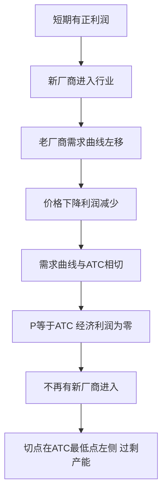

# KP04 垄断竞争市场

<a href="../../../../exam.html" target="_blank" style="display:inline-block;padding:6px 16px;background:#2563eb;color:#fff;border-radius:6px;text-decoration:none;font-size:14px;">📝 开始做题</a>

> 所属：[[00_章节总结|第5章 不完全竞争市场]]

## 1. 一句话先懂（小白版）

奶茶店街上一抓一把——蜜雪冰城、喜茶、一点点、茶百道……产品差不多但品牌、口味、位置有差异。每家店都有一点定价权，但又不能乱定（贵太多客人跑别家）。这就是垄断竞争。

## 2. 严格定义

**垄断竞争（Monopolistic Competition）**：许多厂商生产**有差别但相近**的产品，自由进出。

**特征**：
1. 厂商数量多。
2. 产品有差异（品牌、包装、位置、口味）。
3. 自由进出。
4. 厂商面对**向右下倾斜**但较平坦的需求曲线。

## 3. 短期与长期均衡

**短期**：类似垄断，按 MR = MC 定产量，P > MC，可能有正利润。

**长期**：新厂商进入 → 现有厂商需求曲线左移 → 直到 P = AC，经济利润 = 0。

**长期均衡点**：MR = MC，且 P = AC（相切）。注意此时 **P = AC > min(AC)**——厂商有过剩产能。

## 4. 怎么用（手把手算）

**场景**：某奶茶店需求 $P = 10 - 0.1Q$，成本 $TC = 100 + 2Q$。

**第一步**：MR = 10 - 0.2Q，MC = 2。

**第二步**：令 MR = MC：
$$10 - 0.2Q = 2 \Rightarrow Q = 40$$

**第三步**：P = 10 - 0.1×40 = 6。

**第四步**：AC = (100 + 2×40)/40 = 180/40 = 4.5。

**第五步**：短期利润 = (6 - 4.5) × 40 = 60。

**长期**：新奶茶店进入，本店需求左移，直到 P = AC，利润 = 0。

## 理论推导（一步步推）

> 本节补充：垄断竞争长期均衡为什么是"需求曲线与 AC 曲线相切"，以及新厂商进入如何让需求曲线左移。

**假设起点**：
1. 厂商生产有差异产品，面对向右下倾斜但较平坦的需求曲线。
2. 行业自由进出——短期有正利润时新厂商进入，亏损时旧厂商退出。
3. 厂商成本曲线 U 形（ATC 先降后升）。

**推导过程**：
- 第一步（短期）：厂商按 $MR = MC$ 定产量 $Q^*$，价格由需求曲线给出 $P = P(Q^*)$。此时利润 $\pi = (P - ATC)\cdot Q^*$，可能为正。
- 第二步（进入效应）：新厂商看到正利润进入行业。每家新厂商都分走一部分老厂商的顾客——在每一价格下，老厂商能卖出的数量减少。**老厂商的需求曲线向左移动**（不是沿需求曲线移动，是整条线左移）。
- 第三步（持续进入）：需求曲线不断左移，直到与 ATC 曲线**相切**。此时在最优产量处 $P = ATC$，经济利润 $\pi = 0$，新厂商不再进入。
- 第四步（长期均衡条件）：同时满足 $MR = MC$（利润最大化）和 $P = ATC$（经济利润为零、自由进出）。
- 结论：长期均衡点是需求曲线与 ATC 相切的切点，且该切点在 ATC 最低点的**左边**——厂商存在过剩产能。

**为什么切点在 ATC 最低点左边？** 因为需求曲线向右下倾斜，而 ATC 曲线 U 形。向右下倾斜的直线只能在 ATC 最低点左侧与其相切（在最低点相切要求需求曲线水平，即完全竞争）。

## 数学推导（公式怎么来的）

> 每个符号第一次出现必须解释。

设代表性厂商短期需求曲线 $P = A - bQ$（$A$ 是当前需求截距，随新厂商进入而下降），总成本 $TC = F + cQ + dQ^2$（$F$ 固定成本，$c$、$d > 0$）。

**第一步：MR 与 MC**
$$MR = A - 2bQ$$
$$MC = \frac{dTC}{dQ} = c + 2dQ$$

**第二步：令 MR = MC**
$$A - 2bQ = c + 2dQ$$
$$Q^* = \frac{A - c}{2(b+d)}$$

**第三步：短期价格**
$$P^* = A - bQ^* = A - \frac{b(A-c)}{2(b+d)} = \frac{A(b+2d) + bc}{2(b+d)}$$

**第四步：长期零利润条件 P = ATC**

平均成本 $ATC = \frac{F}{Q} + c + dQ$。长期均衡要求 $P^* = ATC(Q^*)$，即：
$$\frac{A(b+2d) + bc}{2(b+d)} = \frac{F}{Q^*} + c + dQ^*$$

当新厂商进入使 $A$ 下降到某一临界值 $A_{long}$ 时，上式成立。此时需求曲线与 ATC 相切。

**第五步：验证相切条件**

相切要求需求曲线斜率等于 ATC 曲线斜率：
$$\frac{dP}{dQ} = -b = \frac{dATC}{dQ} = -\frac{F}{Q^2} + d$$

解得长期产量：
$$Q_{long} = \sqrt{\frac{F}{b+d}}$$

**对比完全竞争**：完全竞争需求曲线水平（$b = 0$），长期均衡点在 ATC 最低点 $Q = \sqrt{F/d}$。垄断竞争 $b > 0$，长期产量 $Q_{long} = \sqrt{F/(b+d)} < \sqrt{F/d}$——产量小于最优规模，这就是"过剩产能"。

**图形说明**：纵轴 P/成本，横轴 Q。需求曲线 d（向右下倾斜）、MR 曲线（位于 d 下方）、MC 曲线（U 形）、ATC 曲线（U 形且在 MC 上方穿过最低点）。长期均衡时：d 与 ATC 相切；MR 与 MC 交点对应产量 $Q^*$；从 $Q^*$ 向上到切点对应价格 $P^*$。切点在 ATC 最低点左侧。

**生活实例**：大学城奶茶街。第一家奶茶店生意火爆（短期利润高），半年后冒出 5 家新店。每家店顾客被分流，需求曲线左移——同样定价 15 元，原来每天卖 200 杯，现在只卖 100 杯。直到每家店利润都薄到不值得再开新店为止。每家店都没开满产能（午晚高峰排队、其他时段空座）——这就是过剩产能。

## 5. 与完全竞争对比

| | 完全竞争 | 垄断竞争 |
|---|---|---|
| 产品 | 同质 | 有差别 |
| 需求曲线 | 水平 | 向右下倾斜 |
| 长期 P | = min(AC) | = AC > min(AC) |
| 过剩产能 | 无 | 有 |
| 广告 | 不需要 | 需要（打造差异） |

## 6. 现实意义

- 为啥奶茶店遍地开花但都不怎么赚钱？自由进出把利润抹平。
- 为啥奶茶店疯狂打广告？要把自己的产品和别家"区分开"，让需求曲线更陡。
- 为啥饭馆换招牌比换菜快？死了一批又开一批，长期利润趋零。

---

## 🔗 相关知识点

**同章关联：** [[KP01_完全垄断市场|垄断]] ｜ [[KP05_寡头市场与囚徒困境|寡头]]

**跨章关联：** [[../../04_完全竞争市场/知识点/KP04_长期均衡与供给曲线|完全竞争长期均衡]]

**📖 原书原文：** [[../../../../原文件/经济学/西方经济学上册_微观_全书|原书·第五章第三节]]

---

## 🐮 小白教程入门

> 看不懂下面这个KP？先看通俗版教程建立直觉：

- [[../../../../经济统计学论文从0基础到精通/13_微观经济学基础/11_寡头与囚徒困境是什么|🐮 教程·寡头与囚徒困境是什么（市场结构延伸）]]

---

## 📝 考研真题（首经贸 801）

**配套主观题：** 见同目录 [[../考研真题集|本章考研真题集]]
**配套选择题：** 见同目录 [[../选择题集|本章选择题集]]

### 高频简答
- 用图形说明垄断竞争厂商的短期与长期均衡 → 见 [[../考研真题集#s8|真题集·简答]]

### 高频论述
- 四种市场结构效率比较及其对中国产业政策的启示 → 见 [[../考研真题集#l4|真题集·论述]]

### 易错选择
- 本知识点选择题见 [[../选择题集#KP04 垄断竞争市场|选择题集]]
