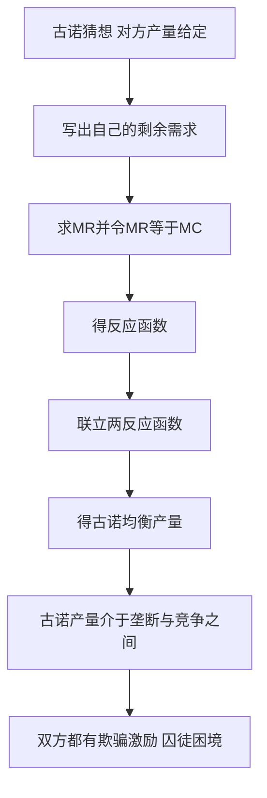

# KP05 寡头市场与囚徒困境

<a href="../../../../exam.html" target="_blank" style="display:inline-block;padding:6px 16px;background:#2563eb;color:#fff;border-radius:6px;text-decoration:none;font-size:14px;">📝 开始做题</a>

> 所属：[[00_章节总结|第5章 不完全竞争市场]]

## 1. 一句话先懂（小白版）

中国电信、中国移动、中国联通——三家巨头互相盯着。任何一家降价，另外两家立刻跟。每家都想合作（维持高价），但又怕对方偷偷降价抢客户。**这种"几家互相牵制"就是寡头。**

## 2. 严格定义

**寡头（Oligopoly）**：少数几家厂商控制整个行业，产品可以同质（钢铁）也可以有差异（汽车）。

**特征**：
1. 厂商数量少（3-5 家）。
2. 相互依存——一家决策直接影响别家。
3. 进入壁垒高。

**囚徒困境（Prisoner's Dilemma）**：博弈论经典模型——合作对双方都好，但每个人都有"背叛"的激励，结果达成"双输"的纳什均衡。

## 3. 怎么用（手把手算，囚徒困境矩阵）

**场景**：两家奶茶店 A 和 B，都选高价或低价。

| | B 高价 | B 低价 |
|---|---|---|
| **A 高价** | A 赚 10，B 赚 10 | A 赚 2，B 赚 15 |
| **A 低价** | A 赚 15，B 赚 2 | A 赚 5，B 赚 5 |

**第一步**：站在 A 角度。
- 如果 B 高价：A 选高价赚 10，选低价赚 15 → 选低价。
- 如果 B 低价：A 选高价赚 2，选低价赚 5 → 选低价。
- **A 的优势策略：低价**。

**第二步**：站在 B 角度。
- 同理，**B 的优势策略：低价**。

**第三步**：纳什均衡 = 双低价，各赚 5。

**但**：如果双方都选高价，各赚 10——比 5 好！这就是"困境"。

## 理论推导（一步步推）

> 本节补充：古诺模型均衡产量怎么推出来的，为什么双寡头均衡产量介于垄断与完全竞争之间。

**假设起点**（古诺模型）：
1. 两个厂商生产同质产品，同时决定产量 $q_1$、$q_2$，总产量 $Q = q_1 + q_2$。
2. 市场反需求函数 $P = a - bQ$。
3. 两厂商边际成本均为常数 c，无固定成本。
4. 每个厂商假定对方产量不变，据此选择自己的利润最大化产量（古诺猜想）。

**推导过程**：
- 第一步：站在厂商 1 角度，把 $q_2$ 视为给定。厂商 1 的剩余需求：
$$P = a - b(q_1 + q_2) = (a - bq_2) - bq_1$$
- 第二步：厂商 1 的边际收益（对 $q_1$ 求导）：
$$MR_1 = (a - bq_2) - 2bq_1$$
- 第三步：令 $MR_1 = MC = c$：
$$a - bq_2 - 2bq_1 = c$$
$$q_1 = \frac{a - c}{2b} - \frac{q_2}{2}$$
这是厂商 1 的**反应函数**——给定对手产量，自己最优产量是多少。
- 第四步：同理，厂商 2 的反应函数：
$$q_2 = \frac{a - c}{2b} - \frac{q_1}{2}$$
- 第五步：联立两个反应函数：
$$q_1 = \frac{a-c}{2b} - \frac{1}{2}\left(\frac{a-c}{2b} - \frac{q_1}{2}\right)$$
$$q_1 = \frac{a-c}{4b} + \frac{q_1}{4}$$
$$\frac{3}{4}q_1 = \frac{a-c}{4b}$$
$$q_1^* = \frac{a-c}{3b}$$
同理 $q_2^* = \frac{a-c}{3b}$。
- 第六步：总产量 $Q^* = q_1^* + q_2^* = \frac{2(a-c)}{3b}$，价格 $P^* = a - bQ^* = \frac{a+2c}{3}$。

**对比三种结果**（同一需求 P=a-bQ，MC=c）：
- 完全竞争：$P = c$，$Q_c = \frac{a-c}{b}$。
- 双寡头古诺：$Q_{Cournot} = \frac{2(a-c)}{3b}$，介于两者之间。
- 完全垄断（合谋）：$Q_m = \frac{a-c}{2b}$。

古诺产量 > 垄断产量但 < 竞争产量。寡头数目越多，总产量越接近完全竞争。

## 数学推导（公式怎么来的）

> 每个符号第一次出现必须解释。

**N 个厂商的古诺均衡**（推广）：

设 N 个对称厂商，每个厂商 i 的产量 $q_i$，总产量 $Q = \sum q_i$。

厂商 i 的剩余需求：$P = a - b(q_i + Q_{-i})$，其中 $Q_{-i} = \sum_{j\neq i} q_j$ 是其他厂商总产量。

厂商 i 的 MR：$MR_i = a - bQ_{-i} - 2bq_i$。

令 $MR_i = c$：
$$q_i = \frac{a-c}{2b} - \frac{Q_{-i}}{2}$$

由对称性，均衡时所有厂商产量相同 $q_i = q^*$，$Q_{-i} = (N-1)q^*$：
$$q^* = \frac{a-c}{2b} - \frac{(N-1)q^*}{2}$$
$$q^*\left(1 + \frac{N-1}{2}\right) = \frac{a-c}{2b}$$
$$q^* = \frac{a-c}{b(N+1)}$$

总产量：
$$Q^* = N q^* = \frac{N(a-c)}{b(N+1)}$$

**验证**：
- N = 1（垄断）：$Q^* = \frac{a-c}{2b}$，与垄断结果一致。
- N = 2（双寡头）：$Q^* = \frac{2(a-c)}{3b}$，与上面推导一致。
- N → ∞：$Q^* \to \frac{a-c}{b}$，趋近完全竞争。

**囚徒困境的数学表达**：

双寡头若合谋成垄断，总产量 $Q_m = \frac{a-c}{2b}$，每个厂商生产 $q_m = \frac{a-c}{4b}$，行业利润 $\pi_m = \frac{(a-c)^2}{4b}$，每个厂商分 $\pi_m/2 = \frac{(a-c)^2}{8b}$。

但给定对方生产 $q_m$，自己偷偷增产到反应函数最优点：
$$q_{cheat} = \frac{a-c}{2b} - \frac{q_m}{2} = \frac{a-c}{2b} - \frac{a-c}{8b} = \frac{3(a-c)}{8b}$$

此时总产量 $Q = \frac{a-c}{4b} + \frac{3(a-c)}{8b} = \frac{5(a-c)}{8b}$，价格 $P = a - bQ = \frac{3a+5c}{8}$。

欺骗者利润 > 合谋时的利润，而守约者利润下降。于是双方都有欺骗激励，均衡落到古诺双寡头产量——比合谋时产量更高、利润更低。这就是囚徒困境。

**图形说明**：在 (q1, q2) 坐标系中画两条反应函数曲线，交点即古诺均衡。囚徒困境用支付矩阵表示（已在"怎么用"中给出）。

**生活实例**：县城两家奶茶店。A 定高价时 B 偷偷降价抢客户赚更多；B 定高价时 A 也想偷偷降价。结果双方都定低价，利润比合谋定高价时少。2023 年新能源汽车价格战就是囚徒困境——比亚迪先降价，特斯拉跟进，所有人利润变薄。

## 4. 寡头模型

| 模型 | 假设 | 结果 |
|---|---|---|
| 古诺模型 | 同时定产量 | 介于垄断与完全竞争之间 |
| 斯塔克伯格模型 | 领导者先动 | 领导者占优 |
| 伯特兰模型 | 同时定价 | 价格战到 P = MC |
| 卡特尔 | 合谋 | 像垄断一样定价，但有背叛激励 |

## 5. 现实例子

- 航空业：油价涨时大家一起涨价，油价跌时谁都不敢先降。
- 运营商：话费套餐多年不变，新进入者（虚拟运营商）被夹击。
- OPEC：石油输出国组织合谋减产抬价，但成员国偷偷超产。

## 6. 容易混淆什么

| 概念 | 区别 |
|---|---|
| 寡头 vs 垄断竞争 | 几家 vs 很多家；互相依存 vs 独立决策。 |
| 纳什均衡 vs 帕累托最优 | 纳什均衡是"没人想单独改"；帕累托最优是"没人能更好而不损人"。囚徒困境的纳什均衡不是帕累托最优。 |

## 7. 现实意义

- 为啥寡头行业广告战激烈？谁都不想让对方抢客户。
- 为啥卡特尔难维持？每个成员都有偷偷降价的激励。
- 为啥政府要反垄断法？防止寡头合谋抬价。

---

## 🔗 相关知识点

**同章关联：** [[KP04_垄断竞争市场|垄断竞争]] ｜ [[KP06_不同市场结构比较|市场结构比较]]

**📖 原书原文：** [[../../../../原文件/经济学/西方经济学上册_微观_全书#第四节 博弈论和策略行为|原书·第五章第四节]]

---

## 🐮 小白教程入门

> 看不懂下面这个KP？先看通俗版教程建立直觉：

- [[../../../../经济统计学论文从0基础到精通/13_微观经济学基础/11_寡头与囚徒困境是什么|🐮 教程·寡头与囚徒困境是什么]]

---

## 📝 考研真题（首经贸 801）

**配套主观题：** 见同目录 [[../考研真题集|本章考研真题集]]
**配套选择题：** 见同目录 [[../选择题集|本章选择题集]]

### 高频简答
- 计算题：双寡头古诺模型，线性需求、MC=常数，求均衡产量 → 见 [[../考研真题集#s10|真题集·简答]]

### 高频论述
- 从寡头与囚徒困境视角分析中国新能源汽车价格战 → 见 [[../考研真题集#l3|真题集·论述]]

### 易错选择
- 本知识点选择题见 [[../选择题集#KP05 寡头市场与囚徒困境|选择题集]]
