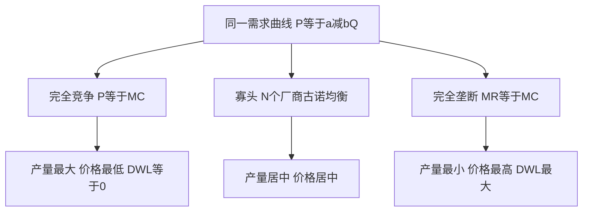

# KP06 不同市场结构比较

<a href="../../../../exam.html" target="_blank" style="display:inline-block;padding:6px 16px;background:#2563eb;color:#fff;border-radius:6px;text-decoration:none;font-size:14px;">📝 开始做题</a>

> 所属：[[00_章节总结|第5章 不完全竞争市场]]

## 1. 一句话先懂（小白版）

四种市场结构就像四种"战场"：完全竞争是菜市场小贩，垄断竞争是奶茶街，寡头是航空巨头，垄断是自来水公司。**越靠右，定价权越大，效率越低。**

## 2. 严格定义

四种市场结构对比表：

| | 完全竞争 | 垄断竞争 | 寡头 | 完全垄断 |
|---|---|---|---|---|
| 厂商数量 | 无数 | 很多 | 少数几家 | 1 |
| 产品 | 同质 | 有差别 | 同质或有差别 | 唯一 |
| 定价权 | 无（P 接受者） | 弱 | 中 | 强 |
| 需求曲线 | 水平 | 向右下倾斜（平坦） | 弯折或不确定 | 向右下倾斜（陡） |
| MR 与 P | MR = P | MR < P | MR < P | MR < P |
| 长期经济利润 | 0 | 0 | ≥ 0 | > 0 |
| P 与 MC | P = MC | P > MC | P > MC | P > MC |
| 效率 | 最高 | 较低 | 低 | 最低 |
| 现实例子 | 农产品 | 奶茶店、餐馆 | 航空、运营商 | 自来水、专利药 |

## 3. 效率排序

$$\text{完全竞争} > \text{垄断竞争} > \text{寡头} > \text{垄断}$$

- 越接近完全竞争，P 越接近 MC，无谓损失越小。
- 越接近垄断，P 越高、Q 越少、效率越低。

## 4. 怎么用（手把手算）

**场景**：同一行业需求 $P = 100 - Q$，MC = 20。

**完全竞争**（P = MC）：
- 100 - Q = 20 → Q = 80，P = 20。

**完全垄断**（MR = MC）：
- MR = 100 - 2Q = 20 → Q = 40，P = 60。

**对比**：
- 完全竞争：Q = 80，P = 20。
- 垄断：Q = 40，P = 60。
- 垄断导致产量减半、价格翻三倍。

## 理论推导（一步步推）

> 本节补充：为什么市场结构越接近垄断，产量越少、价格越高、无谓损失越大。用同一需求曲线对比四种结构。

**假设起点**：
1. 同一行业面对同一市场需求曲线 $P = a - bQ$。
2. 边际成本 MC = c（常数，简化）。
3. 不同市场结构的唯一区别是厂商的市场势力（定价权）。

**推导过程**：
- 第一步（完全竞争）：无数厂商，每家都是价格接受者。均衡条件 $P = MC$，即 $a - bQ = c$，解得 $Q_c = \frac{a-c}{b}$，$P_c = c$。此时消费者剩余最大，无谓损失为零。
- 第二步（垄断竞争）：短期类似垄断，长期自由进入使经济利润为零。产量 $Q_{moncomp} < Q_c$，价格 $P_{moncomp} > c$，但无谓损失较小（产品多样性带来的好处部分抵消）。
- 第三步（寡头古诺）：N 个厂商，总产量 $Q_{oligopoly} = \frac{N(a-c)}{b(N+1)}$。N 越大越接近完全竞争；N = 2 时 $Q = \frac{2(a-c)}{3b}$。
- 第四步（完全垄断）：一个厂商，按 $MR = MC$ 定产量 $Q_m = \frac{a-c}{2b}$，价格 $P_m = \frac{a+c}{2}$。产量最少、价格最高。
- 结论：产量排序 $Q_c > Q_{oligopoly} > Q_{moncomp} > Q_m$（粗略），价格反向，无谓损失反向递增。

**无谓损失的统一公式**：

在需求曲线 $P = a - bQ$、MC = c 下，任意产量 $Q$ 对应的无谓损失（三角形面积）：
$$DWL = \frac{1}{2}(P(Q) - c)\cdot(Q_c - Q)$$

- 完全竞争 $Q = Q_c$：DWL = 0。
- 双寡头 $Q = \frac{2(a-c)}{3b}$：DWL = $\frac{(a-c)^2}{18b}$。
- 完全垄断 $Q = \frac{a-c}{2b}$：DWL = $\frac{(a-c)^2}{8b}$，是双寡头的 $\frac{9}{4}$ 倍。

## 数学推导（公式怎么来的）

> 每个符号第一次出现必须解释。

**统一参数**：$a$（需求曲线纵截距）、$b$（需求曲线斜率绝对值）、$c$（常数边际成本）、$Q_c = \frac{a-c}{b}$（完全竞争产量）。

| 市场结构 | 产量 Q | 价格 P | 相对 Q_c | DWL |
|---|---|---|---|---|
| 完全竞争 | $\frac{a-c}{b}$ | $c$ | 100% | 0 |
| 双寡头古诺 | $\frac{2(a-c)}{3b}$ | $\frac{a+2c}{3}$ | 66.7% | $\frac{(a-c)^2}{18b}$ |
| 三寡头古诺 | $\frac{3(a-c)}{4b}$ | $\frac{a+3c}{4}$ | 75% | $\frac{(a-c)^2}{32b}$ |
| N 寡头古诺 | $\frac{N(a-c)}{b(N+1)}$ | $\frac{a+Nc}{N+1}$ | $\frac{N}{N+1}$ | $\frac{(a-c)^2}{2b(N+1)^2}$ |
| 完全垄断 | $\frac{a-c}{2b}$ | $\frac{a+c}{2}$ | 50% | $\frac{(a-c)^2}{8b}$ |

**推导 N 寡头 DWL**：
$P(Q) = a - b\cdot\frac{N(a-c)}{b(N+1)} = \frac{a+Nc}{N+1}$
$P - c = \frac{a+Nc}{N+1} - c = \frac{a-c}{N+1}$
$Q_c - Q = \frac{a-c}{b} - \frac{N(a-c)}{b(N+1)} = \frac{a-c}{b(N+1)}$
$$DWL = \frac{1}{2}\cdot\frac{a-c}{N+1}\cdot\frac{a-c}{b(N+1)} = \frac{(a-c)^2}{2b(N+1)^2}$$

**图形说明**：纵轴 P，横轴 Q。画一条向右下的需求曲线、一条水平线 MC=c。完全竞争均衡在需求曲线与 MC 交点；垄断均衡在 MR 与 MC 交点，再垂直到需求曲线。两者之间的三角形即无谓损失。寡头的 MR 曲线位置介于完全竞争（P=MR）与垄断（MR 在 P 下方一半处）之间。

**生活实例**：外卖配送费市场。
- 完全竞争：无数骑手自由接单，配送费 = 骑手边际成本 3 元。
- 双寡头（美团+饿了么）：各压一头，配送费 5 元，部分商家退出。
- 完全垄断：只有一个平台，配送费 8 元，大量小店倒闭。
市场越垄断，消费者花得越多、商家死得越多——这就是无谓损失。

## 5. 政府怎么应对

| 市场失灵类型 | 政策 |
|---|---|
| 垄断 | 反垄断法、价格管制 |
| 寡头合谋 | 禁止卡特尔、反不正当竞争 |
| 自然垄断 | 国有化或价格上限管制 |

## 6. 现实例子对应

- **菜市场小贩**：完全竞争。
- **奶茶店**：垄断竞争。
- **航空公司**：寡头。
- **国家电网**：完全垄断。

## 7. 容易混淆什么

| 概念 | 区别 |
|---|---|
| 垄断竞争 vs 寡头 | 厂商数量多 vs 少；独立决策 vs 互相依存。 |
| 效率 vs 公平 | 完全竞争效率高但可能分配不均；垄断利润大但无谓损失。 |

---

## 🔗 相关知识点

**同章关联：** [[KP01_完全垄断市场|垄断]] ｜ [[KP04_垄断竞争市场|垄断竞争]] ｜ [[KP05_寡头市场与囚徒困境|寡头]]

**跨章关联：** [[../../08_市场失灵与微观经济政策/知识点/KP01_垄断与政府管制|政府管制]]

**📖 原书原文：** [[../../../../原文件/经济学/西方经济学上册_微观_全书|原书·第五章第五节]]

---

## 🐮 小白教程入门

> 看不懂下面这个KP？先看通俗版教程建立直觉：

- [[../../../../经济统计学论文从0基础到精通/13_微观经济学基础/09_完全竞争市场是什么|🐮 教程·完全竞争市场是什么]]
- [[../../../../经济统计学论文从0基础到精通/13_微观经济学基础/10_完全垄断与价格歧视是什么|🐮 教程·完全垄断与价格歧视是什么]]
- [[../../../../经济统计学论文从0基础到精通/13_微观经济学基础/11_寡头与囚徒困境是什么|🐮 教程·寡头与囚徒困境是什么]]

---

## 📝 考研真题（首经贸 801）

**配套主观题：** 见同目录 [[../考研真题集|本章考研真题集]]
**配套选择题：** 见同目录 [[../选择题集|本章选择题集]]

### 高频简答
- 比较完全竞争、垄断竞争、寡头、完全垄断四种市场结构的效率 → 见 [[../考研真题集#s12|真题集·简答]]

### 高频论述
- 四种市场结构效率比较及其对中国产业政策的启示 → 见 [[../考研真题集#l4|真题集·论述]]

### 易错选择
- 本知识点选择题见 [[../选择题集#KP06 不同市场结构比较|选择题集]]
