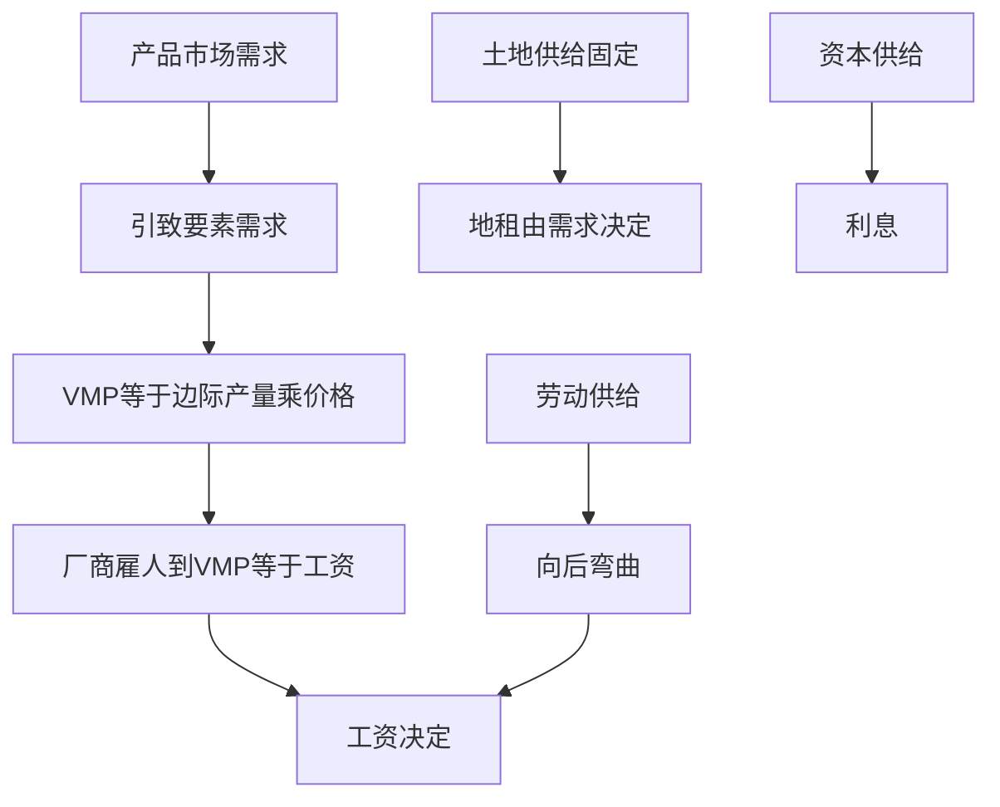

# 第六章 生产要素市场和收入分配 章节总结

> 所属：[[../README|06 西方经济学]]

## 这一章在回答什么问题

工资、地租、利息是怎么定出来的？为什么程序员比搬砖工工资高？为什么市中心房价贵？答案都在"要素市场"——劳动、土地、资本这些生产要素的价格决定。

## 核心概念清单

- **引致需求**：对要素的需求是由对产品的需求派生出来的。
- **边际生产力**：多雇一个工人带来的额外收益。
- **劳动供给**：工资高到一定程度，工人反而想休假（向后弯曲）。
- **地租**：土地供给固定，价格由需求单独决定。

## 框架图

## 本章 KP 列表

- [[KP01_引致需求与边际生产力|KP01 引致需求与边际生产力]]
- [[KP02_完全竞争厂商的要素需求|KP02 完全竞争厂商的要素需求]]
- [[KP03_劳动供给与工资决定|KP03 劳动供给与工资决定]]
- [[KP04_地租与利息|KP04 地租与利息]]

## 与前后章的关系

前面章节研究产品市场（奶茶多少钱），本章研究要素市场（做奶茶的工人多少钱）。第 7 章把两个市场同时放到一起。
