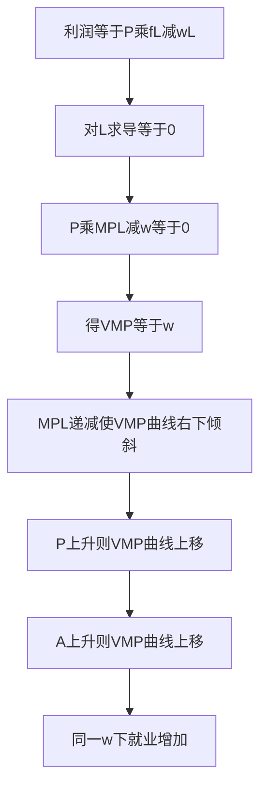

# KP01 引致需求与边际生产力

<a href="../../../../exam.html" target="_blank" style="display:inline-block;padding:6px 16px;background:#2563eb;color:#fff;border-radius:6px;text-decoration:none;font-size:14px;">📝 开始做题</a>

> 所属：[[00_章节总结|第6章 生产要素市场与收入分配]]

## 1. 一句话先懂（小白版）

老板为啥雇你？不是因为喜欢你，是因为你做的奶茶能卖钱。**对劳动的需求不是"想雇人"，而是"因为有人买奶茶才需要人"——这叫引致需求。**

## 2. 严格定义

**引致需求（Derived Demand）**：厂商对生产要素的需求，是由消费者对产品的需求派生出来的。

**边际产品价值（Value of Marginal Product, VMP）**：多投入一单位要素，所生产的额外产量按产品价格出售带来的收益。

$$VMP = P \cdot MP$$

其中 $P$ 是产品价格，$MP$ 是要素的边际产量。

**完全竞争厂商使用要素的原则**：
$$VMP = w$$

即"多雇一人带来的额外收益 = 工资"。

## 3. 为什么（原理/机制）

- 如果 VMP > w：多雇一人赚的比工资多，继续雇。
- 如果 VMP < w：多雇一人亏，裁人。
- 直到 VMP = w。

## 4. 怎么用（手把手算）

**场景**：奶茶店 P = 10 元/杯，工人边际产量：

| 工人 L | MP（杯/天） | VMP = P·MP（元） | 工资 w（元/天） |
|---|---|---|---|
| 1 | 10 | 100 | 150 |
| 2 | 8 | 80 | 150 |
| 3 | 5 | 50 | 150 |
| 4 | 3 | 30 | 150 |

**第一步**：找 VMP = w 的点。
- 工人 1：VMP = 100 < 150 → 不雇。
- 等等，这表有问题。换个工资 w = 80。

| 工人 L | VMP | w = 80 |
|---|---|---|
| 1 | 100 | 雇（100 > 80） |
| 2 | 80 | 雇（相等） |
| 3 | 50 | 不雇（50 < 80） |

**结论**：雇 2 个工人。

## 理论推导（一步步推）

> 本节补充：为什么完全竞争厂商使用劳动的原则是 VMP = w，这个等式怎么从利润最大化推出来。

**假设起点**：
1. 厂商在产品市场和要素市场都是完全竞争者——产品价格 P 给定，工资 w 给定。
2. 只投入一种可变要素劳动 L，生产函数 Q = f(L)。
3. 厂商追求利润最大化 $\pi(L) = P\cdot f(L) - w\cdot L$。

**推导过程**：
- 第一步：利润 $\pi(L) = P\cdot Q - wL = P\cdot f(L) - wL$。
- 第二步：对 L 求导并令其为零：
$$\frac{d\pi}{dL} = P\cdot\frac{df}{dL} - w = 0$$
- 第三步：$\frac{df}{dL}$ 就是劳动的边际产量 $MP_L$（多雇一人多生产多少杯奶茶）。
- 第四步：代入得 $P\cdot MP_L = w$，即 **VMP = w**。
- 第五步：二阶条件 $\frac{d^2\pi}{dL^2} = P\cdot\frac{d^2f}{dL^2} < 0$，要求 $MP_L$ 递减（边际报酬递减规律）。
- 结论：厂商雇人到"多雇一人带来的额外收益 VMP = 支付的工资 w"为止。

**为什么这就是要素需求曲线？** 在不同工资 w 下，方程 $P\cdot MP_L(L) = w$ 解出的 L 就是最优雇用量。由于 $MP_L$ 随 L 增加而递减，w 越低，能满足 $MP_L = w/P$ 的 L 越大——所以 VMP 曲线本身就是向右下倾斜的劳动需求曲线。

## 数学推导（公式怎么来的）

> 每个符号第一次出现必须解释。

设生产函数为柯布-道格拉斯形式（最常用）：
$$Q = A L^\alpha$$
其中 $A$ 是技术水平（$A>0$），$\alpha$ 是劳动的产出弹性（$0<\alpha<1$，保证边际报酬递减），$L$ 是劳动投入量。

**第一步：求 $MP_L$**
$$MP_L = \frac{dQ}{dL} = \alpha A L^{\alpha-1}$$

**第二步：求 VMP**
$$VMP = P\cdot MP_L = \alpha P A L^{\alpha-1}$$

**第三步：令 VMP = w，解出劳动需求函数**
$$\alpha P A L^{\alpha-1} = w$$
$$L^{\alpha-1} = \frac{w}{\alpha P A}$$
$$L = \left(\frac{w}{\alpha P A}\right)^{\frac{1}{\alpha-1}} = \left(\frac{\alpha P A}{w}\right)^{\frac{1}{1-\alpha}}$$

**第四步：分析比较静态**（什么因素让劳动需求曲线移动）：

1. **产品价格 P 上升**：$L = (\alpha PA/w)^{1/(1-\alpha)}$，P 在分子上 → 同一 w 下 L 增大 → **劳动需求曲线右移**。
2. **技术水平 A 上升**（技术进步）：A 在分子上 → 同一 w 下 L 增大 → **劳动需求曲线右移**。
3. **产出弹性 α 上升**（劳动更重要）：同样右移。
4. **工资 w 变化**：w 在分母上 → 沿需求曲线移动，不是线移动。

**第五步：劳动需求的工资弹性**

对 $L = (\alpha PA/w)^{1/(1-\alpha)}$ 取对数：
$$\ln L = \frac{1}{1-\alpha}(\ln\alpha + \ln P + \ln A - \ln w)$$

工资弹性：
$$E_{L,w} = \frac{\partial\ln L}{\partial\ln w} = -\frac{1}{1-\alpha}$$

$\alpha$ 越大（劳动在生产中越重要），弹性绝对值越大。

**图形说明**：纵轴工资 w，横轴劳动量 L。VMP 曲线（即劳动需求曲线）向右下倾斜——因为 $MP_L$ 递减。当 P 上升或 A 上升时，整条 VMP 曲线右移（上移）：在同一 L 下 VMP 更高，或在同一 w 下愿意雇更多 L。

**生活实例**：奶茶从 10 元涨到 15 元（P 上升），老板发现多雇一个学徒每天多做 80 杯，每杯赚 5 元毛利 → VMP = 400 元/天。在工资 200 元/天时，原来只愿雇 2 人，现在愿雇 4 人——劳动需求曲线右移了。这就是为什么"产品涨价"会带动"用工需求增加"。

## 5. 要素需求曲线

完全竞争厂商的要素需求曲线 = VMP 曲线（向右下倾斜，因为 MP 递减）。

## 6. 现实意义

- 为啥奶茶涨价时老板多招人？P 上升 → VMP = P·MP 上升 → 在同样工资下愿意雇更多人。
- 为啥技术进步让工资上涨？MP 上升 → VMP 上升 → 工资上升。
- 为啥经济衰退时裁员？产品卖不动 P 下降 → VMP 下降 → 裁员。

---

## 🔗 相关知识点

**同章关联：** [[KP02_完全竞争厂商的要素需求|要素需求]] ｜ [[KP03_劳动供给与工资决定|工资决定]]

**跨章关联：** [[../../03_生产与成本/知识点/KP02_边际报酬递减规律|边际报酬递减]]

**📖 原书原文：** [[../../../../原文件/经济学/西方经济学上册_微观_全书|原书·第六章第一节]]

---

## 🐮 小白教程入门

> 看不懂下面这个KP？先看通俗版教程建立直觉：

- [[../../../../经济统计学论文从0基础到精通/13_微观经济学基础/09_完全竞争市场是什么|🐮 教程·完全竞争市场是什么（相关延伸）]]

---

## 📝 考研真题（首经贸 801）

**配套主观题：** 见同目录 [[../考研真题集|本章考研真题集]]
**配套选择题：** 见同目录 [[../选择题集|本章选择题集]]

### 高频简答
- 简述引致需求的含义及其与产品需求的区别 → 见 [[../考研真题集#s1|真题集·简答 1]]
- 为什么厂商使用要素的原则是 VMP = w？若 VMP > w 应如何调整 → 见 [[../考研真题集#s3|真题集·简答 3]]

### 高频论述
- 结合平台经济用工现象，论述引致需求原理如何解释互联网行业高工资与"996"现象 → 见 [[../考研真题集#l2|真题集·论述 2]]

### 易错选择
- 本知识点选择题见 [[../选择题集#KP01 引致需求与边际生产力|选择题集·KP01]]
