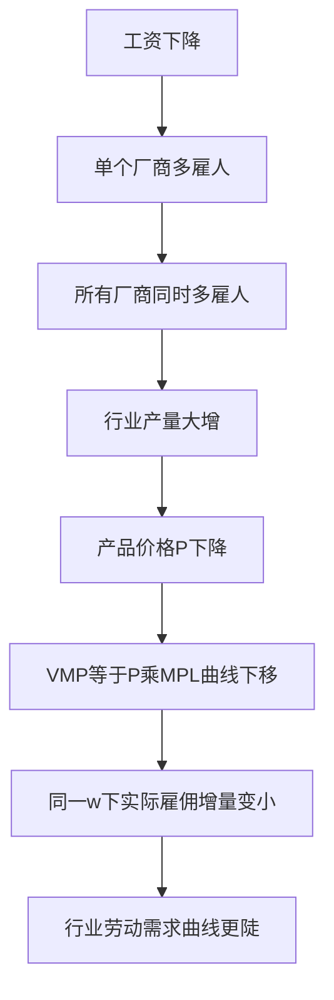

# KP02 完全竞争厂商的要素需求

<a href="../../../../exam.html" target="_blank" style="display:inline-block;padding:6px 16px;background:#2563eb;color:#fff;border-radius:6px;text-decoration:none;font-size:14px;">📝 开始做题</a>

> 所属：[[00_章节总结|第6章 生产要素市场与收入分配]]

## 1. 一句话先懂（小白版）

老板雇多少人？规则和产品市场一样：**雇到"多一个人带来的收益 = 工资"就停。**

## 2. 严格定义

**完全竞争厂商的要素需求原则**：
$$VMP = w$$

即 $P \cdot MP_L = w$。

**要素需求曲线**：VMP 曲线本身（向右下倾斜）。

## 3. 怎么用（手把手算）

**场景**：奶茶店 $P = 10$ 元，生产函数 $Q = 10\sqrt{L}$。

**第一步**：求 $MP_L$：
$$MP_L = \frac{dQ}{dL} = \frac{5}{\sqrt{L}}$$

**第二步**：VMP：
$$VMP = P \cdot MP_L = 10 \times \frac{5}{\sqrt{L}} = \frac{50}{\sqrt{L}}$$

**第三步**：令 VMP = w，求最优雇用量。

如果 w = 50：
$$\frac{50}{\sqrt{L}} = 50 \Rightarrow \sqrt{L} = 1 \Rightarrow L = 1$$

如果 w = 25：
$$\frac{50}{\sqrt{L}} = 25 \Rightarrow \sqrt{L} = 2 \Rightarrow L = 4$$

如果 w = 10：
$$\frac{50}{\sqrt{L}} = 10 \Rightarrow \sqrt{L} = 5 \Rightarrow L = 25$$

**观察**：工资越低，雇的人越多——要素需求曲线向右下倾斜。

## 理论推导（一步步推）

> 本节补充：为什么行业要素需求曲线比单个厂商 VMP 加总更陡（更缺乏弹性）。

**假设起点**：
1. 单个厂商是产品市场的价格接受者——P 给定，其 VMP = P·MP_L 不随自己雇多少人变化。
2. 但行业整体雇人增加时，行业产量增加 → 产品市场供给增加 → 产品价格 P 下降。
3. 单个厂商 VMP 曲线在 P 给定时是向右下倾斜的。

**推导过程**：
- 第一步（单个厂商）：工资 w 下降 → 单个厂商沿自身 VMP 曲线多雇人，产量增加。此时 P 不变（厂商太小）。
- 第二步（行业联动）：所有厂商同时因 w 下降而多雇人 → 行业总供给 Q 大幅增加 → 产品价格 P 下降。
- 第三步：P 下降使每家厂商的 VMP = P·MP_L 曲线**整体下移**（P 是乘数）。
- 第四步：在新的更低 P 下，同一 w 对应的最优雇用量比"P 不变时"少。
- 结论：行业要素需求曲线是每条 P 不同对应的 VMP 曲线的"包络线"，比单个厂商 VMP 加总更陡（弹性更小）。

**对比记忆**：
- 单个厂商劳动需求曲线：P 固定时的 VMP 曲线，较平坦。
- 行业劳动需求曲线：考虑 P 随行业雇佣量变化而下降后的"调整后 VMP"，更陡。

## 数学推导（公式怎么来的）

> 每个符号第一次出现必须解释。

设代表性厂商生产函数 $Q = A L^\alpha$，产品市场需求曲线 $P = a - bQ_{industry}$。

**第一步：单个厂商 VMP**
$$VMP_{firm} = P\cdot \alpha A L^{\alpha-1}$$

**第二步：给定 P 时，厂商劳动需求**
$$L_{firm} = \left(\frac{\alpha P A}{w}\right)^{\frac{1}{1-\alpha}}$$

**第三步：N 个相同厂商加总（P 不变假设）**
$$L_{industry}^{naive} = N\cdot \left(\frac{\alpha P A}{w}\right)^{\frac{1}{1-\alpha}}$$

**第四步：考虑 P 随行业产量变化**

行业总雇佣 $L_{ind} = N L$，行业总产量 $Q_{ind} = N\cdot A L^\alpha = N^{1-\alpha} A L_{ind}^\alpha$。

产品价格：
$$P = a - b Q_{ind} = a - b N^{1-\alpha} A L_{ind}^\alpha$$

代入 VMP = w：
$$P(L_{ind})\cdot \alpha A L_{ind}^{\alpha-1}/N^{\alpha-1} = w$$

**第五步：w 下降的影响对比**

- 若 P 不变（naive）：w 从 $w_1$ 降到 $w_2$，L 从 $L_1$ 升到 $L_2^{naive}$，变化大。
- 若 P 随 L 增加而下降：VMP 曲线下移，新均衡 L 升到 $L_2^{real} < L_2^{naive}$。

**工资弹性对比**：
- 单个厂商：$E = -1/(1-\alpha)$（弹性大）。
- 行业：因 P 下降抵消部分雇佣增加，弹性绝对值更小。

**图形说明**：纵轴 w，横轴 L。画两条 VMP 曲线：VMP1（P1 较高）、VMP2（P2 较低）。单个厂商劳动需求 = 给定 P 下的 VMP。行业需求曲线是连接"w1 下 L1（P1 对应）"和"w2 下 L2（P2 对应）"的线，因为 w 下降时 P 也下降，所以 L2 比"P 不变时"小。

**生活实例**：最低工资从 20 元/小时降到 15 元/小时。
- 单家奶茶店看：哇，工资便宜了，多雇 5 个学徒。
- 但所有奶茶店都多雇人，奶茶总供给暴增，从 10 元/杯降到 8 元/杯。
- 每杯奶茶毛利少了 2 元，单店 VMP 下降，实际只多雇了 2 个学徒。
这就是行业劳动需求比单店"想得少"的原因。

## 4. 行业要素需求曲线

行业要素需求不是单个厂商 VMP 的简单加总——因为行业扩产会压低产品价格 P，从而 VMP 整体下移。所以行业要素需求曲线比单个厂商加总更陡。

## 5. 现实意义

- 为啥最低工资法在小县城影响大？小厂商 VMP 低，工资一涨就雇不起人。
- 为啥大企业工资高？规模大，VMP 高（产品价格虽然一样，但 MP 因资本充足而高）。
- 为啥程序员工资远高于平均？MP 高（一个程序员做的产品卖几亿份）。

---

## 🔗 相关知识点

**同章关联：** [[KP01_引致需求与边际生产力|引致需求]] ｜ [[KP03_劳动供给与工资决定|劳动供给]]

**📖 原书原文：** [[../../../../原文件/经济学/西方经济学上册_微观_全书#第二节 要素供给的一般理论|原书·第六章第二节]]

---

## 🐮 小白教程入门

> 看不懂下面这个KP？先看通俗版教程建立直觉：

- [[../../../../经济统计学论文从0基础到精通/13_微观经济学基础/09_完全竞争市场是什么|🐮 教程·完全竞争市场是什么（相关延伸）]]

---

## 📝 考研真题（首经贸 801）

**配套主观题：** 见同目录 [[../考研真题集|本章考研真题集]]
**配套选择题：** 见同目录 [[../选择题集|本章选择题集]]

### 高频简答
- 推导完全竞争厂商对单一可变要素的需求曲线并说明其形状 → 见 [[../考研真题集#s2|真题集·简答 2]]
- 计算题：已知生产函数与产品价格求厂商要素需求量 → 见 [[../考研真题集#s8|真题集·简答 8]]
- 简述行业要素需求曲线与单个厂商要素需求曲线加总之间的关系 → 见 [[../考研真题集#s9|真题集·简答 9]]

### 高频论述
- 结合中国劳动力市场实际，论述最低工资制度对就业与收入分配的影响 → 见 [[../考研真题集#l1|真题集·论述 1]]

### 易错选择
- 本知识点选择题见 [[../选择题集#KP02 完全竞争厂商的要素需求|选择题集·KP02]]
